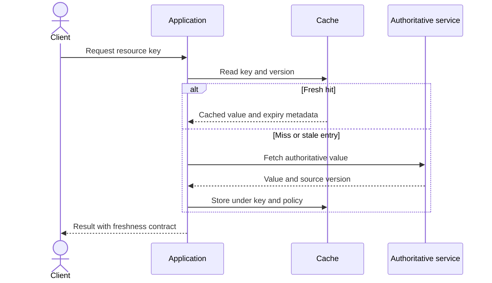
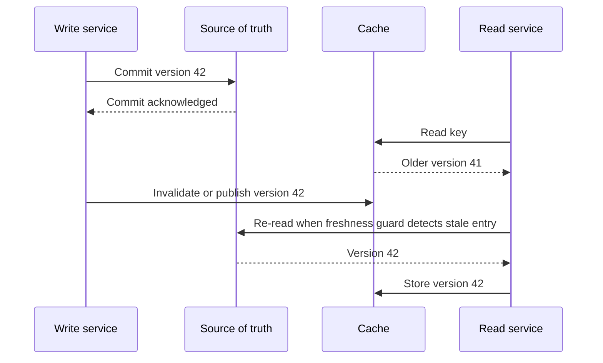
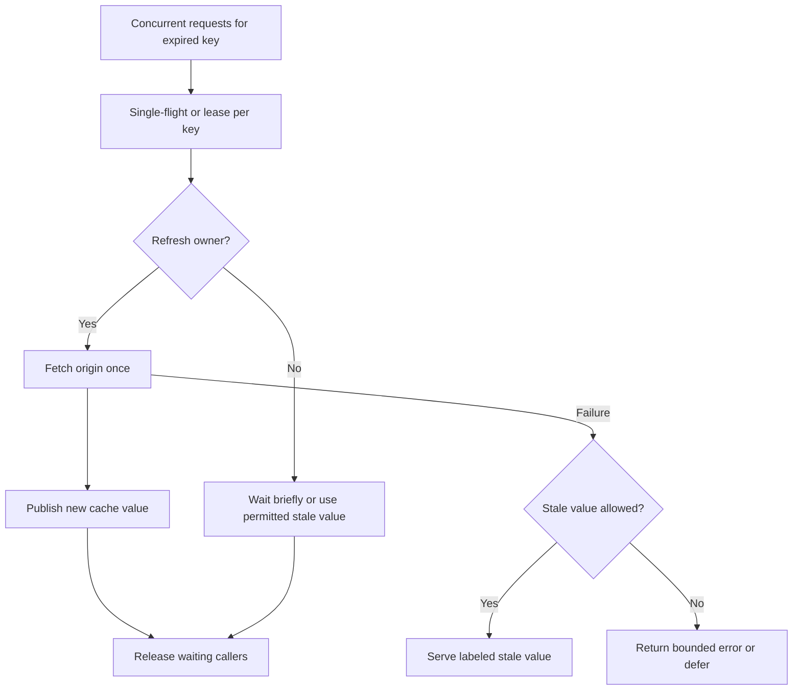
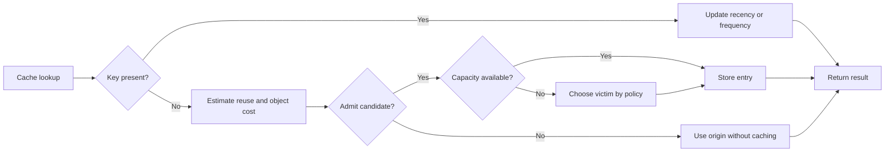
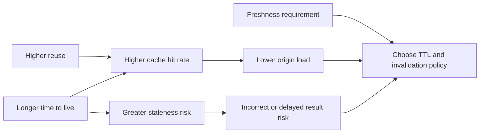

# Caching

Part: [19 — Performance Engineering](PART_OVERVIEW.md)

A cache stores a reusable result closer to its consumer to reduce latency, repeated work, or load on an origin. It is beneficial only when reuse outweighs lookup, storage, invalidation, and correctness costs. A high hit rate does not prove that the cache improves the user-visible objective or returns current and authorized data.

Part 19 owns workload-level cache selection and measurement. Part 06 owns database and storage cache mechanics; Part 05 CH09 owns content delivery network (CDN) behavior. This chapter focuses on deciding where and how caching improves a workload.

## Select a Cache From Reuse and Freshness

Estimate request frequency, key cardinality, result size, recomputation cost, acceptable staleness, and invalidation ability. Cache stable, expensive-to-compute results with useful reuse. Avoid caching high-cardinality one-off inputs unless they reduce repeated work or protect a costly dependency. Define the freshness contract by data type: product images, account balances, and policy rules have different tolerance for staleness.

Cache-aside gives the application control over population and fallback but can duplicate logic. Read-through hides lookup from callers but couples them to cache behavior. Write-through updates the cache as part of a write path; write-behind defers origin persistence and adds durability risk. Choose the pattern based on consistency and failure semantics, not just code convenience.

## Define Invalidation and Staleness Behavior

Invalidation is a correctness problem. Time-to-live expiry bounds age but does not guarantee freshness; event-driven invalidation can be faster but may lose events or race with concurrent writes. Versioned keys avoid some overwrite races by making data identity explicit. Define behavior when invalidation fails, when a cache entry is older than allowed, and whether stale data may be served during an origin outage.

The sequence exposes a race between source commit and cache invalidation. If stale reads are unacceptable, use a consistency mechanism that closes or detects the gap, such as version checks or a read-after-write bypass. If bounded staleness is acceptable, document the bound and measure how often it is exceeded.

## Prevent Cache Stampedes

When a popular key expires, many callers may recompute it simultaneously and overload the origin. Techniques include request coalescing, early refresh, stale-while-revalidate, randomized expiry, and bounded concurrency. These techniques trade freshness and complexity differently; serving stale data is appropriate only when the consumer can tolerate it.

The coalescing key must include every input that changes the result, including tenant, authorization scope, locale, and version. Otherwise a stampede fix can create a data-isolation bug. Bound waiters and refresh time; if the origin fails, avoid a synchronized retry wave.

## Choose Eviction Under Memory Pressure

Caches have finite capacity. Least Recently Used (LRU), Least Frequently Used (LFU), time-based expiry, and size-aware admission suit different access patterns. LRU is effective when recent access predicts reuse; LFU can retain popular keys despite bursts; admission policies can reject one-off scans. Workload traces and memory cost should guide policy.

Track both item count and bytes; a few large values can exhaust memory before a key-count limit is reached. Avoid unbounded key cardinality and account for per-entry metadata, replication, and serialization overhead. Eviction that causes origin overload can become a feedback loop, so test under capacity pressure.

## Measure Hit Rate Against Freshness

Hit rate is hits divided by eligible lookups, but the denominator must be defined. A cache may report a high hit rate by serving stale entries or by excluding bypass traffic. Also measure latency saved, origin work avoided, bytes, refresh failures, stale responses, evictions, and correctness violations. Compare against a baseline at equivalent load.

The diagram shows why a hit-rate target cannot select a time-to-live by itself. Optimize under the freshness and authorization contract, then validate origin protection and latency under realistic traffic. Reassess after key distribution, source update frequency, or workload mix changes.

## Worked Case: Product Catalog

Product descriptions and images are requested frequently and change infrequently. The application caches them by product and version, while inventory quantity remains on a shorter freshness policy. A product update publishes an invalidation event; if delivery fails, a bounded time-to-live limits staleness and a version check detects old entries. Cache keys include locale and market so content cannot cross those scopes.

During a campaign, a popular item expires across many application instances. Request coalescing limits refresh to one origin call per scoped key. The service serves a slightly stale description during a brief catalog outage but never serves stale price or inventory beyond its stricter rule. The team measures origin load, p95 latency, stale-response age, and campaign-period correctness, not only aggregate hit rate.

## Review Questions

1. What reuse and freshness evidence justifies caching a result?
2. How can a source write race with cache invalidation?
3. Which stampede technique preserves the required correctness contract?
4. How does eviction policy affect origin load and tail latency?
5. Which metrics distinguish a useful hit from an incorrect stale response?

Caching is a consistency and capacity decision as much as a speed optimization. Choose it from reuse and freshness requirements, design invalidation and failure behavior explicitly, control stampedes and memory pressure, and measure improvement against user and origin objectives.
