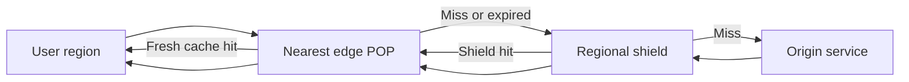
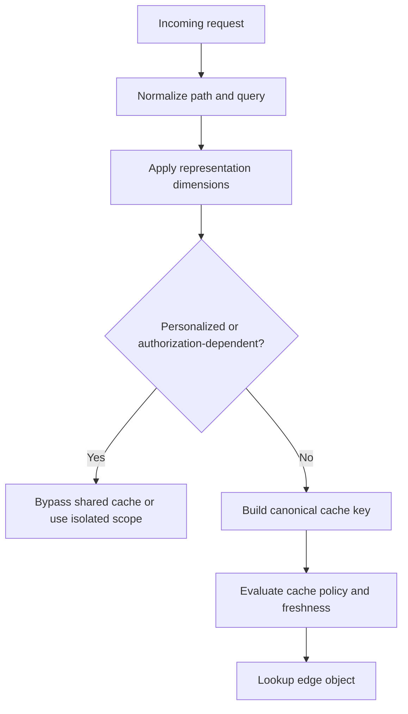
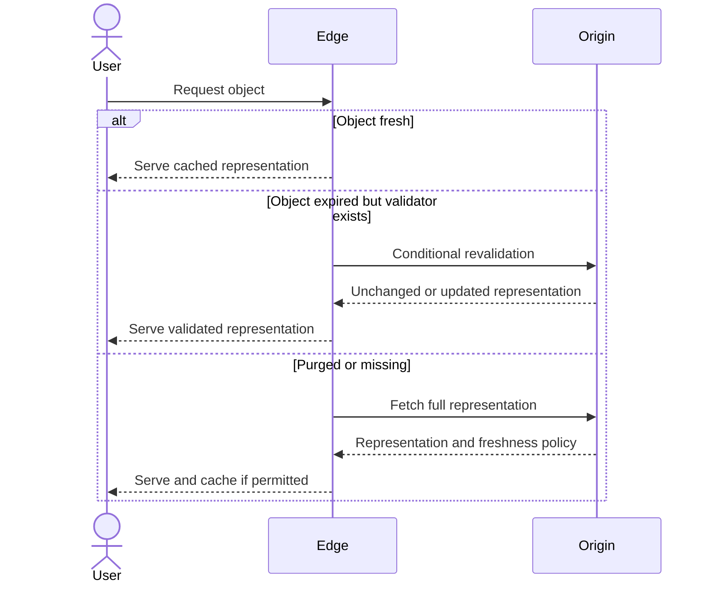
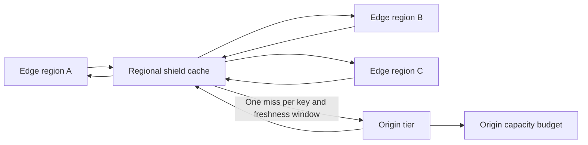
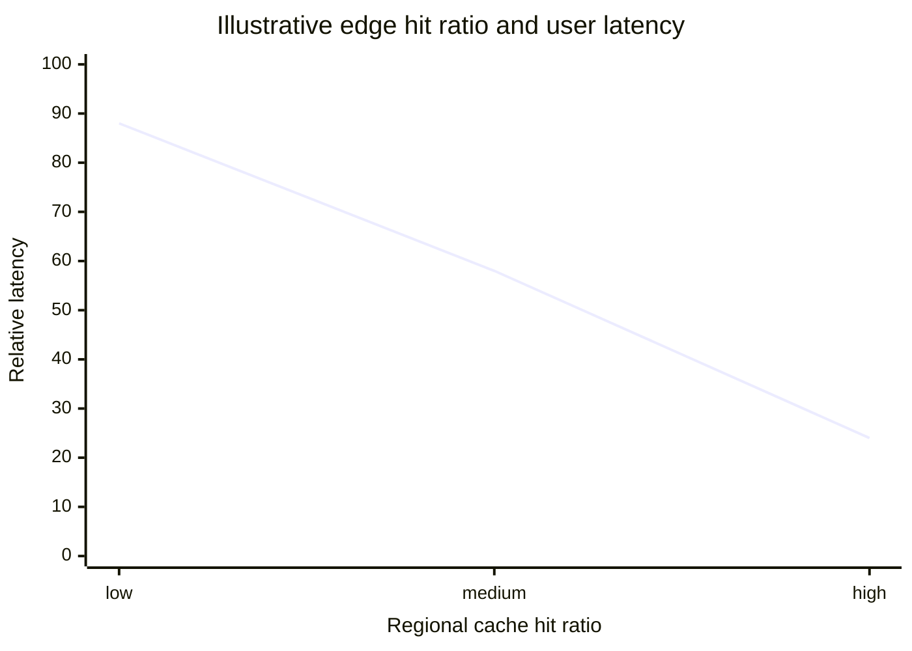

# CDN: Content Delivery Network

Part: [19 — Performance Engineering](PART_OVERVIEW.md)

A Content Delivery Network (CDN) places content and selected application responses near users to reduce network distance and origin work. Performance depends on cacheability, key design, freshness, edge distribution, and origin behavior. Part 05 CH09 owns protocol mechanics; Part 09 owns provider services. This chapter focuses on workload-level selection and measurement.

## Place Edge Caching on the Request Path

An edge point of presence (POP) can serve a cached response or fetch from an origin. A shield layer can consolidate misses before they reach the origin. Dynamic content may still benefit from edge execution, connection termination, or selective caching, but personalized responses require careful identity and key boundaries.

Measure cache hit by request and bytes; large media objects can dominate byte hit ratio while small API responses dominate request volume. Also track edge latency, origin request rate, shield effectiveness, error rate, and cold-region behavior. A CDN that is close to users but frequently misses may add an extra network hop without reducing load.

## Design a Correct Cache Key

The cache key determines which requests share a response. Include every input that changes the representation, such as path, selected query parameters, language, encoding, device class, or tenant where appropriate. Excluding a relevant dimension can leak or corrupt responses; including irrelevant high-cardinality values fragments the cache and lowers reuse.

Review cookies, authorization headers, query parameters, and vary dimensions explicitly. Avoid caching personalized output in a shared key unless isolation is proven. Canonicalization rules should prevent equivalent requests from creating unbounded variants, and any key change should be tested for both isolation and hit-rate consequences.

## Manage Freshness and Revalidation

Freshness can be controlled by time-to-live, explicit purge, versioned asset names, or conditional revalidation with the origin. Long-lived immutable assets benefit from versioned URLs; rapidly changing business data may need short freshness or no shared caching. A purge is operationally useful but can create a miss storm, so coordinate invalidation with origin capacity.

Separate browser, edge, and intermediary freshness behavior. Ensure purge scope and propagation are observable, and use staged invalidation for large asset sets. If stale serving is permitted during an outage, label or constrain it according to the data's correctness and security contract.

## Use Shielding to Protect the Origin

A shield aggregates requests from many edges and can reduce duplicate origin fetches. It adds another cache and failure dependency, so its location and bypass behavior matter. A shield is most useful when many edge regions request the same content and the origin is expensive or geographically distant.

Test shield failure, purge propagation, and origin fallback. Avoid a shield becoming a single overloaded point or silently bypassing origin rate controls during a regional event. Use request collapsing and bounded origin concurrency for hot keys.

## Compare Regional Latency and Cache Reuse

Edge locations reduce round-trip distance only for traffic that reaches a useful edge and receives a hit. A regional user population may have a low hit ratio if keys are highly personalized or assets are rarely reused. Compare end-to-end user latency, hit ratio, origin load, and cost by region and content class.

The curve is illustrative. Real latency includes DNS, connection setup, TLS, edge processing, origin distance, and browser behavior. Evaluate cold starts and cache misses as well as warm hits; average latency can hide a miss path that is slower than direct origin access.

## Worked Case: Global Product Catalog

A retailer serves images, public descriptions, and localized pricing across several regions. Versioned image URLs receive long edge freshness; localized descriptions vary by language and market; price and inventory use shorter or private paths. A regional shield collapses popular misses during campaigns. The key excludes tracking parameters but includes locale and market.

The team measures p95 latency by region, request and byte hit rates, origin request volume, purge completion, and incorrect representation incidents. A campaign test includes cold edge regions and purge activity. When the origin is unavailable, the edge can serve stale images but does not serve stale inventory or account-specific content beyond their approved policies.

## Review Questions

1. Which representation dimensions belong in the cache key?
2. How does a shield affect origin load and failure domains?
3. When is versioned naming preferable to purging?
4. Why can a high byte hit ratio hide poor dynamic-response performance?
5. What should happen to each content class during an origin outage?

A CDN improves performance only when edge placement and cache policy fit the content's reuse, security, and freshness properties. Design keys carefully, manage invalidation under load, and measure regional miss paths and origin protection alongside warm-hit latency.
