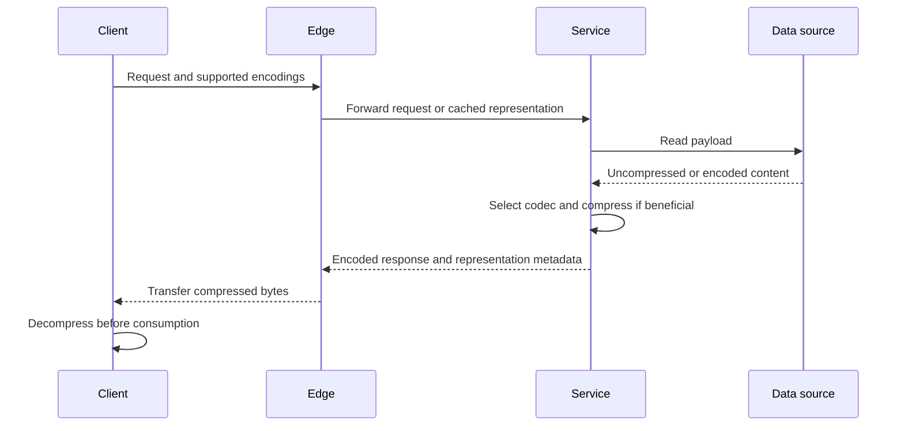
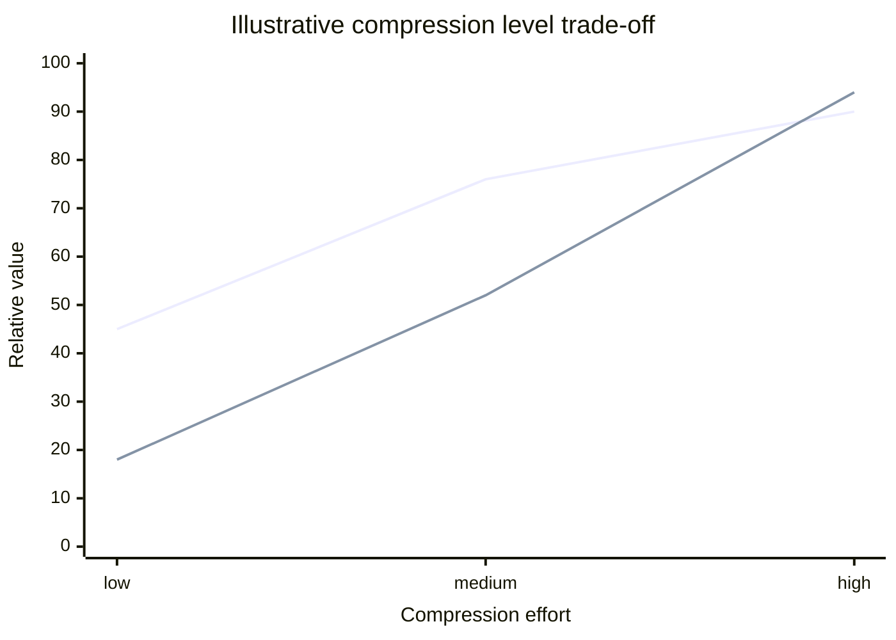
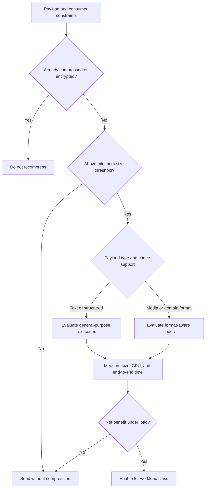
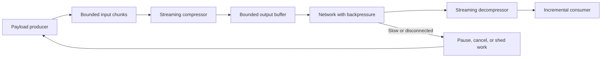
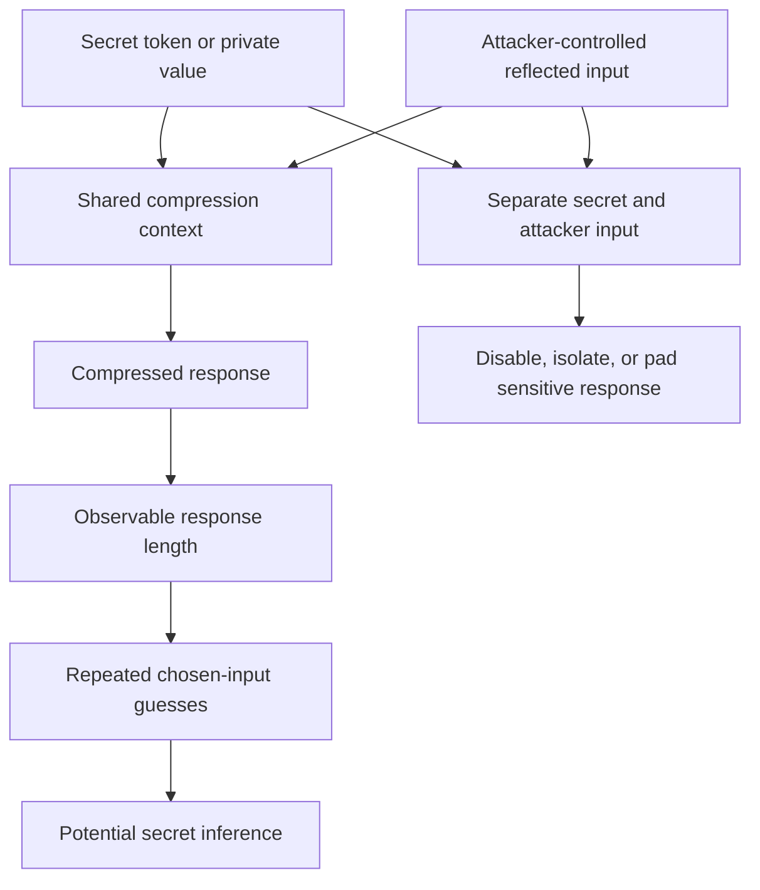

# Compression

Part: [19 — Performance Engineering](PART_OVERVIEW.md)

Compression reduces payload size by encoding repeated or predictable information more compactly. It trades network transfer and storage for CPU, memory, buffering, and sometimes latency. The best choice depends on payload type, bandwidth, concurrency, client capability, and the end-to-end objective. Part 05 owns HTTP compression negotiation; this chapter owns workload-level selection and performance validation.

## Place Compression at the Right Boundary

Compress where the payload crosses a constrained network or storage boundary and decompress near the consumer. Avoid recompressing already compressed images, archives, or media. Include negotiation and decompression cost in the request path; a smaller response can still be slower if compression blocks a latency-sensitive thread or delays the first streamed byte.

Use consistent metadata for the representation and cache key so compressed and uncompressed variants do not collide. Part 05 CH01 owns the wire-level negotiation and content-encoding details. At the workload boundary, verify that client support, proxy behavior, and intermediary caching match the intended path.

## Balance Size Reduction Against CPU

Text formats often compress well because they contain repeated structure; already compressed media may gain little. Higher compression levels generally consume more CPU for diminishing size reduction. At high concurrency, this can move the bottleneck from network to CPU and increase tail latency. Measure compression ratio, CPU time, allocation, time to first byte, total transfer time, and throughput under representative payloads.

The curves illustrate diminishing transfer benefit and rising compute cost; they are not benchmark results. Choose an effort level from end-to-end completion time and capacity, not file size alone. A lightweight codec may win on a constrained service even if it produces a larger payload.

## Select Codec and Threshold by Payload

Codec selection depends on payload structure, compatibility, hardware, and latency. Thresholds avoid spending CPU to compress tiny messages whose framing overhead exceeds the saved bytes. Keep codec choice and level configurable per workload class, then validate with representative samples rather than a single synthetic string.

A threshold should include CPU scheduling and metadata overhead. Consider separate policies for small interactive messages, large downloads, and background transfers. Do not assume that a codec supported by one client is safe to require across all consumers.

## Preserve Streaming and Backpressure

Streaming compression emits output incrementally, but buffering can delay chunks and increase memory. Configure flush behavior and chunk boundaries with the application protocol. If producers outpace consumers, compression can shift pressure into buffers; propagate backpressure or cancel rather than accumulating unbounded data.

Measure time to first byte and inter-chunk delay as well as total duration. Verify that truncation or disconnect is detected and that decompression does not accept incomplete data as a valid document. Avoid compressing a full response in memory when the output can be streamed within a clear framing contract.

## Isolate Compression From Secret-Dependent Input

Compression can create a side channel when a secret and attacker-controlled content share a compressed context and the attacker can observe output length. Repeatedly chosen input may reveal whether guesses match secret text. This is a context-design risk, not a reason to disable all compression indiscriminately.

Mitigations include avoiding shared compression contexts for secret and reflected input, disabling compression on sensitive endpoints, reducing attacker observability, or using carefully designed padding. Evaluate the whole protocol and threat model; padding can add bandwidth and still fail if lengths are observable through other paths.

## Worked Case: JSON API Responses

A public catalog API returns large JSON lists and small personalized account responses. The team measures representative payload sizes, CPU per response, and client latency under peak concurrency. Compression is enabled above a tested threshold for catalog responses; personalized account responses use a separate policy and cache scope. Binary images are served in their existing encoded form.

The team compares a fast codec with a higher-compression option and selects by total completion time at target load. A streaming export uses bounded chunks and cancellation when the client disconnects. Security review ensures private tokens are not compressed in the same response context as attacker-controlled reflected text. A rollout measures CPU saturation, network bytes, time to first byte, and client errors before broad enablement.

## Review Questions

1. Which resource is compression intended to save, and what resource does it consume?
2. How does payload type change codec benefit?
3. Why is a size threshold useful?
4. What measurements matter for streaming beyond total response time?
5. When can compression expose secret-dependent length information?

Compression is valuable when saved transfer or storage exceeds compute, memory, and latency cost. Select policy by payload and consumer, preserve streaming bounds, and isolate sensitive content from attacker-controlled input when compressed length can be observed.
