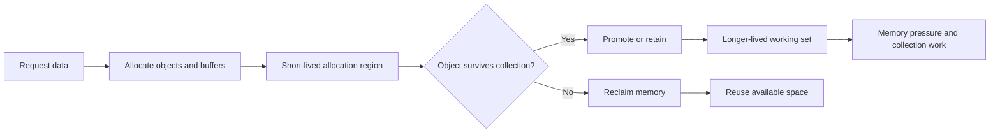
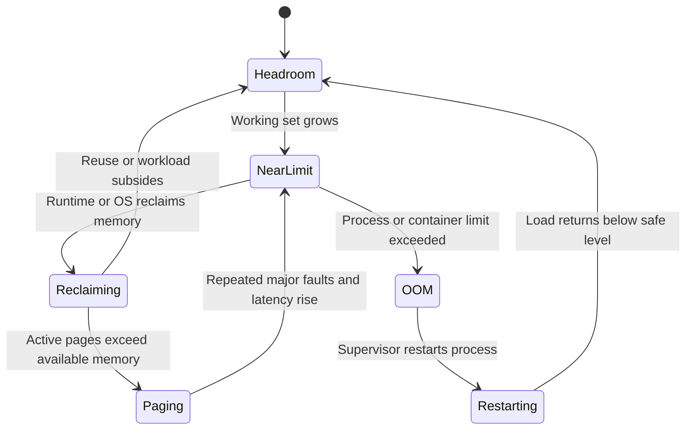
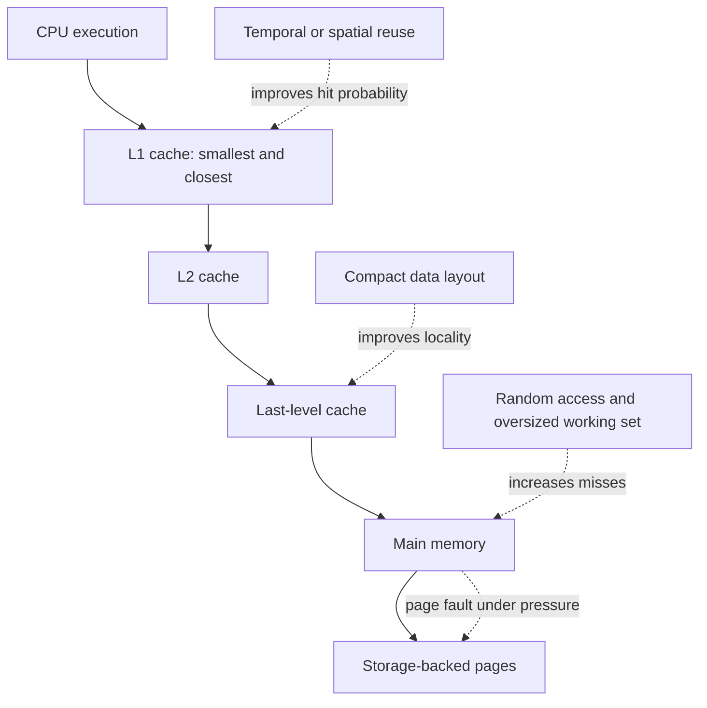
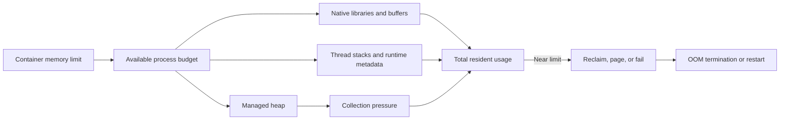
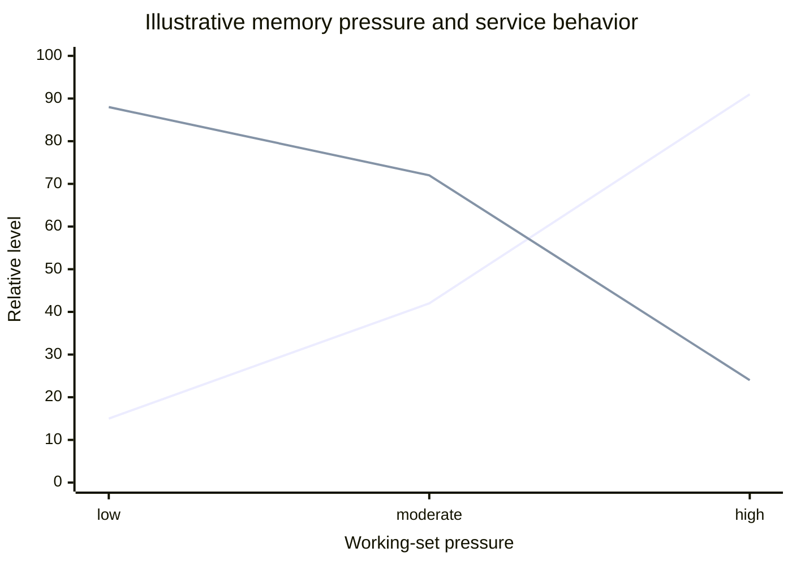

# Memory Performance

Part: [19 — Performance Engineering](PART_OVERVIEW.md)

Memory performance affects latency and throughput through allocation, locality, memory bandwidth, garbage collection, paging, and process limits. A system can appear CPU-light while spending time stalled on memory or repeatedly collecting short-lived objects. Part 05 CH25 owns operating-system memory mechanisms; Part 03 owns runtime-specific behavior; Part 19 CH09 owns collector tuning.

## Follow Allocation Through the Runtime

Allocation rate matters because object creation consumes memory bandwidth and can trigger collection or allocator contention. Short-lived objects may be cheap when allocated and reclaimed together, but high allocation volume can still create pauses and CPU cost. Long-lived objects increase the working set and can promote memory pressure across the application.

Measure allocation bytes per operation, object lifetime distribution, retained heap, and collection time. Reduce unnecessary copies and temporary objects when profiles show allocation is material, but avoid pooling indiscriminately: pools can retain memory, add synchronization, and create stale-state bugs.

## Understand Working-Set Pressure

The working set is the memory actively needed over a time interval. When it exceeds available physical or container memory, reclaim and paging can introduce large latency variance; if the process crosses its limit, it may be terminated. Memory usage should include heap, native allocations, thread stacks, mapped files, buffers, runtime metadata, and sidecars.

Monitor resident set, heap and non-heap memory, page faults, allocation rate, collection pauses, container limit, and restart events together. A heap graph alone cannot explain native memory growth or operating-system pressure. Diagnose whether the workload is retaining more data, allocating faster, or running with less effective capacity.

## Improve Locality and Access Patterns

Modern memory hierarchies have different latency and capacity levels: registers and caches are close to execution units, main memory is larger but slower, and storage-backed paging is much slower still. Access patterns with locality reuse nearby data and reduce stalls. Pointer-heavy structures, random access, and large working sets can defeat locality even when the data volume fits in memory.

Optimization may involve compact representations, batching adjacent work, reducing copies, or limiting unnecessary retained state. Measure cache-miss or memory-stall evidence where available; do not infer locality problems from high memory usage alone. NUMA (Non-Uniform Memory Access) placement can matter on large hosts, but its mechanisms belong to Part 05.

## Respect Process and Container Limits

Container memory limits often apply to total process usage rather than language heap alone. Runtime heap sizing that consumes nearly the entire limit leaves no headroom for native libraries, stacks, buffers, and runtime metadata. Memory pressure can cause aggressive collection before an out-of-memory kill, creating a latency cliff.

Leave measured headroom for bursts and non-heap usage. Validate behavior at the actual deployment limit and under realistic concurrency. A larger limit can reduce paging but may increase cost or hide leaks; right-size from peak working set and recovery requirements rather than a single steady-state sample.

## Relate Collection to Latency and Throughput

Garbage Collection (GC) reclaims managed objects and may pause application threads or consume concurrent CPU. Collector tuning trades memory headroom, throughput, and pause goals; more aggressive collection can reduce pauses while increasing CPU or retained memory. Part 19 CH09 covers collector-specific tuning experiments.

The curves illustrate rising collection/paging pressure and falling throughput headroom. Real behavior depends on runtime, workload, and memory topology. Correlate pause duration and frequency with tail latency and request concurrency; a low average pause can still hide a small number of long stop-the-world events.

## Worked Case: Image Transformation Service

An image service experiences p99 latency spikes during large uploads. Profiles show high temporary-buffer allocation, while memory telemetry shows native decoder buffers in addition to the managed heap. The team bounds concurrent transformations, streams input instead of copying it repeatedly, and sizes the runtime heap below the container limit to preserve native-memory headroom.

The team compares throughput, tail latency, allocation bytes per image, resident memory, collection pauses, and restart rate under mixed image sizes. A larger container reduces failures but costs more; bounded concurrency produces most of the improvement at the current size. The change is validated against image correctness and maximum supported dimensions, not just benchmark throughput.

## Review Questions

1. How can high allocation rate hurt performance even when objects are short-lived?
2. Which memory metrics distinguish heap growth from native or container pressure?
3. How does locality differ from total capacity?
4. Why must a managed heap leave headroom under a container limit?
5. Which latency percentiles should be correlated with collection behavior?

Memory optimization begins with distinguishing allocation, retention, locality, and capacity pressure. Measure the full process and deployment boundary, change the demonstrated bottleneck, and verify both tail behavior and correctness under realistic limits.
