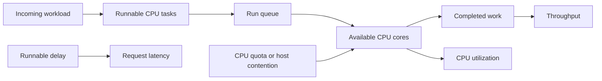
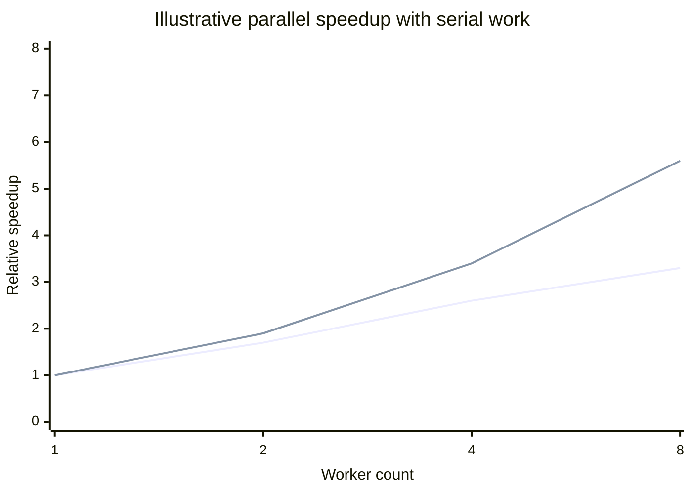
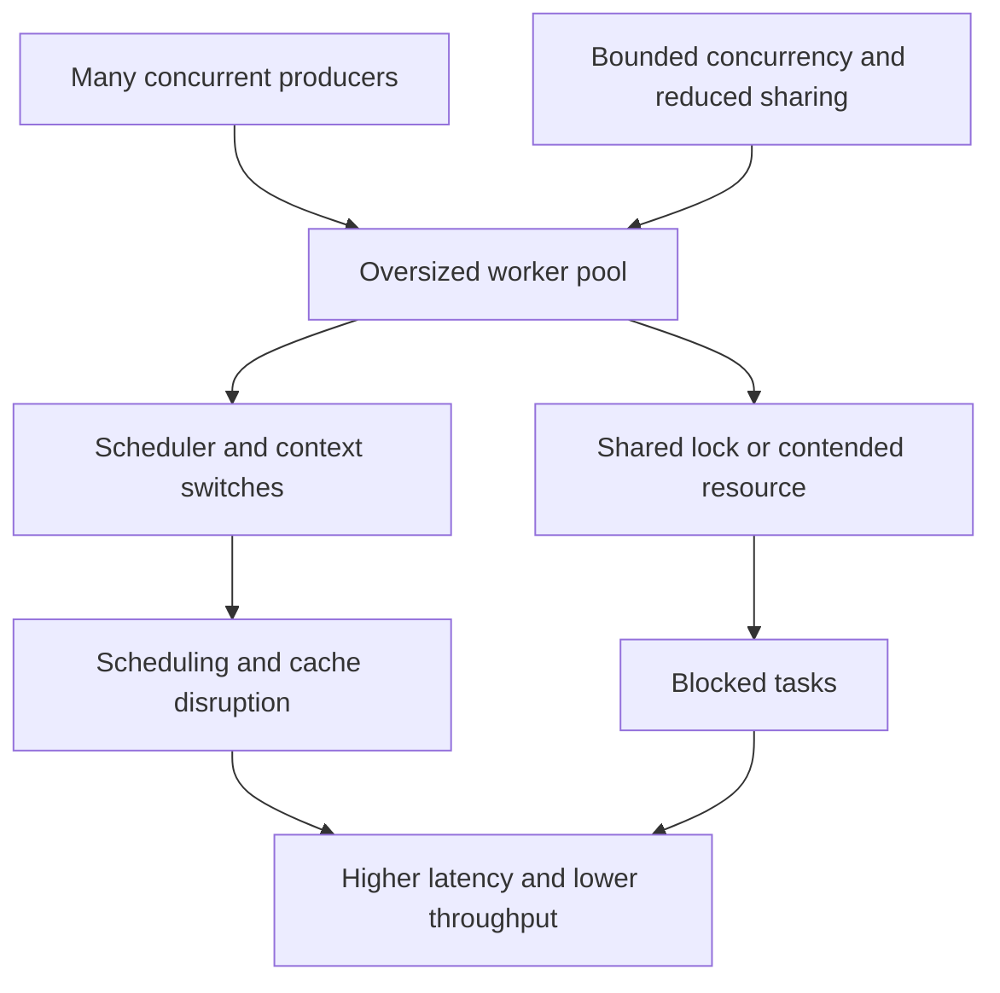
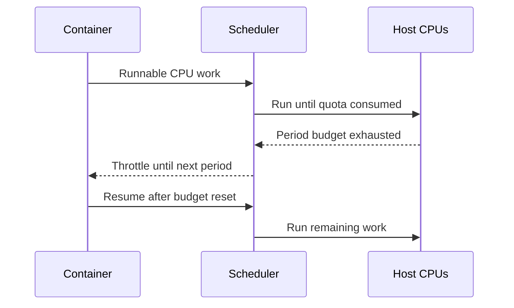
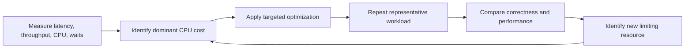

# CPU Performance

Part: [19 — Performance Engineering](PART_OVERVIEW.md)

CPU performance is about how much useful computation completes within a workload's latency and throughput objectives. High utilization can indicate efficient saturation or harmful contention; low utilization can indicate blocking, I/O wait, or insufficient parallelism. Part 05 CH27 owns operating-system scheduling mechanics, and Part 03 owns runtime concurrency details. This chapter focuses on measurement and workload-level optimization.

## Relate Demand, Capacity, and the Run Queue

Each request consumes CPU service time. When arrival demand approaches available capacity, runnable work waits in a queue and response time grows. More workers do not create CPU capacity; they can increase context switching and cache disruption. Distinguish runnable delay from time blocked on network, storage, locks, or runtime pauses.

Measure process and host utilization, run-queue wait, throttled time, service time, and completed throughput together. A single process-utilization percentage cannot tell whether work is CPU-bound or whether a container is throttled despite idle host capacity.

## Estimate Parallel Speedup

Parallel work can reduce elapsed time only for the fraction that can run concurrently. Serial coordination, shared state, locks, and communication limit speedup. Adding workers beyond available cores may reduce performance when contention and scheduling overhead exceed additional parallel work.

The lines illustrate different serial fractions; they are not benchmark measurements. Profile the serial path and coordination costs before increasing parallelism. Batch operations or reduce synchronization when evidence shows that the work can be made more independent.

## Diagnose Contention and Context Switching

Contention occurs when tasks compete for shared CPU, locks, caches, memory bandwidth, or runtime resources. Context switches preserve concurrency but cost execution time and can evict useful state. A high thread count with a short CPU workload can spend more time scheduling than computing.

Use profiles and runtime diagnostics to distinguish hot computation, lock wait, scheduler overhead, and cache misses. Reduce lock scope, avoid unnecessary shared mutation, or bound concurrency only when those costs appear in representative profiles. Changing a worker count without understanding the bottleneck can merely move waiting into another queue.

## Understand CPU Quotas and Throttling

Containers and virtualized environments may enforce CPU quotas. A workload can consume its quota early in a scheduling period and then be throttled, producing latency spikes even when average utilization looks moderate. Quota, request, host contention, and burst capacity must be interpreted together.

Correlate throttled time with request latency and queue growth. Raising the quota may reduce throttling but increase cost or host contention. For bursty work, consider whether the platform supports a suitable burst policy and whether requests can be admitted or shed before the quota is exhausted.

## Recheck After Optimization

Optimization often migrates the bottleneck. Reducing CPU time may expose a database wait; batching may reduce per-item cost but increase queue delay; parallelization may increase memory bandwidth pressure. Re-run the full workload and update the resource profile after each material change.

Keep the objective fixed during comparison and record environment, workload, sample size, and confidence. Do not declare success from a microbenchmark if the production path is limited by queueing, dependencies, or quota behavior.

## Worked Case: Recommendation Ranking

A recommendation service misses its latency objective during a seasonal peak. CPU profiles show repeated feature transformations and lock contention in a shared cache. The team caches immutable feature vectors, reduces lock scope, and bounds worker count to available cores. It validates ranking correctness, p95 and p99 latency, throughput, run-queue delay, and throttled time at peak concurrency.

After the change, CPU time per request falls but database wait becomes the dominant latency component. The team does not add more workers; it batches the feature reads and remeasures. Capacity planning then verifies that the new database load and memory footprint remain within limits. This sequence targets each measured bottleneck rather than accumulating optimizations without a stable baseline.

## Review Questions

1. What evidence distinguishes CPU saturation from blocking or throttling?
2. How does serial work constrain parallel speedup?
3. When can more workers lower throughput?
4. Why can a CPU quota create periodic latency spikes?
5. What must be measured again after optimizing CPU work?

CPU optimization begins with useful-work and wait-time evidence. Reduce the demonstrated compute or contention cost, respect quotas and parallelism limits, and reprofile the end-to-end workload because the limiting resource often changes.
