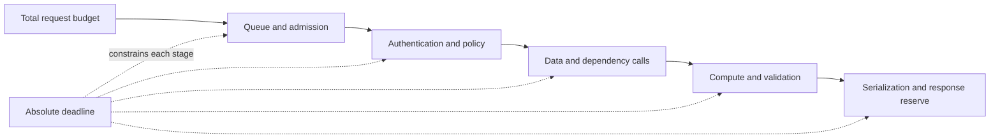
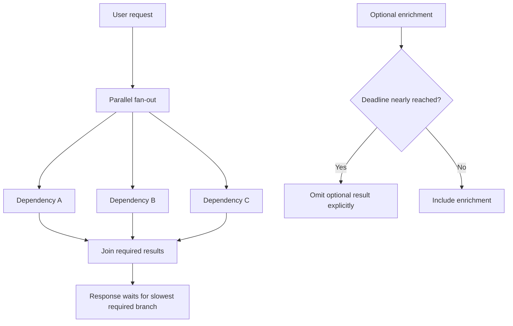
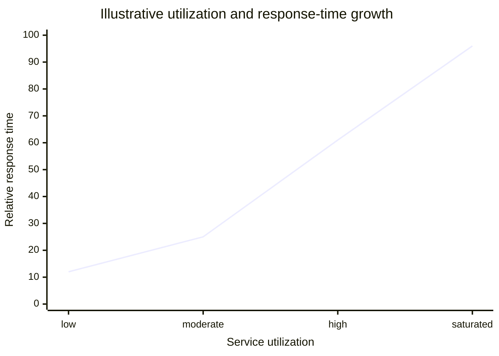
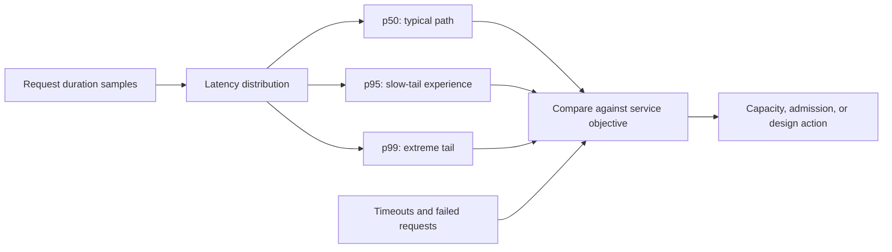

# Latency

Part: [19 — Performance Engineering](PART_OVERVIEW.md)

Latency is elapsed time from a defined start event to a defined completion event. Performance work must specify the boundary: server processing, end-to-end request, or user-perceived interaction. The average alone hides the slow requests that often dominate user experience. Part 07 owns distributed failure semantics; Part 14 owns telemetry platforms.

## Measure the Critical Path

Break an operation into sequential work, parallel branches, queue waits, and response transfer. Sequential costs add; parallel branches contribute the slowest branch plus coordination. Include client-side and network time when the objective is user-visible. A service timer that starts after queueing can look healthy while callers wait.

```mermaid
flowchart LR
    Request[Request arrival] --> Queue[Admission and queue wait]
    Queue --> Auth[Identity and policy]
    Auth --> Data[Data access]
    Data --> Compute[Business computation]
    Compute --> Dependency[External dependency]
    Dependency --> Serialize[Serialization and response]
    Serialize --> Client[Client receives result]
```

Instrument boundaries consistently and avoid double-counting nested spans. Record queue wait, service time, dependency time, and total duration. Optimize the measured critical path; reducing a non-critical parallel branch may not change the user-visible latency.

## Budget Time Across Dependencies

An end-to-end budget is a constraint to allocate, not a sum of independent generous timeouts. Reserve time for validation, response delivery, and recovery. Propagate a deadline or remaining budget to downstream calls so a slow early step does not allow later work to exceed the caller's limit.

Assign stage budgets from observed distributions and business criticality. If a mandatory step cannot fit, reject or defer early rather than consuming resources on work that cannot complete. Timeouts do not cancel remote work automatically; ensure cancellation and cleanup reach downstream components where supported.

## Understand Fan-Out Tail Amplification

When a request waits for multiple parallel dependencies, overall completion depends on the slowest required branch. As the number of dependencies grows, the chance that at least one branch is unusually slow increases. Optional branches can be hedged, cached, or omitted only when the product contract permits it; critical results must not be fabricated to meet a deadline.

Identify required and optional branches explicitly. Limit fan-out width, bound concurrency, and consider partial responses where semantics allow. Hedged requests can lower tail latency but increase load; use them only with cancellation and capacity controls to avoid amplifying an outage.

## Relate Queueing to Response Time

Queueing delay rises sharply as utilization approaches capacity, especially when service times vary. Little's Law relates average number in a stable system $L$ to arrival rate $\lambda$ and average time $W$: $L = \lambda W$. Applying it requires a stable boundary and consistent measurements. A growing queue indicates that arrival demand exceeds completed capacity over the observed interval.

The curve illustrates nonlinear growth near saturation, not a universal capacity law. Measure queue depth and age, arrival and completion rates, concurrency, and service-time distribution. Apply admission control, bounded queues, or workload isolation before the queue turns overload into timeouts and retries.

## Choose Percentiles and Objectives

Latency distributions are skewed; p50 describes a typical request while p95 or p99 exposes tail behavior. The correct percentile depends on volume, user impact, and objective. Always state the measurement window, request population, and whether failed or timed-out requests are included. Averages can improve while the tail worsens.

Service-Level Objectives (SLOs) should connect a latency target to a user-visible outcome and a defined population. Use histograms or compatible distributions for aggregation; averaging per-instance percentiles can produce a misleading global result. Pair latency with correctness and completion rate so fast failures do not appear as performance wins.

## Worked Case: Search Results Page

A search page calls identity, catalog, inventory, and recommendation services. Identity, catalog, and required inventory are on the critical path; recommendations are optional enrichment. The team sets an end-to-end objective and allocates budgets to queueing, required dependencies, rendering, and response transfer. When the deadline is threatened, recommendations are omitted with a clear UI state rather than delaying the whole page.

During a promotion, queue age rises before endpoint latency alarms fire. Admission limits protect the catalog service, and the page returns a bounded degraded response for low-priority searches. Fan-out traces reveal that inventory in one region dominates p99. The team improves regional placement and validates the complete distribution, including errors, rather than focusing only on catalog service time.

## Review Questions

1. Which start and completion events define the latency metric?
2. How do sequential, parallel, and queued work contribute to the critical path?
3. Why can wider fan-out worsen tail latency?
4. When is partial response safer than waiting for all branches?
5. Which percentiles and populations match the user-visible objective?

Latency engineering makes time visible across the whole path. Budget dependencies, manage queueing before saturation, distinguish required from optional work, and judge improvements using distributions and complete outcomes rather than averages alone.
