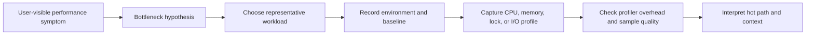
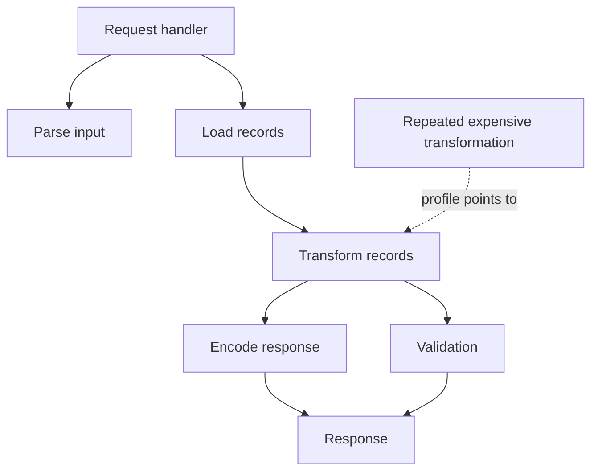
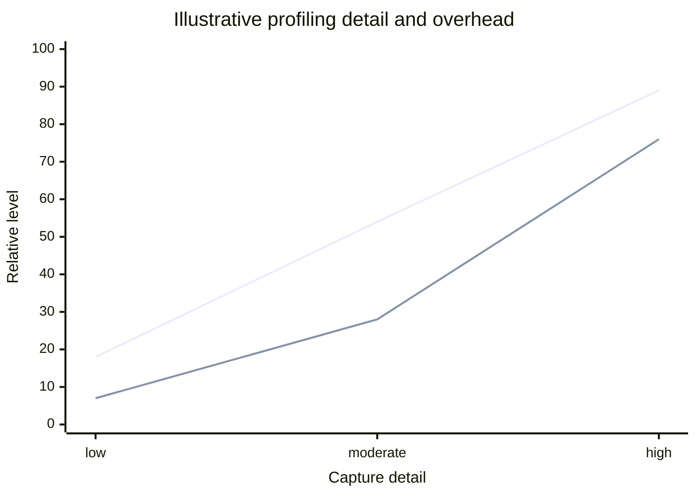
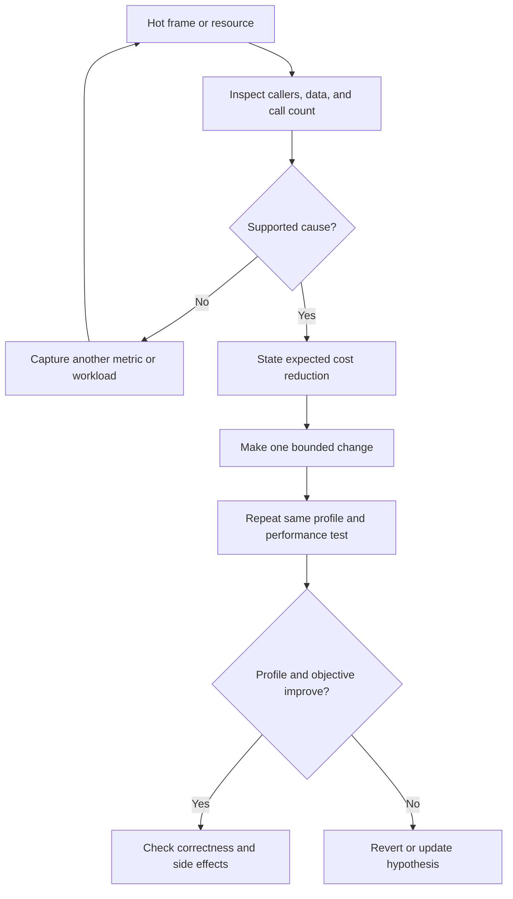
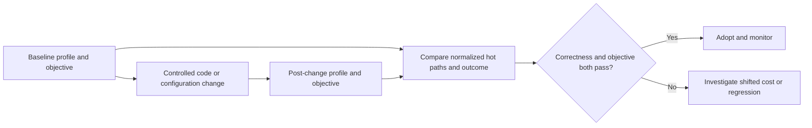

# Profiling

Part: [19 — Performance Engineering](PART_OVERVIEW.md)

Profiling samples or records where a program spends time and resources so an engineer can test a bottleneck hypothesis. A profile is evidence from a particular workload, environment, and interval, not a universal ranking of code quality. Part 05 owns operating-system tracing primitives; this chapter owns profiling workflow and interpretation.

## Collect a Representative Profile

Choose the metric from the symptom: CPU samples for compute, allocation or heap profiles for memory, lock profiles for contention, and I/O traces for blocked work. Reproduce the relevant concurrency and payload distribution. Record build, configuration, host limits, warm-up state, load, and profiler settings so that another run can be compared.

Avoid profiling an idle process or a synthetic input that omits the path under investigation. Production profiling may require sampling, access controls, redaction, and a short capture window. Confirm that the profiler does not collect secrets or create unacceptable overhead.

## Interpret Call Stacks and Hot Paths

A flame graph aggregates sampled stack frames; width represents samples attributed to a frame and its descendants, while vertical position represents call depth. It is not a timeline and does not directly show elapsed time for every invocation. A wide frame indicates where sampled work accumulates, but the right fix may be in its caller, data shape, or call frequency.

Inspect inclusive and exclusive cost, call count, input sizes, and whether a frame is hot because it is inherently expensive or simply called too often. Compare stacks across representative request classes. A single global flame graph can hide one slow endpoint behind higher-volume fast paths.

## Balance Sampling Detail and Overhead

Sampling interrupts execution periodically and records state; lower sampling frequency reduces overhead but may miss brief activity. Instrumentation records specific events with greater detail but can add substantial cost and alter timing. Choose the least intrusive method that can answer the hypothesis, and compare profile-on with profile-off behavior.

The curves illustrate information gained and overhead incurred, not measured values. Sampling can distort very short operations; instrumentation can perturb concurrency and lock timing. Record profiler settings, repeat captures, and treat small differences as uncertain when overhead is comparable to the measured effect.

## Turn a Profile Into a Testable Change

A profile narrows where to investigate but does not explain why the cost exists. Inspect the implicated data structures, call frequency, allocation patterns, blocking, and algorithmic complexity. Form a specific change hypothesis, predict the expected profile shift and user-visible effect, then rerun the same workload.

Change one major factor at a time when practical. Verify correctness, resource use, and tail behavior; a faster hot function can shift load to memory, a database, or another service.

## Compare Before and After Profiles

Use the same workload, versioned test data, environment, warm-up, duration, and capture settings. Compare both profile shape and end-to-end metrics. Normalize sample counts or time where appropriate, and report variance across repeated runs. A profile improvement is useful only when the service objective or cost changes in the intended direction.

Keep profile artifacts access-controlled and short-lived when they contain paths, symbols, or sensitive workload context. Document the capture and decision so the next engineer does not repeat an invalid comparison.

## Worked Case: Slow Checkout Validation

A checkout endpoint's p99 regresses after a new fraud rule. CPU profiles show the rule engine repeatedly normalizing the same address fields; allocation profiles show temporary strings growing with basket size. The team caches normalized values within the request and avoids repeated copies. A lock profile confirms the change does not introduce shared contention.

The before-and-after test uses the same transaction mix and concurrency. It compares CPU per request, allocation bytes, p99 latency, fraud-rule output correctness, and database load. CPU time decreases, but serialization becomes the next hot path. The team records that bottleneck migration and decides whether it matters to the objective before making another change.

## Review Questions

1. Which symptom suggests CPU, allocation, lock, or I/O profiling?
2. What does flame-graph width mean, and what does it not mean?
3. How can a profiler alter the behavior being measured?
4. Which workload and environment facts make before/after profiles comparable?
5. What user-visible evidence confirms that a hot-path change mattered?

Profiling is a hypothesis test. Capture representative work with known overhead, interpret cost in call and data context, make a bounded change, and compare both profiles and service outcomes under controlled conditions.
