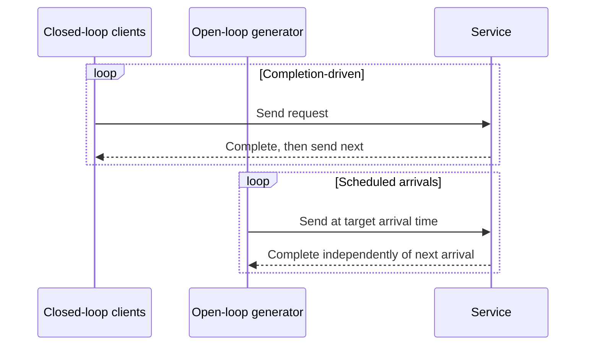
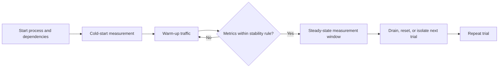
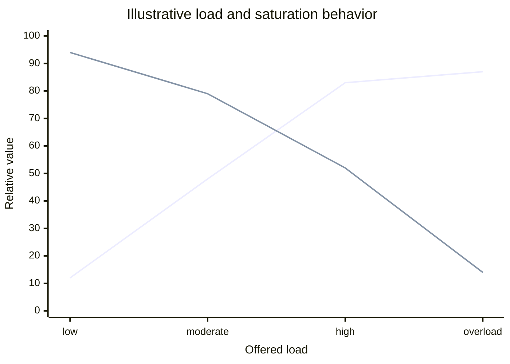
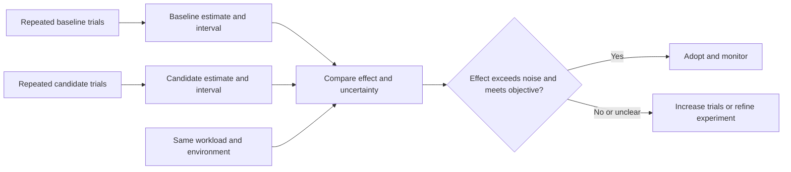

# Benchmarking

Part: [19 — Performance Engineering](PART_OVERVIEW.md)

A benchmark is a controlled experiment that estimates how a system behaves under a defined workload and environment. It is useful when its workload, measurement boundary, and uncertainty resemble the production question. A benchmark that only demonstrates a faster code path can still predict worse user experience if it omits queueing, dependencies, data shape, or failures.

Part 19 owns controlled performance experiments; Part 14 owns production telemetry. Use production evidence to build the workload model, then use benchmarks to isolate and compare candidate changes.

## Define the Experiment

State the question, baseline, candidate, workload, environment, metric, duration, and decision threshold before running. Hold variables stable where possible and record hardware, runtime, configuration, dataset, load generator, warm-up, and test version. Keep correctness assertions in the benchmark so invalid fast results do not pass.

Choose a measurement boundary that matches the decision. A microbenchmark isolates a function; a component benchmark includes runtime and dependencies; an end-to-end benchmark includes the user path. Use the narrowest experiment that answers the question, then validate relevant effects at a broader boundary.

## Choose an Open or Closed Load Model

In a closed-loop test, a fixed set of clients sends a new request after completing the previous one. As the system slows, offered load falls. In an open-loop test, arrivals are scheduled independently of completion, so offered load continues during slowdown and queue growth is visible. Each model answers different questions; do not infer overload behavior from a closed-loop test alone.

Open-loop generators need enough capacity and accurate scheduling; otherwise the load generator itself can become the bottleneck. Closed-loop tests can suffer coordinated omission, where slow periods reduce the number of requests recorded and hide the waiting time that would have occurred at a fixed arrival rate. Select and report the model explicitly.

## Separate Warm-Up From Steady State

Warm-up initializes caches, JIT compilation, connection pools, and model state. Measure it separately unless cold-start behavior is the target. Steady-state measurement should begin after defined stabilization criteria, not an arbitrary delay. Include a cool-down or reset plan so one trial does not contaminate the next.

Define stabilization signals such as cache hit rate, throughput variance, queue depth, and runtime compilation. If production includes frequent restarts or scale-from-zero, cold starts are part of the objective and should not be hidden as warm-up.

## Find Saturation Without Overloading the Generator

Increase offered load gradually and measure throughput, latency percentiles, queueing, errors, resource use, and correctness. Saturation appears when added load increases waiting or failures without proportional completed work. Test beyond the target enough to reveal the knee, but use safe data and stop conditions to protect shared environments.

The curves illustrate throughput flattening and latency degradation near saturation. They are not expected measurements for every system. Test with realistic request sizes and dependency behavior; an artificial constant payload may miss a memory, database, or network bottleneck.

## Compare Results With Uncertainty

Performance varies with scheduling, caches, noisy neighbors, garbage collection, network conditions, and data distribution. Run repeated trials and report sample counts, median and tail percentiles, confidence intervals or another uncertainty method, and environmental variance. Compare like-for-like measurements and avoid claiming significance from small differences inside run-to-run noise.

Use randomized order or alternating trials when time-dependent drift is likely. Preserve raw samples and test code. Report effect size and confidence. Avoid relying on the fastest run or a percentage without a baseline.

## Worked Case: API Runtime Upgrade

A team evaluates a runtime upgrade for a high-volume order API. The benchmark replays a representative mix of reads, writes, payload sizes, and dependency delays against isolated baseline and candidate environments. It tests both closed-loop user behavior and open-loop peak arrival rates. Warm-up and steady-state phases are recorded separately; p50, p95, p99, throughput, errors, CPU, memory, and queue delay are captured.

Repeated runs show a small median improvement but no reliable p99 change, while peak throughput improves before saturation. The team validates database load and correctness, then stages a production canary. It does not claim a user-visible latency win; its decision is that the candidate increases capacity headroom with no measured regression under the tested workload.

## Review Questions

1. Which production question does the benchmark answer?
2. How do open-loop and closed-loop tests behave under slowdown?
3. When is warm-up part of the result rather than a discarded phase?
4. How do generator limits and coordinated omission bias measurements?
5. What evidence shows an observed improvement exceeds run-to-run noise?

Useful benchmarks are controlled, representative, and reproducible. Define the workload and boundary, use a load model that matches the question, separate warm-up from steady state, and report uncertainty alongside the result.
