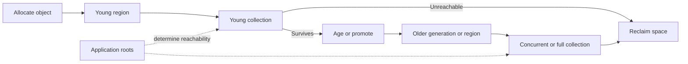
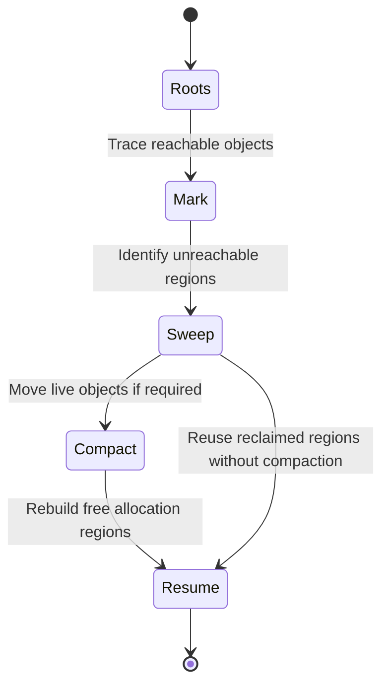
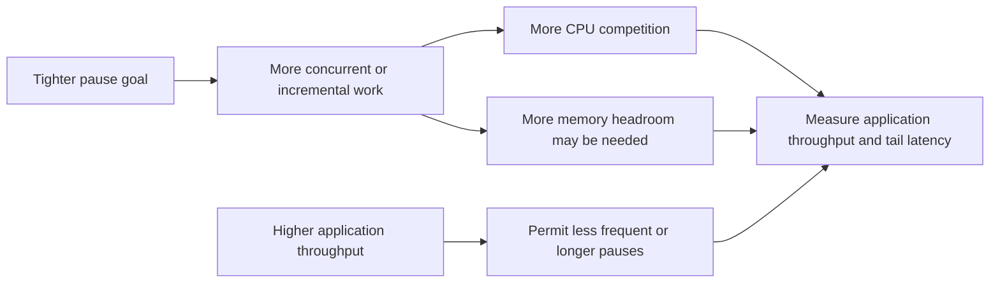
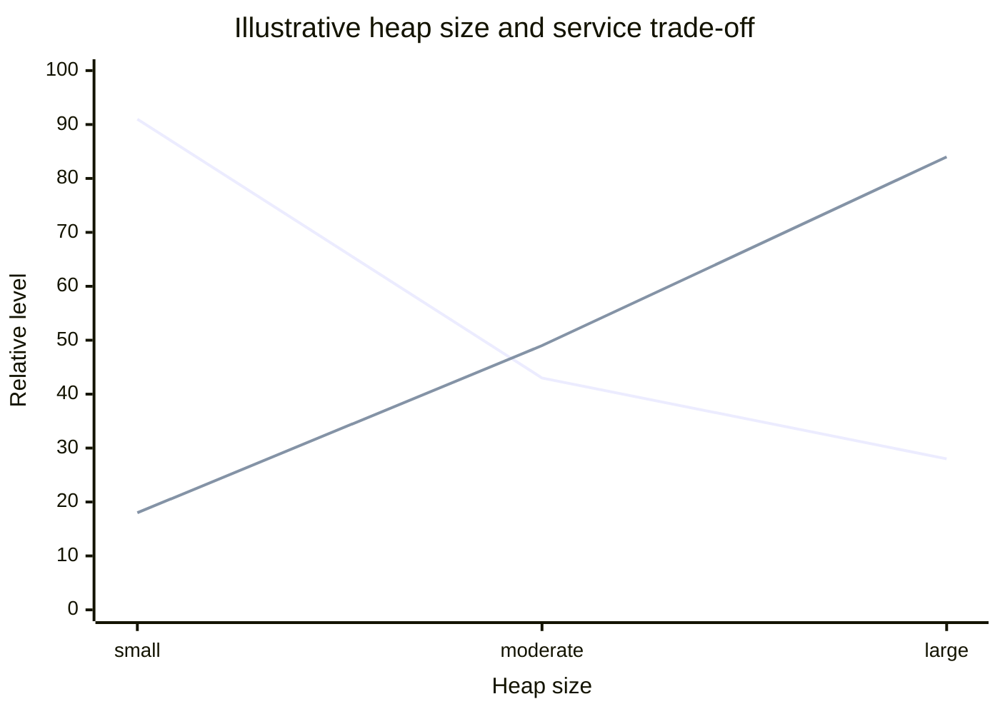
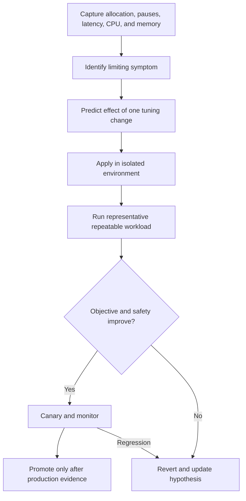

# Garbage Collector Tuning

Part: [19 — Performance Engineering](PART_OVERVIEW.md)

Garbage Collection (GC) reclaims memory occupied by objects that are no longer reachable. Tuning balances application throughput, pause duration, memory footprint, and allocation headroom. There is no universally best collector or heap size; the correct choice depends on runtime, object lifetime, workload, and service objectives. Part 03 owns language runtime details and Part 05 owns operating-system memory mechanics.

## Follow Allocation, Survival, and Promotion

Many managed runtimes optimize for objects that die quickly. A young-generation collection can reclaim short-lived objects cheaply, while survivors may be promoted or retained in older regions. A high allocation rate can trigger frequent collections even when the live set is small; a large retained set can create long marking or compaction work.

Observe allocation rate, survival and promotion, live-set size, pause frequency, and time spent collecting. A low live set with frequent young collections suggests allocation pressure; a growing live set suggests retention or cache growth. Find the cause before changing heap size.

## Understand Mark, Sweep, and Compaction Work

Collectors identify reachable objects from roots, reclaim unreachable memory, and may compact live objects to reduce fragmentation. Concurrent collectors perform some work alongside application threads but still consume CPU and may require brief coordination pauses. Compaction can improve future allocation locality but costs copying and pause time.

Collector names and phase details vary by runtime. Use the runtime's own documentation and logs for exact semantics. This conceptual lifecycle explains the trade-off; it does not imply that every collector executes these phases as a single stop-the-world sequence.

## Trade Pause Time Against Concurrent CPU

Shorter pauses may require more concurrent work, larger memory headroom, or more frequent collection. Higher throughput targets may permit longer pauses or less concurrent work. Evaluate pause distribution and application latency together: collector logs can show short pauses while application threads still contend for CPU or memory bandwidth during concurrent phases.

Choose the trade-off from the service-level objective, not from the shortest observed pause. Include p95 and p99 application latency, collection frequency, CPU use, allocation rate, and out-of-memory risk. If the service is throughput-oriented and tolerant of pauses, excessive concurrent work may waste capacity.

## Size the Heap With Process Headroom

A larger heap can reduce collection frequency but increase memory footprint, collection duration, and failure impact. A heap set too close to the process or container limit leaves little room for native memory, stacks, buffers, and runtime metadata. A very small heap can cause excessive collection and promote objects earlier. Size from the observed live set, allocation rate, burst profile, and deployment limit.

The curves illustrate collection pressure and memory footprint, not measured data. Determine the safe region through controlled tests with production-like allocation and container limits. Include restart behavior and startup warm-up; a larger heap can make recovery slower even when steady-state pauses improve.

## Run Tuning Experiments Safely

Change one collector or heap parameter at a time and keep workload, runtime version, environment, and measurement window stable. Define the objective and abort conditions. Compare repeated runs and verify application correctness, not just GC metrics. Revert when the change worsens the service objective or creates unacceptable memory risk.

Avoid copying flags from unrelated systems. Runtime versions change defaults and semantics. Keep the chosen configuration, reason, evidence, and rollback path with the deployment, and retest after runtime or workload changes.

## Worked Case: Managed Runtime API

An API sees periodic p99 latency spikes and high GC time. Logs show a large allocation rate from response construction, while the live set remains stable. The team first reduces intermediate copies and bounds response size, then repeats a fixed-concurrency benchmark. Allocation per request drops, young collections become less frequent, and tail latency improves without increasing heap size.

The team tests a collector configuration in an isolated environment and observes slightly shorter pauses but higher concurrent CPU, which reduces throughput at peak. It rejects the change because the service's primary objective is completed requests per second within a latency bound. The production configuration remains until new evidence supports a different trade-off.

## Review Questions

1. How do allocation rate and live-set size point to different causes?
2. Why can shorter GC pauses reduce application throughput?
3. What process memory must remain outside a managed heap limit?
4. Which workload and metrics make a collector experiment comparable?
5. What evidence justifies a configuration change over code-level allocation reduction?

GC tuning should follow measured allocation, retention, pause, and process-memory behavior. Establish an objective, change one factor at a time, test under the real memory boundary, and prefer a verified workload improvement over collector settings copied from another system.
