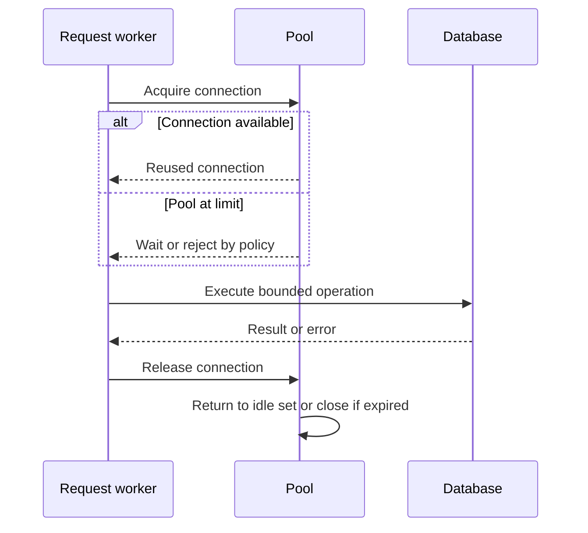
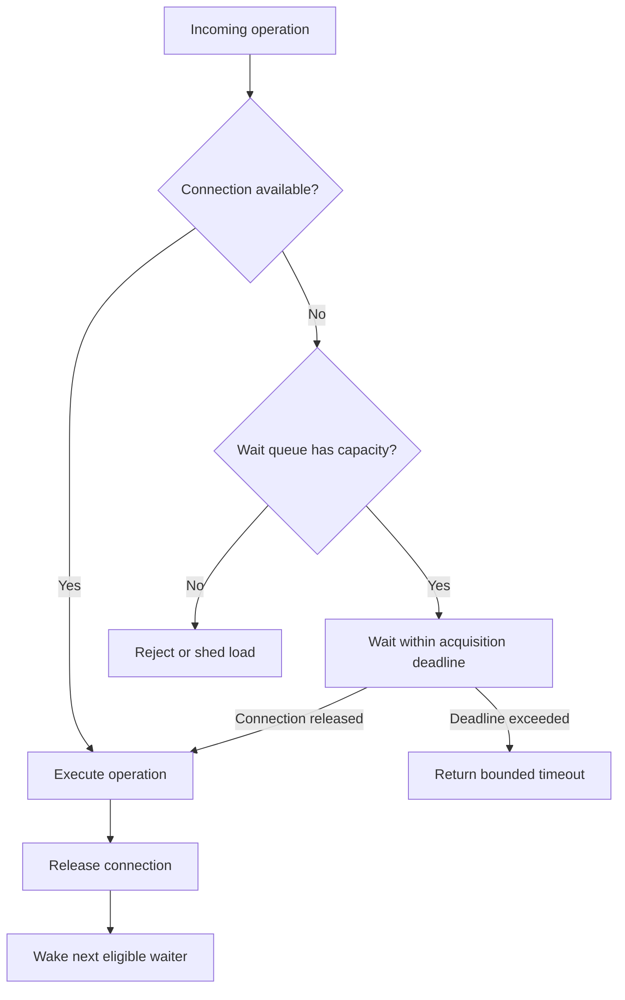
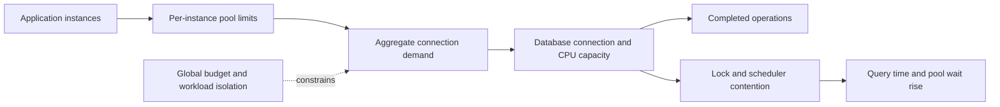
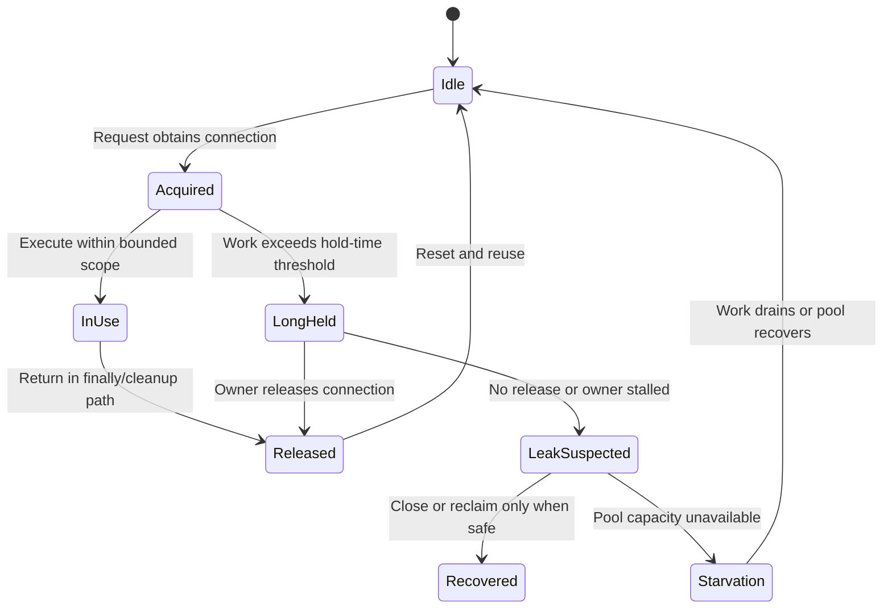
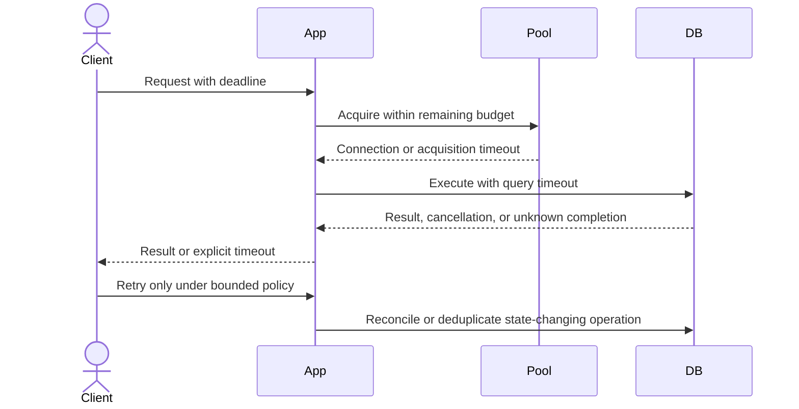

# Connection Pools

Part: [19 — Performance Engineering](PART_OVERVIEW.md)

A connection pool reuses expensive connections and bounds concurrent access to a dependency. It trades connection setup cost against queueing, resource use, and downstream capacity. A pool that is too small creates acquisition delay; one that is too large can overwhelm the database or remote service. Part 06 owns database connection mechanics; Part 08 owns API rate-limit contracts.

## Follow a Request Through the Pool

A request acquires a connection, performs work, and returns the connection for reuse. Pool wait is part of request latency even when the downstream query is fast. Measure acquisition wait, active and idle connections, connection lifetime, query time, and errors together.

Keep connection acquisition separate in telemetry from query execution. A slow endpoint can be pool-bound even when the database's execution plan is healthy. Define cleanup on exceptions and cancellation so connections are always returned or discarded safely.

## Bound Queueing and Saturation

When all connections are in use, new work waits, times out, or is rejected. An unbounded wait queue hides overload and increases memory and tail latency. Set an acquisition deadline consistent with the caller's total budget and a bounded queue or immediate rejection policy. Avoid retrying pool timeouts without reducing demand.

Choose the queue policy based on workload priority and fairness. A long-running query should not monopolize every connection needed for short critical operations. Isolate pools by workload class only when total connection limits and database capacity are coordinated.

## Size Against Downstream Capacity

Pool size should reflect database concurrency capacity and application demand across all instances. A per-instance maximum multiplied by replica count can exceed the database connection budget. Little's Law can help reason about average concurrency, but tail service time, bursts, and lock contention require headroom and measurement.

Tune aggregate capacity, not just one pool. Coordinate autoscaling with database limits, reserve capacity for administration and recovery, and test behavior during replica scale-out. A pool should not grow simply because threads are waiting if the downstream service is already saturated.

## Detect Leaks and Starvation

A leaked connection is acquired and not returned; starvation occurs when work cannot acquire capacity for too long. Long transactions, blocked calls while holding a connection, and exception paths can cause both. Leak detection should report acquisition stack or duration with bounded overhead, but must avoid logging credentials or sensitive query data.

Do not forcibly reclaim a connection while a valid transaction may still be running. Diagnose hold time and call paths first. Bound transaction duration, avoid network waits inside a database transaction, and verify that cancellation returns resources.

## Prevent Timeout and Retry Amplification

Pool wait, connection establishment, query execution, and caller deadline need separate but nested timeouts. If a request times out at the client while the database operation continues, retrying can duplicate work and increase load. Use idempotency for state changes and reconcile unknown outcomes before retrying.

Retries should have a total deadline, backoff, and limit. A retry at every layer multiplies database load during an incident. Expose pool wait and timeout as distinct metrics so teams do not respond to saturation by simply increasing retries or pool size.

## Worked Case: Order Service Pool Saturation

An order service scales from four to twelve instances during a promotion. Each instance uses a pool maximum sized for the database's full connection budget, causing aggregate connections to exceed capacity. Database contention increases query time, which holds connections longer and grows the pool wait queue.

The team sets a global connection budget, reduces per-instance maxima, shortens a reporting query, and adds a bounded acquisition wait. Read-only analytics uses a separately budgeted path. Load tests include scale-out, long queries, cancellation, and retry behavior. The team monitors acquisition wait, active connections, query duration, database CPU, and rejected work; it does not infer success from connection count alone.

## Review Questions

1. Which pool metrics distinguish pool wait from slow query execution?
2. How does replica count affect aggregate connection demand?
3. What queue and timeout behavior protects the caller's deadline?
4. How can leaks and long-held connections be detected safely?
5. Which conditions make a retry unsafe or amplifying?

Connection pools protect expensive dependencies when their limits reflect shared capacity and their queues remain bounded. Measure wait and use separately, return connections on every path, coordinate aggregate limits, and constrain retries under downstream stress.
