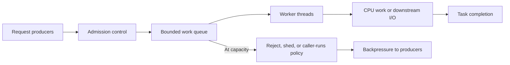
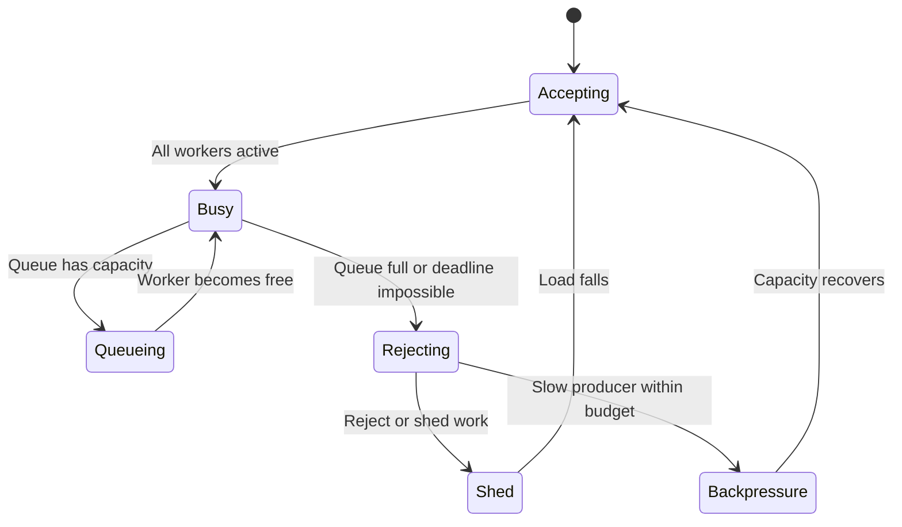
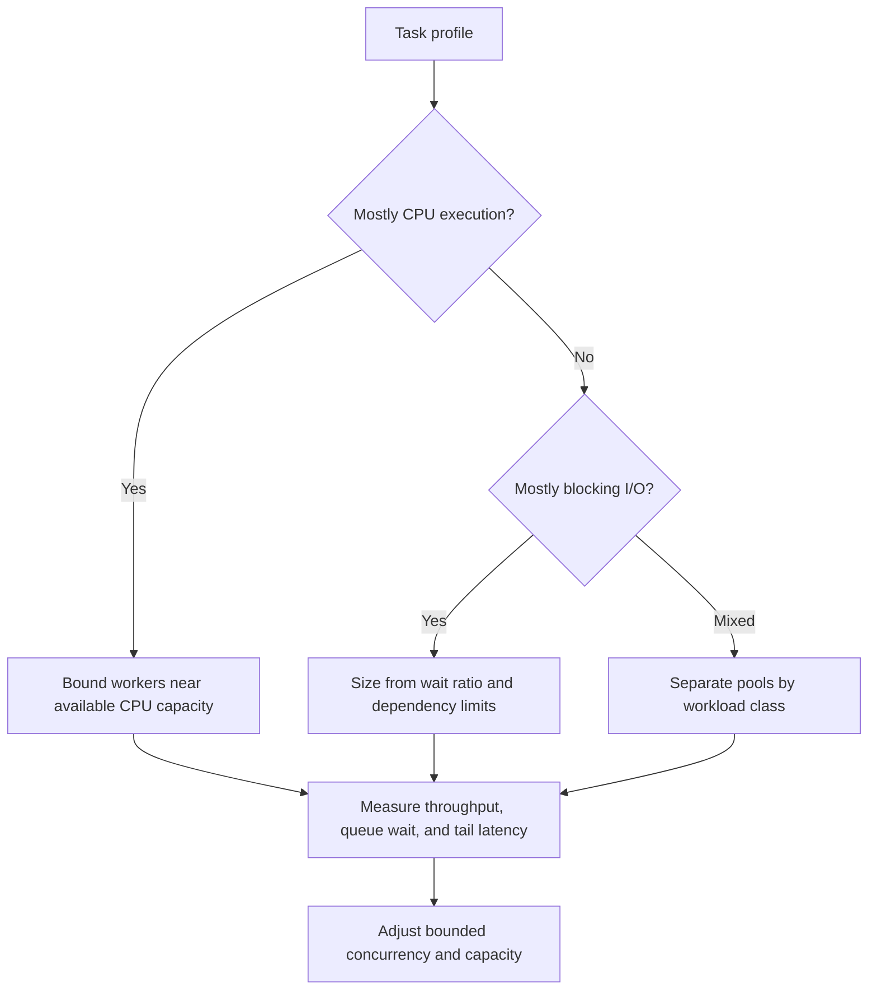
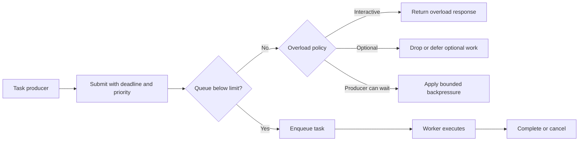
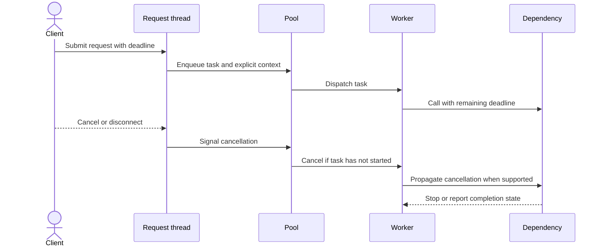

# Thread Pools

Part: [19 — Performance Engineering](PART_OVERVIEW.md)

A thread pool reuses workers and bounds concurrent task execution. Its performance depends on task duration, CPU versus I/O behavior, queue policy, cancellation, and downstream capacity. More threads can increase parallelism for blocking work but can also create scheduling overhead, memory use, contention, and overload. Part 05 CH24 and CH27 own operating-system thread and scheduling mechanisms; Part 03 owns runtime-specific executors.

## Model Producers, Workers, and Queues

Producers submit tasks; workers execute them; a queue holds work that exceeds current concurrency. The pool should define maximum workers, queue capacity, rejection behavior, task deadline, and shutdown policy. Measure queue wait separately from execution time.

An unbounded queue converts overload into unbounded latency and memory consumption. A bounded queue forces an explicit choice: reject, shed low-priority work, block producers, or execute inline. Each policy affects caller latency and fairness; select it from the service contract.

## Handle Saturation and Rejection

When all workers are busy, tasks wait or are rejected. Queue age often predicts deadline failure earlier than queue length alone. Prioritize by deadline only when starvation is controlled and task classes are isolated. Do not respond to a saturated pool by increasing worker count without checking CPU, memory, and downstream capacity.

Define what a task timeout means. Canceling a future does not necessarily stop the underlying operation; propagate cancellation to blocking dependencies where possible. Track rejected tasks and canceled-but-still-running work to detect hidden resource consumption.

## Size for CPU-Bound and I/O-Bound Work

CPU-bound tasks compete for cores; too many runnable workers increase context switching and cache disruption. I/O-bound tasks spend time blocked and may use more workers, but only if downstream services and memory can support the concurrency. Mixed workloads can benefit from separate pools so blocking work does not starve latency-critical CPU tasks.

Use measured service time, arrival rate, and downstream limits to tune a pool. A nominal formula is only a starting estimate because task variance, locks, garbage collection, and host quotas affect effective capacity. Retest at peak concurrency and with slow dependencies.

## Bound Queues and Apply Backpressure

Queue capacity should be derived from the maximum acceptable wait and memory per task, not an arbitrary large number. Backpressure prevents producers from overwhelming the pool. Rejection can be safer than accepting work that cannot finish before its deadline. For background workloads, durable queues may be more appropriate than in-memory thread-pool queues.

Expose queue depth, oldest task age, wait-time distribution, rejection, and deadline misses. Queue length without age and arrival/completion rates can hide a stalled workload. Ensure the overload response is explicit and does not trigger automatic retry storms.

## Propagate Context and Cancellation

Worker threads often outlive the request that submitted a task. Propagate trace identifiers, security context, locale, deadlines, and cancellation explicitly; do not rely on ambient thread-local state when work changes threads. Avoid carrying sensitive request data beyond its purpose and retention window.

Cancellation races with task start and external side effects. Define how completion is reconciled, and use idempotency for state-changing operations. During shutdown, stop accepting work, drain within a deadline, cancel remaining tasks safely, and report abandoned work.

## Worked Case: Thumbnail Processing

A web application generates thumbnails after image uploads. CPU-heavy resizing uses a bounded worker pool; uploads enter a bounded queue, and the service rejects or defers low-priority variants when queue age threatens the user-facing deadline. File reads use a separate I/O pool. Workers receive trace and tenant context explicitly and enforce per-tenant concurrency.

During a storage slowdown, the I/O queue grows while CPU remains underused. The system applies backpressure to upload producers rather than increasing all worker counts. Canceled uploads stop pending work; in-progress storage operations reconcile by idempotency key. The team measures queue age, processing time, CPU, memory per task, rejection rate, and completion latency at peak traffic.

## Review Questions

1. Which pool settings bound concurrency and queue delay?
2. How should worker sizing differ for CPU-bound and blocking tasks?
3. What overload policy matches interactive versus background work?
4. How are request context and cancellation propagated across workers?
5. Which downstream capacity limit constrains the pool maximum?

Thread pools protect execution when concurrency, queueing, and rejection are intentional. Size from task behavior and downstream limits, bound queued work, propagate deadlines and cancellation, and measure wait separately from execution.
