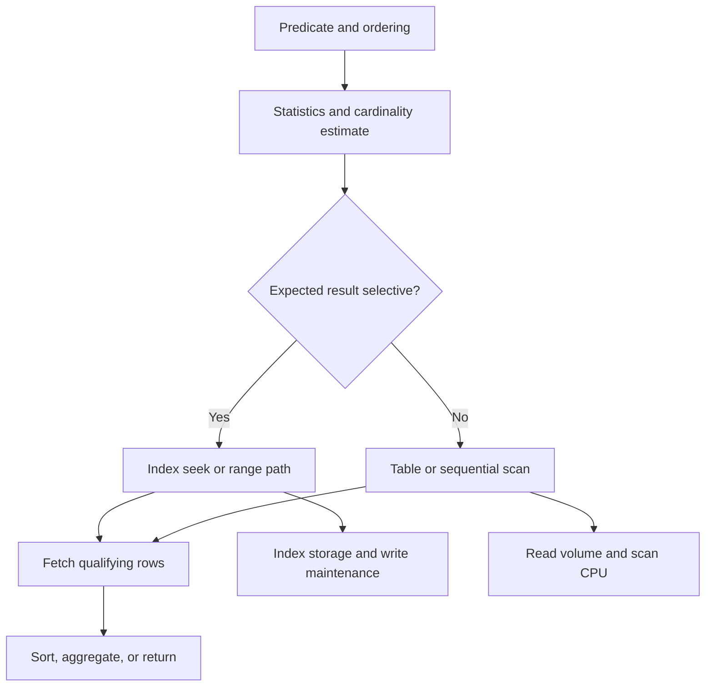
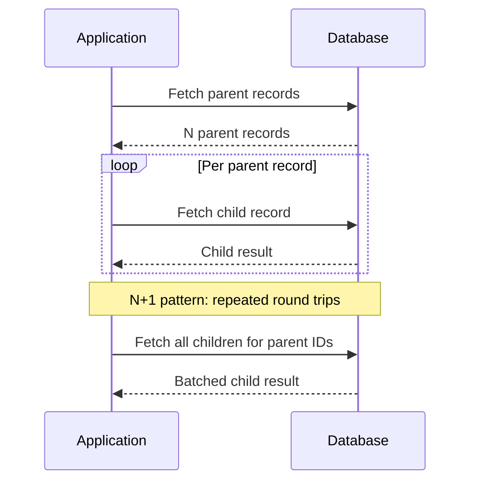
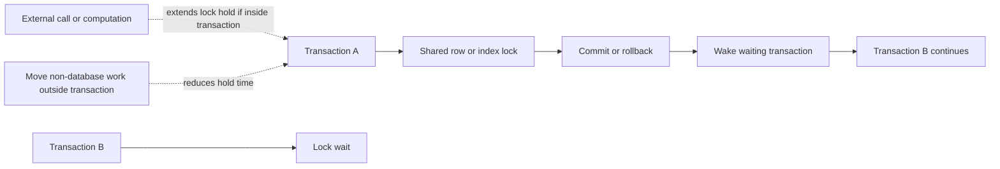
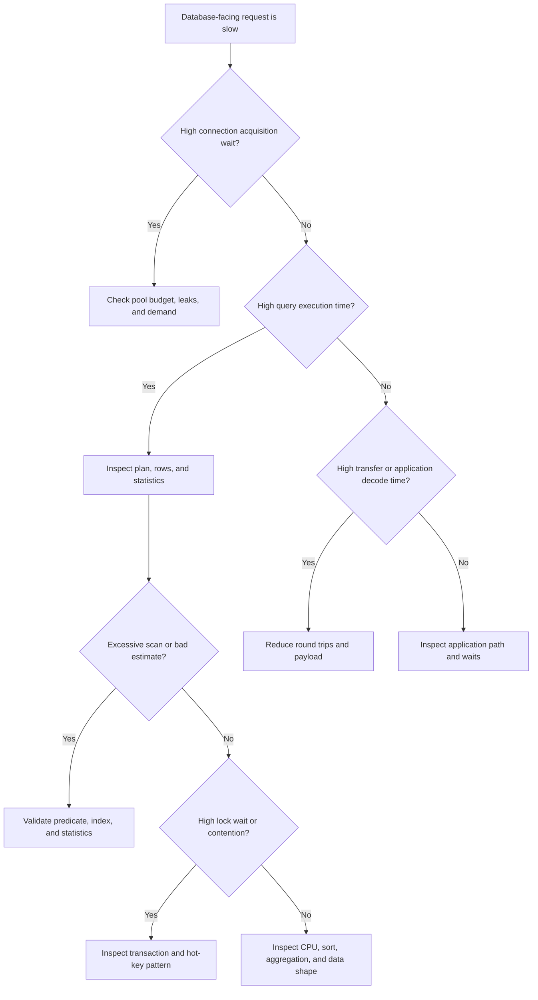

# Database Optimization

Part: [19 — Performance Engineering](PART_OVERVIEW.md)

Database optimization improves the workload that reaches a database by identifying expensive plans, access paths, contention, data shape, and application interaction. The goal is not to make one query look fast in isolation if the change increases write cost, storage, or tail latency elsewhere. Part 06 owns database and query-engine internals; this chapter provides a cross-engine performance method.

## Trace a Request Into the Query Plan

Database time includes connection-pool wait, network transfer, parsing or planning where relevant, execution, lock wait, and result decoding. Separate these stages before changing SQL or indexes. A query plan estimates or describes how the engine accesses data; compare estimated and observed row counts and execution behavior on representative parameters.

```mermaid
flowchart LR
    Application[Application request] --> Pool[Connection acquisition]
    Pool --> Network[Network and protocol]
    Network --> Planner[Parse, plan, and optimize]
    Planner --> Access[Access path and operators]
    Access --> Storage[Pages and indexes]
    Storage --> Locks[Locks and concurrent work]
    Locks --> Result[Rows returned]
    Result --> Decode[Transfer and application decoding]
```

Measure query count, duration distribution, rows examined and returned, bytes, lock wait, connection wait, and plan identity. A low database execution time with high application latency points elsewhere; a fast query that returns too much data can still cost substantial network and decode time.

## Compare Scan and Index Access Paths

An index can reduce rows examined for selective predicates, but adds storage and write maintenance. A table or index scan can be faster when most rows are needed or data is small and cache-resident. The choice depends on selectivity, data distribution, statistics, ordering, and parameter values. Validate with actual workload and plan evidence.

Do not add an index solely because a column appears in a slow query. Check composite-key order, predicate shape, sorting, partial conditions, and workload write rate. Revisit stale statistics, parameter skew, and plan changes. Indexes can improve reads while worsening write latency, storage, and maintenance windows.

## Eliminate N+1 and Excessive Round Trips

An application can issue one query per returned object, turning a bounded request into many network round trips. Batching or set-based queries often reduce fixed overhead, but very large batches can increase lock duration, memory, or result size. Choose a batch size from latency, transaction, and capacity requirements.

Batching reduces round trips but changes data and error boundaries. Preserve pagination, authorization filters, and transaction semantics. Compare query count, bytes, database CPU, lock duration, and end-to-end tail latency; do not assume one large query is always best.

## Diagnose Lock Contention and Transactions

Concurrent transactions can wait on locks or conflict over hot rows and indexes. Longer transactions hold resources longer and increase the chance of blocking. Reduce the work performed inside a transaction, access shared rows consistently, and batch writes carefully. Isolation-level and locking semantics remain owned by Part 06.

Use lock-wait and deadlock evidence to identify the conflict pattern and affected transaction. Moving work outside a transaction can introduce consistency gaps, so define idempotency, compensation, and state transitions. Adding connections rarely resolves lock contention and can increase the number of competing transactions.

## Follow a Diagnosis Tree

Start with the symptom and isolate whether the bottleneck is connection acquisition, query execution, lock wait, network transfer, or application decoding. Use a known slow-query sample and its plan, then test one change at a time. Refresh statistics or adjust access paths only when evidence supports the diagnosis.

After each change, confirm correctness, write impact, concurrency behavior, and workload-level latency. A benchmark with a warm cache and one parameter value may not predict peak production behavior.

## Worked Case: Order History Endpoint

An order-history endpoint has high p99 latency. Tracing shows low connection-acquisition time but many small queries. The query log reveals an N+1 pattern loading line items. The team batches line-item retrieval by a bounded set of order IDs, preserves tenant and pagination predicates, and compares plans at several account sizes.

The change reduces round trips and application decoding time, but a very large batch increases memory for accounts with years of history. The endpoint caps page size and streams only required fields. Load testing measures query count, rows and bytes, database CPU, lock wait, p95/p99 latency, and correctness across empty, small, and large histories.

## Review Questions

1. Which parts of database-facing latency occur outside query execution?
2. When can a scan outperform an index path?
3. What risks remain when replacing N+1 queries with one large query?
4. Why can more connections worsen lock contention?
5. What workload and parameter variation should validate an optimization?

Database optimization starts by locating the cost boundary. Inspect plans and data shape, reduce unnecessary round trips, understand contention, and validate read and write effects under representative concurrency before accepting a faster query as a faster system.
