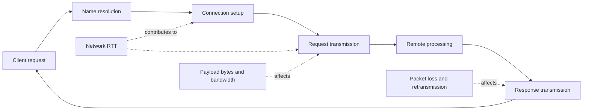
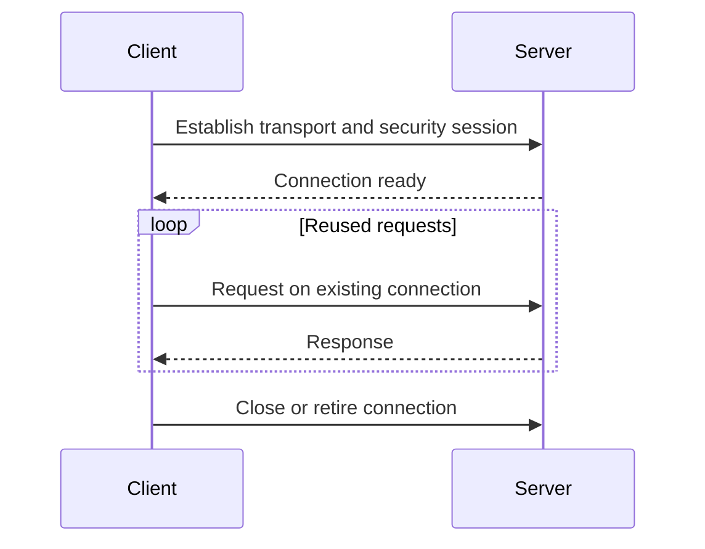
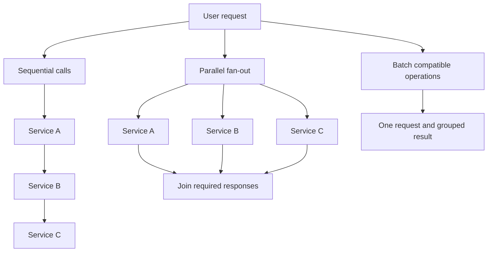
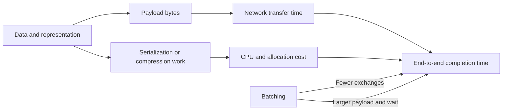
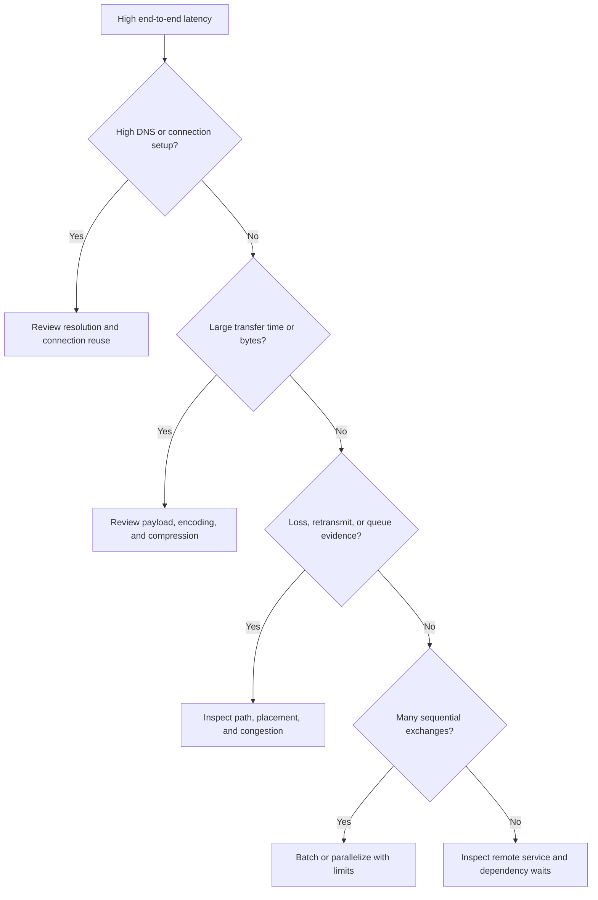

# Network Optimization

Part: [19 — Performance Engineering](PART_OVERVIEW.md)

Network optimization reduces communication delay, transfer cost, and resource use without weakening correctness, security, or freshness. The relevant variables include round trips, connection setup, payload size, bandwidth, packet loss, fan-out, and placement. Part 05 owns network and protocol mechanisms; Part 09 owns provider connectivity products.

## Budget Round Trips and Transfer Time

Round-Trip Time (RTT) is the time for a signal to travel to a peer and for a response to return. A request path with several sequential network exchanges can be dominated by propagation delay even when each service executes quickly. Large payloads add serialization and transfer time, while loss can trigger retransmission and increase tail latency.

Measure DNS, connection setup, time to first byte, transfer, remote processing, and retries separately where possible. A single request duration cannot show whether placement, payload size, or server execution dominates. Optimize the segment on the critical path rather than reducing a cost that is hidden by another wait.

## Reuse Connections and Multiplex Work

Connection reuse avoids repeated setup and can reduce CPU and handshake latency. Multiplexing allows multiple streams over a connection, but can introduce head-of-line effects or shared congestion depending on protocol and implementation. Pool size and lifetime should match server limits and workload concurrency.

Compare reused and fresh connections under realistic concurrency. Also test idle expiry and route change. Excessive keep-alive can consume server resources or retain stale routes; too-short lifetimes recreate handshake cost. Part 05 owns connection protocol details, while the workload design chooses reuse policy and validates capacity.

## Reduce Sequential Fan-Out

Every sequential network dependency adds latency. Parallel fan-out can reduce elapsed time to the slowest branch but increases simultaneous load and tail amplification. Batching can reduce round trips at the cost of payload size, response granularity, and potentially delayed work. Choose based on dependency semantics and the end-to-end deadline.

Parallelism is not free: it can overload a shared dependency and make the slowest branch control tail latency. Apply concurrency limits and deadlines. Batching should preserve per-item authorization and error reporting; one malformed item should not obscure every result unless atomicity is required.

## Trade Payload Size Against Compute

Smaller payloads reduce transfer and serialization cost but may require more CPU, reduce useful context, or cause extra requests. Compression can help when data is compressible and bandwidth-bound; serialization changes can help when encoding overhead dominates. Part 19 CH03 owns compression trade-offs in detail.

Measure bytes, encoding time, transfer time, and end-to-end latency together. Use field selection, pagination, binary formats, or compression only when they preserve client needs and data semantics. Avoid sending unused fields simply because bandwidth is available; reducing data can also reduce memory and privacy exposure.

## Localize the Bottleneck

Network latency can result from geographic distance, overloaded links, packet loss, connection churn, DNS, TLS, proxy behavior, or application-level retries. Compare client regions and paths, inspect distributions rather than averages, and correlate network evidence with service traces. A server CPU optimization does not help if time is spent waiting on a distant dependency.

Validate a suspected fix across network regions and failure conditions. Moving a service closer to users can increase replication complexity or move data across a policy boundary. Connection reuse, batching, compression, and placement each alter resource and correctness behavior.

## Worked Case: Mobile Product Search

A mobile search experience is slow for users on high-latency networks. Traces show three sequential calls to obtain category, product, and availability data, plus repeated connection setup. The team combines compatible reads into a bounded request, reuses secure connections, and removes unused response fields. Availability remains a distinct dependency with an explicit freshness marker.

The benchmark replays representative network RTT, bandwidth, and loss profiles. It measures time to first useful result, full completion, bytes, server CPU, and dependency load. Parallel search reduces median latency but increases p99 during inventory contention, so the team makes optional recommendations asynchronous and caps concurrent fan-out. It also verifies that regional routing respects data-residency rules.

## Review Questions

1. Which network segments contribute to end-to-end request time?
2. When does connection reuse help, and what server-side cost can it create?
3. How can parallel fan-out improve median while harming tail latency?
4. Which measurements distinguish payload cost from remote processing?
5. What policy or consistency constraints could invalidate a placement change?

Network optimization is a critical-path and resource-boundary exercise. Reduce unnecessary exchanges and bytes, reuse connections deliberately, constrain parallel fan-out, and validate placement against latency, capacity, and data policy.
