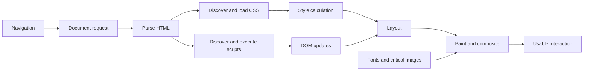
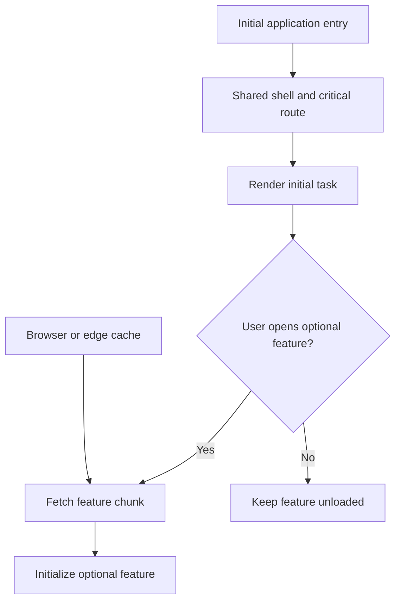
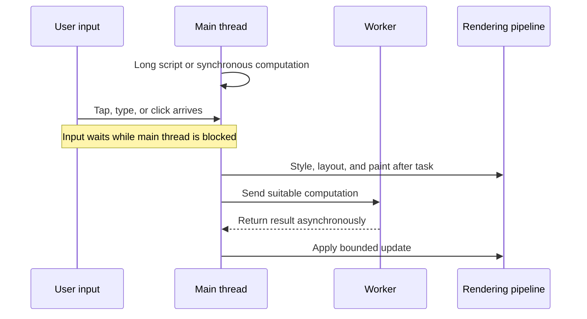
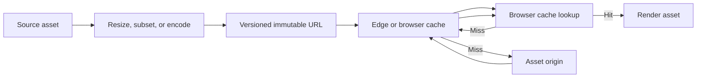
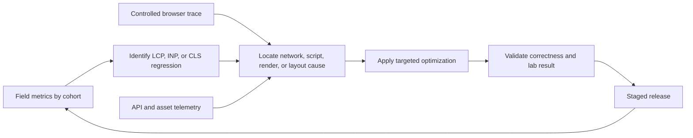

# Frontend Optimization

Part: [19 — Performance Engineering](PART_OVERVIEW.md)

Frontend performance is the time and stability users experience while content loads, becomes usable, and responds to input. It depends on network delivery, parsing, JavaScript execution, rendering, layout stability, and backend work. Part 04 owns frontend architecture and framework behavior; Part 05 owns HTTP and CDN protocol mechanics.

## Follow the Critical Rendering Path

The browser discovers HTML, stylesheets, scripts, fonts, and images; it parses and schedules them before painting and interaction. Render-blocking resources, server delay, and script execution can postpone the first useful content. Optimize the critical path for the page's primary task rather than loading every asset before the user can act.

Measure time to first byte, first contentful paint, main-content paint, and interaction readiness. Avoid optimizing an early paint that contains no useful content. Defer non-critical scripts, inline only small critical styles when justified, and verify that changes do not produce layout shifts or delayed functionality.

## Split Bundles and Load on Demand

Code splitting reduces initial JavaScript by loading route or feature code when needed. It can improve first load but add a later network dependency and loading state. Split along user journeys and dependency boundaries; avoid a proliferation of tiny chunks that increases request overhead or causes duplicate library downloads.

Show a stable loading state and handle chunk-load failure with a retry or recovery path. Preload only when navigation intent and network conditions justify it. Measure total transferred bytes, parse and execution time, cache behavior, and the latency of the interaction that triggers lazy loading.

## Reduce Main-Thread Blocking

Long tasks block input and rendering on the main thread. Large synchronous computations, hydration, event handlers, and repeated layout work can make a page feel unresponsive even when network load is complete. Break work into smaller tasks, move suitable computation to workers, and avoid layout thrashing by batching reads and writes.

Use browser traces and interaction metrics to find long tasks and layout work. Moving code to a worker does not automatically improve total performance if serialization, memory copies, or coordination dominate. Keep user input responsive and validate that asynchronous results cannot overwrite newer state.

## Deliver Assets Efficiently

Images, fonts, and scripts can dominate bytes and critical-path time. Serve appropriately sized and formatted images, cache immutable versioned assets, and load below-the-fold media lazily. Fonts can delay text rendering or cause layout shifts; subset and preload only critical fonts when evidence supports it. Part 19 CH02 owns CDN trade-offs, and CH03 owns compression selection.

Asset policy should reflect content freshness and privacy. Public immutable assets can use long cache lifetimes with versioned names; personalized content needs an isolated or private cache path. Measure cache hit, transferred bytes, decoding time, and visual impact rather than treating smaller files as a complete success criterion.

## Connect User Metrics to Optimization

Core Web Vitals are Largest Contentful Paint (LCP), Interaction to Next Paint (INP), and Cumulative Layout Shift (CLS). They describe loading, interaction responsiveness, and visual stability. Track field data across device and network cohorts alongside lab tests, backend latency, and release versions. A field regression can arise from larger bundles, a slower API, third-party scripts, or a shift in device mix.

Set targets for the audience and page journey, and evaluate suitable percentiles rather than averages. Separate lab reproducibility from field representativeness. Do not optimize a metric by hiding content, reducing accessibility, or delaying essential actions; user success remains the governing outcome.

## Worked Case: Product Detail Page

An online store sees slow mobile product pages. Field data shows poor LCP on low-bandwidth devices and elevated INP after hydration. Traces reveal oversized hero images, a large shared script, and synchronous recommendation logic. The team serves responsive image variants, splits the recommendation feature, and defers its computation until after the primary purchase controls are interactive.

The rollout tracks LCP, INP, CLS, image bytes, JavaScript parse time, and conversion errors by device cohort. It confirms that the purchase flow remains accessible before recommendations load and that the page has no layout jump when images arrive. A backend delay remains visible as a separate contributor rather than being misdiagnosed as a browser-only issue.

## Review Questions

1. Which resources block the page's primary useful content or interaction?
2. What trade-off does lazy loading introduce for the triggering interaction?
3. How can main-thread work delay input after network loading completes?
4. Which asset caching rules preserve both reuse and freshness?
5. How do field cohorts and lab traces work together to locate regressions?

Frontend optimization follows the user's critical path from navigation through useful interaction. Measure field and lab behavior, reduce blocking work and unnecessary bytes, and verify that improvements preserve correctness, accessibility, and visual stability.
