# Layered Architecture

Part: [20 — Architecture Patterns](PART_OVERVIEW.md) · Status: Revised (in-depth rewrite)

## 1. Introduction

Layered architecture is the oldest and most widely used way to organize the inside of an application. The code is divided into horizontal groups called layers, each with one kind of responsibility, and a rule says which layers may use which others. Most engineers have worked in a layered codebase without naming it: a controller calls a service, the service calls a repository, the repository talks to a database. The pattern is so common that it is often applied by habit, without checking whether the forces that justify it are present, and without enforcing the rules that make it more than a folder convention.

For an engineer moving into architecture, the useful skill is not drawing the stack. It is knowing what the stack is supposed to buy, what it costs, how it quietly degrades, and when a different pattern fits better. A layered design that is enforced keeps the effect of a change local: a new report format touches the presentation layer, a pricing change touches business rules, a database migration touches data access. A layered design that is not enforced is a single coupled program with several directories, and it gives none of those benefits while still charging the ceremony.

This chapter owns the layered pattern as a general architecture pattern: its forces, structure, dependency rules, variants, quality-attribute consequences, evolution paths, enforcement, and failure modes. The boundaries with neighbouring material are deliberate:

- Solution-level component, deployment, and runtime design belongs to [High-Level Design](../07_System_Design_and_Distributed_Systems/CH03_High_Level_Design.md), and class-level building blocks such as entities, value objects, and repositories belong to [Low-Level Design](../07_System_Design_and_Distributed_Systems/CH04_Low_Level_Design.md). This chapter uses them as vocabulary and does not re-teach them.
- Language and framework mechanics, such as how the Java platform packages and loads code, belong to [Java Architecture](../03_Software_Engineering_Foundations/CH01_Java_Architecture.md) and the other chapters of Part 03.
- Pattern definitions that refine or replace the layered stack have their own chapters: [Hexagonal Architecture](CH02_Hexagonal_Architecture.md), [Clean Architecture](CH03_Clean_Architecture.md), [Onion Architecture](CH04_Onion_Architecture.md), and [Microservices](CH05_Microservices.md). This chapter compares against them and does not duplicate their detail.
- Database design, schema normalization, and indexing belong to [Normalization](../06_Databases_and_Storage/CH01_Normalization.md) and [Indexes](../06_Databases_and_Storage/CH03_Indexes.md). Interface design for the outer boundary belongs to [REST](../08_API_Architecture/CH01_REST.md). Caching belongs to [Caching](../19_Performance_Engineering/CH01_Caching.md).

After studying this chapter, a reader should be able to:

1. State the forces that make a layered structure appropriate, and the forces that argue against it.
2. Define what a layer is, what each conventional layer owns, and the difference between a layer and a deployment unit.
3. Apply the dependency rules of strict and relaxed layering, and explain what open and closed layers mean for change propagation.
4. Trace a request through the layers and say what each layer is allowed to know.
5. Choose between layering variants for a given system using concrete criteria.
6. Reason about how the pattern affects modifiability, testability, performance, deployability, operability, and security.

## 2. The Foundational Model

### 2.1 What a layer is

A layer is a group of code with one kind of responsibility and an explicit rule about which other groups it may use. Two parts of that definition carry the weight. The responsibility must be a single idea that a reader can state in a sentence ("translates web requests into calls on the application"), otherwise the layer becomes a drawer for miscellaneous code. The dependency rule must be written down and checkable, otherwise the layer is a naming convention that the first deadline will erode.

Layers are a logical concept. They are not processes, servers, or networks. The word tier names the physical or deployment counterpart: a web tier, an application tier, and a database tier are separately deployed things that communicate over a network. A three-layer application can run in one process on one host (one tier), or each layer can run on a different host (three tiers). The two ideas are independent, and mixing them causes real design errors. Putting a network call between every layer to "do it properly" multiplies latency and failure modes without improving the logical separation. Keeping layers in one process, with the dependency rules enforced in code, gives most of the modularity benefit at a fraction of the operational cost. Deployment is a separate decision, covered by the neighbouring chapter on [Microservices](CH05_Microservices.md) and by the deployment parts of this handbook.

A layer is also different from a module in the vertical sense. A layer cuts across features: the "service layer" contains the code for orders, customers, and billing. A module (or feature slice) cuts down through the layers and contains everything for one business capability. The tension between these two cuts is the central design tension of the pattern and returns in the later discussion of the modular monolith.

### 2.2 The conventional layers

Four layers appear in most descriptions, though the names vary between teams and frameworks. The names matter less than the responsibility statements.

| Layer | Responsibility | Typical contents | Must not contain |
| --- | --- | --- | --- |
| Presentation | Translate an external protocol or user interaction into calls on the application, and translate results back | Web controllers, message listeners, command-line handlers, view models, request validation of shape and syntax | Business rules, transaction control, direct database access |
| Application | Coordinate one use case: load data, invoke rules, save results, manage the transaction boundary, publish events | Use-case services, command and query handlers, transaction demarcation, authorization checks tied to a use case | Protocol details, SQL, pricing or eligibility rules |
| Domain | Hold the business rules and the concepts they operate on | Entities, value objects, domain services, policies, invariants | Framework annotations for transport, persistence-specific types, I/O |
| Infrastructure (data access) | Implement technical capabilities the rest of the system needs | Repositories, database mappings, message-broker clients, external API clients, file storage | Business decisions, request handling |

Some teams merge the application and domain layers into a single "business" or "service" layer, which gives the classic three-layer arrangement of presentation, business, and data. The four-layer version separates use-case coordination from business rules, which pays off when several use cases share the same rules, or when the rules deserve to be tested without any coordination code around them. For a small application with simple rules, three layers are enough, and splitting further adds files without adding clarity. The criterion is whether two use cases would otherwise duplicate a rule, or whether the rule logic is complicated enough to warrant isolated testing.

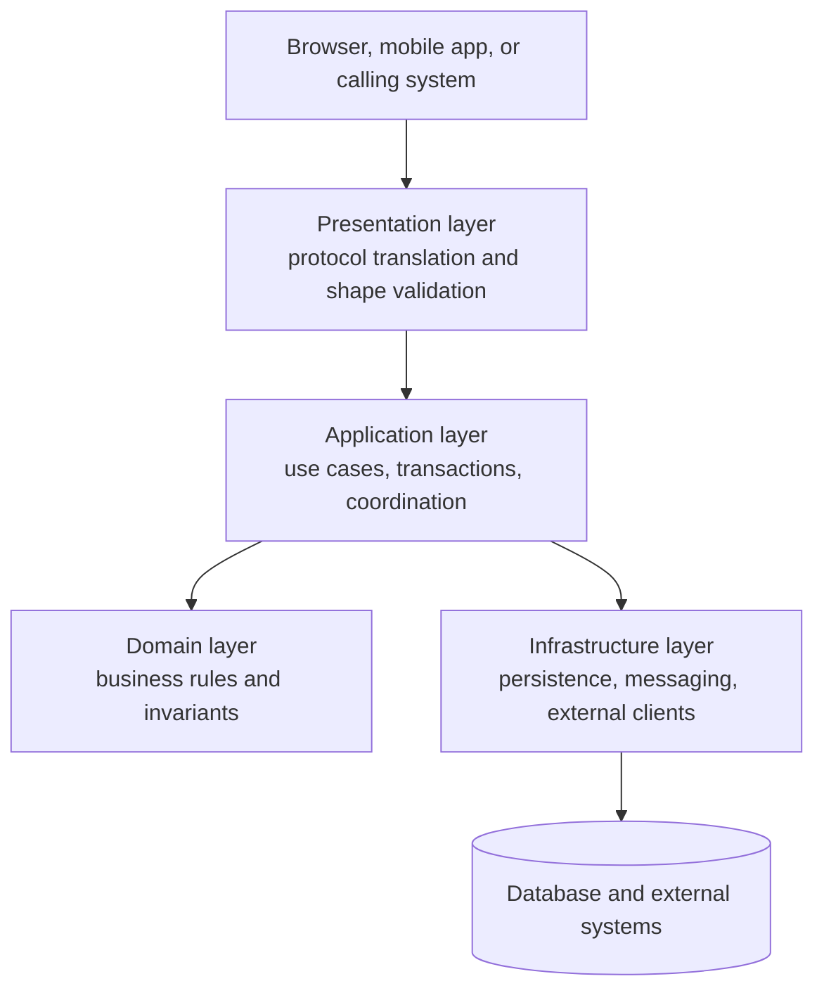

The diagram shows the conventional stack with the usual downward calls. Two details deserve attention. First, the application layer calls both the domain and the infrastructure layer, so the domain is not sandwiched between presentation and data access in a strict chain. Second, the arrow from the infrastructure layer to the store is the only place where storage technology should be visible. Everything above that arrow should be able to describe its needs in business terms. How strictly that is achieved depends on the dependency rules in the next sections, and on whether the domain owns the contracts the infrastructure implements, which the later section on dependency inversion examines.

### 2.3 The dependency rule

The defining rule is that a layer may depend only on layers below it. Presentation uses application, application uses domain and infrastructure, and nothing lower ever refers to anything higher. The rule has a direct effect on change. If the presentation layer is replaced, from a web interface to a message listener, nothing below changes, because nothing below knew about it. If the domain changes, the layers above may need updating, which is the expected direction of effect because higher layers exist to use lower ones.

The corollary is that upward dependencies are the first thing to forbid. A domain object that imports a web framework class, or an infrastructure class that calls back into a presentation component, ties the lower layer to a technology or concern that should be free to change. Cyclic dependencies between layers are the extreme case, because they make the layers impossible to build, test, or reason about separately. Detecting both is straightforward with static analysis, which the later section on enforcement covers.

Whether a layer may skip a level, for example presentation calling domain directly, is the question that separates strict from relaxed layering, and it is the next topic after the forces that make the pattern worth using.

## 3. Forces and Context

A pattern is a response to forces: pressures that pull a design in different directions. Layering resolves some forces well and ignores others, so stating them up front is the honest way to decide whether to adopt it.

### 3.1 Forces that favour layering

- **Separation of concerns across skills and rates of change.** Web protocol handling, business rules, and storage access change for different reasons and at different speeds. Interface frameworks are replaced every few years, business rules change with each commercial decision, and database schemas change with data growth. Grouping code by reason to change limits how many files one change touches.
- **A team that is organized by technical skill or is small enough to share everything.** Where a single team owns the whole application, horizontal layers match how people think about the code, and a new engineer can find where a kind of logic lives without learning feature boundaries first.
- **Need for a simple, widely understood structure.** Layering is familiar to most engineers, supported by most frameworks, and needs no special runtime. Onboarding cost is low. For an application whose value is in its domain, not its structure, the cheapest structure that works is the right one.
- **Testability of business rules in isolation.** If rules live in a layer that does not import web or database code, they can be tested with plain objects and no infrastructure running. This force is strong when the rules are complicated.
- **Replaceable technology at the edges.** When there is a real chance that the user interface, the persistence technology, or an external provider will change, a layer boundary localizes that change.

### 3.2 Forces that argue against it, or that it does not address

- **Independent delivery by several teams.** Horizontal layers force every feature to pass through every layer. If two teams own different features but share the same service and data-access layers, they edit the same files and coordinate releases. This is a force for vertical slicing, covered in the later modular monolith discussion, or for independently deployable services.
- **Very simple create-read-update-delete applications.** When the "business rule" is to store what the user typed, layers add a controller, a service that only forwards, and a repository that only forwards. Each method is written three times and no layer does any real work.
- **Large differences in scale or reliability between parts of the system.** A layer is not a deployment boundary. If one capability needs a hundred times the capacity of another, or must stay up while another is being redeployed, layering in one process cannot give that. Independent scaling and failure isolation are the territory of [Microservices](CH05_Microservices.md) and of the cell and serverless patterns in later chapters of this part.
- **Domain complexity that outgrows an anemic service layer.** When the business rules are rich and numerous, a thin layered structure tends to put all logic in the service layer, treating domain objects as data holders. The rules become procedural scripts. Richer models and stricter boundary rules are the response, and they are developed in [Hexagonal Architecture](CH02_Hexagonal_Architecture.md), [Clean Architecture](CH03_Clean_Architecture.md), and [Onion Architecture](CH04_Onion_Architecture.md).
- **Heavy cross-cutting data access patterns.** Reporting, search, and analytics queries often want to read across entities in shapes the domain model does not represent. Forcing them through the rule-holding layers adds cost with no protection, which pushes teams to create the shortcuts discussed in the later section on detecting cross-layer shortcuts.

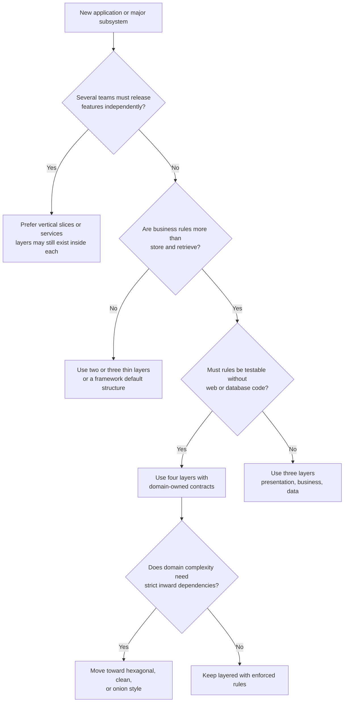

The decision tree is a prompt for discussion, not an algorithm. Its main message is that layering is rarely the whole answer for a large organization: the first question is about delivery independence, and a yes sends the design toward vertical boundaries before any horizontal ones are drawn. The second and third questions size the layering to the actual rules in play. The final branch shows that layering shades into the inward-dependency family of patterns as domain complexity and testing demands grow, which is a spectrum, not a contrast between right and wrong choices. A team that chooses "Keep layered with enforced rules" at that last node is making a defensible decision, as long as it enforces them.

### 3.3 Context checks before adopting

Four short checks help avoid adopting the pattern on autopilot. First, name the rate-of-change difference that justifies each layer boundary. If you cannot, merge the layers. Second, name who owns each layer. If the same people change all layers for every feature, the boundary is for code clarity, which is a fine reason, but it should not be defended as a team boundary. Third, identify the expected technology replacements in the next few years, if any, since these define which contracts earn an abstraction. Fourth, decide how the rules will be enforced. A structure with no enforcement plan is a structure that will drift.

## 4. Layering Variants and Their Dependency Rules

### 4.1 Strict and relaxed layering

In strict layering, a layer may call only the layer directly beneath it. Presentation calls application, application calls domain, domain calls infrastructure, and nothing skips a level. The benefit is maximum isolation: replacing the layer below affects only the layer immediately above. The cost is pass-through code. A request for a customer's name may cross three layers that each add nothing, only forwarding the call.

In relaxed layering, a layer may call any layer below it. Presentation may call the domain directly for a trivial read. This removes pass-through code and lets simple operations stay simple. The cost is that more layers depend on each lower layer's interface, so changing a lower layer has a wider reach, and the shortcuts are exactly where authorization and rule checks are skipped by accident.

Neither variant is correct in general. The choice is a trade between ceremony and the reach of change. A workable policy is relaxed by default for reads with an explicit, documented list of allowed shortcuts, and strict for anything that changes state, since state changes are where skipped rules cause data errors.

### 4.2 Open and closed layers

A closed layer must be passed through: requests from above reach lower layers only via that layer. An open layer may be bypassed. The concept makes the strict-versus-relaxed choice explicit per layer instead of for the whole stack, and it is a precise tool for deciding where shortcuts are legal.

Consider an application with presentation, business, services, and persistence layers. If the services layer holds only shared utilities such as date formatting, tax-code lookup, or audit logging, making it closed forces the business layer to funnel every call through code that adds nothing. Marking it open lets the business layer call persistence directly and use the shared services only where needed. The layer is still a layer, with a defined responsibility, but it is not on the mandatory path. The rule to record with each layer is therefore twofold: what it contains, and whether it is open or closed.

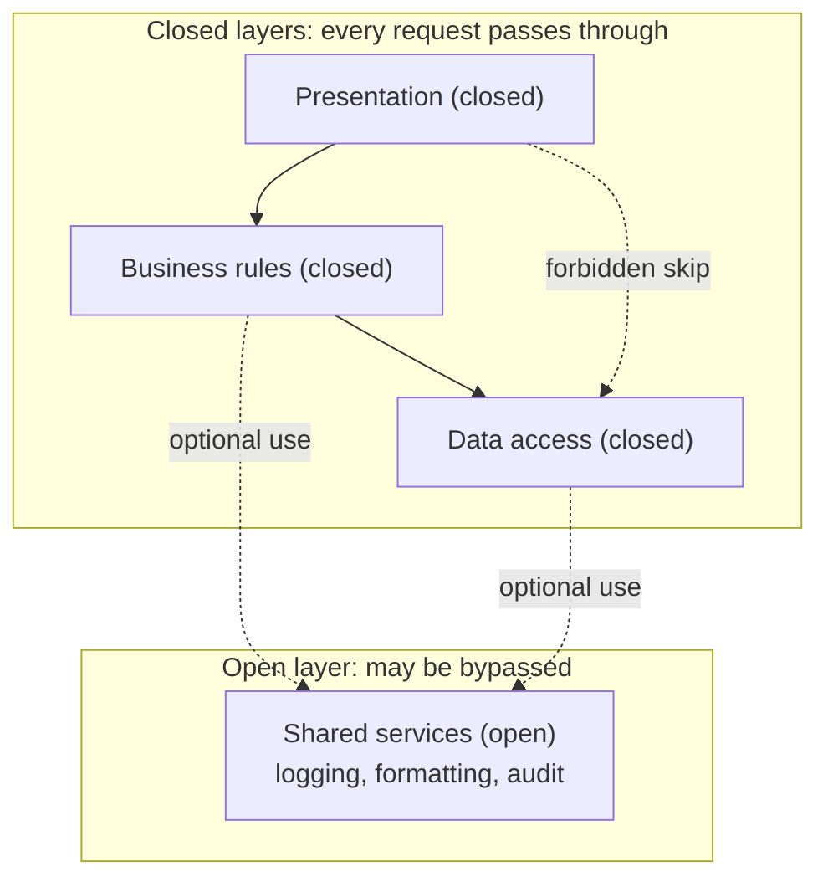

The diagram makes the policy readable. The three closed layers form a mandatory chain, so presentation cannot reach data access. The open shared-services layer sits beside the chain, so business and data access can use it without a pass-through hop. The forbidden skip marks the shortcut the team has chosen to ban. The implication is that "how many layers" matters less than the written rule for each one, because an unrecorded open layer looks like a violation to the next reviewer, and an unrecorded closed layer gets bypassed by anyone in a hurry.

### 4.3 Other layering styles worth distinguishing

- **Horizontal technical layers (the conventional style).** All code is organized by technical role. It is the simplest and fits small or single-team applications.
- **Vertical feature slices with layers inside.** Each feature or capability owns its own presentation, application, domain, and data code, and layers exist within each slice. This is the structure used in a modular monolith and is the usual evolution when several teams share one codebase. Layers still enforce a direction within each slice; a separate rule governs how slices call one another.
- **Layers of abstraction rather than of responsibility.** Some systems, notably network protocol stacks and operating systems, use layers where each one offers a simpler abstraction to the layer above and hides the one below. The same dependency rule applies, and it is the older origin of the pattern, but the layers are defined by level of abstraction, not by application responsibility. The distinction matters because advice for application layers (for example, "put business rules in the domain layer") does not carry over to protocol-style layers.
- **Inverted dependencies.** In the hexagonal, clean, and onion styles the domain sits at the centre and infrastructure depends on contracts the domain owns. This keeps the layered idea of ordered responsibilities but changes the direction of the source-code arrow for infrastructure. The later section on dependency inversion explains the mechanism, and the dedicated chapters in this part develop it.

The table summarizes how the main variants compare on the dimensions that usually decide the choice.

| Variant | Isolation of lower layers | Pass-through code | Fits | Main risk |
| --- | --- | --- | --- | --- |
| Strict, closed layers | Highest | Highest | Systems with strong rules and long lifetimes | Boilerplate and pressure to bypass |
| Relaxed layers | Medium | Low | Small teams and mostly simple operations | Silent skipping of rules |
| Open and closed mix | Medium to high, by policy | Moderate | Applications with shared utility layers | Policy not written down |
| Vertical slices with inner layers | Per slice | Moderate | Several teams on one codebase | Slices reaching into each other |
| Inverted (hexagonal, clean, onion) | Highest for the domain | Moderate, mostly mapping | Rich domains and long-lived rules | Extra abstractions with no change benefit |

## 5. How a Request Flows Through the Layers

### 5.1 A write request, step by step

Runtime request flow is easiest to understand by following one state-changing request. Take a customer placing an order. The trace below separates what happens in each layer and what each layer is allowed to know.

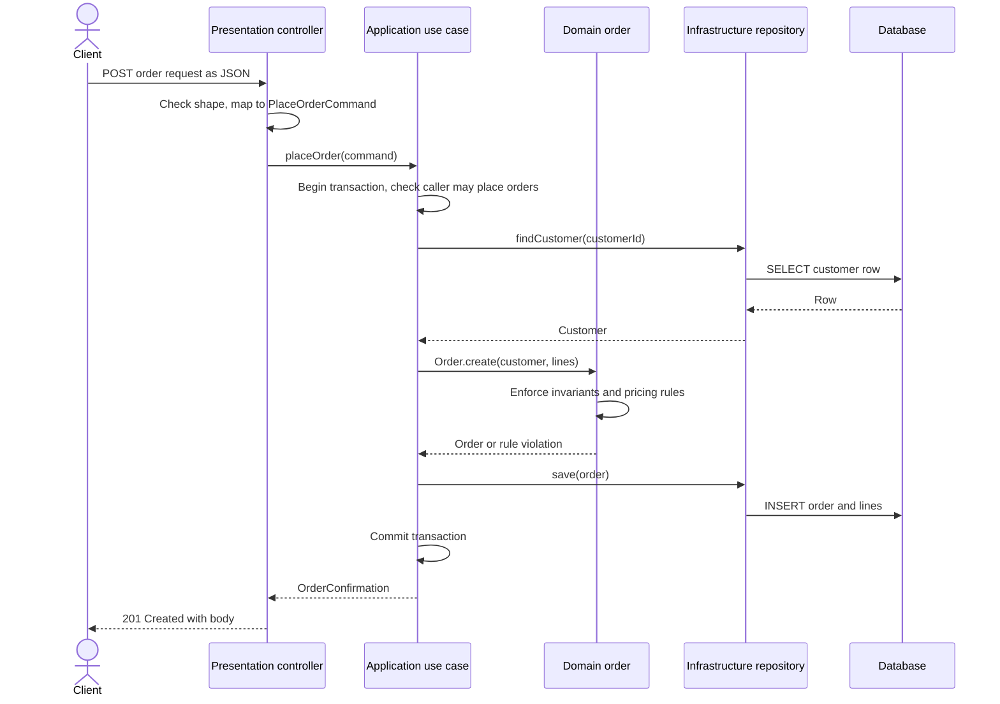

Each step has an owner. The controller checks that the request is well formed (required fields present, numbers parse) and builds a command object that carries no web types. It does not decide whether the order is acceptable. The use case opens the transaction, because it is the only layer that knows which operations must succeed or fail together, and it checks that the caller may perform this use case. The domain object enforces the rules that make an order valid, such as a minimum quantity, a credit limit, or a price calculation. The repository translates between objects and rows and knows nothing about the rules.

Two points follow. Validation is split by kind: shape and syntax at the edge, business validity in the domain. If all validation sits in the controller, a second entry point such as a message listener or a batch job must repeat it or skip it. Second, the transaction boundary is a property of the use case, not of the repository. If each repository method opens its own transaction, saving an order and deducting stock become two commits, and a failure between them leaves inconsistent data. How transactions behave across more than one database or service is a distributed-systems topic owned by Part 07.

### 5.2 A read request, and where it may be shorter

A read request that fetches an order for display follows the same path in strict layering but usually has no business rule to apply. The use case checks that the caller may view the order, the repository loads it, and a mapper builds a response model. Requiring the domain layer in this path adds an object construction that does nothing. This is why relaxed policies for reads are common: the read use case may call a query contract that returns a read-specific shape, skipping the domain model entirely, as long as the authorization check is still made in the application layer. The check is the part that must not be skipped, and the later section on cross-layer shortcuts returns to this.

### 5.3 What crosses a layer boundary

What passes between layers is a design decision with performance and coupling consequences.

- **Presentation to application:** command and query objects, or simple parameters. Passing the raw HTTP request or a framework type into the application layer ties business code to the web framework.
- **Application to domain:** domain objects and values.
- **Domain or application to infrastructure:** domain objects in, domain objects or query results out. Passing persistence entities (with lazy-loading proxies or mapping annotations) up through the layers lets storage behaviour leak into rules and views. A lazy collection that triggers a database query when the view renders is the classic form of this leak.
- **Application to presentation:** result objects or response models, not live domain objects with mutable state. Returning domain objects directly lets the presentation layer call methods that change state, and it makes the web response format a hidden change driver for the domain.

Mapping objects at each boundary is the price of independence. It means writing and maintaining conversion code, and it costs some processing per request. For small applications the price may exceed the benefit, and teams reasonably pass one model through several layers. The risk to accept knowingly is that a change to a database column then shows up in the web response format. The usual compromise is to map at the outermost boundary (web to command, result to response) and share domain objects between the application and domain layers, which have the same reason to change.

### 5.4 A compact Spring Boot illustration

The following sketch (Java 21, Spring Boot) keeps the dependency direction visible. Package names show the layers, and the use case owns the transaction.

```java
// presentation
@RestController
@RequestMapping("/orders")
class OrderController {
    private final PlaceOrder placeOrder;
    OrderController(PlaceOrder placeOrder) { this.placeOrder = placeOrder; }

    @PostMapping
    ResponseEntity<OrderResponse> create(@Valid @RequestBody OrderRequest req) {
        var confirmation = placeOrder.handle(
            new PlaceOrderCommand(req.customerId(), req.lines()));
        return ResponseEntity.status(201).body(OrderResponse.from(confirmation));
    }
}

// application
@Service
class PlaceOrder {
    private final CustomerRepository customers;
    private final OrderRepository orders;
    PlaceOrder(CustomerRepository customers, OrderRepository orders) {
        this.customers = customers;
        this.orders = orders;
    }

    @Transactional
    OrderConfirmation handle(PlaceOrderCommand cmd) {
        var customer = customers.findById(cmd.customerId())
            .orElseThrow(() -> new UnknownCustomerException(cmd.customerId()));
        var order = Order.create(customer, cmd.lines()); // rules live here
        orders.save(order);
        return new OrderConfirmation(order.id(), order.total());
    }
}

// domain
final class Order {
    static Order create(Customer customer, List<OrderLine> lines) {
        if (lines.isEmpty()) throw new RuleViolation("An order needs at least one line");
        var total = lines.stream().map(OrderLine::amount).reduce(Money.ZERO, Money::plus);
        if (total.exceeds(customer.creditLimit())) throw new RuleViolation("Credit limit exceeded");
        return new Order(OrderId.next(), customer.id(), lines, total);
    }
    // constructor, id(), total() omitted
}
```

Three things in the sketch are worth reading closely. The controller handles only the web shape, annotated validation of the request body, and a mapping to a command. The `@Transactional` annotation sits on the use case, so loading the customer and saving the order commit together. The `Order` class imports no Spring or persistence types, so its rules can be tested with ordinary unit tests. The repository interfaces are used by the use case and implemented in infrastructure; whether they are declared in the domain or in the infrastructure package is the dependency inversion decision examined in the next section. The sketch is illustrative and omits exception mapping, idempotency, and the mapping between the order object and its stored form.

### 5.5 Runtime direction and source direction

The sequence above shows calls moving downward at runtime. Source-code dependencies, meaning which file imports which, usually move the same way in a plain layered design. When the domain declares a contract and infrastructure implements it, the runtime call still goes from the use case to the repository, but the source dependency from the repository implementation points up to the contract in the domain. Keep the distinction clear when reading diagrams: a runtime call arrow and an import arrow are different relationships, and the dependency rule is a statement about imports.

## 6. Dependency Inversion and Where Strictness Fits

### 6.1 The mechanism

In a plain layered design the source-code arrows follow the call direction: the application layer imports the repository class from the infrastructure layer, so the use case cannot be compiled or tested without the persistence code and its framework. The dependency inversion principle reverses only that one arrow. High-level policy (the use case and the domain) declares the contract it needs, in its own vocabulary, and the low-level detail (the database code) implements that contract. Both sides now depend on an abstraction, and the abstraction lives with the policy side.

The runtime call is unchanged. The use case still calls `save(order)` and the repository still runs the `INSERT`. What changes is which package imports which:

```java
// package com.example.shop.domain  (owns the contract)
public interface OrderRepository {
    Optional<Order> findById(OrderId id);
    void save(Order order);
    List<Order> overdueFor(CustomerId customerId, LocalDate asOf);
}

// package com.example.shop.infrastructure  (depends on the domain, not the reverse)
class SqlOrderRepository implements OrderRepository {
    private final OrderTable table; // mapping and driver types stay in this package
    SqlOrderRepository(OrderTable table) { this.table = table; }

    @Override public Optional<Order> findById(OrderId id) { return table.load(id).map(OrderRow::toOrder); }
    @Override public void save(Order order) { table.upsert(OrderRow.from(order)); }
    @Override public List<Order> overdueFor(CustomerId customerId, LocalDate asOf) {
        return table.selectOverdue(customerId.value(), asOf).stream().map(OrderRow::toOrder).toList();
    }
}
```

The method names describe business questions (`overdueFor`), not storage operations. A framework wires `SqlOrderRepository` into the use case at startup, which keeps the construction decision outside both layers.

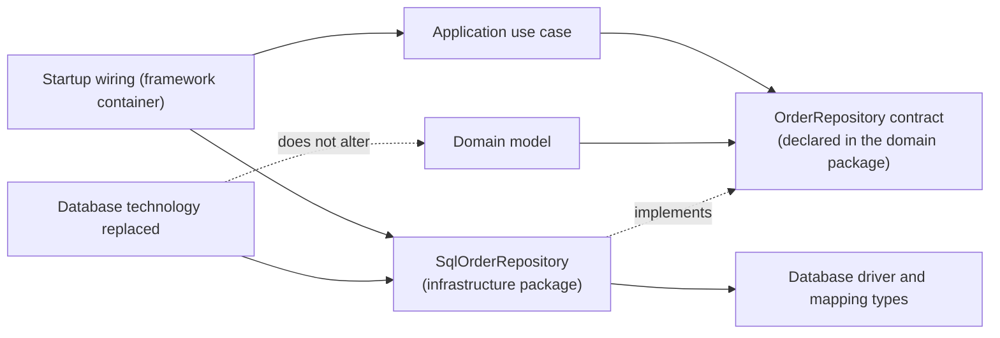

The diagram separates three kinds of arrow. Solid arrows are imports, the dotted "implements" arrow is the inverted dependency, and the wiring box is the only place that knows both sides. The practical implication is the blast radius of a storage change: swapping the relational mapping for another store edits the infrastructure package and the wiring, and the contract, the domain, and the use case compile unchanged. That claim holds only while the contract speaks in domain terms. A repository interface that mirrors every table method, or that returns a persistence entity, keeps the original coupling under a new name, and a future store change then edits the contract and every caller.

### 6.2 Which boundaries earn an inversion

An interface costs a file, a naming decision, and one more indirection to follow in a debugger. It pays back when at least one of these holds:

- The implementation is likely to be replaced, or has more than one real implementation (for example, a payment provider with a sandbox and a live variant).
- The use case needs to be tested without the real thing, and a faster fake would give the same confidence.
- The detail drags a heavy dependency (a client library, a driver, a framework type) that the policy code would otherwise import.
- The boundary is owned by another team or an external party, so the policy needs protection from its changes.

It does not pay back for pure functions, for in-memory collaborators in the same layer, or for a class that has one implementation, no test double, and no expected replacement. Applying an interface everywhere produces a codebase where every class has a twin and reading any flow means jumping through three files. A defensible default is to invert at the edges where the system meets something it does not control, and to leave internal collaborators concrete until a second implementation or a test need appears. Adding an interface later is a mechanical refactoring; removing a hundred speculative ones is a cleanup project.

### 6.3 Worked example: choosing strictness per boundary

Take the order application from the earlier request trace and decide, boundary by boundary, whether to use strict layering, relaxed layering, or an inverted contract. The example is a design exercise for a mid-sized shop system with one team; the verdicts would change for another context.

| Boundary | Call kind | Decision | Reason |
| --- | --- | --- | --- |
| Controller to `PlaceOrder` use case | State change | Strict: only through the use case | The use case owns the transaction and the caller check, so skipping it loses both |
| `PlaceOrder` to `Order.create` | State change | Direct call, no interface | A pure domain function with no replacement, so an interface adds nothing |
| `PlaceOrder` to `OrderRepository` | Persistence | Inverted: contract in domain | Tests use an in-memory fake, and the storage technology may change |
| `PlaceOrder` to `PaymentGateway` | External provider | Inverted: contract in domain | Two real implementations (sandbox and live) and an external party owning the API |
| Order detail screen to storage | Read, no rules | Relaxed: controller calls a read contract | A single query returning a response shape is enough, and the application layer still checks access |
| Monthly export job to storage | Bulk read | Relaxed: a dedicated read adapter | Loading the domain model for each row would cost more than the export itself |

Reading the table top to bottom shows the policy in a form a reviewer can enforce: strictness follows the risk of the call. State changes pass through the use case and the domain because that is where rules and transactions live. Reads that carry no rules may take a shorter path as long as the access check is not lost. Contracts are inverted only where a second implementation, a test double, or an external owner exists. The relaxed rows also name the exceptions, which is what makes them enforceable later. An exception that is not written down is indistinguishable from a violation, so the list belongs next to the layer definitions in the architecture documentation and, if the team keeps them, in an architecture decision record (see [Architecture Decision Records](../21_Architecture_Documentation/CH03_ADR_Architecture_Decision_Record.md)).

The strict-versus-relaxed choice also interacts with the inversion choice. A relaxed read path that skips the domain still needs a contract if the presentation layer must not import storage types. The usual answer is a small query interface owned by the application layer, returning a flat result record. That keeps the rule "presentation never imports infrastructure" intact while letting reads avoid the full domain model.

## 7. Enforcing Layer Rules

### 7.1 Why a written rule is not enough

A layering rule that lives only in a diagram or a wiki page decays at the rate of the team's deadlines. The first import that "just works" is accepted in review because the reviewer cannot see the whole dependency graph in a diff, and the second import is accepted because the first one set a precedent. Enforcement means turning the rule into something a machine checks on every change, so that a violation is a failing build and not a debate.

Three mechanisms are available, and they differ in strength and cost:

| Mechanism | What it checks | Strength | Cost |
| --- | --- | --- | --- |
| Build-system module boundaries (separate Maven or Gradle modules, or language-level modules) | Whether a module can see another module's classes at compile time | Strongest, because an illegal import does not compile | Needs a module per layer or slice, with build configuration to maintain |
| Architecture tests in the unit-test suite (for example ArchUnit, a Java library that checks imports and package rules) | Package and class dependency rules, cycles, naming, annotations | Strong, runs in the normal test phase | Rules need maintenance when packages are renamed |
| Dependency analysis and fitness functions in continuous integration (CI) | Trends and thresholds across the codebase, such as cycle count or cross-module call counts | Medium, good for gradual repair | Needs a baseline and someone who reads the results |

Module boundaries and architecture tests are complementary. Separate modules prevent the most severe violation, a lower layer importing a higher one, because the compiler has no path to the class. Architecture tests catch the rules that modules cannot express, such as "the domain package must not import persistence annotations" when the domain and infrastructure code share a module for simplicity.

### 7.2 An architecture test in Java

The following test (JUnit 5 with ArchUnit) states the layer rules from the earlier sections as executable checks. Package names follow the sketch used earlier in this chapter, and the infrastructure layer is allowed to depend on the domain and application layers because it implements contracts they declare.

```java
import com.tngtech.archunit.core.importer.ImportOption;
import com.tngtech.archunit.junit.AnalyzeClasses;
import com.tngtech.archunit.junit.ArchTest;
import com.tngtech.archunit.lang.ArchRule;

import static com.tngtech.archunit.lang.syntax.ArchRuleDefinition.noClasses;
import static com.tngtech.archunit.library.Architectures.layeredArchitecture;
import static com.tngtech.archunit.library.dependencies.SlicesRuleDefinition.slices;

@AnalyzeClasses(packages = "com.example.shop", importOptions = ImportOption.DoNotIncludeTests.class)
class LayerRulesTest {

    @ArchTest
    static final ArchRule layers = layeredArchitecture().consideringOnlyDependenciesInLayers()
        .layer("Presentation").definedBy("com.example.shop.presentation..")
        .layer("Application").definedBy("com.example.shop.application..")
        .layer("Domain").definedBy("com.example.shop.domain..")
        .layer("Infrastructure").definedBy("com.example.shop.infrastructure..")
        .whereLayer("Presentation").mayNotBeAccessedByAnyLayer()
        .whereLayer("Application").mayOnlyBeAccessedByLayers("Presentation", "Infrastructure")
        .whereLayer("Domain").mayOnlyBeAccessedByLayers("Application", "Infrastructure")
        .whereLayer("Infrastructure").mayNotBeAccessedByAnyLayer();

    @ArchTest
    static final ArchRule domainIsFrameworkFree = noClasses()
        .that().resideInAPackage("com.example.shop.domain..")
        .should().dependOnClassesThat().resideInAnyPackage(
            "org.springframework..", "jakarta.persistence..", "com.fasterxml..");

    @ArchTest
    static final ArchRule noCyclesBetweenFeatures = slices()
        .matching("com.example.shop.(*)..").should().beFreeOfCycles();
}
```

Three details are easy to get wrong. The `layeredArchitecture()` rule checks only the relationships between the declared layers, so a class in an undeclared package is invisible to it, which is why the layer definitions must cover every top-level package. The "Application may be accessed by Infrastructure" clause exists because the infrastructure layer in this design may reference application-level types, and it should be removed if the team keeps infrastructure dependent on the domain alone. The third rule targets the slices that appear directly under `com.example.shop`, so it is only meaningful once the code is organized in feature packages, as described in the modular monolith section below; for a pure layer-first layout it would detect cycles between the layer packages themselves, which is also a valid outcome.

A violation should fail with a readable message that names the offending class and the rule. If the team inherits a codebase with existing violations, a frozen baseline (ArchUnit offers a freezing wrapper for rules) records current violations in a file and fails only on new ones, which lets enforcement start on day one while the old shortcuts are repaired gradually.

### 7.3 Dependency analysis and fitness functions

An architectural fitness function is an automated check that measures whether a stated quality of the architecture still holds, and fails or warns when it does not. The ArchUnit rules above are fitness functions with a binary result. Others are numeric and tracked over time:

- Count of imports that cross a forbidden layer boundary (target: zero, ratcheted downward from a baseline).
- Count of package cycles (target: zero).
- Number of classes in the domain package that import framework types (target: zero).
- Fan-out of each feature package, meaning how many other feature packages it imports, to spot a module that is becoming a hub.

A ratchet makes gradual repair concrete. Suppose a legacy codebase has 37 forbidden imports today (an illustrative figure). The pipeline stores 37 as the permitted maximum. A change that adds a violation raises the count to 38 and fails the build. A change that removes five lowers the stored maximum to 32, so the improvement cannot be undone silently. After the team removes violations at a rate of about five per sprint, the count reaches zero in eight sprints, since $37 / 5 = 7.4$ rounds up to 8. The arithmetic matters less than the mechanism: the number can only go down, so the codebase moves toward the rule without a stop-the-world rewrite.

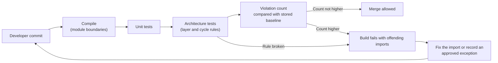

The pipeline places the cheapest and strongest checks first. Compilation stops the most severe violations before any test runs, architecture tests give a precise message, and the ratchet handles legacy debt without blocking unrelated work. The recorded exception path at the end is important: when a shortcut is legitimate, the way to allow it is a visible, reviewed exception with an owner, not a rule that is switched off. Exceptions that accumulate without review are a signal that the rule or the structure needs rethinking, which is itself useful architectural feedback.

Dependency analysis tools can also render the actual import graph of the codebase, which is worth comparing with the intended diagram once per quarter or after a large merge. The comparison finds the dependencies that tests do not yet forbid. Treat the picture as evidence for a conversation and add a rule for anything the team decides is wrong.

## 8. Cross-Layer Shortcuts and Anemic Domain Models

### 8.1 What counts as a shortcut

A cross-layer shortcut is a dependency or call that bypasses the layer that is supposed to mediate it. Some are harmless, and some skip a rule that matters. The table lists the common forms with how to detect and repair each.

| Shortcut | Why it hurts | Detection | Repair |
| --- | --- | --- | --- |
| Controller queries the database directly | Skips authorization and business rules, ties the web response to the schema | Architecture test: presentation must not depend on infrastructure | Route through a use case or a read contract owned by the application layer |
| Domain class imports a web or persistence framework type | The rules cannot be tested or reused without the framework | Architecture test: domain must not depend on framework packages | Move the annotation or type into infrastructure and map at the boundary |
| Persistence entities returned to the view | Lazy loading runs queries during rendering, schema changes alter the response | Search for entity types in controller signatures | Return response records built in the application layer |
| Use case catches a database exception and branches on its code | Storage details decide business flow | Search for driver exception types in the application package | Translate in infrastructure to a domain-level error |
| One service calls another feature's repository | Bypasses the other feature's rules and couples to its tables | Slice rule: features may use another feature only through its published contract | Call the other feature's use case or event |
| Business rule written in a SQL view or stored procedure | Rules split across the application and the database, tested in two ways | Review of database objects against the rule catalogue | Move the rule into the domain, or document the database as the owner |

Not every row is a defect in every system. A stored procedure may be the right owner of a rule when the database is shared by several applications and must enforce it regardless of the caller. The point is that ownership is chosen and recorded, not left to accident.

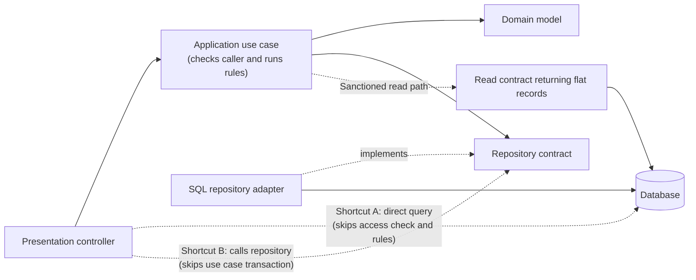

The two dotted shortcut arrows lead into the database and the repository without passing the use case. Shortcut A loses the access check and every rule. Shortcut B is less visible: the data is correct and the rules may not matter for a read, but a write through this path runs outside the transaction the use case would have opened, so two repository calls can commit separately. The sanctioned read path at the bottom shows that the fix for slow or awkward reads is a second, explicit route that still starts at the application layer, not a free-for-all in the controller. Review conversations go better when the diagram shows the legal alternative and not only the prohibition.

### 8.2 The anemic domain model

An anemic domain model is a domain layer whose classes hold data and accessors but no behaviour, while all rules sit in service classes that read and write those fields. It is the most common quiet failure of a layered design, because every layer still exists and every dependency arrow is legal, yet the domain layer does no work. The signs are easy to spot in a review:

- Domain classes consist of fields, getters, and setters, and nothing enforces an invariant. Any code can put an order into an impossible state by calling setters in the wrong order.
- Service classes are long, named after the entity (`OrderService`), and contain conditionals that restate the same rule in several methods.
- Tests for business rules need the whole service with mocked repositories, because the rule has no home that can be tested alone.
- The same rule appears in two use cases with slightly different wording, since nothing forces sharing.

The repair moves behaviour to the object that owns the data. The following before-and-after sketch uses a cancellation rule (illustrative: an order may be cancelled only before it ships).

```java
// before: rule in the service, state exposed through a setter
class OrderService {
    void cancel(Order order) {
        if (order.getStatus() == Status.SHIPPED) {
            throw new IllegalStateException("Already shipped");
        }
        order.setStatus(Status.CANCELLED);
    }
}

// after: the rule is a method on the domain object, and state changes only through it
final class Order {
    private Status status = Status.PLACED;

    void cancel() {
        if (status == Status.SHIPPED) {
            throw new RuleViolation("A shipped order cannot be cancelled");
        }
        status = Status.CANCELLED;
    }
}

class CancelOrder {
    @Transactional
    void handle(OrderId id) {
        var order = orders.findById(id).orElseThrow();
        order.cancel();
        orders.save(order);
    }
}
```

After the change, the use case coordinates and the domain decides. A second use case that needs to cancel an order, such as a bulk cancellation after a supplier failure, calls the same method and inherits the same rule. The rule can be tested with `new Order()` and one assertion, with no repository and no mock.

Anemic models are not always wrong. A system whose rules are limited to field validation and storage may be correctly modelled with data holders and a thin service layer, and forcing behaviour into the objects would add ceremony. The test is whether business rules exist and are duplicated or scattered. When they do, the structure is hiding a domain model that wants to exist. The richer boundary styles in [Hexagonal Architecture](CH02_Hexagonal_Architecture.md), [Clean Architecture](CH03_Clean_Architecture.md), and [Onion Architecture](CH04_Onion_Architecture.md) put this behaviour at the centre by design, and the class-level building blocks are covered in [Low-Level Design](../07_System_Design_and_Distributed_Systems/CH04_Low_Level_Design.md).

### 8.3 Repairing shortcuts safely

Fixing shortcuts in a live system follows an order that limits risk:

1. **Stop new violations.** Add the architecture tests with a frozen baseline so that existing shortcuts are tolerated and new ones fail the build.
2. **Rank the existing violations by risk, not by count.** A controller that reads storage for a public report is low risk. A controller that writes through a repository without the use case is high risk because it skips transactions and rules.
3. **Add characterization tests around the shortcut** before touching it, so that behaviour is pinned. A test that calls the endpoint and asserts the response and the stored rows is enough.
4. **Introduce the missing seam.** Create the use case or read contract, move the logic into it, and point the controller at it. The behaviour should not change in this step.
5. **Delete the old path and lower the baseline.** The ratchet from the enforcement section then prevents regression.

Not every query must pass through a rich domain model. A reporting path may use a read-specific adapter if it preserves access controls and has an explicit ownership boundary. The layering should clarify where policy lives, not create ceremony around every field access, so the target state for a read-heavy shortcut is often a documented read path and not a trip through the domain.

## 9. Layers Inside a Modular Monolith

### 9.1 Package by layer and package by feature

A modular monolith is one deployable application whose code is divided into modules with enforced boundaries, each owning a business capability. Layering and modularity are two cuts through the same code, and the question is which cut is the top-level one.

```text
package-by-layer                      package-by-feature
com.example.shop                      com.example.shop
  presentation                          orders
    OrderController                       OrderController
    CustomerController                    PlaceOrder
  application                             Order
    PlaceOrder                            OrderRepository
    RegisterCustomer                      SqlOrderRepository
  domain                                customers
    Order                                 CustomerController
    Customer                              RegisterCustomer
  infrastructure                          Customer
    SqlOrderRepository                    CustomerRepository
    SqlCustomerRepository                 SqlCustomerRepository
```

In the package-by-layer layout, every feature touches every top-level package, and any two teams working on different features still edit the same four packages. Visibility rules are of little help, because the classes of different features share a package and can see each other. In the package-by-feature layout, each feature owns a package, classes can be package-private inside it, and only the published use case and contract types are public. The layer rules still apply inside each feature, and the architecture tests can check them with patterns such as `com.example.shop.*.domain..` when a feature is large enough to keep sub-packages.

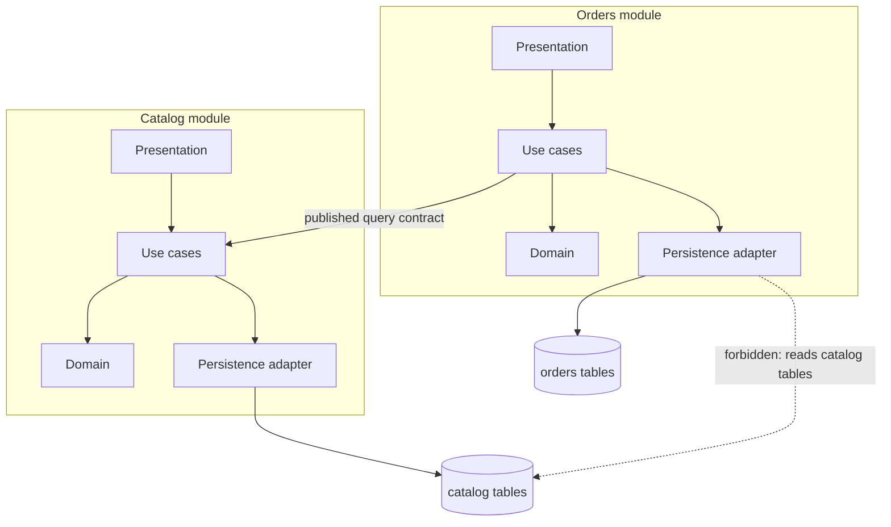

The diagram shows two modules that each hold a full internal stack. The single solid arrow between them goes from use case to use case through a published contract, and the forbidden dotted arrow marks the shortcut that most often erodes a modular monolith: one module reading another module's tables because the join is convenient. The implication is that module boundaries cover data as well as code. If Orders needs the product name, it asks Catalog through the contract, or it stores the copy it needs, with a clear rule for how the copy is refreshed. Each module's tables should be owned by exactly one module, even when all tables live in the same database.

### 9.2 Module contracts and transaction boundaries

Inside one module, the use case owns the transaction, as established earlier. Across modules, the choice is between two designs:

- **One shared transaction.** The Orders use case calls the Catalog use case in the same thread, and both run inside the transaction the caller opened. This gives atomic behaviour and is simple, but the modules are now coupled at commit time: a slow Catalog operation holds Orders' locks, and a Catalog failure rolls back the order. It also makes extraction harder, because a later network call cannot join a database transaction.
- **Separate transactions with a published event.** Orders commits, then records an event (for example, `OrderPlaced`) that Inventory handles in its own transaction. The modules are decoupled at commit time, and the later move to a message broker changes the transport and not the contract. The price is eventual consistency: for a short time the order exists and the stock has not yet been reserved, so the design must define what the user sees in that window and how a failed reservation is compensated.

A workable rule for a modular monolith is to allow a shared transaction only between modules that are expected to stay together, and to use events between modules that may separate. The event-based style raises the problem of atomically saving state and publishing the event; the standard answers belong to [Event-Driven Architecture](CH07_Event_Driven_Architecture.md) and the [Saga Pattern](CH10_Saga_Pattern.md), and distributed transaction theory belongs to Part 07. Within a single database, a simple way to keep both writes atomic is to insert the event into an outbox table in the same transaction as the state change, and have a separate relay publish it.

The contract itself should be small and stable. It exposes use-case methods and plain data records, not domain entities, so a module can change its internals without recompiling its callers. Enforcement uses the same tools as for layers: a slice rule that a module may reference another module's published package only, and a rule that the internal packages are unreachable from outside.

### 9.3 Worked arithmetic: change impact and build time

The two figures below are illustrative, built to show the effect of structure on change; measure the real codebase before using them in a decision.

**Change overlap.** Assume three teams run twelve concurrent changes in one sprint, each change adding a feature that touches the presentation, application, domain, and infrastructure code of one feature. With a package-by-layer layout, all twelve changes touch the same four packages, so every pair of changes shares a package. The number of pairs is $\binom{12}{2} = 66$. With package-by-feature and six features, assume the changes spread evenly, two per feature. Only changes in the same feature share a package, giving $6 \times \binom{2}{2} = 6$ overlapping pairs. The reduction is $1 - 6/66 \approx 91\%$. Sharing a package is not the same as editing the same file, so these counts are an upper bound on possible merge conflicts and a measure of how many pairs of people must coordinate about the same area.

**Build time.** Assume eight modules that each take 45 seconds to compile and test, for 360 seconds when everything is rebuilt. A change in the Orders module, which two other modules depend on, needs three modules rebuilt when the build tool compiles only affected modules: $3 \times 45 = 135$ seconds, which is $135 / 360 = 37.5\%$ of the full build. A change in a leaf module with no dependents rebuilds only itself: $45 / 360 = 12.5\%$. A layer-first layout with one module can offer no such shortcut, because every change may affect every class, so the cost is the full 360 seconds each time unless a finer incremental tool is in use. The point is that module boundaries create a dependency graph the build can exploit, and a flat structure does not.

Both effects depend on discipline. If Orders and Catalog start calling each other freely, the dependency graph becomes a cycle and the saving disappears, which is why the cycle rule from the enforcement section covers modules as well as layers.

## 10. Testing, Performance, Security, and Evolution Across Layers

### 10.1 Testing per layer

Layers give each kind of test a clear target. The cost of a test rises with the number of real components it involves, so most tests should sit where behaviour is concentrated and few should need everything.

| Layer | Test kind | What is real | What is replaced | Speed |
| --- | --- | --- | --- | --- |
| Domain | Unit tests of rules and invariants | Domain objects only | Nothing | Milliseconds |
| Application | Use-case tests | Use case and domain | In-memory fakes of the repository and gateway contracts | Milliseconds to tens of milliseconds |
| Infrastructure | Contract tests of each adapter | Adapter and a real database or a provider sandbox | Nothing in the adapter | Hundreds of milliseconds or more |
| Presentation | Slice tests of mapping, validation, and status codes | Controller and serialization | The use case, stubbed | Tens of milliseconds |
| Whole system | A few end-to-end paths | All layers | External providers | Seconds |

The same contract test suite should run against the in-memory fake and the real adapter, so the fake cannot drift from the behaviour the use-case tests rely on. Where rules are rich, this distribution yields many fast domain tests and few slow ones, which is the effect measured in the case study.

### 10.2 Layer-hop performance arithmetic

An in-process call between layers costs nanoseconds, so the number of layers is almost never a performance problem. The costs that matter are object mapping, extra queries, and network hops. The figures are illustrative; measure before deciding.

- **Mapping.** Assume three boundary mappings per request at 20 µs each: $3 \times 20 = 60$ µs. A single query at 0.5 ms (500 µs) gives a request of about 560 µs, so mapping is $60 / 560 \approx 10.7\%$ of it. That is noticeable in a micro-benchmark and irrelevant when the request also includes a 40 ms call to an external provider.
- **Network hops between layers.** Placing the application and data-access layers on separate hosts adds, say, two round trips of 1 ms each: $560 + 2000 = 2560$ µs, about $4.6$ times the in-process cost, plus two new failure modes. This is the arithmetic behind keeping layers in one process unless there is a reason to separate them.
- **Extra queries through lazy loading.** Listing 50 orders where each lazily loads its lines issues $1 + 50 = 51$ queries, or $51 \times 0.5 = 25.5$ ms, against 2 queries, or $2 \times 0.5 = 1$ ms, with one query for orders and one for all their lines. The ratio is $25.5$. This is the leaky-layer problem in numbers, and the fix is a read contract that fetches what the response needs.

The conclusion is that layering rarely costs time directly, while careless boundaries cost it indirectly. Caching and query tuning are owned by [Caching](../19_Performance_Engineering/CH01_Caching.md) and [Indexes](../06_Databases_and_Storage/CH03_Indexes.md).

### 10.3 Security placement

Each security concern has a natural layer, and placing it there avoids both gaps and duplicated checks. Identity and permission models are owned by [Authentication](../15_Security/CH02_Authentication.md) and [Authorization](../15_Security/CH03_Authorization.md); this section only places the checks.

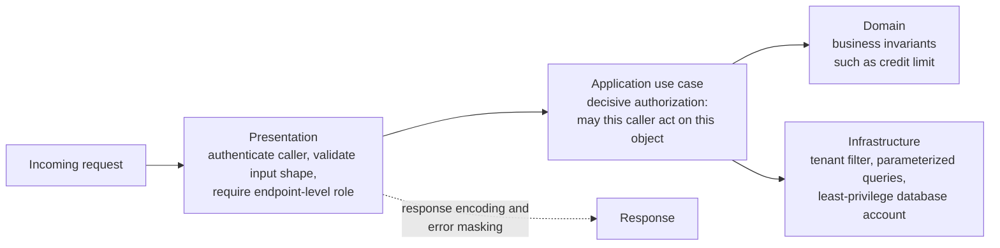

The edge authenticates and applies coarse checks, which fail cheaply and early. The decisive authorization sits in the use case, because it is the only layer that knows both the caller and the object, and it is shared by every entry point. The domain enforces business invariants, which are not permission checks even when they look similar. The infrastructure layer is the last line, applying a tenant filter in every query and using a database account limited to what the application needs, so a bug above it does not become full data access. The implication for reviews is that a check only in the controller is a gap for every other entry point, and a check only in the repository gives poor error messages and no business context. Defence in depth means more than one layer, each with its own job.

### 10.4 Evolution paths

A layered application can change shape without a rewrite. Four steps recur, ordered from least to most costly, and the decision flow in the comparison section tells when to take each. First, enforce the existing rules and invert the boundaries that earn it. Second, move behaviour from services into the domain, starting with the rule that is duplicated most. Third, repackage by feature and publish module contracts, which gives a modular monolith. Fourth, extract a module as a service along its contract, replacing the in-process call with a network interface and the shared transaction with an event. Each step leaves a working system, and each can stop where the symptoms disappear. The first two steps are cheap and nearly always worthwhile, and the last is justified only by the need for independent scaling, failure isolation, or ownership, as developed in [Microservices](CH05_Microservices.md).

## 11. Failure and Quality-Attribute Scenarios

A quality-attribute scenario states a stimulus, the response the architecture should produce, and a measurable criterion. The figures are illustrative targets for a mid-sized business application, to be replaced with the organization's own service level objectives (SLOs). They show what a layered design must demonstrate, not what it guarantees on its own.

| Id | Attribute | Stimulus | Expected response | Measurable success criterion |
| --- | --- | --- | --- | --- |
| S1 | Modifiability | A tax rule changes | Only the domain rule and its tests change | The change set touches 0 files in the presentation and infrastructure packages, and all architecture tests pass |
| S2 | Modifiability | The payment provider is replaced | One infrastructure adapter and the wiring change | 0 changed lines in the domain and application packages, and the shared contract test suite passes against the new adapter |
| S3 | Availability | Database queries slow to 10 times normal latency | Calls time out, one retry, a domain-level error reaches the client as a temporary failure | 95th percentile (p95) error response within 1.5 s, and connection pool never fully exhausted |
| S4 | Maintainability | A developer imports a repository into a controller | The build fails and names the class and the rule | Every deliberately seeded violation in a test branch fails the build, within 10 minutes of the push |
| S5 | Security | A user requests another tenant's order through the report path | The request is refused and audited | 0 cross-tenant rows returned across the negative test set, and 1 audit record per refusal |
| S6 | Reuse | A batch listener must place orders as the web interface does | The listener calls the same use case | 0 copies of the order rules, and one rule test suite passing for both entry points |

**S1 and S2: change stays where it belongs.** These two scenarios are the main reason for layering, so they should be checked, not assumed. A practical check is to review the last ten real changes of each kind and count how many files fell outside the expected layer. If a tax change keeps touching controllers, the rule is leaking into the presentation layer, and the layering is decoration. S2 also tests the contract: if the new adapter needs a change to the contract, the contract was shaped by the first provider and should be redrawn in domain terms.

**S3: a slow database must not become a hung system.** The scenario needs a time budget that each layer respects, otherwise every layer waits for the one below and threads pile up at the top. The sequence below assigns the budget.

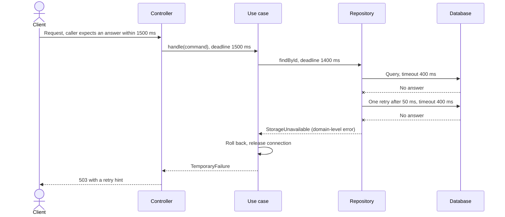

The arithmetic: two attempts of 400 ms plus a 50 ms pause is $2 \times 400 + 50 = 850$ ms, which fits inside the 1,400 ms repository deadline and the 1,500 ms client budget with 650 ms to spare for rollback and response mapping. Setting the repository timeout to 800 ms would give $2 \times 800 + 50 = 1650$ ms and miss the budget, so the per-call timeout must be derived from the outer deadline and not chosen independently. The implications for layering are specific. The repository translates the driver's timeout into a domain-level error, so the use case does not import driver exceptions. The use case owns the rollback, because it owns the transaction. The controller maps the error to a protocol response and does not decide whether to retry business operations. Retrying a state-changing call needs idempotency, which Part 07 owns; the retry here is safe because the failed call was a read.

**S4: the shortcut is caught before review.** The success criterion is verified by a seeded-violation test: a branch with a deliberate illegal import must fail the pipeline. A rule that has never been seen to fail is untested. Seeding one violation per rule after any rule change takes minutes and prevents a false sense of safety from a rule that matches no package.

**S5: the cheap read path is where tenant checks are lost.** The expected response relies on the application layer's access check surviving the shortcut from the earlier cross-layer section. The negative test set should include at least one request per read path, with an identifier that belongs to a different tenant. Security placement across layers is covered in section 10.3.

**S6: a second entry point exposes duplicated rules.** If the batch listener needs its own copy of the credit-limit check, the rule lived in the controller or in a controller-only validator. The success criterion is a count of rule copies, which a reviewer can verify with a text search for the rule's distinctive condition.

## 12. Worked Case Study: A Subscription Billing Application

The organization below is hypothetical and exists only to show the reasoning. All names and figures are illustrative.

**Context.** A software company (call it Ledgerleaf) sells subscription billing to small businesses. Fourteen engineers in three groups maintain one application written in Java with Spring Boot. It generates invoices, applies proration when a plan changes mid-month, calculates tax, collects payment through an external card provider, and serves a monthly revenue report. The first version was built as controllers calling one large `BillingService`. Pricing logic is duplicated in four places: invoice generation, plan change, refund, and the report export. Each pricing change takes four edits and has twice shipped with one copy missed. Tests need a running database, so the suite takes 12 minutes.

**Quality goals.** In priority order: correctness of money calculations, modifiability of pricing and tax rules, a test suite fast enough to run before every push, and replaceability of the payment provider, since the company is negotiating terms with its current one.

### 12.1 Decisions and rejected alternatives

| Decision | Chosen | Rejected | Reason |
| --- | --- | --- | --- |
| Overall style | One deployable application, layered, with an enforced dependency rule | Splitting into services now | Fourteen engineers do not have the delivery conflicts that justify distributed data and operations. The release process is one pipeline and nothing in the goals requires independent scaling |
| Number of layers | Four: presentation, application, domain, infrastructure | Three layers with one business layer | The pricing rules are shared by four use cases and need isolated tests, which is the criterion for separating domain from application |
| Top-level packaging | Package by feature (`billing`, `customers`, `payments`), layers inside each | Package by layer | Three groups own different features and were already colliding in shared packages |
| Contracts | Inverted contracts only for the payment gateway and the tax-rate provider, plus one store contract per module | A generic repository interface for each of the 11 tables | The generic interfaces mirrored table operations, never had a second implementation, and gave no test benefit. Only external boundaries have a real replacement need |
| Strictness | Strict for state changes, relaxed for the report read path with a mandatory tenant check | Strict everywhere | Loading domain objects for a report of 40,000 rows costs more than the report |
| Enforcement | Architecture tests with a frozen baseline, plus module rules | A written guideline | The first version already shows how guidelines decay |
| Domain model | Behaviour moved into `Invoice` and `Subscription` objects | Keep data holders with a service | Duplicated pricing logic is the sign that the rules want an owner |

Rejecting the full hexagonal style deserves a sentence, because the team considered it. The structure resembles it already, since the payment and tax contracts are ports and the adapters implement them. The team did not adopt the full vocabulary of primary and secondary ports for the web and listener side, because a thin controller calling a use case gave them the same testability. They record that choice in an architecture decision record and revisit it if a second inbound protocol appears, with the comparison in [Hexagonal Architecture](CH02_Hexagonal_Architecture.md).

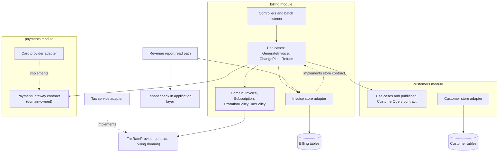

The final structure uses layers inside modules and inverts only the boundaries listed in the table. Reading the diagram, three implications stand out. First, the pricing and tax policies live in one place in the billing domain, so all four former copies call the same code. Second, replacing the card provider changes the adapter in the payments module and nothing in billing. Third, the report path reads through the store adapter, not through the domain, but starts at an application-layer tenant check, so the shortcut is explicit and guarded.

### 12.2 Validation evidence

The team does not accept the design on opinion. It collects four kinds of evidence over two sprints.

**Rule duplication.** A search for the proration condition finds four copies before and one after. That is a reduction of $(4 - 1) / 4 = 75\%$ in places to edit, and the two incidents of a missed copy cannot recur in the same form.

**Test time.** Before the change, 1,800 tests each needed the database, at an average of 0.4 s: $1800 \times 0.4 = 720$ s, or 12 minutes. After the move of rules into the domain, 1,500 tests run as plain unit tests at an average of 5 ms and 300 still use the database at 0.4 s:

$$1500 \times 0.005 + 300 \times 0.4 = 7.5 + 120 = 127.5 \text{ s}$$

That is about 2.1 minutes, a reduction of $1 - 127.5/720 \approx 82\%$. The 1,500 and 300 split comes from counting which tests exercise rules and which exercise mapping and queries. The 5 ms average is a measured mean for tests with no I/O in this hypothetical suite.

**Dependency rule.** At the start, the architecture tests report 52 forbidden imports, mostly controllers calling stores. The baseline is frozen at 52 and the ratchet lowers it as the use cases are introduced. At a pace of 13 per sprint, the count reaches zero after $52 / 13 = 4$ sprints. The team plans on that basis and checks the actual count at each sprint review, not trusting the projection.

**Change locality.** The team applies scenarios S1 and S2 to real work. A tax change from the next quarter's backlog is implemented and the change set is reviewed: it touches the tax policy and its tests, and no controller or adapter. A rehearsal of the provider swap implements a second adapter against a recorded sandbox and runs the shared contract tests; the domain and application packages show no diff.

### 12.3 What the team gave up

The decisions carry costs. Mapping code between the domain and the store adds about 600 lines (illustrative), and every engineer must learn which exceptions are allowed on the report path. The frozen baseline also shows 52 violations that remain for four sprints, which is a visible debt and not a hidden one. The cost the team watches most closely is drift in the module contracts: if `CustomerQuery` grows to mirror the customer tables, the modules are coupled again. A quarterly review of contract size, tied to the fitness functions earlier in this chapter, is the control.

## 13. Common Mistakes and Anti-Patterns

Each mistake below has a cause, a consequence, and a way to detect it. The anemic model and the shortcut forms were taught earlier and appear here with their causes so the whole set can be reviewed together.

| Anti-pattern | Typical cause | Consequence | Detection | Correction |
| --- | --- | --- | --- | --- |
| Anemic domain model | Domain classes generated from the schema, and rules added where the data is already loaded, which is the service | Duplicated rules, impossible states reachable through setters, rule tests needing mocks | Domain classes with only accessors, and the same condition in several services | Move behaviour to the owning object, and expose state changes as named methods |
| Leaky layers | A lower-layer type is convenient to pass up: a persistence entity in a response, a web request object in a use case, a driver exception in a branch | A schema or protocol change ripples through every layer, lazy loading runs queries during rendering | Architecture tests on package imports, and entity types in controller signatures | Map at each boundary, translate exceptions, return response records |
| God service layer | One `XxxService` per entity collects every operation for that entity because it is the obvious place to add code | Classes of thousands of lines, merge conflicts, no ownership, and a transaction scope that is hard to see | Class size, method count, and the number of distinct collaborators | Split into one use case per operation, and move rules into the domain |
| Pass-through layers | Strict layering applied where a layer has no responsibility | Three files per field, and slower reading with no isolation gained | Methods whose body is a single forwarding call | Merge the layers, or declare the layer open |
| Repository per table | A repository interface created for every table by habit | Interfaces that mirror storage, and a contract that changes with every schema change | Interfaces with one implementation and no test double | Keep contracts for real boundaries, and shape them around business questions |
| Network between every layer | Confusing layers with tiers | Added latency and failure modes with no change benefit | Remote calls between components deployed together | Keep layers in one process, and separate deployments only for an independent scaling or ownership need |
| Shared utility layer that grows | A "common" or "util" package that everyone may use and no one owns | A hidden dependency hub, cycles, and domain code importing helpers that import frameworks | Fan-in and fan-out of the common package | Give each helper an owner layer, and keep the shared package small, open, and free of business rules |
| Unenforced rules | The structure agreed in a workshop and never checked | Drift until the layers match the diagram only in the documentation | Compare the import graph with the intended diagram | Architecture tests, module boundaries, and a ratchet |

Two causes recur. The first is **convenience at the moment of change**. Each shortcut is small and saves an hour, so no single review rejects it, and the cost arrives later as slower change. Enforcement exists to make convenience visible. The second is **layers chosen by technology, not by reason to change**. When layers mirror frameworks (controller, service, repository, entity) and not responsibilities, the names guide where code goes, and the code lands in whichever class has the data. Asking what reason to change each class has, and putting classes with the same reason together, is the correction.

A god service layer is worth a separate remark because it looks like success. Every operation has an obvious home, new engineers find code easily, and the dependency rule is respected. The failure shows later in metrics: the file with the highest change frequency is also the one with the most authors, and a quarter's worth of merge conflicts concentrate there. Splitting by use case lets each class have one reason to change and lets two engineers work on two operations without touching the same file.

## 14. Comparison With Neighbouring Patterns

The related patterns are covered in their own chapters, so this section only places layering among them. The common thread of the hexagonal, clean, and onion styles is a domain at the centre with infrastructure depending on it. Layered architecture is the simpler starting point and can evolve into any of them. Microservices answer a different question, which is deployment and ownership, not internal code structure.

| Pattern | Main idea | What it adds to a layered design | Cost compared with layering | Choose it over layering when |
| --- | --- | --- | --- | --- |
| Layered (this chapter) | Ordered responsibilities with a downward dependency rule | Baseline | Lowest | Rules are modest, one team owns the code, and familiarity matters |
| [Hexagonal](CH02_Hexagonal_Architecture.md) | Application core surrounded by ports and adapters on both input and output sides | Symmetric treatment of inbound and outbound boundaries, and easy adapter substitution | Extra ports and adapters, and more mapping | Several entry points or several replaceable external systems exist |
| [Clean](CH03_Clean_Architecture.md) | Concentric rings with dependencies pointing inward | Explicit use-case boundary and entity ring, and a rule about data crossing boundaries | More types and a steeper learning curve | Policy is complex and must outlive frameworks |
| [Onion](CH04_Onion_Architecture.md) | Domain model at the centre with domain services and repository contracts around it | Domain-owned contracts as the default | Similar to clean | The team thinks in domain-driven terms and wants the domain model to be central |
| [Microservices](CH05_Microservices.md) | Independently deployable services that own their data | Independent delivery, scaling, and failure isolation | Network, data consistency, and operations overhead | Several teams need independent release and scale, and the organization can run distributed systems |

Layering and the others are not exclusive. A microservice is normally built with an internal structure, and a layered or hexagonal one is common. Choosing microservices does not remove the need for internal rules, and choosing layers does not rule out later extraction of a module into a service. The decision that matters is where the boundary of independence lies: inside the codebase (layers and modules) or across the network (services).

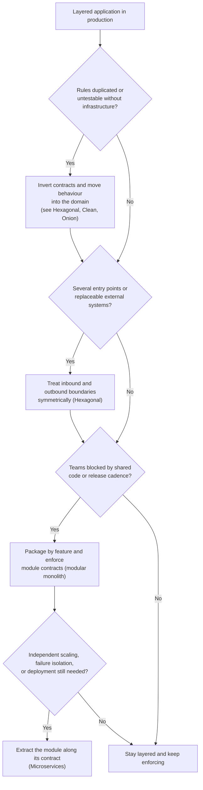

The flowchart reads as an evolution path and not as a one-time choice. Each question is triggered by an observed symptom, and each answer is the smallest step that addresses it. Inversion comes before modularity, because moving behaviour into the domain improves every later step. Extraction into a service comes last, and only when the independent-scaling or failure-isolation need remains after the modular monolith is in place. A team that jumps to the last step has taken on distributed-system costs to solve a problem that module boundaries would often have solved.

## 15. Design-Review Checklist

Use these questions when reviewing a layered design or an existing codebase. Each should be answerable with evidence, such as a test, a rule, or a document, and not with an opinion.

### 15.1 Responsibilities

- Does each layer have a one-sentence responsibility, and is it written down?
- Is each layer marked open or closed, and are the permitted shortcuts listed?
- Can you name the reason to change that justifies each layer boundary?

### 15.2 Dependencies

- Is the dependency rule checked by the build, through module boundaries or architecture tests?
- Is there a seeded-violation test showing that each rule fails when broken?
- Are cycles between layers and between modules checked?
- Does the domain package import any web, persistence, or messaging framework type?

### 15.3 Contracts and boundaries

- Are inverted contracts used only where a second implementation, a test double, an external owner, or a heavy dependency exists?
- Do contracts speak in business terms and avoid returning persistence entities?
- Are objects mapped at the boundaries where independence is claimed, and is the cost accepted for the others?

### 15.4 Behaviour

- Does each business rule have exactly one owner, and can you find it by search?
- Does the use case own the transaction, and does every state change pass through it?
- Is validation split between shape at the edge and business validity in the domain?
- Is every read path guarded by the same access check as the write path?

### 15.5 Operations and quality

- Does each layer respect a time budget derived from the outer deadline?
- Are driver and protocol errors translated at the layer that owns them?
- Do rule tests run without infrastructure, and how long does the unit suite take?
- Are scenarios S1 to S6, or the organization's equivalents, checked on real changes?

### 15.6 Evolution

- Is the package structure by layer or by feature, and does it match team ownership?
- Is a baseline and a ratchet in place for legacy violations?
- What symptom would trigger the next step in the evolution path, and who watches for it?

## 16. Exercises

Each exercise has a brief answer outline. Attempt the exercise before reading the outline.

1. **Place the code.** A team has these classes: `OrderController`, `PricingPolicy`, `SqlInvoiceStore`, `CancelSubscription`, `CardProviderClient`, and `TaxRateCache`. Assign each to a layer and say which depend on which.
   *Outline:* Presentation holds `OrderController`. Application holds `CancelSubscription`. Domain holds `PricingPolicy`. Infrastructure holds `SqlInvoiceStore` and `CardProviderClient`. `TaxRateCache` depends on the answer: if it caches an external provider's rates, it is infrastructure behind a domain-owned contract. Arrows run controller to use case to domain, and infrastructure implements contracts the domain or application declares.

2. **Derive a timeout.** A client waits at most 2,000 ms. The controller and mapping need 200 ms. A repository makes one attempt plus one retry with a 100 ms pause. Find the largest per-attempt timeout $t$.
   *Outline:* The repository must finish within $2000 - 200 = 1800$ ms, so $2t + 100 \le 1800$ and $t \le 850$ ms. A margin for rollback means choosing a lower value, for example 700 ms, and recording why.

3. **Plan a ratchet.** A legacy system has 40 forbidden imports and the team removes 6 per sprint. How many sprints until zero, and what does the pipeline store each sprint?
   *Outline:* $40 / 6 \approx 6.7$, so 7 sprints. The pipeline stores the current maximum, lowers it whenever the count falls, and fails on any increase. The last sprint removes 4, and a count of zero then converts the rule from a ratchet to a plain failing rule.

4. **Repair an anemic model.** A discount limit of 30 per cent is checked in three services, and the third has a limit of 35 by mistake. Describe the repair and the test.
   *Outline:* Add a method on the owning domain object (for example `applyDiscount`) that enforces the limit, make the field private, and call the method from all three use cases. A single unit test with no mocks covers the boundary at 30 and the rejection at 30.01 or the next smallest unit. The 35 disappears because only one copy exists.

5. **Strict or relaxed.** Classify five calls as strict, relaxed, or inverted: a state-changing order placement, a public product list, an invoice PDF export, a call to a card provider, and a bulk reconciliation read.
   *Outline:* Order placement is strict through the use case. The product list is relaxed through a read contract. The PDF export is relaxed if it checks access. The card provider is an inverted contract with sandbox and live implementations. The bulk read uses a dedicated read adapter. Each choice names the risk it controls.

6. **Fix a module leak.** The Orders module joins directly against Catalog tables for product names. Propose two repairs and compare them.
   *Outline:* Option one is a published `CatalogQuery` contract called by the Orders use case, which gives fresh data and a runtime dependency. Option two is a copy of the name stored in Orders and refreshed by an event, which removes the runtime dependency and accepts a short staleness window. Choose by whether stale names are acceptable on a historical order, where they usually are because the name at purchase time is the correct record.

7. **Layers or services.** A six-person team on a single product proposes microservices to "keep things clean". Give a recommendation.
   *Outline:* Check the forces: no independent release need, no independent scaling need, one owner. Recommend a layered modular monolith with enforced module contracts, record the decision, and list the symptoms that would reopen it, such as teams blocked by release cadence or one capability needing very different scale.

8. **Explain direction.** Explain to a new engineer why the repository implementation may import the domain package while the runtime call goes from the use case to the repository.
   *Outline:* Runtime calls follow control flow, source dependencies follow imports. The domain declares the contract, so the implementation imports it, and the call still reaches the implementation through the interface at runtime. The dependency rule is about imports.

## 17. Summary

Layered architecture organizes code by responsibility and restricts which layers may depend on which, so that a change stays in the layer that owns its reason to change. It works when the rules are written, checked by the build, and matched to the way teams own the code. It degrades into a single coupled program when the rules exist only as a diagram.

The summary maps back to the outcomes listed in the Introduction.

| Introduction outcome | Where it is taught |
| --- | --- |
| 1. Forces for and against layering | Section 3, the decision tree, and the comparison in section 14 |
| 2. What a layer is, what each conventional layer owns, and layers versus deployment units | Section 2 |
| 3. Strict and relaxed layering, and open and closed layers | Sections 4 and 6.3 |
| 4. Tracing a request and what each layer may know | Section 5, with scenario S3 in section 11 for the failure path |
| 5. Choosing between variants with concrete criteria | Sections 4.3, 6, 9, 12, and 14 |
| 6. Effects on modifiability, testability, performance, deployability, operability, and security | Sections 10 and 11, with enforcement in section 7 and the case study in section 12 |

Three habits carry most of the value. State each layer's responsibility and openness in one line. Enforce the dependency rule with a failing check, and ratchet legacy violations down. Invert a boundary only where a second implementation, a test double, an external owner, or a heavy dependency pays for the interface. The next chapter, [Hexagonal Architecture](CH02_Hexagonal_Architecture.md), develops what happens when those inversions become the organizing principle of the whole design.

Layered architecture is useful when responsibility boundaries reduce change propagation and clarify policy ownership. Define dependencies explicitly, distinguish logical layers from deployment units, and enforce only the rules that protect real boundaries.
