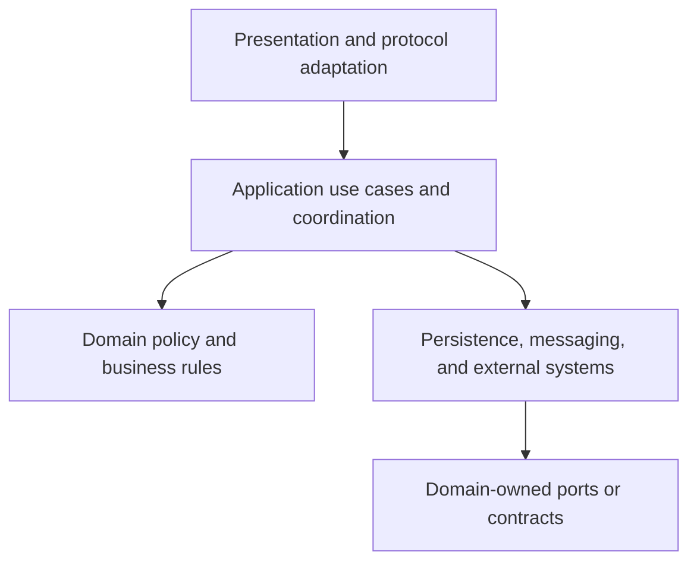
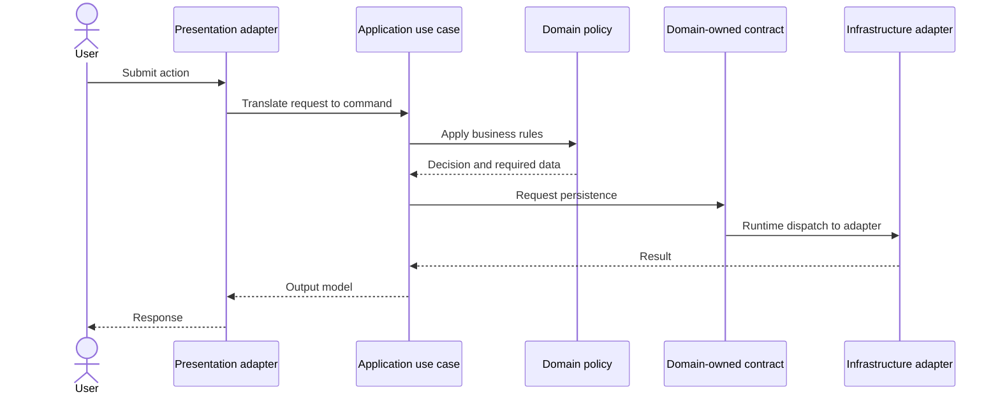
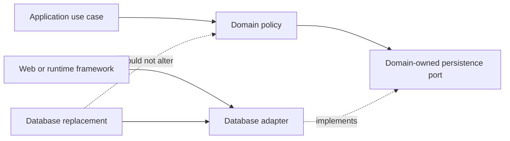
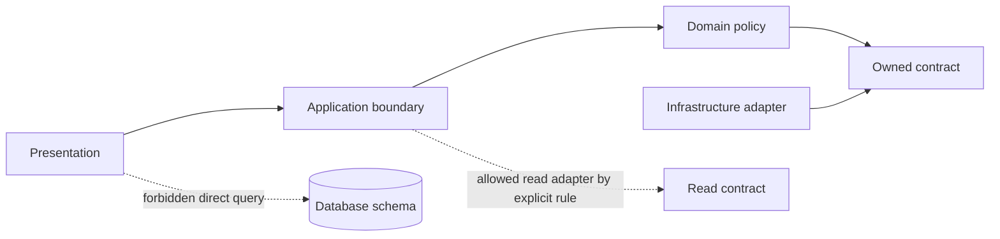
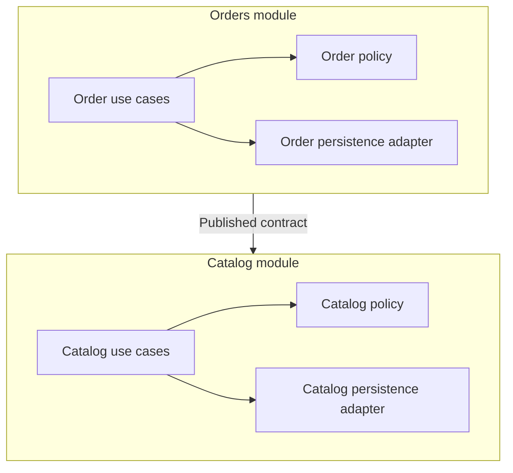

# Layered Architecture

Part: [20 — Architecture Patterns](PART_OVERVIEW.md)

Layered architecture organizes responsibilities into horizontal groups and defines which groups may depend on others. It helps teams separate presentation, application coordination, domain policy, and infrastructure concerns. The pattern does not guarantee modularity: unrestricted cross-layer access can leave the codebase as a single coupled system with several folders.

Part 20 owns pattern selection and consequences. Part 07 owns solution-level design, and Part 03 owns software engineering and module implementation practices.

## Define Responsibilities and Boundaries

A common arrangement includes presentation, application, domain, and infrastructure or data layers. Presentation translates user or external protocols. The application layer coordinates use cases and transactions. The domain layer expresses business rules. Infrastructure implements persistence, messaging, and external integrations. These names are not universal; define responsibility and ownership before creating directories.

The diagram describes logical responsibilities, not necessarily separate processes. A layered monolith can deploy as one unit while enforcing internal dependency rules. Separate deployment is a different decision with network, operations, and failure consequences.

## Control Request Flow and Dependencies

Runtime request flow usually moves from an outer interface through application coordination toward domain behavior and infrastructure. Compile-time dependency direction may differ when domain-owned interfaces allow an outer adapter to implement an inner contract. Keep the distinction clear: runtime calls and source-code dependencies are not always the same arrows.

The contract belongs near the policy that needs it; infrastructure implements that contract. This reduces the chance that a database schema or web framework becomes the domain model. Avoid abstracting every dependency without a change or testability reason; unnecessary interfaces add indirection without meaningful independence.

## Apply Dependency Inversion Deliberately

Dependency inversion means high-level policy should not be forced to depend on low-level implementation details; both can depend on an abstraction owned at the appropriate boundary. It does not mean every call needs an interface or that all source dependencies point inward automatically. Use it where the implementation is likely to change independently or where a stable policy boundary improves testing.

The boundary reduces change propagation only if the abstraction expresses domain needs rather than leaking implementation-specific query shapes. A repository interface that mirrors every database method can preserve the coupling under a different name.

## Detect Cross-Layer Shortcuts

Shortcuts can be justified for simple read paths, but repeated bypasses create hidden dependencies. A presentation component that queries a database directly can couple user behavior to storage schema and bypass authorization or domain rules. Document allowed exceptions and enforce important constraints with tests or architecture checks.

Not every query must pass through a rich domain model. A reporting path may use a read-specific adapter if it preserves access controls and has an explicit ownership boundary. The pattern should clarify where policy lives, not create ceremony around every field access.

## Use Layers Inside a Modular Monolith

Layers can structure a modular monolith when paired with vertical ownership boundaries. A module may own its domain, use cases, and infrastructure adapter while exposing a narrow contract to other modules. This avoids a single global “domain” package that all features share and modify.

Keep module-to-module communication explicit, and prevent one module from reaching into tables or internals owned by another module. A modular monolith can be a better choice than distributed services when independent deployment is not worth the network and operational cost.

## Worked Case: Subscription Billing

A billing application separates an HTTP adapter, use cases for invoice generation, domain rules for pricing and tax eligibility, and infrastructure adapters for payment and persistence. A pricing-rule change remains in the domain module; replacing a payment provider changes an adapter and its contract tests. A reporting query bypasses the domain only through an explicit read path with the same tenant and permission checks.

The team initially creates too many generic repositories that mirror database operations. Review shows no independent change or testability benefit, so it retains stable ports only for external boundaries and aggregates queries within the owning module. Architecture tests prevent the presentation layer from importing persistence packages directly.

## Review Questions

1. Which responsibilities belong in each layer for this system?
2. How do runtime call direction and source dependency direction differ?
3. Where does dependency inversion reduce meaningful change coupling?
4. Which shortcuts are permitted, and how are policy checks preserved?
5. How can a modular monolith combine layers with feature ownership?

Layered architecture is useful when responsibility boundaries reduce change propagation and clarify policy ownership. Define dependencies explicitly, distinguish logical layers from deployment units, and enforce only the rules that protect real boundaries.
