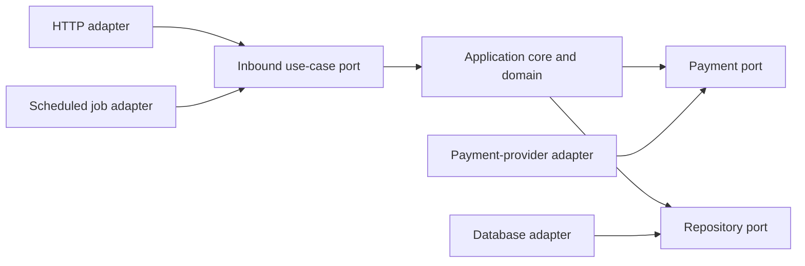
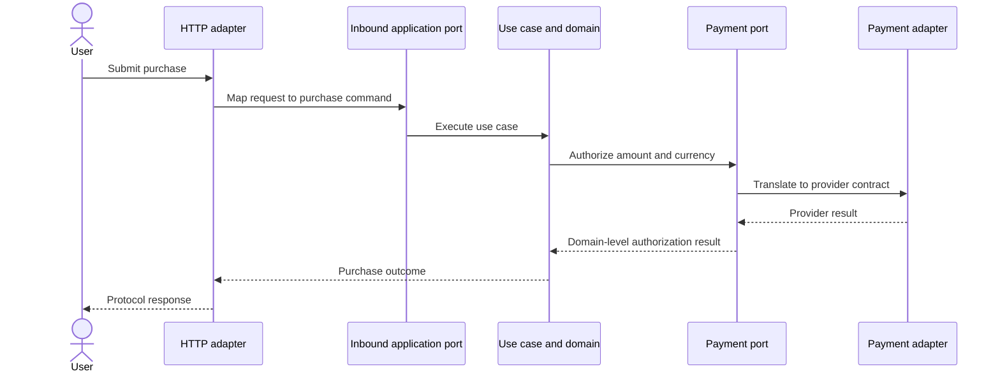
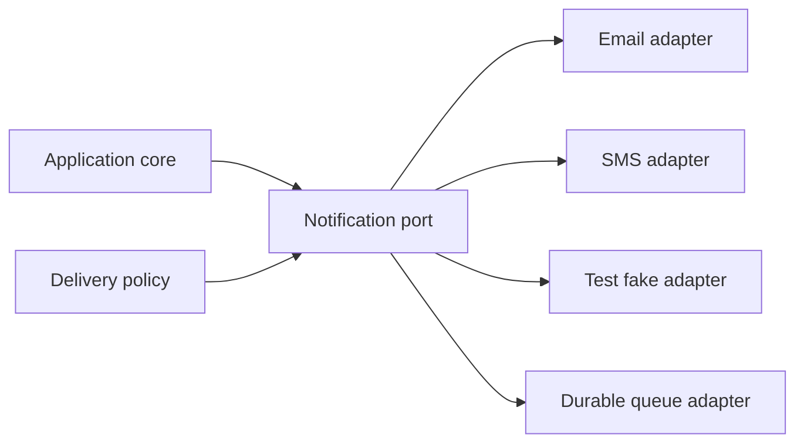
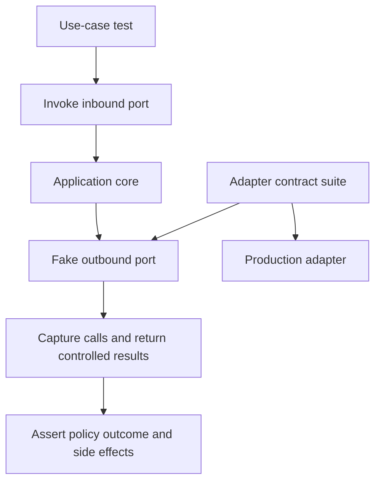
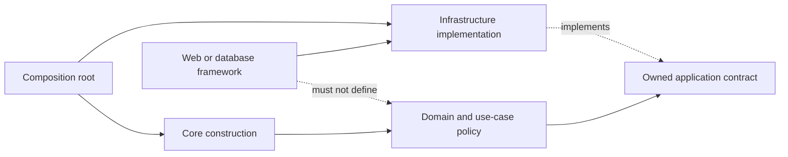

# Hexagonal Architecture

Part: [20 — Architecture Patterns](PART_OVERVIEW.md)

Hexagonal architecture, also called ports and adapters, isolates application behavior from delivery mechanisms and infrastructure. A port expresses a capability the application offers or requires; an adapter translates an external protocol or technology into that contract. The hexagon is a visual metaphor, not a required number of sides or modules.

Part 20 owns the pattern and its decision trade-offs. Part 07 owns solution-level boundaries, while Part 08 owns API architecture and Part 06 owns database mechanics.

## Place the Application Core Behind Ports

The application core contains use cases and domain behavior. Inbound or driving adapters translate requests from users, APIs, schedules, or messages into calls on primary ports. Outbound or driven adapters implement secondary ports that the application uses for persistence, notifications, or external services. Ports belong to the application boundary; adapters depend on those contracts.

This topology allows the same use case to be invoked through different delivery mechanisms and allows infrastructure choices to change without rewriting policy. The abstraction is useful only when its contract describes what the application needs, rather than exposing a vendor's API unchanged.

## Trace Inbound and Outbound Paths

Inbound adapters validate protocol-level input and translate it into application commands or queries. They should not own business policy. The core coordinates a use case and invokes required ports. Outbound adapters translate those calls into database, payment, messaging, or other infrastructure operations.

Keep transactions and error translation explicit. The adapter may normalize provider errors, but the core decides their business meaning. Do not leak protocol status codes or database exceptions into domain policy unless those concepts are intentionally part of the application contract.

## Substitute Adapters at a Boundary

An adapter can be replaced when it honors the same port semantics, including error behavior, timing assumptions, idempotency, and consistency. Substitution is not guaranteed merely because two classes implement the same interface. Contract tests should verify behavior for the real implementation and useful test doubles.

The core can select or configure an adapter through composition at startup. If switching providers changes delivery guarantees, retry behavior, cost, or data handling, those differences belong in architecture decisions and tests rather than being hidden as an implementation detail.

## Test the Application Through Its Ports

Ports let tests exercise use cases without requiring every infrastructure dependency. In-memory fakes can make scenarios fast and deterministic, but they do not prove production adapter behavior. Pair core tests with adapter contract tests and a smaller set of integration tests against real dependencies or faithful environments.

The same contract cases should apply to the fake and production adapter where feasible. If a fake omits transactional or retry semantics, tests can pass while production fails. Keep test seams aligned with real boundaries and avoid mocking internal classes that the architecture does not promise to preserve.

## Keep Dependency Direction Explicit

The core defines ports that express application needs; infrastructure adapters depend on those ports. Compile-time references should not force the domain or use-case layer to import a web framework or database driver. Runtime invocation can still flow outward through dependency injection or composition.

Avoid abstractions that merely mirror an external client. A useful port expresses a stable application capability and keeps irrelevant provider details outside. For a simple CRUD application with one stable infrastructure choice, the extra boundary may not pay for itself.

## Worked Case: Payment Authorization

An order application accepts purchases through a web API and scheduled retry workflow. Both are inbound adapters to the same purchase use case. The core validates order policy and invokes a payment port. One adapter integrates with the current provider; a test fake simulates approval, decline, timeout, and unknown completion. Contract tests confirm idempotency and result mapping.

A provider change requires an adapter and contract-suite update. The team does not assume the new provider's timeout means the same thing: unknown authorization status triggers reconciliation by idempotency key. The port remains stable only for semantics both providers can satisfy; provider-specific capabilities are modeled explicitly rather than erased.

## Review Questions

1. Which interactions are inbound ports, and which are outbound ports?
2. Where should protocol translation and business policy reside?
3. What behavioral guarantees must an adapter preserve?
4. Why do fake-adapter tests need contract and integration tests as well?
5. When is a port valuable, and when is it unnecessary indirection?

Hexagonal architecture protects application behavior when external protocols and technologies change independently. Define ports from application needs, keep adapters responsible for translation, and verify their semantics with shared contracts and realistic integration tests.
