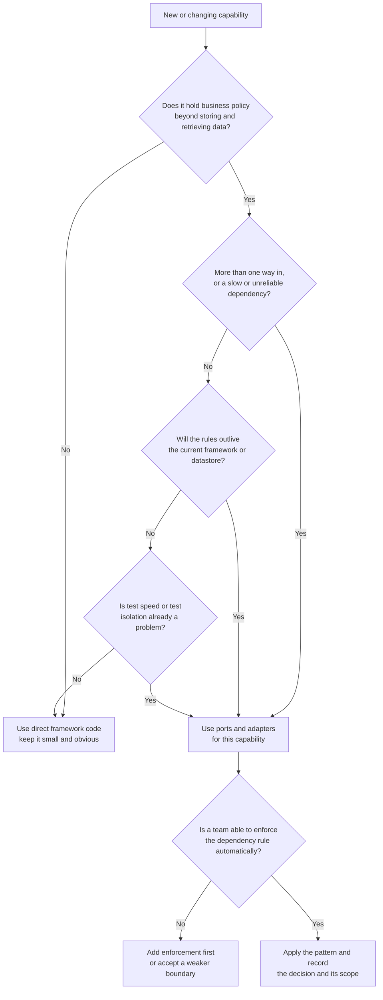
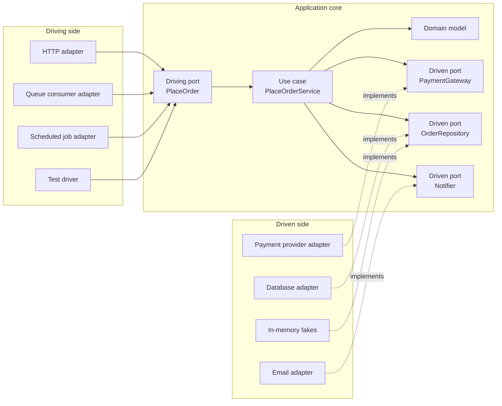
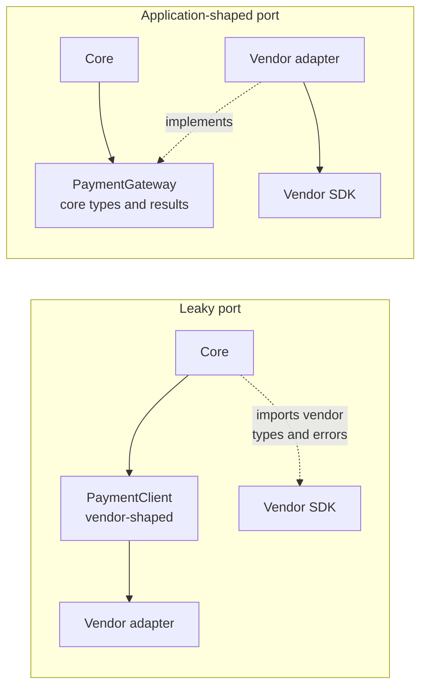
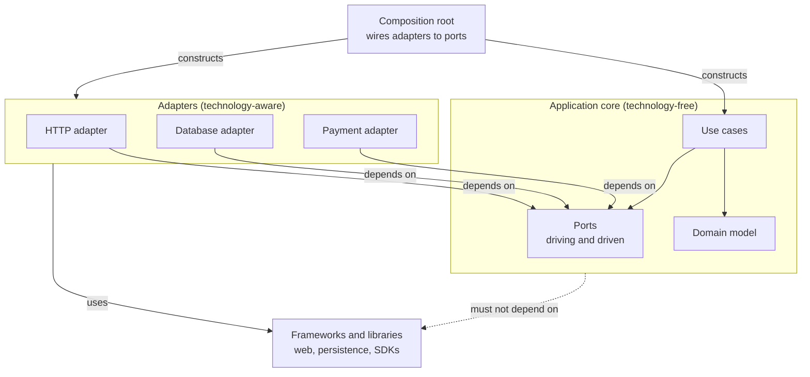
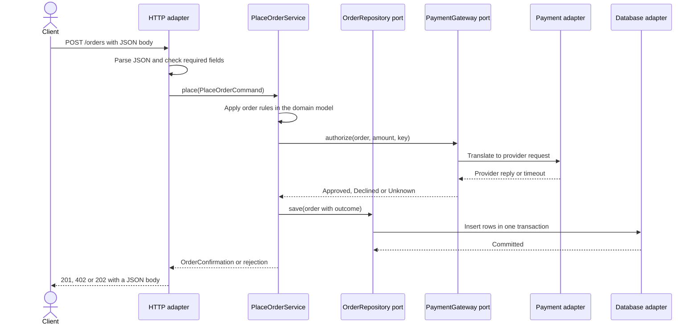
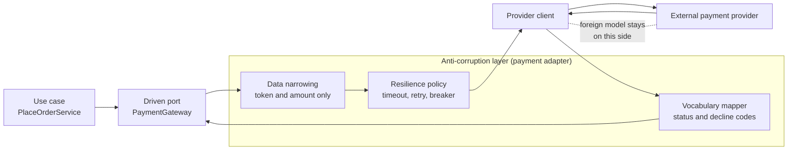
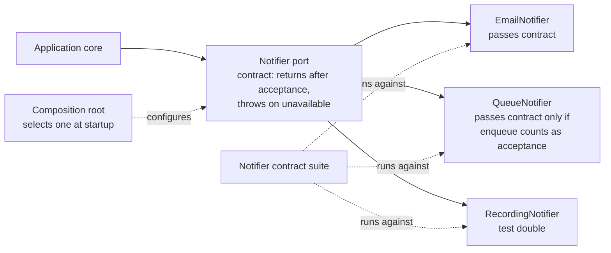
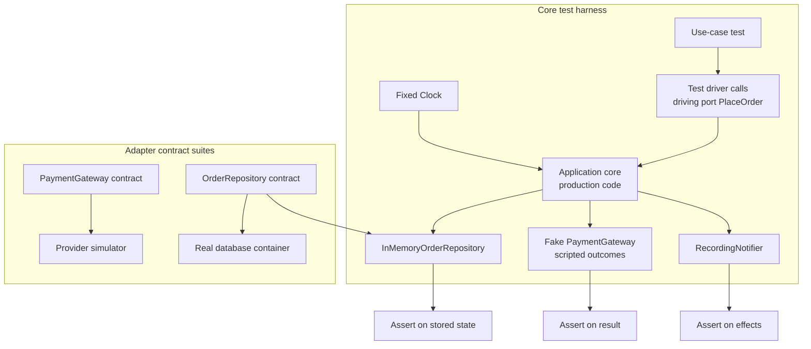
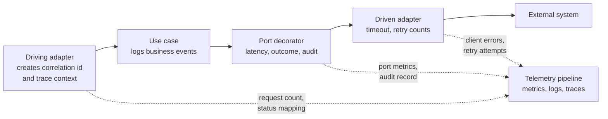
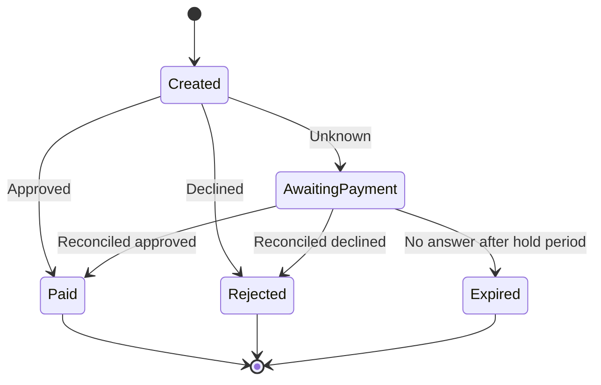

# Hexagonal Architecture

Part: [20 — Architecture Patterns](PART_OVERVIEW.md) · Status: Revised (in-depth rewrite)

## 1. Introduction

Hexagonal architecture, also called ports and adapters, isolates application behavior from delivery mechanisms and infrastructure. A port is a contract that the application owns and that names a capability: either one the application offers to the outside world, or one it needs from the outside world. An adapter is a piece of code that translates between one specific technology or protocol and a port. The application core sits in the middle and knows only ports. The hexagon is a drawing convention that leaves room to show several sides, and carries no rule about six of anything.

The idea is attributed to Alistair Cockburn, who named it "ports and adapters". The two names refer to the same pattern, and this chapter uses them interchangeably. The pattern is best understood as a rule about who knows about whom. Business behavior must not know that it is being driven by a Hypertext Transfer Protocol (HTTP) request, a message consumer, a scheduled job or a test, and it must not know whether state lives in a relational database, a document store or memory. Everything that does know those things is placed in adapters at the edge, where it can be replaced, tested separately and kept from spreading.

For an engineer moving toward architecture, this pattern is a good first example of an architectural rule that can be checked mechanically. It states a dependency direction, it has an obvious enforcement mechanism, and it has a measurable cost: more types, more mapping code and more indirection. Judging whether that cost is worth paying for a given system is the real skill, and this chapter spends as much time on when not to apply the pattern as on how to apply it.

This chapter owns the pattern definition, its structure and responsibilities, how requests flow through it, the quality-attribute consequences, enforcement, and the failure modes. The boundaries with neighbouring material are deliberate:

- Layered designs, which allow dependencies to run top to bottom through presentation, application, domain and data layers, belong to [Layered Architecture](CH01_Layered_Architecture.md). This chapter recaps the contrast where it matters and does not re-teach layering.
- Concentric-ring designs with a formal dependency rule and a set of named rings belong to [Clean Architecture](CH03_Clean_Architecture.md) and [Onion Architecture](CH04_Onion_Architecture.md). Hexagonal architecture is compared with them by name; it is not taught again through their vocabulary.
- Class-level building blocks such as entities, value objects, aggregates and repositories belong to [Low-Level Design](../07_System_Design_and_Distributed_Systems/CH04_Low_Level_Design.md). This chapter uses them without re-explaining them.
- Solution-level component and deployment design belongs to [High-Level Design](../07_System_Design_and_Distributed_Systems/CH03_High_Level_Design.md). Application programming interface (API) design belongs to Part 08 (API Architecture), and database mechanics belong to Part 06 (Databases and Storage).

After studying this chapter, a reader should be able to:

1. Define the application core, a port, a driving adapter and a driven adapter, and state the dependency rules among them.
2. Decide whether the forces in a given system justify the pattern, and describe a cheaper alternative when they do not.
3. Design ports in the language of the application instead of the language of a vendor.
4. Trace a request through an inbound adapter, a use case and outbound adapters, and say which layer owns validation, transactions and error meaning.
5. Wire the pieces from a composition root and show in code how the dependency direction is preserved.
6. Explain how each quality attribute (modifiability, testability, performance, deployability, operability and security) is helped or hurt.

## 2. Forces and Context

### 2.1 The problem the pattern answers

Most business software starts life with a direct path from the entry point to the data store. A controller parses a request, calls a service, and the service calls a database library. This is fast to write and entirely reasonable for a small system. The difficulty appears as the system lives longer. Business rules get written in the vocabulary of the framework: a pricing rule reads an HTTP header, an eligibility check issues a Structured Query Language (SQL) query, and a notification rule is tangled with the client of a mail provider. Four things then become hard.

- **Change in one direction drags change in the other.** Moving from one message broker to another touches business code, because the code was written against broker types.
- **Behavior can only be exercised through the slowest path.** To test a discount rule you start the web framework and a database, so tests are few, slow and flaky, and teams stop running them.
- **A second way in is expensive.** When a nightly job or a message consumer needs the same behavior as an HTTP endpoint, the business rule is either copied or invoked through a fake HTTP call.
- **Vendor concepts become domain concepts.** A payment provider's status codes end up in order logic, so replacing the provider means rewriting order rules.

The pattern answers these four problems with one move: the application defines the contracts at its own boundary, and everything technology-specific implements or calls those contracts from outside. The core then has no reason to change when a technology changes, and a technology has no way to reach into the core except through a contract.

### 2.2 Forces that favour the pattern

The pattern earns its cost when several of the following forces are present at once. One force alone is rarely enough.

| Force | Why it favours ports and adapters |
| --- | --- |
| Several ways to drive the same behavior (HTTP, messages, batch jobs, command line) | One use-case contract serves every driving adapter, so rules exist once |
| Long expected life of the business rules compared with the infrastructure | Rules outlive frameworks, brokers and database products, so they should not depend on them |
| High business-rule complexity | Fast, deterministic tests of the core pay back most where the rules are intricate |
| External dependencies that are slow, costly, rate-limited or unreliable | Faking them at a port allows complete tests without calling them |
| Several teams, or a team plus vendors, working on the same codebase | Ports are a stable seam that lets integration code change on its own schedule |
| Real prospect of replacing or adding an infrastructure choice | A narrow port bounds the cost of the swap to one adapter |
| Compliance or audit need to show where data leaves the system | Every outbound call crosses a named port, which makes the data flows inspectable |

### 2.3 Forces that argue against it

The pattern costs something every day, not only when a technology is swapped, so the opposing forces deserve equal attention.

- **Thin logic.** When the use case is "read a row, return it as JSON" there is no policy to protect. A port in front of the database adds a type, a mapper and a delegation that carry no meaning.
- **One infrastructure choice that will not change.** A system tightly built on one datastore's capabilities, such as a geospatial query engine or a full-text search feature, cannot be hidden behind a neutral port without losing the reason for choosing it.
- **Small, short-lived or exploratory systems.** A prototype to test a market assumption is not helped by a boundary around code that will be discarded.
- **A team without the habits to maintain the rule.** If the dependency direction is not enforced, adapters gradually import core internals and the core imports adapters, and the system ends up with the costs of the pattern and none of the benefits.

### 2.4 A decision procedure

The decision is rarely all or nothing. A system can apply the pattern to its complex, long-lived domain and use plain framework code for administrative screens. The decision tree below expresses the reasoning as questions a team can answer in a design review.



The tree makes two points. First, the pattern is applied per capability, so a modular system can contain hexagonal modules next to simple ones. Second, the last question matters as much as the earlier ones. A boundary that is not checked by the build erodes, and an eroded boundary is worse than an honest simple design because readers trust a structure that is no longer true.

### 2.5 An illustrative cost and benefit estimate

The numbers below are illustrative and chosen to show the arithmetic, not measurements from a real project. Suppose a service has 6 use cases, 3 outbound dependencies (a database, a payment provider and a notifier) and 2 driving adapters (an HTTP interface and a queue consumer).

Count the extra types the pattern introduces. There are 6 inbound ports, one per use case, and 3 outbound ports, so 9 interfaces. Each outbound adapter needs a mapper between its external representation and the core's types, which adds 3 mappers. Each driving adapter has request and response types for the 6 use cases, so 2 adapters times 6 use cases times 2 types is 24 small types. The total is about 9 + 3 + 24 = 36 additional small types before any real logic. At roughly 15 lines each, that is about 540 lines that a direct design would not have.

Now count the test-time benefit. Suppose the service has 120 use-case tests. With the core run against in-memory fakes, a test takes about 5 milliseconds, so the suite takes 120 × 5 ms = 600 ms. If the same 120 scenarios needed a running web framework and a database container, assume 400 ms each: 120 × 400 ms = 48,000 ms, or 48 seconds. The difference of roughly 47 seconds per run matters when the suite is run hundreds of times a day, and matters little for a project run twice a week. The estimate shows why the pattern pays where tests are numerous and rules are complex, and why for a handful of CRUD (create, read, update, delete) endpoints it may not.

## 3. The Structure of the Pattern

### 3.1 The application core

The application core holds everything that decides what the system does. It has two parts that are often kept in separate packages. The first is the domain model: entities, value objects and domain services that encode business rules independent of any particular use. The second is the application layer: use cases, each of which coordinates one business interaction by loading state through outbound ports, invoking domain behavior, and saving results through outbound ports. The core has no import of a web framework, a database driver, a message client or a vendor software development kit (SDK).

The core also defines the ports. This is the most important structural fact in the pattern. Because the core owns the contracts, the dependency arrows between core and adapter point toward the core, even though at runtime calls travel in both directions.

### 3.2 Ports, driving and driven

A port is an interface, in the language sense, owned by the core and expressed in its vocabulary. Ports come in two kinds, distinguished by who initiates the interaction.

- A **driving port**, also called a primary or inbound port, is a capability the application offers. Something outside calls it. Examples are "place an order" or "cancel a booking". Driving ports are implemented by the core's use cases and are called by driving adapters.
- A **driven port**, also called a secondary or outbound port, is a capability the application needs. The core calls it. Examples are "save this order", "authorize this payment" and "send this notification". Driven ports are declared by the core and implemented by driven adapters.

The terms primary and secondary are a convenient memory aid, since the actor that starts the conversation is the primary one. The words inbound and outbound can mislead when a message arrives through a driven adapter, for example when a payment provider sends a webhook. The webhook is a driving interaction, because the outside world initiates it, even though it relates to a driven port's counterpart. Classify by who initiates, not by data direction.

### 3.3 Adapters

An adapter converts between the core's contract and one technology. A driving adapter receives something in an external form (an HTTP request, a queue message, a scheduled trigger, a test call), converts it to a command or query in the core's types, calls a driving port, and converts the result back. A driven adapter implements a driven port using a technology (a relational database through an object-relational mapper, a provider's REST (Representational State Transfer) client, a message producer, an in-memory map in a test).

An adapter is allowed to know the technology and the port. It must not contain business decisions. The usual test is that an adapter can be described entirely as mapping, protocol handling, retry and timeout configuration, and error translation. When an adapter begins to decide whether a customer qualifies for a discount, policy has leaked out of the core.

### 3.4 The topology



The diagram shows the topology: several driving adapters share one driving port, and each driven port has a production adapter and possibly a fake. Solid arrows are calls that the core's own code makes or receives. Dotted arrows are the implements relationship, and they are what keep source-code dependencies pointing inward. The implication is that the test driver is just another driving adapter. A test that invokes `PlaceOrder` exercises the same entry point that production traffic does, which is why the pattern gives high-value tests rather than tests of a special back door.

### 3.5 Responsibilities and where decisions live

| Concern | Owner | Notes |
| --- | --- | --- |
| Syntactic validation (field present, number parses, JavaScript Object Notation (JSON) well-formed) | Driving adapter | Rejects malformed requests before they reach the core |
| Semantic validation (quantity within stock, customer eligible) | Core | Business rules apply regardless of how the request arrived |
| Authentication of the protocol caller | Driving adapter or framework | Identity is established at the edge |
| Authorization of the business action | Core | Whether this actor may cancel this order is policy |
| Transaction boundary | Use case, implemented through a port or the composition root | See the request-flow section |
| Retry, timeout, circuit breaking on a call | Driven adapter | Technology behavior that does not change business meaning |
| Business meaning of a failure ("payment declined") | Core | The adapter translates the provider error to a core result |
| Mapping external representation to core types | Adapter | The core never sees wire formats |

The split between authentication and authorization is a frequent source of bugs. If the only authorization check is in an HTTP filter, then the queue consumer that calls the same use case bypasses it. Putting action-level authorization in the use case means every driving adapter is covered, as discussed under the security consequences later in the chapter.

## 4. Designing Good Ports

The pattern is only as good as its ports. A badly shaped port moves the coupling instead of removing it: the core no longer imports the vendor library, but it still depends on the vendor's concepts, error model and timing, now hidden behind an interface that pretends otherwise. This section gives the rules that separate useful ports from ceremony.

### 4.1 Name the capability, not the technology

A port is named for what the application needs in business terms. `PaymentGateway.authorize(...)` is a capability. `StripeClient`, `KafkaTemplate` or `JdbcOrderTable` name a technology, and an interface named that way almost always has methods shaped like the technology.

Compare two driven ports for the same need, shown in Java 21.

```java
// Leaky: the shape of the vendor SDK is the contract.
public interface PaymentClient {
    ProviderChargeResponse createCharge(ProviderChargeRequest request, Map<String, String> headers);
    ProviderRefundResponse createRefund(String chargeId, long amountMinorUnits, String reasonCode);
}

// Application-shaped: the contract states what the use case needs.
public interface PaymentGateway {
    AuthorizationResult authorize(OrderId order, Money amount, IdempotencyKey key);
    void release(AuthorizationId authorization);
}

public sealed interface AuthorizationResult {
    record Approved(AuthorizationId id) implements AuthorizationResult {}
    record Declined(DeclineReason reason) implements AuthorizationResult {}
    record Unknown(IdempotencyKey key) implements AuthorizationResult {}
}
```

The second port has three useful properties. The method parameters are core value types, so no provider class crosses the boundary. The result is a closed set of outcomes the core can handle exhaustively, with `Unknown` modelling a timeout whose outcome is not known, a case a thin vendor wrapper typically hides in an exception. And the idempotency key is an explicit part of the contract, so any adapter must honor it. Idempotency as a distributed-systems property is owned elsewhere in the handbook; here it is only a reminder that semantics such as it belong in the port.

### 4.2 Granularity: one port per capability, not per table or per class

Two extremes cause trouble.

A **fat port** gathers unrelated operations, for example one `InfrastructureServices` interface that saves orders, sends email and calls payments. Every use case depends on all of them, every fake must implement all of them, and a change for one need ripples to everyone.

A **hairline port** exposes one method per concrete class or per table, mirroring the persistence model. A generic `Repository<T>` with `save`, `findById`, `findAll` and `delete` is common here. It looks reusable but says nothing about what the application needs. The core ends up writing queries through the generic interface, or the interface grows methods such as `findByStatusAndCreatedBefore`, which are really the query needs of one use case.

A workable heuristic is to define driven ports around the consumer's need and the aggregate boundary. `OrderRepository` offers `findById(OrderId)` and `save(Order)`, and reporting needs such as "orders awaiting payment older than a day" get a separate query port named for that need, because their consistency and performance expectations differ from those of the write path.

For driving ports, the common shapes are one interface per use case, or one interface per cohesive group of use cases.

```java
public interface PlaceOrder {
    OrderConfirmation place(PlaceOrderCommand command);
}
```

One interface per use case keeps each driving adapter dependent on exactly what it calls, at the price of many small interfaces. A grouped interface such as `OrderManagement` with `place`, `cancel` and `amend` has fewer files, and is acceptable when the use cases genuinely change together. Neither is wrong. What matters is that the choice is consistent and the interface is named in the application's language.

### 4.3 Commands, queries and the types that cross the boundary

Only core types and simple immutable data cross a port. A driving port receives a command (an intent to change state) or a query (a request for information), both expressed as plain immutable types owned by the core. It returns a result type or a read model owned by the core. A driven port receives and returns domain types.

Two traps are worth naming. The first is passing an adapter's representation inward: a controller that hands a persistence entity or a web request object straight to a use case welds the core to that technology and makes the port a formality. The second is returning domain entities outward to be serialized. If the web adapter serializes the domain `Order` directly, every change to the domain model silently changes the public API. A small read model or response type, mapped in the adapter, keeps the two moving at independent rates.

This mapping has a cost, and the pattern's critics are right to point at it. In the earlier estimate, 24 small request and response types were required for two adapters and six use cases. Three tactics reduce that cost without breaking the boundary.

- Reuse one command type across several driving adapters, since a queue consumer and an HTTP adapter both build the same `PlaceOrderCommand`. Only the adapter-specific wire types differ.
- Use records, which in Java 21 make a value type a single line, and generate mappers only where the mapping is non-trivial.
- Skip the response type when the result type is already a small immutable value that is safe to publish, and accept that a change to it is then an API change that needs the same care as any other.

### 4.4 Errors and semantics are part of the contract

A port contract includes more than method signatures. It must state how failure is reported, how long a call may take, whether repeating a call is safe, and what consistency a read has. When these are left implicit, two adapters that implement the same interface can behave in incompatible ways, and the core will be written against whichever one the author tested first.

The practical rules are as follows.

- Model expected business outcomes (declined payment, out-of-stock item) as return values or checked results. Model unexpected technical failure (connection refused, malformed provider reply) as an exception that the core does not try to interpret in detail.
- Never let a vendor exception type appear in a port signature or in the exception chain the core catches by type. Wrap it in a core-owned exception such as `PaymentUnavailableException`.
- Document timeout and idempotency expectations next to the port in Javadoc and enforce them in a shared contract test suite, which later sections on substituting adapters and on testing develop.
- State the consistency a read provides. "Returns the latest committed state" and "may return state up to a few seconds old" are different contracts, and a use case may be correct only for one.

### 4.5 When a port is not worth having

Some dependencies are so stable and so well-bounded that wrapping them adds nothing. Standard library collections, date and time types, a logging facade, and a well-understood value library are examples. The question to ask is whether the application would have to change its policy, not merely its glue, if the dependency changed. If not, depend on it directly. Hiding a logging call behind a port named `Logger` that mirrors the facade is ceremony.

The opposite mistake is also common: wrapping a capability so thinly that the vendor's semantics leak, while claiming the benefit of isolation. A port that mirrors an SDK one-to-one gives the cost of indirection and none of the protection. In that case it is more honest to depend on the SDK in the adapter layer and accept the coupling openly, recording the decision in the architecture decision record.



The left half shows the failure: the core still reaches the vendor's types through the interface, so swapping vendors forces core changes. The right half shows the intended shape, where only the adapter touches the SDK. The implication for a design review is practical. Open the port file and ask whether any import or any parameter name would be meaningless to a reader who has never heard of the current vendor. If so, the port is leaking.

## 5. Dependency Direction and the Composition Root

### 5.1 The rule

The one rule that defines the pattern is that source-code dependencies point toward the core. The core depends on nothing technological. Adapters depend on the core, because they implement its ports or call its use cases. The code that decides which adapter is attached to which port, called the composition root, depends on both, and it is the only place that does.

Three consequences follow, and each is checkable.

1. No class in the core imports a package from a web framework, a persistence library, a message client or a vendor SDK.
2. No adapter imports another adapter. The HTTP adapter does not call the database adapter, even when that looks convenient.
3. The core's use cases depend on driven ports as interfaces and are given implementations from outside, so they never construct an adapter themselves.



The diagram separates two kinds of arrow. Dependency arrows, which are import statements, all end inside the core or at the frameworks used only by adapters. The dotted arrow marks the forbidden direction. At run time a call still travels from the use case to the database adapter, but it does so through an interface the core owns, so the compiled core does not know the adapter exists. This is dependency inversion applied to the whole system boundary, and it is what lets you build, test and reason about the core with no infrastructure present.

### 5.2 Layered dependency compared with ports and adapters

In a conventional layered design the business layer depends downward on the data access layer. Replacing the data access technology therefore changes what the business layer compiles against, unless an interface is introduced deliberately. Hexagonal architecture builds that inversion in as the default, and it additionally treats the delivery side the same way as the data side. The sides of a layered design are ordered top to bottom, while the sides of a hexagonal design are symmetrical: both the user interface and the database are outside, and both are adapters. See [Layered Architecture](CH01_Layered_Architecture.md) for the layered rules and its inversion variant, and [Clean Architecture](CH03_Clean_Architecture.md) and [Onion Architecture](CH04_Onion_Architecture.md) for rings that formalize the same inward rule. In practice the three share the dependency rule and differ in the vocabulary they use for the inside: hexagonal names the boundary (ports), while the others name the rings (entities, use cases, and so on).

### 5.3 The composition root in Spring Boot

Something must connect the pieces. In a Spring Boot application with Java 21, the composition root is a configuration class in the outermost module, and it is the only place that mentions both a use case and its adapters.

```java
@Configuration
class OrderWiring {

    @Bean
    PlaceOrder placeOrder(OrderRepository orders,
                          PaymentGateway payments,
                          Notifier notifier,
                          Clock clock) {
        return new PlaceOrderService(orders, payments, notifier, clock);
    }

    @Bean
    OrderRepository orderRepository(JdbcClient jdbc) {
        return new JdbcOrderRepository(jdbc);
    }

    @Bean
    PaymentGateway paymentGateway(PaymentProviderProperties props) {
        return new ProviderPaymentGateway(props);
    }
}
```

`PlaceOrderService` is a plain Java class with a constructor that takes the ports. It carries no Spring annotation, so the core module needs no Spring dependency, and a unit test can construct it with fakes in one line. The adapters carry the technology: `JdbcOrderRepository` uses `JdbcClient`, and `ProviderPaymentGateway` uses the provider's HTTP client. Spring appears only in the wiring and in adapters.

### 5.4 How strictly to apply it

Teams choose a point on a spectrum, and the honest trade-offs are worth stating.

| Strictness | What it looks like | Benefit | Cost |
| --- | --- | --- | --- |
| Separate build modules for core and adapters | `core`, `adapter-web`, `adapter-persistence`, `app` modules; the core module's build file has no framework dependency | The compiler enforces the rule; an illegal import does not build | More modules and build configuration |
| Single module with package rules checked by tests | `core`, `adapters` packages; an architecture test fails the build on an illegal import | Light to set up, good enough for one team | Relies on the test being kept and run |
| Pragmatic annotations in the core | Core classes use `@Service` or `@Transactional` | Less wiring code, less ceremony | Core now compiles against the framework; a framework change touches the core |
| Convention only | A wiki page describes the rule | No setup | The rule erodes under deadline pressure |

Annotation use in the core deserves a direct answer because it is the most debated point. A `@Transactional` annotation on a use case is a framework dependency, so a strict reading forbids it. Many teams accept it knowingly because the annotation is declarative and replaceable, because the cost of keeping the core framework-free is real, and because the practical risk of changing the transaction framework is small. If the team makes that choice, it should be an explicit, recorded exception limited to a stated small set of annotations, and the architecture test should enforce the limit. The wrong outcome is for the exception to widen quietly until the core uses framework types freely.

### 5.5 A first enforcement check

The structure is cheap to verify with an architecture test. The next code uses ArchUnit, a Java library for checking dependencies between packages, which is an example of this kind of tool, not a requirement of the pattern. The test below fails the build if the core imports an adapter or a framework package.

```java
@AnalyzeClasses(packages = "com.example.orders")
class DependencyRulesTest {

    @ArchTest
    static final ArchRule core_does_not_depend_on_adapters =
        noClasses().that().resideInAPackage("..core..")
            .should().dependOnClassesThat().resideInAPackage("..adapter..");

    @ArchTest
    static final ArchRule core_is_framework_free =
        noClasses().that().resideInAPackage("..core..")
            .should().dependOnClassesThat().resideInAnyPackage(
                "org.springframework..", "jakarta.persistence..", "com.fasterxml..");

    @ArchTest
    static final ArchRule adapters_do_not_depend_on_each_other =
        slices().matching("..adapter.(*)..").should().notDependOnEachOther();
}
```

Package names such as `core` and `adapter` are a local convention, and the rule list should be adjusted to the project's real packages. Later sections of the chapter return to enforcement as part of keeping the boundary alive. The point here is that the rule is written once, runs on every build, and turns an architectural intention into a failing test. An equivalent test in TypeScript can use a dependency-checking tool in the same way, and in Python an import-linting tool can express a layered contract between packages.

## 6. Tracing a Request Through the Hexagon

### 6.1 The path of one request

Follow a purchase that arrives over HTTP. The sequence below shows who does what, and where the translations happen.



Reading the diagram from the outside in, the HTTP adapter does only protocol work: parse the body, reject malformed input, build a core command, and later map the result to a status code. The use case does everything with business meaning: it applies rules, asks for the payment, interprets the three possible outcomes, and persists the order. The payment adapter turns a provider reply or a timeout into one of the three results. The database adapter writes rows. No box in the middle of the diagram mentions HTTP, JSON, SQL or a provider format, which is the evidence that the boundary is holding.

### 6.2 The use case in code

The use case orchestrates and decides. It is a plain class with no framework types, so it can be run in any test.

```java
public final class PlaceOrderService implements PlaceOrder {
    private final OrderRepository orders;
    private final PaymentGateway payments;
    private final Notifier notifier;
    private final Clock clock;

    public PlaceOrderService(OrderRepository orders, PaymentGateway payments,
                             Notifier notifier, Clock clock) {
        this.orders = orders;
        this.payments = payments;
        this.notifier = notifier;
        this.clock = clock;
    }

    @Override
    public OrderConfirmation place(PlaceOrderCommand cmd) {
        Order order = Order.create(cmd.customer(), cmd.lines(), clock.instant());
        order.assertWithinCreditLimit();

        var key = IdempotencyKey.of(cmd.requestId());
        AuthorizationResult result = payments.authorize(order.id(), order.total(), key);

        return switch (result) {
            case AuthorizationResult.Approved a -> {
                order.markPaid(a.id());
                orders.save(order);
                notifier.orderPlaced(order.id(), cmd.customer());
                yield OrderConfirmation.accepted(order.id());
            }
            case AuthorizationResult.Declined d -> {
                order.markRejected(d.reason());
                orders.save(order);
                yield OrderConfirmation.rejected(order.id(), d.reason());
            }
            case AuthorizationResult.Unknown u -> {
                order.markAwaitingPayment(u.key());
                orders.save(order);
                yield OrderConfirmation.pending(order.id());
            }
        };
    }
}
```

Three points are worth drawing out. The `switch` over a sealed interface is exhaustive, so adding a fourth outcome to the port makes the compiler show every use case that must handle it. The `Unknown` branch records the order as awaiting payment, which leaves a reconciliation process to resolve it by idempotency key instead of guessing. And the use case receives `Clock` as a port, so a test can fix the time without any mocking library.

The matching driving adapter is short, and it is the only place that knows the wire format.

```java
@RestController
class OrderController {
    private final PlaceOrder placeOrder;

    OrderController(PlaceOrder placeOrder) { this.placeOrder = placeOrder; }

    @PostMapping("/orders")
    ResponseEntity<OrderResponse> create(@RequestBody @Valid OrderRequest body,
                                         @RequestHeader("Request-Id") String requestId) {
        var confirmation = placeOrder.place(body.toCommand(requestId));
        return switch (confirmation.status()) {
            case ACCEPTED -> ResponseEntity.status(201).body(OrderResponse.from(confirmation));
            case REJECTED -> ResponseEntity.status(402).body(OrderResponse.from(confirmation));
            case PENDING  -> ResponseEntity.status(202).body(OrderResponse.from(confirmation));
        };
    }
}
```

The adapter owns the mapping from the core's three outcomes to three status codes. A queue consumer for the same use case would map the same three outcomes to acknowledgement, dead-letter routing, or deferred retry, without changing the use case.

### 6.3 Transactions

Where the transaction boundary sits is the most frequent practical question in this pattern. The use case is the natural unit, since it defines one business interaction, so the transaction should span the use case's work on the driven side that is under the application's control. There are three common ways to achieve this.

- **Declarative at the use case.** A framework annotation or a wrapping decorator opens and commits a transaction around `place`. This is simple and common, and it is the framework dependency discussed in the previous section on dependency strictness.
- **A transaction port.** The core defines a `UnitOfWork` or `TransactionRunner` port with a method that runs a function transactionally, and a database adapter implements it. The core stays free of framework types, at the cost of a little more code in each use case.
- **Adapter-managed.** The repository adapter opens a transaction per call. This is the simplest to write and is correct only when each use case makes a single repository call. As soon as a use case needs two changes to commit together, it silently loses atomicity.

The payment call in the code above is deliberately outside any database transaction. A call to an external provider cannot be rolled back by a database rollback, and holding a database transaction open across a network call to a third party ties row locks to a provider's latency. The design therefore writes the order only after the provider outcome is known, and records `Unknown` explicitly when it is not. Where a business change and an outgoing message must be atomic, a pattern such as the transactional outbox applies; that belongs to the chapters on event-driven design and sagas, and is only named here.

### 6.4 Entry through a message or a schedule

The value of a shared driving port appears when a second entry point is added. A message consumer reads from a queue, parses the message, builds the same `PlaceOrderCommand` and calls `placeOrder.place`. A scheduled reconciliation job loads orders in the awaiting-payment state and calls a second use case, `ReconcilePayments`. Neither adapter duplicates a rule.

The two adapters differ in ways the core should not absorb. A consumer must handle duplicate delivery, since many brokers deliver at least once, and the idempotency key on the command is what makes the repeated `place` call safe. A consumer also decides what to do with a message that fails permanently, typically routing it to a dead-letter queue. Those are properties of the transport and live in the adapter, with only the idempotency identifier passing into the core as data.

### 6.5 Failure paths and error translation

The request path above looks different when each step can fail. The table maps common failures to the layer that must handle them.

| Failure | Detected by | Translated by | Business meaning decided by |
| --- | --- | --- | --- |
| Malformed JSON body | HTTP adapter | HTTP adapter returns a client error | None, the core is never called |
| Order breaks a credit limit | Domain model | Use case returns a rejection | Core |
| Provider returns a decline | Payment adapter maps the reply to `Declined` | Payment adapter | Core chooses to reject the order |
| Provider times out | Payment adapter | Payment adapter returns `Unknown` | Core chooses to hold the order pending |
| Database connection lost | Database adapter | Adapter raises a core-owned unavailable exception | Use case lets it propagate; the HTTP adapter maps it to a service-unavailable response |
| Duplicate message delivered | Core through the idempotency key | Core returns the earlier result | Core |

The rule that follows is that an adapter may normalize an error, but only the core decides what it means for the business. The decline and the timeout look similar to an HTTP client, yet they lead to opposite business outcomes, and only the core can choose correctly.

## 7. Adapters and Substitution

### 7.1 Driving and driven adapters compared

Both kinds of adapter translate, but their responsibilities differ because the direction of initiative differs.

| Aspect | Driving adapter | Driven adapter |
| --- | --- | --- |
| Who calls whom | Calls a driving port the core implements | Implements a driven port the core calls |
| Typical examples | HTTP controller, queue consumer, scheduled trigger, command-line handler, test driver | Database repository, payment client, email sender, clock, message producer |
| Inputs it converts | Wire formats into commands and queries | Domain types into provider requests |
| Failure it must handle | Malformed input, duplicate delivery, caller identity | Timeouts, rate limits, provider errors, partial failure |
| Typical state | None, or request-scoped | Connection pools, credentials, client configuration |
| Substitution value | Low in production, high for tests (a test driver replaces a web server) | High, because providers and stores change and are slow to call |

Driving adapters are rarely replaced one for another. They are added, so the main design question is whether the second entry point can reuse the first one's use case unchanged. Driven adapters are replaced, doubled and faked, so the main design question is whether the port is narrow enough that a different implementation can satisfy it.

### 7.2 Substitution is a behavioral promise

Two classes that implement the same interface are interchangeable only if they behave the same way in the respects the core relies on. Those respects are the ones section 4.4 listed: how failure is reported, how long a call may take, whether a repeat call is safe, and what consistency a read has. The Java compiler checks signatures only. A substitute that returns quickly where the real adapter times out, or that saves synchronously where the real one is eventually consistent, passes compilation and misleads every test written against it.

Four kinds of substitute appear in practice, and they have different purposes.

- **Production alternative.** A second provider, a second database, or a different broker. It must satisfy the same contract, and where it cannot, the difference belongs in the port or in a recorded decision.
- **In-memory fake.** A working but simplified implementation, such as a `Map` behind `OrderRepository`. It has real behavior (what is saved can be found) without real infrastructure. Fakes make core tests fast.
- **Stub.** A fixed-answer implementation, such as a `PaymentGateway` that always declines. Stubs suit one scenario and little else.
- **Spy or recording double.** An implementation that records calls so a test can assert that a notification was sent once. Use it for effects that have no queryable state.

Fakes deserve most of the investment, because a fake with real semantics lets one test cover several steps of a use case. A fake that is too simple causes a quieter failure: the core passes every test and breaks on a behavior the fake never modeled, such as a uniqueness violation.

```java
final class InMemoryOrderRepository implements OrderRepository {
    private final Map<OrderId, Order> store = new HashMap<>();

    @Override public Optional<Order> findById(OrderId id) {
        return Optional.ofNullable(store.get(id)).map(Order::copy);
    }

    @Override public void save(Order order) {
        Order existing = store.get(order.id());
        if (existing != null && existing.version() != order.loadedVersion()) {
            throw new ConcurrentModificationException(order.id());
        }
        store.put(order.id(), order.withNextVersion());
    }
}
```

Two details make this fake faithful. It stores and returns copies, so mutating a loaded order does not change stored state, which is true of a real database. It also enforces optimistic versioning, so a use case that ignores concurrent modification fails in a fast test instead of in production.

### 7.3 Contract tests for adapters

A contract test is a test written against the port and run against every implementation of it, production and fake alike. It is the mechanism that keeps a fake honest, and it is how a second provider is shown to be a legitimate substitute.

```java
abstract class OrderRepositoryContract {
    abstract OrderRepository newRepository();

    @Test void saved_order_can_be_found() {
        var repo = newRepository();
        var order = Orders.sample();
        repo.save(order);
        assertEquals(order.id(), repo.findById(order.id()).orElseThrow().id());
    }

    @Test void stale_save_is_rejected() {
        var repo = newRepository();
        var first = Orders.sample();
        repo.save(first);
        var a = repo.findById(first.id()).orElseThrow();
        var b = repo.findById(first.id()).orElseThrow();
        repo.save(a);
        assertThrows(ConcurrentModificationException.class, () -> repo.save(b));
    }

    @Test void unknown_id_is_empty() {
        assertTrue(newRepository().findById(OrderId.random()).isEmpty());
    }
}

class InMemoryOrderRepositoryTest extends OrderRepositoryContract {
    OrderRepository newRepository() { return new InMemoryOrderRepository(); }
}

class JdbcOrderRepositoryTest extends OrderRepositoryContract {
    OrderRepository newRepository() { return new JdbcOrderRepository(TestDatabase.fresh()); }
}
```

The abstract class holds the behavior and each subclass supplies an implementation. Adding a provider means adding one subclass. When a defect shows that the real adapter behaves in a way the contract did not cover, the right response is to add a contract case, so the fake and every future adapter inherit the lesson.

For a driven port that calls an external service, the real adapter cannot be tested in every run, since the provider may be rate limited, billed or unavailable. Two techniques cover this. A recorded or simulated provider (a local server that replays documented responses) lets the adapter's mapping and error translation be tested on every build. A smaller set of tests against the provider's sandbox environment runs on a schedule and detects drift in the provider's behavior. Neither replaces the other, and a contract that exists only against a simulator verifies the author's understanding of the provider, not the provider.

### 7.4 Anti-corruption layers at the boundary

A driven adapter for an external system is often more than a one-to-one mapper. When the external model is large, inconsistent or built on different concepts, the adapter becomes an anti-corruption layer (ACL): a deliberate translation layer that prevents the foreign model from shaping the core. The term comes from domain-driven design, where it names the protective boundary between two bounded contexts.

An ACL has three jobs.

- **Translate vocabulary.** The provider says `status = "requires_capture"` and `status = "succeeded"`. The core says `Approved`. The ACL owns the table that maps one to the other, including statuses the core has no word for.
- **Absorb instability.** Providers add fields, rename codes and change defaults. The ACL contains the change to one module and one contract suite.
- **Narrow the data.** The core gives the ACL only what a call needs. A card token and an amount cross the boundary, and the full customer profile does not. This also limits what an external system can learn.



The diagram shows that the foreign model is visible only between the provider client and the mapper. Everything the core receives has passed through the mapper, and everything the provider receives has passed through the narrowing step. The practical implication is that the mapper is the single most valuable file in the adapter for tests: it should have a case for every provider status it can return, including a default branch that maps an unrecognized status to a safe outcome such as `Unknown` and raises an alert, rather than guessing.

### 7.5 A worked substitution

Take the notification need of the order service. The core defines one driven port.

```java
public interface Notifier {
    void orderPlaced(OrderId order, CustomerId customer);
}
```

Three implementations exist: `EmailNotifier`, `SmsNotifier` and a `RecordingNotifier` for tests. The product team asks to move from email to a messaging service that delivers asynchronously through a queue. Reading only the signature suggests a one-line change in the composition root.

The contract tells a different story. `EmailNotifier.orderPlaced` returns after the mail server accepts the message, and throws a core-owned `NotificationUnavailableException` otherwise. A queue-backed implementation returns after enqueueing, so a later delivery failure is invisible to the caller. Whether this matters depends on what the core does after a failure. If the use case ignores notification failures, the swap is safe. If a use case needs to know that the customer was told (a legal notice, for example), the port was never honest enough and needs an explicit acknowledgement operation. This is the kind of difference that belongs in an architecture decision, which is why the earlier advice was to put delivery guarantees in the port's documented contract and shared tests.



The diagram places the contract suite beside the port, running against every implementation, with the composition root choosing one at startup. Its implication is that substitution is a verified operation, not a configuration change. The team adds `QueueNotifier` as a subclass of the contract test, discovers the difference in acknowledgement meaning, and decides on the contract before the switch, not after a customer misses a notice.

## 8. Testing the Application Through Its Ports

### 8.1 Where the pattern changes the test pyramid

The test pyramid says to have many fast tests at the bottom and few slow tests at the top. Ports and adapters give the pyramid a definite shape, because each layer of it has a natural seam.

- **Core tests (the base).** Drive a driving port with a command, supply fakes for the driven ports, and assert on the result and on state held in the fakes. No web server, no database, no network. These tests cover business rules, including the awkward cases (declined, unknown, duplicate).
- **Adapter contract tests (the middle).** Run the shared contract suite against each driven adapter, against a real database in a container or a simulated provider. They verify mapping, error translation and the behaviors the core relies on.
- **Driving adapter tests (the middle).** Start the adapter with a stubbed driving port, send a real HTTP request or queue message, and assert on the command received and the response produced. They verify parsing, status-code mapping and authentication at the edge.
- **End-to-end tests (the top).** Run the assembled application against test infrastructure for a few critical journeys, to show that the composition root wires everything correctly.



The upper box shows the whole core running as production code with only its edges replaced, so a test exercises the same entry point and the same rules that production does. The lower box shows that the fake repository is itself tested by the contract that tests the real one, which is why a passing core test says something about production. The implication is that mock-heavy tests of individual classes are mostly unnecessary. Mocking the internals of a use case ties the test to its current structure, so a refactor that keeps behavior intact still breaks the test. A test that calls the port and asserts on outcomes survives the refactor.

### 8.2 A core test

```java
class PlaceOrderTest {
    private final InMemoryOrderRepository orders = new InMemoryOrderRepository();
    private final ScriptedPaymentGateway payments = new ScriptedPaymentGateway();
    private final RecordingNotifier notifier = new RecordingNotifier();
    private final Clock clock = Clock.fixed(Instant.parse("2026-01-15T10:00:00Z"), ZoneOffset.UTC);
    private final PlaceOrder placeOrder = new PlaceOrderService(orders, payments, notifier, clock);

    @Test
    void unknown_payment_outcome_leaves_order_awaiting_payment_and_sends_no_notice() {
        payments.respondWith(new AuthorizationResult.Unknown(IdempotencyKey.of("req-1")));

        var confirmation = placeOrder.place(Commands.validOrder("req-1"));

        assertEquals(Status.PENDING, confirmation.status());
        assertEquals(OrderState.AWAITING_PAYMENT, orders.findById(confirmation.orderId()).orElseThrow().state());
        assertTrue(notifier.sent().isEmpty());
    }
}
```

The test states a business rule in business terms: an unknown payment outcome holds the order and sends no notice. It names no HTTP status, SQL table or provider code, and it runs in milliseconds. The scripted gateway is the stub kind of double from section 7.2, used here because the scenario needs one fixed answer.

### 8.3 Worked numbers on test speed

The figures are illustrative assumptions, chosen to show the arithmetic. A service has 400 behavior scenarios for its use cases, 60 adapter contract cases and 12 end-to-end journeys.

Design A runs every scenario through the web framework and a database container at an assumed 400 ms each: 400 × 0.4 s = 160 s.

Design B uses the pyramid above with these assumed costs:

| Level | Count | Cost each | Total |
| --- | --- | --- | --- |
| Core tests with fakes | 400 | 5 ms | 2.0 s |
| Contract cases against fakes | 60 | 5 ms | 0.3 s |
| Contract cases against a real database | 60 | 150 ms | 9.0 s |
| Database container start (once) | 1 | 8 s | 8.0 s |
| End-to-end journeys | 12 | 2 s | 24.0 s |
| **Total** | | | **43.3 s** |

The ratio is 160 s ÷ 43.3 s, about 3.7 times faster. Most of design B's time is in the 12 end-to-end journeys (24 s) and the container start, so further gains come from running those on a different schedule, not from speeding up the core tests. The number worth watching in practice is the base of the pyramid: 400 scenarios finish in 2 s, which makes it reasonable to run them on every save. A team should replace these figures with measurements from its own build before using them in an argument.

### 8.4 What the fakes do not prove

Core tests with fakes prove that the rules are right given the contract. They do not prove that a production adapter honors the contract, that the composition root wires the intended implementations, or that the platform behaves as assumed under load. Each gap has a named test: contract suites for the first, an end-to-end smoke test for the second, and performance and failure tests for the third (section 13). Treating the fast suite as sufficient is the most common way for the pattern to produce confidence without evidence.

## 9. Observability, Security and Consistency at Port Boundaries

### 9.1 Ports as observation points

Every call that crosses a port is a natural place to measure, because it is where the application's meaning meets a technology. A design with named ports gives operators a stable vocabulary: they can ask how long `PaymentGateway.authorize` takes and what share of calls end as `Unknown`, without reading provider-specific code.

The cleanest way to add this without touching the core is a decorator that implements the same port and wraps another implementation.

```java
final class ObservedPaymentGateway implements PaymentGateway {
    private final PaymentGateway delegate;
    private final Metrics metrics;

    ObservedPaymentGateway(PaymentGateway delegate, Metrics metrics) {
        this.delegate = delegate;
        this.metrics = metrics;
    }

    @Override public AuthorizationResult authorize(OrderId order, Money amount, IdempotencyKey key) {
        long start = System.nanoTime();
        AuthorizationResult result = delegate.authorize(order, amount, key);
        metrics.timer("port.payment.authorize", "outcome", result.getClass().getSimpleName())
               .record(System.nanoTime() - start, TimeUnit.NANOSECONDS);
        return result;
    }

    @Override public void release(AuthorizationId authorization) { delegate.release(authorization); }
}
```

The composition root wraps the real adapter with the decorator. The core and the adapter are both unchanged, and the metric carries a business outcome label (`Approved`, `Declined`, `Unknown`) as well as a latency. Three rules keep this useful.

- **Measure at the port, label with the outcome.** Latency alone hides the difference between a fast decline and a fast approval.
- **Propagate correlation.** The driving adapter extracts or creates a correlation identifier and a trace context, and the use case passes it to driven ports through an explicit parameter or a context object that the port contract names. A driven adapter forwards it to the provider where the provider supports it.
- **Keep the core free of vendor telemetry.** A log statement with business content is fine in a use case, but a tracing library's span type is a technology type and belongs in decorators and adapters.



The diagram shows three measurement points, each owned by the layer that has the right knowledge. The driving adapter knows request-level facts, the decorator knows business outcomes per port call, and the driven adapter knows transport facts such as retries. The implication is for alerts: an alert on port-level `Unknown` rate catches a provider degradation that an HTTP error-rate alert would miss, because the order service still returns a successful `202 Accepted`.

### 9.2 Where security is enforced

The structure suggests a placement rule: identity is established at the edge, and permission is decided in the core.

| Concern | Placement | Reason |
| --- | --- | --- |
| Authentication (who is calling) | Driving adapter or framework in front of it | The credential format is a protocol detail |
| Authorization (may this actor do this) | Use case, using an actor identity passed as part of the command | Every driving adapter, including a queue consumer and a batch job, gets the same check |
| Input validation, syntactic | Driving adapter | Rejects malformed data cheaply before the core runs |
| Input validation, business | Core | Applies to every entry point |
| Secrets and credentials for external systems | Driven adapter configuration | The core never holds a provider credential |
| Data minimization toward external systems | Driven adapter (the ACL) | Only the fields a call needs leave the system |
| Audit of outbound data flows | Port decorator | One place that sees every call across a port |

A command that carries the actor, such as `PlaceOrderCommand(actor, customer, lines, requestId)`, makes authorization testable in a core test. A scheduled job that acts on behalf of the system passes a system actor with explicit, narrow permissions, so its authority is visible in code. The frequent failure is a check that exists only in a web filter, which a second entry point silently bypasses. The architecture test in section 11 can catch part of this: for example, a rule that every driving-port implementation calls an authorization collaborator.

### 9.3 Consistency across ports

A use case that touches several driven ports cannot rely on one database transaction to make them atomic, because a payment provider, a message broker and a database do not share a transaction. Section 6.3 placed the transaction boundary; this section states what remains.

- **Database changes inside one use case** share one transaction, however the transaction port or annotation provides it.
- **A database change and an outgoing message** need an explicit pattern, such as writing the message to an outbox table in the same transaction and publishing it afterward. The pattern is taught in the chapters on [Event-Driven Architecture](CH07_Event_Driven_Architecture.md) and [Saga Pattern](CH10_Saga_Pattern.md); the port-level implication here is that the outbox is a driven port (`EventPublisher`) whose adapter writes to the table.
- **A change and a call to an external provider** are made safe by recording intent and outcome. The idempotency key and the `Unknown` state from section 4.1 let a later reconciliation job finish what a timeout left open.

The honest summary for a reviewer is that each driven port declares its consistency guarantee in its contract, and the use case is written against the weakest guarantee among the ports it uses.

## 10. The Performance Cost of Indirection

### 10.1 What the pattern adds at run time

The extra layer introduces three kinds of cost: interface dispatch, object mapping, and sometimes a copy of data to avoid sharing mutable state. Dispatch through an interface is cheap on modern runtimes, and the Java Virtual Machine (JVM) can often inline calls when a port has few implementations. Mapping is the larger part, since each crossing may allocate several small objects and copy fields.

### 10.2 Worked arithmetic

The numbers are illustrative assumptions for the order service, to show the method.

Assume one request crosses four boundaries: one driving port, then driven ports for the repository, the payment gateway and the notifier. At each crossing assume 15 microseconds (µs) of mapping and dispatch cost. The added cost per request is 4 × 15 µs = 60 µs.

Assume the request's total latency is 120 milliseconds (ms), made up of 80 ms in the payment provider, 25 ms in the database and 15 ms elsewhere. The relative cost is 60 µs ÷ 120,000 µs = 0.0005, which is 0.05 percent. For this service the indirection cannot be seen in latency.

Central processing unit (CPU) consumption is a different question. At 2,000 requests per second on one instance, the added work is 2,000 × 60 µs = 120,000 µs each second, which is 0.12 CPU-seconds per second, or about 12 percent of one core. On a service with several cores and I/O-dominated requests, that is a small budget item. On a compute-bound service where a request takes 200 µs in total, the same 60 µs is a 30 percent increase and the pattern deserves a second look.

| Request profile | Baseline | Added | Relative cost |
| --- | --- | --- | --- |
| I/O-bound order service (illustrative) | 120 ms | 60 µs | 0.05 percent |
| Compute-bound scoring call (illustrative) | 200 µs | 60 µs | 30 percent |

### 10.3 Controlling the cost where it matters

The mitigation for the compute-bound case is targeted, not a retreat from the pattern.

- Keep the hot loop inside the core or inside one adapter, and cross a port once per batch, not once per element. A port such as `scoreAll(List<Candidate>)` crosses the boundary one time where `score(Candidate)` would cross it thousands of times.
- Avoid defensive copies of large immutable data. Pass immutable values and copy only mutable state.
- Measure before changing. Profile a representative load, find the share of time spent in mapping, and only then remove a layer. The measurement should be added to the build as a benchmark if the budget is tight.

The reasoning matters more than the numbers: boundaries should be few and coarse enough that their cost is small compared with the work behind them, and a boundary in the middle of a tight loop is a design mistake regardless of the pattern.

## 11. Enforcement and Architectural Fitness Functions

### 11.1 Why enforcement is part of the pattern

Section 2.3 described a team that adopts the pattern without checks and ends up with all of its costs. A fitness function is an automated check of an architectural property, run on every build or on a schedule, so that the property is a tested fact and not a hope. Section 5.5 showed three package rules. The pattern supports more checks than those.

| Property | Check | Frequency |
| --- | --- | --- |
| Core does not import adapters or frameworks | Package dependency rule (ArchUnit-style) | Every build |
| Adapters do not import each other | Slice independence rule | Every build |
| Ports are interfaces and live in the core | Rule that types in `..core.port..` are interfaces | Every build |
| No vendor type appears in a port signature | Rule that port methods use only core and standard types | Every build |
| Every driven adapter passes the shared contract suite | Contract test subclass exists and passes | Every build |
| Every driving-port implementation performs authorization | Rule on use-case classes calling the authorization collaborator | Every build |
| Mapping overhead stays within budget | Micro-benchmark for the hot path | Nightly |
| Number of allowed framework annotations in the core is unchanged | Rule listing permitted annotations | Every build |

```java
@ArchTest
static final ArchRule ports_do_not_expose_vendor_types =
    methods().that().areDeclaredInClassesThat().resideInAPackage("..core.port..")
        .should().notHaveRawParameterTypes(resideInAnyPackage("com.vendor..", "com.fasterxml.."))
        .andShould().notHaveRawReturnType(resideInAnyPackage("com.vendor..", "com.fasterxml.."));
```

The rule above checks the leak described in section 4.1, so the review question "would a reader who has never heard of this vendor understand this port?" becomes partly automatic. The package names are placeholders for a project's own conventions.

### 11.2 Operating the checks

Fitness functions are code, so they need the same care as production code. A few practices keep them useful.

- **Fail the build, not the dashboard.** A rule that only warns is read once and then ignored.
- **Allow documented exceptions in one place.** An exception list in the test, with a reason and an owner for each entry, keeps shortcuts visible. A growing list is a signal that the boundary does not fit the system.
- **Review rule changes like design changes.** Loosening a rule is an architecture decision and belongs in the decision record.
- **Check the checker.** Add a test class that deliberately violates each rule in a sandbox package and confirm that the rule fails, so a rule that silently matches nothing is noticed.

## 12. Migrating from a Layered Design and Relating to Clean and Onion

### 12.1 Why migrate incrementally

A system built as layers, with a service layer calling a data access layer and a provider SDK, rarely justifies a rewrite. The reason to move is usually concentrated: one dependency that is expensive to test or likely to change, or one capability with a second entry point. See [Layered Architecture](CH01_Layered_Architecture.md) for how the layers allow dependencies to run downward, and its dependency-inversion variant, which is the first step of the path below.

### 12.2 A step sequence

1. **Choose one use case.** Pick one with real business rules and a painful dependency, such as the payment authorization flow.
2. **Name the capability.** Write the driven port in application language (section 4.1) and the result type that includes the outcomes the business distinguishes.
3. **Move the SDK behind an adapter.** Create the adapter next to the old code, implement the port, and move vendor types, mapping and error translation into it.
4. **Point the service at the port.** The existing service class now depends on the interface, and the composition root supplies the adapter.
5. **Add contract tests and a fake.** Write the contract suite against the port, run it on the adapter, and write the first core tests with the fake.
6. **Add the enforcement rule for this slice.** A package rule that stops new imports of the vendor SDK from the service code. Without this step, the next change quietly reintroduces the coupling.
7. **Repeat for the next dependency.** Move on only when the first slice has paid back in test speed or change cost.

The sequence can stop at any step and leave the system better than it was, which is the main reason to prefer it over a rewrite. A partial migration should be recorded as such, so readers know that one module follows the rule and others do not.

### 12.3 Relation to Clean and Onion

Hexagonal, Clean and Onion architecture share one idea: source-code dependencies point inward toward the business rules, and technology details sit outside. They differ in what they emphasize.

| Pattern | Emphasis | Vocabulary for the inside | Where it adds guidance beyond the others |
| --- | --- | --- | --- |
| Hexagonal | The boundary and its symmetry between driving and driven sides | Application core, ports | How to substitute and test at the edge |
| Clean | A named set of rings and a strict dependency rule | Entities, use cases, interface adapters | Data transfer across rings and the placement of frameworks |
| Onion | Layers around a domain model | Domain model, domain services, application services | Domain-centered layering and repository placement |

A team using Clean or Onion often already has ports and adapters under other names: a use-case boundary interface is a driving port, and a repository interface in the domain ring is a driven port. The practical advice is to pick one vocabulary per codebase, avoid mixing three sets of terms in the same package names, and read [Clean Architecture](CH03_Clean_Architecture.md) and [Onion Architecture](CH04_Onion_Architecture.md) for their specific rules. This chapter's contribution is the focus on the two kinds of adapter and on substitution as a verified act.

## 13. Failure and Quality-Attribute Scenarios

A quality-attribute scenario states a stimulus, the response the system must give, and a measure that decides whether the response was good enough. The scenarios below apply to the order service of earlier sections. The measures are illustrative targets for a hypothetical organization, to be replaced with real service-level objectives (SLOs).

| Scenario | Stimulus | Response | Measure |
| --- | --- | --- | --- |
| Provider outage | The payment provider returns errors for 10 minutes | The adapter's circuit breaker opens, orders are saved as awaiting payment, and the customer is told payment is pending | No order lost, 0 duplicate charges, 99 percent of pending orders resolved within 15 minutes of recovery |
| Provider timeout | A call exceeds the 3 s adapter timeout | The port returns `Unknown`, and reconciliation queries the provider by idempotency key | Outcome known within 2 reconciliation cycles of 60 s each |
| Duplicate delivery | The queue delivers the same order message twice | The second `place` call returns the earlier result and makes no second authorization | Exactly one authorization per request identifier in 100 percent of injected duplicates |
| Provider replacement | A second provider replaces the first | A new adapter is added and the contract suite passes | Zero changes in the core module, change confined to adapter and wiring modules |
| Boundary erosion | A developer imports the provider SDK into a use case | The architecture test fails the build | Violation detected before merge, 0 SDK imports in the core on the main branch |
| Slow dependency | The database adapter exceeds 500 ms for 5 minutes | Port latency alert fires with the port name and outcome label | Alert within 2 minutes, operator identifies the failing port without reading code |
| Unauthorized entry | A batch job calls `cancel` without a permitted actor | The use case rejects the command and records an audit entry | 100 percent of unauthorized calls rejected in the core test and in an integration test |

Each scenario maps to a design element already taught: the resilience policy and `Unknown` result (sections 4.1 and 7.4), the idempotency key (6.4), contract suites (7.3), enforcement (11) and decorators (9.1). The point of writing them in this form is that each one can be tested, so the pattern's claims are checked by exercising failures, not by reading the design.

## 14. Worked Case: Payment Authorization at Harbor Retail

Harbor Retail is a hypothetical online retailer used only for this illustration. The figures are assumptions, not data from a real company.

### 14.1 Context and forces

Three teams work on the checkout service: an order team, a payments team and a platform team. The service accepts purchases from a web storefront (HTTP) and a mobile application (HTTP through a gateway), consumes retry messages from a queue, and runs a reconciliation job. It calls one payment provider today and expects to add a second for a different region within a year. About 900,000 authorization attempts arrive per day.

Load arithmetic, using assumed figures: 900,000 attempts ÷ 86,400 seconds is about 10.4 attempts per second on average. With a peak-to-average ratio of 5, the peak is about 52 attempts per second. If 0.4 percent of calls time out and end as `Unknown`, then at peak 52 × 0.004 ≈ 0.21 per second, or about 12.5 per minute, need reconciliation. Over a day, 900,000 × 0.004 = 3,600 orders need it. These numbers set the reconciliation job's sizing: a 60-second cycle handles about 13 orders in the peak minute, which is trivial work but must be reliable.

### 14.2 Decisions and rejected alternatives

| Decision | Chosen | Alternatives rejected | Reason |
| --- | --- | --- | --- |
| Overall structure for the checkout domain | Ports and adapters for checkout, plain framework code for the admin screens | Pattern everywhere; layered with SDK in the service | Checkout has complex rules, three entry points and a second provider coming; admin screens hold no policy |
| Payment port shape | `PaymentGateway` with `Approved`, `Declined`, `Unknown` and an idempotency key | Thin wrapper mirroring the provider SDK; one method returning a boolean | The wrapper leaks vendor semantics, and a boolean hides the timeout case that causes double charges |
| Substitution proof | Shared contract suite of 24 cases run on both provider adapters and the fake | Trusting the interface; end-to-end tests only | Interface equality does not show equal behavior, and end-to-end tests are too slow for 24 error cases |
| Repository port | `OrderRepository` per aggregate plus a separate `AwaitingPaymentQuery` port | Generic `Repository<T>`; one wide persistence port | Reconciliation has a different query and consistency need from the write path |
| Transaction placement | Transaction port in the core, implemented by the persistence adapter | Annotation on use cases; adapter-managed per call | The platform team wanted a framework-free core, and use cases need two writes to be atomic |
| Provider call and database | Provider call outside any database transaction | Holding a transaction open across the call | Row locks must not depend on provider latency |
| Enforcement | Build modules for core and adapters plus architecture tests | Convention document only | The earlier layered service had drifted without checks |
| Payments as a separate service | Not now, a module in the checkout service | Immediate microservice | The team count and load do not justify a network boundary; the port keeps the option open |

### 14.3 The order state model

The `Unknown` outcome adds a state that a boolean-style design would not have. The states are shown next.



The diagram shows that three port outcomes lead to three different states, and that `AwaitingPayment` has exits that are driven by a reconciliation use case, not by the customer's request. The implications are for the design of the core and the adapters. The use case must be written so that each transition is a domain method (`markPaid`, `markRejected`, `markAwaitingPayment`), so illegal transitions fail in the core. The reconciliation job is a second driving adapter calling `ReconcilePayments`, which asks the port for the provider's answer by idempotency key and applies the same transitions. The hold period, assumed here to be 24 hours, is a business decision made in the core, not a provider setting in an adapter.

### 14.4 Validation evidence

The team gathers the following evidence, with illustrative results, before declaring the design sound.

- **Contract suite on three implementations.** 24 cases pass on the fake, the provider A adapter against its simulator and the provider B adapter against its simulator. A deliberately introduced defect, an adapter that maps a provider's "pending" status to `Declined`, fails 2 of the 24 cases, which shows the suite detects the class of error that matters.
- **Core test speed.** The 400-scenario core suite runs in about 2 s (section 8.3), against an estimated 160 s for the same scenarios through the web framework and database.
- **Provider swap effort.** Adding provider B changes the adapter and wiring modules and adds a contract subclass. An architecture test confirms that the core module's compiled imports are unchanged.
- **Failure injection.** In a staging environment, the simulator is set to time out all calls for 10 minutes. At peak load of 52 attempts per second, that is about 52 × 600 = 31,200 attempts that become `Unknown`. The team checks that all of them end as `AwaitingPayment`, that none is charged twice after recovery, and that reconciliation clears the backlog. If it processes at 50 orders per second, 31,200 ÷ 50 = 624 s, about 10.4 minutes, which meets the scenario's 15-minute target from section 13 with a margin of about 4.6 minutes.
- **Boundary check.** The architecture tests have run on every build for the period, and the exception list contains zero entries.

### 14.5 What the case does not show

The case does not show that the pattern is free. The adapters, mappers, contract suite and decorators are additional code that the payments team maintains, and they are justified here by a second provider, three entry points and costly mistakes in double charging. A smaller company with one provider, one entry point and low payment volume could reasonably choose the layered design with a thin interface around the SDK and accept the lower protection.

## 15. Common Mistakes

| Mistake | Cause | Consequence |
| --- | --- | --- |
| Port mirrors the vendor SDK | The interface was extracted mechanically from the first adapter | The core still depends on vendor concepts, and a provider swap changes core code |
| Generic `Repository<T>` for every aggregate | Habit and a wish for reuse | Use cases write queries through a vague interface, and the port grows methods per use case |
| Business rule inside an adapter | Convenience while mapping | The rule is skipped by other entry points and cannot be tested without infrastructure |
| Authorization only in a web filter | Security treated as a protocol concern | A queue consumer or batch job bypasses the check |
| Fake with simpler semantics than the real adapter | No contract suite | Core tests pass and production fails on uniqueness, ordering or concurrency |
| Domain entities serialized directly by the web adapter | Avoiding mapping code | Every domain change alters the public API |
| Adapters calling each other | Shortcut between the HTTP and database adapters | The core is bypassed, and rules and transactions are skipped |
| Mocking use-case internals in tests | Habit from class-level unit testing | Refactors break tests although behavior is intact |
| Database transaction held across an external call | Wanting atomicity with a provider | Locks held for the provider's latency, and rollback cannot undo the external effect |
| Ports for everything, including logging and time utilities | Applying the pattern as a rule instead of by forces | Ceremony and extra types without protection |
| No enforcement | Reliance on a document | The boundary erodes and readers trust a structure that is no longer true |
| Treating the timeout as a decline | The adapter returns a boolean | Customers are charged twice on retry, or orders are lost |

Several rows share a root cause: the boundary was drawn but its contract was left implicit. Most of the cures are the same three practices, which are naming ports in application language, running shared contract tests on every implementation, and checking the dependency rule in the build.

## 16. Comparison with Neighboring Patterns

| Dimension | Layered | Hexagonal | Clean | Onion | Microservices |
| --- | --- | --- | --- | --- | --- |
| Central rule | Layers call downward | Core owns ports, adapters depend on the core | Dependencies point inward through rings | Dependencies point to the domain model | Services own data and deploy independently |
| Symmetry of UI and data store | No, UI above and data below | Yes, both are adapters | Yes, both are outer rings | Yes, both are outer layers | Per service |
| Typical added types | Few | Ports, adapters, mappers | Ports, boundary models, presenters | Domain services, repository interfaces | Service contracts, clients |
| Test speed of business rules | Slow unless inverted | Fast with fakes | Fast with fakes | Fast with fakes | Per service, network needed for integration |
| Cost of changing a datastore | Spreads into services | One adapter | One adapter | One implementation | One service, with data migration |
| Operational complexity | Low | Low | Low | Low | High |
| Best fit | Simple CRUD, small teams | Rich rules, several entry points, external dependencies | Rich rules, formal ring structure desired | Domain-heavy systems | Independent deployability at team scale |
| Main risk | Drift into shortcuts | Ceremony and leaky ports | Ring ceremony | Layer confusion | Distributed-systems complexity |

The table is a summary for orientation, not a ranking. Hexagonal, Clean and Onion are internal structures of one deployable unit and can be used inside a microservice. Layered design remains the right choice for a large class of systems where the logic is thin, and for those the cost estimate of section 2.5 does not favor the pattern. See [Microservices](CH05_Microservices.md) for the deployment-level pattern, which is a separate decision.

## 17. Design-Review Checklist

Use these questions in a review of a service that claims to follow the pattern.

- **Forces.** Which forces from section 2.2 justify the pattern for this capability, and which parts of the system deliberately do not use it?
- **Core purity.** Does the core module build with no web, persistence, messaging or vendor dependency? Is any framework annotation in the core on a documented, bounded list?
- **Port naming.** Would a reader who has never heard of the current vendor understand every port and its parameters?
- **Port granularity.** Is each port shaped by a consumer's need and an aggregate boundary, without generic repositories or fat service interfaces?
- **Contract completeness.** Does each driven port document failure reporting, timeout, idempotency and read consistency?
- **Outcomes.** Are expected business outcomes (including unknown completion) modeled as results and not as exceptions or booleans?
- **Adapters.** Is every adapter limited to mapping, protocol handling, resilience policy and error translation?
- **Substitution.** Does a shared contract suite run on every implementation of each driven port, including the fake?
- **Testing.** Do core tests run through driving ports with fakes, and do contract, driving-adapter and end-to-end tests cover the gaps in section 8.4?
- **Transactions.** Is the boundary placed at the use case, with no transaction held across an external call, and an explicit pattern for change-plus-message?
- **Security.** Is authentication at the edge and authorization in the core with an actor on the command?
- **Observability.** Are ports measured through decorators with outcome labels, and is correlation propagated?
- **Performance.** Has the per-request crossing cost been compared with the latency or CPU budget, and are hot loops inside one side of a boundary?
- **Enforcement.** Which fitness functions fail the build, and where is the exception list recorded?
- **Migration state.** If part of the system is still layered, is that recorded and bounded?

## 18. Exercises

1. **Is the pattern justified?** A team owns an internal tool with 5 screens, each reading and updating one table, with one developer and no external integrations. Decide whether to apply the pattern, using section 2 and the estimate method of section 2.5.

   *Outline:* Count use cases, dependencies and entry points. Few use cases and no policy mean the estimated extra types outweigh test savings. Recommend direct framework code, with a seam added later if a second entry point or a vendor appears.

2. **Reshape a leaky port.** A port declares `StripeCharge createCharge(StripeChargeRequest r)`. Redesign it for the order service.

   *Outline:* Use core value types, a closed result type with approved, declined and unknown cases, and an explicit idempotency key. Move the provider's class names and error codes to the adapter's mapper.

3. **Write contract cases.** List five contract cases for a `PaymentGateway` port that both a real adapter and a fake must pass.

   *Outline:* Approve with a valid token, decline with a declined card, same key returns the same result, timeout returns `Unknown` and not an exception, and an unrecognized provider status maps to `Unknown`.

4. **Place the transaction.** A use case saves an order, publishes an event and calls a provider. Describe where the transaction boundary lies and what happens on a failure after each step.

   *Outline:* Provider call first, outside any transaction. Then save the order and an outbox row in one transaction. A failure after the provider call leaves an `Unknown` or approved order recorded by reconciliation, a failure at save causes a retry by idempotency key, and the outbox relay publishes later.

5. **Do the performance arithmetic.** A compute-bound call takes 150 µs, crosses 3 ports at 15 µs each, and runs at 4,000 calls per second. Compute the relative and CPU cost and suggest a mitigation.

   *Outline:* Added cost is 45 µs, which is 45 ÷ 150 = 30 percent. CPU added is 4,000 × 45 µs = 0.18 CPU-second per second, 18 percent of one core. Batch calls across the port, or keep the loop inside one side of the boundary.

6. **Detect erosion.** Write three architecture rules that would have caught a use case importing a provider SDK, an HTTP adapter calling a repository adapter and a port returning a vendor type.

   *Outline:* A core-to-framework dependency rule, an adapter slice independence rule and a port signature rule as in section 11. Add a test that violates each rule on purpose.

7. **Migrate one slice.** A layered service calls a mail SDK from a service class. Give the first four steps to move it behind a port.

   *Outline:* Name the `Notifier` capability, create the adapter and move the SDK use into it, inject the port through the composition root, and add a contract suite with a recording fake. Add an import rule against the SDK in the service package.

8. **Quality scenario.** Write a scenario with stimulus, response and measure for a duplicate message delivery to the order consumer.

   *Outline:* Stimulus is the same message delivered twice. Response is that the second call returns the first result with no second authorization. Measure is one authorization per request identifier across injected duplicates.

## 19. Summary

The summary maps to the outcomes listed in the introduction.

1. **Definitions and rules (outcome 1).** The application core holds the domain and use cases and owns the ports. Driving adapters call driving ports, driven adapters implement driven ports, and source dependencies point toward the core (sections 3 and 5).
2. **Deciding when to use it (outcome 2).** The pattern pays when there are several entry points, complex long-lived rules or unreliable external dependencies, and does not pay for thin logic. The cost estimate and decision tree in section 2 and the comparison in section 16 support the decision.
3. **Port design (outcome 3).** Name ports for capabilities, shape them by consumer need, model outcomes including unknown completion, and make semantics part of the contract (section 4).
4. **Request tracing (outcome 4).** Adapters handle protocol and translation, the use case owns business meaning, authorization and the transaction boundary (sections 6 and 9).
5. **Wiring (outcome 5).** A composition root connects adapters to ports, and architecture tests check that the direction holds (sections 5 and 11).
6. **Quality attributes (outcome 6).** Modifiability and testability improve through substitution and fast core tests (sections 7 and 8), operability and security are placed at the boundary (section 9), and the performance cost is small for I/O-bound work and needs attention in tight compute loops (section 10). Failure scenarios in section 13 and the case study in section 14 test the claims.

Hexagonal architecture protects application behavior when external protocols and technologies change independently. Define ports from application needs, keep adapters responsible for translation, and verify their semantics with shared contracts and realistic integration tests.
