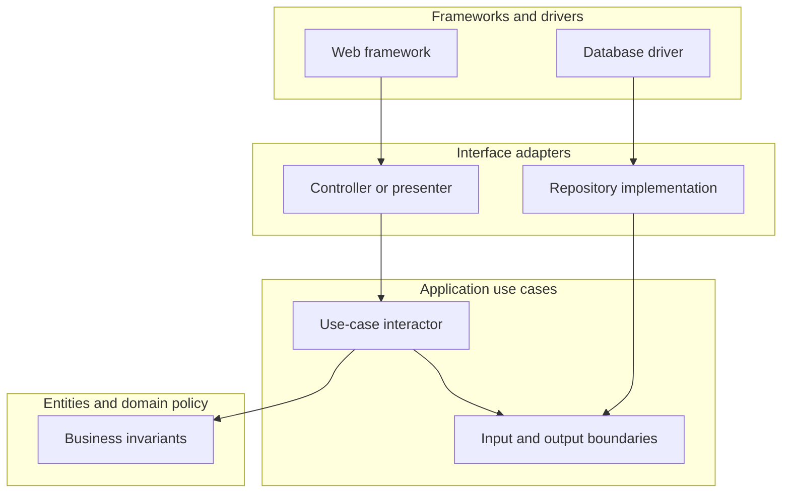
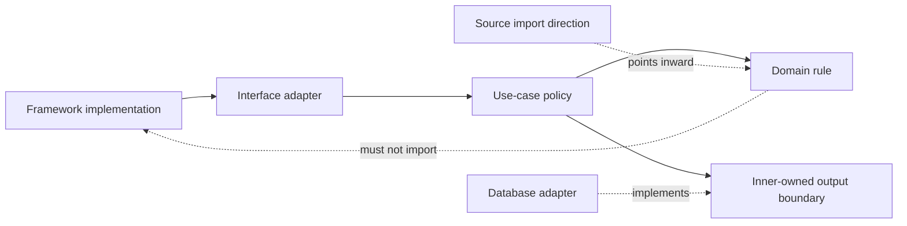
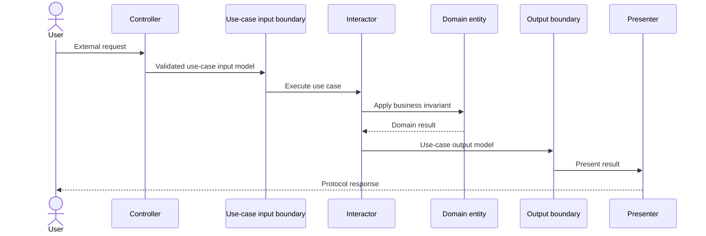
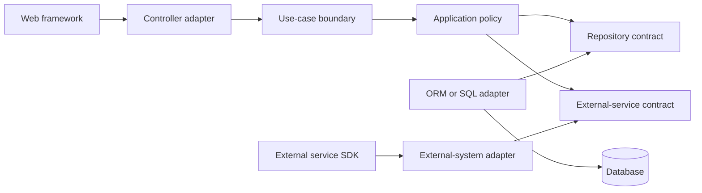
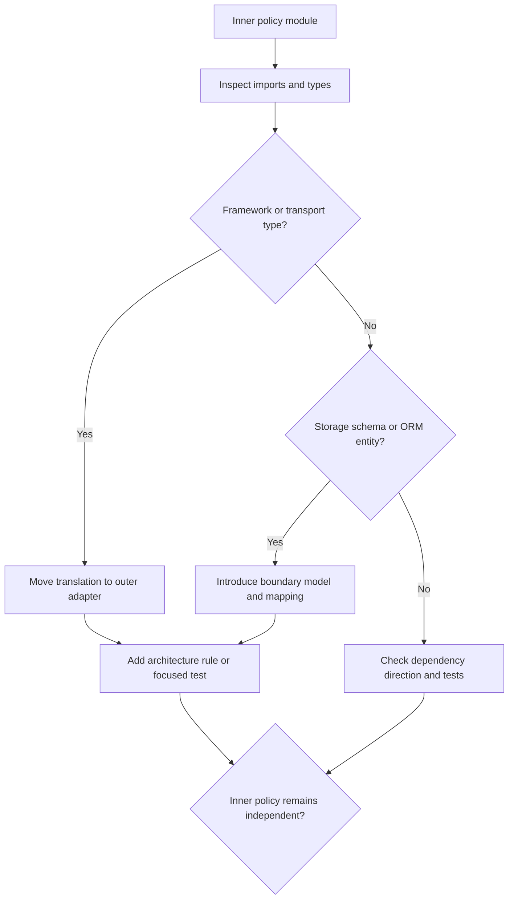

# Clean Architecture

Part: [20 — Architecture Patterns](PART_OVERVIEW.md)

Clean Architecture organizes software around inward-facing policy boundaries. Entities or domain rules are most independent; use cases coordinate application-specific behavior; interface adapters translate data; frameworks and external systems sit outside. The central dependency rule is that source dependencies point inward toward policy, not outward toward implementation details.

Part 20 owns general architecture patterns. Part 07 owns solution-level design; Part 21 owns documentation and diagram notation. Clean Architecture overlaps with Hexagonal and Onion architectures, but this chapter focuses on the dependency rule and use-case boundary.

## Organize Responsibilities as Concentric Boundaries

The inner entities express business invariants that remain useful across applications. Use cases coordinate those policies for a particular system. Interface adapters translate between use-case models and external formats. Frameworks and drivers provide databases, web servers, user interfaces, and vendor libraries.

The diagram is conceptual; exact layer names and boundaries vary. A small application may combine some outer responsibilities, but it should preserve the core rule that business policy does not depend on a chosen web or database framework.

## Apply the Dependency Rule

Compile-time dependencies point inward. An outer layer can know about an inner interface, while the inner layer avoids importing the outer implementation. Dependency injection or a composition root connects them at runtime. This allows a framework or database to be replaced without forcing business policy to change.

The rule applies to source dependencies, not necessarily runtime call direction. A use case can call an inner-owned interface that dispatches to an outer implementation. Avoid abstractions that leak framework types or database schemas into inner policies; otherwise the dependency rule exists only syntactically.

## Define Use-Case Input and Output Boundaries

An interactor accepts a use-case input model and returns an output model through a boundary. The controller adapts the external request to input; a presenter adapts the result to a view or response. This keeps protocol details out of the use case and prevents a persistence entity from becoming a public response format.

Keep models shaped for their boundary. Do not reuse one mutable object across database, domain, and API layers just to avoid mapping; those representations evolve for different reasons. Mapping should be explicit and tested, with validation at trust boundaries.

## Isolate Frameworks and Persistence

Frameworks are delivery mechanisms. Controllers, ORM mappings, and vendor SDKs should remain in outer adapters. Persistence interfaces should express application needs, while implementations translate those needs into queries and storage operations. This separation is useful when the implementation changes independently or when fast use-case tests matter.

The architecture does not require hiding every framework feature. If a framework's transaction, routing, or dependency-injection model is central to the system, isolate the essential policy dependency and make the trade-off explicit. Abstraction that duplicates framework concepts can increase maintenance without increasing replaceability.

## Detect Dependency-Rule Violations

Common violations include entities importing ORM annotations, use cases depending on web request types, inner layers returning database records, or tests requiring a live framework to exercise policy. Some frameworks support annotations that are inert in the domain, but this is still a coupling decision to assess rather than assume away.

Use architecture tests or module boundaries where violations are likely to recur. Do not enforce arbitrary package rules that block useful cohesion. The test should protect a meaningful change boundary, not merely preserve diagram symmetry.

## Worked Case: Insurance Quote Service

An insurance quote system receives requests through a web API and a partner batch file. Both adapters translate input to a quote use case. Domain rules calculate eligibility and premium from validated inputs; repository and risk-service interfaces isolate persistence and external scoring. Presenters map results to API and batch formats.

The team keeps provider-specific risk fields in the adapter and maps them to a stable domain result. It tests business invariants without starting the web framework, then runs adapter contract tests against the actual provider sandbox. A proposed abstraction around every field adds no independent change boundary and is removed; the architecture keeps only ports that protect policy from external contracts.

## Review Questions

1. Which responsibilities belong in entities, use cases, adapters, and frameworks?
2. How can runtime calls point outward while source dependencies point inward?
3. Why separate use-case models from database and API representations?
4. Which imports indicate that policy depends on implementation details?
5. When does an abstraction add meaningful independence rather than ceremony?

Clean Architecture protects business policy by directing source dependencies inward. Define use-case boundaries, translate external data at adapters, and keep framework or persistence details out of inner policy where that separation yields real change or testing value.
