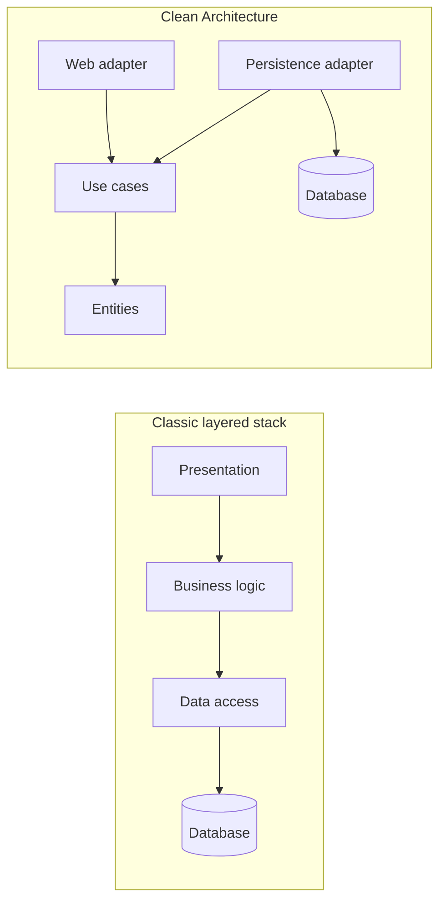
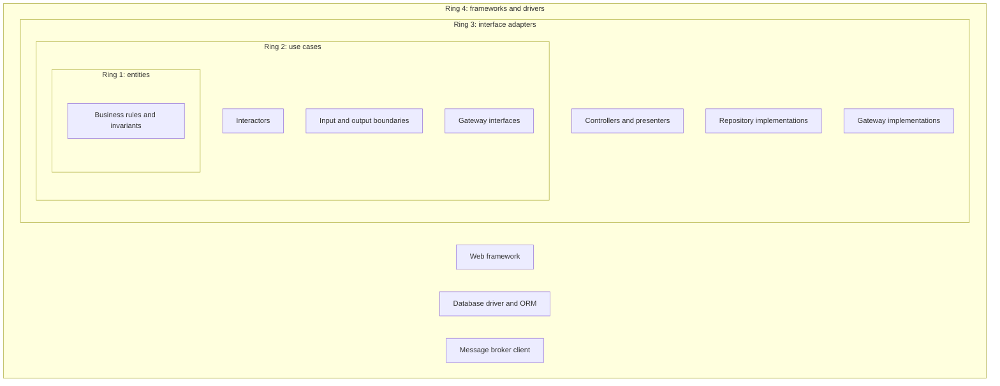
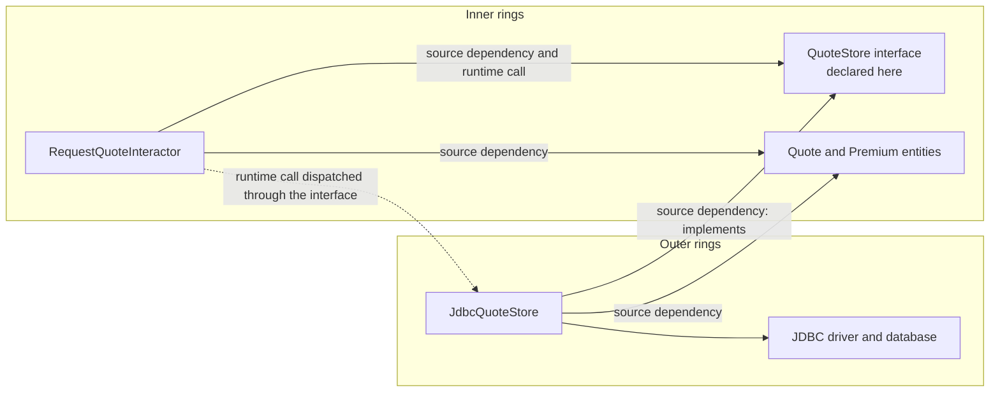
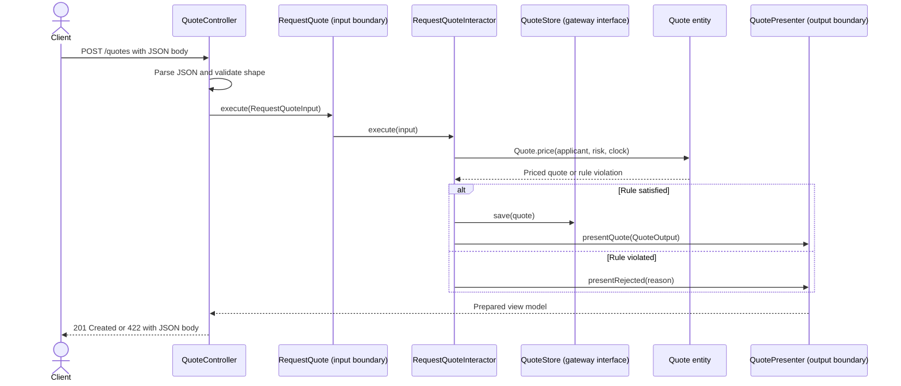
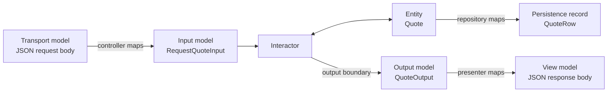
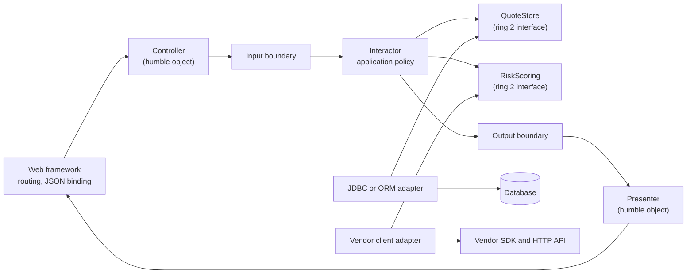
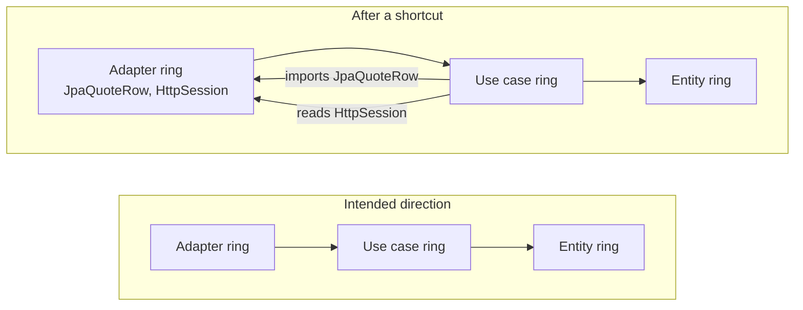
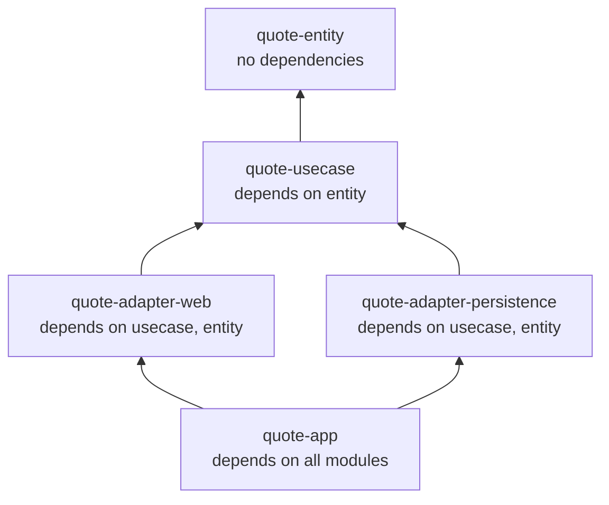
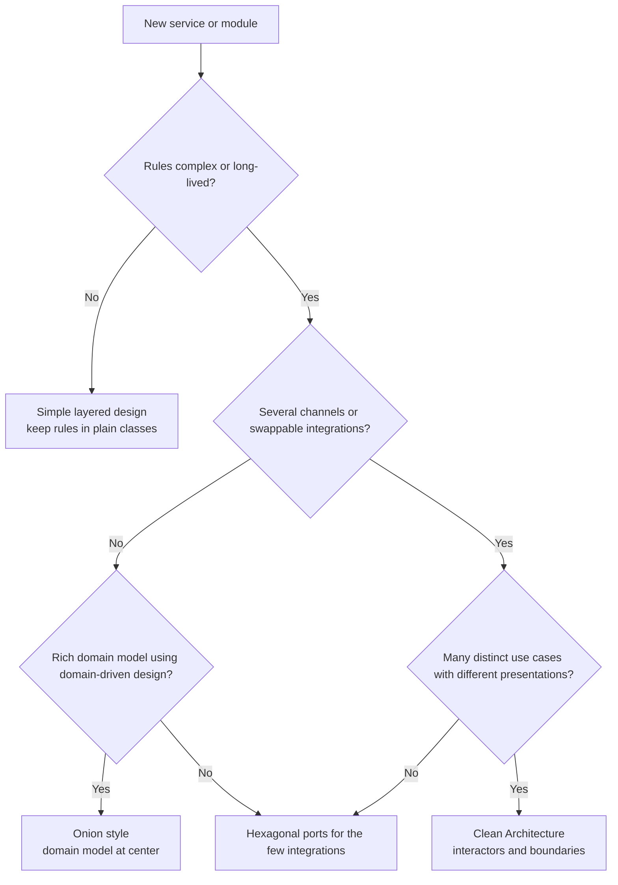
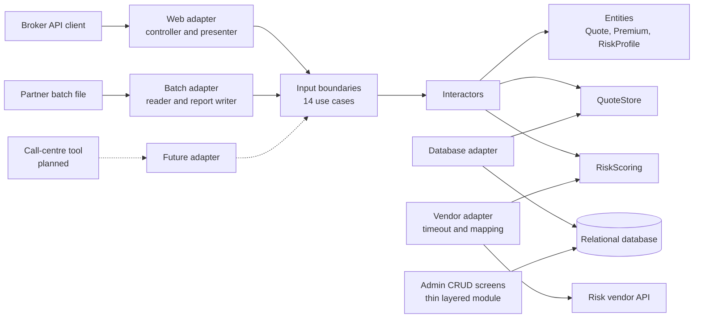

# Chapter: Clean Architecture

Part: [20 — Architecture Patterns](PART_OVERVIEW.md) · Status: Revised (in-depth rewrite)

## 1. Introduction

Clean Architecture is a way of arranging source code so that the rules of the business sit at the center of the program and everything that changes for technical reasons (web frameworks, databases, message brokers, user interface toolkits, vendor Software Development Kits (SDKs)) sits around them. The arrangement is governed by a single constraint, the dependency rule: source code dependencies point only inward, toward policy. The pattern is associated with Robert C. Martin, who described it in writing and in the book of the same name, and it deliberately combines ideas that earlier styles had already established.

For an engineer moving into architecture, the value of the pattern is a specific kind of predictability. When a requirement changes, you want to know in advance which parts of the code will have to change with it. A system arranged by the dependency rule gives a short and checkable answer: a change to how data is stored or delivered should touch outer code only, and a change to an application workflow should not touch the web or database code. When the pattern is applied where those changes actually happen, it pays for itself. When it is applied to a small create-read-update-delete (CRUD) application whose rules never change independently of its screens, it adds files and mapping code without buying anything. A large part of this chapter is about telling those two situations apart.

After studying this chapter, you should be able to:

1. Name the four rings (entities, use cases, interface adapters, frameworks and drivers), state what each owns, and place a given class in the correct ring.
2. State the dependency rule precisely, explain how a runtime call can point outward while the source dependency points inward, and show the mechanism that makes this possible.
3. Design a use case as an interactor with an input boundary, an output boundary, and boundary-shaped data models.
4. Decide what data may cross a boundary, and why one object should not be shared across the database, domain, and Hypertext Transfer Protocol (HTTP) layers.
5. Judge whether the pattern is justified by the forces present in a given system, and describe its quality-attribute consequences.

The chapter owns the dependency rule, the ring model, and the use-case boundary as organizing ideas. The boundaries with neighboring material are:

- [Layered Architecture](CH01_Layered_Architecture.md) owns the layer stack in which each layer depends on the one below it. Clean Architecture reverses the arrow between application and infrastructure, and the recap below explains why that matters.
- [Hexagonal Architecture](CH02_Hexagonal_Architecture.md) owns ports, primary and secondary adapters, and testing through ports. This chapter uses the same inversion mechanism but organizes the inside of the hexagon into entities and use cases, and compares the two by name instead of re-teaching ports.
- [Onion Architecture](CH04_Onion_Architecture.md) owns the domain-model-centered layering with repository interfaces. The comparison section of that chapter sets the three patterns side by side.
- Entity, value object, aggregate, and repository as code-level domain building blocks belong to [Low-Level Design](../07_System_Design_and_Distributed_Systems/CH04_Low_Level_Design.md); solution-level component design belongs to [High-Level Design](../07_System_Design_and_Distributed_Systems/CH03_High_Level_Design.md).
- Diagram notation and architecture documentation practice belong to [Part 21](../21_Architecture_Documentation/PART_OVERVIEW.md).

Terminology note: the word "entity" in this chapter means an enterprise-wide business rule object in the innermost ring. It does not mean a persistence-mapped class from an Object-Relational Mapper (ORM), which is an outer-ring detail. Mixing the two meanings is one of the most common sources of confusion, and a later section returns to it.

## 2. Forces and Context

A pattern is justified by the forces acting on a system, so start there. Clean Architecture responds to five forces, and the pattern is worth its cost roughly in proportion to how many of them are present.

The first force is unequal rates of change. Business rules such as how a premium is calculated or when a refund is allowed change when the business changes. The web framework, the database product, the message broker client, and the user interface change for unrelated reasons: a vendor release, a security advisory, a platform migration, a redesign. If both kinds of code are tangled, every technical change risks a business regression and every business change needs knowledge of technical details. Separating code by reason for change is the central idea, and it follows the general principle that a module should have one reason to change.

The second force is test cost. Business rules are the code you most want to test thoroughly, because mistakes there cost money. If a rule can only be exercised by starting a framework container, a database, and an HTTP server, tests are slow and flaky, and teams run fewer of them. As an illustrative calculation, suppose a service has 600 rule-level test cases. If each runs in memory in about 5 ms, the suite takes 600 × 5 ms = 3,000 ms, or 3 seconds. If each goes through a framework test slice at about 150 ms, the suite takes 600 × 150 ms = 90,000 ms, or 90 seconds, and requires infrastructure to be available. The exact numbers vary by stack, but the ratio of more than an order of magnitude is typical of the difference between a plain object test and a framework-backed test, and it determines whether developers run the suite before every commit.

The third force is multiple delivery mechanisms. When the same workflow is reachable through an HTTP Application Programming Interface (API), a batch file, a message consumer, and a command-line tool, the workflow must not be written inside any one of them. Otherwise it is duplicated, and the copies drift.

The fourth force is long-lived policy with short-lived technology. Business rules often outlive three or four generations of frameworks. Keeping them free of framework types means they can be carried across an upgrade or a rewrite of the outer ring with their tests intact.

The fifth force is deferred decisions. A team that has not yet chosen a database, or expects to change one, benefits from being able to build and test the rules first. This should not be overstated: deferring a decision is useful when the decision is truly uncertain, and wasteful when the team already knows it will use one relational database for the life of the product.

### 2.1 What Clean Architecture changes compared with a layered stack

In a classic [layered architecture](CH01_Layered_Architecture.md), the presentation layer calls the business layer, and the business layer calls the data layer. Each arrow is both a call and a source dependency. The consequence is that the business layer imports data-access types, so a change to the storage technology propagates upward through the stack. Layering can be improved by applying dependency inversion at the data boundary, and the layered chapter covers that. Clean Architecture makes the inversion the organizing principle rather than an add-on.



In the layered stack every arrow points downward, so the business logic ends up depending on the data access code. In the Clean Architecture view the arrows from the web adapter and the persistence adapter both point at the use cases, and the use cases point only at the entities. The database is still reached at runtime when a use case saves data, but the source code that does so lives in the persistence adapter, which depends on an interface that the use case layer owns. The implication is that business code can be compiled, tested, and reasoned about without any outer ring present, while the persistence adapter cannot be compiled without the use cases.

### 2.2 When the pattern is and is not appropriate

Apply the pattern where the first three forces are present and the system is expected to live for years. Typical examples are a billing or underwriting engine with many rules, a workflow system reachable through several channels, and a product whose storage or messaging infrastructure is expected to change.

Be cautious where the system is thin. A service that exposes database rows through an HTTP API with little logic has no policy to protect, and a ring structure around it produces classes that forward calls and copy fields. In that case a simple layered or transaction-script design is cheaper and easier to read. A reasonable test is to ask what would change independently. If the answer is "nothing, because every change touches the screen, the endpoint, and the table together", the boundaries will not earn their upkeep.

There is also a middle path. Many teams start with a small number of boundaries and add rings as pressure appears: keep the rules in plain classes from the first day, because that costs almost nothing, and introduce explicit input and output boundaries only for use cases that have multiple delivery mechanisms or complicated presentation. The cost of the pattern is concentrated in the mapping code and the extra interfaces, so adopting it incrementally concentrates the cost where the benefit is.

## 3. The Four Rings and Their Responsibilities

The model has four concentric rings. The usual names are entities, use cases, interface adapters, and frameworks and drivers. The number four is a convention, not a law; Martin says explicitly that a system may have more rings. What matters is the ordering: policy at the center, mechanism at the edge, and the dependency rule between them.



The nesting in the diagram is the dependency structure: code in an inner box never names anything in an outer box. Ring 1 knows nothing of use cases. Ring 2 knows ring 1 but not controllers, repositories, or frameworks. Ring 3 knows rings 2 and 1. Ring 4 is mostly configuration and glue and may know everything. The diagram does not show runtime calls, which cross the rings in both directions, and the next section explains how that works.

### 3.1 Ring 1: entities

Entities hold the rules that are true for the business regardless of which application is running. A loan entity that refuses a negative principal, a money type that will not add two currencies, an order that cannot be shipped before it is paid: these are entity-level rules. They are expressed as plain objects with behavior, not as data holders with logic placed elsewhere.

An entity has no knowledge of storage, transport, or even of the use cases that call it. It should be possible to compile the entities module with nothing but the language's standard library. In Java that means no persistence annotations from the Jakarta Persistence (JPA) specification, no Spring annotations, and no serialization annotations in this ring, and the same goes for decorators and base classes from a Python or TypeScript framework.

Entities correspond to the domain building blocks covered in [Low-Level Design](../07_System_Design_and_Distributed_Systems/CH04_Low_Level_Design.md): entity, value object, and aggregate. The Clean Architecture ring does not add new building blocks to those. It says where they live and what they may depend on. If you use domain-driven design, the ring holds your domain model; if you do not, it holds the rules that are shared across features.

### 3.2 Ring 2: use cases

Use cases hold application-specific rules: the sequence of steps that achieves one goal for a user or a calling system. "Place order", "Approve claim", and "Calculate quote" are use cases. A use case loads the entities it needs, asks them to apply their invariants, coordinates the outcome, and reports the result. It decides things that are specific to this application, such as whether a quote is valid for thirty days or whether a duplicate request is rejected, and it orchestrates things that are shared, such as asking an entity to check an invariant.

The distinction between ring 1 and ring 2 is the scope of the rule. A rule that would still hold if the company launched a second application belongs in an entity. A rule that exists because of how this application presents or sequences the work belongs in a use case. Where the scope is unclear, start with the use case. Moving a rule inward later is easy, and discovering that an entity carries rules that only one application wants is expensive.

Ring 2 also owns the interfaces through which it reaches the outside world: the input boundary that callers use, the output boundary that it uses to report results, and the gateway interfaces that it uses to load and save data or call other systems. These interfaces are declared in ring 2 and implemented in ring 3. Ownership is the point: the interface is shaped by what the use case needs, not by what the database or vendor offers.

### 3.3 Ring 3: interface adapters

Interface adapters convert data between the form that is convenient for the use cases and entities and the form that is convenient for an external agency such as the web, a database, or a file. This ring contains the controllers that turn an HTTP request into a use case input model, the presenters that turn an output model into a response or a view model, and the implementations of repositories and gateways that translate between domain objects and tables, documents, or vendor payloads.

Two rules keep this ring honest. First, all knowledge of one external format lives in one adapter. If the code that understands a partner's file layout appears in two places, a change to the layout has two places to fail. Second, adapters contain translation and no decisions. A controller that checks whether a customer is eligible has taken over a use case's job and made the rule unreachable from the batch import.

### 3.4 Ring 4: frameworks and drivers

The outermost ring is the code you did not write or that is mostly configuration: the web framework, the database driver, the ORM, the broker client, the Docker image, and the composition root that wires the application together. It is deliberately thin. Martin calls these details, and the word is accurate: they matter operationally but they are not the point of the application.

The composition root deserves a note because it is where the rule is satisfied at runtime. It is the one place that is allowed to know about every ring, because it creates the concrete adapters and hands them to the use cases. In Spring Boot, configuration classes and component scanning play this role. In a plain program it is the `main` function.

### 3.5 Placing a class: a short decision procedure

When you are unsure which ring a class belongs in, ask three questions in order. Would the class still be needed if the framework were replaced? If not, it is ring 3 or 4. Would it still be needed if a different application used these rules? If yes, it is ring 1. Otherwise it is ring 2. A `PremiumCalculator` that applies actuarial rules shared by the quote and renewal applications is an entity-ring concept. A `RequestQuoteInteractor` that loads the applicant, calls the calculator, stores the quote, and reports it is ring 2. A `QuoteController` that parses JavaScript Object Notation (JSON) is ring 3. The `@SpringBootApplication` class is ring 4.

## 4. The Dependency Rule

The dependency rule states that source code dependencies can only point inward. Nothing in an inner ring may mention the name of anything declared in an outer ring. That includes functions, classes, variables, annotations, and the data formats used by outer code. A name that is declared in ring 3 or 4 must not appear in the source of ring 1 or 2, not in an import, not in a parameter type, not in a thrown exception, and not in an annotation.

The rule is mechanical, which is its strength. It can be checked by reading imports, and it can be enforced by tools, as a later section on enforcement shows. A design principle that cannot be checked tends to erode, and one that is checked by the build tends to hold.

### 4.1 Source dependency versus runtime call

The rule governs where names are declared and imported, which is the compile-time view. Runtime control flow is a separate matter. A use case must at runtime cause a row to be written, which means control flows from ring 2 outward into a ring 3 repository and a ring 4 database driver. If the use case imported the repository class, the source dependency would point outward and the rule would be broken.

The standard resolution is dependency inversion. The use case declares an interface in ring 2 that describes what it needs, such as `QuoteStore` with `save(Quote)` and `findByApplicant(ApplicantId)`. The ring 3 repository imports that interface and implements it. At runtime the use case calls the interface, and the call is dispatched to the repository. The call arrow points outward, and the source arrow points inward.



The solid arrows are source dependencies and all of them point toward the entities and the interface. The dotted arrow is only a runtime call, and it points outward, but it passes through an interface owned by the inner ring so no source dependency is created. The implication is that the inner ring can be compiled and tested alone, that the repository can be replaced by an in-memory version in a test, and that a change to the database driver recompiles only the outer code.

### 4.2 The mechanism in code

The following Java 21 sketch uses Java Database Connectivity (JDBC) and shows the three pieces: the interface owned by the use case ring, the implementation in an adapter, and the wiring in the composition root. The names are illustrative.

```java
// ring 2: package app.quote.usecase
public interface QuoteStore {
    void save(Quote quote);
    Optional<Quote> findByApplicant(ApplicantId id);
}

// ring 3: package app.quote.adapter.persistence
public class JdbcQuoteStore implements QuoteStore {
    private final JdbcClient jdbc;

    public JdbcQuoteStore(JdbcClient jdbc) { this.jdbc = jdbc; }

    @Override
    public void save(Quote q) {
        jdbc.sql("insert into quote(id, applicant_id, premium_minor, currency) values (?,?,?,?)")
            .params(q.id().value(), q.applicant().value(),
                    q.premium().minorUnits(), q.premium().currency().getCurrencyCode())
            .update();
    }

    @Override
    public Optional<Quote> findByApplicant(ApplicantId id) { /* map row to Quote */ return Optional.empty(); }
}

// ring 4: package app.config
@Configuration
class QuoteConfig {
    @Bean QuoteStore quoteStore(JdbcClient jdbc) { return new JdbcQuoteStore(jdbc); }
    @Bean RequestQuote requestQuote(QuoteStore store) { return new RequestQuoteInteractor(store); }
}
```

Three observations follow. The `QuoteStore` interface mentions `Quote` and `ApplicantId`, which are entity-ring types, and nothing from `java.sql` or Spring. The adapter's method converts entity values to column values, so the entity never learns the table layout. The configuration class is the only place that names both `JdbcQuoteStore` and `RequestQuoteInteractor`. The same arrangement in Python uses an abstract base class or a `typing.Protocol` in the use case module and a concrete class in an adapter module; in TypeScript it uses an `interface` in the use case module. In dynamic languages the discipline is harder to see, because nothing forces the import, so the checks described later matter more.

### 4.3 What counts as a dependency

The rule is violated by more than imports of concrete classes. Several less obvious forms count, and teams commonly miss them.

| Form of dependency | Example in an inner ring | Why it breaks the rule |
| --- | --- | --- |
| Framework annotation | `@Entity`, `@Column`, `@JsonProperty` on a rule object | The ring now needs the framework library to compile, and the annotation encodes outer-ring decisions |
| Framework type in a signature | A use case taking `HttpServletRequest` or returning `ResponseEntity` | The use case can only be called from that framework |
| Persistence type in a signature | An interface returning a JPA-managed object or a `ResultSet` | The storage representation has leaked into the policy |
| Exception from outer code | A use case catching `SQLException` | The use case must know the storage technology to handle failure |
| Shared base class | Entities extending a framework `BaseEntity` | Inheritance imports the outer ring into every rule |
| Static access to outer code | A use case calling a static `Clock` or logger wrapper from ring 4 | Hidden dependency that tests cannot replace |

Some of these have pragmatic exceptions. A marker annotation that is inert at runtime, or a standard library `java.time.Clock` that is passed in, is a weaker coupling than a framework base class. The point of the table is to make each coupling a decision made on purpose, with its cost understood, and not an accident discovered during a framework upgrade.

### 4.4 Why only one direction

The rule does not forbid outer code from knowing inner code; it forbids the reverse. The asymmetry exists because of stability. Inner rings change rarely and for business reasons, and outer rings change often and for technical ones. Depending toward the stable side limits how far a change spreads. If the use case depended on the repository, every change to the repository's shape would force a change in the use case. With the inversion, the repository is the one that must adapt when the interface it implements changes, and that interface changes only when the use case's needs change.

There is a cost. The interface is an extra type, and a second file to read when following a call. For a repository with one implementation that will never be replaced, the interface adds little beyond testability. That testability, replacing the database with an in-memory fake in 600 fast tests, is usually a sufficient reason on its own, and the cost of the interface is small compared with the cost of a framework-dependent test suite.

## 5. Use Cases and Their Boundaries

The use case is the unit of application behavior in this pattern. Each one is a class (the interactor) that implements one goal, with a defined way in (the input boundary) and a defined way out (the output boundary). Organizing the code around use cases rather than around technical layers or database tables makes the application's purpose visible in the source tree: a developer opening the use case package sees "RequestQuote", "AcceptQuote", and "CancelPolicy", not "Controllers", "Services", and "Repositories".

### 5.1 Anatomy of a use case

A use case has five parts.

- The input boundary is an interface, or just the interactor's public method, that callers use to start the use case. Its parameter is an input model: a plain data structure with fields shaped by what the use case needs, not by a protocol.
- The interactor implements the input boundary. It contains the sequence of steps and calls into entities for invariants.
- Gateways are interfaces declared in this ring for data access and external services, as in the previous section.
- The output boundary is an interface through which the interactor reports the result, by calling a method such as `presentQuote(QuoteOutput)` or `presentRejected(String)`.
- The output model is a plain data structure that carries the result across the boundary.

The output boundary is the part that surprises people, since most code simply returns a value. Using an output boundary has an effect on dependency direction: the interactor calls the presenter through an interface it owns, so the presenter, which is outer code that knows about views and protocols, depends on the use case and not the reverse. When the interactor returns a value directly, the dependency direction is already correct, because the caller (a controller) depends on the use case and receives plain data. For many systems, returning an output model is simpler and sufficient. The output boundary earns its place when the same use case must produce different presentations, when the result is streamed or produced in several steps, or when outcomes are numerous enough that a single return type becomes awkward.

### 5.2 The flow of one request



Read the diagram from top to bottom. The controller does only translation work: it parses the request body, checks that the fields are present and well-formed, and builds an input model that no longer mentions HTTP. The interactor holds the workflow and asks the entity to enforce the business invariant. The presenter converts the result to a view model, and the controller sends it with the correct status code. Three consequences follow. The status codes and the JSON field names can change in the adapter ring without touching the interactor. A batch import can call the same input boundary and supply a different presenter that writes a result file. And the interactor test needs only a fake `QuoteStore` and a recording presenter.

Note where the two kinds of validation live. Shape validation (is the field present, is it a number, is the date in the expected format) belongs at the edge, because it depends on the transport. Business validation (is this applicant eligible, is the premium within the allowed range) belongs in the entity or the use case, because it must apply regardless of which channel delivered the request. Putting all validation in the controller leaves the batch import unprotected, and putting shape parsing inside the use case drags the protocol inward.

### 5.3 A use case in code

```java
// ring 2
public interface RequestQuote {
    void execute(RequestQuoteInput input, QuoteOutputBoundary out);
}

public record RequestQuoteInput(String applicantId, String productCode, int termMonths) {}

public interface QuoteOutputBoundary {
    void presentQuote(QuoteOutput quote);
    void presentRejected(String reasonCode);
}

public record QuoteOutput(String quoteId, long premiumMinorUnits, String currency) {}

public class RequestQuoteInteractor implements RequestQuote {
    private final QuoteStore store;
    private final RiskScoring scoring;     // gateway interface owned by this ring
    private final Clock clock;

    public RequestQuoteInteractor(QuoteStore store, RiskScoring scoring, Clock clock) {
        this.store = store; this.scoring = scoring; this.clock = clock;
    }

    @Override
    public void execute(RequestQuoteInput in, QuoteOutputBoundary out) {
        var applicant = new ApplicantId(in.applicantId());
        var risk = scoring.profileFor(applicant);
        var result = Quote.price(applicant, in.productCode(), in.termMonths(), risk, clock.instant());
        if (result.isRejected()) {
            out.presentRejected(result.reasonCode());
            return;
        }
        store.save(result.quote());
        out.presentQuote(new QuoteOutput(
            result.quote().id().value(),
            result.quote().premium().minorUnits(),
            result.quote().premium().currency().getCurrencyCode()));
    }
}
```

Several choices in this sketch are deliberate. Money is carried as minor units and a currency code so that no floating-point arithmetic touches monetary values. The clock is injected, so tests can fix the time and the interactor has no hidden dependency on the system clock. A business rejection is reported through the output boundary as an ordinary outcome, because an applicant being ineligible is an expected result and not an exceptional failure. Genuine faults, such as the store being unreachable, propagate as exceptions that the controller or a framework-level handler translates. That keeps the rule that the interactor does not catch technology-specific exceptions: the gateway implementation converts a driver failure to an application-level exception type declared in ring 2.

A matching test needs no framework:

```java
@Test
void rejectsApplicantWithHighRisk() {
    var store = new InMemoryQuoteStore();
    RiskScoring scoring = id -> RiskProfile.of(Risk.VERY_HIGH);
    var interactor = new RequestQuoteInteractor(store, scoring, Clock.fixed(T0, ZoneOffset.UTC));
    var out = new RecordingOutput();

    interactor.execute(new RequestQuoteInput("A-1", "HOME", 12), out);

    assertEquals("RISK_TOO_HIGH", out.rejectedReason);
    assertTrue(store.isEmpty());
}
```

### 5.4 Where the transaction boundary goes

A use case is usually the natural transaction boundary: one goal, one unit of work that must succeed or fail as a whole. The difficulty is that transactions are a mechanism of the persistence technology, so an interactor that opens and commits a database transaction depends on that technology. There are two common solutions. The first is to declare a small `UnitOfWork` interface in ring 2 that the interactor calls to bracket its work, with the ring 3 implementation delegating to the real transaction manager. The second is to wrap the interactor in a decorator in the composition root that starts and ends the transaction around the call, which leaves the interactor unaware of transactions entirely. In Spring Boot the second approach is often achieved with a `@Transactional` annotation applied to a ring 4 wrapper bean and not to the interactor. Choose the decorator when transactions are uniform across use cases, and the explicit interface when a use case needs to make decisions based on transaction outcome, for example to publish an event only after commit.

Cross-service workflows that cannot share a transaction are a different problem owned by the [Saga pattern](CH10_Saga_Pattern.md); the use case in that setting becomes a step in a longer process and is not itself the transaction boundary.

## 6. Data Crossing Boundaries

The dependency rule is not satisfied merely because the import statements are clean. If the data passed across a boundary is shaped by an outer ring, the inner ring has been coupled to it even without importing a class. The rule is therefore accompanied by a second one: data that crosses a boundary should be in the form most convenient to the inner side.

### 6.1 Four models and why they differ

A typical request touches four representations of "a quote". The entity is rich in behavior and invariants and is shaped by business rules. The input and output models are simple data structures shaped by the use case. The persistence record is shaped by the table or document, including identifiers, foreign keys, and audit columns. The transport model is shaped by the API contract: field names, nesting, optional fields, and version.

Each of these changes for a different reason. The table gains a column for reporting. The API adds a field for a mobile client. The business adds a rule that changes the entity's methods. If a single class serves all four roles, every one of those changes touches it, and a change made for one audience can break another. A column rename silently changes the public response, or an API field forces a change to the rule object.



The diagram shows where each translation happens: the controller maps transport to input, the repository maps entity to record and back, and the presenter maps output to view. There are three mapping points per request path. The implication is that every representation can change freely as long as its mapper is updated, and that the mappers are the place to test compatibility. The cost is mapping code, which is the most frequently cited complaint about the pattern and the subject of the next subsection.

### 6.2 The cost of mapping, and when to reduce it

Mapping is boilerplate, and it is also where defects hide: a field is forgotten, a null is mishandled, a rounding rule differs. Two practices keep it manageable. First, write mapping tests that round-trip a populated object and compare every field, so a new field that is not mapped fails a test. Second, use a mapping tool or record constructors where mappings are mechanical, and write them by hand where logic is involved.

There are honest cases for reducing the number of models. When the input model and the transport model are identical in shape and the API is internal to one team, letting the controller pass a record that is declared in ring 2 and also deserialized from JSON saves a class. When the output model is returned directly rather than through a presenter, the presenter's mapping disappears. The cost of these shortcuts is that the API contract is now partly defined by an inner-ring class, so any change to the contract touches ring 2. Take the shortcut knowingly, for stable, internal, and low-variance contracts, and keep full separation for public APIs, partner integrations, and anything with more than one consumer format.

The shortcut that should almost never be taken is letting persistence-mapped entities double as domain entities. It looks efficient, because one class and no repository mapping are needed, and it fails in practice. ORM requirements such as a no-argument constructor, mutable fields, lazy-loading proxies, and annotations pull framework concerns into the innermost ring, and the table shape starts to dictate the rule objects. Some teams accept this deliberately for simple domains. If you do, document it as a conscious trade-off in a decision record and expect to pay later if the rules grow.

### 6.3 What may cross

Plain data structures are the safest things to pass across a boundary: records, simple value types, and primitives. Entities may be passed from the entity ring outward in a read-only sense, for example when the repository interface returns a `Quote` to the interactor, because the direction of the source dependency still points inward. Passing an entity outward to a presenter is possible but ties the presenter to the entity's shape, so most designs copy the needed fields into an output model. What must not cross inward is anything that carries outer knowledge: framework request objects, ORM-managed objects, database cursors, and vendor SDK types.

Errors cross boundaries too. Use cases should declare the failures they can report, either as outcomes through the output boundary or as exception types in ring 2 or ring 1. Outer adapters translate those into status codes, retries, or messages. A repository that lets a `SQLException` escape forces every use case to know about SQL, so the adapter catches it and rethrows an application-level exception such as `QuoteStoreUnavailable`.

### 6.4 Illustrative arithmetic: the cost and payoff of mapping

Consider a service with 25 use cases, each with an input model, an output model, and one entity-to-record mapping, so three mappers per use case (transport-to-input, entity-to-record, output-to-view). That is 25 × 3 = 75 mappers. At an assumed 20 lines each, the mapping code is 75 × 20 = 1,500 lines. With a mapping test of 15 lines each, tests add 75 × 15 = 1,125 lines. This is the up-front cost, and it is real.

Now suppose the table gains a reporting column twice a year, and the API gains a field four times a year, which are illustrative rates. With shared classes, assume each such change reaches an average of 6 use-case classes and their tests. With separate models, a column change touches one record and one mapper, and an API field touches one view and one mapper. Under these assumptions the shared design needs 6 edits per event, or 6 × 6 = 36 edits a year, and the separated design needs about 2 per event, or 2 × 6 = 12 edits a year. The payoff is more significant still where the edits would have caused regressions in a different audience's contract. The numbers are invented to show the method: count the mappers you will write, estimate how often each representation changes, and compare. If the representations rarely change, the arithmetic can favor sharing, which is the honest answer for small stable systems.

## 7. Isolating Frameworks, Persistence, and the Web Layer

Sections 4 to 6 explained the rule and the data that crosses it. This section applies them to the three outer-ring technologies that most often leak inward: the web framework, the persistence mechanism, and vendor clients. A framework is a delivery mechanism. It decides how requests arrive and how rows are stored, and it should not decide what a quote is worth.



The diagram is the external framework adapter view. The web framework appears only on the left and is reached through a controller and a presenter, both of which hold no decisions. The database and the vendor SDK appear only on the right behind adapters that implement interfaces owned by the interactor. The implication is that the interactor is surrounded by interfaces it owns, so each outer technology can be replaced, upgraded, or faked by changing one adapter and the composition root.

### 7.1 The humble object

The humble object pattern splits behavior that is hard to test from behavior that is easy to test. The hard-to-test part (the part that talks to the framework, the screen, or the network) is made as small and decision-free as possible. The logic is moved into a testable object that has no framework dependency.

In the web layer this gives a controller and a presenter. The controller is humble: it receives a framework request, extracts values, builds an input model, calls the use case, and returns the framework response. The presenter holds the formatting logic that is worth testing, such as turning a minor-unit amount into a display string or choosing a message for a rejection code, and it produces a plain view model. The framework then serializes the view model. A rule of thumb is that a controller method longer than about ten lines, or with an `if` on a business value, has absorbed use case work.

The same split applies to persistence. The repository implementation is humble about storage: it runs statements and maps rows. Any rule such as "a quote cannot be saved twice for the same applicant and day" is either an entity invariant or an interactor decision, backed by a database uniqueness constraint as a last line of defense. The constraint protects data integrity, and the interactor rule gives a meaningful business outcome. Relying on the constraint alone turns an expected business case into a storage exception that outer code must interpret.

### 7.2 Repository interfaces that express use case needs

A repository interface should be shaped by what the interactors ask, not by what the table offers. Compare two designs for the quote store.

A table-shaped interface exposes `findAll()`, `findById()`, `save()`, `delete()`, and a query-by-example method, because that is what a generic data access framework generates. Every interactor can then call any of them, and the use cases accumulate queries that only the adapter can implement efficiently. A need-shaped interface exposes `save(Quote)`, `findByApplicant(ApplicantId)`, and `existsForApplicantOn(ApplicantId, LocalDate)`. Each method is a question one interactor asks. The adapter can implement each with a tuned statement and an index, and a reviewer can read the interface to see what the application needs from storage.

Three guidelines keep repository interfaces healthy.

- Return entities or small read models, never framework-managed objects. A lazy-loading proxy that works only inside a session is a storage detail that has escaped.
- Keep the interface narrow per aggregate or per use case group. A single 40-method repository interface is a sign that reporting queries have been mixed with transactional ones. Reporting often deserves its own read-side interface, which anticipates the separation taught in [CQRS](CH09_CQRS.md).
- Name failures in the interface contract. State that `save` throws `QuoteStoreUnavailable` on infrastructure failure and returns normally on success, so the interactor does not have to guess at driver exceptions.

Many persistence frameworks offer a repository abstraction of their own, such as Spring Data repositories. Using one is a legitimate decision, and it is cheaper than writing JDBC by hand. The question to ask is whether the framework interface can sit in ring 3 behind your own ring 2 interface. If the adapter is a three-line class that delegates to a generated repository and maps types, the cost is low and the isolation is complete. If you instead let interactors import the framework repository, the use case ring now requires that framework to compile, which is acceptable only as a recorded trade-off.

### 7.3 Mapping costs at the adapter, with arithmetic

Section 6.4 estimated the code volume and change frequency of mapping. A different cost is the runtime cost, which is usually small but worth computing so that the decision is made with numbers and not with intuition.

Take an illustrative read path that returns a list of 50 quotes, where each persistence record is mapped to an entity and then to an output model. Assume each mapping allocates one object of about 120 bytes, and each takes about 1 microsecond (µs). Per request that is 50 × 2 mappings = 100 object creations, 100 × 120 bytes = 12,000 bytes, and 100 × 1 µs = 100 µs. At an illustrative 200 requests per second the added work is 200 × 100 µs = 20,000 µs, or 20 ms of central processing unit (CPU) time per second, which is 2% of one core. The database round trip for the same request is commonly measured in milliseconds, so 0.1 ms of mapping is noise next to, say, 5 ms of query time (0.1 / 5 = 2%).

The conclusion to draw from the method is not that mapping is free. It is that mapping cost scales with rows returned and mapping steps, so check it where rows are many. If a use case streams 500,000 rows for an export, the same figures give 500,000 × 2 × 1 µs = 1,000,000 µs, or 1 second, and 500,000 × 2 × 120 bytes = 120,000,000 bytes, or 120 MB of short-lived allocation. For such a path the usual remedy is a purpose-built read model: the adapter exposes `streamQuotesForExport()` that maps one record directly to an export line, bypassing the entity because no invariant needs to run. Skipping the entity on read-only bulk paths is consistent with the pattern when the shortcut is declared in the interface and not hidden. Measure with a profiler before optimizing; these numbers are assumptions, not benchmarks.

### 7.4 Wiring a Spring Boot application (Java 21)

The following sketch shows the web side. Spring types appear only in the controller, the presenter's output type, and the configuration class.

```java
// ring 3: package app.quote.adapter.web
@RestController
@RequestMapping("/quotes")
class QuoteController {
    private final RequestQuote requestQuote;

    QuoteController(RequestQuote requestQuote) { this.requestQuote = requestQuote; }

    record QuoteRequest(String applicantId, String productCode, Integer termMonths) {}

    @PostMapping
    ResponseEntity<?> create(@RequestBody QuoteRequest body) {
        if (body.applicantId() == null || body.productCode() == null || body.termMonths() == null) {
            return ResponseEntity.badRequest().body(Map.of("error", "MISSING_FIELD"));
        }
        var presenter = new QuoteHttpPresenter();
        requestQuote.execute(
            new RequestQuoteInput(body.applicantId(), body.productCode(), body.termMonths()),
            presenter);
        return presenter.response();
    }
}

// ring 3: implements the ring 2 output boundary
class QuoteHttpPresenter implements QuoteOutputBoundary {
    private ResponseEntity<?> response;

    @Override public void presentQuote(QuoteOutput q) {
        response = ResponseEntity.status(201).body(Map.of(
            "quoteId", q.quoteId(),
            "premium", q.premiumMinorUnits(),
            "currency", q.currency()));
    }

    @Override public void presentRejected(String reasonCode) {
        response = ResponseEntity.unprocessableEntity().body(Map.of("reason", reasonCode));
    }

    ResponseEntity<?> response() { return response; }
}
```

The controller checks shape only. The presenter is created per request, so it holds no shared state, and it is the only class that knows the status codes. Notice what is absent: no `Quote` import, no repository, no business condition. The configuration class from section 4.2 supplies the beans, with `RequestQuoteInteractor` created from a `QuoteStore`, a `RiskScoring` implementation, and a `Clock` bean. Constructor injection is used throughout, so the interactor can be created in a test with `new`.

Component scanning deserves a caution. If the whole application is scanned from one root package, an annotation placed on an inner-ring class would be picked up without anyone noticing that the ring now depends on the framework. Keep the interactors free of Spring annotations and register them in the configuration class, as the earlier example does. The convenience of `@Service` on an interactor is real, and it is a one-line coupling that some teams accept. If you accept it, put it in the decision record and make the architecture test described next allow exactly that annotation and nothing else.

### 7.5 Vendor clients and the web client side

The same technique applies to outbound HTTP. A risk-scoring vendor returns fields named for its own model, with its own error codes and rate-limit headers. The `RiskScoring` interface returns a `RiskProfile` in the application's vocabulary, and the adapter owns the translation, the timeout, the retry policy, and the mapping from vendor error codes to application exceptions. When the vendor changes a field name, one adapter and its contract test change. Resilience policy such as timeouts and retries belongs in this adapter because it is a property of the outside connection, while the decision about what to do when scoring is unavailable (reject the quote, queue it, or use a default tier) belongs in the interactor because it is business behavior. The [Microservices](CH05_Microservices.md) chapter covers resilience mechanisms in depth.

The framework is a detail, but it is a detail you probably chose on purpose. Isolate what is cheap to isolate and what protects the rules. Do not build an abstraction over a routing annotation to prepare for a framework change that has no evidence of arriving, because the abstraction will duplicate the framework's own concepts and add upkeep without adding replaceability.

## 8. Detecting Dependency-Rule Violations

A rule that depends on reviewers noticing a stray import will erode. The usual path of erosion is not malice. A developer under deadline needs the current user's identifier inside an interactor, finds `SecurityContextHolder` a single import away, and adds it. Each such shortcut is small and passes review because the reviewer is reading the diff and not the dependency graph. Detection therefore needs to be automatic and run on every change.

### 8.1 What a violation looks like

The most common violations fall into the categories listed in section 4.3. The diagram shows one realistic case: an interactor that has acquired an outward source dependency.



In the violated half, the use case ring has arrows into the adapter ring in addition to receiving them. The use case now compiles only when the persistence mapping and the servlet API are present, so the in-memory test of section 5.3 no longer builds without a framework on the classpath. The implication is that a single leaked type removes the benefit that justified the pattern, and the fix is rarely local: removing the import means introducing a boundary model, a gateway interface, or an input field (such as a `callerId` passed in by the controller).

### 8.2 Architecture tests

An architecture test expresses the rule as an executable check over compiled classes. ArchUnit is a Java library for this, and equivalent tools exist for other ecosystems, such as import-linter for Python and dependency-cruiser for JavaScript and TypeScript. The following example is a correct minimal pair of rules in ArchUnit style. Check the method names against the version you use, because the library's fluent API has changed across releases.

```java
import com.tngtech.archunit.core.importer.ImportOption;
import com.tngtech.archunit.junit.AnalyzeClasses;
import com.tngtech.archunit.junit.ArchTest;
import com.tngtech.archunit.lang.ArchRule;

import static com.tngtech.archunit.lang.syntax.ArchRuleDefinition.noClasses;

@AnalyzeClasses(packages = "app.quote", importOptions = ImportOption.DoNotIncludeTests.class)
class DependencyRuleTest {

    @ArchTest
    static final ArchRule entitiesDependOnNothingOutward =
        noClasses().that().resideInAPackage("..entity..")
            .should().dependOnClassesThat().resideInAnyPackage(
                "..usecase..", "..adapter..", "..config..",
                "org.springframework..", "jakarta.persistence..", "com.fasterxml.jackson..");

    @ArchTest
    static final ArchRule useCasesDoNotSeeAdaptersOrFrameworks =
        noClasses().that().resideInAPackage("..usecase..")
            .should().dependOnClassesThat().resideInAnyPackage(
                "..adapter..", "..config..", "java.sql..", "org.springframework..");
}
```

The first rule says that nothing in the entity packages may refer to any outer package or to the named framework packages. The second says the same for the use case packages, so a `java.sql.SQLException` catch block or a Spring annotation fails the build. Each rule fails with the offending class and the line that creates the dependency, which makes the message actionable.

Two cautions apply. A rule that lists framework packages by name checks only what you thought of, so complement it with a positive rule where practical: entities may depend only on the standard library and on other entity packages. And an ArchUnit rule works on compiled bytecode, so a rule that fails to match any class passes silently. Add a check, or a test that asserts the rule's package pattern matches at least one class, so a package rename cannot turn the guard into a no-op.

### 8.3 Build-module boundaries

Package rules are advisory in the sense that a developer can edit the test. Build-module boundaries are stronger because the compiler enforces them. Split the code into modules whose declared dependencies form the same inward graph.



The diagram reads from the bottom up. The entity module has no declared dependencies, so a framework import in it fails to compile. The use case module depends on the entity module only, so it cannot import a web or JDBC class because the library is not on its classpath. Only the application module knows all of them, which matches the composition root of section 3.4. The implication is that the compiler enforces the rule with no test to forget, and the cost is more build files and a slower first build. In Java the options are Maven or Gradle modules, or the Java Platform Module System (JPMS) with `module-info.java` files that state which packages are exported and required. In other ecosystems the equivalents are separate packages in a workspace, such as Go modules or Python distributions.

Module splitting is not free. For a small service, five modules for a few thousand lines is excessive, and package-level ArchUnit rules give most of the protection. A practical threshold is to move to build modules when several teams touch the code, when a violation has already happened twice, or when the same use cases are packaged into more than one deployable.

### 8.4 Fitness functions and review

An architecture test is one kind of fitness function: an automated check of an architectural property that runs in the delivery pipeline. For this pattern, useful fitness functions beyond import rules include:

- A test that counts entity-ring classes with framework annotations, which should be zero (or exactly the accepted exceptions).
- A test that every `QuoteStore` implementation passes the same contract test suite, which prevents the in-memory fake from drifting from the real adapter.
- A check that use case tests start no framework context, for example by asserting the use case module has no test dependency on the framework's test library.
- A trend measure, such as the number of allowed-exception entries in the architecture test, with a failing threshold so exceptions do not accumulate.

Run these in the same pipeline as unit tests so the feedback arrives with the change. Treat an exception list as a ledger: each entry has an owner and a reason, and a growing list is a signal to revisit the design.

Do not enforce arbitrary package rules that block useful cohesion. A rule such as "every class in `usecase` must end in `Interactor`" protects a naming habit and not a change boundary. Prefer rules that correspond to a cost you can name: this rule keeps framework upgrades out of the business module, that rule keeps tests fast.

### 8.5 Triage when a rule fails

When a rule fails on existing code, resist the urge to add the class to an exception list immediately. Work through three questions. Is the dependency necessary for the use case's goal, or incidental, as with a logging or utility import? If necessary, what does the use case need from the outside, and can that need be stated as a gateway interface or an input field? If the cost of removal is high now, is it a conscious trade-off that belongs in a decision record with an expiry date? An exception without a recorded reason becomes permanent by default.

## 9. Testing, Errors, Security, and Performance Across the Rings

Four concerns cut across every ring: how the code is tested, how failures are represented, where security decisions are made, and what the structure costs at runtime. Each has a placement rule that follows from the dependency rule. Transaction placement was covered in section 5.4 and is not repeated.

### 9.1 Testing strategy by ring

Each ring has a cheapest effective test, and the pattern's test benefit comes from using it.

| Ring | Primary test | Needs | Checks |
| --- | --- | --- | --- |
| Entities | Plain unit test | Nothing | Invariants, calculations, edge values |
| Use cases | Interactor test with fakes | In-memory store, stub gateways, fixed clock, recording presenter | Workflow, outcomes, rejection paths |
| Interface adapters (persistence) | Contract test against the real technology | Database container or sandbox | Mapping, queries, constraints, error translation |
| Interface adapters (web) | Framework slice test | Framework test support | Routes, status codes, JSON shape, shape validation |
| Frameworks and drivers | A few end-to-end tests | Full deployment of the service | Wiring, configuration, security filters |

The shape is a pyramid with the many fast tests at the bottom. Consider an illustrative suite: 600 entity tests at 5 ms, 100 interactor tests at 10 ms, 25 web slice tests at 150 ms, 30 persistence contract tests at 400 ms against a containerized database, and 5 end-to-end tests at 3,000 ms. The totals are 3,000 ms, 1,000 ms, 3,750 ms, 12,000 ms, and 15,000 ms, which sum to 34,750 ms, or about 35 seconds. The 700 tests below the adapters account for 4,000 ms, about 11.5% of the time (4,000 / 34,750), and the 35 tests that need real infrastructure account for the rest. The point is where the time goes: a developer can run the inner 700 tests in 4 seconds before each commit and leave the slower ring for the pipeline.

Two disciplines keep this working. Every fake of a gateway interface should pass the same contract test as the real adapter, so the fast tests do not drift from reality. And adapter tests should check translation and failure behavior, not business rules, because the rules are already checked cheaply inside. For the equivalent argument through ports, see the testing section of [Hexagonal Architecture](CH02_Hexagonal_Architecture.md).

### 9.2 Error handling across boundaries

Errors have three kinds, and each has a home.

- Business rejections are expected outcomes, such as "applicant not eligible". They are modeled by the entity or interactor and reported through the output boundary as ordinary results. No exception is needed.
- Application-level failures are inability to complete, such as `QuoteStoreUnavailable` or `RiskScoringTimeout`. They are declared in ring 2, thrown by adapters that translate technology-specific exceptions, and propagated by the interactor.
- Programming faults, such as a null that should not exist, are not part of the contract. They propagate to a framework-level handler that logs and returns a generic failure.

The translation to the outside world happens once, in ring 3 or 4. A single exception-handling component in the web adapter maps `QuoteStoreUnavailable` to a 503 response with a retry hint and a rejection code to a 422, so status-code policy lives in one place. The interactor never decides an HTTP status, and the batch adapter maps the same exceptions to a retry queue and a failure report. Logging belongs at the point where the error is translated, since logging at every layer produces duplicate entries for one fault.

### 9.3 Security placement

Security decisions are tied to rings by what information they need.

- Authentication (who is calling) depends on tokens, sessions, and the identity provider, so it belongs in ring 4 as a framework filter or gateway. The result crosses inward as plain data, such as a `callerId` field in the input model. The interactor never reads a security context holder.
- Coarse authorization (may this role call this endpoint) depends on the route, so it belongs in the web adapter.
- Business authorization (may this broker see this applicant's quote) depends on data and applies to every channel, so it belongs in the use case, using the caller identity from the input. If it lived only in the controller, the batch import and the message consumer would bypass it.
- Invariants that protect the data, such as "premium must be positive", are entity rules and apply regardless of caller.
- Input validation of shape and size belongs at the edge. Secrets and keys live in ring 4 configuration and are never passed into entities.

This placement means an architecture review can answer "where is permission checked for this action" by looking at one use case. The deeper treatment of identity, tokens, and threat modeling belongs to [Part 15](../15_Security/PART_OVERVIEW.md).

### 9.4 Performance cost of the structure

The structural costs are mapping allocations (computed in sections 6.4 and 7.3), extra method dispatch through interfaces, and sometimes extra queries when a use case loads whole entities where a projection would suffice. Interface dispatch is negligible on a modern runtime relative to a network call. The query cost is the one that matters. An interactor that loads a quote with 200 line items to check one flag is paying for a rule-shaped model on a path that needed a lookup. Section 7.3 gave the remedy: a read-side interface that returns a small projection, declared in ring 2 and implemented with a tuned query. Performance engineering practices such as profiling and capacity planning are covered in [Part 19](../19_Performance_Engineering/PART_OVERVIEW.md).

## 10. Over-Engineering Signals and When Clean Architecture Is Too Heavy

The pattern has real costs: more types, mapping code, and indirection, and a learning curve for people who read a call chain through interfaces. Those costs are justified by the forces in section 2. This section gives signals that the costs have outrun the benefit, and a comparison with its three neighbors.

### 10.1 Signals of over-engineering

- Interactors that only forward a call to a repository, with no rule and no sequencing. Such a use case is a pass-through, and the ring adds a class and no policy.
- A one-to-one copy of every field through input model, entity, record, output model, and view model, with no field ever differing between them. If five classes change together every time, they were one class.
- An interface for every class, including ones with one implementation that is not replaced and not faked. Interfaces at boundaries are justified by a tested change or test need. Interfaces inside a ring usually are not.
- Entities that are anemic data holders, while the rules live in interactors. The ring structure is present but the center is empty, so the pattern protects nothing.
- A mapping layer with more lines than the business rules it protects. Compare the 1,500 lines of mapper code in section 6.4 with the number of lines of actual rule code. If rules are a few hundred lines, the proportion is a warning.
- Teams that cannot name a technology they expect to swap, or a second delivery channel, or a rule set complex enough to test heavily, and still maintain all four rings.
- Features that take noticeably longer to add because each needs a new set of files across five packages, with no corresponding drop in regression defects.

None of these proves the pattern is wrong. Each is a prompt to ask what independent change the boundary protects, and to remove or merge the boundary if the answer is none.

### 10.2 Scaling the pattern down

You can keep the dependency rule and shed the ceremony. Keep rules in framework-free classes. Keep one interface per external dependency that you actually fake or may replace. Return output models from interactors and skip output boundaries unless one use case has several presentations. Let simple read-only screens call a query service that reads a projection directly, and reserve full interactors for state-changing work with rules. A service with ten CRUD endpoints and two rule-heavy workflows can use the full structure for the two workflows and a thin layered structure for the rest, as long as the boundary between the two styles is explicit.

### 10.3 Comparison with the neighboring patterns

Clean Architecture sits among related styles that share the inward-dependency idea. The table compares them on the dimensions that drive a choice. It recaps the other chapters and does not re-teach them.

| Dimension | [Layered](CH01_Layered_Architecture.md) | [Hexagonal](CH02_Hexagonal_Architecture.md) | Clean (this chapter) | [Onion](CH04_Onion_Architecture.md) |
| --- | --- | --- | --- | --- |
| Organizing idea | Horizontal technical layers | Application core with ports and adapters | Concentric rings with the dependency rule | Domain model at center with surrounding layers |
| Dependency direction | Downward, often to the data layer | Inward to the core through ports | Inward to entities through use case boundaries | Inward to the domain model |
| Where application workflow lives | Business layer | Application services in the core | Interactors in the use case ring | Application services layer |
| Default test seam | Mocks per layer, often database-backed | Ports, with fakes for secondary adapters | Input boundary and gateway interfaces | Repository interfaces and service layer |
| Mapping burden | Low | Medium | Highest of the four when boundaries are fully separated | Medium |
| Best fit | Simple or short-lived systems, CRUD-heavy applications | Systems with several channels or integrations to swap | Rule-heavy systems needing explicit use cases and strict direction | Domain-model-heavy systems using domain-driven design |
| Main risk | Business layer coupled to storage | Port proliferation | Ceremony and mapping volume | Layer count without enforcement |

The patterns overlap more than the table suggests. Clean and Hexagonal both rely on dependency inversion at the same places. What Clean adds is the explicit naming of the use case as the unit and the rule for data crossing boundaries. What Hexagonal adds is the vocabulary of primary and secondary adapters. The choice between them is often a vocabulary and convention decision inside one team, and the substantive decision is whether to invert dependencies at all.



The tree is a starting heuristic and not a procedure. It shows that the full ring structure is reached only after several forces are present, and that lighter inward-dependency styles cover the middle cases. The implication is that the question to ask a team is which branch it is on and what evidence supports the answer, and the decision should be recorded as described in [Part 22](../22_Architectural_Thinking_and_Decision_Practice/PART_OVERVIEW.md).

### 10.4 When Clean Architecture is too heavy

Choose something lighter when any of these holds: the application is a short-lived prototype or internal tool, the rules are trivial and change with the screens, a single developer owns the code and its lifetime is under a year, or the framework is the product, as in a plugin for a platform where the framework's model is the domain. In these cases a plain layered design with disciplined naming and a few unit tests gives most of the benefit. Revisit the decision when the second delivery channel, the first swap of infrastructure, or the first rule explosion arrives, and move the rules inward then. Because the entity and use case code is plain, the later migration is incremental.

## 11. Failure and Quality-Attribute Scenarios

A quality-attribute scenario states a stimulus, the response the architecture should give, and a measure that decides pass or fail. The scenarios below test the claims the pattern makes. All numbers are illustrative targets for a hypothetical service, to be replaced by your own.

### 11.1 Scenario table

| Attribute | Stimulus | Expected response | Measure |
| --- | --- | --- | --- |
| Modifiability | The web framework releases a major version that changes request binding | Only ring 3 web classes and the composition root are edited, and inner modules are untouched | Zero changed files in entity and use case modules, and the inner test suite passes unmodified |
| Modifiability | The business adds a rule that a quote for a term over 36 months needs a surcharge | Entity or interactor changes, with new tests, and adapters are unchanged unless the output shape changes | Changed files limited to ring 1 and 2 plus their tests, review confined to one module |
| Testability | A developer runs the inner test suite before committing | Entity and interactor tests run with no container, no network, and no database | Under 10 seconds for 700 tests, matching section 9.1 |
| Availability | The risk-scoring vendor times out for 5 minutes | The adapter fails fast after its timeout, the interactor applies the business fallback, and no thread pool is exhausted | Quote requests return the fallback outcome within 2 seconds, and 0 requests wait past the adapter timeout |
| Integrability | A partner requires a file-based channel that must use the same rules | A new controller and presenter call the existing input boundary | No new business logic and no change to the interactor, with rule parity proven by running the same scenario set through both channels |
| Evolvability of storage | The team moves quote storage from one relational product to another | A new adapter passes the existing contract suite and the composition root is changed | Contract suite is 100% green, with interactor and entity code unchanged |
| Enforceability | A developer adds a persistence annotation to an entity | The build fails with a message that names the class and the rule | The pull request cannot merge, and the failure occurs within one pipeline run |

### 11.2 Failure modes of the pattern itself

The pattern fails in recognizable ways. In the first, the rules drift outward: a controller starts making eligibility decisions because it is the fastest place, the batch channel gets a different answer, and a regression appears between channels. The detection is a parity test that runs the same scenarios through every channel, and the remedy is moving the decision into the interactor. In the second, the fakes drift from the adapters: the in-memory store accepts a duplicate that the database rejects, the fast tests pass, and production fails. The detection is the shared contract suite from section 8.4. In the third, boundary models multiply faster than they change, which is the over-engineering signal of section 10.1. In the fourth, a deferred decision is never made, and the team maintains interfaces to storage products it will never use.

A useful drill is to run the framework-upgrade scenario on paper before relying on the claim. List the files a hypothetical upgrade would touch. If the list includes an interactor, find the import that caused it, and that import is a violation to fix now.

## 12. Worked Case: Insurance Quote Service

This case applies the chapter to one hypothetical organization. Everything below, including the organization, its numbers, and its results, is illustrative and constructed to show the reasoning, not reported from a real project.

### 12.1 Context

Harbor Mutual is an imaginary mid-size insurer with a team of eight engineers who own the quote service. The service prices home insurance. It is reached through a broker web API, through a nightly partner batch file of about 20,000 requests, and, planned for next year, through a call-centre tool. Pricing rules are revised by the actuarial team roughly every quarter, with interim corrections. Risk scoring comes from an external vendor over HTTP. Quotes are stored in one relational database. The service has about 14 state-changing use cases (such as request quote, accept quote, and withdraw quote) and about 26 administrative create-read-update-delete endpoints for reference data such as product codes and territory tables.

The forces from section 2 are present for the quote use cases: pricing rules change on a different schedule from the web and storage code, there are two channels now and a third planned, and the rules need heavy testing. They are absent for the reference-data screens, which change together with their tables.



The diagram shows two channels that share the same input boundaries and a planned third that will attach to them, plus two interfaces that isolate the database and the vendor. The administrative screens sit outside the ring structure and write reference data in a thin layered module. The implication is that the full structure is paid for only on the part of the system whose forces justify it, and the new channel will cost one adapter and no new business logic.

### 12.2 Decisions

**Decision 1: Full Clean Architecture for the 14 quote use cases only.** The reasoning follows the forces. Rules change quarterly, two channels share them, and the actuarial rule set is large enough that fast tests matter. The reference-data module stays layered.

**Decision 2: Separate persistence records and entities.** The `Quote` entity enforces invariants such as "premium is positive and in a single currency". The table has audit columns and a legacy status code that the entity should not know. A mapper in the database adapter translates between them.

**Decision 3: Output boundaries for the quote request use case.** Two presenters exist from day one: a JSON presenter and a batch report presenter that writes one line per request. For the other 13 use cases, which have a single presentation, the interactor returns an output model directly.

**Decision 4: Build modules plus architecture tests.** Four modules (entity, use case, adapters, application) enforce direction at compile time, and ArchUnit-style rules in the pipeline catch annotation and package leaks, as in section 8.

**Decision 5: Vendor adapter owns timeout and mapping, interactor owns the fallback.** Vendor fields are mapped to the application's `RiskProfile` in the adapter. When scoring is unavailable, the interactor applies a business rule: reject the instant quote with the reason `SCORING_UNAVAILABLE` and queue the request for manual review.

### 12.3 Rejected alternatives

| Alternative | Reason rejected |
| --- | --- |
| Plain layered design with persistence-mapped classes used as entities | The batch and web channels would both depend on ORM-shaped objects, and an ORM upgrade or a table change would reach the pricing rules. The change-rate difference was the main reason for the pattern. |
| Full ring structure for all 40 endpoints | The 26 administrative endpoints would add 26 × 3 = 78 mappers. At the 20 lines per mapper assumed in section 6.4, that is 78 × 20 = 1,560 lines to protect screens whose rules never change independently of their tables. |
| One deployable per channel, each with its own copy of the rules | The rules would be duplicated and drift between copies. A shared interactor module serves both channels without a network boundary. |
| Interfaces for every internal class | Only two gateway interfaces had a fake or a plausible second implementation. Others were left as plain classes. |

### 12.4 Arithmetic and validation evidence

Code volume. The quote part has 14 use cases × 3 mappers = 42 mappers. At 20 lines each that is 840 lines of mapping code, plus 42 × 15 = 630 lines of mapping tests, for 1,470 lines. The team judged this acceptable against a quarterly rule revision cycle.

Test speed. Suppose the rule suite has 420 entity tests at 5 ms and 80 interactor tests at 10 ms. The total is 420 × 5 + 80 × 10 = 2,100 + 800 = 2,900 ms, under 3 seconds, so engineers run it before each commit.

Batch capacity. A nightly file has 20,000 rows. Assume each row costs 3 ms of interactor and mapping work plus a 40 ms vendor call, so 43 ms per row. With 8 parallel workers the elapsed time is 20,000 × 43 ms / 8 = 860,000 ms / 8 = 107,500 ms, about 108 seconds. Mapping at three steps of about 1 µs per row adds 20,000 × 3 × 1 µs = 60,000 µs, or 60 ms, which is about 0.06% of the total (60 / 107,500). The vendor call dominates, so the mapping cost is not a reason to relax the boundaries, while the vendor round trip is the target for tuning.

Evidence collected before release, as illustrative acceptance criteria:

- A dry run of the framework-upgrade scenario from section 11 lists only web adapter classes and the composition root as touched, and the check passes when no file in the entity or use case modules appears.
- The architecture tests fail on a deliberately added persistence annotation in an entity, proving the guard is active.
- Both channels run the same 60 pricing scenarios and produce identical premiums, proving rule parity.
- The persistence contract suite runs against the database container and against the in-memory fake with identical results.
- A fault-injection test makes the vendor stub time out and confirms the fallback outcome within the 2-second target of section 11.

### 12.5 What would change the decision

If the call-centre tool never materializes and actuarial rules stabilize, the output boundary of Decision 3 and some mapping can be collapsed. If the administrative screens acquire real rules, such as approval workflows, they graduate to the ring structure one use case at a time. The decision record carries these triggers so the review is evidence-based and not a matter of taste.

## 13. Common Mistakes and Anti-Patterns

| Mistake | Cause | Consequence |
| --- | --- | --- |
| Persistence-mapped classes used as entities | One class seems cheaper than two, and the ORM generates it | Table shape and lazy loading shape the rules, and a schema change reaches pricing logic |
| Framework annotations in the entity ring | Convenience of serialization or validation annotations | The inner ring needs the framework to compile, and upgrades touch the rules |
| Business decisions in controllers | The controller is the first place a developer opens | The batch and message channels apply different rules or none |
| Interactors that only delegate | Pattern applied by template to every endpoint | Extra classes with no policy, and slower feature work |
| Interfaces owned by the adapter side | The interface is generated from the table or vendor API | Use cases are shaped by storage or vendor models, and the inversion is cosmetic |
| Shared models across all boundaries | Mapping is seen as waste | Any API or table change reaches every ring, and public contracts change by accident |
| Catching `SQLException` in use cases | No application-level exception type was defined | Use cases know the storage technology and cannot be tested without it |
| Fakes that diverge from adapters | No shared contract tests | Fast tests pass and production fails on a constraint or ordering difference |
| Rules enforced only by convention | No architecture test or module split | Gradual erosion, discovered during a framework upgrade |
| Ring structure applied to a thin CRUD service | Pattern treated as a default | Mapping code exceeds rule code, with no independent change to protect |
| Treating the four rings as mandatory | Reading the diagram as a template | Empty rings are created, or necessary rings (for example an application services ring) are missing |
| Security context read inside interactors | It is available statically | Authorization cannot be tested or reused by other channels, and identity handling is hidden |

Two of these deserve a second look because they pair with one another. Teams that avoid mapping by sharing classes often later add the structure back after a painful contract break, and teams that apply the structure to everything often later strip it out after a slowdown. Both corrections are costly because they happen under pressure. Deciding per use case, using the forces in section 2 and the signals in section 10, is cheaper than correcting an extreme in either direction.

## 14. Design-Review Checklist

Use this list when reviewing a service that claims to follow the pattern. Each item should be answerable from the code, the build, or a decision record.

- Placement: can each class be assigned to a ring using the three questions in section 3.5, and does the source tree show the use cases by name?
- Direction: do entity and use case modules compile without the framework, the ORM, or any vendor SDK on the classpath?
- Enforcement: is there an automated architecture test or build-module boundary, and does it fail on a deliberately introduced violation?
- Interfaces: are gateway interfaces declared in the use case ring and shaped by use case needs, with failures named in the contract?
- Boundary data: do input and output models contain only plain data, and is every deliberate sharing of models recorded with its reason?
- Validation: is shape validation at the edge and business validation in entities or interactors?
- Transactions: is the transaction boundary placed per section 5.4, and is it uniform across use cases?
- Errors: are business rejections ordinary outcomes, and are technology exceptions translated by adapters?
- Security: does authentication sit at the edge and business authorization in the use case, using caller identity from the input?
- Tests: do inner tests run without a container, and do fakes pass the same contract suite as real adapters?
- Cost: is mapping code proportionate to the rules it protects, and are bulk read paths using projections?
- Justification: can the team name the forces and the independent changes that the boundaries protect, and when they would reconsider?

## 15. Exercises

Each exercise has a brief answer outline. Try it before reading the outline.

1. **Place the classes.** Assign each to a ring and justify it with the questions in section 3.5: `Money`, `AcceptQuoteInteractor`, `QuoteJsonPresenter`, `JdbcQuoteStore`, `ApplicationConfig`, `RiskProfile`.
   *Outline:* `Money` and `RiskProfile` are ring 1 if they carry rules shared by applications. `AcceptQuoteInteractor` is ring 2. `QuoteJsonPresenter` and `JdbcQuoteStore` are ring 3. `ApplicationConfig` is ring 4, the composition root.

2. **Find the violation.** An interactor method signature is `QuoteOutput execute(HttpServletRequest req)`. Name the violation, the consequence for tests, and a fix.
   *Outline:* A framework type is in a ring 2 signature. The interactor cannot be called from the batch channel or tested without the servlet API. Move parsing to the controller and pass an input model.

3. **Compute mapping cost.** A service has 18 use cases with three mappers each at 25 lines, and tests at 12 lines per mapper. The API changes 5 times a year and the table 3 times a year. A shared-class design touches 5 classes per change and a separated design touches 2. Compare yearly edits and code volume.
   *Outline:* Mappers 18 × 3 = 54. Code 54 × 25 = 1,350 lines, tests 54 × 12 = 648 lines, total 1,998 lines. Events 5 + 3 = 8. Shared edits 8 × 5 = 40, separated 8 × 2 = 16, a saving of 24 edits per year. Conclude by comparing 1,998 lines of upkeep against the savings, and note that regressions avoided are not counted.

4. **Write the rule.** Write an architecture test that forbids the use case package from depending on `jakarta.persistence` and `org.springframework`. State one way the test could silently pass.
   *Outline:* A `noClasses()` rule with `resideInAnyPackage` as in section 8.2. It passes silently if the package pattern matches no class after a rename, so add a check that the pattern matches at least one class.

5. **Place the security check.** A broker may view only quotes for their own clients, and the batch channel must follow the same rule. Where does each of authentication, endpoint access, and client ownership live?
   *Outline:* Authentication at the framework edge. Endpoint access by role in the web adapter. Client ownership in the interactor, using a caller identity passed in the input model.

6. **Decide whether to use the pattern.** A team builds an internal tool with 30 CRUD screens, one developer, and a six-month life. Recommend a structure.
   *Outline:* Plain layered design with rules in framework-free classes. The forces are absent, so mapping would exceed the rule code. State the triggers that would change the recommendation.

7. **Transaction placement.** A use case saves a quote and must publish an event only after the commit succeeds. Choose between a decorator and a unit-of-work interface.
   *Outline:* The interactor must act on the commit outcome, so use the explicit unit-of-work interface from section 5.4, or an outbox mechanism owned by the persistence adapter. A transparent decorator hides the commit from the interactor.

8. **Compare the patterns.** A rule-heavy billing system with one channel, a rich domain model, and a team using domain-driven design is choosing between Clean, Hexagonal, and Onion. Argue for one and name the evidence that would change your mind.
   *Outline:* Onion or Hexagonal fits with a single channel and a rich domain model, since the main value is the model. Clean's explicit interactors are justified if distinct use cases with several presentations appear. Evidence that would change the choice is a second channel or a growing number of distinct workflows.

## 16. Summary

Clean Architecture protects business policy by directing source dependencies inward. The summary below maps the chapter back to the outcomes listed in the introduction.

1. **Rings and placement (outcome 1).** Entities hold enterprise rules, use cases hold application workflows, interface adapters translate, and frameworks and drivers wire and deliver. Section 3.5 gives three questions that place any class.
2. **The dependency rule (outcome 2).** Source dependencies point inward while runtime calls cross outward through interfaces owned by the inner ring. Sections 4 and 8 show the mechanism and how to enforce it with architecture tests and build modules.
3. **Use case design (outcome 3).** An interactor has an input boundary, an output boundary where several presentations justify one, and plain data models. Sections 5 and 7 give the code and the humble object split of controllers and presenters.
4. **Data across boundaries (outcome 4).** Transport, input and output, entity, and persistence models change for different reasons, so the mapping cost buys independence. Sections 6 and 7.3 show the arithmetic and when sharing is acceptable.
5. **Judging fit (outcome 5).** Sections 2, 9, 10, and 11 tie the pattern to forces, cross-cutting placement, over-engineering signals, comparison with layered, hexagonal, and onion styles, and measurable scenarios. Section 12 applies the reasoning to one illustrative case.

Keep the rule, scale the ceremony to the forces present, and record the decision so it can be revisited with evidence.
