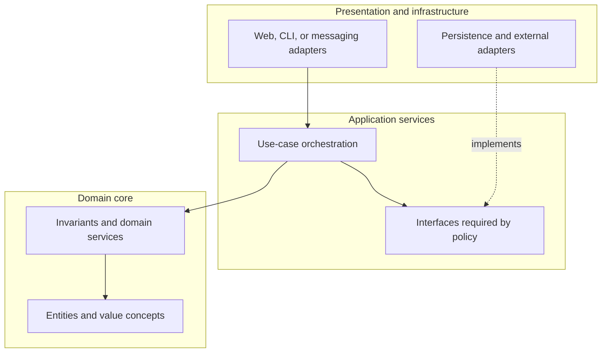
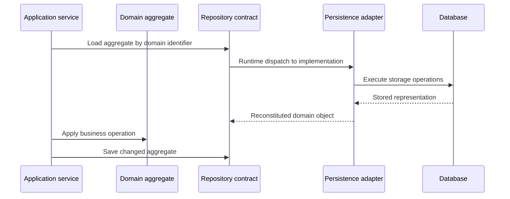
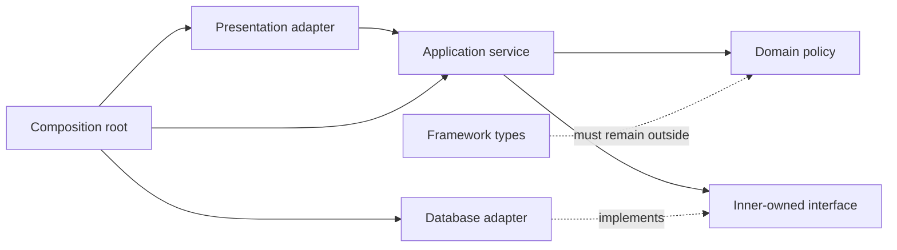
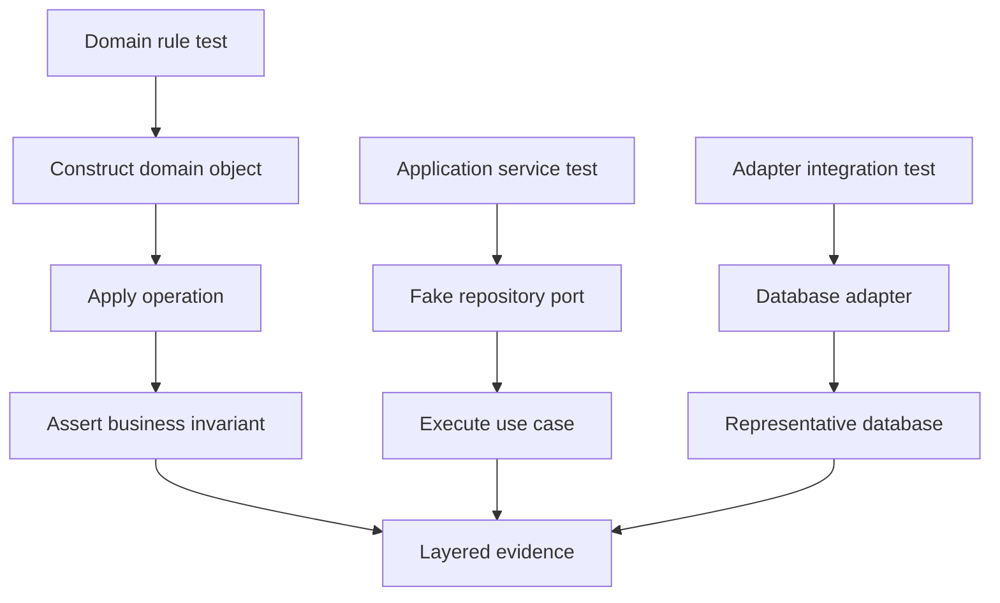
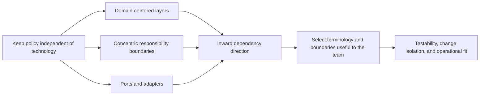

# Onion Architecture

Part: [20 — Architecture Patterns](PART_OVERVIEW.md)

Onion Architecture places the domain model at the center and surrounds it with policies, application services, and infrastructure. Dependencies point inward: outer layers may use inner abstractions, but domain policy should not depend on a database, user interface, or framework. The pattern emphasizes domain independence and testability; it does not require a literal set of concentric projects.

Part 20 owns the pattern comparison. Part 07 owns solution-level design, and Part 06 owns database mechanics.

## Center the Domain Model

The core contains entities, value concepts, invariants, and domain services that express business rules. Application services coordinate use cases and transaction boundaries. Infrastructure implements persistence and external integrations. Presentation and delivery mechanisms remain outside. Layer names and count depend on the system; dependency direction is the governing constraint.

The domain should remain meaningful without the persistence framework loaded. Avoid an anemic model that stores data while every rule lives in outer services; also avoid forcing all business logic into entities when orchestration belongs in application services.

## Invert Repository Dependencies

The domain or application layer defines a repository contract in terms of its use case. An outer adapter implements that contract using a database or remote service. This allows tests to use a focused in-memory implementation and lets infrastructure change without redefining domain concepts.

Keep persistence mapping outside the domain and avoid leaking table names, query-language objects, or ORM lifecycle callbacks into core rules. Repository methods should express aggregate or query needs, not reproduce every low-level database operation as a generic interface.

## Keep Dependencies Pointing Inward

Source imports and package dependencies should respect the layer rule. Infrastructure can reference domain contracts; the domain should not reference infrastructure. Runtime wiring happens at the outer composition root. This direction makes domain tests independent of web servers and databases while preserving a production adapter.

Do not add an interface for every concrete class. An abstraction is valuable when it represents a real boundary, allows a meaningful substitution, or improves isolation of policy tests. Otherwise it may add navigation cost without reducing coupling.

## Test the Domain Without Infrastructure

Domain tests should construct core objects and exercise invariants without connecting to a database or web framework. Application-service tests can use fakes for required ports; adapter tests verify mapping and persistence behavior against a real or representative environment. This creates different evidence levels rather than relying on a single mock-heavy suite.

Fakes should preserve important contract semantics such as uniqueness, transactions, and concurrency where they affect correctness. A passing domain test cannot prove SQL behavior, and an integration test cannot replace direct tests of complex business invariants.

## Compare Related Boundary Patterns

Onion, Clean, and Hexagonal architectures all use dependency inversion to protect policy. Onion emphasizes the domain-centered layers; Clean emphasizes concentric responsibility boundaries and the dependency rule; Hexagonal emphasizes ports and adapters around application behavior. They are compatible ideas, not mutually exclusive implementation templates.

Select one primary vocabulary for a codebase to avoid duplicate concepts and conflicting layer names. The pattern name matters less than clear ownership, dependency rules, and evidence that a likely change remains localized.

## Worked Case: Policy Quoting

A quoting system models eligibility, coverage, and premium rules in the domain core. The application service coordinates a quote request and calls ports for customer data and external risk evaluation. Web and batch adapters translate inputs; persistence adapters store quote state. Domain tests exercise pricing invariants without starting infrastructure, while integration tests verify provider mapping and transaction behavior.

As the risk provider changes, the team updates the outer adapter and contract tests. A provider-specific score remains outside the domain; the application maps it to a stable risk result with explicit uncertainty. The team avoids moving every service into its own project because the module and dependency rules already provide the desired isolation.

## Review Questions

1. What belongs at the onion's center, and why?
2. How does a repository interface invert dependency direction?
3. Which tests can run without infrastructure, and what can they not prove?
4. How do Onion, Clean, and Hexagonal emphasize different aspects of similar principles?
5. What evidence shows that extra layers reduce real change coupling?

Onion Architecture protects domain rules by placing technology at the perimeter. Keep source dependencies inward, define repository contracts from domain needs, and use layered tests to verify both policy and infrastructure behavior.
