# Onion Architecture

Part: [20 — Architecture Patterns](PART_OVERVIEW.md) · Status: Revised (in-depth rewrite)

## 1. Introduction

Onion Architecture organizes a system as a set of concentric rings with the domain model at the centre. Each ring may depend on the rings inside it and on nothing outside it. The innermost ring holds the business concepts: entities, value objects, and the rules that keep them valid. Around it sit rings for domain services, for application services that coordinate use cases, and finally for everything that touches the outside world: user interfaces, databases, message brokers, and third-party services. Jeffrey Palermo described the pattern under this name in a series of articles. The idea it expresses is older and broader than any one article: the part of the system that changes least and matters most to the business should not know that the part which changes most and matters least exists.

For an engineer moving into architecture, the value of the pattern is a single question you can ask of any import statement, package, or module: does this dependency point toward the domain or away from it? A team that can answer that question mechanically, and that has an automated check for it, gets three practical effects. Business rules can be tested in milliseconds without a database or web server. A change of persistence technology, message broker, or delivery mechanism touches a bounded set of files. A newcomer can find the business rules in one place, because nothing else is allowed to contain them.

This chapter owns the Onion pattern itself: what each ring contains, which direction dependencies run, how a request travels through the rings, how domain services differ from application services, how repository contracts invert the dependency on storage, and how the pattern is wired together at start-up. Later parts of the chapter cover testing, variants, quality-attribute consequences, migration, enforcement, and failure modes.

The boundaries with neighbouring material are deliberate:

- [Layered Architecture](CH01_Layered_Architecture.md) owns the classic stack of presentation, business, and data layers. Onion is best understood as a change to the direction of one arrow in that stack, and this chapter recaps only enough of the layered model to show that change.
- [Hexagonal Architecture](CH02_Hexagonal_Architecture.md) owns ports and adapters, including the distinction between inbound and outbound adapters. Onion arrives at a similar dependency structure from a different starting point, and this chapter compares the two by name rather than re-teaching ports and adapters.
- [Clean Architecture](CH03_Clean_Architecture.md) owns the Dependency Rule as stated in concentric circles, use-case input and output boundaries, and the four-ring vocabulary. This chapter uses the Onion vocabulary and compares where the two differ.
- [Low-Level Design](../07_System_Design_and_Distributed_Systems/CH04_Low_Level_Design.md) owns the Domain-Driven Design (DDD) tactical building blocks: entity, value object, aggregate, repository, and domain event. This chapter uses those terms and shows where they sit among the rings, without re-teaching how to design an aggregate.
- [High-Level Design](../07_System_Design_and_Distributed_Systems/CH03_High_Level_Design.md) owns system-level decomposition, and [Transactions](../06_Databases_and_Storage/CH08_Transactions.md) owns the database mechanics of isolation and locking that the persistence ring relies on.

After studying this chapter, a reader should be able to:

1. State the forces that make Onion Architecture worth its cost, and recognize systems where those forces are absent.
2. Name the rings, say what belongs in each, and say what each may import.
3. Trace a request from an inbound adapter to the database and back, naming the ring that owns each step.
4. Decide whether a piece of logic is a domain service or an application service.
5. Place a repository interface and its implementation in the correct rings and explain why.
6. Wire the rings together at a composition root so that dependencies point inward at compile time and outward only at run time.

## 2. Forces and Context

A pattern is a response to forces, and Onion responds to a specific set. Reading them first tells you whether the pattern belongs in your system.

### 2.1 The forces

The first force is a mismatch in rates of change. Business rules for pricing, eligibility, or settlement change when the business changes, perhaps a few times a quarter. Frameworks, database drivers, and message-broker clients change when vendors release, and the team often has little say in the timing. When the rules are written against the framework types, every upgrade of the framework becomes a business-logic change and every business-rule change is tested through the framework.

The second force is test cost. If a rule can only be exercised by starting a web container and a database, the team writes fewer tests of it, and the tests that exist are slow and fail for reasons unrelated to the rule. A rule that is a plain object with plain methods can be tested with thousands of cases in a few seconds.

The third force is the lifetime of the domain model. In many business systems the domain model outlives several generations of delivery technology: a desktop client becomes a web application, then a mobile back end, then an event consumer. The rules stay and the doors into them change. A pattern that keeps the rules free of any one door lets the system add doors without copying the rules.

The fourth force is knowledge location. When business rules are scattered across controllers, stored procedures, and utility classes, no one can answer what the system does in a given case without reading all of them. Onion puts a hard boundary around the place where rules live, so that a reviewer knows the rule is either in the core or does not exist.

### 2.2 Where the forces are weak

These forces are not present in every system. A service that receives a record, validates its format, and writes it to a table has almost no domain model to protect, and wrapping it in four rings adds files without adding isolation. A short-lived prototype, a data-migration script, and a thin gateway whose behaviour is configuration are all poor candidates. The same is true of systems whose value is in the data and queries, such as a reporting store, where the logic is expressed in the database and moving it into objects would make it slower and harder to read.

A useful test is to list the ten most recent business-rule changes and ask where each landed. If most of them touched a rule and nothing else, the rules are a stable unit worth isolating. If most of them touched a screen, a column, or an integration format, the rules are thin and the pattern will mostly add ceremony.

### 2.3 Relationship to the layered stack

Classic layered architecture, covered in [Layered Architecture](CH01_Layered_Architecture.md), arranges presentation above business logic above data access, with each layer calling the one below. The business layer therefore depends on the data-access layer, and through it on the database schema and the object-relational mapper (ORM) in use. The practical effect is that the lowest layer, which is the most volatile, sits at the bottom of the dependency chain and everything above it is affected when it changes.

Onion reverses that one relationship. The data-access code moves from underneath the business logic to the outside, and it depends on the business logic by implementing interfaces the business logic defines. Presentation sits on the outside as well. The stack becomes a ring with the domain at its centre, and both the user interface and the database become peers at the perimeter. The cost is an additional layer of indirection at each boundary, which is the subject of later sections on repositories and composition.

### 2.4 An illustrative count

Consider a hypothetical order-management code base with 40 domain classes. In a conventional layered arrangement, 14 of them carry persistence annotations, 9 call a data-access class directly, and 6 take a framework-supplied transaction or session object as a parameter. That is 29 of 40 classes with a compile-time dependency on persistence technology. A change of mapping approach, such as moving from annotation-driven mapping to explicit mapping code, requires editing up to 29 classes, retesting every rule that touches them, and reviewing business logic in a change that is nominally technical.

In an Onion arrangement of the same code base, the 40 domain classes carry no persistence imports. The mapping lives in one persistence package with, say, 12 mapper and repository classes. The same technology change edits those 12 files, and the 40 domain classes and their tests are untouched. The figures are illustrative, but the arithmetic shows what is being bought: the blast radius of a persistence change falls from 29 files to 12 and, more usefully, no business-rule file is in it. The price is the 12 mapping files themselves, which the layered version did not need.

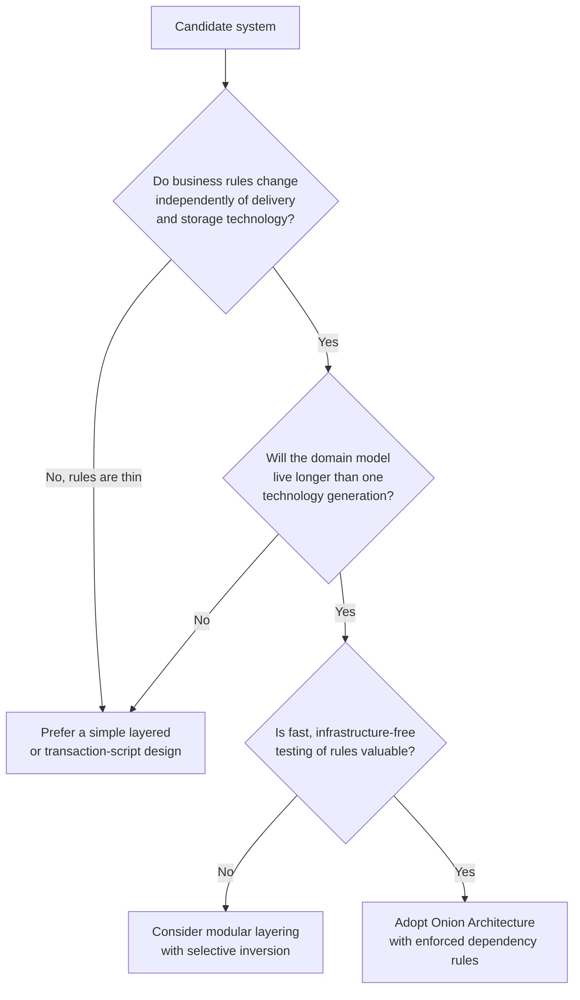

The decision tree above is a screening aid and not a formula. Its implication is that the pattern is gated on rule stability and lifetime, not on system size. A small system with a rich, long-lived domain can justify Onion, and a large system made of data pipelines may not. When the answer is mixed, the middle branch is common in practice: invert only the dependencies that protect the rules which matter, and leave the rest layered.

## 3. The Rings and Their Responsibilities

### 3.1 Four rings

Onion Architecture is usually drawn with four rings. The names and the exact number vary between teams, and the governing constraint is the direction of dependencies, not the count. The four-ring form below is a convenient default.

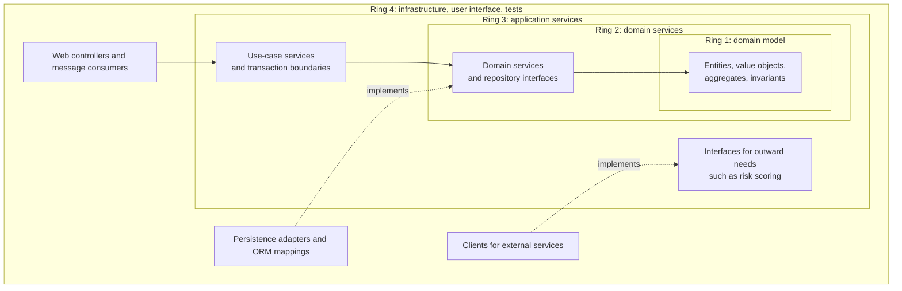

Read the diagram from the outside in. Every solid arrow points to an inner ring, and the only arrows that cross a ring boundary in the other direction are dotted, marking an implementation relationship. An outer class implements an interface that an inner ring declared. At run time a call travels outward through that interface, but in the source code the outer class depends on the inner interface and the inner ring never mentions the outer class. That is the whole mechanism, and the rest of the pattern follows from keeping it true.

### 3.2 Ring 1: the domain model

The innermost ring holds the entities, value objects, and aggregates that describe the business, together with the invariants they enforce. An invariant is a condition that must hold whenever an object is observable, such as "a quote total equals the sum of its coverage lines" or "a shipped order has at least one line". The domain model is plain code in the host language. In a Java code base it has no imports from a web framework, no persistence annotations, and no references to a database session.

The model should hold behaviour as well as data. An aggregate method such as `quote.addCoverage(...)` checks the rules that apply to adding coverage and changes the state only if they pass. When the model is a bag of getters and setters with every rule in an outer service, it is called anemic, and it fails the first force in Section 2: the rules are not in one place. The domain model is the ring that expresses what the business means by its own words, and it is the most valuable code in the system.

### 3.3 Ring 2: domain services

Some rules do not belong to one entity. Computing a premium may need a quote, a rate table, and a customer's history, and placing the calculation on any one of them would give that class knowledge about the others. A domain service holds such a rule as a stateless operation expressed in domain terms. Ring 2 also commonly holds the repository interfaces, since a repository interface describes how the domain needs to obtain and store aggregates. The domain services ring may depend on the domain model and nothing else.

### 3.4 Ring 3: application services

An application service implements a use case: "accept a quote request", "cancel a policy", "renew a subscription". It loads the aggregates it needs, calls their behaviour or a domain service, and saves the result. It also owns the concerns that surround a use case and that the domain should not know about: the transaction boundary, authorization of the caller for this use case, and publishing the outcome to other parts of the system. It declares interfaces for outward needs that are not storage, for example a port for asking an external provider for a risk score, and the infrastructure ring implements them. Section 6 returns to the difference between this ring and Ring 2.

### 3.5 Ring 4: infrastructure and delivery

The outer ring holds everything that depends on a specific technology: HTTP (Hypertext Transfer Protocol) controllers, message consumers, command-line entry points, repository implementations that use an ORM or SQL (Structured Query Language), clients for third-party services, and configuration. Palermo's original drawing places user interface, infrastructure, and tests together on the outside, which reflects the idea that all of them are consumers or providers of the core and none of them is part of it. This ring is replaceable by design. It is also the ring with the most lines of code in most systems, and it should hold no business decisions.

### 3.6 What may import what

The import rule can be stated in one table.

| Ring | May depend on | Must not depend on |
| --- | --- | --- |
| 1 Domain model | Language standard library, nothing else | Any other ring, any framework |
| 2 Domain services | Ring 1 | Rings 3 and 4 |
| 3 Application services | Rings 1 and 2 | Ring 4 |
| 4 Infrastructure and delivery | Rings 1, 2, and 3, plus frameworks | Nothing is forbidden by the pattern, but no inner ring may depend on it |

A subtle point concerns the language standard library. Strict teams allow Ring 1 to use only the standard library and a small, vetted set of value types. Pragmatic teams also allow a validation annotation library or a date-time utility. Whichever the team chooses, the allowed list should be short, written down, and checked by a tool, because the list that is not checked grows by convenience.

## 4. The Dependency Rule and What Crosses a Boundary

### 4.1 Source dependencies and run-time calls

Two different graphs describe the same program, and confusing them is the most common beginner error. The source dependency graph records which file imports which. The run-time call graph records which method calls which while the program executes. In a layered system the two graphs point the same way. In an Onion system they agree for inward calls and disagree for outward ones.

Take a use case that saves an aggregate. At run time the application service calls the repository, and the repository implementation calls the database. In the source code the application service imports an interface from Ring 2, and the repository implementation in Ring 4 imports that same interface and declares that it implements it. The arrow from the implementation to the interface points inward even though control flows outward. This is dependency inversion: the high-level policy owns the abstraction and the low-level detail conforms to it.

### 4.2 Who owns the interface

The ownership of an interface decides which way the dependency points, so the location of the interface matters more than its shape. An interface declared in the infrastructure ring and implemented there is not an inversion at all, even if the use case takes it as a parameter, because the domain would have to import the infrastructure ring to name it. The rule is that an interface is declared in the innermost ring that needs to call it. Repository interfaces are called by application services and sometimes by domain services, so they live in Ring 2. An interface for an external risk provider is called only by an application service, so it can live in Ring 3.

The shape of the interface follows the same reasoning. It should be written in domain terms, such as `findByQuoteNumber(QuoteNumber)`, and should return domain objects. It should not expose rows, result sets, entity-manager handles, or framework page types. A signature that mentions a framework class pulls that framework into the inner ring.

### 4.3 What data crosses a boundary

Something must pass between rings. The rule is that the thing crossing a boundary is in a form the inner ring defined, or in a plain structure with no behaviour that depends on the outer ring. In practice this gives three kinds of crossing:

- Inbound requests. A controller in Ring 4 receives a JSON (JavaScript Object Notation) body, turns it into a command object that Ring 3 defines, and calls the application service. The JSON shape and the web framework annotations stay in Ring 4. The command is a plain record with only the fields the use case needs.
- Outbound results. The application service returns a result object defined in Ring 3, or a domain object. The controller maps it to a response representation. If the application service returned the web response type, Ring 3 would depend on Ring 4.
- Persistence. The repository implementation reads rows or documents, builds domain objects, and hands them inward. It writes the reverse way. The mapping between stored form and domain form lives in Ring 4. When the same class is both a persistence entity and a domain entity, the ring boundary has disappeared in practice, a point the later section on failure modes returns to.

Mapping code has a cost. For a system with 40 domain classes and a separate persistence model, the team writes and maintains the mappers, and each new field is added in two or three places. This is the price of keeping the domain free of persistence concerns. Some teams accept a controlled compromise, in which the domain entities carry a small number of mapping annotations from a standard persistence specification. That compromise should be a conscious, recorded decision with a check that limits what the annotations may reach, not a gradual drift.

### 4.4 A rule about types, not packages

Dependency direction is easy to state by package and easy to violate by type. A domain class can sit in the correct package and still use a framework type as a method parameter, a base class, or an annotation. The rule is therefore about every type referenced from the inner ring, including those in method signatures, generics, annotations, and exception declarations. A thrown framework exception is a dependency, which is why inner rings define their own exception types, such as `QuoteNotFoundException`, and outer rings translate between them and framework-specific errors.

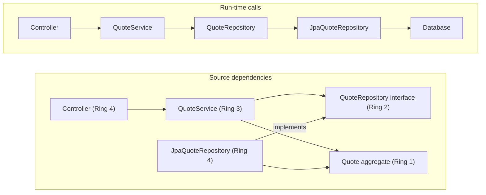

The two panels show the same use case as two graphs. On the left, every arrow points inward or sideways to the same ring, and the implementation reaches the interface by an implements arrow. On the right, the call path runs from the controller to the database, which is the path a debugger would show. The implication for reviews is that a reviewer checks the left panel, because that is the one that determines what must be recompiled and retested when something changes. Run-time calls are free to go anywhere, and that freedom is what the interface inversion buys.

## 5. How a Request Flows Through the Rings

### 5.1 A use case end to end

Follow one use case, "accept a quote", through a Spring Boot service. The numbered steps below name the ring that owns each action.

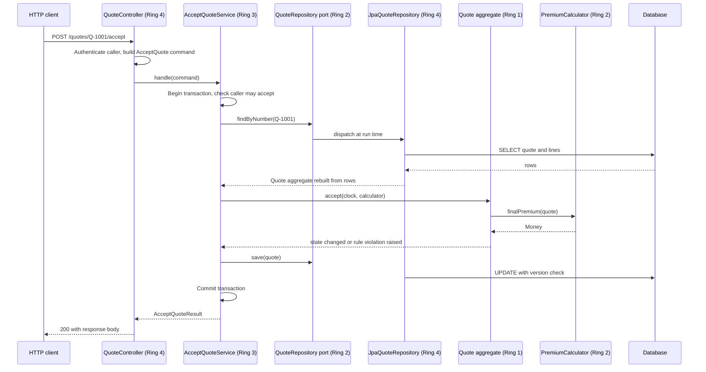

The first thing to notice is how many steps happen in the outer ring and how few of them involve a decision. The controller authenticates, translates, and maps. The repository implementation issues SQL and rebuilds objects. The only step that decides anything about insurance is the call to the aggregate, and the only step that decides anything about the use case is the sequence in the application service. This distribution is what a healthy Onion system looks like: most code is adaptation, a small amount is orchestration, and the smallest and most valuable amount is rules.

### 5.2 Step by step

1. The controller receives the HTTP request and uses the framework to authenticate the caller. It builds an `AcceptQuote` command containing the quote number and the caller identity, both as plain values. It then calls the application service.
2. The application service opens a transaction. In Spring Boot this is typically a transactional annotation on the service method. The annotation is a framework dependency, so a strict team applies it through a thin wrapper in Ring 4 or accepts the single annotation as a documented exception in Ring 3. The choice is discussed in Section 8.
3. The service asks the repository port for the aggregate by its business identifier. The port is an interface in Ring 2.
4. The infrastructure implementation, in Ring 4, loads rows, builds the aggregate through a factory or reconstitution method, and returns it. The aggregate is now in memory, and the database is out of sight.
5. The service calls the aggregate's behaviour, passing in what the aggregate needs: a clock value or interface and a domain service for pricing. The aggregate checks its invariants and changes state, or raises a domain exception.
6. The service calls `save`. The repository implementation writes the changes, using a version column so that two concurrent acceptances of the same quote cannot both succeed.
7. The service commits, builds a result object, and returns. The controller maps the result to a response.

### 5.3 Where failures surface

Each ring reports failure in its own terms, and the translation happens at the boundary.

| Failure | Raised in | Translated by | Visible to client as |
| --- | --- | --- | --- |
| Malformed JSON or missing field | Ring 4 deserialization | Controller advice | 400 response |
| Caller may not accept quotes | Ring 3 authorization check | Controller advice | 403 response |
| Quote expired, coverage invalid | Ring 1 invariant | Application service result or domain exception mapped in Ring 4 | 409 or 422 response, depending on convention |
| Concurrent update detected | Ring 4 version check | Repository implementation raises a domain-level conflict type | 409 response |
| Database unavailable | Ring 4 driver | Controller advice | 503 response |

The practical rule is that inner rings never see a transport-level or driver-level error type. When the repository implementation catches an optimistic-lock exception from the persistence framework and throws the domain's `ConcurrentModificationException`-style type, Ring 3 can handle the conflict without importing the framework. That translation is a few lines of code per boundary, and it is the place where leaks are most often introduced by accident.

### 5.4 Transaction boundary

The transaction wraps the use case, not the controller and not the individual repository call. A transaction around a repository call would commit the aggregate save before the application service has finished the rest of its work, and a transaction around the controller would hold a database connection open while the response is serialized. Placing the boundary in Ring 3 means a use case either completes entirely or does not. When a use case must also publish an event to a broker, the transaction cannot span both systems by default, and the design must choose a technique such as writing an outgoing message to the database in the same transaction. Systems-level treatment of that technique belongs to the distributed-systems material in Part 07; this chapter records only that the application service is the ring where the decision is made.

## 6. Domain Services and Application Services

### 6.1 Why the distinction exists

Both kinds of service are stateless objects with operations, and both are called "service", so teams often put everything in one class named after the use case. Onion Architecture separates them because they change for different reasons and depend on different things. A domain service changes when the business rule changes. An application service changes when the use case changes, such as adding a step, a notification, or a permission check. Mixing them forces rule tests to run through use-case plumbing, and makes it hard to reuse a rule in a second use case.

### 6.2 A working test

Three questions classify a piece of logic.

1. Would a domain expert recognize the operation by name, and would it make sense with no mention of a database, user, or network? If yes, it is a domain concern. "Compute the premium for these coverages" passes. "Load the quote and save it" fails.
2. Does it need infrastructure to do its job, such as a repository, a clock service, or a message publisher? A domain service in Ring 2 may use repository interfaces but should prefer to receive aggregates as arguments, which keeps it pure and easy to test. An operation that must call outward to external systems is an application concern.
3. Does it belong to a single aggregate? If so, make it a method on the aggregate, not a service. A domain service exists for rules that span several aggregates or that have no natural home.

Application services pass the opposite test. They know about the user making the call, the transaction, and the sequence of steps, and they contain almost no business decisions. If an application service has an `if` that encodes a business rule, such as "customers under 25 pay a surcharge", the rule has leaked outward and belongs in the domain.

### 6.3 Code

The domain service is a pure function of its inputs. The example uses Java 21 records and has no framework imports.

```java
package com.example.quotes.domain;

import java.math.BigDecimal;
import java.math.RoundingMode;
import java.util.List;

public record Money(BigDecimal amount, String currency) {
    public Money {
        if (amount.signum() < 0) throw new IllegalArgumentException("negative amount");
    }
    public Money plus(Money other) {
        if (!currency.equals(other.currency)) throw new IllegalArgumentException("currency mismatch");
        return new Money(amount.add(other.amount), currency);
    }
    public Money times(BigDecimal factor) {
        return new Money(amount.multiply(factor).setScale(2, RoundingMode.HALF_UP), currency);
    }
}

public record CoverageLine(String code, Money basePremium) {}

public interface RateTable {
    BigDecimal factorFor(String coverageCode, int customerAge);
}

public final class PremiumCalculator {
    private final RateTable rates;

    public PremiumCalculator(RateTable rates) {
        this.rates = rates;
    }

    public Money finalPremium(List<CoverageLine> lines, int customerAge, String currency) {
        Money total = new Money(BigDecimal.ZERO, currency);
        for (CoverageLine line : lines) {
            total = total.plus(line.basePremium().times(rates.factorFor(line.code(), customerAge)));
        }
        return total;
    }
}
```

With an illustrative rate table that returns 1.00 for age 30 and 1.25 for age 22 on coverage `COLLISION`, a quote with one `COLLISION` line at a base premium of 400.00 yields 400.00 for the 30-year-old and 400.00 × 1.25 = 500.00 for the 22-year-old. The test needs only a stub `RateTable`, constructed in a line of code, and runs in well under a millisecond. The `RateTable` interface sits in Ring 2 as a domain-defined need, and an infrastructure class reading the real table implements it.

The application service orchestrates around the same objects.

```java
package com.example.quotes.application;

import com.example.quotes.domain.*;
import java.time.Clock;

public class AcceptQuoteService {
    private final QuoteRepository quotes;
    private final PremiumCalculator calculator;
    private final Clock clock;

    public AcceptQuoteService(QuoteRepository quotes, PremiumCalculator calculator, Clock clock) {
        this.quotes = quotes;
        this.calculator = calculator;
        this.clock = clock;
    }

    public AcceptQuoteResult handle(AcceptQuote command) {
        Quote quote = quotes.findByNumber(command.quoteNumber())
            .orElseThrow(() -> new QuoteNotFoundException(command.quoteNumber()));
        quote.accept(clock.instant(), calculator);
        quotes.save(quote);
        return new AcceptQuoteResult(quote.number(), quote.status());
    }
}
```

The service has four lines of real logic: load, call the aggregate, save, and build a result. Every rule about whether acceptance is allowed is inside `Quote.accept`. The transactional annotation is omitted here and added by the composition approach described in Section 8.

### 6.4 Comparison across the two kinds

| Aspect | Domain service (Ring 2) | Application service (Ring 3) |
| --- | --- | --- |
| Reason to change | Business rule changes | Use case or workflow changes |
| Vocabulary | Ubiquitous language of the domain | Use-case names and request/response types |
| Statefulness | Stateless | Stateless, but holds a transaction scope while running |
| Dependencies | Ring 1 and domain-defined interfaces | Rings 1 and 2, plus ports for outward needs |
| Knows about caller identity | No | Yes, for authorization at the use-case level |
| Knows about transactions | No | Yes, defines the boundary |
| Typical test | Plain unit test with stubs | Test with fake repositories and ports |

### 6.5 Common misplacements

Two misplacements recur. The first is the fat application service, in which every rule is implemented as private methods of the use-case class. It works until a second use case needs the same rule, at which point the team either copies the rule or calls one application service from another, producing a web of use-case dependencies. The remedy is to move the rule to a domain service or onto the aggregate when the second use case appears.

The second is the thin pass-through, where an application service does nothing but forward to a repository. A use case that is a pure read of one record may legitimately be that thin, and teams sometimes allow controllers to call a read-only query interface directly for such cases. The decision should be recorded and applied consistently; otherwise some use cases pass through Ring 3 and others do not, and a reader cannot tell which rule governs.

## 7. Repositories: Interface Inside, Implementation Outside

### 7.1 What a repository is for

A repository presents a collection of aggregates as if they were held in memory. The application service asks for an aggregate by identity or by a domain-meaningful query, changes it, and asks the repository to keep the change. The caller does not see tables, queries, or sessions. Onion Architecture adds a placement rule to this idea: the interface belongs to the domain, and the implementation belongs to the infrastructure ring.

The rule has a direct effect on what the interface can say. Because the domain writes it, the interface contains operations the domain needs and nothing that the database happens to offer. A `QuoteRepository` with `findByNumber`, `findExpiringBefore(Instant)`, and `save` describes needs. A generic interface exposing `findAll`, `findBySpecification`, `executeQuery(String)`, and `flush` describes the database, and every caller that uses it takes on knowledge of how the data is stored.

### 7.2 Structure

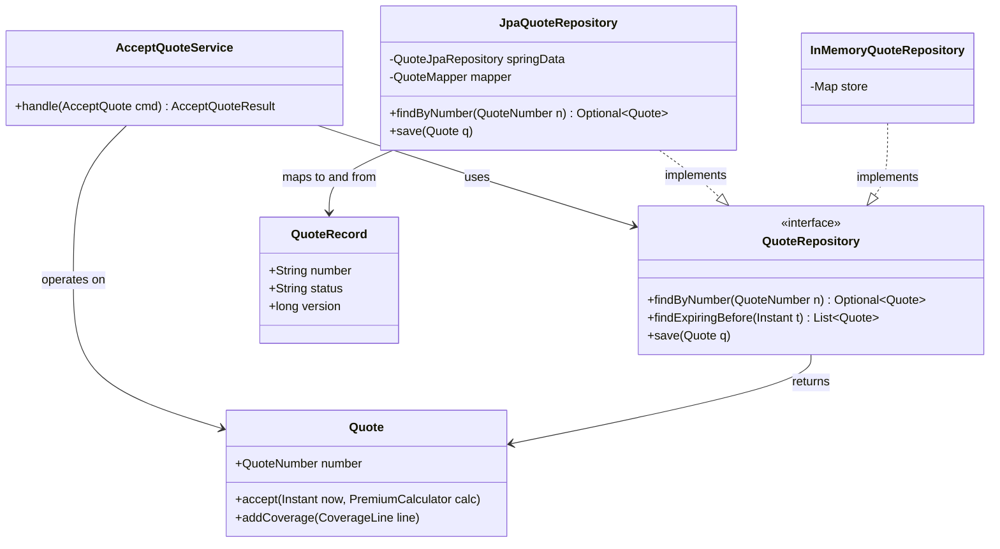

The diagram has three groups. The domain side holds `Quote` and the `QuoteRepository` interface. The application service in Ring 3 depends on both. On the infrastructure side, `JpaQuoteRepository` implements the interface and depends on a persistence record, `QuoteRecord`, which is a separate class from `Quote`. An `InMemoryQuoteRepository` also implements the interface and serves tests and local runs. Nothing on the infrastructure side is visible from the domain side. The implication is that the persistence record can gain columns, change names, or be replaced by a document representation without touching `Quote`, and that both implementations are interchangeable by construction. `JpaQuoteRepository` is a repository built on the Java Persistence API (JPA), the Java standard for object-relational mapping.

### 7.3 Interface and implementation in code

The interface sits next to the aggregate in the domain package.

```java
package com.example.quotes.domain;

import java.time.Instant;
import java.util.List;
import java.util.Optional;

public interface QuoteRepository {
    Optional<Quote> findByNumber(QuoteNumber number);
    List<Quote> findExpiringBefore(Instant cutoff);
    void save(Quote quote);
}
```

The implementation sits in the infrastructure package, uses Spring Data, and translates between the record and the aggregate.

```java
package com.example.quotes.infrastructure.persistence;

import com.example.quotes.domain.*;
import org.springframework.stereotype.Repository;
import java.time.Instant;
import java.util.List;
import java.util.Optional;

@Repository
class JpaQuoteRepository implements QuoteRepository {
    private final QuoteJpaRepository springData;
    private final QuoteMapper mapper;

    JpaQuoteRepository(QuoteJpaRepository springData, QuoteMapper mapper) {
        this.springData = springData;
        this.mapper = mapper;
    }

    @Override
    public Optional<Quote> findByNumber(QuoteNumber number) {
        return springData.findByNumber(number.value()).map(mapper::toDomain);
    }

    @Override
    public List<Quote> findExpiringBefore(Instant cutoff) {
        return springData.findByExpiresAtBefore(cutoff).stream().map(mapper::toDomain).toList();
    }

    @Override
    public void save(Quote quote) {
        try {
            springData.save(mapper.toRecord(quote));
        } catch (org.springframework.dao.OptimisticLockingFailureException e) {
            throw new QuoteConflictException(quote.number(), e);
        }
    }
}
```

Three details deserve attention. The class is package-private, so no other package can name it, and the only way to reach it is through the interface. The `catch` converts a framework exception into the domain's `QuoteConflictException`, as Section 5 required. The mapper builds an aggregate through a reconstitution path that restores state without re-running the checks that apply to new business actions, since stored data was valid when it was written.

### 7.4 Granularity: one repository per aggregate

A repository serves an aggregate root, not a table. An order with its lines is one aggregate, loaded and saved together, and has one repository. Giving every table a repository invites callers to modify a child without the root, which defeats the invariants the root protects. The persistence implementation may touch several tables inside a single `save`. The interface hides that, and a change to the table layout stays inside the infrastructure ring.

### 7.5 Reads that do not fit aggregates

Loading whole aggregates is the wrong tool for a screen that lists 5,000 quotes with five columns each. Rebuilding 5,000 aggregates with all their lines to display five fields wastes memory and queries. Two options keep the pattern intact. The first is a separate read-side interface, for example `QuoteSummaryQuery`, declared in Ring 3, returning flat summary records, and implemented in Ring 4 with a direct query. The second is to relax the rule for read-only screens, letting a controller call such a query interface without passing through a domain service. Both put the query description in the inner ring and the technology outside. The systems-level pattern behind separating reads from writes is treated in the CQRS chapter of this part, and this chapter notes only that Onion accommodates it without change.

### 7.6 Concurrency and the repository contract

The contract includes behaviour the signature cannot show. Two users accepting the same quote must not both win. The version column in the record, checked on update, gives optimistic concurrency, and the implementation raises `QuoteConflictException` for the loser. Any other implementation of the interface, including the in-memory one, must honour the same behaviour, or tests built on it will pass for code that fails in production. An in-memory implementation that stores a reference to the same object and never checks versions would let a test pass that the real implementation would fail. The safe approach is to write a contract test suite against the interface, run it against every implementation, and treat a failing implementation as a bug in the implementation. Database-level isolation and locking details belong to [Transactions](../06_Databases_and_Storage/CH08_Transactions.md).

## 8. Dependency Inversion in Practice and the Composition Root

### 8.1 Who builds the objects

If `AcceptQuoteService` needs a `QuoteRepository` and only knows the interface, something must supply an implementation. The class that does so must see both the interface and the implementation, which means it must sit in the outermost ring. This place is called the composition root. It builds the object graph at start-up, decides which implementation fulfils each interface, and hands the result to the entry points.

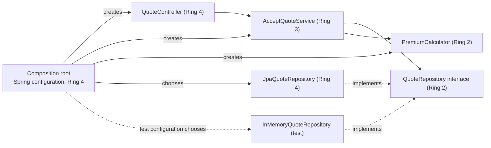

The composition root is the one place where the outer and inner rings are both visible. Every other class in Rings 1 to 3 receives its collaborators through a constructor and is unaware of how they were chosen. The implication is that swapping an implementation is a change in one configuration class, and that testing an application service with a fake repository requires no framework: the test builds the service by hand with the fake.

### 8.2 Spring Boot wiring

Spring Boot offers two ways to do it. Component scanning with annotations such as `@Service` on inner-ring classes is convenient but places framework imports in rings that were meant to be free of them. The alternative is to keep Rings 1 to 3 annotation-free and declare their instances in a configuration class in Ring 4.

```java
package com.example.quotes.infrastructure.config;

import com.example.quotes.application.AcceptQuoteService;
import com.example.quotes.domain.*;
import java.time.Clock;
import org.springframework.context.annotation.Bean;
import org.springframework.context.annotation.Configuration;
import org.springframework.transaction.PlatformTransactionManager;
import org.springframework.transaction.support.TransactionTemplate;

@Configuration
class QuoteWiring {

    @Bean
    Clock clock() {
        return Clock.systemUTC();
    }

    @Bean
    PremiumCalculator premiumCalculator(RateTable rates) {
        return new PremiumCalculator(rates);
    }

    @Bean
    AcceptQuoteService acceptQuoteService(QuoteRepository quotes,
                                          PremiumCalculator calc,
                                          Clock clock,
                                          PlatformTransactionManager tm) {
        AcceptQuoteService core = new AcceptQuoteService(quotes, calc, clock);
        TransactionTemplate tx = new TransactionTemplate(tm);
        return new TransactionalAcceptQuote(core, tx);
    }
}
```

`TransactionalAcceptQuote` is a small decorator in Ring 4 that calls the core service inside `tx.execute(...)`. It replaces an annotation on the application service and keeps Ring 3 free of the transaction framework. Teams that accept one annotation in Ring 3 save the decorator and add one recorded exception to the dependency rules. Both approaches are defensible, and what matters is that the rule says which one the team picked.

### 8.3 The same idea in TypeScript and Python

The pattern does not depend on Java. In TypeScript, an interface declared in the domain folder and a class implementing it in the infrastructure folder give the same arrangement, and the composition root is the module that constructs the objects.

```typescript
// domain/quote-repository.ts
export interface QuoteRepository {
  findByNumber(n: QuoteNumber): Promise<Quote | undefined>;
  save(q: Quote): Promise<void>;
}

// application/accept-quote.ts
export class AcceptQuote {
  constructor(private quotes: QuoteRepository, private calc: PremiumCalculator) {}
  async handle(cmd: { number: string }): Promise<void> {
    const q = await this.quotes.findByNumber(new QuoteNumber(cmd.number));
    if (!q) throw new QuoteNotFound(cmd.number);
    q.accept(new Date(), this.calc);
    await this.quotes.save(q);
  }
}

// main.ts (composition root)
const service = new AcceptQuote(new PgQuoteRepository(pool), new PremiumCalculator(rates));
```

In Python a `typing.Protocol` plays the role of the interface, and a plain function or class in the entry module is the composition root. The structural rule is the same: the domain package never imports from the infrastructure package, and only the entry module imports both.

### 8.4 What dependency inversion costs

Every inverted boundary adds an interface, an implementation, and a mapping step, so each one needs a reason. Boundaries to storage and to external providers have an obvious reason: the technology is volatile, and tests benefit from fakes. An interface for a class that will only ever have one implementation, and whose substitution would never be tested, adds navigation cost without reducing coupling. A good practice is to invert at points where a real second implementation exists, including the test fake, and to leave the rest as direct calls inside the same ring. The checks that keep these boundaries intact over years are covered in the section on enforcement.

## 9. Testing Strategy: Evidence at Each Ring

### 9.1 One ring, one kind of test

The rings give each test a natural scope, and the scope decides how fast the test runs and what a failure means. A test of Ring 1 or Ring 2 constructs objects with `new` and calls methods. A test of Ring 3 builds an application service by hand and passes in fakes for its ports. A test of Ring 4 starts the real technology, such as a database in a container, and checks that the adapter does what its interface promises. Each level produces a different kind of evidence, and none of them can substitute for another. A passing domain test cannot prove that a SQL statement is correct, and a passing database test cannot show that a pricing rule handles a leap-day expiry.

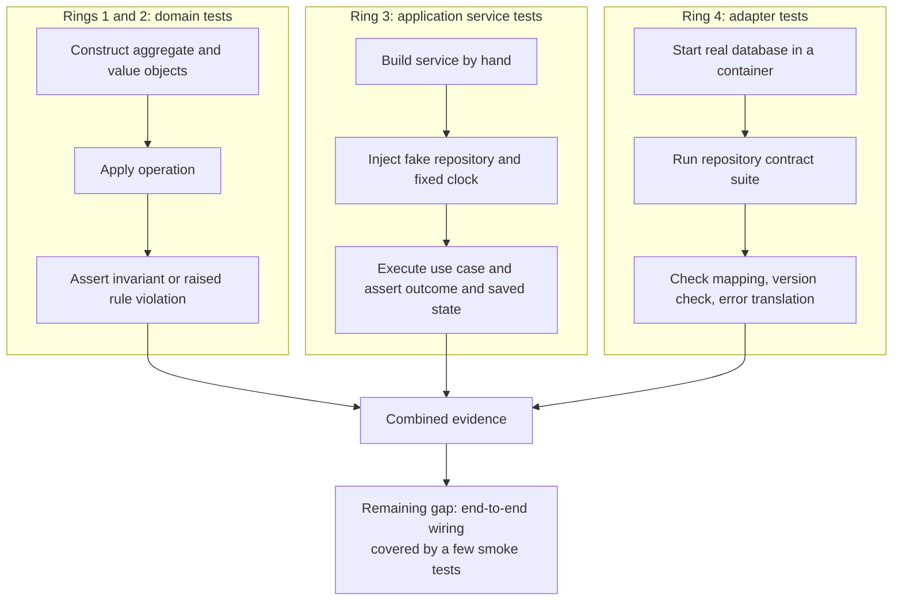

The diagram shows three independent tracks that meet only at the evidence summary. The implication is that a failure points to a ring. A red domain test means a rule is wrong. A red adapter test with green domain and application tests means the mapping or the storage behaviour is wrong. Teams that rely on a single suite of end-to-end tests lose that diagnostic value, because every failure could be in any ring. The final box names the residual gap: nothing above proves that the composition root wired the real classes correctly, so a small number of smoke tests that start the whole application are still needed.

### 9.2 Ring 1 and Ring 2 tests

A domain test needs no framework and, for a pure rule, no test double beyond a stub. The following JUnit 5 test uses the `PremiumCalculator` from Section 6 and a lambda as the `RateTable`.

```java
class PremiumCalculatorTest {

    private final RateTable rates =
        (code, age) -> age < 25 ? new BigDecimal("1.25") : BigDecimal.ONE;

    @Test
    void youngDriverPaysSurchargeOnCollision() {
        var calc = new PremiumCalculator(rates);
        var lines = List.of(new CoverageLine("COLLISION",
                new Money(new BigDecimal("400.00"), "EUR")));

        Money premium = calc.finalPremium(lines, 22, "EUR");

        assertEquals(new BigDecimal("500.00"), premium.amount());
    }
}
```

Because the test has no container and no I/O, an illustrative suite of 600 such tests at 2 milliseconds each finishes in 600 × 2 ms = 1.2 s. The same 600 cases run through a web layer and a database at an illustrative 150 ms each would take 600 × 150 ms = 90 s, and would also fail whenever the database was unavailable. The speed is what allows a team to write the 600th boundary case instead of stopping at the tenth.

### 9.3 Ring 3 tests with fakes

An application service test checks sequencing and outcomes: that the service loads the right aggregate, calls the behaviour, saves, and reports a missing quote correctly. A fake repository keeps state in a map and is simpler than a mocking framework's scripted answers, because the test can assert on what was saved rather than on which method was called.

```java
class InMemoryQuoteRepository implements QuoteRepository {
    private final Map<QuoteNumber, Quote> store = new HashMap<>();

    public Optional<Quote> findByNumber(QuoteNumber n) { return Optional.ofNullable(store.get(n)); }
    public List<Quote> findExpiringBefore(Instant t) {
        return store.values().stream().filter(q -> q.expiresAt().isBefore(t)).toList();
    }
    public void save(Quote q) { store.put(q.number(), q); }
}

@Test
void acceptingUnknownQuoteFails() {
    var service = new AcceptQuoteService(new InMemoryQuoteRepository(),
            new PremiumCalculator(rates), Clock.fixed(Instant.parse("2026-01-10T10:00:00Z"), ZoneOffset.UTC));

    assertThrows(QuoteNotFoundException.class,
            () -> service.handle(new AcceptQuote(new QuoteNumber("Q-404"), "agent-7")));
}
```

The fixed clock matters. A domain that reads the system time directly cannot be tested at its expiry boundary without waiting or patching static state, whereas a clock passed in from outside lets the test choose the instant.

### 9.4 Ring 4 tests and the repository contract

The fake in 9.3 is only trustworthy if it behaves like the real adapter. Section 7.6 introduced the contract suite: an abstract test class that states the repository's behavioural guarantees once and is run against every implementation.

```java
abstract class QuoteRepositoryContract {
    abstract QuoteRepository repository();

    @Test
    void secondConcurrentSaveOfSameVersionIsRejected() {
        var repo = repository();
        repo.save(newQuote("Q-1"));
        Quote a = repo.findByNumber(new QuoteNumber("Q-1")).orElseThrow();
        Quote b = repo.findByNumber(new QuoteNumber("Q-1")).orElseThrow();

        a.accept(NOW, calculator());
        repo.save(a);
        b.accept(NOW, calculator());

        assertThrows(QuoteConflictException.class, () -> repo.save(b));
    }
}
```

The in-memory subclass and the container-backed subclass both extend it. If the fake accepts both saves, the contract suite fails for the fake, and the fake is fixed before any application test relies on it. The container-backed subclass is slower, at an illustrative 2 s per class for start-up plus 50 ms per test, so the team keeps its tests focused on mapping, constraints, version checks, and exception translation instead of repeating business rules there.

### 9.5 Test distribution

An illustrative distribution for the quoting code base is 600 domain tests, 120 application tests, 40 adapter tests, and 6 smoke tests, a total of 766. Using the illustrative timings above, the run time is roughly 600 × 2 ms + 120 × 10 ms + 40 × 50 ms + 2 s start-up + 6 × 3 s = 1.2 s + 1.2 s + 2 s + 2 s + 18 s = 24.4 s, of which the six smoke tests account for 18 s. The shape is a wide base of fast tests and a thin top, and the arithmetic shows why the thin top still dominates the run time and should stay thin.

### 9.6 What Onion changes compared with its siblings

Hexagonal and Clean architectures give the same inward testing benefit; see [Hexagonal Architecture](CH02_Hexagonal_Architecture.md) for ports-first testing and [Clean Architecture](CH03_Clean_Architecture.md) for use-case-boundary tests. The Onion-specific point is the placement of the Ring 2 domain service and its repository interface. A rule that uses a repository can be tested at Ring 2 with the same in-memory fake used for Ring 3, so there is no need to climb to the application ring merely to supply a repository. Without a separate domain-services ring, such a rule is often placed in the application service, and its test then drags use-case plumbing along with it.

## 10. Enforcing the Inward Dependency Rule

### 10.1 Why a rule that is only written down fails

Dependency direction decays through small, individually reasonable changes. A developer needs a date helper from a web library inside an entity, adds one import, and the build stays green. Six months later the domain package imports the framework in 30 places and no one remembers when it started. The remedy is to make the rule executable, so that the first violating import fails the build on the pull request that introduces it, while it is still one line.

Three mechanisms enforce direction at different strengths, and a mature code base usually combines them.

| Mechanism | What it checks | Strength | Cost |
| --- | --- | --- | --- |
| Package and class tests | Imports between packages, annotations, base classes | Catches violations after compilation | One test class, runs in the unit-test phase |
| Build modules | Which module can see which other module at compile time | A forbidden import does not compile | Multi-module build, more configuration |
| Java Platform Module System (JPMS) | Which packages a module exports and requires | Enforced by compiler and runtime | Highest friction, uneven framework support |

### 10.2 Package and class tests with ArchUnit

ArchUnit is a Java library that reads compiled classes and lets a test assert rules over the dependency graph. It ships with a ready-made onion check. The test below states the ring structure once. The package names are an illustrative convention.

```java
import com.tngtech.archunit.core.importer.ImportOption;
import com.tngtech.archunit.junit.AnalyzeClasses;
import com.tngtech.archunit.junit.ArchTest;
import com.tngtech.archunit.lang.ArchRule;

import static com.tngtech.archunit.library.Architectures.onionArchitecture;
import static com.tngtech.archunit.lang.syntax.ArchRuleDefinition.noClasses;

@AnalyzeClasses(packages = "com.example.quotes", importOptions = ImportOption.DoNotIncludeTests.class)
class OnionRulesTest {

    @ArchTest
    static final ArchRule rings = onionArchitecture()
        .domainModels("..domain.model..")
        .domainServices("..domain.service..")
        .applicationServices("..application..")
        .adapter("persistence", "..infrastructure.persistence..")
        .adapter("web", "..infrastructure.web..")
        .withOptionalLayers(true);

    @ArchTest
    static final ArchRule domainIsFrameworkFree = noClasses()
        .that().resideInAnyPackage("..domain..")
        .should().dependOnClassesThat().resideInAnyPackage(
            "org.springframework..", "jakarta.persistence..", "com.fasterxml.jackson..");
}
```

The first rule encodes the table in Section 3.6: the model depends on nothing, domain services depend on the model, application services depend on both, and adapters depend inward but not on each other. The second rule is a deliberate overlap. It names the specific frameworks the team has decided to keep out of the core, so a violation produces a message that names the offending class and the forbidden package. The overlap is useful because the second rule can be tightened or relaxed independently, for example when the team records an exception allowing one validation annotation library in Ring 1.

Two cautions apply. A rule that allows an empty layer to pass silently can hide a typo in a package name, so the team should include one assertion that each ring contains at least one class. And the rules apply to types, as Section 4.4 required, which means that a framework annotation on a method parameter is caught, whereas a naming convention check on package names alone would miss it.

### 10.3 Build modules

Package tests detect a violation after the code compiles. Splitting the rings into build modules prevents the violation from compiling at all. In Maven the module graph below makes it impossible for the domain module to import an infrastructure class, because the infrastructure module is not on its classpath.

```xml
<!-- quotes-domain/pom.xml : no dependencies except the test scope -->
<dependencies>
  <dependency>
    <groupId>org.junit.jupiter</groupId>
    <artifactId>junit-jupiter</artifactId>
    <scope>test</scope>
  </dependency>
</dependencies>

<!-- quotes-application/pom.xml -->
<dependencies>
  <dependency><groupId>com.example</groupId><artifactId>quotes-domain</artifactId></dependency>
</dependencies>

<!-- quotes-infrastructure/pom.xml -->
<dependencies>
  <dependency><groupId>com.example</groupId><artifactId>quotes-application</artifactId></dependency>
  <dependency><groupId>org.springframework.boot</groupId><artifactId>spring-boot-starter-data-jpa</artifactId></dependency>
</dependencies>
```

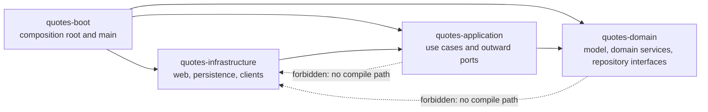

The solid arrows are the only edges the build allows, and every one points toward the domain. The dotted edges are the violations the build refuses: the compiler cannot find an infrastructure class from inside the domain module because the module is not on the classpath. The implication is that review effort moves from reading imports to reading the module descriptors, which change rarely and are small. Adding a dependency edge to a `pom.xml` becomes the visible, reviewable act, and a new edge that points outward is a design discussion rather than an accident.

Modules have a cost. Each module adds build configuration and slows incremental builds a little. For a small service, a single module with package tests gives most of the protection. The practical threshold is a team large enough, or a code base long-lived enough, that the package tests are being waived or edited to pass. At that point the stronger compile-time barrier is worth its configuration.

### 10.4 The Java module system

JPMS can go further: a `module-info.java` for the domain exports only its public API packages, so even a class in the same build cannot reach its internals. It also has the highest friction, because frameworks that rely on reflection, such as ORM and dependency-injection containers, need explicit `opens` declarations. Most Spring Boot teams stop at Maven modules plus ArchUnit, and that combination is a reasonable default for this chapter's pattern.

### 10.5 What to do on a violation

A failing architecture test should name the rule, the class, and the offending dependency. The review decision then has only three outcomes: move the code, add an interface in the inner ring, or record a deliberate exception with a reason and an expiry date. The third outcome should be rare and visible, listed in a file reviewed with the architecture decision records, so that waivers do not accumulate silently. Sibling chapters use the same mechanism; the check from [Hexagonal Architecture](CH02_Hexagonal_Architecture.md) applies to its core and adapters, and the Onion version differs only in that it has an extra ring to police: Ring 2 must not import Ring 3, which a two-zone core-versus-adapter rule would not catch.


## 11. Transactions, Error Handling, and Security Placement

### 11.1 Three concerns that cross every ring

Transactions, error translation, and security are cross-cutting. A tempting response is to push each one into the domain model because the rules seem to need it, or to scatter it through controllers and repositories because that is where the framework offers a hook. Onion Architecture gives each concern one home, chosen by what the concern needs to know.

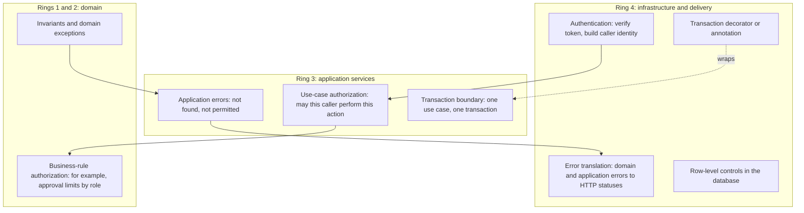

Each concern splits across rings. Identifying who the caller is belongs outside, because it depends on a protocol and a token format. Deciding whether a caller may invoke a use case belongs in Ring 3. Deciding whether a rule permits the action for this data, such as an approval limit that depends on the policy amount, is a business rule and belongs in the domain. The implication is that a single security check is rarely enough, and the review question is which ring owns each part. Security mechanics in depth belong to Part 15 and are not repeated here.

### 11.2 Transactions

The transaction belongs to the application service, as Section 5.4 argued, and the inner rings should not know it exists. Two practical consequences follow.

First, an aggregate must be loaded, changed, and saved inside one transaction, and a use case should modify one aggregate per transaction wherever possible. When a use case must change two aggregates, the team has either drawn the aggregate boundary wrongly or accepted eventual consistency between them, handled with an event after commit. Second, the repository `save` must not commit. If it did, a use case that saved two aggregates and then failed on the second would leave the first committed.

A small decorator keeps the framework out of Ring 3, as Section 8.2 introduced. It also makes the boundary visible as code instead of an annotation.

```java
class TransactionalAcceptQuote extends AcceptQuoteService {
    private final AcceptQuoteService core;
    private final TransactionTemplate tx;

    TransactionalAcceptQuote(AcceptQuoteService core, TransactionTemplate tx) {
        super(null, null, null);
        this.core = core;
        this.tx = tx;
    }

    @Override
    public AcceptQuoteResult handle(AcceptQuote command) {
        return tx.execute(status -> core.handle(command));
    }
}
```

A cleaner variant defines a Ring 3 interface `UseCase<C, R>` that the service implements, and the decorator implements the same interface instead of extending the class with null arguments. Either form keeps the same property: the transactional wrapper is Ring 4 code, and the service is testable without it.

### 11.3 Error handling

Each ring defines errors in its own vocabulary and translates at the boundary, as the table in Section 5.3 showed. Three rules keep the scheme from degrading.

1. Domain exceptions describe broken business conditions, such as `QuoteExpiredException`, and carry business identifiers, not stack-trace hints about storage.
2. Application errors describe use-case conditions, such as not found or not permitted. They are distinct from domain exceptions because a missing record is not a rule violation.
3. The outermost layer owns the mapping to a protocol. A single controller-advice class maps the full set, so adding a new domain exception without a mapping falls through to a generic server error that a test can detect.

An illustrative mapping test enumerates every exception class in the domain and application packages, using ArchUnit or reflection, and fails if any lacks a status mapping. That test costs a few lines and removes a common production surprise, where a new rule violation reaches clients as a 500 response.

### 11.4 Security placement

Two sub-rules matter most for Onion. The first is that authorization is checked in Ring 3 before the aggregate is loaded, or immediately after loading if the check depends on the aggregate's data. Checking in the controller alone protects one door, and the second door added later, such as a message consumer, would bypass it. The second is that user identity enters Ring 3 as a plain value in the command, such as a caller identifier and a set of roles, not as the framework's security context object. That keeps application tests free of the security framework and lets a batch job supply a system identity in the same shape.

Database-enforced controls are a defence in depth and sit outside the rings as part of Ring 4's storage configuration. They cannot replace the domain-level approval rule, because the database does not know the business meaning of a limit. The layered defence idea is covered in the security part of the handbook.

### 11.5 A worked trace

Consider an illustrative request to accept quote Q-1001 from an agent whose approval limit is 5,000 and whose quote total is 6,200. The controller authenticates the agent and builds the command with the agent identifier and role. The application service checks that the role `AGENT` may use the accept use case, and passes. It loads the quote and calls `quote.accept(now, calculator, agentLimit)`. The aggregate computes the final premium, finds that 6,200 exceeds 5,000, and raises `ApprovalLimitExceededException`. The transaction rolls back, nothing is saved, and the controller advice maps the exception to a 403-or-409 response according to the convention the team chose. The decision about the limit sits in Ring 1, the permission to use the use case sits in Ring 3, and only the status code sits in Ring 4. A change to the limit touches one rule and one test.

## 12. Performance and Mapping Costs

### 12.1 Where the cost actually is

Critics of layered inversion point to indirection and mapping as performance costs. The indirection through an interface is a virtual method call, which costs nanoseconds and is invisible next to a database round trip. The costs that matter are two: the extra objects created when a stored form is mapped to a domain form, and the temptation to use whole aggregates for operations that need a few columns. Both are measurable, and both should be reasoned about with numbers before the design is blamed.

### 12.2 Write path: mapping is small

Take the accept-quote use case with an illustrative aggregate of one root and 8 coverage lines, 9 objects in total. Assume the load query takes 3 ms, the update takes 4 ms, and mapping costs 2 µs per object each way.

- Mapping on load: 9 × 2 µs = 18 µs.
- Mapping on save: 9 × 2 µs = 18 µs.
- Total mapping per request: 36 µs.
- Total per request including queries: 3 ms + 4 ms + 0.036 ms = 7.036 ms.
- Mapping share: 0.036 / 7.036 ≈ 0.51 percent.

Mapping adds about half of one percent to a request dominated by two database round trips. At an illustrative 200 requests per second, the mapping consumes 200 × 36 µs = 7.2 ms of central processing unit (CPU) time per second of wall-clock time, which is 0.72 percent of one core. The write path is not where Onion costs performance.

### 12.3 Read path: whole aggregates are the trap

The read path can be expensive when a list screen reuses the write-side repository. Suppose a screen lists 5,000 quotes and displays five fields each. Compare three ways of producing it, using illustrative figures: 0.4 ms per extra query on a local network, 2 µs per mapped object, 1.5 KB per aggregate root, and 0.4 KB per coverage line.

| Approach | Queries | Time (illustrative) | Memory (illustrative) |
| --- | --- | --- | --- |
| A. Load aggregates, lines fetched lazily per quote | 1 + 5,000 | 1 × 120 ms + 5,000 × 0.4 ms + mapping 45,000 × 2 µs = 120 + 2,000 + 90 = 2,210 ms | 5,000 × (1.5 + 8 × 0.4) KB = 5,000 × 4.7 KB = 23,500 KB |
| B. Load aggregates with lines in one joined query | 1 | 120 ms + 90 ms mapping = 210 ms | 23,500 KB |
| C. Read-side summary query returning five columns | 1 | 35 ms + 5,000 × 1 µs mapping = 40 ms | 5,000 × 0.2 KB = 1,000 KB |

Approach A takes 2.21 s, Approach B takes 0.21 s, and Approach C takes 0.04 s, which is 55 times faster than A and 5 times faster than B. The memory column shows a 23.5-fold difference between B and C, since 23,500 / 1,000 = 23.5. The conclusion is not that the pattern is slow but that the write-side repository is the wrong tool for this query. Section 7.5 gives the remedy: a read-side query interface declared in Ring 3 and implemented with a direct query in Ring 4. The pattern absorbs it without breaking the dependency rule, because the interface is still owned by the inner ring.

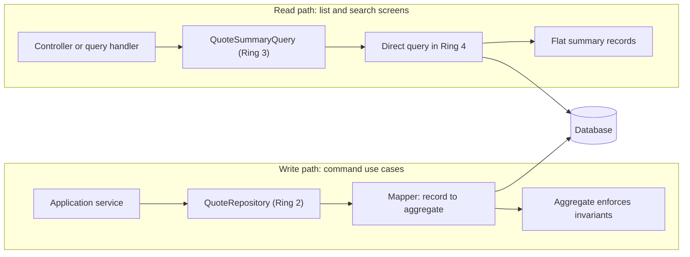

The diagram separates the two paths over the same database. The write path goes through the aggregate because invariants matter when state changes. The read path skips the aggregate because there is nothing to protect when state is only displayed. The implication is that Onion needs no single model for both purposes, and that forcing one model onto both is the usual cause of the slow-screen complaint. For the full pattern, which separates the models at the system level, see [CQRS](CH09_CQRS.md).

### 12.4 Development cost of mapping

The other cost is time. Suppose a team adds an average of 20 persisted fields per year. With a persistence record separate from the domain class, each field is edited in three places: the domain class, the record, and the mapper, giving 20 × 3 = 60 edits a year. With annotated domain entities, each field is edited once or twice, giving 20 to 40 edits. The difference is 20 to 40 extra edits a year, each a few minutes, plus the tests that catch a forgotten mapper line. That is small compared with the 29-file blast radius Section 2.4 described for a mapping-technology change, but it is paid every year rather than once. The pattern pays off when persistence change or domain-test speed has real value for the team, and does not pay off when the domain is thin, which is the conclusion of Section 2.2.

### 12.5 Reducing the cost without losing the boundary

Three techniques lower the cost while keeping the rings intact. A mapping library that generates the converter from a declared field correspondence removes hand-written boilerplate, with the caution that generated code in Ring 4 must still not leak into inner rings. A projection onto a summary record, as in Approach C, avoids creating aggregates when only data is wanted. And batching, either with a single joined query or with a bounded second query for the child rows of all roots in a page, removes the one-query-per-row pattern that dominated Approach A. None of these touch the dependency direction.

## 13. Onion Compared with Layered, Hexagonal, and Clean

### 13.1 One idea, four vocabularies

Hexagonal, Clean, and Onion all enforce that source dependencies point toward the policy. They differ in what they draw, what they name, and how many structural distinctions they insist on inside the core. The layered pattern differs in the direction of one arrow. This section compares the four without re-teaching them; each owning chapter is linked in the table.

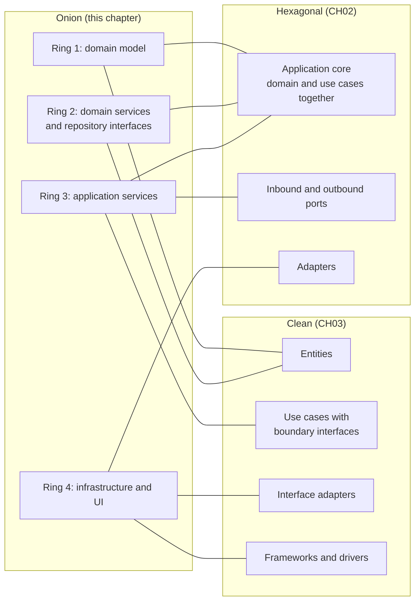

The lines connect the places where each pattern puts roughly the same code. Onion splits the core into two rings where Clean has one and Hexagonal has none, and the line pattern shows it: Rings 1 and 2 map to Clean's entities and Rings 1 to 3 together map to Hexagonal's single core. The implication is that moving a system from one vocabulary to another changes names and package layout far more than it changes dependency direction, and that any argument about which pattern is correct is mostly an argument about how many named rings the team finds useful.

### 13.2 Comparison table

| Dimension | [Layered](CH01_Layered_Architecture.md) | [Hexagonal](CH02_Hexagonal_Architecture.md) | [Clean](CH03_Clean_Architecture.md) | Onion |
| --- | --- | --- | --- | --- |
| Central picture | Horizontal stack | Hexagon with ports on its edge | Concentric circles | Concentric rings |
| Direction of the data-access arrow | Business depends on data access | Adapters depend on ports | Outer circles depend on inner ones | Outer rings depend on inner ones |
| Where the repository interface lives | Usually not separated | In the core, as an outbound port | In the use-case or entity ring | In Ring 2, with the domain services |
| Distinguishes domain services from application services | Rarely | Not as a ring | Entities versus use cases | Yes, as separate rings |
| Names the use-case input and output boundary | No | Inbound port | Yes, explicit | Not as a requirement |
| Emphasis | Separation of concerns by technical role | Symmetry of inbound and outbound edges | Dependency Rule and use-case isolation | Domain model at the centre, domain services ring |
| Typical ceremony | Low | Medium | Medium to high | Medium to high |
| Strongest when | Rules are thin and the stack is stable | Many delivery mechanisms and many external systems | Use cases are the main unit of change | Rich, long-lived domain with rules spanning aggregates |

### 13.3 What is distinctive about Onion

Three points separate Onion from its siblings in practice.

The first is the explicit domain-services ring. Hexagonal and Clean give a rule that spans aggregates no particular home, so teams invent one. Onion names it, which gives a reviewer a question to ask: does this rule need infrastructure or a user? If not, it belongs in Ring 2 and can be tested there.

The second is the placement of repository interfaces next to domain services in Ring 2. In Clean they often sit in the use-case ring, and in Hexagonal they are one among many outbound ports. In Onion they are defined as part of the domain, so a domain service can use a repository without crossing outward. This makes the pattern a natural fit for Domain-Driven Design (DDD) vocabularies, which is why Palermo's description and DDD practice are often combined.

The third is what Onion does not require. It does not demand a request and response model per use case, as Clean's boundary interfaces do, and it does not require symmetric inbound ports, as Hexagonal does. A team that wants less ceremony around the use-case edge can take Onion's rings and omit those. A team that wants them can add them without leaving the Onion shape.

### 13.4 Choosing, and choosing once

A team should adopt one primary vocabulary for each code base. Mixing them produces two names for each concept, such as "port" and "repository interface", and a confused glossary. Choose by the following reasoning:

- If the system has many delivery mechanisms and external systems and the important design question is the symmetry of the edges, Hexagonal's vocabulary fits.
- If the unit of change is the use case and the team wants explicit input and output boundaries, Clean's vocabulary fits.
- If the unit of value is a rich domain model with rules that span aggregates, and the team already uses DDD terms, Onion's vocabulary fits.
- If the rules are thin, the layered pattern with careful package boundaries is the cheaper choice.

The enforcement mechanisms of Section 10 work identically in all four, so the choice does not alter the verification tooling. The evidence that justifies any of them is the same: a likely change, such as a persistence swap or a new delivery mechanism, stays within the outer ring and leaves the domain tests untouched.

## 14. Failure and Quality-Attribute Scenarios

### 14.1 Erosion as a failure mode

The most common failure of an Onion system is not an outage but erosion: the rings are still drawn in the documentation while the dependencies no longer follow them. Erosion passes through recognizable stages, and the controls of Section 10 interrupt it at specific points.

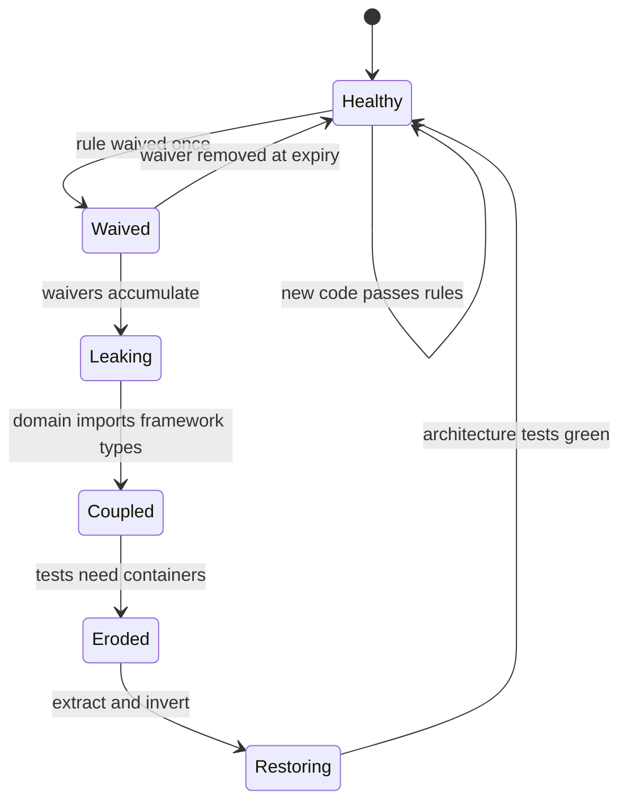

The diagram makes two points. First, the path from Healthy to Eroded runs through small steps, and the first step, a waiver, is harmless when it expires. The control is the expiry date from Section 10.5. Second, the return path exists but is a project, not a commit: the Restoring state means extracting interfaces, moving mapping code, and rewriting tests, which is why detection early is far cheaper than repair late. The implication is that the architecture test belongs in the pull-request build and not in a nightly report.

### 14.2 Scenario format

Each scenario below states a stimulus, the expected response, and a measure by which the response is judged. The figures are illustrative targets for a hypothetical quoting service, not benchmarks.

| Quality attribute | Stimulus | Expected response | Measure |
| --- | --- | --- | --- |
| Modifiability | The team replaces the relational database mapping approach | Only Ring 4 persistence classes and their tests change | Zero files changed under `domain` and `application`; domain test suite unchanged and green; change completed within the persistence module of 12 classes |
| Modifiability | A message consumer is added as a second entry point | A new Ring 4 adapter builds the same command and calls the existing service | No business rule duplicated; authorization check still runs once, in Ring 3 |
| Testability | A pricing rule changes for drivers under 25 | The rule is edited in a domain service and tested without infrastructure | New test written and passing in under 5 ms; no container started |
| Integrity | Two agents accept the same quote within the same second | One succeeds, one receives a conflict | Exactly one `accepted` row; loser receives a conflict response; the contract test for the repository passes against the real database |
| Availability | The external risk-scoring provider is unavailable for 10 minutes | The application service uses its outward port with a timeout and a defined fallback, and the quote is marked pending review | Accept requests continue; 100 percent of affected quotes carry a pending flag; no request waits longer than the 2 s timeout |
| Performance | The quote list screen is opened by 200 users in one minute | The read path uses a summary query, not aggregates | 95th-percentile list latency at or below 100 ms, against the 40 ms single-query estimate in Section 12.3 |
| Security | A new controller is added that forgets to check permission | Authorization in Ring 3 rejects the call regardless of the controller | The integration test that calls the use case with a caller lacking the role receives a not-permitted error |
| Maintainability | A developer imports a persistence annotation into an entity | The build fails on the pull request | Architecture test reports the class and the forbidden package; zero merges with the violation |

### 14.3 Walking through the risk-provider scenario

The availability row deserves a closer look, because it shows where Onion places the resilience decision. The application service declares a port, `RiskScoringPort`, in Ring 3, with a method that returns a result type containing either a score or a marker for unavailable. The Ring 4 client implements it with a timeout and a circuit breaker, a mechanism that stops calling a failing dependency for a period and fails fast instead. When the client cannot get a score, it returns the unavailable marker, not an exception, and the application service decides the business consequence: mark the quote pending, still allow a low-premium quote, or refuse. The domain never learns that a network exists. The decision about the consequence is a business decision made in a ring where it can be tested with a fake port returning the marker. At an illustrative 150 accept requests per minute and a 10-minute outage, 1,500 quotes pass through the pending path. With a 2 s timeout, a design without a circuit breaker would hold 150 × 10 = 1,500 requests each waiting up to 2 s, adding up to 3,000 request-seconds of blocked threads, whereas a breaker that opens after 20 failures limits the waiting to about 20 × 2 s = 40 request-seconds. That arithmetic is the reason the breaker is in the adapter rather than left to chance.

### 14.4 Scenario for an inversion that was never real

A subtler failure is an interface that exists but does not invert anything. If `QuoteRepository` is declared in the infrastructure package, or if its signature returns a persistence record, the domain compiles against it but still depends on the storage technology. The measure that catches it is the build-module test of Section 10.3: with the domain in its own module that has no persistence dependency, the code does not compile. A team that cannot move the domain to its own module without errors has found a real violation and has the list of offending types in the compiler output.

## 15. Worked Case: A Quoting Service Moves to Onion

The organization below is hypothetical and illustrative. All figures are invented for the exercise, and the arithmetic is shown so the reasoning can be checked and re-run with real numbers.

### 15.1 Context

Harbour Mutual is an imagined regional insurer with a six-person team that owns a quoting service. The service is a Spring Boot application built in the layered style. It has 40 domain classes, of which 29 depend on persistence technology as in Section 2.4, and a test suite of 220 business-rule tests that each start a Spring context and a database. The suite averages 400 ms per test. Three forces are visible. Rate rules change about once a month. A second entry point, a nightly batch import of broker quotes, is being added and would duplicate the rules if built on controllers. The team also plans to replace its mapping approach in the next year.

### 15.2 Decisions

1. Adopt Onion for the quoting module only. The reporting module, which is a set of queries over the same database, stays as it is, because its value is in the queries and not in domain rules.
2. Use four rings with the domain-services ring kept separate, because the premium calculation spans a quote, a rate table, and customer history.
3. Keep persistence records separate from domain classes, accepting the mapping cost.
4. Enforce with ArchUnit on the pull-request build now, and with Maven modules after the first quarter if waivers appear.
5. Add a read-side summary query for the list screen from the start.

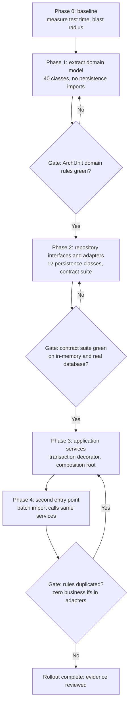

The diagram shows a migration as gated phases and not as one rewrite. Each gate is an automated check that can fail, and a failure returns the work to the phase that produced it. The implication is that the module stays releasable throughout: a phase that does not pass its gate is not merged, and the old layered code continues to serve traffic until the new rings take over a use case. The third gate checks the outcome the second entry point was meant to demonstrate, which is that the batch import adds no copy of a business rule.

### 15.3 Alternatives considered and rejected

| Alternative | Why it was rejected |
| --- | --- |
| Stay layered and rely on code review | The 29-of-40 coupling had accumulated under review already. The batch import would have copied rules into a second set of classes |
| Split quoting into its own microservice first | It adds network and deployment cost before the domain is isolated. Isolating the rules inside one process is a prerequisite, not an alternative. See [Microservices](CH05_Microservices.md) for when a split pays off |
| Clean Architecture with request and response models per use case | The team has 14 use cases and judged the 28 extra model classes more ceremony than the edge needed. Onion's rings can add them later if a use case grows |
| Annotated domain entities with no separate records | Would keep the 29-of-40 coupling and make the mapping-technology change a business-code change |
| Hexagonal vocabulary with a single core | Workable, but gave no home for the premium calculation that spans aggregates, which the domain-services ring provides |

### 15.4 Validation evidence

The team defines in advance what evidence would show success, then measures it.

Test speed. After the move, the suite has 540 domain tests at 2 ms, 60 application tests at 10 ms, 30 adapter tests at 50 ms with a 2 s container start, and no smoke tests in the unit phase. The run time is 540 × 2 ms + 60 × 10 ms + 30 × 50 ms + 2 s = 1.08 s + 0.6 s + 1.5 s + 2 s = 5.18 s. Before, 220 tests × 400 ms = 88 s. The ratio is 88 / 5.18 ≈ 17 times faster, and the test count has risen from 220 to 630 because boundary cases became cheap to write.

Pipeline time. At an illustrative 40 pipeline runs per working day, the saving per day is 40 × (88 − 5.18) s = 40 × 82.82 s = 3,312.8 s, about 55.2 minutes of pipeline time. Over 220 working days this is 55.2 × 220 = 12,144 minutes, about 202 hours.

Cost of the change. The team estimates 160 hours: 40 domain classes at 2 hours each is 80 hours, 12 persistence classes at 4 hours each is 48 hours, 16 hours for the contract suite, 8 hours for architecture tests, and 8 hours for the composition root, a total of 80 + 48 + 16 + 8 + 8 = 160 hours. The 202 hours of pipeline time is not developer time, so this is not a payback calculation. It shows that the recurring cost does not grow and that the one-time cost is bounded. The case for the move rests mainly on the batch entry point and the planned mapping change.

Mapping change. In the following year the team replaces annotation-driven mapping with explicit mapping code. Before the move that change would have touched up to 29 domain classes. After it, 12 persistence classes change, and the domain suite of 540 tests stays untouched and green. The architecture tests report no domain file in the change set, which is the check that the benefit was realized.

Second entry point. The batch import builds the same `AcceptQuote` command and calls the existing service. Review finds zero business conditionals in the batch adapter, and the authorization check runs once, in Ring 3.

Read path. The list screen at 5,000 quotes uses the summary query. The measured 95th-percentile latency is compared against the 100 ms target from Section 14.2, and the team keeps the figures from Section 12.3 as the hypothesis the measurement must confirm or refute.

### 15.5 What the team would revisit

Two conditions would reopen the decision. If more than about a quarter of the quoting classes turn out to be pass-through with no rules, the domain is thinner than assumed and the rings are costing more than they protect. And if the Maven module threshold from Section 10.3 is reached, with waivers being renewed repeatedly, the team moves from package tests to module boundaries. Both conditions are checkable from the repository, which is a reason for choosing the evidence in advance.

## 16. Common Mistakes and Anti-Patterns

Each mistake below has a cause, which is the pressure that produces it, and a consequence, which is what the team eventually pays.

| Mistake | Cause | Consequence |
| --- | --- | --- |
| Persistence entity used as the domain entity | Avoiding the mapping cost, or following a tutorial that annotates domain classes | The domain imports the persistence framework. A mapping change becomes a business-code change, and lazy-loading behaviour leaks into rules |
| Repository interface declared in the infrastructure package | Placing interface and implementation side by side for convenience | The domain must import infrastructure to name it, so the inversion is cosmetic and a module split fails to compile |
| Generic repository exposing queries and flush | Reuse of one base interface for every aggregate | Callers learn how data is stored, and replacing the store means rewriting callers |
| Anemic domain model | Rules written in services because that is where the team's habits are | Rules are scattered across services, the first force of Section 2 reappears, and domain tests prove nothing |
| Fat application service | Every new rule added to the nearest use case class | Second use case copies the rule, and rule tests need use-case plumbing |
| Everything inverted | Reading the pattern as a rule that every class needs an interface | Interfaces with one implementation and no test double add navigation cost without reducing coupling |
| Framework annotations spread across Rings 1 to 3 | One annotation at a time, each convenient | Domain tests need the container, and the waiver list is undocumented |
| Controllers calling repositories directly | Skipping Ring 3 for speed | Authorization and transaction boundary are missing or duplicated, and the second entry point bypasses them |
| Repository `save` that commits | Treating each call as its own unit of work | Use cases that change two aggregates leave partial state on failure |
| In-memory fake that does not enforce version checks | Writing the fake for convenience | Application tests pass for code that fails against the real database |
| Domain exceptions that wrap driver errors | Rethrowing what the framework threw | Inner rings depend on driver types, and error mapping depends on message text |
| Applying the pattern to a thin domain | Treating the pattern as a standard template | Files and mappers added with no rule to protect, and the team concludes the pattern is overhead |
| Architecture tests that are optional or advisory | Fear of blocking merges | Violations accumulate until the tests are rewritten to match the code |

### 16.1 The pattern behind most of the rows

Most rows share one cause: the boundary is treated as a package layout when it is a dependency rule over types. A team that moves classes into folders named after rings without checking imports has the diagrams of Onion Architecture and the dependencies of a layered one. The remedy is the same for each row, which is to make the rule executable, and the second remedy is to record why each exception exists.

### 16.2 A cause chain to recognize

A typical sequence is worth knowing because each step looks reasonable alone. The team uses annotated entities to save mapper code. Lazy-loading annotations then appear in domain methods, so rule tests need a session. The tests are moved to the container to run, and the suite slows from seconds to minutes. Developers run fewer tests locally, and rule regressions reach the integration environment. By then the domain imports the persistence framework in dozens of places, and the extraction work described in Section 14.1 is a project. Each step was a local decision, which is why the check has to run on every pull request.

## 17. Design-Review Checklist

Use the checklist at design reviews and when inheriting a code base. Each item can be answered by looking at the repository or a pull request, not by asking the team.

**Fit**

1. Can the team list the last ten business-rule changes and show that most touched only a rule? If not, reconsider the pattern (Section 2.2).
2. Is there a reason to expect a second entry point, a storage change, or a framework upgrade? If not, is the ceremony justified?

**Rings and ownership**

1. Does every class belong to one named ring, and is each ring's allowed import list written down?
2. Do domain classes hold behaviour and invariants, or are the rules in services?
3. Is each cross-aggregate rule in a domain service, with no use-case plumbing in it?
4. Does each application service contain only sequencing, authorization, and transaction scope?

**Dependencies**

1. Is every repository and outward port declared in the innermost ring that calls it?
2. Do repository signatures use only domain types, with no records, row types, or page types from a framework?
3. Does an automated test fail when an inner ring imports an outer ring or a named framework?
4. Is each waiver recorded with a reason and an expiry date?

**Behaviour at the boundary**

1. Does the repository implementation translate framework exceptions into domain or application errors?
2. Does a single mapping, tested for completeness, translate every domain and application error to a protocol status?
3. Is the transaction boundary at the use case, and does `save` leave commit to that boundary?
4. Is authorization checked in Ring 3 as well as at the entry point, with identity passed as plain values?

**Tests**

1. Do domain tests run without a container, and how long does the full set take?
2. Does a contract suite run against every repository implementation, including the in-memory fake?
3. Do a few smoke tests start the composition root and exercise the real wiring?

**Cost control**

1. Do list and search screens use a read-side query instead of loading aggregates?
2. Is there an interface only where a second implementation or test double exists?
3. Is the mapping cost known, as in Section 12, and judged against the benefit?

## 18. Exercises

Each exercise has a brief answer outline. Try the exercise before reading it.

**Exercise 1. Classify the logic.** A service method loads a customer, checks that the caller has the role `SUPPORT`, applies a loyalty discount of 5 percent when the customer has held a policy for more than 3 years, and saves the customer. Split it across rings.

*Outline.* Loading, saving, and the role check are Ring 3 concerns. The loyalty rule is a business rule: it belongs on the customer aggregate or, if it needs a rate table, in a domain service in Ring 2. The method then keeps only load, call, save. The test for the discount needs no repository.

**Exercise 2. Find the leak.** A `Quote` class has a field `@OneToMany(fetch = LAZY) List<CoverageLineEntity> lines` and a method `total()` that iterates over it. Name two consequences and the fix.

*Outline.* The domain imports the persistence framework, so `total()` cannot be tested without a session, and calling it outside a transaction raises a lazy-loading error. The fix is a separate record class for the mapping, a plain `List<CoverageLine>` in the aggregate, and a mapper in Ring 4 that loads the lines eagerly when reconstituting.

**Exercise 3. Write the rule.** Write an ArchUnit-style rule in words, in three sentences, that would have caught Exercise 2 and also catches a domain class that throws a framework exception.

*Outline.* No class in the domain packages may depend on classes in the persistence or web framework packages. This covers fields, parameters, annotations, and exception types, since the rule applies to every referenced type. A second assertion states that each ring has at least one class, so that a package typo cannot make the rule pass vacuously.

**Exercise 4. Count the cost.** A write path loads an aggregate of one root and 20 lines, with 4 ms per query, two queries per request, and 2 µs per mapped object each way. Compute the mapping share of request time.

*Outline.* Objects: 21. Mapping: 21 × 2 µs × 2 directions = 84 µs, or 0.084 ms. Total: 2 × 4 ms + 0.084 ms = 8.084 ms. Share: 0.084 / 8.084 ≈ 1.04 percent. Conclusion: mapping is negligible on the write path, so a slow request is more likely a query or lock problem.

**Exercise 5. Choose the vocabulary.** A team has a system with three delivery mechanisms (REST, a queue consumer, a scheduled job), five external partner integrations, and a simple domain. Which pattern vocabulary fits and why?

*Outline.* The symmetry of many inbound and outbound edges favours Hexagonal vocabulary. The simple domain weakens the case for Onion's separate domain-services ring. If the domain grows, the dependency direction is already correct and the services ring can be added later.

**Exercise 6. Design the fake.** List three behaviours an in-memory `QuoteRepository` must reproduce to be a safe test double, and a test that would reveal one that does not.

*Outline.* Version check on save that raises the conflict exception, uniqueness of the quote number, and returning independent copies so that mutation of a loaded object does not change the store until `save`. A contract test that loads the same quote twice, mutates and saves one, then saves the other, and expects `QuoteConflictException`, fails a fake that ignores versions.

**Exercise 7. Plan a migration.** A layered service has 60 domain-bearing classes and 8 use cases. Sketch phases and gates for moving it to Onion without a freeze.

*Outline.* Phase 0 measures baseline test time and the count of classes with persistence imports. Phase 1 extracts the domain and adds the framework-free rule, with a waiver list. Phase 2 introduces repository interfaces, one aggregate at a time, with the contract suite as the gate. Phase 3 introduces application services per use case behind the existing controllers. Phase 4 adds the stricter module boundary if waivers persist. Each phase ships behind passing gates, and the old path remains until a use case is moved.

TAIL_MARKER

Onion Architecture protects domain rules by placing technology at the perimeter. Keep source dependencies inward, define repository contracts from domain needs, and use layered tests to verify both policy and infrastructure behavior.
