# Microservices

Part: [20 — Architecture Patterns](PART_OVERVIEW.md) · Status: Revised (in-depth rewrite)

## 1. Introduction

A microservice architecture splits a system into many small services. Each service is built, deployed, and operated by one team, owns the data it changes, and is reached by other services only through a network contract. The pattern is attractive because it lets teams change and scale parts of a system without coordinating with everyone else. It is expensive because every call that used to be a method invocation becomes a network request that can be slow, fail, or return stale answers, and because every service adds a unit that must be built, secured, monitored, and kept running.

For an engineer moving into architecture, the useful skill is not knowing how to draw services. It is deciding, for a specific organization and workload, whether the autonomy gained is worth the recurring cost, and where the boundaries should fall if the answer is yes. A wrong boundary is costly to move later, because it hardens into a network contract, a data schema, and a team structure.

This chapter owns the general definition of the microservices pattern, its decision criteria, and its consequences. After this first part of the chapter you should be able to:

1. State what makes a service independently deployable and explain which properties are required, not merely convenient.
2. Name the forces that justify splitting a system and the forces that argue against it.
3. Derive service boundaries from business capabilities and bounded contexts, and test a proposed boundary.
4. Apply the data-ownership rule and explain how other services and reports get the data they need.
5. Choose between synchronous and asynchronous communication for a given interaction.
6. Compute the availability and latency consequences of a call chain and decide whether the design fits its targets.

The boundaries with neighbouring material are deliberate:

- Distributed-systems theory belongs to Part 07: the [CAP Theorem](../07_System_Design_and_Distributed_Systems/CH05_CAP_Theorem.md), [Consensus](../07_System_Design_and_Distributed_Systems/CH07_Consensus.md), [Distributed Transactions](../07_System_Design_and_Distributed_Systems/CH12_Distributed_Transactions.md), and [Idempotency](../07_System_Design_and_Distributed_Systems/CH16_Idempotency.md). This chapter uses their conclusions and recaps them briefly.
- Interface design belongs to Part 08, which covers application programming interface (API) design: [REST](../08_API_Architecture/CH01_REST.md), [gRPC](../08_API_Architecture/CH03_gRPC.md), [Async APIs](../08_API_Architecture/CH06_Async_APIs.md), [API Gateway](../08_API_Architecture/CH08_API_Gateway.md), and [Versioning](../08_API_Architecture/CH10_Versioning.md).
- Sibling patterns in Part 20 own their own mechanisms: [Event-Driven Architecture](CH07_Event_Driven_Architecture.md), [CQRS (Command Query Responsibility Segregation)](CH09_CQRS.md), [Saga Pattern](CH10_Saga_Pattern.md), [Event Sourcing](CH11_Event_Sourcing.md), [SOA (Service-Oriented Architecture)](CH06_SOA_Service_Oriented_Architecture.md), and [Cell-Based Architecture](CH18_Cell_Based_Architecture.md).
- Cloud composition belongs to Part 10 and Kubernetes mechanics to Part 12. Observability tooling is covered in Part 14, for example [Tracing](../14_Observability/CH03_Tracing.md).

All numbers in this chapter are illustrative. They show how to reason, and they are not measurements of any real system.

## 2. The Foundational Model: What a Service Is

A microservice, as this chapter uses the term, has five properties. The first three define it. The last two are what make the first three survivable.

1. **Independently deployable.** The team can build, test, release, and roll back the service without releasing any other service at the same time. This is the defining property. A set of processes that must always ship together is one application with network calls inside it.
2. **Owns its data.** Only the service reads and writes its persistent state directly. Everything else goes through the service's contract.
3. **Organized around a business capability.** The service does one coherent job in the language of the business, such as "price a basket" or "reserve stock", rather than a technical layer such as "the database access service".
4. **Owned by one team end to end.** The same team designs, builds, deploys, and is paged for the service. Without this, independence of deployment has no owner and operational quality drifts.
5. **Reached only through a contract.** The contract (an interface, a message schema, and its behavioural promises) is the only coupling. It can evolve compatibly, so a consumer does not need to change when a provider releases.

The pattern is defined by these properties and not by size. A service can be small or large. What matters is that the boundary lets a team change its inside freely. The word "micro" is a historical label and is misleading if read as a code-size target. A boundary drawn too small turns routine changes into multi-team changes, which is the opposite of the goal.

### 2.1 Deployment unit, runtime unit, and ownership unit

Three different units are often confused, and distinguishing them removes most arguments about what counts as a microservice.

- The **deployment unit** is what is released together. It is the unit of independent change.
- The **runtime unit** is what runs as a process or container and scales together. A deployment unit can run as many identical instances.
- The **ownership unit** is what one team is accountable for. One team can own several deployment units, but a deployment unit should not have several owning teams.

A modular monolith has one deployment unit and one runtime unit, with several internal modules that can each have a clear owner. A microservice system has many deployment units. The design question is which of the two shapes lets the organization meet its goals at lower total cost, and the answer depends on how often teams block each other, not on fashion.

### 2.2 The independence test

Four checks make "independently deployable" concrete. A candidate service passes only if the answer to each is yes under realistic conditions.

1. Can the team release a change that touches only this service's code and data, on a normal day, without asking another team to release anything?
2. If the change fails in production, can the team roll back without rolling back any other service or migrating data in a way that other services observed?
3. Can a consumer keep working, unmodified, while the provider releases a compatible new version?
4. Can the service be tested with its collaborators replaced by contract-level doubles, so that release does not depend on a shared, always-available integration environment?

If a check fails, the pattern's benefit is not realized for that boundary, and the service is paying distributed costs for monolith coupling. Later sections on deployment autonomy and the decision to adopt the pattern return to these checks as measurements.

### 2.3 What the network changes

Inside one process, a call has predictable cost, either succeeds or throws, shares a transaction with its caller if desired, and sees the caller's data immediately. Across a network, each of these assumptions weakens:

| Property | In-process call | Network call between services |
| --- | --- | --- |
| Latency | Nanoseconds to microseconds, stable | Milliseconds, with a long and variable tail |
| Failure | Returns or throws in the same fault domain | Can time out with unknown outcome, fail partially, or succeed with a lost reply |
| Transaction | Can share one local transaction | Cannot share one by default, needs a coordination protocol |
| Data visibility | Immediate | Eventually consistent unless the design pays for stronger guarantees |
| Versioning | Compiler checks the signature | Contract compatibility must be managed and tested |
| Observability | One stack trace | A distributed trace across processes |

Each row is a cost that the pattern introduces. The remaining sections of this part of the chapter quantify these costs and show how decomposition and data ownership decide how often the system has to pay them.

## 3. Forces: Why Split, and Why Not

A pattern is justified by the forces present in the context, so this section lists the forces on both sides. A force counts only if it can be observed in the organization now, or is reliably expected soon.

### 3.1 Forces that favour splitting

- **Team coordination cost.** When many teams change one deployment unit, they queue for releases, resolve merge conflicts, and share a test suite whose failures belong to nobody. Splitting along team lines removes the queue. The benefit grows with the number of teams, and is small for a single team.
- **Different rates of change.** A pricing rule engine changing daily and a tax calculation changing yearly gain from separate release cycles, because the frequently changing part no longer waits for the stable part's regression tests.
- **Different scaling profiles.** If product search needs 40 instances at peak and order placement needs 4, a single unit scales both together to 40, and the order code pays for capacity it does not use. Separate units scale on their own signals.
- **Different security or compliance boundaries.** Payment-card handling or personal data can be confined to a small unit with a narrow attack surface, tighter access control, and its own audit scope.
- **Fault containment.** A defect or runaway resource use in one service can be limited to that service if it does not share a process, memory, or connection pool with the rest.
- **Technology fit.** A capability may be best served by a different runtime or datastore. This is a weaker force than the others, because every additional technology adds operational load.

### 3.2 Forces that argue against splitting

- **Unclear or unstable domain.** If the team does not yet know where the stable seams are, any boundary it draws will be wrong and expensive to move. Moving behaviour inside a monolith is a refactoring. Moving it across services is a data migration and a contract change.
- **Chatty interactions.** If two parts exchange many fine-grained calls per user request, a network boundary between them multiplies latency and failure exposure.
- **Strong consistency needs across the boundary.** If two parts must update together atomically, splitting them forces a coordination protocol (see the [Saga Pattern](CH10_Saga_Pattern.md) and [Distributed Transactions](../07_System_Design_and_Distributed_Systems/CH12_Distributed_Transactions.md)) that is harder than a local transaction.
- **Missing operational capability.** Many services need automated deployment, centralized logs, metrics and traces, secure service-to-service identity, and an on-call rotation per service. Without these, each new service increases incident time.
- **Small team.** One team of six running twelve services spends its time on plumbing. The coordination savings are zero because there is no coordination problem to solve.

### 3.3 Reading the forces

The forces are not equal, and they interact. A useful heuristic is to ask which force is the binding one. If the binding constraint is "ten teams block each other on release", the remedy is some form of split, and a modular monolith with independent module ownership may be enough as a first step. If the binding constraint is "search needs very different scaling", a single extraction of search may solve it while the rest stays together. If the binding constraint is "we want to use fashionable technology", no force justifies the pattern.

The evidence for each force should be measurable. For team coordination cost, measure lead time from merge to production and the share of releases that waited on another team. For scaling, compare peak resource use per capability. For fault containment, list the incidents where one capability's failure spread to others. A force supported only by opinion has not yet been shown to exist.

### 3.4 Alternatives to full microservices

Several intermediate shapes exist, and a chapter on the pattern should present them as real options.

- **Modular monolith.** One deployment unit with enforced internal module boundaries and module-owned data. It keeps in-process calls and local transactions while giving teams clear ownership. It is the default alternative and the safest starting point.
- **Service-based architecture with a few coarse services.** Three to ten larger services, often sharing a database. This delivers some deployment independence at lower operational cost, at the price of coupling through shared data.
- **Extract only the outlier.** Keep the core together and extract the single capability with a distinct scaling, security, or change profile.

The choice among these is not final. A later section on evolution and migration describes how a system moves between them in either direction.

## 4. Decomposition: Finding the Boundaries

Decomposition decides where the seams go. Two lenses are used together: business capabilities, which answer "what does the organization do", and bounded contexts, which answer "where does a word keep one meaning". Technical layers are not a valid lens, and the section on anti-patterns later in the chapter explains why.

### 4.1 Decomposition by business capability

A business capability is something the organization does to create value, stated as a noun phrase that is independent of how it is implemented: "order management", "catalog management", "payment processing", "shipment tracking". Capabilities are relatively stable. The software that realizes them is reorganized often, but a retailer will still need to price, sell, and ship goods when the code is rewritten.

The method is to list the capabilities, find the owner for each in the business, and group the ones that change together. Three signals indicate a good capability boundary:

- **Cohesion of change.** Most requirements that touch the capability stay inside it.
- **Low coupling of data.** The capability's data is mostly its own, and other capabilities need only a few facts from it.
- **A natural owner.** One team, or one business stakeholder, can decide priorities for it.

Take a retail example. Capabilities: Catalog (products and descriptions), Pricing (price lists and promotions), Ordering (basket to confirmed order), Payment, Inventory (stock levels and reservations), Fulfillment (picking and shipping), and Identity (customers and credentials). The business has a different stakeholder for each, and requirements such as "add a promotion type" stay in Pricing. Those are good boundary candidates.

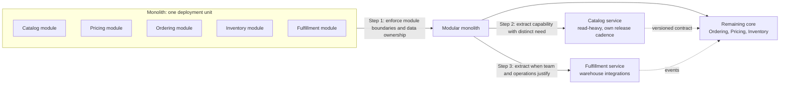

The diagram shows decomposition as a sequence of reversible steps, not a single rewrite. The first step happens inside the monolith and costs little: modules stop reaching into each other's tables and talk through explicit interfaces. Only after that boundary has held for a while is a capability extracted, and only the ones with a distinct need. The remaining core stays together because its parts change together and share transactions. The implication is that the most important decomposition work is done before any network exists, and that the decision to extract can be postponed without losing the benefit of the clearer structure.

### 4.2 Decomposition by bounded context

Capabilities describe what the business does. Bounded contexts, a concept from Domain-Driven Design (DDD) introduced by Eric Evans, describe where a model and its vocabulary stay consistent. Inside one bounded context a term has one precise meaning. Across contexts the same word often means different things, and trying to share one model across them produces a model that fits none.

In the retail example, "product" is not one thing:

- In Catalog, a product is a described item with images, attributes, and categories.
- In Pricing, a product is a price-list key with rules attached.
- In Inventory, a product is a stock-keeping unit (SKU) with quantities at locations.
- In Fulfillment, a product is a physical item with weight and dimensions.

One shared `Product` class with all of these fields would be edited by four teams for four reasons, and a change for one would risk the others. Giving each context its own model, holding only the fields it needs and linked by a shared identifier such as the stock-keeping unit code, removes that coupling. The contexts exchange the identifier and the facts the other side needs.

A service boundary usually aligns with a bounded context, and often a context maps to one service. Alignment is a guide and not a law. A large context may later split into several services if the model inside is truly separable, and several tiny contexts may live in one service if they are always changed together.

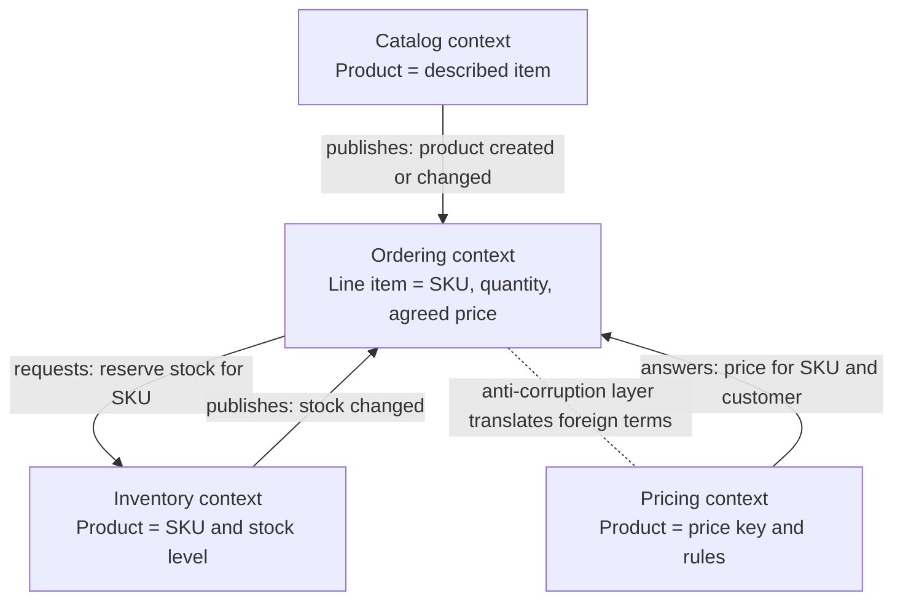

The diagram is a context map: it shows which contexts exist, which direction knowledge flows, and where one context translates another's vocabulary. The dotted line marks an anti-corruption layer, a translation component that stops a foreign model from leaking into a context's own. The implication for design is that every arrow is a contract to be owned, versioned, and tested, so the number and direction of arrows are the main measure of how coupled the decomposition is. A context that has arrows to and from every other context is a boundary in the wrong place, or a candidate to merge.

### 4.3 Testing a proposed boundary

Before committing to a boundary, run it against realistic change requests. Take the last twenty significant requirements, from the backlog or the requirement history, and for each one list the services it would touch under the proposed split. Two outputs matter.

- **Spread.** If more than a small fraction of requirements touch three or more services, the boundaries cut across the way the business actually changes. For example, if 9 of 20 requirements (45%) touch three or more services, the split is probably wrong. The cut-off is a judgment, and the useful signal is the comparison between alternative splits, not an absolute threshold.
- **Transaction crossings.** List the business invariants (rules that must always hold, such as "an order cannot be confirmed without reserved stock") and mark which ones span a boundary. Each crossing needs a coordination mechanism and a decision on what the user sees during the inconsistency window. Few crossings are better than many.

Other heuristics help. A boundary is suspect if two services always release together, if one cannot be tested without the other running, or if a single database table is edited by both. A boundary is healthy if the owning team can describe the service's responsibility in one sentence without using "and".

### 4.4 Granularity

Granularity is the size of a service in terms of responsibility. Too coarse and the service becomes a mini-monolith with its own coordination problems. Too fine and the system pays network cost and operational overhead for very little isolation. There is no correct size, but three forces set the range.

- **Lower bound: operational cost.** Each service has a fixed cost of pipeline, monitoring, on-call, patching, and contracts. A service must carry enough value to pay that cost.
- **Upper bound: team cognition.** A team should be able to understand its service fully, including its failure modes. When one service grows beyond that, it is a candidate to split along an internal seam.
- **Transaction scope.** Things that must change atomically belong in one service unless the cost of coordinating them is acceptable.

A practical rule is to start coarser than the final picture, and split when evidence appears. Splitting a service is possible when its internals are modular. Merging two services is possible but means reconciling two data stores and two contracts, so coarse-first is the cheaper mistake.

## 5. Data Ownership

The data-ownership rule is the property that separates a service architecture from a distributed monolith: a service is the only writer of its persistent state, and other services read that state only through the service's contract. If two services write the same table, a schema change in one silently breaks the other, and the two cannot be deployed independently, regardless of how many containers are involved.

### 5.1 What ownership means in practice

Ownership has three layers, and a team can enforce them to different degrees.

1. **Logical ownership.** One service is the authority for each business fact. "Order status" is decided by Ordering, and no other service computes or overwrites it.
2. **Schema ownership.** Only the owner changes the structure of the data. Consumers depend on the contract, not on the columns.
3. **Physical separation.** The data lives in a separate schema, database, or cluster with credentials only the owner holds. This is the layer that makes the other two enforceable.

Physical separation can be graduated. A schema per service inside one shared database server is the cheapest and still blocks cross-service queries when credentials differ. A database instance per service adds failure and performance isolation, at higher cost. Choose based on the isolation the forces demand, and keep the logical rule regardless.

A minimal PostgreSQL illustration of schema separation with separate credentials:

```sql
CREATE ROLE orders_svc LOGIN PASSWORD 'set-from-secret-store';
CREATE ROLE catalog_svc LOGIN PASSWORD 'set-from-secret-store';

CREATE SCHEMA orders AUTHORIZATION orders_svc;
CREATE SCHEMA catalog AUTHORIZATION catalog_svc;

REVOKE ALL ON SCHEMA orders FROM PUBLIC;
REVOKE ALL ON SCHEMA catalog FROM PUBLIC;
```

With this setup, `orders_svc` cannot read `catalog` tables unless someone grants it, so a shortcut query fails at the database instead of surviving in code until it breaks a release. The password placeholder shows where a secret store belongs; credentials never appear in source control.

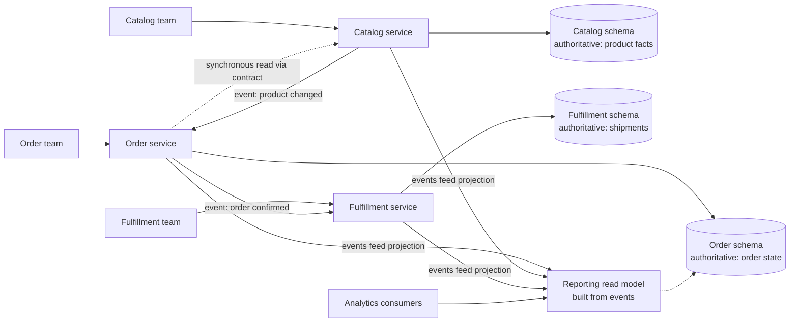

The diagram separates three paths for data to cross a boundary: a synchronous read through a contract, an event that the consumer stores in a copy of its own, and an event stream that builds a read model for reporting. No arrow reaches into another service's schema. The dotted line to the Order schema marks that the read model is not a query against it. The implication is that every piece of data a consumer needs from another service must be either fetched at the moment it is needed or copied under a defined staleness limit, and the choice between the two is a design decision with a cost, covered next.

### 5.2 Getting data you do not own

A service that needs another service's data has three options. Each trades freshness against coupling and availability.

| Option | How it works | Freshness | Availability coupling | Typical use |
| --- | --- | --- | --- | --- |
| Synchronous query | Call the owner at request time | Current | High: caller fails if owner fails | Rarely changing, high-value reads where staleness is unacceptable |
| Local copy from events | Store the fields needed, update from change events | Eventually consistent, lag is measurable | Low: caller works if owner is down | Reference data such as product name or customer tier |
| Passed in the request | The caller supplies the facts it already holds | As fresh as the caller's copy | None | Facts already known to the client, with validation by the owner |

A local copy is not a second authority. The consumer keeps only the fields it needs, never edits them, and treats the owner as the source of truth when a conflict appears. The consumer's copy has a lifecycle: it needs initial population, a way to catch up after downtime, and handling for duplicate and out-of-order events, for which see [Event-Driven Architecture](CH07_Event_Driven_Architecture.md) and [Idempotency](../07_System_Design_and_Distributed_Systems/CH16_Idempotency.md).

Consider the order example with illustrative numbers. Orders must show the product name and the unit's weight class on each line. Option one, a synchronous query to Catalog for each line, adds one network call per line. An order of 8 lines creates 8 calls or one batched call, and the order service fails if Catalog is down. Option two keeps a small table of SKU, name, and weight class in the Order schema, updated from Catalog's change events. The read is local, takes microseconds, and works while Catalog is unavailable, at the cost of showing a product name that may be seconds stale. A name that is a few seconds stale is acceptable for display, so option two wins. Price at the moment of purchase is different. The Order service records the agreed price on the order line at confirmation time, as a fact of the order, and does not re-read it afterwards.

### 5.3 Reporting and queries across services

A query that joins data from five services cannot be a database join once the data is separated. Teams respond in three ways.

- **API composition.** A composing service calls each owner and combines the results in memory. This suits small, interactive queries, and inherits the latency and availability costs of every call it makes.
- **Read model.** A dedicated store is fed from events and holds the joined shape the query needs. This is the approach taken by [CQRS](CH09_CQRS.md), which owns the full treatment.
- **Analytics pipeline.** Data is exported from each service into an analytical store for reporting that tolerates delay. The operational services are not queried by analysts.

The rule of thumb is to never let reporting convenience reintroduce a shared schema. A shared reporting login with read access to every service's tables is the quiet route back to a distributed monolith, because schemas then become unchangeable contracts.

### 5.4 Consistency across owners

Separate ownership means a business operation spanning two services cannot use one local transaction. For example, confirming an order and reserving stock touches Ordering and Inventory. The options are to accept a window of inconsistency and repair it with compensation, as the [Saga Pattern](CH10_Saga_Pattern.md) describes, or to merge the two parts into one service if the invariant is strict and the coupling is real. Part 07 covers the theory in [Distributed Transactions](../07_System_Design_and_Distributed_Systems/CH12_Distributed_Transactions.md) and the [CAP Theorem](../07_System_Design_and_Distributed_Systems/CH05_CAP_Theorem.md). The architecture decision is to count the invariants that cross boundaries during decomposition, since each one costs a coordination mechanism, a user-visible intermediate state, and tests for the failure paths.

## 6. Communication: Synchronous and Asynchronous

Services interact in two basic styles, and the choice for each interaction shapes latency, availability, and coupling more than the choice of protocol does.

### 6.1 Synchronous request and response

In the synchronous style the caller sends a request and waits for the reply before continuing. Typical carriers are Hypertext Transfer Protocol (HTTP) with REST ([REST](../08_API_Architecture/CH01_REST.md)) or a remote procedure call (RPC) framework such as [gRPC](../08_API_Architecture/CH03_gRPC.md). Its strengths are simplicity, an immediate answer, and a direct error result. Its costs are temporal coupling and availability coupling. The caller and callee must both be up at the same moment, and the caller's latency includes the callee's.

Synchronous calls fit when the caller cannot proceed without the answer and the answer must be current: authorizing a payment, validating a coupon, reading the user's profile to render a page.

### 6.2 Asynchronous messaging

In the asynchronous style the sender publishes a message or event to a broker and continues. The receiver processes it later. The detailed mechanics belong to [Event-Driven Architecture](CH07_Event_Driven_Architecture.md) and [Async APIs](../08_API_Architecture/CH06_Async_APIs.md). The properties that matter for this chapter are:

- The sender does not wait, so the sender's latency and availability do not include the receiver's.
- The receiver can be down and catch up later, so brief outages do not propagate.
- The sender does not get an immediate result, so the user experience must tolerate "accepted, being processed".
- Delivery is generally at least once, so consumers must handle duplicates, and ordering is limited, so consumers must handle out-of-order messages. Part 07 covers [Idempotency](../07_System_Design_and_Distributed_Systems/CH16_Idempotency.md) and [Ordering Guarantees](../07_System_Design_and_Distributed_Systems/CH18_Ordering_Guarantees.md).
- A broker is a new component to operate and a new place for failure.

Two kinds of message are worth separating. A **command** asks a specific service to do something and expects it to be done, so it has one intended receiver. An **event** states that something happened, and the publisher does not know or care who reacts. Events reduce coupling, since new consumers can subscribe without changing the publisher, but they make end-to-end behaviour harder to follow.

### 6.3 Choosing the style per interaction

A decision for each interaction, rather than a blanket policy, gives the best result. Ask these questions in order.

1. Does the user or caller need the result of this step to continue? If not, use asynchronous.
2. Must the data be current to the second, or is a short, bounded staleness acceptable? If staleness is acceptable, prefer a local copy fed by events over a synchronous read.
3. Can the operation be retried safely? If not, it needs an idempotency key before it can be made asynchronous or retried.
4. What should happen when the other side is down? If the answer is "degrade and continue", asynchronous or a cached fallback fits. If the answer is "reject the request", synchronous is acceptable and the dependency is mandatory.

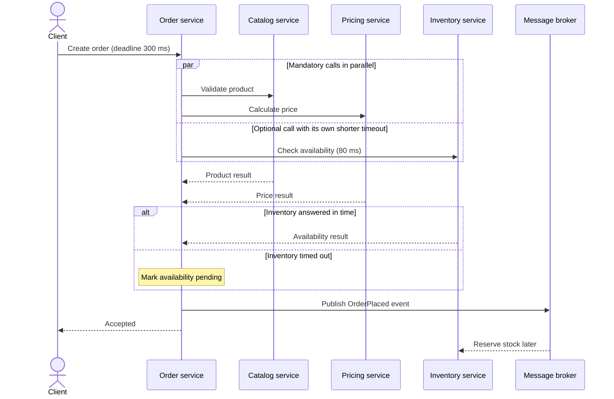

The diagram classifies the three outgoing calls. Catalog and Pricing are mandatory because an order without a valid product or a price cannot be accepted, so the caller waits for them, in parallel and under one deadline. Inventory is optional on the critical path: if it is slow, the order is accepted with "availability pending" and stock is reserved after the event is published. The implication is that the shape of the call graph, not only the speed of each service, determines availability. Every mandatory synchronous edge multiplies failure exposure, which the next section quantifies. Moving a step off the critical path is the cheapest way to raise availability, as long as the user-facing promise can be worded honestly.

### 6.4 A bounded fan-out in code

The following Java 21 sketch performs the fan-out above using `CompletableFuture`. It applies a deadline to mandatory calls and a shorter timeout with a fallback to the optional call. The `catalog`, `pricing`, and `inventory` clients are assumed interfaces that wrap blocking calls.

```java
public OrderDecision validate(OrderRequest req) {
    var product = CompletableFuture
        .supplyAsync(() -> catalog.find(req.sku()), executor)
        .orTimeout(250, TimeUnit.MILLISECONDS);
    var price = CompletableFuture
        .supplyAsync(() -> pricing.quote(req.sku(), req.customerId()), executor)
        .orTimeout(250, TimeUnit.MILLISECONDS);
    var stock = CompletableFuture
        .supplyAsync(() -> inventory.available(req.sku()), executor)
        .completeOnTimeout(Availability.PENDING, 80, TimeUnit.MILLISECONDS)
        .exceptionally(e -> Availability.PENDING);

    try {
        return OrderDecision.accept(product.join(), price.join(), stock.join());
    } catch (CompletionException e) {
        return OrderDecision.reject("product or price unavailable");
    }
}
```

The executor can be `Executors.newVirtualThreadPerTaskExecutor()`, which keeps blocking calls cheap on Java 21. Three points matter. The three calls start together, so total latency tracks the slowest mandatory call and not the sum. Mandatory failures turn into a rejection, with a message the caller can act on. The optional call can never fail the request. The sketch does not include retries, which the cost model in the next section treats separately because retries change the load that dependencies see.

## 7. The Cost Model of a Distributed System

The benefits of the pattern come from independence. The costs come from the fact that independent services still need each other to finish a user request. This section turns the costs into arithmetic so that a design can be checked against its targets before it is built. The numbers are illustrative.

### 7.1 Availability of serial dependencies

If a request needs services A, B, and C all to succeed, and their failures are independent, the request succeeds only when all three succeed. Availability multiplies:

$$A_{path} = A_1 \times A_2 \times \dots \times A_n$$

Suppose each service has an availability of 99.9% (0.999). A 30-day month has 43,200 minutes, and 99.9% allows 0.001 × 43,200 = 43.2 minutes of unavailability.

| Services on the path | Path availability | Unavailable minutes per 30 days |
| --- | --- | --- |
| 1 | 0.999 = 99.9% | 43.2 |
| 5 | 0.999^5 ≈ 0.99501 = 99.50% | 0.00499 × 43,200 ≈ 215.6 |
| 10 | 0.999^10 ≈ 0.99005 = 99.00% | 0.00995 × 43,200 ≈ 430 |
| 20 | 0.999^20 ≈ 0.98018 = 98.02% | 0.01982 × 43,200 ≈ 856 |

Five services each good enough for a 99.9% target together deliver about 99.5%, and the downtime is five times as long. If the path includes a 99.95% Order service and four mandatory 99.9% dependencies, availability is 0.9995 × 0.999^4 = 0.9995 × 0.996006 ≈ 0.99551, or about 194 minutes per month. The Order service alone looks better than the path it is part of. Teams that measure each service separately and report green can still deliver a poor user experience.

The independence assumption is optimistic. Failures are often correlated, because services share a deployment platform, a network zone, or a common dependency such as an identity provider. Correlation makes the real number differ from the product in either direction, so the product is a planning check, not a prediction. Use measured end-to-end success rates to validate it, as the [service level objective (SLO)](../14_Observability/CH11_SLO.md) chapter describes.

Three design moves raise path availability:

1. **Shorten the mandatory path.** Each service removed from the synchronous path removes a factor. Moving the Inventory call off the critical path in the earlier example raises the path from five factors to four.
2. **Replace a synchronous dependency with a local copy.** A service that reads its own copy of reference data does not depend on the owner being up.
3. **Add a degraded mode.** A fallback such as a cached price or "availability pending" turns a hard dependency into a soft one that does not multiply into the path.

A short Python function makes the check repeatable during design review:

```python
from math import prod

def path_availability(availabilities):
    return prod(availabilities)

def minutes_down(availability, days=30):
    return (1 - availability) * days * 24 * 60

path = [0.9995, 0.999, 0.999, 0.999, 0.999]
a = path_availability(path)
print(f"{a:.5f}", round(minutes_down(a), 1))
# 0.99551 194.1
```

The function covers serial, independent dependencies only. A dependency with a working fallback is excluded from the list, which is how the design decision shows up in the arithmetic.

### 7.2 Latency budgets and the tail

A user-facing request has a latency target, for example 300 milliseconds at the 99th percentile (p99), meaning 99% of requests finish within that time. The budget is spent across every hop. A budget forces the team to say who may use how much of it.

Consider an illustrative budget of 300 ms p99 for "create order". The gateway takes 20 ms and the Order service's own work takes 50 ms, leaving 230 ms for dependencies. If Catalog, Pricing, and Inventory have p99 latencies of 40, 60, and 80 ms and are called one after another, the upper bound on their combined time is 40 + 60 + 80 = 180 ms. Adding the 70 ms of gateway and order work gives 250 ms, which is inside the budget but uses 83% of it. Each hop also adds serialization and queueing time that the per-service figures may not include. If the calls run in parallel, the dependency time is about max(40, 60, 80) = 80 ms and the total is about 150 ms, which leaves 150 ms of margin for network overhead and slow outliers.

The tail grows with fan-out. If each call independently stays under its own p99 with probability 0.99, then the probability that all n parallel calls do so is 0.99^n:

| Parallel calls n | Probability all are under their p99 | Share of requests with at least one slow call |
| --- | --- | --- |
| 1 | 0.99 | 1% |
| 3 | 0.9703 | about 3.0% |
| 10 | 0.9044 | about 9.6% |
| 50 | 0.6050 | about 39.5% |

A request waiting for the slowest of ten calls is at or beyond one of its callee's p99 about one time in ten, even though every callee meets its own target. The practical consequences are to keep fan-out small, to set deadlines per call and a total deadline per request, and to pass the remaining deadline downstream so that a service does not keep working on a request whose caller has given up.

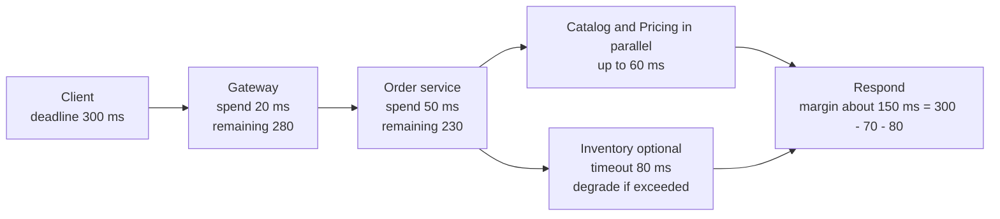

The diagram shows the budget as a countdown that each hop consumes and passes on. Because the optional branch has its own timeout, a slow Inventory service cannot spend the margin reserved for the tail. The implication is that a latency target is a design input that determines how many sequential steps a request may contain. A chain of six services in sequence, each with a 50 ms p99, already has an upper bound of 300 ms from calls alone and leaves nothing for the caller's own work.

### 7.3 Partial failure and retry amplification

In-process code either works or throws. A network call has a third outcome: no answer. The caller cannot tell whether the request was lost, whether the callee is slow, or whether the callee did the work and the reply was lost. Retries are the usual response, and they are safe only for operations that are idempotent, meaning repeating them has the same effect as doing them once (see [Idempotency](../07_System_Design_and_Distributed_Systems/CH16_Idempotency.md)).

Retries help when failures are brief and independent. If a call fails transiently with probability 0.05 and attempts are independent, three attempts all fail with probability 0.05^3 = 0.000125, so the call succeeds 99.9875% of the time. The same retries hurt when the callee is overloaded, because each retry adds load to a service that is already failing. Retries also multiply across layers:

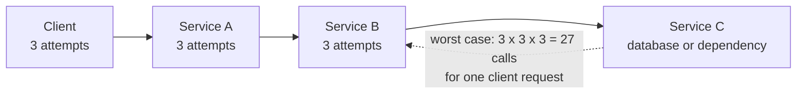

If each of three layers makes up to three attempts, one client request can produce 3 × 3 × 3 = 27 calls at the bottom service during an incident, at the moment it can least afford them. The usual controls, defined in Part 07 and Part 08, are:

- Retry at one layer only, usually the one closest to the user, and have inner layers fail fast.
- Cap total attempts with a retry budget (for example, retries limited to a fraction of recent requests) and use exponential backoff with random jitter.
- Use timeouts shorter than the caller's remaining deadline, so a retry is not started when it cannot finish.
- Use a circuit breaker, which stops calling a dependency that is failing and lets it recover, and a bulkhead, which limits the resources one dependency can consume so that its slowness does not exhaust the caller's threads or connections.

The architecture-level decision is to classify every dependency as mandatory or optional and to define its failure behaviour in the contract: fail the request, return a degraded answer, or queue the work.

### 7.4 Consistency costs

Once data is owned by separate services, there is no single point that sees all of it at one instant. Three consequences follow, and Part 07 gives the formal treatment in the [CAP Theorem](../07_System_Design_and_Distributed_Systems/CH05_CAP_Theorem.md) and [Distributed Transactions](../07_System_Design_and_Distributed_Systems/CH12_Distributed_Transactions.md).

- **Stale reads.** A service reading a copy of another service's data can see an old value. The staleness window equals event delivery delay plus processing time. If the lag target is 5 seconds at p99, the design must say what a user sees in that window and which decisions may use stale data.
- **Multi-service operations without a shared transaction.** An operation that changes two services is either coordinated by a saga with compensating steps ([Saga Pattern](CH10_Saga_Pattern.md)) or accepted as eventually consistent. Each choice creates intermediate states that the product must define, for example an order that is "pending" until stock is reserved.
- **Duplicate and reordered messages.** Asynchronous delivery usually repeats or reorders messages, so consumers need idempotent handling and version checks.

The architecture cost is not only code. Product owners must agree to intermediate states, support staff must be able to see and repair them, and tests must cover the failure interleavings. These costs are why strict invariants across boundaries argue for keeping the parts together.

### 7.5 Operational overhead

Every service carries a recurring load that does not shrink with its size. Typical items are a build and release pipeline, secrets and certificates, service-to-service authentication, dashboards and alerts, a distributed-tracing integration, log retention, dependency and base-image patching, an on-call rotation, capacity planning, and contract maintenance.

Two simple measures show the scale. First, the number of potential communication pairs among n services is n(n-1)/2: 10 services give 45 pairs, and 40 services give 780. Few pairs will be real, but each real one is a contract and a failure path. Second, recurring toil scales with service count. If each service needs 3 hours a month for patching, certificate rotation, and dependency updates, 40 services need 120 hours a month, close to one full-time engineer, before any feature work. The 3-hour figure is illustrative, and the point is that the cost is linear in service count and is paid regardless of how little a service changes.

Operational cost can be reduced by a platform that provides the common capabilities once: templates, a standard pipeline, a shared observability setup, and default security policies. Without that platform, every team rebuilds them differently. The break-even question for adoption is whether the coordination time saved across teams exceeds the platform and per-service load added, and the later section on deciding whether the pattern fits returns to that measurement.

### 7.6 Putting the costs together

The five cost categories are summarized below, together with the design response that reduces each.

| Cost | Cause | Illustrative effect | Design response |
| --- | --- | --- | --- |
| Availability | Serial mandatory dependencies | 5 services at 99.9% give about 99.5% | Shorten mandatory path, local copies, degraded modes |
| Latency | Sequential hops and fan-out tail | 10 parallel calls give about 9.6% of requests with a slow call | Parallel calls, deadlines, caching, fewer hops |
| Partial failure | Unknown outcomes and retries | 3 layers of 3 attempts give 27 calls | Idempotency, single-layer retry, breakers, bulkheads |
| Consistency | Separate data ownership | Stale reads, intermediate states | Align boundaries with invariants, sagas, explicit states |
| Operations | Per-service recurring work | 40 services at 3 hours give 120 hours per month | Platform, automation, fewer and larger services |

The table is a design-review prompt. For a candidate boundary, estimate each row before extraction and compare it with the benefit gained from the forces that motivated the split. If the benefit is not larger than the sum, the boundary should stay inside the same service.

## 8. Deployment Autonomy

Section 2.2 defined independence as four checks. This section describes the mechanisms that make those checks pass in practice: separate pipelines, compatible contract changes, contract tests, and release controls that separate deploying code from exposing behaviour. Without them, the services are separate processes that still ship as one release.

### 8.1 Independent pipelines

Each service has its own repository path or build scope, its own continuous integration and continuous delivery (CI/CD) pipeline, and its own deployable artifact (see [CI/CD](../13_DevOps/CH02_CI_CD.md) for pipeline mechanics). The pipeline's gates test the service against its own tests and against contract-level doubles of its collaborators, then promote the artifact through environments without waiting for another service's pipeline.

Three properties of the pipeline decide whether autonomy is real:

- **No shared release train.** If a calendar or a release manager gates all services together, the unit of deployment is the train, not the service.
- **No shared mutable environment as a gate.** A single integration environment that must be green for every service turns each team's failure into everyone's delay. Contract tests (section 8.3) replace most of its purpose, and a small set of end-to-end checks runs after deployment, not before.
- **Rollback is a pipeline action.** The previous artifact can be redeployed without touching data in a way other services observed. This is why schema changes follow the compatibility rules in section 8.4.

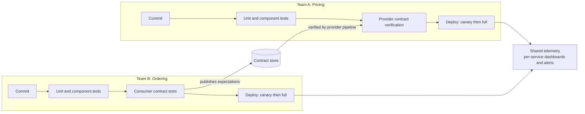

The diagram shows two pipelines that never wait for each other. The only link between them is the contract store: the consumer publishes what it relies on, and the provider pipeline verifies that its build still satisfies it. The telemetry node is shared infrastructure, not a shared release gate. The implication is that coordination moves from meetings and release calendars into an automated check that runs on every commit, which scales with the number of services where a calendar does not.

### 8.2 Versioning and compatibility

A provider and its consumers release at different times, so at any moment the provider's new version meets consumers built against the old one, and the old provider version meets consumers built against a new contract. Two compatibility directions matter.

- **Backward compatibility.** A new provider version works with consumers built for the previous contract. This is the property that lets the provider release first.
- **Forward compatibility.** A consumer tolerates additions it does not know about, such as an extra response field or an unknown enum value. This is the tolerant reader behaviour, and it is what lets a provider add things without a consumer release.

Changes fall into compatible and breaking groups. Adding an optional request field, adding a response field, and adding a new operation are compatible if consumers ignore unknown fields. Removing or renaming a field, changing a field's type or meaning, making an optional field required, and tightening validation are breaking. A change in meaning without a change in shape is the worst case, because no schema check detects it. For binary schema formats such as Protocol Buffers, never reuse a field number for a different meaning, and reserve retired numbers. Part 08 owns the versioning schemes themselves in [Versioning](../08_API_Architecture/CH10_Versioning.md). The pattern-level rule is that a breaking change gets a new version of the contract and a migration period, and is never shipped in place.

Event contracts need the same care, with an extra constraint: events in a log or broker may be read long after they were written, so a consumer can meet old event shapes. Event schema evolution is covered in [Event-Driven Architecture](CH07_Event_Driven_Architecture.md) and [Event Sourcing](CH11_Event_Sourcing.md).

### 8.3 Contract testing

A contract test checks the agreement between a consumer and a provider without running both in one environment. In the consumer-driven form, the consumer records the requests it makes and the responses it needs, and the provider's pipeline replays those requests against its build. Open-source tools such as Pact implement this approach. The result is a fast, reliable test that answers the question "will this provider release break a known consumer?" before release.

What contract tests cover and do not cover should be stated plainly:

- They catch removed fields, changed types, changed status codes, and changed message shapes for the interactions consumers declared.
- They do not catch behavioural problems such as a changed rounding rule, nor performance regressions, nor interactions nobody declared. Those need component tests, canary release, and monitoring.
- They depend on consumers keeping their expectations accurate and minimal. A consumer that asserts every field makes the provider's freedom smaller than necessary, so teams record only what the consumer reads.

The test also gives the provider a list of its real consumers, which turns "who uses this field?" from guesswork into a query. That list is what makes the removal step in the next subsection safe.

### 8.4 Backward-compatible change: expand, migrate, contract

Any breaking change can be broken into compatible steps. The expand, migrate, and contract sequence, also called parallel change, does this for contracts and for the data behind them.

1. **Expand.** The provider adds the new form beside the old one and keeps both working.
2. **Migrate.** Consumers move to the new form, each on its own schedule. The provider measures how many callers still use the old form.
3. **Contract.** When the old form has no remaining use, the provider removes it.

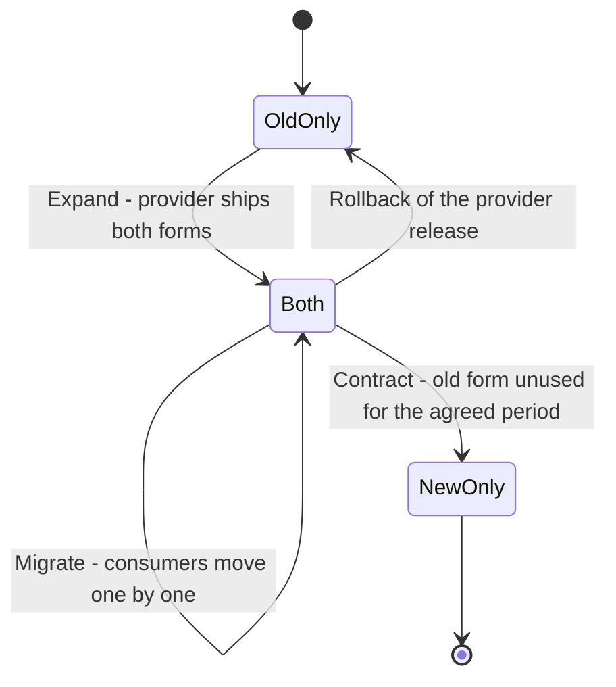

The diagram shows that the risky transition, removing the old form, happens only from the state where both forms coexist, and rollback is always possible until the contract step. The implication is that a single breaking change costs three releases and a measurement period instead of one coordinated release, and that the cost is paid in provider effort rather than in cross-team scheduling. The same sequence applies to database columns: add the new column, write to both, backfill and switch reads, then drop the old column in a later release.

### 8.5 Feature flags: deploy is not release

A feature flag is a runtime switch that enables behaviour without redeploying. It separates two events that a monolith ties together: code reaching production (deployment) and users seeing the behaviour (release). This helps autonomy in two ways. Incomplete work can be merged and deployed dark, so branches stay short. A faulty feature can be switched off in seconds, which is faster than a rollback. [Feature Flags](../13_DevOps/CH14_Feature_Flags.md), [Canary Deployment](../13_DevOps/CH16_Canary_Deployment.md), and [Progressive Delivery](../13_DevOps/CH13_Progressive_Delivery.md) own the mechanics.

Flags carry costs that the pattern makes sharper. Each flag doubles the paths to test in principle, and old flags become dead code with unclear owners, so every flag needs an owner and a removal date. A flag whose state must agree across services, for example one that changes a message shape, creates a hidden coordination point, and it should be rolled out with the expand-migrate-contract sequence and not toggled at the same moment everywhere.

### 8.6 Worked example: changing the price representation

Illustrative scenario. Pricing returns `price` as a number of minor units (for example 1999 for 19.99). The business adds multi-currency, so the field must become an object with an amount and a currency code. Four services read the field: Ordering, Search, Recommendations, and a reporting job.

Lockstep approach: all five teams change and release in one window. The window needs agreement from five teams and a rollback plan for all of them.

Expand-migrate-contract approach:

| Day | Action | Who |
| --- | --- | --- |
| 0 | Pricing adds `priceDetail` with amount and currency, keeps `price` unchanged. Contract tests pass for all four consumers | Pricing |
| 1 to 21 | Each consumer switches to `priceDetail` on its own release. Pricing records which consumers still read `price` | Each consumer |
| 21 | The record shows reads of `price` from one consumer only. That team is asked to finish | Pricing |
| 28 | Last consumer releases. Reads of `price` fall to zero | Last consumer |
| 28 to 42 | Hold for 14 days to cover monthly and rare jobs | Pricing |
| 42 | Pricing removes `price` | Pricing |

The total elapsed time is 42 days against one coordinated day, but no team scheduled a joint release and every step was individually reversible. Measured against the independence test, the check "consumer keeps working while the provider releases" passes at every step. The 14-day hold is a judgment: a monthly report would need at least a 31-day hold, so the hold should match the slowest known consumer cycle, which the contract store reveals.

Autonomy is measurable. Track for each service the share of releases that needed another team's release, the lead time from merge to production, and the share of releases rolled back. If more than a small share of releases need coordination, the autonomy check has failed, and the cause is usually a hidden coupling such as a shared schema or an undeclared consumer.

## 9. Deciding Whether the Pattern Fits

The earlier sections gave the benefits (section 3), the boundaries (sections 4 and 5), and the costs (section 7). This section turns them into a decision, and describes how to move in either direction without a rewrite.

### 9.1 Team topology and Conway's law

Conway's law, from Melvin Conway's 1968 paper "How Do Committees Invent?", states that organizations that design systems produce designs that copy their communication structures. Stated carefully, it is an observation about tendency and not a physical law: the interfaces in a system tend to appear where communication between groups is costly, and a design that needs more communication than the organization supports tends to be bent toward the organization's shape.

Two practical uses follow. First, a service boundary that cuts across a team will be hard to hold, because changes will keep crossing it. Second, a team structure can be chosen deliberately to encourage the architecture wanted, an approach sometimes called the inverse Conway manoeuvre. The pattern works best when each service is owned by one team that can make most of its decisions without negotiation. Team Topologies, a book by Matthew Skelton and Manuel Pais, describes stream-aligned teams that own a flow of change end to end, supported by platform teams that provide shared capabilities. That vocabulary is useful here, but the book is a framework to apply with judgment and not a proof.

Checks that follow from this:

- Count the teams and the services. If there are more services than the teams can own and be on call for, ownership is nominal. A common warning sign is a team owning so many services that it cannot name the failure modes of each.
- If one team owns all the services, the coordination benefit is absent and only the costs remain.
- If a service has no clear owning team, it will degrade. Unowned services are the ones that keep running unpatched.

### 9.2 The modular monolith as the alternative

A modular monolith is the benchmark against which the pattern should be compared. It has one deployment unit, internal modules with enforced boundaries (no access to another module's internals or tables), explicit module interfaces, and per-module ownership. It keeps local transactions and in-process calls, and it avoids the network costs of section 7.

What the modular monolith does not give is independent release and scaling for each module, fault containment between modules at runtime, and technology freedom per module. If those are the forces that bind (section 3.3), it is not enough. If the binding force is "teams interfere with each other's code", a modular monolith with module ownership and a faster pipeline often removes most of the interference at far lower cost. A useful sequence is to enforce module boundaries first, observe which boundaries hold under real change, and extract only those that need runtime independence.

### 9.3 A decision procedure

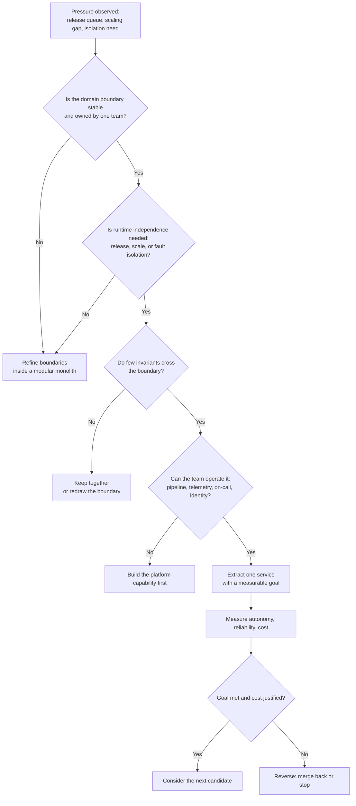

The diagram orders the questions from cheapest to answer to most expensive. A "no" at any of the first three questions points to a cheaper alternative, not to "later". The fourth question is about the organization and not the code, and it is where many programs fail, because the service is ready before the pipeline, telemetry, and on-call are. The final loop is deliberate: extraction is an experiment with a stated goal, and a failed experiment is reversed instead of defended. The implication is that the decision is made per boundary, so one system can reasonably have a monolithic core and a few services.

### 9.4 Migration with the strangler fig and a reversible cutover

The strangler fig approach, named by Martin Fowler after a plant that grows around a tree, replaces a capability gradually. A routing layer sits in front of the old system. A new service takes over one capability at a time, and the old code for that capability is retired only when the new one has proved itself. The key property is that each cutover can be undone by changing routing.

A reversible cutover has these steps:

1. **Route.** Place a router (gateway or proxy, see [API Gateway](../08_API_Architecture/CH08_API_Gateway.md)) in front of the capability, still sending all traffic to the old code.
2. **Build and shadow.** Build the new service. Send it a copy of live read traffic and compare answers with the old code without returning them to users.
3. **Canary.** Route a small share of real traffic to the new service, with a switch back to the old code that does not need a deployment.
4. **Ramp and watch.** Increase the share in steps while comparing error rate, latency, and business results to the old path.
5. **Own the data.** Moving writes is the hard step. Run with one authoritative store at a time, and synchronize the other from it, so rollback never loses writes.
6. **Retire.** Remove the old code only after a hold period at full traffic.

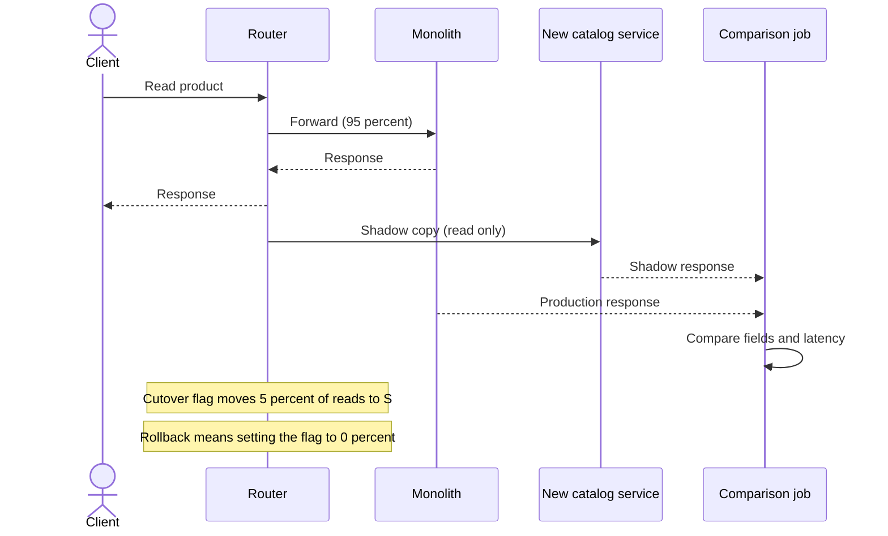

The diagram shows two stages at once. Shadow traffic validates the new service on real requests with no user impact, and the flag-controlled share moves real traffic gradually. The implication is that the evidence for cutover comes from comparing real behaviour, and the rollback is a configuration change measured in seconds. The shared data store is the constraint: reads can be migrated this way easily, and writes need a defined single authority during the transition, as described in the previous list.

Illustrative arithmetic for ramp planning: at 2,000 requests per second of catalog reads, a 5% canary sends 100 requests per second to the new service. If the acceptance rule is "error rate within 0.1 percentage points of the old path with at least 10,000 requests per step", then at 100 requests per second a step takes 10,000 / 100 = 100 seconds. A 25% step at 500 requests per second needs 20 seconds, so the traffic volume is not the limiting factor. The limit is how long it takes to see rare events, so the steps should include at least one daily peak and one batch cycle.

### 9.5 Where the neighbouring patterns fit

Several patterns in this part cover problems the decision above creates. Each is owned elsewhere and recapped here.

- Multi-service business operations without a shared transaction need coordination and compensation. The [Saga Pattern](CH10_Saga_Pattern.md) owns this, and [Distributed Transactions](../07_System_Design_and_Distributed_Systems/CH12_Distributed_Transactions.md) owns the theory.
- Queries across services use read models, which [CQRS](CH09_CQRS.md) owns.
- Event-based integration between services is owned by [Event-Driven Architecture](CH07_Event_Driven_Architecture.md), with [Event Sourcing](CH11_Event_Sourcing.md) for logs as the system of record.
- Enterprise-wide service reuse through a central bus is the earlier approach covered in [SOA](CH06_SOA_Service_Oriented_Architecture.md). Microservices differ by favouring smart services with simple connections, team-owned data, and decentralized governance, whereas SOA's shared infrastructure and shared canonical models tended to centralize them.
- Limiting the blast radius of a failure across a very large fleet is the subject of [Cell-Based Architecture](CH18_Cell_Based_Architecture.md), which partitions the whole stack into isolated replicas.

Operational and platform topics are owned by later parts: cloud composition in Part 10 (for example [Cloud-Native Application and Integration Patterns](../10_Cloud_Architecture/CH07_Cloud_Native_Application_and_Integration_Patterns.md)), Kubernetes in Part 12 (for example [Deployments](../12_Kubernetes/CH02_Deployments.md)), delivery practice in Part 13, and telemetry in Part 14.

## 10. Observability, Security, Platform, and Cost

Section 7.5 listed the recurring load that each service adds. This section describes the cross-cutting capabilities that carry it. Each is owned in depth by a later part, so this section states the pattern-level requirement and what goes wrong without it.

### 10.1 Distributed tracing

One user request crosses several services, so a single process log no longer tells the story. A distributed trace links the work done for one request across processes. Each unit of work is a span with a start, a duration, and a parent. A trace identifier is created at the edge and passed on every call, for example in the W3C Trace Context `traceparent` header for HTTP, and in message headers for asynchronous hops. Each service writes the trace identifier into its logs, so a trace and the logs for its spans can be joined. Part 14 owns the mechanics in [Tracing](../14_Observability/CH03_Tracing.md) and [OpenTelemetry](../14_Observability/CH04_OpenTelemetry.md).

The pattern-level requirements are three:

- **Propagation is part of the contract.** A service that drops the trace header breaks every trace that passes through it, and the break is silent. Include propagation in the service template and in contract tests.
- **Asynchronous hops need explicit linking.** A message consumed minutes later is a new span linked to the producer's trace, and not a child waiting for it. Without this, the saga in [Saga Pattern](CH10_Saga_Pattern.md) is invisible as one flow.
- **Sampling is a cost decision.** Keeping every trace is costly at high volume. Common choices are a low random rate plus always keeping slow or failed requests, which needs a decision after the trace completes. State the policy, because a trace that was not kept cannot be used in an incident.

The most useful artifact for the pattern is the trace's critical path. It shows which mandatory call dominated a slow request, which is the practical way to check the latency budget from section 7.2 against reality.

### 10.2 Service level objectives

A service level indicator (SLI) is a measured ratio of good events to valid events, such as requests answered correctly within 300 ms. A service level objective (SLO) is the target for that ratio over a window, such as 99.9% over 30 days. The error budget is the allowed shortfall, which is 0.1% of 43,200 minutes, or 43.2 minutes, for a 30-day window at 99.9%. See [SLI](../14_Observability/CH12_SLI.md), [SLO](../14_Observability/CH11_SLO.md), and [Error Budgets](../14_Observability/CH13_Error_Budgets.md).

Microservices need SLOs at two levels, and the arithmetic in section 7.1 explains why. A per-service SLO tells the owning team whether it is meeting its promise. A user-journey SLO measures the whole request path, such as "place order succeeds", because the journey's availability is the product of the services on it. If the journey target is 99.5% (216 minutes per 30 days) and five mandatory services each carry 99.9%, the product is about 99.5% and the budget is used up with no slack. Setting each service to 99.9% and the journey to 99.9% is not a consistent plan. The consequence is that service SLOs must be derived from the journey SLO and the length of its mandatory path, or the path must be shortened.

### 10.3 Service identity and zero trust

In a monolith, an internal call is a function call and no authentication is involved. Between services, the network becomes the attack surface, and a request arriving from inside the network is not trustworthy merely because of where it came from. Zero trust treats every call as untrusted until verified: the caller proves who it is, and the callee decides whether that caller may perform that operation. [Zero Trust](../15_Security/CH08_Zero_Trust.md) in Part 15 owns the model.

For services this means:

- **Each service has its own cryptographic identity**, issued and rotated automatically, so that identity does not depend on an IP address or a shared password. Mutual TLS (mTLS), where both sides present certificates, is one common mechanism, described in [TLS](../05_Networking_and_OS/CH06_TLS.md) and [Certificates](../05_Networking_and_OS/CH15_Certificates.md).
- **Authorization is per call and per service pair.** A service may call only the operations it needs. A compromised Catalog should not be able to call Payment.
- **End-user identity travels separately from service identity.** The call carries both who the service is and on whose behalf it acts, typically as a validated token (see [OAuth](../05_Networking_and_OS/CH19_OAuth.md)). Without this, a service can act with its own broad rights for any user.
- **Secrets are not in images or repositories.** Credentials come from a secret store at runtime, as the SQL example in section 5.1 indicated.

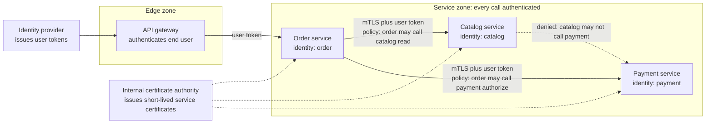

The diagram separates three trust questions: who is the end user (checked at the edge and carried inward), who is the calling service (the certificate), and is this pair allowed to perform this operation (policy). The denied dotted edge is the useful part. It shows that a compromised service is contained by policy and not by network position. The implication for design is that every new service-to-service edge needs a policy entry, so unreviewed edges are visible in code review. Part 15 covers detailed policy design.

### 10.4 Platform and cost

The platform is the set of shared capabilities that let a team create and run a service without rebuilding common parts: a service template with logging, tracing, health checks and security defaults; a standard pipeline; a runtime such as Kubernetes ([Deployments](../12_Kubernetes/CH02_Deployments.md)); a secret store; observability backends; and a self-service way to request them. The aim is a paved road that is easier to use than to avoid. Without it, forty services produce forty slightly different ways of doing deployment, logging, and certificate renewal, and every incident begins by finding out which way this service uses.

Platform work is itself a cost, usually requiring a team. A rough rule is that a platform team becomes worthwhile when the number of services or stream-aligned teams is large enough that the saved per-service effort exceeds the platform team's cost. The break-even depends on the organization, so it should be estimated with the organization's own figures.

Cost shows up in four places beyond engineers' time, and the first is often missed:

- **Fixed per-service infrastructure.** Each service typically runs at least two instances for availability, even when idle. Illustratively, if each instance reserves 0.25 virtual CPUs, one service reserves 0.5 CPUs, and 40 services reserve 20 CPUs before serving any traffic. A modular monolith runs the same capability with a few instances.
- **Network and data movement.** Calls and events that stayed in memory now cross a network, and cross-zone or cross-region traffic is billed by most cloud providers. See [Cloud Cost, Performance, and Sustainability Architecture](../10_Cloud_Architecture/CH13_Cloud_Cost_Performance_and_Sustainability_Architecture.md).
- **Telemetry volume and duplicated data.** Logs, metrics, and traces grow with the calls between services, and local copies (section 5.2) cost storage and a pipeline to keep them current.

Cost is a legitimate reason against the pattern, and a legitimate reason for it when independent scaling saves more than the overhead adds. The comparison should be made on illustrative workload data before extraction and checked afterward.

## 11. Failure and Quality-Attribute Scenarios

A quality-attribute scenario states a stimulus, the environment in which it arrives, the response the system should give, and a measure that decides whether the response was good enough. Writing scenarios turns statements such as "the system should be resilient" into tests that a design review and a game day can check. The scenarios below use the commerce example. All numbers are illustrative.

### 11.1 A downstream slowdown cascades upstream

**Stimulus.** The Inventory service's latency rises from about 40 ms to 5 s because its database is saturated. Inventory is still up and answering, only slowly.

**Environment.** Peak traffic. The Order service handles 200 requests per second, and each request calls Inventory once.

**Why it is dangerous.** A slow dependency is worse than a dead one, because a dead one fails fast. Little's law, which says the average number of requests in a system equals arrival rate times time in the system, gives the in-flight count at Order:

- Normal: 200 requests per second × 0.04 s = 8 concurrent Inventory calls.
- Slowed with no timeout: 200 × 5 s = 1,000 concurrent calls. If Order has a pool of 200 worker threads, the pool is exhausted after 200 / 200 = 1 second.
- Once the pool is exhausted, Order cannot serve requests that do not even need Inventory, such as order status, and the callers of Order begin to wait in turn.

```mermaid
flowchart TD
    subgraph Unprotected["Without protection"]
        U1["Inventory slows to 5 s"] --> U2["Order threads wait on Inventory"]
        U2 --> U3["Thread pool exhausted in about 1 s"]
        U3 --> U4["Order stops answering all requests"]
        U4 --> U5["Gateway and clients time out and retry"]
        U5 --> U6["Retry load worsens the overload"]
    end
    subgraph Protected["With timeout, breaker, bulkhead, fallback"]
        P1["Inventory slows to 5 s"] --> P2["80 ms timeout cuts each call"]
        P2 --> P3["Breaker opens after failure threshold"]
        P3 --> P4["Calls skip Inventory, answer availability pending"]
        P4 --> P5["Bulkhead keeps Inventory calls to a small pool"]
        P5 --> P6["Order keeps serving, orders accepted"]
    end
```

The diagram shows the same stimulus following two paths. In the unprotected path each step is a waiting resource that blocks the next layer, and retries then feed the overload. In the protected path the timeout bounds the time spent per call, the breaker stops the calls altogether, the bulkhead caps what Inventory can consume even before the breaker opens, and the fallback keeps the user-facing promise. The implication is that fault containment is built from several small mechanisms, each of which must be configured with numbers taken from the budget in section 7.2, and each of which must be exercised in tests.

**Response.** With an 80 ms timeout, in-flight Inventory calls are bounded at 200 × 0.08 = 16 per instance group, which fits a bulkhead pool of, say, 32. After the breaker opens, in-flight Inventory calls fall near zero. Orders are accepted with "availability pending", and stock is reserved when Inventory recovers, as in section 6.3. The breaker probes with a few trial calls and closes when they succeed.

**Measure.** During a 10-minute induced slowdown in a pre-production exercise: order acceptance stays at or above 99%, Order p99 latency stays under 300 ms from 10 seconds after onset, the Order thread pool never exceeds 50% use, and every order accepted as pending reaches a reserved or rejected state within 15 minutes of Inventory recovery. Part 13 covers [Chaos Engineering](../13_DevOps/CH17_Chaos_Engineering.md) for running this on purpose.

### 11.2 Worked availability arithmetic with and without the optional call

Take the gateway and Order service at 99.95% each, and Catalog, Pricing, and Inventory at 99.9% each, with independent failures.

- All five mandatory: 0.9995 × 0.9995 × 0.999 × 0.999 × 0.999 = 0.99900025 × 0.997003 ≈ 0.99601. Downtime is about 0.00399 × 43,200 ≈ 172 minutes per 30 days.
- Inventory off the critical path (fallback to pending): 0.99900025 × 0.998001 ≈ 0.99700. Downtime is about 0.00300 × 43,200 ≈ 130 minutes.

The saving is about 42 minutes per month, close to Inventory's own 43.2-minute budget, as expected: removing a hard dependency removes its whole contribution. The price is the intermediate "pending" state, which has to be agreed with the product owner, reported to users, and repaired by the stock reservation step. This is the typical shape of a quality-attribute trade-off in the pattern: availability is bought with a defined loss of immediacy.

### 11.3 Other scenarios worth writing

| Scenario | Stimulus | Response | Measure |
| --- | --- | --- | --- |
| Faulty release | A new Pricing build raises error rate | Canary stage detects the regression, traffic returns to the old version | At most 5% of traffic exposed, rollback within 5 minutes, error budget spend under 10% of the month |
| Breaking contract change | Provider removes a field a consumer reads | Provider pipeline fails the contract verification and blocks release | Zero production errors from the change, failure visible to the provider team within the pipeline run |
| Compromised service | Attacker controls Catalog and calls Payment | Policy denies the call and an alert fires | Denial on 100% of unauthorized calls, alert within 1 minute |
| Dependency outage | Catalog down for 30 minutes | Order serves from its local product copy | Order availability unchanged, copy staleness stays under the agreed lag of 5 s once Catalog recovers |

Each row should have an owner and a test. A scenario that is never exercised describes an intention and not a property of the system.

## 12. Worked Case Study: Harbor Goods

This case applies the chapter's reasoning to one hypothetical organization. Harbor Goods is invented for illustration, and every figure below is an assumption chosen to show the arithmetic, not data from a real company.

### 12.1 Starting position

Harbor Goods sells household goods online. One codebase and one database serve the whole platform, deployed as 30 identical instances at peak. Six teams (48 engineers) commit to it: Catalog, Pricing, Ordering, Inventory, Fulfillment, and Identity.

Measured problems at the start (assumed):

- Median lead time from merge to production is 9 days, and 38% of releases wait for another team's failing test.
- Peak traffic is 1,800 catalog reads per second and 120 order writes per second, a total of 1,920 requests per second. Catalog reads are about 94% of requests (1,800 / 1,920).
- One instance handles about 65 mixed requests per second, so peak needs 1,920 / 65 ≈ 29.5, rounded up to 30 instances. All 30 scale together although only the read path needs the capacity.
- Fulfillment integrates with warehouse systems through nightly batches and shares a database table with Inventory.

### 12.2 Decisions and rejected alternatives

| Decision | Reasoning | Rejected alternative and why |
| --- | --- | --- |
| Enforce module boundaries and data ownership inside the monolith first (8 weeks) | Cheap, reversible, and exposes which boundaries hold (section 4.1) | Immediate extraction: the Inventory and Fulfillment shared table showed the boundaries were not yet real |
| Extract Catalog as the first service | Distinct scaling profile (94% of traffic, read-only), a stable owner, few cross-boundary invariants | Extract Ordering first: it holds the invariants that cross Pricing and Inventory, so it carries the highest coordination cost |
| Keep Ordering, Pricing, and Inventory together as one core service | They change together and share the order-confirmation invariant, so splitting would need sagas for little gain | Split all into separate services: 3 more services, 3 more on-calls, and a saga for confirmation, with no scaling or release force |
| Keep Fulfillment as a module | One regional team, batch-based integration, no distinct scaling need | Extract now: the shared table would have to be unpicked first, and the operations cost has no matching benefit |
| Ordering reads Catalog with an 80 ms timeout and a fallback only when its local copy lacks a product | Keeps order availability from depending on a second service on the critical path (section 11.2) | Mandatory synchronous read on every order: each mandatory dependency removes roughly its own downtime budget from the path |
| Catalog publishes versioned contracts and change events, and Ordering stores a small local product copy | Orders work while Catalog is down, and staleness is bounded to seconds (section 5.2) | Shared database: couples schemas and breaks independent deployment |
| Use a strangler router with shadow traffic, canary, and a flag for rollback | Cutover is reversible in seconds (section 9.4) | Big-bang rewrite: no way back and no evidence before commitment |

A full split into twelve services was also rejected on organizational grounds: six teams cannot own and be on call for twelve services (section 9.1).

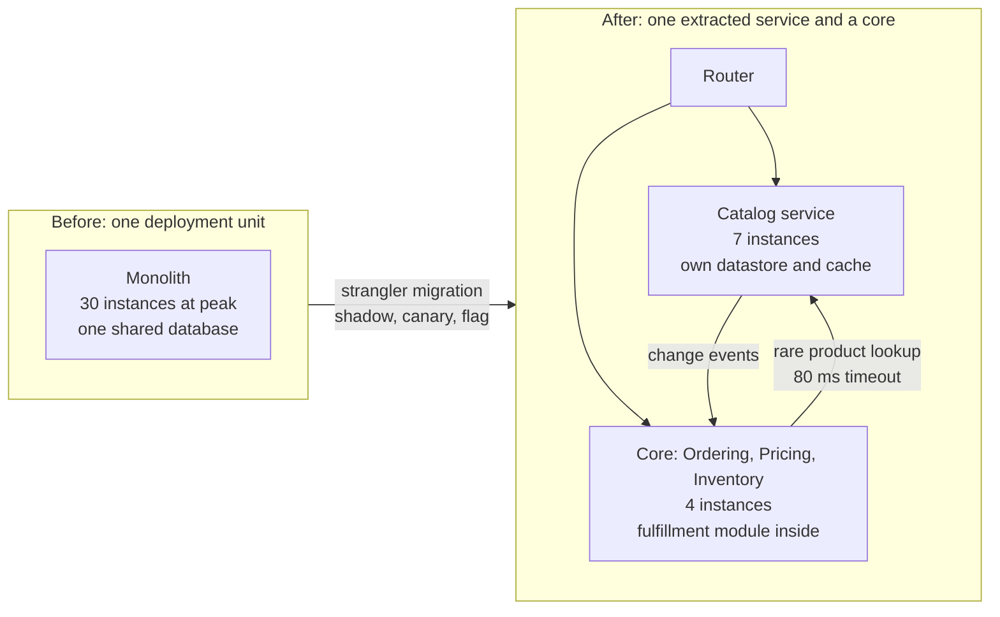

The diagram shows the end state of the first migration wave: one service extracted, a deliberately larger core retained, and a router that stays in place for the next candidate. The implication is that the architecture is decided per boundary, and the shape after the wave is still a system a six-team organization can operate. The arrow from the core to Catalog is a bounded synchronous call, and the reverse arrow carries events, matching the data-ownership rule. Inventory stays inside the core, so the stock check is an in-process call. The timeout and fallback pattern of section 6.3 would apply to it only if Inventory were extracted later.

### 12.3 Sizing arithmetic

After extraction, the Catalog service is read-only and cache-friendly. Assume one instance handles 300 requests per second. Peak catalog load is 1,800, so 1,800 / 300 = 6 instances, plus one for failure tolerance, which gives 7. The core now sees 120 writes per second plus a small read load. Assume 40 requests per second per instance for these heavier operations: 120 / 40 = 3, plus one spare gives 4. The extraction adds a router and a cache tier, assumed at 3 instance-equivalents.

| Item | Before | After |
| --- | --- | --- |
| Peak instances | 30 | 7 + 4 + 3 = 14 |
| Instance-hours per 30-day month | 30 × 720 = 21,600 | 14 × 720 = 10,080 |
| Saving | | 21,600 − 10,080 = 11,520 hours, or 53% |

The table is a bound that confirms direction and is not a forecast, because real usage depends on autoscaling. The costs are one new pipeline, one on-call rotation, telemetry, and eight weeks of module work. The case rests on whether the saving and the Catalog team's release independence outweigh them.

### 12.4 Validation evidence

The team defined success measures before cutover and collected evidence at each stage.

- **Shadow comparison.** Over 7 days, the new Catalog service received a copy of 40 million read requests. Responses matched the monolith on all but 8,000 requests, which is 8,000 / 40,000,000 = 0.02%. The team classified the differences: cache refresh timing, and two product fields that the monolith computed differently. Both were fixed or accepted before canary.
- **Canary.** 5% of reads, then 25%, 50%, and 100%, each step held for at least one daily peak. The rule was error rate within 0.1 percentage points of the old path and p99 read latency not higher than the old path's.
- **Reversibility test.** The team set the flag to 0% during the 50% step on purpose and confirmed traffic returned to the monolith within 30 seconds.
- **Autonomy.** Over the eight weeks after cutover, the Catalog team made 14 production releases, and none needed another team to release. Median lead time for Catalog changes fell from 9 days to 2 days (assumed figures).
- **Failure test.** A pre-production exercise made Catalog unavailable for 30 minutes. Orders continued from the local product copy, and the copy's staleness returned to under 5 seconds after recovery.
- **Cost.** After a full month, the measured instance-hours were compared with the 10,080 estimate, and the team recorded the difference and its cause.

If the measured autonomy gain or cost saving had not matched expectations, the reversal path in section 9.3 applied: route back and merge Catalog into the core. Fulfillment stays a module until a regional team, an operational boundary, or a scaling profile creates a force that the pattern can answer.

## 13. Common Mistakes and Anti-Patterns

Each mistake below has a cause and a consequence. Most of them keep the costs of section 7 and give up the benefits of section 3.

### 13.1 Distributed monolith

**Cause.** Services were split by technical layer or by code size, without independent data, contracts, or release practice. They call each other in long synchronous chains and must be released in a fixed order.

**Consequence.** The system pays network latency, partial failure, and operational overhead and gets none of the autonomy. A change still needs several teams and a coordinated release. The test is the independence check in section 2.2: if any check fails for most services, the system is a distributed monolith.

### 13.2 Shared database

**Cause.** Services were separated at the code level for speed, but kept one schema because data migration looked hard, or because reports needed joins.

**Consequence.** The schema is an unversioned contract with every service. A column rename breaks consumers nobody knew about, and teams stop changing the schema, so autonomy ends. Lock contention and one team's heavy query also affect every service. The remedy is the data-ownership rule of section 5, applied gradually: separate schemas and credentials first, then events or APIs in place of cross-schema queries.

### 13.3 Chatty services

**Cause.** Boundaries were drawn around entities (a "customer service", an "address service") so that rendering one page needs many fine-grained calls.

**Consequence.** Latency adds per hop, and the tail grows with fan-out (section 7.2). Availability falls with each mandatory edge (section 7.1). For example, a page that needs 12 sequential calls of 20 ms each spends 240 ms on calls before doing any work. The remedy is to merge services that always change and are used together, to return coarser results, or to keep local copies of reference data.

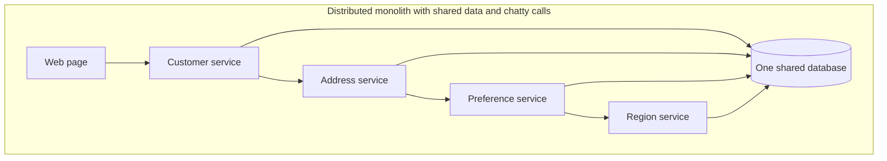

The diagram shows four services in a chain that all read one database. Every request pays four hops, the services cannot be released independently because they share the schema, and a slowdown in any one of them delays the page. The implication is that the picture contains the whole set of costs and none of the benefits, so merging the four into one service with one data store would improve latency, availability, and release independence at the same time.

### 13.4 Other common mistakes

- **Splitting before the domain is understood.** Wrong boundaries become contracts and schemas (section 4.4).
- **No platform.** Every team rebuilds pipeline, logging, and certificates, so incidents take longer (section 10.4).
- **Synchronous everywhere.** Availability becomes the product of all services (section 7.1).
- **Retries at every layer.** A transient failure becomes multiplied load (section 7.3).
- **Version-less contracts.** Breaking changes ship in place and consumers fail in production (section 8).
- **Ownerless services.** A service without an owning team stops being patched and causes the next incident.
- **Counting services as progress.** Measure lead time, release independence, availability, and cost instead.

## 14. Pattern Comparison and Trade-Offs

The table compares the microservices pattern with its nearest alternatives on the dimensions that decide the choice. The ratings are relative and describe typical outcomes in a well-run implementation of each, not guarantees.

| Dimension | Modular monolith | Service-based (a few coarse services) | Microservices | SOA (enterprise service reuse) |
| --- | --- | --- | --- | --- |
| Deployment units | One | Three to ten | Many, one per capability | Many, often tied to shared middleware |
| Independent release | Low: whole unit ships together | Medium | High if contracts and pipelines are sound | Medium: shared services and bus need governance |
| Independent scaling | None per module | Per coarse service | Per service | Per service, bounded by shared infrastructure |
| Data ownership | Per module, one database | Often a shared database | One store per service | Often shared or canonical models |
| Transactions across parts | Local, simple | Local within a service, shared database across | Sagas or accepted inconsistency | Often distributed transactions or orchestration in the bus |
| Failure isolation | Low: one process | Medium | High if timeouts, breakers, and bulkheads exist | Medium: shared bus is a common failure point |
| Operational cost | Lowest | Moderate | Highest per capability | High, centralized |
| Latency per request | Lowest | Low | Higher: network hops | Higher: mediation hops |
| Team fit | One to a few teams | A few teams | Many autonomous teams | Central integration team plus service teams |
| Main risk | Boundaries erode | Shared data couples services | Distributed monolith, operational overload | Central governance bottleneck |

The comparison shows that the cost of each step toward independence is paid in operations and consistency, and that the benefit is paid back only where the forces in section 3 are present. [SOA](CH06_SOA_Service_Oriented_Architecture.md) is listed for contrast and is owned by its own chapter. [Cell-Based Architecture](CH18_Cell_Based_Architecture.md) is not an alternative in the table because it complements services: it replicates a whole stack in isolated cells to limit blast radius.

If the left column meets the goals, stay left, and extract only the capability that needs independence.

## 15. Design-Review Checklist

Use this list when reviewing a proposal to adopt the pattern or to add a service. Each item should be answerable with evidence, not opinion.

**Justification**

- [ ] The binding force is named and measured (lead time, scaling gap, isolation need), not assumed.
- [ ] A modular monolith alternative was costed and the reason it is insufficient is recorded.
- [ ] The extraction has a measurable goal and a defined way back.

**Boundaries and data**

- [ ] Each service maps to one business capability or bounded context and one owning team.
- [ ] The boundary was tested against recent change requests, and few requirements touch three or more services.
- [ ] Each service is the only writer of its data, with separate credentials.
- [ ] Cross-boundary invariants are listed, and each has a coordination mechanism and a defined intermediate state.
- [ ] Reporting and cross-service queries use read models or an analytics pipeline, not shared tables.

**Communication and resilience**

- [ ] Each dependency is classified as mandatory or optional, with a defined failure behaviour.
- [ ] Path availability and latency were computed from the mandatory chain, with per-call deadlines.
- [ ] Timeouts, retries with budgets and jitter, circuit breakers, and bulkheads are specified with numbers.
- [ ] Consumers handle duplicate and reordered messages, and operations that can be retried are idempotent.

**Delivery**

- [ ] Each service has its own pipeline and can roll back alone.
- [ ] Contracts are versioned, changes follow expand-migrate-contract, and contract tests run in the provider pipeline.
- [ ] Feature flags have owners and removal dates.

**Operations and security**

- [ ] Trace propagation, structured logs, and per-service dashboards are in the service template.
- [ ] Service SLOs are derived from a user-journey SLO, with error budgets.
- [ ] Each service has its own identity, per-pair authorization, and secrets from a secret store.
- [ ] A platform provides the paved road, and per-service recurring cost and telemetry cost are estimated.
- [ ] Every service has an on-call owner, and the team count can sustain the service count.

## 16. Exercises

Each exercise has a short answer outline. Attempt it before reading the outline.

**1. Independence test.** A team says its five services are microservices. They share one database schema, and a release needs all five to ship together. Apply the four checks of section 2.2.
*Outline.* Checks 1 and 2 fail: a change touching the schema needs the other services, and rollback needs all five. Check 3 fails if consumers read shared tables, and check 4 is unlikely without contract tests. The system is a distributed monolith (section 13.1). First steps: separate schemas and credentials, introduce contracts, then pipelines.

**2. Path availability.** A request needs six mandatory services, each at 99.95%. The target is 99.9%. Does the design meet it?
*Outline.* 0.9995^6 ≈ 0.99700, so about 99.70%, or 0.00300 × 43,200 ≈ 130 minutes per 30 days against an allowed 43.2. It fails. Options: shorten the mandatory path, replace calls with local copies, or add degraded modes. Removing three mandatory calls gives 0.9995^3 ≈ 0.99850, still below target, so a mix of options is needed.

**3. Latency budget.** The p99 target is 400 ms. The gateway takes 25 ms and the service's own work 40 ms. Three sequential calls have p99 of 60, 80, and 100 ms. Does it fit, and what happens if the last call is retried once on timeout?
*Outline.* 25 + 40 + 60 + 80 + 100 = 305 ms, leaving 95 ms. One retry of the 100 ms call adds up to 100 ms, giving 405 ms, which exceeds the target. Fixes: call in parallel where independent, set a total deadline so a retry is not started when it cannot finish, or cache the slow call's result.

**5. Compatible change.** The `customerName` field must become `fullName`, and three consumers read it. Plan the change.
*Outline.* Expand: provider returns both fields. Migrate: each consumer switches on its own release, and the provider measures remaining reads from the contract store and telemetry. Contract: remove `customerName` after reads reach zero and a hold period at least as long as the slowest consumer's cycle. Rollback is possible until the last step (section 8.4).

**6. Boundary test.** Two proposed services both write the same `product` table. Should they stay separate?
*Outline.* Both own the same data, so neither is the single writer. Either choose one owner and make the other call it or consume its events, or merge them. Check recent change requests: if most touch both, merge. If they change independently, keep both and split the table by ownership.

**7. Migration ramp.** A read endpoint serves 600 requests per second. The acceptance rule needs at least 3,000 requests per canary step. How long does a 5% step take, and what else limits the ramp?
*Outline.* 5% of 600 is 30 requests per second, so 3,000 / 30 = 100 seconds. Volume is not the limit. Rare events, daily peaks, and batch cycles are, so hold steps across at least one peak. The rollback flag must be tested during the ramp (section 9.4).

**8. Adoption decision.** A team of four engineers proposes fifteen services for a new product with an unclear domain. What do you advise?
*Outline.* No force justifies it: one team means no coordination gain, an unclear domain means unstable boundaries, and fifteen services exceed what four people can operate (sections 3.2 and 9.1). Advise a modular monolith with enforced module boundaries, and revisit extraction when a measured force appears.

## 17. Summary

The chapter's learning outcomes from section 1 map to the material as follows.

1. **Independent deployability.** A service is independently deployable only if it passes the four checks of section 2.2. Separate pipelines, compatible change, contract tests, and flags (section 8) are what make the checks pass in practice.
2. **Forces for and against splitting.** Team coordination cost, different change and scaling rates, security boundaries, and fault containment favour splitting. An unstable domain, chatty interactions, strong cross-boundary invariants, missing operations capability, and small teams argue against it (section 3). The decision procedure and the modular monolith alternative are in section 9.
3. **Boundaries.** Business capabilities and bounded contexts give candidate boundaries, and recent change requests and invariant crossings test them (section 4). Start coarse and split on evidence.
4. **Data ownership.** One writer per fact, enforced by separation of schemas and credentials. Other services use a synchronous read, an event-fed local copy, or a read model (section 5).
5. **Communication.** The style is chosen per interaction by whether the caller needs the result, how fresh the data must be, whether retry is safe, and what happens when the other side is down (section 6).
6. **Cost model.** Serial availability multiplies, the latency tail grows with fan-out, retries amplify load, and recurring operational work grows with service count (section 7). Scenarios, the case study, and the checklist (sections 11, 12, and 15) apply the arithmetic to design reviews.

Three habits carry the chapter. Name the force and measure it before extracting. Treat each extraction as a reversible experiment with a stated goal, using the strangler approach and a rollback flag. Count the cost of every mandatory synchronous edge and every service as a recurring charge. Microservices are justified by measurable autonomy, scaling, or isolation needs, and not by fashion or code size.
