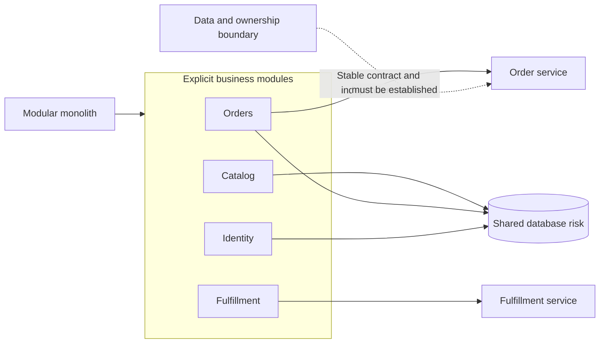
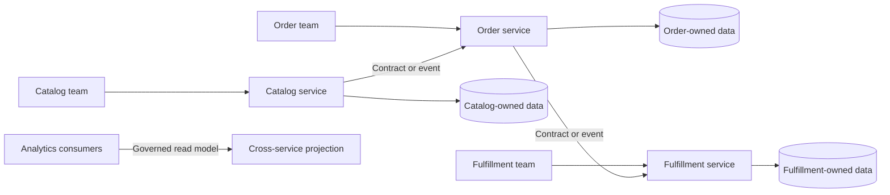
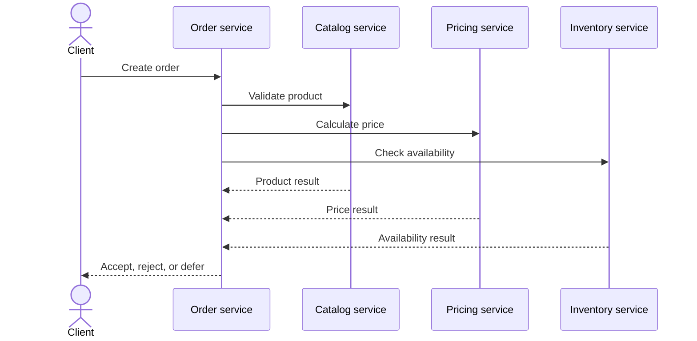
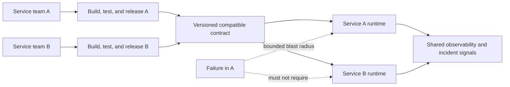
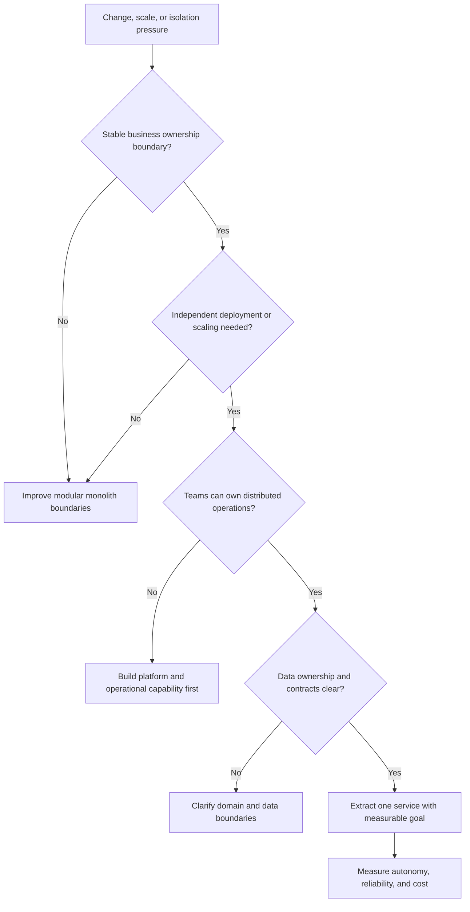

# Microservices

Part: [20 — Architecture Patterns](PART_OVERVIEW.md)

Microservices are independently deployable services organized around business capabilities or bounded responsibilities. They typically own data and communicate over networks. Their value is autonomy in change and scaling; their cost is distributed operation, data coordination, observability, and reliability work. Part 07 owns distributed-systems semantics, Part 10 owns cloud composition, and Part 12 owns Kubernetes mechanics.

## Decompose Around Ownership and Change

Service boundaries should align with capabilities, domain language, and teams that can own design through operation. A service split is justified when independent change, scaling, security, or failure isolation outweighs network and coordination costs. Extracting classes into remote calls without clarifying ownership creates a distributed monolith.

Begin with modular boundaries even when deployment remains unified. Extract when team autonomy, deployment cadence, scaling profile, security boundary, or fault containment demands it. Preserve a migration path and contract tests; a premature service split can make local changes slower and harder to validate.

## Establish Service and Data Ownership

Each service should own the data it changes and expose capabilities through contracts rather than allowing every other service to write its tables. Ownership enables independent evolution but creates consistency and reporting challenges. Define which service is authoritative for each business fact and how consumers learn about changes.

Avoid shared-database writes across services. If a temporary shared store is needed during migration, define ownership, access rules, and a removal plan. Cross-service reporting should use an explicit projection or data product rather than coupling queries to every operational schema.

## Control Synchronous Dependency Fan-Out

Synchronous calls are useful when the caller needs an immediate answer, but latency and failure dependencies accumulate. A service that fans out to many dependencies inherits their tail behavior and capacity limits. Prefer local decisions or asynchronous workflows when the user contract permits, and define timeout, retry, and degraded behavior at each boundary.

The path can become brittle when one nonessential service is required synchronously. Classify dependencies as mandatory or optional, set a total deadline, and avoid retry multiplication. Part 07 owns detailed resilience semantics; this pattern decision concerns whether the interaction belongs in the synchronous request path at all.

## Make Deployment Autonomy Real

Independent deployment requires compatible contracts, ownership, observability, release controls, and operational support. If every service must release in lockstep because of shared schemas or hidden assumptions, the architecture has not achieved useful autonomy. Smaller service units can increase deployment count, infrastructure overhead, and support burden.

Validate autonomy by checking whether teams can deploy and roll back independently under realistic contract evolution. Observability, on-call, dependency upgrades, and security patching must scale with the service fleet. A small service with a large operational tax may be better combined with a cohesive neighbor.

## Decide Whether the Pattern Fits

Compare the current monolith or modular monolith with a service-based alternative. Consider domain volatility, team count, deployment coupling, scaling differences, data ownership, latency, failure isolation, regulatory boundaries, and operational maturity. The decision should identify the capability gained and the recurring cost accepted.

Prefer incremental extraction around a clear boundary. Migrate one capability, preserve behavior through contract tests, and measure deployment lead time, failure rate, scaling benefit, and operating cost. Stop extracting when the marginal autonomy benefit no longer exceeds the added distributed-system burden.

## Worked Case: Commerce Platform

A commerce platform has one codebase with clear order, catalog, and fulfillment modules. Catalog traffic is highly read-heavy and has a different release cadence; fulfillment integrates with warehouses and has regional operational ownership. The team first enforces module boundaries and data ownership inside the monolith. It extracts catalog only after demonstrating independent scaling and release value.

Orders retain authoritative order state. Catalog exposes versioned product contracts and change events. The team handles a temporary synchronous availability check with a bounded deadline and an explicit “availability pending” response. It measures release independence, read latency, cache invalidation, incident load, and platform cost. Fulfillment remains a module until a separate team and operational boundary justify its extraction.

## Review Questions

1. What capability or autonomy does a service boundary create?
2. Which service owns each business fact and write path?
3. What fan-out and dependency behavior enters the user-facing critical path?
4. Can teams deploy independently while evolving contracts safely?
5. How should the organization measure whether extraction was worth its operating cost?

Microservices are justified by measurable autonomy, scaling, or isolation needs—not by fashion or codebase size. Establish ownership and contracts first, account for synchronous failure paths, and extract incrementally only when teams can operate the resulting system.
