# SOA: Service-Oriented Architecture

Part: [20 — Architecture Patterns](PART_OVERVIEW.md) · Status: Revised (in-depth rewrite)

## 1. Introduction

Service-Oriented Architecture (SOA) is an architectural style in which an organization exposes its business and technical capabilities as services. Each service has an explicit, published contract, and consumers depend on that contract instead of on the provider's code, database, or deployment. The style grew out of a practical problem: large enterprises ran dozens of packaged and custom applications, each integrated to the others through its own private connection, and every change to one application broke several neighbors. SOA proposed a shared vocabulary of services, shared rules for describing and securing them, and a governance process so that capabilities could be reused instead of rebuilt.

SOA is often described through its most visible artifact, the Enterprise Service Bus (ESB). That description is incomplete. The ESB is one possible mediation mechanism, and a system can follow service-oriented principles without one. This chapter separates the style from the product category so that you can judge which parts of the style still earn their cost.

After this chapter you will be able to:

- State the forces that make SOA a reasonable choice, and the forces that make it expensive.
- Apply the service-orientation principles and explain what each one costs in practice.
- Classify services by role, design contracts at a sensible granularity, and decide where business logic is allowed to live.
- Explain what an ESB does, trace a request through it, and choose between orchestration and choreography for a given process.
- Evaluate a canonical data model, including the coupling it creates and the cases where it pays for itself.
- Describe a governance and service registry process that controls change without freezing it.
- Compare SOA with microservices on ownership, data, change cadence, and failure boundaries, and avoid deciding from the label alone.

Ownership boundaries for this chapter:

| Topic | Owner |
|---|---|
| Microservices decision forces, decomposition, data ownership per service | [CH05 Microservices](CH05_Microservices.md) |
| Event-driven design, brokers, event contracts | [CH07 Event-Driven Architecture](CH07_Event_Driven_Architecture.md) |
| Representational State Transfer (REST) and OpenAPI contract mechanics, Application Programming Interface (API) versioning | [Part 08 CH01 REST](../08_API_Architecture/CH01_REST.md), [Part 08 CH07 OpenAPI](../08_API_Architecture/CH07_OpenAPI.md), [Part 08 CH10 Versioning](../08_API_Architecture/CH10_Versioning.md) |
| Enterprise architecture governance and application portfolio | [Part 18 CH05 Application Architecture](../18_Enterprise_Architecture/CH05_Application_Architecture.md), [Part 18 CH08 Architecture Governance](../18_Enterprise_Architecture/CH08_Architecture_Governance.md) |
| Service orientation principles, service roles, ESB mediation, orchestration versus choreography, canonical data models, service governance as it applies to SOA | This chapter |

The contract mechanics of Simple Object Access Protocol (SOAP) and REST are covered in Part 08. This chapter uses them only far enough to reason about coupling and governance. Numbers in worked scenarios are illustrative and chosen to show the arithmetic, not measured from any real system.

## 2. The Foundational Model

### 2.1 Forces and context

SOA is a response to a specific set of forces. It is worth listing them, because a team that does not face them is unlikely to benefit from the style.

- Many applications, acquired and built over decades, run on different platforms and protocols and cannot be rewritten together.
- The same business capability (for example, "look up a customer" or "calculate tax") is needed by several applications and several business units.
- Business processes cross application boundaries, so a change in the process touches several systems.
- Security, audit, and compliance rules must be applied uniformly, and applying them inside each application separately produces gaps.
- Different parts of the organization have different release cadences and budgets, so integration must tolerate independent change.

When these forces are weak, for example one product built by one team, a service-oriented structure adds contracts, registries, and review without removing any pain. When they are strong, the alternative is point-to-point integration, which grows with the square of the number of systems. The section on canonical data models shows the arithmetic.

### 2.2 Structure and responsibilities

A service-oriented system has four kinds of participant. A service provider implements a capability and owns its data and behavior. A service consumer calls the capability through its contract. A service registry holds the published contracts, versions, owners, and support policies so consumers can find and assess a service. A mediation layer, when present, performs protocol translation, routing, and policy enforcement between consumers and providers. Around these sits governance: the people and rules that decide which services exist, who may change a contract, and how consumers are told.

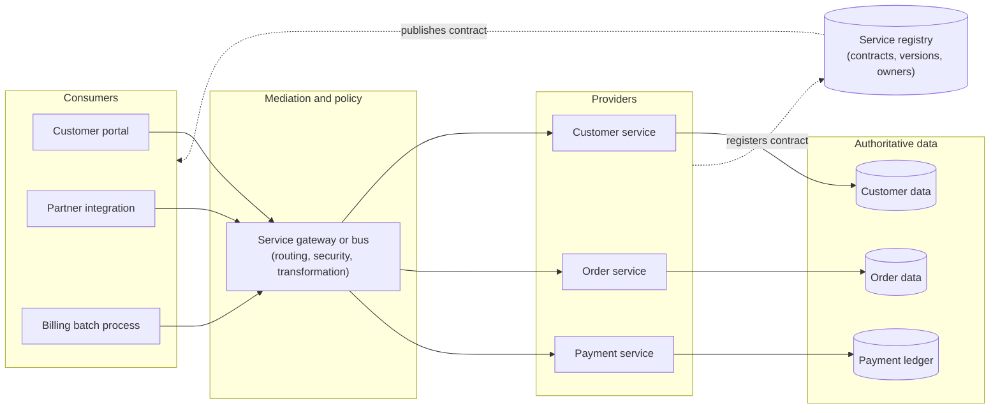

The diagram shows two separations that define the style. First, consumers never reach a provider's data store, so each datum has one authoritative owner and one place where its rules are enforced. Second, the registry and the runtime path are different things: the registry is a design-time and governance artifact, while the mediation layer sits on the runtime path. Confusing the two produces the common mistake of putting heavy runtime logic into a component that was meant to be a catalog. The implication for operations is that the mediation layer, if it exists, becomes a dependency of every call, so its availability and capacity bound everything behind it.

### 2.3 How a request flows

Consider a portal that shows a customer's open orders with their payment status. The consumer sends a request to the mediation layer, which authenticates the caller, checks that the caller's identity may use the Order service, and routes the call. The Order service calls the Customer service to validate the customer, then reads its own data. Payment status comes from a second call to the Payment service. Each hop crosses a contract, so each hop has a timeout, a failure mode, and a version.

Two properties of this flow drive most of the later reasoning. Latency adds up across hops, and availability multiplies. If each of three services sits on a path and each has 99.9% availability, the path availability is at most 0.999 × 0.999 × 0.999 = 0.997, about 0.3 percentage points lower than any single service, ignoring the mediation layer. Adding a bus at 99.9% brings it to 0.999^4 = 0.996. Neither figure is bad for a back-office process. Both are a problem for a customer-facing page that must reach 99.95%. The arithmetic is why SOA designs for customer-facing paths keep the call depth shallow and cache read-mostly data.

### 2.4 Variants

SOA has no single canonical shape. The variants differ mainly in where mediation lives and how much logic the mediation layer holds.

| Variant | Mediation | Typical use | Main risk |
|---|---|---|---|
| Point-to-point services | None, consumers call providers directly | Few services, one team | Connection count grows quickly |
| Hub-and-spoke ESB | One central bus runs routing, transformation, and often orchestration | Legacy integration under one integration team | Bus becomes bottleneck and owner of business logic |
| Federated or domain buses | One lightweight bus or gateway per domain | Large enterprises with business-unit autonomy | Inconsistent policy between domains |
| Gateway plus direct service calls | Gateway handles security and routing only, logic stays in services | Modern service estates | Teams skip the gateway for internal calls |

The last row is where many organizations end up after discovering the cost of the first two. The section on the Enterprise Service Bus explains why.

## 3. Service-Orientation Principles and What They Cost

Thomas Erl's SOA books list eight design principles that became the common vocabulary of the style: standardized service contract, loose coupling, abstraction, reusability, autonomy, statelessness, discoverability, and composability. Other authors group them differently. What matters for an architect is the mechanism behind each principle and the price paid for it.

### 3.1 The principles as design constraints

| Principle | What it asks for | Mechanism | Cost |
|---|---|---|---|
| Standardized service contract | Services in one estate describe themselves with the same conventions | Shared contract language, naming, error model, security policy | Review effort, and friction with teams who prefer their own conventions |
| Loose coupling | Consumers depend on the contract, not on provider internals or location | Interface plus mediation or lookup, no shared database | Indirection adds latency and a place for mistakes |
| Abstraction | The contract hides how the capability is implemented | Coarse operations, business terms, no leaked table structure | Contracts that hide too much force consumers into many calls or workarounds |
| Reusability | A service is designed for use by consumers beyond the first | Generic operations, shared funding, support model | Generality costs design time and slows the first consumer |
| Autonomy | A service controls its own runtime and data | Own deployment, own store | Duplicated infrastructure, data synchronization questions |
| Statelessness | A call carries what the service needs, and the service keeps no conversation state between calls | Context in the message, state in a store | Larger messages, more reads |
| Discoverability | Consumers can find and assess a service without asking the author | Registry entries with owner, version, policy, examples | Entries decay unless maintained |
| Composability | Services can be assembled into larger processes | Small stable contracts, consistent error handling | Composition multiplies failure paths |

Three of these principles pull against each other, and most real design decisions are decisions about the tension.

Reusability pulls against autonomy. A service reused by twelve consumers is a dependency of twelve release plans. To change it safely the owner must coordinate, and coordination is the opposite of autonomy. The usual resolution is to reuse only where the capability is genuinely common and stable, such as identity lookup or currency conversion, and to accept duplicated, domain-specific logic elsewhere.

Abstraction pulls against performance. A contract that exposes `getCustomer` hides the structure of the customer data, but a consumer that needs only a postal code now receives the whole record. Contracts that are too fine-grained create the opposite problem: a consumer needs five calls for one screen. Granularity is discussed in the section on taxonomy and contracts.

Loose coupling pulls against standardization. A shared canonical format reduces the number of translations but couples every participant to the format. The section on canonical data models returns to this.

### 3.2 Coupling is a property of the contract, not the protocol

A common misreading is that using SOAP, or REST, or messaging makes a system loosely coupled. Coupling comes from what the consumer must know. A consumer that must know the provider's operation order, internal identifiers, field encodings, or retry quirks is tightly coupled whatever the transport. A consumer that needs to know only a business-level operation, its inputs and outputs, and its documented failures is loosely coupled even over a synchronous call.

A practical test is a change scenario. Ask what happens to consumers when the provider (a) splits its database, (b) moves to another data center, (c) adds an optional field, (d) renames an internal status code. In a loosely coupled design the first two cause no consumer change, the third is ignored by tolerant consumers, and the fourth is invisible because internal codes never appear in the contract. If the answers differ, the contract leaks.

Statelessness deserves a short example. A service that expects consumers to call `startSession`, then `addItem` several times, then `commit` has conversation state. The provider must keep that state somewhere, usually in memory, which ties a consumer to one instance and makes failover lose work. A stateless version takes the full list in one call, or takes an identifier for a draft stored in a shared store:

```java
// Spring Boot (Java 21): the draft is addressed by id, so any instance can serve any call.
@RestController
@RequestMapping("/orders")
class OrderController {
    private final DraftStore drafts;
    private final OrderService orders;

    OrderController(DraftStore drafts, OrderService orders) {
        this.drafts = drafts;
        this.orders = orders;
    }

    @PutMapping("/drafts/{draftId}/items")
    ResponseEntity<Void> replaceItems(@PathVariable String draftId,
                                      @RequestBody List<OrderItem> items) {
        drafts.save(draftId, items);      // idempotent: same body, same result
        return ResponseEntity.noContent().build();
    }

    @PostMapping("/drafts/{draftId}/commit")
    ResponseEntity<OrderConfirmation> commit(@PathVariable String draftId) {
        return ResponseEntity.ok(orders.placeFrom(drafts.load(draftId)));
    }
}
```

The service holds no in-memory session. Replacing the full item list makes the call idempotent, which means a consumer that retries after a timeout cannot add items twice. That property matters in the discussion of orchestration, where retries are routine.

### 3.3 Where the principles stop applying

The principles describe a service estate, not every module in a codebase. Applying reusability to an internal helper, or abstraction to every table, yields services nobody needs. A workable rule is to apply the full set to services that cross a team or business-unit boundary, and to treat everything inside a boundary as ordinary software design governed by the patterns in [CH01 Layered Architecture](CH01_Layered_Architecture.md) and [CH02 Hexagonal Architecture](CH02_Hexagonal_Architecture.md).

## 4. Service Taxonomy and Contracts

### 4.1 Service roles

Not every service has the same job, and treating them alike produces either a thin layer of pointless wrappers or business rules scattered across the estate. A common classification, used with variations in the SOA literature, separates services by the kind of logic they hold.

| Role | Holds | Example | Owner |
|---|---|---|---|
| Entity (or data-centric) service | Access to one business entity and the rules that protect its integrity | Customer service, Product service | Team that owns the entity's data |
| Task (or business) service | One business action across a small number of entities | Place order, Approve credit | Team that owns the business capability |
| Process (or orchestration) service | A long-running business process that sequences task services | Order-to-cash | Process owner |
| Utility service | A technical capability without business meaning | Notification sender, Document converter | Platform team |

The classification matters because it says where logic may live. An entity service enforces invariants of its entity, such as "a customer cannot be deleted while open orders exist." A task service composes entity services for one business purpose. A process service coordinates over time and keeps process state. Utility services hold no business rules.

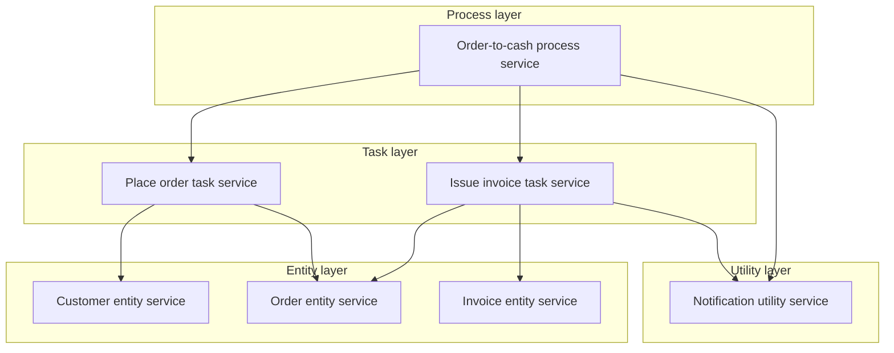

The layering shows the permitted direction of calls: processes call tasks, tasks call entities, and everyone may call utilities. Entity services never call upward. That rule keeps invariants in one place and avoids cycles. The cost is call depth. A single "place order" request in this diagram passes through the process service, the task service, and two entity services, which is where the availability arithmetic from the foundational model bites. Many estates flatten the layers for latency-sensitive paths, letting a consumer call a task service directly. The architectural position is that a layer is allowed to be skipped but a dependency is not allowed to point upward.

### 4.2 Granularity

Granularity is the main design decision inside a contract. The trade-off is between chattiness and over-sharing.

A fine-grained operation such as `getPostalCode(customerId)` has a tiny payload and a very specific meaning, but a screen that needs name, address, and status needs three round trips. A coarse-grained operation such as `getCustomerSummary(customerId)` returns a purpose-built summary in one trip, but must be changed whenever any consumer needs an additional field, and risks becoming a catch-all.

A useful heuristic is to shape operations around business questions the consumer asks, not around the provider's tables. If consumers regularly ask "what is the customer's billing address and payment terms," then a `getBillingProfile` operation is the contract, and the provider is free to assemble it from three tables or one external system. Consider the latency effect with a calculation. Suppose each round trip over the mediation layer costs 25 ms (illustrative). Three fine-grained calls cost 75 ms in sequence, and the one coarse call costs 25 ms plus a few milliseconds of server-side assembly. Parallelizing the three calls brings them near 25 ms but triples the load on the bus and raises the chance that one fails. The coarse operation wins when the same combination is requested often, and the fine operation wins when consumers use fields independently.

### 4.3 What a contract contains

A contract is more than an interface signature. A complete service contract states:

- Operations and message structures, with data types and constraints.
- Semantics: what each field means, units, time zones, and whether values may be null.
- Fault model: which errors can occur, which are retryable, and what each means.
- Security requirements: authentication method, required claims or roles.
- Non-functional commitments: expected latency, availability target, rate limits, maximum payload size.
- Versioning and deprecation policy.
- Owner and escalation contact.

The first two items are machine-checkable. The remainder are text, and a contract with only the first two items leaves consumers guessing about the behavior that causes most production incidents.

In classic SOA the machine-readable part is a Web Services Description Language (WSDL) document that describes a Simple Object Access Protocol (SOAP) service, with message structures defined in XML Schema Definition (XSD). A trimmed WSDL 1.1 fragment shows the structure:

```xml
<definitions name="CustomerService"
    targetNamespace="urn:example:customer:v2"
    xmlns="http://schemas.xmlsoap.org/wsdl/"
    xmlns:tns="urn:example:customer:v2"
    xmlns:xsd="http://www.w3.org/2001/XMLSchema"
    xmlns:soap="http://schemas.xmlsoap.org/wsdl/soap/">
  <types>
    <xsd:schema targetNamespace="urn:example:customer:v2"
                elementFormDefault="qualified">
      <xsd:element name="GetBillingProfileRequest">
        <xsd:complexType><xsd:sequence>
          <xsd:element name="customerId" type="xsd:string"/>
        </xsd:sequence></xsd:complexType>
      </xsd:element>
      <xsd:element name="GetBillingProfileResponse">
        <xsd:complexType><xsd:sequence>
          <xsd:element name="legalName" type="xsd:string"/>
          <xsd:element name="paymentTermsDays" type="xsd:int"/>
        </xsd:sequence></xsd:complexType>
      </xsd:element>
    </xsd:schema>
  </types>
  <message name="GetBillingProfileIn">
    <part name="body" element="tns:GetBillingProfileRequest"/>
  </message>
  <message name="GetBillingProfileOut">
    <part name="body" element="tns:GetBillingProfileResponse"/>
  </message>
  <portType name="CustomerPort">
    <operation name="GetBillingProfile">
      <input message="tns:GetBillingProfileIn"/>
      <output message="tns:GetBillingProfileOut"/>
    </operation>
  </portType>
  <binding name="CustomerBinding" type="tns:CustomerPort">
    <soap:binding style="document"
                  transport="http://schemas.xmlsoap.org/soap/http"/>
    <operation name="GetBillingProfile">
      <soap:operation soapAction="urn:example:customer:v2:GetBillingProfile"/>
      <input><soap:body use="literal"/></input>
      <output><soap:body use="literal"/></output>
    </operation>
  </binding>
  <service name="CustomerService">
    <port name="CustomerPort" binding="tns:CustomerBinding">
      <soap:address location="https://services.example.com/customer/v2"/>
    </port>
  </service>
</definitions>
```

The fragment separates what (types, messages, port type) from how (binding) and where (service address). That separation is the mechanical basis of loose coupling: the abstract part can stay stable while the endpoint address changes. Notice also that the version appears in the namespace, `urn:example:customer:v2`. The namespace makes version an explicit part of the contract identity, so two versions can coexist.

Modern estates usually describe the same idea with an OpenAPI (OpenAPI Specification) document for a REST API over Hypertext Transfer Protocol (HTTP), with JavaScript Object Notation (JSON) payloads. The equivalent operation:

```yaml
openapi: 3.0.3
info:
  title: Customer Service
  version: 2.1.0
paths:
  /customers/{customerId}/billing-profile:
    get:
      operationId: getBillingProfile
      parameters:
        - name: customerId
          in: path
          required: true
          schema: { type: string }
      responses:
        "200":
          description: Billing profile
          content:
            application/json:
              schema:
                type: object
                required: [legalName, paymentTermsDays]
                properties:
                  legalName: { type: string }
                  paymentTermsDays: { type: integer }
        "404":
          description: Customer not found
```

Both documents carry the same business contract. They differ in tooling and in how strictly they are enforced. WSDL toolchains typically generate client code and validate messages against XSD, so contract violations surface at the boundary. OpenAPI tooling can do the same but is often used only for documentation, which weakens the contract. The mechanics are covered in [Part 08 CH07 OpenAPI](../08_API_Architecture/CH07_OpenAPI.md) and [Part 08 CH01 REST](../08_API_Architecture/CH01_REST.md). For SOA the decision is that whatever the notation, the document must be the single source of truth that tests and runtime validation run against.

### 4.4 Ownership and funding

A contract without an owner decays. Every service needs a named owning team with authority to change the implementation, a support model that defines how consumers report problems, and funding for the capacity that consumers will use. Shared services are especially exposed. A project funds the first consumer's need, the service goes live, and later consumers arrive with no budget for the capacity or change they cause. The usual remedy is to fund shared services as products with their own budget line, and to charge or allocate capacity by consumer so that demand is visible. Reuse without funded ownership turns the service into an unmanaged dependency, and the first sign is a growing queue of "small change" requests that nobody can schedule.

## 5. The Enterprise Service Bus, Orchestration, and Choreography

### 5.1 What an ESB does

An Enterprise Service Bus (ESB) is an integration runtime placed between consumers and providers. It exists because enterprises have systems that speak different protocols and formats and cannot all be changed. The mediation capabilities usually attributed to an ESB are:

- Protocol bridging: a consumer sends SOAP over HTTP, and the provider is reached through a message queue, a file drop, or a proprietary adapter.
- Message transformation: converting one message structure to another. Hohpe and Woolf's Enterprise Integration Patterns catalog calls the pattern Message Translator.
- Routing: choosing the destination from message content, headers, or policy. The corresponding catalog patterns include Content-Based Router and Message Filter.
- Policy enforcement: authentication, authorization, rate limits, and audit logging at one point.
- Monitoring: a single place to observe message volume, latency, and faults.

Because these concerns appear in every integration, putting them in one runtime avoids reimplementing them in every consumer and provider. That is the legitimate argument for the bus.

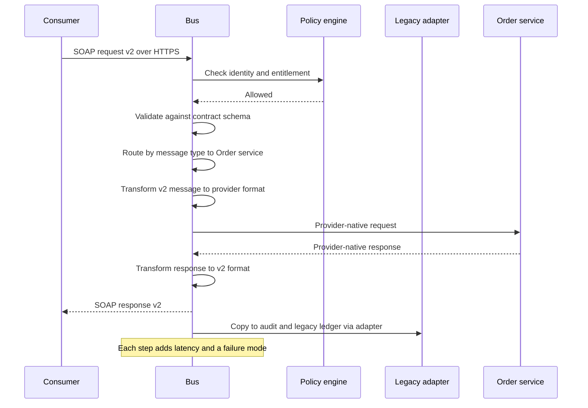

The sequence shows how much work one logical call involves. The bus authenticates, validates, routes, translates twice, and writes an audit copy. Every one of those steps is code that someone must own, test, and version. The implication is that the bus has become a place where integration behavior is defined, and that behavior is invisible to both the consumer and the provider teams unless the bus has its own documentation and tests. A fault might come from the policy engine, from a transformation that silently drops a field, or from the provider, and the consumer sees only a failed call.

### 5.2 How the bus becomes a bottleneck

The ESB pattern has a well-known failure mode. Teams find it convenient to put one more rule in the bus, such as "if the customer is in region X, add surcharge Y" or "if the order total is under 50, skip credit check." Each rule is small. Over time the bus holds business logic, owned by the integration team, who do not own the business domain. Three problems follow.

Release coupling. Every change to any flow is a change to one deployable artifact. If the bus has 60 flows and releases monthly, every service team waits for the next release window, and a defect in one flow can halt the others.

Capacity coupling. All traffic shares the bus's central processing unit (CPU), memory, and connection pools. A heavy transformation in one flow slows every other flow. The arithmetic is direct. Suppose (illustrative) six flows average 150 messages per second at peak, so the bus handles 6 × 150 = 900 messages per second. If transformation and validation cost 8 ms of CPU per message, the bus needs 900 × 0.008 = 7.2 CPU-seconds per second, so 7.2 cores at full use. To keep utilization at 60% for headroom, it needs 7.2 / 0.6 = 12 cores. If one consumer then launches a bulk job of 600 additional messages per second, the demand rises to 1,500 × 0.008 = 12 cores at 100%, so the bus is saturated and all six flows degrade, including those serving customers.

Availability coupling. The bus is on the path of every call, so it multiplies into every availability figure, as shown in the foundational model. A bus that is 99.9% available caps the whole estate at 99.9% before any provider failure is counted.

The mitigation is to constrain the bus to mediation. A rule of thumb that holds up in review: if a rule would change when a business policy changes, it belongs in the service that owns the policy. If it would change when a protocol or format changes, it may belong in the bus. Other mitigations are domain-scoped buses so one team's flows do not affect another's, per-flow throttling, and treating flows as code with automated tests and independent deployment.

The point is not that an ESB is wrong. An ESB is a reasonable way to connect a mainframe, a packaged application, and a modern service when the alternative is rewriting them. The failure comes from placing domain decisions there.

### 5.3 Orchestration versus choreography

When a business process spans several services, someone must decide the order of calls and what to do when a step fails. Two models answer this differently.

In orchestration, one component, the orchestrator, holds the process definition. It calls each service in turn, tracks the state, and handles failures. In SOA this is often a process service or a process engine executing a Web Services Business Process Execution Language (WS-BPEL) definition, an Organization for the Advancement of Structured Information Standards (OASIS) standard. Participating services do not know about the process.

In choreography, no component owns the process. Each service reacts to messages from others and publishes its own result. The process emerges from the rules each participant follows.

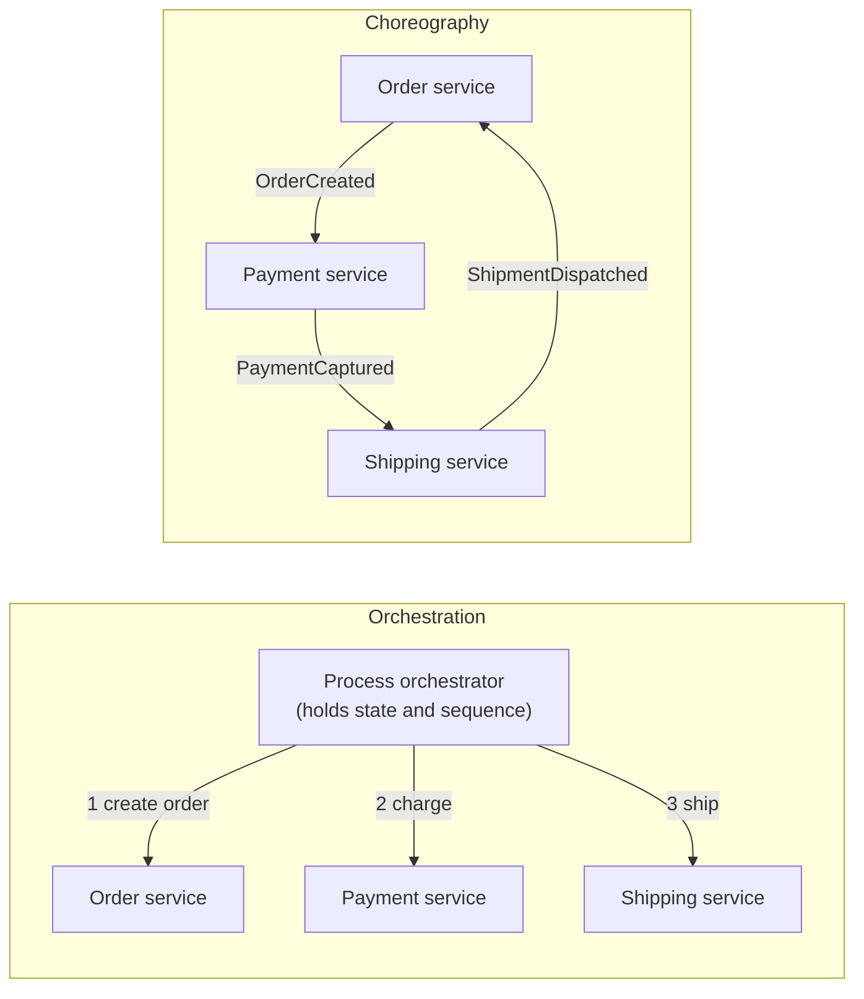

The left side shows a hub: the sequence and the failure policy are in one place. The right side shows a chain of reactions: no one place describes the process. The consequences differ in several ways.

| Aspect | Orchestration | Choreography |
|---|---|---|
| Where is the process defined | In the orchestrator, readable as one artifact | Spread across the participants |
| Adding a step | Change the orchestrator | Change one participant and subscribe it to the right events |
| Failure handling | Orchestrator decides retry or compensate | Each participant must handle its own failures and compensations |
| Visibility | Orchestrator state shows where each instance is | Need correlation across logs to reconstruct a process instance |
| Coupling | Orchestrator knows every participant | Participants know the events, not each other |
| Typical risk | Orchestrator becomes a god service | Hidden cyclic dependencies and unclear ownership of the whole |

Choreography is closer to event-driven design, which [CH07 Event-Driven Architecture](CH07_Event_Driven_Architecture.md) teaches in full, and long-running compensation is covered in [CH10 Saga Pattern](CH10_Saga_Pattern.md). Here the question is when to prefer each inside a service-oriented estate.

Orchestration fits when the process is a business artifact that stakeholders need to see and change, such as an approval workflow with audit requirements. It also fits when failure handling is intricate, because a single place can decide to retry, escalate to a person, or compensate. Choreography fits when the steps are loosely related and independent teams own them, and when adding subscribers must not require touching a central definition.

A concrete orchestration fragment in Python shows what the orchestrator owns. The point is that it holds state and a compensation rule, which the services do not:

```python
def place_order(order_id: str, customer_id: str, amount_cents: int) -> str:
    state = {"order": "NEW"}
    try:
        orders.create(order_id, customer_id)          # idempotent by order_id
        state["order"] = "CREATED"
        payments.charge(order_id, amount_cents)       # idempotent by order_id
        state["order"] = "PAID"
        shipping.dispatch(order_id)
        state["order"] = "SHIPPED"
    except PaymentDeclined:
        orders.cancel(order_id)                       # compensation
        state["order"] = "CANCELLED"
    except TemporaryFailure:
        schedule_retry(order_id, state)               # process engine would persist state
    return state["order"]
```

Every call uses the order identifier as an idempotency key. If the orchestrator crashes and retries from a persisted state, repeating `charge` must not charge twice. A real process engine persists the state between steps, which this fragment only implies.

### 5.4 Choosing between them

For a customer-facing process with strict audit and a short list of steps, prefer orchestration with a small, explicit process service. For notification and downstream updates that other teams join over time, prefer choreography. Most estates use both: an orchestrated core process that emits events to which many independent subscribers react. The decision error to avoid is putting a hub in the bus. An orchestrator owned by the process owner is a business service. An orchestrator embedded in a shared bus is the bottleneck described above.

## 6. Canonical Data Models and Their Costs

### 6.1 The idea and the arithmetic

A canonical data model (CDM) is an enterprise-wide, system-neutral definition of business entities such as Customer, Order, and Product. Each system maps its own format to the canonical one and back, so systems never translate directly to each other. The catalog of Enterprise Integration Patterns describes this as the Canonical Data Model pattern, motivated by the cost of pairwise translation.

The motivating arithmetic is as follows (illustrative). Suppose 8 systems must exchange customer data in both directions, and each pair uses a different format. Directed translators needed: 8 × 7 = 56. With a canonical model, each system needs one translator into the canonical format and one out: 2 × 8 = 16. The saving is 56 − 16 = 40 translators, and adding a ninth system adds 2 translators instead of 16 (9 × 8 − 56).

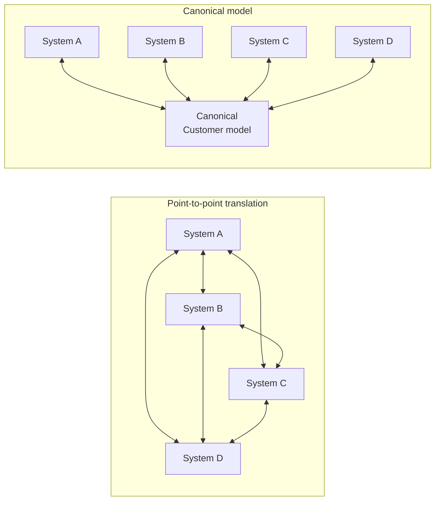

The picture explains the appeal: six pair links on the left against four spokes on the right for four systems, and the gap widens with every system added. It also hides the main cost. The hub in the right-hand picture is not a place but a shared agreement, and every spoke depends on it.

### 6.2 What the canonical model costs

The arithmetic assumes every pair of systems communicates. They usually do not. If the 8 systems actually have 12 directed flows between them, point-to-point needs 12 translators, while the canonical approach still needs 16, plus the effort of designing and governing the model. The canonical model wins only when the number of real flows grows toward the full pairwise count, or when systems come and go often.

Beyond translator counts, four costs recur.

The lowest common denominator problem. A canonical Customer must accommodate every system's view of a customer: a billing system's legal entity, a marketing system's person, a support system's contact. The model either grows into a union of every field, with most fields empty for most consumers, or it excludes fields some systems need and forces side channels.

Change coupling. When a field changes meaning or a new mandatory attribute appears, every adapter that maps to the model must be reviewed. A change that looks local becomes a cross-estate release. With 8 systems and a change to the canonical `Customer`, the review touches 16 translators even if only one system cares.

Semantic collapse. Two systems that both call a field `status` may use different value sets. Mapping both to one canonical `status` forces an enumeration that fits neither, and the conflict is hidden until a consumer interprets a value incorrectly.

Central bottleneck for change. A governance group that approves model changes becomes a queue. Delivery teams wait for the model team, then either wait or route around it.

A small example makes the semantic problem concrete. Two systems describe an order's state:

```xml
<!-- Order system -->
<order><state>OPEN</state></order>

<!-- Billing system -->
<invoice><status>OPEN</status></invoice>
```

Both say `OPEN`. In the order system it means the order has been accepted and has not shipped. In the billing system it means the invoice has been issued and is unpaid. A canonical `Status` with value `OPEN` conflates them. Consumers who assume a single lifecycle may treat an unpaid invoice as an unshipped order. A better canonical model separates `OrderState` from `InvoiceState`, which means the model is organized by business concept, not by field name.

### 6.3 Alternatives and where the canonical model fits

There are four practical alternatives, and the choice depends on how many systems exchange data and how stable the shared meaning is.

| Approach | When it fits | Main cost |
|---|---|---|
| Point-to-point translation | Few systems, few flows | Translator count grows toward n × (n − 1) |
| Enterprise-wide canonical model | Many systems, stable shared concepts, strong governance | Change coupling and the lowest common denominator |
| Domain-scoped canonical models | Distinct business domains with different vocabularies | Translation needed at domain boundaries |
| Consumer-driven contracts | Few consumers per provider, teams able to coordinate | No single enterprise view |

Domain-scoped models are the most common outcome in practice. A canonical Customer for the sales domain and a different one for the finance domain, with an explicit mapping between them at the domain boundary, keeps each vocabulary coherent and limits how far a change spreads. This is close to the bounded context idea from Domain-Driven Design (DDD), and the same reasoning appears in [CH05 Microservices](CH05_Microservices.md) when service boundaries follow domain language. The explicit domain mapping is a deliberate loss of "one model" in exchange for local freedom.

A rule that applies to all variants: the canonical model describes data in transit between systems, not the schema of any system's internal store. An enterprise that forces systems to store data in the canonical shape converts a messaging convention into a database standard, and the coupling becomes far tighter.

## 7. Governance, Registries, and Contract Evolution

### 7.1 What governance decides

Service governance is the set of decisions, rules, and checks that keep a service estate coherent while its parts change independently. Enterprise-level governance is owned by [Part 18 CH08 Architecture Governance](../18_Enterprise_Architecture/CH08_Architecture_Governance.md). This section covers the parts specific to services: which contracts are shared, how they evolve, and what enforces the rules.

Governance answers five questions:

1. Which capabilities become shared services, and who owns each.
2. What every contract must contain (the checklist in the section on taxonomy and contracts).
3. How contracts change: what counts as breaking, how long old versions live, and who approves exceptions.
4. What security, identity, and error conventions apply to all services.
5. How compliance is checked, and what happens on non-compliance.

The failure at either extreme is familiar. With no governance, each team invents its own error format, authentication, and versioning, and consumers pay in integration effort. With heavy governance, every change needs committee approval, and teams build around the process. The workable middle is to centralize a small set of rules that are cheap to check mechanically, such as security, error model, and compatibility, and to delegate everything else to the owning team.

### 7.2 The service registry

A service registry is a catalog of services and their contracts. Early SOA proposed Universal Description, Discovery and Integration (UDDI) as a public registry standard. In practice most enterprises run an internal catalog, which may be a purpose-built registry, an API management portal, or a repository of contract files with metadata. The mechanism is the same: each entry records the contract document, version, owner, lifecycle state, consumer list, and non-functional commitments.

The registry has three jobs. It lets a consumer discover whether a capability already exists, which is the precondition for reuse. It lets governance see which consumers depend on which versions, which is the precondition for safe retirement. It lets tooling retrieve the authoritative contract for validation and test generation. A registry that is not on the delivery path decays: if publishing is optional, entries go stale within months, and the catalog becomes a source of misinformation. The mitigation is to make publication a pipeline step, so the contract in the registry is the same artifact the build tested.

A contract passes through lifecycle states, and the states determine what consumers may do.

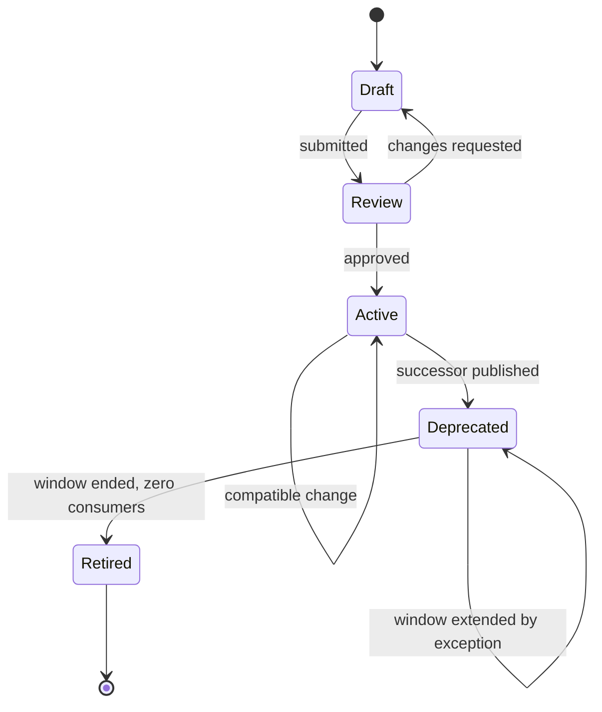

The lifecycle makes two rules explicit. A contract moves from Active to Deprecated only when a successor exists, so consumers always have somewhere to go. It moves from Deprecated to Retired only after the window ends and the registry shows no remaining consumers, or an exception is recorded. The self-loop on Deprecated is the cost of ignoring the second rule: unretired contracts that nobody can afford to remove. The implication for planning is that deprecation windows must be set by what the slowest consumer can realistically do, not by what the provider would like, and the registry's consumer list is the evidence.

### 7.3 Compatibility rules

Versioning works only when old and new contracts have clear compatibility rules. A change is backward compatible if existing consumers, built against the old contract, keep working unchanged. A typical rule set for message contracts:

| Change | Compatible for existing consumers | Reason |
|---|---|---|
| Add an optional response field | Yes, if consumers ignore unknown fields | Consumers do not read it |
| Add a required request field | No | Old consumers do not send it |
| Remove or rename a response field | No | Consumers may read it |
| Narrow an enumeration of values a consumer sends | No | Old values are rejected |
| Widen an enumeration of values a provider returns | Only if consumers handle unknown values | Consumers may fail on a new value |
| Change a field's unit or meaning | No, even if the type is the same | Semantics change silently |

The last row is the dangerous one, because no schema check detects it. It is the reason contracts state semantics in text and why consumer-driven tests are valuable.

The rules can be enforced by a small comparison step in the build. The following Python fragment treats each contract as a map from field name to a `required` flag and reports changes that break existing consumers:

```python
def breaking_changes(old: dict, new: dict, direction: str) -> list[str]:
    """old/new map field name to {'required': bool}. direction is 'request' or 'response'."""
    problems = []
    if direction == "response":
        for name in old:
            if name not in new:
                problems.append(f"response field removed: {name}")
    else:
        for name, spec in new.items():
            if name not in old and spec["required"]:
                problems.append(f"new required request field: {name}")
        for name in old:
            if name not in new:
                problems.append(f"request field removed: {name}")
    return problems
```

This catches structural breaks only. Semantic changes need review, and the version identifier makes the review visible: a breaking change increments the major version, which appears in the namespace or path, and the old major version stays active until the deprecation window ends. Part 08 covers versioning schemes for APIs in [Part 08 CH10 Versioning](../08_API_Architecture/CH10_Versioning.md). The SOA-specific constraint is a cap on parallel versions. Supporting more than two major versions of a service multiplies testing and defect fixing, so governance sets a maximum and enforces retirement.

### 7.4 Change process and consumer communication

When a provider proposes a breaking change, the process is a short sequence of steps with defined actors.

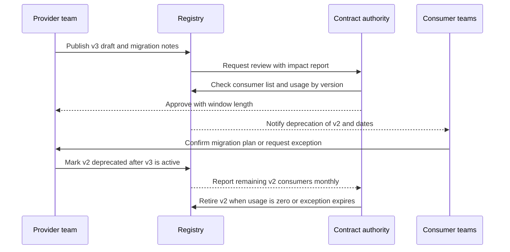

The sequence puts evidence at each decision point. The authority approves a window based on the registry's measured usage, not a guess. Consumers are told by the registry, so notification does not depend on someone remembering to email. The monthly report keeps the retirement date from slipping silently. The escalation path matters most for the unresponsive consumer: a rule that retirement proceeds on the date unless an exception is recorded gives consumers a reason to act, and a named executive sponsor for exceptions gives the authority a way to resolve disputes.

### 7.5 Enforcement mechanisms

Rules that only exist in documents are not enforced. Practical mechanisms, in order of how early they catch problems:

- Build-time checks. Contract linting for required metadata, a compatibility check like the fragment above against the registry's active version, and contract tests that run provider code against stored consumer examples. Failing these blocks the build.
- Publication gating. A service is not routable until its contract is in the registry with an owner and a lifecycle state of Active.
- Runtime policy. The gateway or bus enforces authentication, rate limits, and schema validation, and rejects calls to retired versions with a documented fault.
- Usage reporting. Traffic by consumer and version feeds the registry, so retirement decisions rest on observed use.

A governance process that uses only the last mechanism learns about problems after production incidents. One that uses only the first three misses unknown consumers who bypass the gateway. Both layers are needed.

## 8. Shared-Service Bottlenecks and Hub Failure Modes

A service that many consumers depend on concentrates three risks: capacity, availability, and decision-making. The first two are runtime problems and are treated here. The third, a central team that must approve every change, was covered under governance. This section explains how a shared service or a bus saturates, what the failure looks like to consumers, and which resilience patterns contain it.

### 8.1 How saturation happens

A shared service behaves like a queue in front of a fixed pool of workers. As utilization approaches 100%, waiting time rises faster than load. For a single queue with random arrivals and a simplified model, the mean response time is the service time divided by (1 − utilization). All figures below are illustrative.

| Utilization | Response time with 20 ms service time | Calculation |
|---|---|---|
| 50% | 40 ms | 20 / 0.5 |
| 80% | 100 ms | 20 / 0.2 |
| 90% | 200 ms | 20 / 0.1 |
| 95% | 400 ms | 20 / 0.05 |

The table shows why a service that looks healthy at 80% can fail at 95%: latency has quadrupled, and consumers begin to time out.

Now add consumers. A shared identity service runs 10 instances, each able to handle 100 requests per second, so capacity is 10 × 100 = 1,000 requests per second. Three consumers send 300, 200, and 100 requests per second at peak, a total of 600, which is 60% utilization and a 50 ms response time (20 / 0.4). The second consumer then starts a bulk import that adds 700 requests per second. Offered load is 600 + 700 = 1,300, which exceeds capacity by 300 per second. The queue grows, response times exceed the consumers' timeouts, and the first and third consumers, whose load did not change, now fail.

The failure then amplifies itself. If 30% of calls time out and each is retried once, offered load becomes 1,300 × 1.3 = 1,690 requests per second. Retries add load exactly when capacity is short, which is called a retry storm. The incident ends only when someone stops the import or adds capacity, and by then every consumer has seen errors from a service they did not change.

### 8.2 Hub failure modes

The same dynamics apply to an ESB or gateway, with more ways to fail because it sits on every path.

| Failure mode | Cause | What consumers see | Containment |
|---|---|---|---|
| Resource exhaustion by one flow | One flow has heavy transformation or a bulk load | Latency in unrelated flows | Per-flow throttles, separate thread pools |
| Slow provider ties up bus threads | A provider responds in 30 s and the bus holds a thread for each call | Fast providers also time out | Provider timeouts, bulkheads per provider |
| Poison message | A malformed message fails transformation, is retried, and blocks a queue | One flow stalls while others run | Retry limit, dead-letter queue, alerting |
| Retry storm | Consumers and bus both retry on timeout | Load several times above normal | Retry budgets, backoff with jitter, shedding |
| Single node loss | Too little spare capacity | Degradation as survivors take load | N+1 sizing, health-based routing |
| Faulty release | One artifact carries all flows | Many flows fail after a deploy | Independent flow deployment, canary release |
| Registry or policy engine outage | Runtime depends on a catalog lookup | Rejected calls | Local caches of policy, fail-safe defaults |

The last row repeats a point from the foundational model: the runtime path must not depend on design-time components unless the dependency is cached and has a defined fallback.

### 8.3 Resilience patterns

The patterns below are the standard set. Each one trades some convenience for containment.

- Timeouts with a deadline budget. Every call has a timeout shorter than the remaining time of its caller. If a portal allows 3 s, the bus allows 2.5 s, the order service 2.0 s, and its call to the customer service 1.0 s, so an inner call cannot outlive the outer request. Without this, work continues after the caller has given up.
- Bounded retries. Retry only operations that are idempotent, use exponential backoff with random jitter, and cap retries by a budget such as "no more than 10% of calls are retries." Retrying at every layer multiplies: three layers with two retries each can turn one call into 3 × 3 × 3 = 27 attempts.
- Circuit breaker. After a failure rate threshold, calls to a dependency fail immediately for a cool-down period, then a few trial calls test recovery. It stops wasted work and gives the provider room to recover.
- Bulkheads. Resources, such as thread pools or connection pools, are partitioned by consumer or by dependency so that exhaustion in one partition does not spread.
- Admission control and quotas. Reject excess load at the edge with a clear fault, instead of accepting it and failing slowly.
- Load shedding by priority. When saturated, drop low-priority traffic (batch, reports) and keep interactive traffic.
- Caching and asynchronous paths. Serve read-mostly data from a consumer-side cache with an explicit staleness limit, and move bulk work to a queue that the service drains at its own pace.

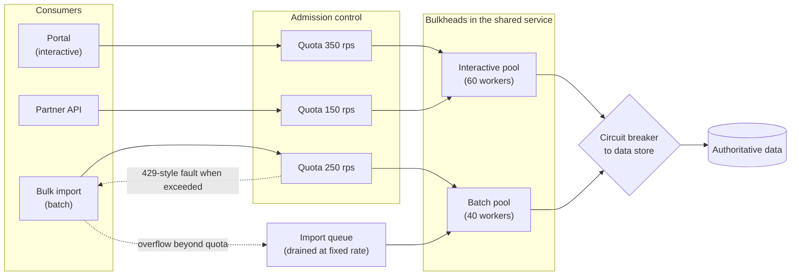

The diagram applies four patterns at once. Quotas total 350 + 250 + 150 = 750 requests per second, which is 75% of the 1,000 request per second capacity from the earlier example and an 80 ms response time under the simplified model (20 / 0.25). That leaves 25% headroom for retries and node loss. The bulk consumer's overflow goes to a queue instead of being refused outright, so the import finishes later but does not hurt others. The batch pool is capped at 40 of 100 workers, so even if it hangs, 60 workers remain for interactive callers. The implication for contracts is that quotas and fault semantics belong in the contract: a consumer needs to know its quota, what the over-quota fault looks like, and whether retrying is safe.

A quota policy can be stated declaratively, so that it is reviewable and versioned:

```yaml
consumer-quotas:
  portal:          { rps: 350, pool: interactive, priority: high }
  partner-api:     { rps: 150, pool: interactive, priority: high }
  bulk-import:     { rps: 250, pool: batch, priority: low, overflow: queue }
unspecified-consumer: { rps: 10, pool: batch, priority: low }
```

### 8.4 Capacity for shared mediation

N+1 sizing from the earlier worked comparison generalizes. If a shared tier needs capacity C at peak and must survive the loss of one of n nodes at full speed, each node's utilization before failure must not exceed (n − 1)/n of the target. With three nodes and a 60% target, steady-state utilization should be at most 60% × 2/3 = 40%. A tier that is cheap to scale horizontally can run closer to the limit. A tier that is hard to scale, such as a licensed bus with fixed nodes, needs generous headroom, and its cost is part of the decision to centralize.

If consumer requirements diverge sharply, for example one consumer needs very low latency and another needs bulk throughput, a separate deployment of the same service, or a specialized service, can be justified. Data ownership and policy consistency still need governance, so the two deployments share a contract and a source of truth.

## 9. SOA and Microservices: Differences, Overlap, and Migration

### 9.1 What the two styles share and where they differ

SOA and microservices both divide a system into services that communicate through contracts. The overlap is real, and the difference is in emphasis rather than in a clean definition. Several authors have described microservices as a refinement or specific approach within service orientation, and others treat them as a reaction to the heavyweight SOA of the 2000s. The terms do not have standards-body definitions, so this chapter compares tendencies and warns against deciding from the label.

| Dimension | SOA tendency | Microservices tendency |
|---|---|---|
| Primary goal | Reuse and integration across the enterprise | Independent deployment and team autonomy |
| Service size | Often coarse, a whole business capability | Smaller, aligned to a team and a bounded context |
| Data | Often shared databases or shared canonical models tolerated | Each service owns its data store |
| Integration | Central mediation, such as an ESB | Lightweight protocols, smart endpoints, dumb pipes |
| Governance | Central contract authority and registry | Team-level ownership with platform guardrails |
| Process logic | Orchestration in a process engine or bus | Logic in services, choreography through events common |
| Technology | Standards such as SOAP, WSDL, Web Services Security (WS-Security) | Mixed, often REST, gRPC (a Remote Procedure Call framework), or messaging |
| Typical risk | Central bottleneck, heavy contracts | Operational overhead, distributed data consistency |

Read the table as a pair of default positions. A system with fine-grained services and a strong central governance board has the size of microservices and the governance of SOA. A system with a few coarse services and fully autonomous teams has the opposite mix. Both are legitimate, and neither fits the label cleanly. The questions that decide are about ownership, data, and change.

Who owns the service and its data? If a single team owns both and no other team may touch the store, the service has the autonomy that microservices emphasize. If several systems read the same tables, the coupling is that of a shared database, whatever the services are called. How often must the service change independently? If it changes weekly and consumers cannot be coordinated, per-service deployment pays. If it changes yearly and many consumers depend on it, a governed shared contract pays. What happens when it fails? Where a failed shared service stops many processes, the estate needs isolation and capacity safeguards, as the preceding section on shared-service bottlenecks discusses.

### 9.2 Evolution and migration paths

Organizations that start with a hub-and-spoke ESB commonly move toward a gateway and domain-owned services. The move is usually incremental because the bus carries live traffic.

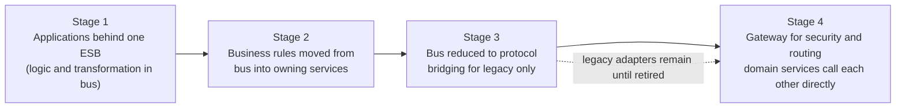

The four stages show a direction of travel, not a mandatory plan. The first step, moving business rules out of the bus, delivers most of the benefit. It removes the release and capacity coupling described earlier, and it can be done flow by flow with the contract unchanged for consumers. The later steps are justified only if the forces that motivate them are present. An estate with a few stable systems may reasonably stay at the second stage indefinitely.

Two techniques make the migration safe. The first is to move one flow at a time, running the bus implementation and the new implementation in parallel and comparing outputs on the same traffic before switching. The second is to keep contracts stable while implementations change, so consumers do not migrate on the provider's schedule. The strangler approach covered in [CH05 Microservices](CH05_Microservices.md) applies here as well.

### 9.3 Quality-attribute consequences and a worked comparison

Compare two designs for the same requirement using a quality-attribute scenario. The stimulus is a change to the discount calculation rules. The expected response is that the rule change is released and live. The measure is the time from approval to production and the number of teams affected.

In a bus-centered design where the discount rule lives in a bus flow, the change goes into a bus release that also carries 11 other pending flow changes (illustrative). Release windows are monthly, with a regression test taking 5 days. Worst case from approval to production is a wait of up to 30 days for the window plus 5 days of testing, so up to 35 days, and the integration team must schedule the work against the other changes. If the discount rule lives in the Pricing service, owned by the pricing team and deployed independently with a pipeline that takes 2 hours, the change reaches production the same day. The difference is not due to the label SOA or microservices. It is due to where the rule lives and who owns the deployment.

A second scenario concerns availability. The stimulus is a hardware failure on one bus node. With 2 nodes at 60% utilization each, failure of one pushes the survivor to 120% and the bus degrades unless capacity or shedding is in place. With 3 nodes at 40% utilization, loss of one pushes the other two to 40 × 3 / 2 = 60%, so the bus keeps serving at full speed. N+1 capacity planning is therefore a design input for any shared mediation layer, and the cost is idle capacity, which should be weighed against the cost of an outage.

The choice between SOA emphasis and microservices emphasis therefore reduces to the same trade-offs already covered: autonomy against reuse, local change against coordinated governance, runtime isolation against central policy. Where the enterprise has many legacy systems and needs consistent security and integration, the SOA elements of mediation, registry, and governed contracts earn their cost. Where a product team owns a domain end to end and releases daily, microservice-style ownership usually earns its cost. Most real estates use both, at different layers.

### 9.4 What to keep, what to drop, and where events fit

Moving from SOA toward microservices or event-driven styles does not mean discarding everything. Some SOA practices solve problems that still exist, and some solve problems that a better structure removes.

| Practice | Decision | Reason |
|---|---|---|
| Explicit, published contracts with owner and version | Keep | Consumers still need a stable boundary, whatever the style |
| Registry of services and consumers | Keep, as a lightweight catalog | Needed for discovery and safe retirement |
| Compatibility rules and deprecation windows | Keep | Independent deployment makes them more necessary |
| Central policy for security and audit | Keep, move to a gateway or platform layer | Uniform rules are cheaper to enforce once |
| Protocol bridging for legacy systems | Keep, isolated and scheduled for retirement | The legacy systems do not change on the new schedule |
| Business rules and orchestration inside the bus | Drop | Causes release and capacity coupling |
| Enterprise-wide canonical model for all data | Drop in favor of domain models | Change coupling and lowest common denominator |
| Shared databases behind several services | Drop | Defeats the ownership of data that contracts assume |
| Central approval for every contract change | Drop, replace with automated checks | Review by committee is the queue that teams route around |

Events change the shape of the integration without changing the need for contracts. A process previously orchestrated through the bus can publish events such as `OrderPlaced`, and independent subscribers can react. The estate then trades synchronous call chains, with their multiplied availability, for asynchronous delivery, with its own questions about ordering, duplicates, and eventual consistency. Those questions are the subject of [CH07 Event-Driven Architecture](CH07_Event_Driven_Architecture.md), and the compensation logic for failures in long-running processes is in [CH10 Saga Pattern](CH10_Saga_Pattern.md). The decomposition forces that decide whether a capability should become a separately deployed service at all are in [CH05 Microservices](CH05_Microservices.md).

An event also becomes a contract. A published `OrderPlaced` event with several subscribers needs the same ownership, schema versioning, and deprecation discipline as a service operation, and a team that skips it recreates the coupling of a shared database through a topic. The SOA discipline of governed contracts therefore transfers directly. What changes is the mechanism: schema compatibility checks run against an event schema registry instead of a WSDL, and the consumer list comes from subscriptions.

## 10. Security: Message-Level Security and Token-Based Access

Security in a service estate answers two questions on every call: who is calling, and what may they do. [Part 15 CH02 Authentication](../15_Security/CH02_Authentication.md) and [Part 15 CH03 Authorization](../15_Security/CH03_Authorization.md) own the full treatment of identity proofs, token formats, and policy models. This section compares the two mechanisms that SOA estates meet, at the level needed to place them in an architecture.

### 10.1 Two mechanisms

Web Services Security (WS-Security) is an OASIS standard for securing SOAP messages. The security data travels inside the message, in a SOAP header. It can carry a signed or encrypted body using XML Signature and XML Encryption, and identity in a token such as a username token, an X.509 certificate, or a Security Assertion Markup Language (SAML) assertion. Because protection belongs to the message, it survives passing through intermediaries: a bus can store the message, route it, and forward it, and the signature still proves who produced it and that it was unchanged.

Token-based access with OAuth 2.0 works at the HTTP request level. A client obtains an access token from an authorization server and presents it in an `Authorization` header. A common token form is a JSON Web Token (JWT), a signed set of claims such as issuer, subject, audience, expiry, and scopes. The receiver verifies the signature, expiry, and audience, then checks scopes or roles. The channel is protected by Transport Layer Security (TLS), so confidentiality and integrity hold between each pair of hops, not end to end through intermediaries.

| Aspect | WS-Security style | OAuth 2.0 token style |
|---|---|---|
| Where protection applies | The message itself | The connection plus a bearer credential |
| Survives intermediaries | Yes, signature stays valid across hops | Only if each hop forwards or exchanges the token correctly |
| Typical payload | SOAP with XML | HTTP with JSON, also usable for SOAP |
| Credential lifetime | Often long-lived certificates and assertions | Short-lived tokens, with refresh |
| Revocation | Certificate or assertion lifetime | Short expiry, plus introspection if needed |
| Cost | Heavy parsing, canonicalization, and configuration | Light verification, but token handling mistakes are common |
| Main risk | Misconfiguration and incompatible toolkits | A stolen bearer token works for anyone who holds it |

The last row matters in design. A bearer token is a credential that authorizes whoever presents it, so tokens need short lifetimes, a narrow audience, and protection in transit. Where stronger binding is needed, the call can additionally require mutual TLS, covered in [Part 05 CH06 TLS](../05_Networking_and_OS/CH06_TLS.md).

### 10.2 Where each is verified

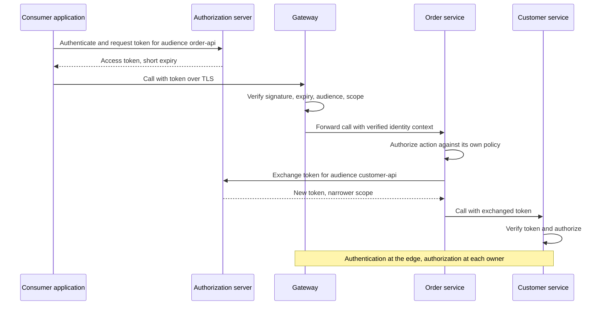

The diagram shows a division of work that is worth keeping explicit. The gateway authenticates and applies coarse checks, such as audience and scope, so unauthenticated traffic never reaches services. Each service still authorizes the action against its own domain policy, because only the owner knows, for example, that a user may approve orders up to a limit. The token exchange step narrows scope for the downstream call, so the customer service never receives a token that is valid for the order API. The implication is that trusting the gateway alone is a mistake: a service reachable on the internal network by a path that skips the gateway would accept any call. Internal calls should be authenticated, either by tokens or mutual TLS, and the service verifies them itself.

### 10.3 Practical consequences

- A bus that terminates and re-originates calls changes the identity seen by the provider. If every provider sees the bus's service account, audit trails and per-user authorization are lost. Propagate the original identity, in a token or a signed header that the provider verifies.
- A SOAP estate with WS-Security usually adds an OAuth-style token at the edge when the first mobile or partner client arrives. The gateway then translates between them, which is one of the legitimate reasons to keep protocol bridging.
- Key and certificate rotation needs an owner and a schedule in both models. A signing key shared by all consumers cannot be rotated without coordination, so use distinct credentials per consumer and publish verification keys through a defined endpoint or registry.
- Security policy belongs in the contract: required authentication, scopes or roles, and the fault returned for rejection.

## 11. Failure and Quality-Attribute Scenarios

A quality-attribute scenario states a stimulus, the response the system should give, and a measure that decides whether it did. Writing them for a service estate converts vague goals such as "resilient" into something a test or an exercise can check. All numbers are illustrative targets, not benchmarks.

| # | Attribute | Stimulus | Expected response | Measure |
|---|---|---|---|---|
| 1 | Performance isolation | One consumer sends 700 extra requests per second to a shared service | Excess is queued or rejected with a rate-limit fault, other consumers are unaffected | Interactive p95 latency stays under 150 ms and error rate under 0.1% for non-offending consumers |
| 2 | Availability | One of three bus nodes fails during peak | Remaining nodes absorb traffic with no shedding | Utilization of survivors at or below 60%, no failed calls beyond in-flight ones |
| 3 | Fault containment | One provider starts responding in 30 s | Calls to that provider fail fast, others are unaffected | Circuit opens within 10 s, other providers' p95 latency unchanged |
| 4 | Modifiability | A breaking change to the customer contract is released | Old and new versions run in parallel, consumers migrate on their own schedule | Zero consumer errors at release, old version retired when the registry shows zero calls |
| 5 | Security | A consumer's token is stolen | Token expires and the consumer's credential is revoked | Token lifetime of 10 min or less, revocation effective within 15 min |
| 6 | Recoverability | A poison message blocks a queue | Message is moved to a dead-letter queue and processing continues | Backlog resumes within 5 min and an alert is raised |

### 11.1 Scenario 3 in detail

Take the slow provider. A customer service normally answers in 40 ms, then degrades to 30 s. The order service calls it with 100 requests per second. With no timeout, the number of calls in flight grows by 100 per second, and a pool of 200 threads is exhausted in 200 / 100 = 2 seconds. The order service then rejects all calls, including those that do not need customer data. With a 1 s timeout, each call holds a thread for at most 1 s, so at most 100 threads are busy, and a circuit breaker that opens after, say, 20 failures in 10 s removes the load completely. The response is a degraded answer, such as the last cached customer record marked stale, instead of an outage. The measure is how long the other operations remain unaffected, and the test is a fault-injection exercise that adds delay to the provider.

### 11.2 Scenario 4 in detail

Contract evolution is the scenario where governance and runtime meet. The provider publishes version 3 of the customer contract with a renamed field. The gateway routes `/v2` and `/v3` to separate deployments (or the same deployment with two adapters). The registry records 14 consumers on version 2 (illustrative). Each month the registry reports usage by version: 14, 9, 4, 1, 0. The version is retired at zero, or on the agreed date with a recorded exception for the final consumer. A release is judged successful if no consumer saw an error caused by it, which means the compatibility check from the governance section ran before publication and the old version stayed routable throughout.

## 12. Worked Case: Customer Identity Integration

This case applies the chapter to one hypothetical organization. Every name and number is illustrative and chosen so that the arithmetic can be followed.

### 12.1 Context

Meridian Retail Group (hypothetical) sells through a web shop, a mobile app, and a call center, and runs billing, loyalty, returns, a partner portal, a marketing platform, and a legacy mainframe order system. That is nine systems. Each keeps its own customer login table. Customers have duplicate accounts, a customer who withdraws marketing consent in the app still receives mail from the marketing platform, and the call center cannot see which systems hold a customer's data. The business wants one authoritative customer identity and one authoritative consent record, with a login path of 99.9% availability and a token-verification path of 99.95%.

### 12.2 Decisions and rejected alternatives

| Decision | Chosen | Rejected alternative | Reason for rejection |
|---|---|---|---|
| Where identity and consent live | A single Identity and Consent service owned by one team, with its own store | Keep nine tables and synchronize | Synchronization leaves several sources of truth, and consent withdrawal depends on the slowest sync |
| Where identity rules live | In the service | In ESB flows | Rule changes would wait for the bus release window, and the integration team does not own the domain |
| Data model | A narrow Identity and Consent model, mapped at the edges of the sales and finance domains | One enterprise canonical Customer model | The translator count does not justify it (see below), and a union model couples all nine systems |
| Legacy integration | ESB used only for protocol bridging of the mainframe | Rewrite the mainframe's calls | Mainframe changes are outside the program's scope |
| Bulk consent export | Asynchronous export through a queue and a batch quota | Marketing platform calls the service directly at full rate | Repeats the saturation described in the bottleneck section |
| Deployment | One shared deployment with per-consumer quotas and bulkheads | One deployment per consumer | Higher cost with no evidence yet of diverging requirements, revisit if latency targets diverge |

The data model decision rests on the translator arithmetic. If all nine systems exchanged identity data pairwise, the maximum is 9 × 8 = 72 directed translators. The real flows number 20, so point-to-point needs 20 translators. An enterprise canonical model needs 2 × 9 = 18. The saving is two translators, which does not pay for governing a model that all nine systems depend on. The case for the service is single ownership of authoritative data and consent, not translator count.

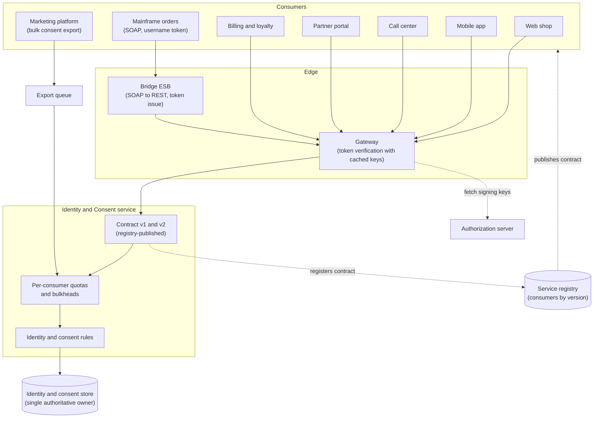

The diagram puts domain rules inside the service and leaves only protocol bridging in the ESB. The gateway verifies tokens locally with cached keys, so the high-volume path does not call the service. The marketing platform is the only consumer that uses the queue, because it is the only bulk consumer. Both facts follow from the numbers below.

### 12.3 Capacity and availability arithmetic

Peak demand in requests per second (illustrative): web 120, mobile 180, call center 20, billing 30, loyalty 40, partner 50, returns 10, mainframe via ESB 30. The sum is 120 + 180 + 20 + 30 + 40 + 50 + 10 + 30 = 480. One instance handles 100 requests per second at a 20 ms service time. The team chooses 9 instances, capacity 900. Utilization is 480 / 900 = 53%, giving a response time of 20 / (1 − 0.53) ≈ 43 ms under the simplified model. If one instance fails, capacity is 800, utilization is 480 / 800 = 60%, and response time is 20 / 0.4 = 50 ms. The N+1 target of 60% is met.

Availability: for login, the call passes the gateway (99.99%), the service (99.95%), and the store (99.99%). The product is 0.9999 × 0.9995 × 0.9999 ≈ 0.9993, which is 99.93% and meets the 99.9% login target. If every API call also asked the service to validate its token, the 99.95% verification target would be missed, because the same chain applies. Local verification at the gateway with cached keys reduces the verification path to the gateway alone at 99.99%.

Bulk export: marketing needs 500,000 consent records each night. At a batch quota of 100 requests per second the export takes 500,000 / 100 = 5,000 seconds, about 83 minutes, which fits a four-hour window. Unrestricted, the marketing platform could send several hundred requests per second, which would saturate the 900 per second capacity together with daytime traffic if a run slipped into business hours. The queue and quota prevent that.

### 12.4 Contract evolution: the consent representation

Version 1 of the contract has a single Boolean `marketingOptIn`. The business needs consent by purpose and channel, so version 2 carries a list of entries such as purpose `offers`, channel `email`, granted or withdrawn, and timestamp. The service keeps both versions routable. Version 1 responses are derived from version 2 data as "true only if every purpose and channel is granted," a conservative rule that cannot over-grant consent. A written semantic note records that version 1 loses detail, which is the kind of change a schema check would not find.

The registry lists nine consumers on version 1. With a six-month window, the monthly report is expected to fall as consumers migrate. Retirement happens when it reaches zero or the window ends with a recorded exception. The measure is no consumer error from the release, plus consent withdrawals visible to all consumers within the agreed bound.

### 12.5 Security decisions

The mainframe sends SOAP with a username token. The ESB bridges it: it authenticates the mainframe, obtains an OAuth token with a narrow scope for the mainframe's service identity, and calls the gateway. The service authorizes by scope and by consumer identity, so billing may read identity attributes but not change consent, and only the app and call center may withdraw consent. The gateway rejects tokens with the wrong audience. Tokens live ten minutes (illustrative).

### 12.6 Validation evidence

The design is accepted when evidence of each kind exists. The expected values come from the arithmetic above, and the real results would replace them.

| Claim | Test | Evidence that confirms it |
|---|---|---|
| 480 rps at p95 below 100 ms | Load test at 480 rps, then at 1.5 times | Latency and error rate at both levels, with saturation point identified |
| Survives loss of one instance | Terminate one instance at 480 rps | No failures beyond in-flight calls, utilization near 60% |
| Bulk consumer cannot hurt others | Run export at five times its quota | Interactive p95 unchanged, over-quota responses returned |
| Slow store contained | Inject 5 s delay into the store | Circuit opens, cached reads served within the staleness limit |
| Consent withdrawal propagates | Withdraw in the app, read from the marketing path | Withdrawal visible within the agreed bound |
| Contract compatibility | Run stored v1 consumer examples against v2 deployment | All examples pass |

The case shows the chapter's pattern: shared capabilities with a single owner, mediation kept thin, quotas that follow from capacity arithmetic, and contract changes governed by evidence from the registry. The shared deployment is kept because the domain and control requirements are common. If measured latency needs differ between the web path and the batch path, a separate deployment of the same contract is the next option to evaluate.

## 13. Common Mistakes and Anti-Patterns

Each entry gives the cause, the consequence, and the correction. Most are forms of a single error: moving a decision to a shared place without moving its ownership with it.

| Anti-pattern | Cause | Consequence | Correction |
|---|---|---|---|
| Business logic in the bus | Convenience: the bus already sees every message | Release and capacity coupling, rules owned by a team that does not own the domain | Keep the bus to mediation, move rules to owning services |
| Enterprise canonical model for everything | Translator arithmetic that assumes all pairs communicate | Union models, cross-estate change reviews, a model team that becomes a queue | Domain-scoped models, canonical form for data in transit only |
| Reuse without funded ownership | A project builds a service and moves on | Unscheduled change requests, no capacity planning, decay | Fund shared services as products with owners and capacity |
| Shared database behind services | Quick access to data a service already holds | Contract bypassed, schema changes break consumers silently | One owner per data set, access only through the contract |
| Contract with only a schema | Treating the WSDL or OpenAPI file as the whole contract | Errors, retry rules, units, and limits are guessed | Add fault model, semantics, quotas, and versioning policy |
| Registry as a documentation project | Publication is optional and off the delivery path | Stale entries, retirement decisions made blind | Publish as a pipeline step, report usage from runtime |
| Orchestrator hidden inside a shared bus | Process logic placed where integration lives | A bottleneck that no business owner controls | Process service owned by the process owner |
| Retry at every layer | Each team adds retries locally | Retry storms, 27 attempts from one call with three layers of two retries each | Retry budgets and one retry layer per path |
| No quotas on shared services | Trust that consumers will behave | One consumer's bulk job degrades all others | Per-consumer quotas, bulkheads, asynchronous paths |
| Trusting the gateway only | Internal network seen as safe | Any path that bypasses the gateway is unauthenticated | Authenticate internal calls, authorize in each owner |
| Choosing by label | "We need SOA" or "we need microservices" | Style adopted without the forces that justify it | Decide from ownership, data, change cadence, and failure scope |
| Unlimited parallel versions | Never retiring old contracts | Testing and defect fixing multiplied by every version | Cap versions, retire on evidence from usage reports |

Two entries deserve a short comment. The "contract with only a schema" mistake appears whenever teams can generate documentation automatically: the generated file is accurate about structure and silent about behavior, and the silent part causes the incidents. The "choosing by label" mistake is the reason this chapter compares tendencies and not definitions. A team that moves from a bus to fine-grained services without changing data ownership has the operational cost of microservices and still has the coupling of SOA.

## 14. Pattern Comparison and Trade-Offs

The table compares the integration and structure options this chapter has discussed. It describes tendencies for a typical implementation, and a given system can differ.

| Dimension | Modular monolith | Point-to-point integration | Hub-and-spoke SOA with ESB | Gateway-based services | Microservices with events |
|---|---|---|---|---|---|
| Best fit | One product, one team or few | A handful of systems | Many legacy and packaged systems, one integration team | Mixed estate with domain teams | Many autonomous teams, frequent independent releases |
| Reuse | In-process, high | Low | High, through shared contracts | Medium to high | Medium, by events and APIs |
| Autonomy | Low between modules | Low, pairwise dependencies | Low, bus release coupling | Medium to high | High |
| Data ownership | Shared database common | Per system | Often shared or canonical | Per domain | Per service |
| Runtime coupling | Function calls | Direct, pairwise | Through the bus | Through the gateway for policy only | Loose, asynchronous |
| Failure scope | Whole process | Per pair | Bus failure affects all flows | Gateway failure affects entry, services may stay reachable internally | Per service, depending on event dependencies |
| Change speed | Fast within a team | Slow as links grow | Limited by bus release | Per service | Per service |
| Governance cost | Low | Low at first, high later | High, central | Medium, automated | Medium, platform plus contracts |
| Main risk | Boundaries erode | Connection count grows | Bottleneck, logic in bus | Policy bypass | Operational and consistency complexity |

How to read it: choose the left of the table when forces such as many teams and independent change are weak, and move right only as they strengthen. A modular monolith, described in [CH01 Layered Architecture](CH01_Layered_Architecture.md) and [CH02 Hexagonal Architecture](CH02_Hexagonal_Architecture.md), often meets the need at lower cost. The hub column is most defensible when legacy systems cannot be changed and one team can own the bus. The right-hand columns assume a platform capable of supporting many deployable units, with monitoring and deployment automation, which is the main cost the table does not show.

## 15. Design-Review Checklist

Use the list in a review of a proposed or existing service estate. A "no" is a finding to resolve or accept with a recorded reason.

Forces and fit

- [ ] The forces that justify service orientation (many systems, shared capabilities, cross-system processes, uniform policy) are stated and present.
- [ ] A simpler structure, such as a modular monolith, was considered and rejected with reasons.

Contracts and ownership

- [ ] Every service has a named owning team, a support path, and funded capacity.
- [ ] Each contract states operations, semantics, fault model, security, quotas, and versioning policy, not only a schema.
- [ ] Each datum has one authoritative owner, and no consumer reads another service's store.
- [ ] Service granularity follows business questions, and call depth on customer-facing paths is within the availability budget.

Mediation and process

- [ ] The bus or gateway holds only mediation and policy, and no rule that changes with business policy.
- [ ] Orchestrators are owned by the process owner, with idempotent steps and defined compensation.
- [ ] The canonical model, if any, is domain-scoped and applies to data in transit.

Resilience

- [ ] Every call has a timeout inside its caller's remaining budget, and retries have budgets and backoff.
- [ ] Shared services have per-consumer quotas, bulkheads, and an asynchronous path for bulk work.
- [ ] Shared mediation is sized N+1 with headroom, and the arithmetic is recorded.
- [ ] Fault-injection tests cover a slow provider, node loss, and a poison message.

Evolution and governance

- [ ] Compatibility rules, a version cap, and deprecation windows are defined, with checks in the build.
- [ ] The registry is fed by the pipeline, and runtime usage by consumer and version is reported.
- [ ] Retirement of old versions is driven by usage evidence, with a recorded exception path.

Security

- [ ] Authentication happens at the edge and internal calls are also authenticated.
- [ ] Each owner authorizes actions against its own policy.
- [ ] Original identity is propagated through any mediation layer, and credentials rotate on a schedule with an owner.

## 16. Exercises

Each exercise has a brief answer outline. Work the exercise before reading the outline.

1. **Granularity.** A mobile screen needs a customer's name, billing address, and payment terms. Each round trip through the mediation layer costs 30 ms (illustrative). Compare three fine-grained calls in sequence, three in parallel, and one coarse operation.
   *Outline:* Sequential is 3 × 30 = 90 ms. Parallel is near 30 ms but triples load and the chance that one call fails. A coarse `getBillingProfile` is about 30 ms plus assembly. Prefer the coarse operation if the combination is common, and keep fine-grained operations for consumers using fields independently.

2. **Bus saturation.** A bus carries 8 flows averaging 100 messages per second, each costing 10 ms of CPU. One consumer adds 400 messages per second. The bus has 16 cores. Does it saturate, and what do you change?
   *Outline:* Baseline 800 × 0.010 = 8 cores (50%). After the addition 1,200 × 0.010 = 12 cores (75%), so it does not saturate but is above a 60% target. Add per-flow throttles and move the new load to a queue with a quota, and resize if it is permanent.

3. **Canonical model.** Ten systems have 18 real directed flows. Does an enterprise canonical model reduce translators, and what else decides?
   *Outline:* Point-to-point needs 18, canonical needs 2 × 10 = 20, so it does not reduce them. Decide by change coupling, semantic differences, and whether flows are growing. Consider domain-scoped models.

4. **Availability.** A path crosses a gateway at 99.95%, a task service at 99.9%, and an entity service at 99.9%. Compute path availability and suggest two ways to reach 99.9%.
   *Outline:* 0.9995 × 0.999 × 0.999 ≈ 0.9975 (99.75%). Reduce depth by letting the consumer call the entity service directly for reads, cache read-mostly data, or remove a hop through the gateway for internal calls with local policy checks.

5. **Orchestration or choreography.** A refund process has approval, audit, and notification steps, and teams add new notifications often. Choose a model for each part.
   *Outline:* Orchestrate approval and audit in a process service owned by the process owner. Publish a `RefundApproved` event so notification teams subscribe without changing the orchestrator.

6. **Contract change.** The provider renames a response field from `status` to `state` and adds a required request field. Classify the changes and propose a rollout.
   *Outline:* Both break existing consumers. Publish a new major version, run both in parallel, check usage monthly in the registry, deprecate when the successor is active, retire at zero usage or recorded exception.

7. **Security placement.** A service trusts any call that arrives from the gateway. An internal job calls it directly. What is the risk and the fix?
   *Outline:* The direct path is unauthenticated. Require tokens or mutual TLS at the service, verify audience and scope locally, and authorize each action against the service's own policy.

8. **Migration.** A hub-and-spoke ESB holds 60 flows, 25 of which contain business rules. Plan the first two stages of migration.
   *Outline:* Inventory flows and owners. Move rules flow by flow into owning services, run old and new in parallel on the same traffic, compare outputs, then switch. Keep contracts stable for consumers. Reduce the bus to bridging, and track the remaining count as the progress measure.

## 17. Summary

The chapter's introduction named seven outcomes. The table maps each to where it was taught.

| Outcome | Where it is covered |
|---|---|
| State the forces that make SOA reasonable or expensive | Section 2 (forces and variants), section 14 (comparison) |
| Apply the service-orientation principles and their costs | Section 3 |
| Classify services, design contracts, decide where logic lives | Sections 4 and 13 |
| Explain the ESB, trace a request, choose orchestration or choreography | Sections 5 and 8 |
| Evaluate a canonical data model | Section 6, with the worked decision in section 12 |
| Describe governance and registry process | Sections 7, 10, and 11 |
| Compare SOA with microservices on ownership, data, change, and failure | Sections 9, 11, and 14 |

The main points are these. Service orientation earns its cost when many systems share capabilities and need uniform policy, and it does not when one team owns one product. Contracts must carry semantics, faults, security, and quotas, because schemas alone leave out the behavior that causes incidents. A shared bus or service is a shared failure domain, so capacity arithmetic, quotas, bulkheads, and bounded retries are design inputs and not tuning work. Business rules belong with the owner of the domain, not in the mediation layer. Contract evolution needs compatibility rules, a version cap, and evidence from registry usage. Authentication at the edge does not replace authorization in each owner. The step from SOA toward microservices and events keeps contracts, the registry, and central policy, and drops bus-resident logic, enterprise-wide canonical models, and shared databases. Give shared services explicit owners and capacity, use mediation only where it reduces real coupling, and govern contract evolution without taking implementation accountability from service teams.
