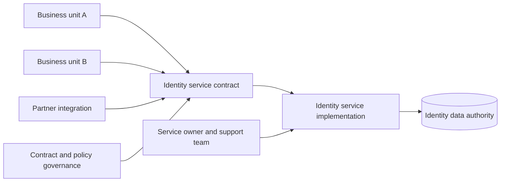
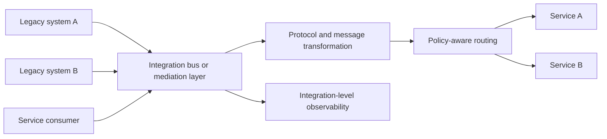
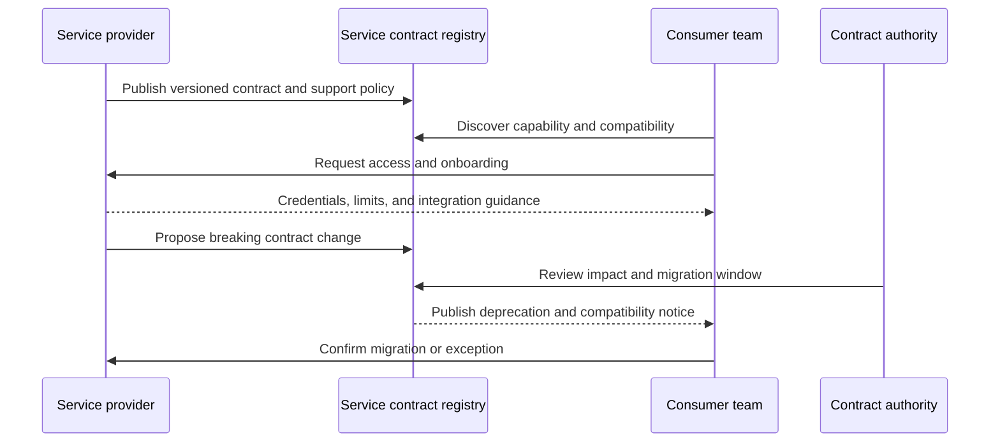
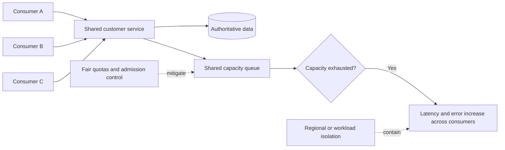
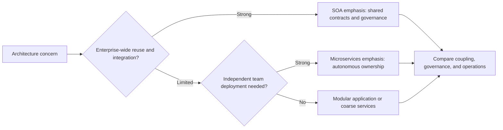

# SOA: Service-Oriented Architecture

Part: [20 — Architecture Patterns](PART_OVERVIEW.md)

Service-Oriented Architecture (SOA) structures enterprise capabilities as services with explicit contracts that can be consumed across organizational boundaries. It emphasizes reuse, integration, interoperability, and governance. SOA is not synonymous with an Enterprise Service Bus (ESB), nor does every SOA require centralized mediation. Part 18 owns enterprise architecture governance; Part 08 owns general API architecture.

## Define Service Contracts and Ownership

A service exposes a business or technical capability through a contract describing operations, data, policy, versioning, and failure behavior. Consumers depend on the contract rather than the provider's internal implementation. Name the service owner, consumer onboarding process, support expectations, and change authority. Shared services need sustainable funding and capacity; reuse without ownership creates an unmanaged dependency.

The service contract should hide internal implementation details while exposing the semantics consumers need. Avoid generic contracts that force every consumer to understand provider internals. Measure service reuse through stable consumption and outcomes, not merely the number of registered interfaces.

## Use Mediation Deliberately

An ESB can mediate protocol translation, routing, transformation, and policy between legacy systems and services. It can simplify integration when many systems require shared mediation capabilities. It can also centralize business logic, create a scaling or release bottleneck, and obscure end-to-end ownership if all behavior is placed in one bus.

Keep mediation responsibilities explicit and avoid embedding domain decisions that belong to service owners. A shared bus requires capacity, change management, access controls, observability, and failure isolation. Alternatives include direct service contracts or domain-owned adapters; compare coupling and operational cost rather than choosing from trend labels.

## Govern Reuse Without Freezing Change

Enterprise service governance defines which contracts are shared, how versions evolve, who approves breaking changes, and how consumers migrate. Central governance can reduce duplication and security inconsistency, but excessive approval slows local work. Use standards for security, identity, and compatibility while delegating non-breaking implementation changes to service owners.

Versioning is useful only when old and new contracts have clear compatibility rules and retirement dates. Avoid indefinite parallel versions; they multiply support and testing. Track consumers and communicate change before deployment, with an escalation route for critical or unresponsive consumers.

## Avoid Shared-Service Bottlenecks

A highly reused service can become a central availability, performance, or decision bottleneck. Shared services should offer capacity planning, fair quotas, regional or failure isolation where needed, and an escalation path. Consumers should not replicate critical data or bypass controls without an explicit decision.

Monitor per-consumer demand and tail latency. A shared service should not let one consumer exhaust capacity for all others. If consumer requirements diverge sharply, separate deployment or a specialized service may be justified, but data ownership and policy consistency still need governance.

## Distinguish SOA From Microservices

SOA and microservices both use service boundaries and contracts. SOA commonly emphasizes enterprise integration and shared capability governance; microservices emphasize smaller independently deployable ownership units. These are tendencies, not rigid definitions. A system can have fine-grained services with centralized governance or coarse-grained services with team autonomy.

Do not decide from the term alone. Compare ownership, data authority, change cadence, integration topology, runtime failure boundaries, and support model. Part 20 CH05 covers microservices decision forces; Part 07 covers distributed implementation consequences.

## Worked Case: Customer Identity Integration

A large enterprise has multiple systems needing customer identity, authentication, and consent status. It defines a shared identity service with versioned contracts, owner, capacity objectives, security review, and consumer onboarding. An ESB mediates a legacy protocol for older systems while newer applications call the service contract directly. Domain policy remains inside the identity service rather than being duplicated in the bus.

During peak onboarding, one consumer's bulk import saturates the shared service. Per-consumer quotas and an asynchronous import path restore fairness. Contract governance approves a new consent representation with a migration window and consumer inventory. The architecture keeps the service shared because the domain and control requirements are common, but regional deployment variants are evaluated for latency and availability.

## Review Questions

1. What makes a service contract useful across organizational boundaries?
2. When does an ESB reduce integration cost, and when does it centralize too much behavior?
3. How can service reuse be governed without freezing provider changes?
4. What safeguards prevent a shared service from becoming a noisy-neighbor bottleneck?
5. Which decision forces distinguish SOA, microservices, and a modular application?

SOA is useful when enterprise capabilities need reusable contracts and coordinated integration. Give shared services explicit owners and capacity, use mediation only where it reduces real coupling, and govern contract evolution without taking implementation accountability from service teams.
