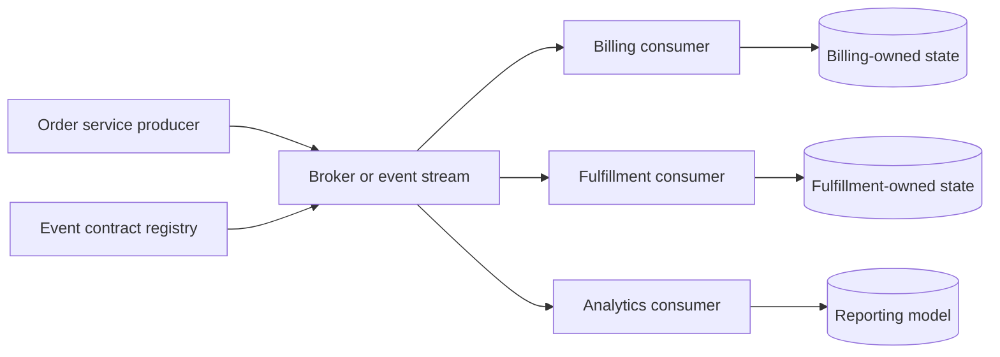
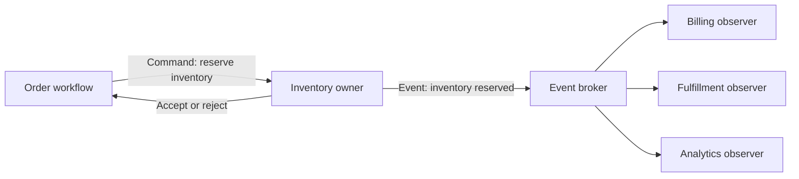
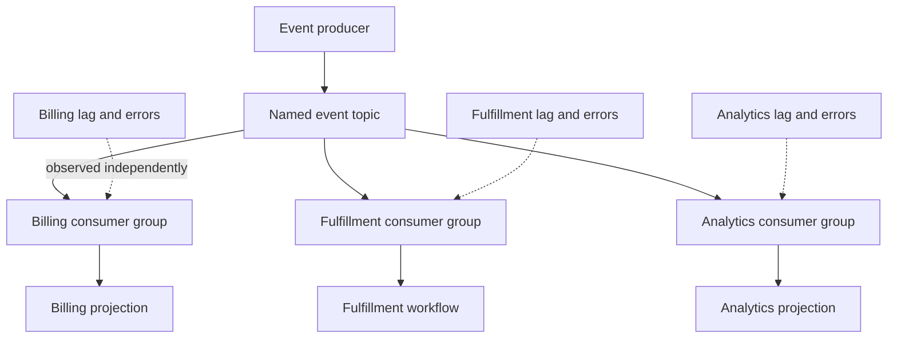
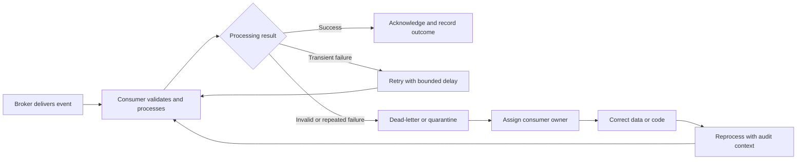
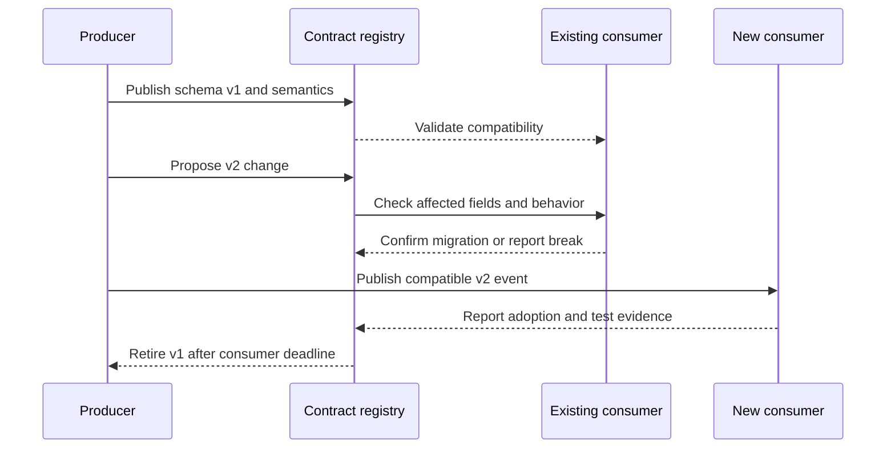

# Event-Driven Architecture

Part: [20 — Architecture Patterns](PART_OVERVIEW.md)

Event-Driven Architecture (EDA) structures components around the production, transport, and reaction to events. It can reduce temporal coupling and support fan-out, but introduces schema evolution, observability, ordering, retries, and eventual state coordination. Part 07 owns event-processing semantics; Part 09 owns messaging products.

## Place Producers, Brokers, and Consumers

Producers publish event records describing facts that have occurred. Brokers route or retain messages; consumers subscribe and react independently. A broker can be a queue, pub/sub system, or event stream with different delivery and retention semantics. Select the form from consumer independence, replay need, ordering, throughput, and operational constraints.

The event contract needs an owner, event identity, subject and time semantics, schema version, sensitivity, and compatibility policy. Consumers should not infer hidden business meaning from field names. Keep the producer independent of the internal implementation of each consumer.

## Distinguish Events From Commands

A command asks a specific owner to perform an action and may be rejected. An event states that something happened and can have many observers. Confusing them creates accidental coupling: a broadcast “please update” message behaves like a command with unclear authority, while a query disguised as an event can leak responsibility.

Commands should identify the intended owner and include enough information to authorize and validate the request. Events should describe an immutable fact, not prescribe every consumer's reaction. Consumers own their response and should tolerate events that are delayed or duplicated according to the system's delivery contract.

## Use Fan-Out With Explicit Consumer Ownership

Fan-out allows billing, fulfillment, analytics, and notification consumers to react independently. This reduces direct synchronous dependencies, but the producer cannot assume every consumer has completed when publication succeeds. Each consumer needs its own lag, failure, retry, and recovery signals. A slow or failing consumer should not silently block unrelated subscribers.

Avoid publishing one enormous event to avoid all follow-up reads; it couples consumers to fields they do not need and can expose sensitive data. Prefer fit-for-purpose payloads or references with access control. Part 18 CH06 owns enterprise data contracts; this chapter applies those ideas to events.

## Design Retry and Dead-Letter Paths

Consumers can fail transiently, encounter invalid data, or fail due to a code defect. Define bounded retry, delay, poison-message handling, and a dead-letter owner. Reprocessing should be safe and auditable. A retry policy must not turn a dependency outage into a message storm or block a partition indefinitely.

Dead-letter queues are operational queues with access, retention, and remediation requirements. Alert on age and volume, not only count. Before replay, verify that the consumer can handle the event version and that the side effect has not already occurred.

## Evolve Event Schemas Safely

Event producers and consumers deploy independently, so schema change needs compatibility rules. Additive optional fields may be safe for tolerant consumers; renaming, deleting, changing units, or changing event meaning can break them. Version event semantics as well as structure, and maintain consumer inventory and deprecation windows.

Compatibility testing should include representative consumers and real event samples. A schema registry cannot detect every semantic change. A field can change meaning while keeping the same type. Publish a new contract version and migrate consumers explicitly.

## Worked Case: Order Fulfillment

When an order is accepted, the order service emits an `OrderAccepted` fact with a stable event ID, order reference, version, and timestamp. Billing and fulfillment consume it independently. Billing records its outcome; fulfillment reserves warehouse capacity. Analytics builds a separate projection. Neither consumer writes the order service's database.

If fulfillment cannot process a regional warehouse code, it retries only transient errors and sends invalid records to a dead-letter queue with an owner. Before rollout, consumer tests and a migration notice verify support for an optional delivery-window field. The architecture dashboard reports per-consumer lag and error rate so a healthy billing path does not hide a stalled fulfillment workflow.

## Review Questions

1. Which facts should be events, and which requests should remain commands?
2. What ownership and delivery semantics does each consumer need?
3. How are slow or failed consumers isolated from other subscribers?
4. Who owns dead-letter messages and replay safety?
5. How are semantic event changes validated across consumers?

EDA reduces direct temporal coupling when event ownership and consumer independence are explicit. Treat events as versioned contracts, give each consumer its own recovery and observability path, and choose broker semantics from the workload rather than assuming one delivery model fits all.
