# Event-Driven Architecture

Part: [20 — Architecture Patterns](PART_OVERVIEW.md) · Status: Revised (in-depth rewrite)

## 1. Introduction

Event-Driven Architecture (EDA) organizes a system around events: records that something has happened. A component that notices a business fact publishes it. Other components, which the publisher does not need to know about, react to it in their own time. The pattern is attractive because it removes the requirement that a caller wait for every downstream consequence of an action, and because new consumers can be added without changing the producer. It is expensive because the work that used to happen inside one call stack is now spread over time, over processes, and over a transport that can duplicate, delay, and reorder messages.

For an engineer moving into architecture, the useful skill is deciding which interactions deserve to be events, which should stay as direct requests, and what the design must contain so that duplicate delivery, lost publications, and incompatible schemas do not corrupt data. Most failures in event-driven systems are not caused by the broker. They come from unstated assumptions: a consumer that assumes each event arrives once, a producer that assumes a database commit and a publish happen together, or a team that assumes it can rename a field without telling anyone.

This chapter owns the general definition of event-driven architecture, the taxonomy of event types, and the design consequences of choosing it. After the first part of the chapter you should be able to:

1. Define an event precisely and separate it from a command, a query, and a message in general.
2. Choose between event notification, event-carried state transfer, and domain events for a given integration.
3. Distinguish queues, publish-subscribe brokers, and retained logs, and state what at-most-once, at-least-once, and effectively-once delivery mean as mechanisms.
4. Compute the duplicate load a consumer must absorb and design an idempotent consumer that absorbs it.
5. Reason about ordering, partition keys, and hot keys, and predict what changing a partition count does.
6. Explain the dual-write problem and implement the transactional outbox in SQL (Structured Query Language) and Java.
7. Design an event envelope and a schema-evolution policy that lets producers and consumers deploy independently.

The boundaries with neighbouring material are deliberate:

- Distributed-systems theory belongs to Part 07. This chapter recaps and links the [CAP Theorem](../07_System_Design_and_Distributed_Systems/CH05_CAP_Theorem.md), [Distributed Transactions](../07_System_Design_and_Distributed_Systems/CH12_Distributed_Transactions.md), [Idempotency](../07_System_Design_and_Distributed_Systems/CH16_Idempotency.md), [Exactly-Once Processing](../07_System_Design_and_Distributed_Systems/CH17_Exactly_Once_Processing.md), [Ordering Guarantees](../07_System_Design_and_Distributed_Systems/CH18_Ordering_Guarantees.md), [Deduplication](../07_System_Design_and_Distributed_Systems/CH19_Deduplication.md), and [Partitioning](../07_System_Design_and_Distributed_Systems/CH11_Partitioning.md). It applies their conclusions to the architecture pattern.
- Messaging products and their configuration belong to the cloud part: [Messaging](../09_Cloud_Computing/CH12_Messaging.md). Asynchronous interface contracts such as webhooks belong to [Async APIs](../08_API_Architecture/CH06_Async_APIs.md), and compatibility policy for interfaces to [Versioning](../08_API_Architecture/CH10_Versioning.md).
- Sibling patterns own their own mechanisms: [CQRS (Command Query Responsibility Segregation)](CH09_CQRS.md), [Saga Pattern](CH10_Saga_Pattern.md), and [Event Sourcing](CH11_Event_Sourcing.md). They are recapped where they connect to events and are not re-taught. The service-boundary context is in [Microservices](CH05_Microservices.md).
- Tracing across asynchronous hops is covered in [Tracing](../14_Observability/CH03_Tracing.md).

All numbers in this chapter are illustrative. They show how to reason and are not measurements of any real system or product.

## 2. The Foundational Model: Events, Producers, Brokers, Consumers

An **event** is an immutable record of something that happened in the business domain, named in the past tense, and published by the component that owns the fact. `OrderAccepted`, `PaymentCaptured`, and `AddressChanged` are events. `ReserveInventory` and `SendReceipt` are not: they are instructions, and they are the subject of a later section.

Four roles recur in every event-driven design.

1. **Producer.** The component that observed or caused the fact and publishes the event. It owns the meaning of the event. It does not know who consumes it and does not wait for them.
2. **Broker.** The infrastructure that accepts events, stores them for some period, and delivers them. It can be a queue, a publish-subscribe topic, or a retained log. The section on queues, logs, and delivery semantics separates these, because their guarantees differ.
3. **Consumer.** A component that subscribes and reacts. It owns its reaction and its own state. Several consumers can react to one event with unrelated behaviour.
4. **Contract.** The event name, the envelope (identity, time, version), the payload schema, and the behavioural promises such as ordering and delivery. The contract is the only coupling between producer and consumer.

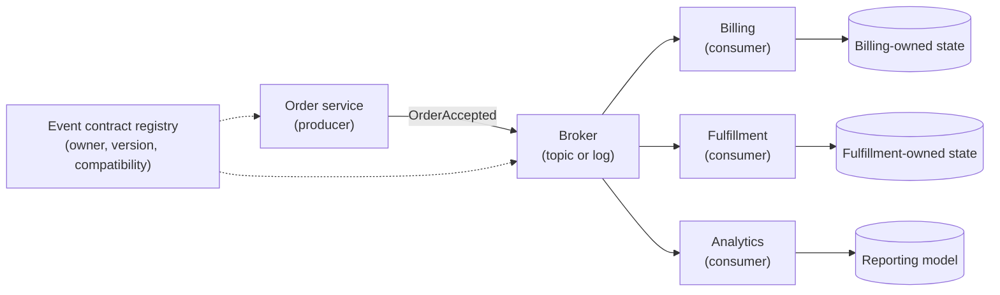

The diagram shows the property that makes the pattern useful and the property that makes it risky. The producer has one outgoing arrow regardless of how many consumers exist, so adding Analytics required no change to the Order service. But each consumer writes only its own state. A consumer must not write the producer's database, because that would reintroduce the shared-state coupling that [Microservices](CH05_Microservices.md) warns about. The registry is drawn as a dotted link because it is a governance and tooling concern. It is not on the delivery path, but it is where ownership, versioning, and sensitivity of each event are recorded.

### 2.1 What coupling is removed and what remains

Event-driven design removes **temporal coupling**: the producer can publish while a consumer is down, and the consumer catches up later. It reduces **knowledge coupling** of identity: the producer does not hold a list of callers. It does not remove **semantic coupling**. Every consumer depends on what `OrderAccepted` means, which fields it carries, and what a missing field implies. A change to the meaning of the event is a breaking change for every consumer even though no code in the producer references them.

This is why the chapter treats the contract as the central artifact. A team that adopts a broker without owning event contracts has moved the coupling from visible method calls to invisible dependencies, which is harder to find and harder to change. The section on schema evolution and event contracts returns to this.

### 2.2 Time and state: what the producer can and cannot assume

When a synchronous call returns success, the caller knows the callee finished. When an event is published, the producer knows only that the broker accepted it, and only if it checked the acknowledgement. It cannot assume that any consumer has seen the event, processed it, or will process it exactly once. Two consequences follow for design.

- Business rules that require all effects to be complete before the user gets an answer do not fit a purely event-driven interaction. They need a synchronous step or a coordinating workflow such as the [Saga Pattern](CH10_Saga_Pattern.md).
- The system as a whole is **eventually consistent**. Between publication and the last consumer finishing, different services hold different views. The theory of what consistency a system can offer is owned by the [CAP Theorem](../07_System_Design_and_Distributed_Systems/CH05_CAP_Theorem.md) chapter. In this chapter the practical question is how long the window is, who can observe it, and what the user sees during it.

## 3. Forces: When Events Fit and When They Do Not

The pattern is a response to specific forces. Naming them guards against adopting it because it is fashionable.

### 3.1 Forces that favour events

- **Many independent reactions to one fact.** When an order is accepted, billing, fulfillment, notification, and analytics all react. A synchronous design would make the order service call each one, so its latency and availability would become the product of theirs, as the availability arithmetic in [Microservices](CH05_Microservices.md) shows.
- **Different timing needs.** The customer needs a response in 200 milliseconds. The warehouse can process in minutes. Events let each consumer run at its own pace.
- **Load smoothing.** A broker absorbs a burst and lets consumers drain it at a steady rate, so the consumer is sized for average load plus an acceptable lag instead of for the peak.
- **Independent evolution.** New consumers (a fraud check, a reporting model) can be added by a different team without a producer release.
- **Replay and rebuild.** With a retained log, a new consumer can read history and build its state, which supports [CQRS (Command Query Responsibility Segregation)](CH09_CQRS.md) projections.

### 3.2 Forces that argue against events

- **The caller needs the answer.** A price lookup, an authorization decision, or a validation that must block the user is a query. Hiding it behind events only adds latency and a correlation problem.
- **Strong consistency across the participants.** If two updates must be visible together or not at all, an event pipeline gives a window in which they are not. See [Distributed Transactions](../07_System_Design_and_Distributed_Systems/CH12_Distributed_Transactions.md) for the cost of the alternatives.
- **A small system with one team.** The broker, schema governance, consumer lag monitoring, and replay tooling are fixed costs. A modular monolith calling in-process interfaces is often the better design until the forces above appear.
- **Weak operational maturity.** Without per-consumer lag alerting and a poison-message process, failures are silent. A synchronous failure produces an error; an asynchronous one produces a stalled consumer nobody notices.

### 3.3 A decision heuristic

Ask three questions for each interaction. Does the producer need a result from the other side before it can respond? If yes, use a request. Are there, or will there likely be, several independent reactions? If no, a point-to-point message or a call is simpler. Can the participants tolerate the delay between publication and reaction, and can the user interface present it honestly? If no, an event is the wrong tool for that interaction. Many systems legitimately mix all three styles, with synchronous requests on the user path and events for the consequences.

## 4. Event Types and Intent

The word "event" is used for several different things. Choosing the wrong kind is a common source of coupling, so this section separates them by intent.

### 4.1 Commands, events, and queries

A **command** asks a specific owner to do something and can be refused. A **query** asks for information and expects an answer. An **event** states that something already happened and cannot be refused, because the fact is past. Messages on a broker can carry any of the three, so using a broker does not by itself make a design event-driven.

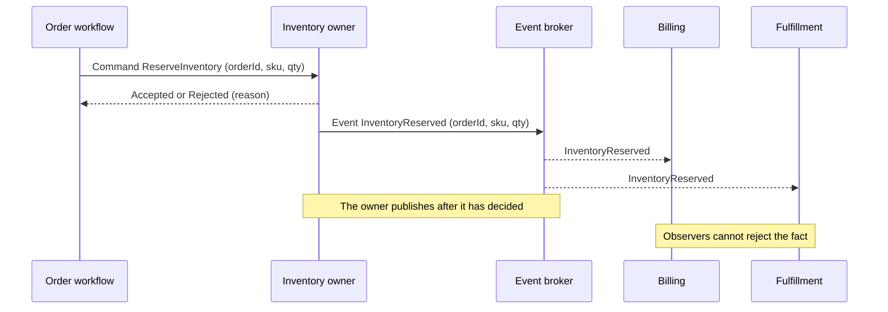

The command has one addressee and a reply: the workflow learns whether the reservation succeeded and can react. The event has no reply. The owner publishes it after deciding, and observers cannot veto it. The implication is about authority. If Billing could reject `InventoryReserved`, the message would really be a command in disguise, and the owner would need to wait for the answer. Teams that blur this rule end up with a broadcast "please update" message that no single component is responsible for, and with failures that nobody can attribute.

Practical rules:

- Name commands in the imperative and address them to one owner. Name events in the past tense and publish them from the owner of the fact.
- A command carries what the owner needs to authorize and validate it. An event describes the fact and does not prescribe what consumers should do.
- A producer should not publish an event to make something happen in a specific consumer. If it needs a particular reaction, it should issue a command to that owner, or use a workflow that tracks the outcome.
- A query disguised as an event (a "please publish the current price" request) leaks ownership. Use a request, or have the owner publish its state as changes occur.

### 4.2 Event notification

In an **event notification**, the event is small. It says that something happened and carries the identifiers needed to find out more, for example `{ "orderId": "o-1842", "type": "OrderAccepted" }`. A consumer that needs details calls back to the producer's interface, usually with a query.

Notification has real advantages. The payload is small and stable, so the contract changes rarely. The producer keeps control of who can read the data, because every consumer must authenticate to fetch it. Sensitive fields never travel on the broker.

The costs are the callback and its timing. Each consumer adds read load on the producer, and that load is correlated with event volume, so a burst of events becomes a burst of queries against the producer. The callback also returns the producer's current state, not its state at the time of the event. If the order changed between publication and the callback, the consumer reacts to a later state than the event described. Consumers must therefore tolerate the situation where the state they fetch is newer than the event they are processing, and should be written to act on current state, not on the event as a snapshot. The availability of the producer returns as a runtime dependency of every consumer, which weakens the temporal decoupling that motivated events.

### 4.3 Event-carried state transfer

In **event-carried state transfer**, the event carries enough data for consumers to act without calling back. An `AddressChanged` event includes the customer identifier, the new address, and a version. A consumer, such as Shipping, keeps its own local copy of the data it needs and updates it from the events.

This gives the consumer autonomy. Shipping can calculate a delivery estimate while the Customer service is down, and its reads are local and fast. It also supports building read models, which connects to [CQRS (Command Query Responsibility Segregation)](CH09_CQRS.md).

The costs are different:

- **Duplicated data.** Each consumer holds a copy that can be stale. The design must say how stale it may be and what happens when it is wrong.
- **Wider contract.** The payload is now a schema many consumers depend on. The more fields included, the more consumers depend on fields the producer would like to change.
- **Data exposure.** Every field is readable by every subscriber. Sensitive fields need explicit decisions, for example sending a reference or restricting the topic.
- **Ordering sensitivity.** If two `AddressChanged` events arrive out of order, applying them blindly leaves the older address. The version field exists so the consumer can ignore an event older than the state it holds. The section on ordering and partitioning covers how to reduce reordering.
- **Initial load.** A new consumer starts empty. It needs either a retained log it can read from the beginning or a snapshot published for the purpose.

A common mistake is publishing one enormous event "so nobody ever has to call us". That couples every consumer to fields it does not need and exposes data broadly. Prefer events shaped for a purpose, with fields that a defined set of consumers need.

### 4.4 Domain events and integration events

A **domain event** records a fact inside a bounded context, in the language of that context, and is usually handled inside the same service, often in the same process. In Domain-Driven Design (DDD), an aggregate raises `OrderLineAdded` and another part of the same service reacts. [Low-Level Design](../07_System_Design_and_Distributed_Systems/CH04_Low_Level_Design.md) owns the class-level mechanics of domain events.

An **integration event** is published across a service boundary. It is part of a public contract and is designed for consumers who do not share the producer's model. Its fields are chosen for outside readers, its names avoid internal vocabulary, and its stability matters much more than that of an internal domain event.

The two should be separate types even when they look similar. If the internal domain event is published directly, every refactoring of the domain model changes a public contract. A small translation step, in which the service maps the domain event to an integration event, gives the team freedom to change its internals. This is the same principle as an anti-corruption layer at the boundary, applied to messages.

[Event Sourcing](CH11_Event_Sourcing.md) uses events differently: they are the stored state of the aggregate, and a published integration event is a derived view of them. That chapter owns the mechanism. The consequence here is that the stored event log must not be exposed as the integration contract, for the same reason the domain event must not be.

### 4.5 Choosing among the types

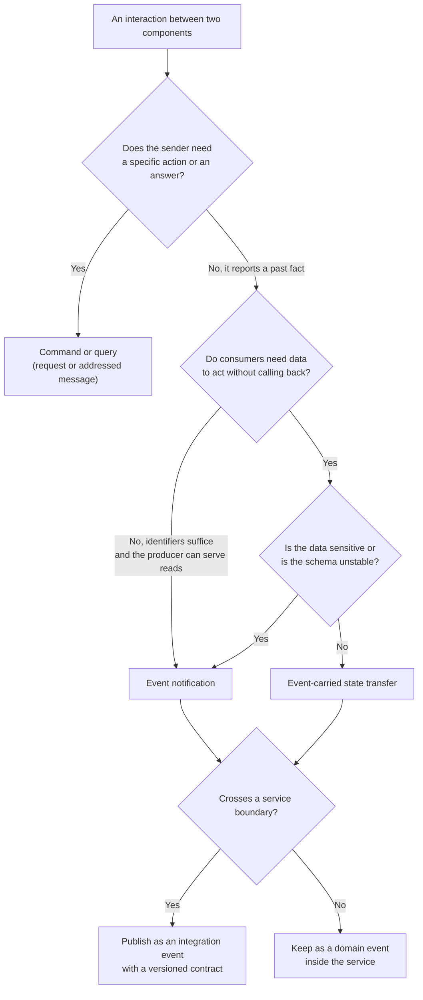

The tree is a first filter and not a rule. It makes the sequence of decisions explicit: intent first, then payload size, then boundary. Real systems often use notification for sensitive subjects and state transfer for reference data such as product catalogues, in the same design. What matters is that each event type has a stated reason, recorded next to its contract.

| Type | Payload | Consumer coupling to producer at run time | Main risk |
| --- | --- | --- | --- |
| Command | Instruction for one owner | High (needs the owner to be reachable or the message queued) | Disguised broadcast with unclear authority |
| Event notification | Identifiers and type | Callback needed for details | Load and staleness on callback |
| Event-carried state transfer | Data consumers need | Low | Wide contract, stale copies, data exposure |
| Domain event | Fact in domain language | None (same service) | Leaking it as a public contract |
| Integration event | Fact designed for outsiders | Low | Contract stability and versioning |

## 5. Brokers: Queues, Publish-Subscribe, and Logs

The broker is where the guarantees of an event-driven system are decided. Three shapes are common, and many products offer more than one. This chapter describes the shapes and not any product's configuration, which belongs to [Messaging](../09_Cloud_Computing/CH12_Messaging.md).

### 5.1 Three shapes and what each retains

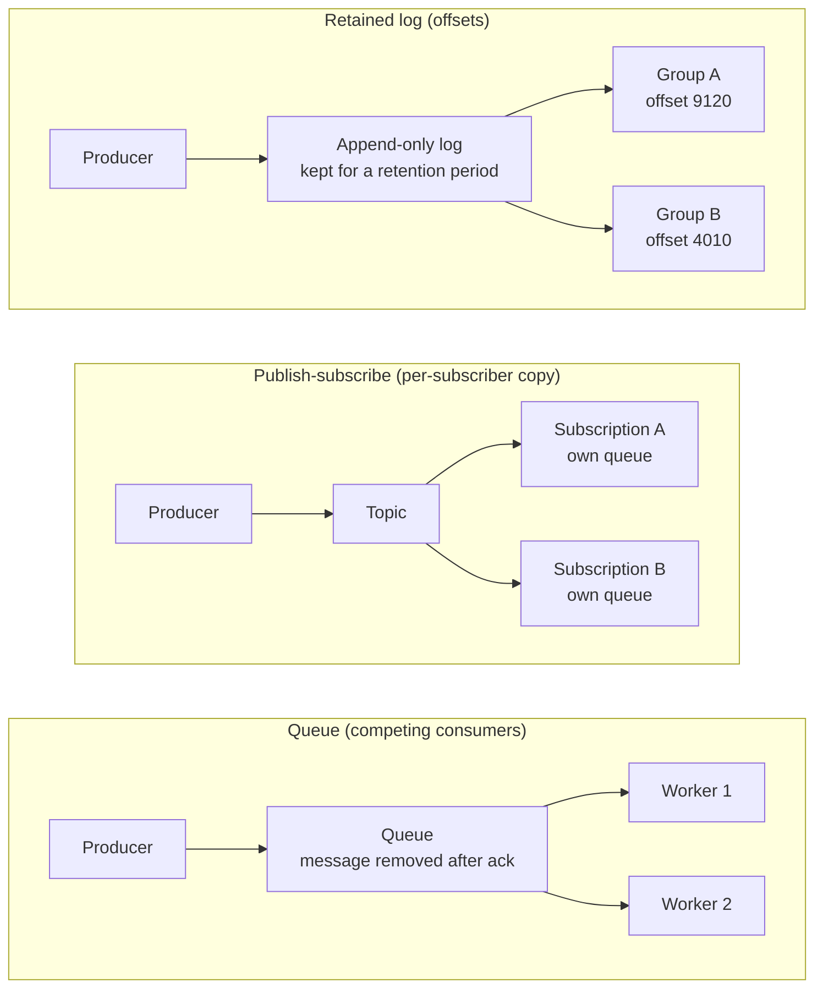

A **queue** hands each message to one of several competing workers and removes it once a worker acknowledges it. It suits work distribution: a message is a task and should be done once by somebody. A queue does not replay. After the acknowledgement, the message is gone, and a new consumer cannot see history.

A **publish-subscribe** topic copies each message to every subscription, and each subscription behaves like its own queue. It suits fan-out, where each interested party needs every event. Each subscriber's backlog is independent, which is what lets a slow subscriber lag without hurting others. Retention is usually until acknowledged or expired, so history is limited.

A **retained log** appends events to an ordered sequence and keeps them for a configured period or size, regardless of whether anyone has read them. Consumers track their own position, called an offset, so each consumer group reads independently, can rewind, and a new group can start from the beginning. Events are not removed when read. The cost is that the consumer owns its progress, and that retention and storage must be sized and paid for.

The decision turns on replay and fan-out needs:

- Work that must be done once by one of N workers, with no replay need: a queue.
- Several independent reactions, each needing every event, history not required: publish-subscribe.
- New consumers that must be able to build state from history, reprocessing after a bug fix, or very high throughput with ordering per key: a retained log.

Some systems combine them, for example a log as the system of record with queues for task distribution downstream. The mistake to avoid is using a queue when replay is a likely requirement. Reconstructing history after the fact means asking the producers to republish, which they often cannot do consistently.

Replication of the broker's own data, such as how a log keeps copies on several nodes, is distributed-systems material owned by [Replication](../07_System_Design_and_Distributed_Systems/CH10_Replication.md). The design consequence for this chapter is that "the broker accepted my event" depends on how many copies must exist before the acknowledgement. A producer that does not wait for a durable acknowledgement can lose an event on a broker failure. Producers should be configured to wait for the level of durability the business needs and to treat an unacknowledged publish as a failure to handle.

### 5.2 Delivery semantics as a mechanism

Delivery semantics describe what a consumer can assume about how many times it sees an event. They are the result of where the consumer places the acknowledgement relative to its processing. This is easy to state and widely misunderstood, so the mechanism is shown step by step.

A consumer receives an event, performs its effect (for example, writes to its database), and acknowledges (tells the broker, or commits an offset, that the event is done). The broker redelivers an event if it does not receive the acknowledgement in time, or on restart resumes from the last committed position. A crash or a lost network message can happen between any two steps.

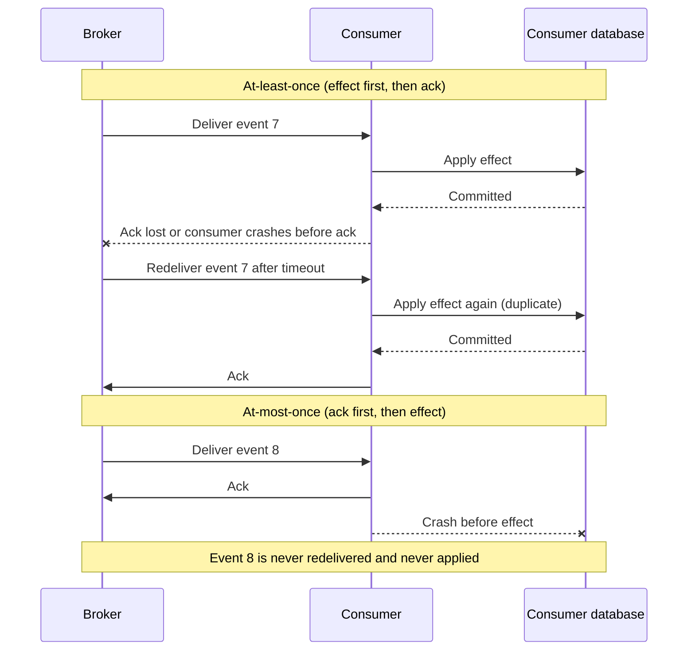

**At-most-once.** The consumer acknowledges before processing. If it crashes after the acknowledgement and before the effect, the event is lost, and the broker will not send it again. No duplicates, but possible loss. It is acceptable only where an occasional loss is harmless, such as a sampled metric or a best-effort cache hint.

**At-least-once.** The consumer acknowledges after the effect is durable. If it crashes after the effect and before the acknowledgement, the broker redelivers, and the effect happens twice. No loss in this path, but duplicates. This is the practical default for business events, because losing an `OrderAccepted` is worse than seeing it twice, and because duplicates can be made harmless, as the next two sections show.

**Exactly-once.** A claim that the effect happens once and only once. A network between the broker and a consumer cannot provide it in isolation, because the sender cannot distinguish a lost message from a lost acknowledgement. What systems provide is a combination: at-least-once delivery plus an effect that is safe to repeat, or a transaction that commits the consumer's input position and its output atomically. Both are described here as "effectively once". The processing-level mechanisms, including transactional commits of offsets together with output, are owned by [Exactly-Once Processing](../07_System_Design_and_Distributed_Systems/CH17_Exactly_Once_Processing.md). The main limit to remember is that such guarantees cover state inside the transaction boundary. An email sent, a card charged, or a call made to an external service is outside it and needs its own idempotency or reconciliation.

The architectural conclusion is stated plainly. Design every consumer of a business event for at-least-once delivery, which means every consumer can see the same event more than once. The delivery guarantee of the broker is then an optimization (fewer duplicates), not a correctness requirement.

### 5.3 Worked arithmetic: how many duplicates must a consumer absorb

Take an illustrative payment-notification consumer. It reads from a retained log, processes in batches, and commits its offset after each batch of 500 events. The topic carries 2,000,000 events per day. Eight consumer instances run, and a deployment restarts all of them.

Duplicates from restarts. A crash falls on average halfway through a batch, so the expected redelivery per ungraceful stop is about 500 / 2 = 250 events. A rolling restart of 8 instances causes up to 8 × 250 = 2,000 redelivered events. With 3 deployments a day, that is up to 6,000 duplicates, or 6,000 / 2,000,000 = 0.3% of volume. Graceful shutdown reduces this, but process kills, node failures, and rebalances also occur.

Duplicates from timeouts. If 0.05% of events exceed the broker's session timeout and are reassigned while the first consumer is still running, 2,000,000 × 0.0005 = 1,000 events a day are processed twice, possibly concurrently.

Total duplicates are about 6,000 + 1,000 = 7,000 per day, which is 0.35% of events. If each duplicate charges an average of 40 currency units, the exposure is 7,000 × 40 = 280,000 currency units per day. A fraction of a percent is large when multiplied by volume and cost per effect.

The duplicate rate is driven by deployments, rebalances, timeouts, and failures, not by the broker's quality. Estimate it per consumer and choose an idempotency mechanism that makes the expected count harmless.

## 6. Idempotent Consumers

An operation is idempotent if applying it several times has the same effect as applying it once. Making a consumer idempotent is the practical answer to at-least-once delivery. The general theory, the catalogue of strategies, and the identity and fingerprint rules are owned by [Idempotency](../07_System_Design_and_Distributed_Systems/CH16_Idempotency.md), and the exact membership and window questions by [Deduplication](../07_System_Design_and_Distributed_Systems/CH19_Deduplication.md). This section applies them to event consumers and shows the two forms an architect most often chooses between.

### 6.1 Natural idempotency and versioned state

Some effects are repeat-safe by their shape. "Set the shipping address of customer 17 to X" gives the same result however many times it is applied, provided events arrive in order. It is not repeat-safe when events are reordered, because applying an older event after a newer one regresses the state. The fix is to carry a version (or a monotonically increasing sequence) in the event and to apply a change only if it is newer than what the consumer holds.

```sql
INSERT INTO customer_address (customer_id, address, version)
VALUES (:customerId, :address, :version)
ON CONFLICT (customer_id) DO UPDATE
   SET address = EXCLUDED.address,
       version = EXCLUDED.version
 WHERE customer_address.version < EXCLUDED.version;
```

This statement, written in PostgreSQL syntax, is both duplicate-safe and reorder-safe. A duplicate has the same version, so the `WHERE` clause is false and nothing changes. A late older event is ignored for the same reason. No extra table is needed. The approach works when the effect is a state replacement and the producer provides a version for the entity. It does not work for effects that accumulate, such as "add 10 to the balance", or that leave the system, such as sending a message.

### 6.2 The inbox: record the event identifier in the same transaction

When the effect is not naturally repeat-safe, the consumer records the identity of each processed event in a table and skips events it has already recorded. The recording and the effect must commit in one database transaction. If they are separate, a crash between them leaves either a recorded event with no effect (a loss) or an effect with no record (a later duplicate).

```sql
CREATE TABLE inbox (
    consumer_name text        NOT NULL,
    event_id      uuid        NOT NULL,
    processed_at  timestamptz NOT NULL DEFAULT now(),
    PRIMARY KEY (consumer_name, event_id)
);
```

```java
@Service
public class PaymentNotificationHandler {

    private static final String CONSUMER = "payment-notification";
    private final JdbcTemplate jdbc;
    private final NotificationLedger ledger;

    public PaymentNotificationHandler(JdbcTemplate jdbc, NotificationLedger ledger) {
        this.jdbc = jdbc;
        this.ledger = ledger;
    }

    @Transactional
    public void handle(EventEnvelope event) {
        int inserted = jdbc.update(
            "INSERT INTO inbox (consumer_name, event_id) VALUES (?, ?) ON CONFLICT DO NOTHING",
            CONSUMER, event.eventId());
        if (inserted == 0) {
            return; // already processed, safe to acknowledge
        }
        ledger.recordNotification(event.subject(), event.data()); // same transaction
    }
}
```

The primary key makes the claim atomic. Two concurrent deliveries of the same event cannot both insert, so only one performs the effect, which also covers the case of a slow first consumer and an overlapping redelivery. The transport acknowledgement (offset commit or message ack) happens after the method returns. If the process dies after the database commit and before the acknowledgement, the redelivery finds the inbox row and returns immediately. The handler is the "effect then ack" order from the delivery section, made safe.

The inbox is scoped by consumer name because each consumer deduplicates independently. Two consumers can process the same `eventId` once each.

### 6.3 What the inbox does not cover

- **External side effects.** If `recordNotification` calls an e-mail provider over a network, the transaction cannot include that call. A crash after the provider accepted the message and before the commit causes a second send on redelivery. The remedy is to send through an interface that accepts an idempotency key (derived from the event identifier), or to write the intention to a table and let a separate sender with its own key send it. [Exactly-Once Processing](../07_System_Design_and_Distributed_Systems/CH17_Exactly_Once_Processing.md) explains where such boundaries lie.
- **Unbounded growth.** The table grows with every event. In the earlier illustration, 2,000,000 events per day retained for 7 days gives 14,000,000 rows. At an assumed 100 bytes per row including the index, that is about 14,000,000 × 100 = 1.4 gigabytes. That is manageable, but the retention window has to be chosen deliberately: it must exceed the longest period in which the broker could redeliver or an operator could replay an old event. If a replay reaches back 30 days and the inbox keeps 7, the older events are reprocessed as new. Cleanup by time (or by partitioned tables dropped whole) bounds the cost, and the window is a documented parameter of the consumer.
- **Different identity for the same fact.** Deduplication by `eventId` assumes the producer gives a repeated publication the same identifier. A producer that retries a publish and generates a new identifier each time defeats the inbox. The identifier must be assigned when the fact is recorded and reused on every publication of it. The outbox section below produces this property by construction.

### 6.4 Choosing between the two forms

| Situation | Preferred form | Reason |
| --- | --- | --- |
| Replace state of an entity, version available | Versioned conditional upsert | No extra storage, handles reordering |
| Accumulating effect (counter, balance, ledger entry) | Inbox in the same transaction | The effect is not repeat-safe by shape |
| Effect leaves the database (e-mail, payment provider) | Idempotency key on the outbound call, plus inbox for local state | The transaction cannot cover the remote system |
| Effect is a pure read-model update that can be rebuilt | Versioned upsert, or rebuild from the log | Cheap, and correctness restored by replay |

A final design rule: the consumer's idempotency must be tested, not assumed. A useful test publishes every event twice, in both orders, and asserts the final state equals the state from a single ordered delivery.

## 7. Ordering and Partitioning

Order matters when two events about the same thing must be applied in the sequence they occurred: `OrderPlaced` before `OrderCancelled`, `AddressChanged` v6 before v7. A global order across all events is expensive, because it forces a single sequence through a single writer and a single reader. Most designs therefore ask for a weaker and cheaper guarantee: order **per key**. All events for one order, customer, or account arrive in order. Events for different keys have no defined order relative to each other. The theory of ordering, clocks, and reorder buffers is owned by [Ordering Guarantees](../07_System_Design_and_Distributed_Systems/CH18_Ordering_Guarantees.md), and how data is split across nodes by [Partitioning](../07_System_Design_and_Distributed_Systems/CH11_Partitioning.md). This section covers the architectural consequences.

### 7.1 How per-key order is obtained

The usual mechanism divides a topic into **partitions**, which are independent ordered sequences. The producer chooses a partition by hashing the event's key and taking the remainder modulo the number of partitions, so all events with the same key land in the same partition and keep their relative order. Each partition is read by at most one consumer within a consumer group at a time, so one worker sees that key's events in order. Parallelism comes from many partitions processed by many workers.

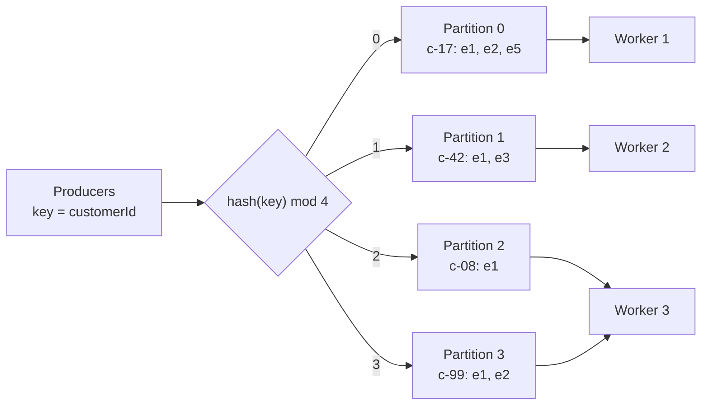

The figure shows two facts that govern design. Within a partition, events for `c-17` are in order and are handled by one worker, so no locking is needed between concurrent handlers of the same customer. Across partitions, there is no ordering: `c-42`'s events might be processed before or after `c-17`'s, which is fine as long as no consumer needs a cross-customer sequence. Worker 3 reads two partitions, so the number of workers can be lower than the number of partitions, but never useful above it, since an extra worker would have no partition. The partition count is therefore the ceiling for consumer parallelism.

### 7.2 Choosing the key

The key should be the identifier of the **unit of consistency**: the thing whose events must stay ordered. For an order lifecycle, use the order identifier. For an account ledger, the account identifier. Choosing a coarser key than needed (for example a tenant identifier, when only per-order order matters) concentrates load in fewer partitions. Choosing a finer key (for example a line item) loses order between events that needed it.

A common trap is a key that is correct for ordering and bad for load. This is the **hot key** problem.

### 7.3 Worked arithmetic: partition sizing and a hot key

Assume an event rate of 6,000 events per second at peak, and that a single worker can process 800 events per second for this consumer (for instance, because each event needs a database write). The minimum number of partitions with perfectly even load is 6,000 / 800 = 7.5, so 8. With headroom of 50%, aim for 8 × 1.5 = 12 partitions.

Now suppose one large customer produces 25% of all events and the key is the customer identifier. That customer's events all go to one partition. The load on it is 6,000 × 0.25 = 1,500 events per second, against a worker capacity of 800. The backlog on that partition grows by 1,500 − 800 = 700 events per second. After 10 minutes, the backlog is 700 × 600 = 420,000 events. At the capacity of 800 per second, even if the arrival rate then dropped to zero, draining it would take 420,000 / 800 = 525 seconds. Adding more partitions or more workers does not help, because the hot customer's events still map to a single partition. Remaining partitions sit underloaded.

The options, with their costs:

- **Split the key** (for example, customer plus a bucket number from 0 to 3). This spreads the load across four partitions, but order between that customer's events is no longer guaranteed across buckets. It is acceptable only if the consumer does not need strict order for that customer, or if the bucket is derived from a finer unit of consistency such as the order within the customer.
- **Make the consumer faster per event**, for example by batching writes, so the single worker handles more than 1,500 per second.
- **Handle the large tenant separately**, on a dedicated topic with its own consumers.
- **Accept lag** for that key if its freshness requirement permits.

The decision is made from the requirement, not from the mechanism. The question to ask is what breaks if two events for the same key are applied out of order. If the answer is "nothing, because the consumer uses versions", the key can be finer.

### 7.4 Changing the partition count

Because the partition is chosen by hash modulo the count, changing the count changes where keys go. With a simple modulo scheme, moving from 12 to 16 partitions leaves a key on its old partition only when `h mod 12` equals `h mod 16`. Over any 48 consecutive hash values, this holds for 12 of them (those below 12). So about 12 / 48 = 25% of keys keep their partition and 75% move. While the change is being rolled out, events for a moved key can be in the old partition, waiting to be consumed, while new events for the same key are already in the new partition, and order for that key is broken for a short window.

The practical guidance is to provision partitions for the expected peak up front, since the count is hard to change safely. If a change is unavoidable, drain consumers first or publish through a temporary stage that preserves order. A product's behaviour on partition changes should be checked in its documentation, and not assumed from this simplified model.

### 7.5 Ordering inside the consumer

Per-key order at the broker does not guarantee per-key order in effects, if the consumer breaks it. A consumer that takes events from a partition and hands them to a thread pool reintroduces concurrency for the same key. The consumer must either process serially per key, or process in parallel only across keys. Retries create a similar hazard: if event 5 for a key fails and is moved to a retry queue while event 6 proceeds, event 6 is applied before 5. Either block the key until 5 succeeds, or make the effects order-tolerant with versions as in the section on idempotent consumers. Blocking one key blocks the partition for everyone sharing it, which is why a persistently failing event needs a bounded retry and a quarantine path.

Use ordering sparingly. Every ordering requirement reduces parallelism, so the minimum needed per-key guarantee should be stated in the event contract.

## 8. The Dual-Write Problem and the Transactional Outbox

A service that changes its own database and also publishes an event has two systems to update. The database and the broker do not share a transaction. The ownership of this problem sits with [Distributed Transactions](../07_System_Design_and_Distributed_Systems/CH12_Distributed_Transactions.md), which covers the dual-write problem and the transactional outbox pattern in depth, and a runnable demonstration is in [01_dual_write_problem_demo.py](../code/python/distributed-transactions-chapter/01_dual_write_problem_demo.py). This section shows what it means for an event-driven design and how to build it.

### 8.1 The failure

Consider the code path of `acceptOrder`:

1. Insert the order row and commit.
2. Publish `OrderAccepted` to the broker.

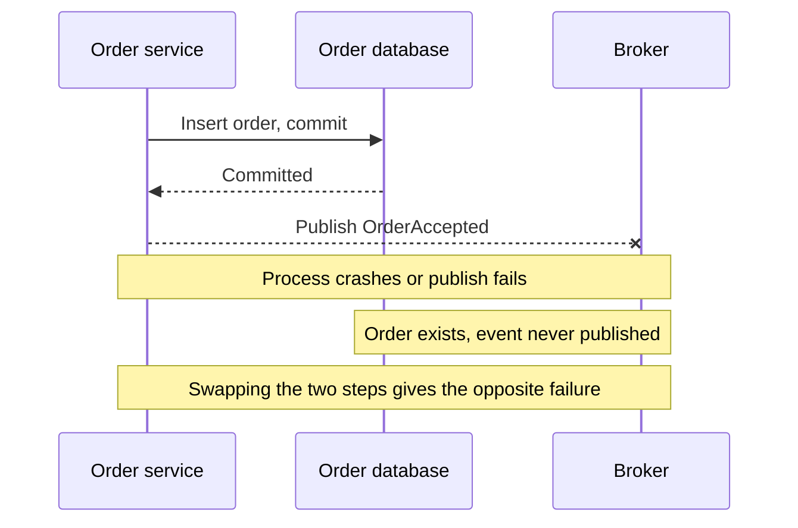

If the process crashes between the steps, or the broker is unavailable, the order exists and the event does not. Billing never charges and Fulfillment never ships. If the steps are swapped (publish first, then commit), a failed commit leaves an event announcing an order that does not exist. Wrapping both in a retry loop narrows the window but does not remove it, because the process can still die between them, and a retry after an ambiguous failure can publish twice.

Illustrative arithmetic: a service accepts 1,000,000 orders a day. Suppose 1 in 100,000 accepted orders hits a crash or an unreachable broker in the window between commit and publish. That is 1,000,000 / 100,000 = 10 orders per day with no event. Over 30 days, 300 orders are silently never billed or shipped, and nothing in the logs necessarily records which ones. The probability is small. The effect is permanent inconsistency, found only when a customer complains or a reconciliation job runs.

### 8.2 The outbox mechanism

The **transactional outbox** removes the second system from the transaction. The service writes the event to an `outbox` table in the same database and in the same transaction as the state change. A separate relay later reads the unpublished rows and publishes them to the broker. The atomic database transaction guarantees that either both the order and its event exist or neither does.

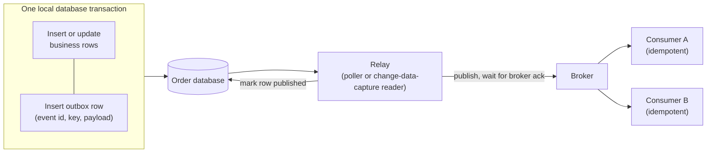

The relay publishes, waits for the broker's acknowledgement, and then marks the row as published. If it crashes between publishing and marking, it publishes the row again on restart. The outbox therefore gives **at-least-once publication**, and not exactly-once. The consumers are already idempotent from the previous section, and they rely on the event identifier staying the same across republications, which the outbox guarantees because the identifier is generated once, when the row is written.

The design shifts the failure from "event lost" to "event delayed". If the broker is down for an hour, rows accumulate in the outbox, and the relay drains them when the broker returns. The business transaction still commits. Whether the order service should accept orders while its relay cannot publish is a business decision that the outbox makes explicit and measurable, by the age of the oldest unpublished row.

The table can look like this (PostgreSQL syntax):

```sql
CREATE TABLE outbox (
    id            uuid        PRIMARY KEY,
    aggregate_id  text        NOT NULL,
    event_type    text        NOT NULL,
    payload       jsonb       NOT NULL,
    created_at    timestamptz NOT NULL DEFAULT now(),
    published_at  timestamptz
);

CREATE INDEX outbox_unpublished
    ON outbox (created_at)
    WHERE published_at IS NULL;
```

The partial index keeps the relay's query fast, because it contains only unpublished rows however large the table becomes. The `aggregate_id` becomes the partition key at publication, so per-aggregate order follows from the order in which the relay reads and publishes rows for one aggregate.

The service writes the order and the event together:

```java
@Service
public class OrderService {

    private final OrderRepository orders;
    private final JdbcTemplate jdbc;
    private final ObjectMapper mapper;

    public OrderService(OrderRepository orders, JdbcTemplate jdbc, ObjectMapper mapper) {
        this.orders = orders;
        this.jdbc = jdbc;
        this.mapper = mapper;
    }

    @Transactional
    public Order accept(NewOrder request) throws JsonProcessingException {
        Order order = orders.save(Order.accepted(request));
        String payload = mapper.writeValueAsString(OrderAcceptedData.from(order));
        jdbc.update(
            "INSERT INTO outbox (id, aggregate_id, event_type, payload) VALUES (?, ?, ?, ?::jsonb)",
            UUID.randomUUID(), order.id().toString(), "OrderAccepted", payload);
        return order;
    }
}
```

The event identifier is generated in the same transaction as the order, so it is stable for the life of the fact.

### 8.3 The relay

The relay has two common forms. A **polling relay** runs a query for unpublished rows on a short interval. A **log-reading relay** uses change data capture (CDC), reading the database's own transaction log and turning inserts into the outbox table into published events, without polling. A product that provides this is a tool choice, and its limits and configuration belong with [Messaging](../09_Cloud_Computing/CH12_Messaging.md) and the database documentation.

A polling relay in Spring Boot, using PostgreSQL's row locking:

```java
@Component
public class OutboxRelay {

    private final JdbcTemplate jdbc;
    private final KafkaTemplate<String, String> kafka;
    private final TransactionTemplate tx;

    public OutboxRelay(JdbcTemplate jdbc, KafkaTemplate<String, String> kafka, TransactionTemplate tx) {
        this.jdbc = jdbc;
        this.kafka = kafka;
        this.tx = tx;
    }

    @Scheduled(fixedDelay = 200)
    public void drain() {
        tx.executeWithoutResult(status -> {
            List<Map<String, Object>> rows = jdbc.queryForList(
                "SELECT id, aggregate_id, event_type, payload::text AS payload " +
                "FROM outbox WHERE published_at IS NULL " +
                "ORDER BY created_at LIMIT 100 FOR UPDATE SKIP LOCKED");
            for (Map<String, Object> row : rows) {
                try {
                    kafka.send("orders.events", (String) row.get("aggregate_id"),
                               (String) row.get("payload")).get(5, TimeUnit.SECONDS);
                } catch (Exception e) {
                    throw new IllegalStateException("publish failed, will retry", e);
                }
                jdbc.update("UPDATE outbox SET published_at = now() WHERE id = ?", row.get("id"));
            }
        });
    }
}
```

Several details matter more than the syntax.

- The publish waits for the broker acknowledgement (`get` on the send result) before the row is marked. Marking first would reintroduce loss.
- A failure rolls back the transaction, so rows already marked in the batch return to unpublished and the whole batch is attempted again. Some events are therefore published twice. The consumers' idempotency absorbs that.
- The aggregate identifier is the message key, so per-aggregate order at the broker follows from the order of publication.
- `SKIP LOCKED` lets several relay instances work without blocking each other, but it can publish a later row of an aggregate before an earlier row that another instance holds. If strict order per aggregate is required, run one relay instance, or assign each relay instance a fixed share of aggregates by a hash of `aggregate_id`.
- The transaction stays open while the relay waits for the broker. This is acceptable for small batches and a healthy broker. For slower brokers, a variant claims rows by setting a lease timestamp in a short transaction and publishes outside it.

### 8.4 Polling relay versus log-reading relay

| Aspect | Polling relay | Log-reading relay (CDC) |
| --- | --- | --- |
| Added publication latency | Polling interval plus processing (200 ms in the example) | Typically lower, but depends on the tool |
| Load on the database | Repeated queries and updates to mark rows | Reads the log, no polling query |
| Operational dependency | Application code only | A capture component with its own deployment, offsets, and failure modes |
| Ordering | Controlled by the query and relay instances | Follows commit order of the log |
| Cleanup | Delete or archive published rows | Rows can be deleted soon after insert, since the log carries the event |
| Portability | Any relational database | Depends on the database and the tool |

For most teams starting out, the polling relay is the smaller commitment, because it adds no new infrastructure. When publication latency requirements are tight or database load from polling becomes visible, a log-reading relay is the natural next step. The application code that writes to the outbox does not change, which is why the pattern migrates well.

### 8.5 Operating the outbox

The outbox adds a table that must be watched.

- **Unpublished age.** Alert on the age of the oldest row with `published_at IS NULL`. This is the direct measure of publication lag and the signal that the relay or broker is unhealthy. A count alone can hide a single stuck row that blocks a key.
- **Table growth.** Published rows are history. Delete or archive them on a schedule. For 1,000,000 events a day, an unpurged table adds 1,000,000 rows daily, and the table and its indexes grow until queries slow.
- **Poison rows.** A row whose payload cannot be published (for example, it violates a size limit) will fail on every attempt and, with strict ordering, block rows behind it. Give the relay a bounded retry count and a place to park the row for a human, as in the retry and quarantine design later in this chapter.
- **Schema of the payload.** Rows hold serialized events. If the schema evolves while rows are waiting, the relay publishes old-format payloads, so consumers must remain compatible with every version that can be in flight.

The alternatives are weaker. Publishing from application code after commit has the lost-event window. Publishing before commit announces facts that may roll back. Distributed transactions across the database and the broker require both to support them, couple availability of the two, and are often unavailable. Another option, deriving events from changes by reading the database log without an outbox table, avoids the extra writes but exposes the internal table schema as the public event contract, which is the leaking problem raised for domain events. The outbox allows the event shape to be designed separately from the table shape.

The runnable counterpart in this repository is [02_transactional_outbox.py](../code/python/distributed-transactions-chapter/02_transactional_outbox.py).

## 9. Schema Evolution and Event Contracts

Producers and consumers are released on different schedules by different teams. The event contract is the only agreement between them, so changing it safely is the main long-term cost of the pattern. Interface compatibility in general, including REST versioning, is covered in [Versioning](../08_API_Architecture/CH10_Versioning.md). Events differ in one important way: a retained log holds old events, so consumers must handle old and new formats at the same time, often for months.

### 9.1 The event envelope

A uniform envelope separates what every event has from what is specific to its type. This example is a JSON (JavaScript Object Notation) envelope. Its fields are chosen for this chapter and are similar in spirit to public specifications such as CloudEvents, which a team may prefer to adopt instead of defining its own.

```json
{
  "eventId": "6f1d2a50-4b7e-4c1a-9a43-2d5c8e1b7a10",
  "eventType": "OrderAccepted",
  "schemaVersion": 2,
  "occurredAt": "2026-11-05T09:14:03.120Z",
  "producer": "order-service",
  "subject": "order/o-1842",
  "correlationId": "c0b8f3a2-71de-4a57-8d6f-93b0f4a6c001",
  "causationId": "a97d1c40-2a8b-4e7f-b6a1-5e0fd2b3c9e2",
  "data": {
    "orderId": "o-1842",
    "customerId": "c-17",
    "totalMinorUnits": 4599,
    "currency": "EUR",
    "deliveryWindow": "2026-11-07/2026-11-09"
  }
}
```

Each field has a purpose:

- `eventId` is the deduplication identity, assigned once when the fact is recorded and reused on every republication.
- `eventType` and `schemaVersion` select the schema used to read `data`. The type names the business meaning. The version names its structure.
- `occurredAt` is when the fact happened in the producer's world, not when it was published. Consumers that need event time use it, and those that need processing time record their own.
- `producer` and `subject` identify the owner and the entity. The subject is also the natural partition key.
- `correlationId` ties together all events and requests caused by one user action, and `causationId` names the immediate parent. These make an asynchronous chain traceable, which is developed in [Tracing](../14_Observability/CH03_Tracing.md).
- Money uses an integer in minor units and an explicit currency. A floating-point amount with an implicit currency is a classic source of breaking changes.

The envelope itself is versioned and changes rarely. The `data` section changes with the business.

### 9.2 Compatible and breaking changes

Compatibility is defined by who is ahead.

- **Backward compatible**: consumers using the new schema can read events written with the old one. Needed when consumers upgrade first or must replay history.
- **Forward compatible**: consumers using the old schema can read events written with the new one. Needed when producers upgrade first, which is the common case with independent teams.
- **Full**: both.

Because producers and consumers move independently and the log retains old events, the safe target is full compatibility for ordinary changes.

| Change | Compatible? | Notes |
| --- | --- | --- |
| Add an optional field | Yes, if consumers ignore unknown fields | Consumers must be written as tolerant readers |
| Add a required field | No for old events and old consumers | Old events lack it. Add it as optional with a default |
| Remove a field | Breaks consumers that read it | Deprecate, wait for consumers to stop, then remove |
| Rename a field | Breaks | Equivalent to remove plus add. Publish both for a period |
| Change a field type or unit | Breaks | Silent when types match. See the example below |
| Narrow an allowed value set | Breaks consumers that produce or expect old values | Treat as a new version |
| Widen an enumeration (new value) | Breaks consumers that reject unknown values | Contract must say consumers handle unknown values |
| Change the meaning of an event | Breaks, and no tool detects it | Publish a new event type |

The **tolerant reader** rule makes most additive changes safe: a consumer reads only the fields it needs, ignores the rest, and has a defined behaviour for unknown enumeration values. Strict deserializers that fail on unknown properties turn every additive change into a break, so the platform default for deserialization should be configured to tolerate them.

A schema registry, which stores schemas and checks proposed changes against compatibility rules in the build pipeline, can detect structural breaks such as a removed required field. It cannot detect semantic ones. If `totalAmount` changes from major units (45.99) to minor units (4599), the type and name can remain the same and every consumer computes wrong numbers silently. That requires a new field name or event type, a decision taken by people, and consumer-driven contract tests built from real event samples catch some of it.

### 9.3 Rolling out a change: expand, migrate, contract

The same expand-migrate-contract sequence used for service interfaces in [Microservices](CH05_Microservices.md) applies to events. The example changes `totalAmount` (major units, decimal) to `totalMinorUnits` (integer).

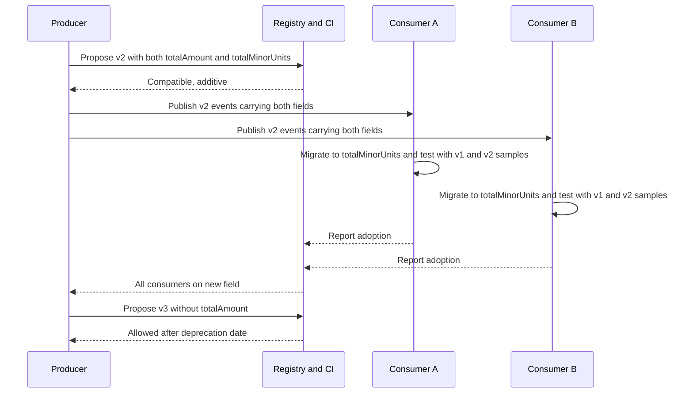

The sequence has three phases. In **expand**, the producer publishes both fields, so old and new consumers both work. In **migrate**, each consumer moves to the new field at its own pace, and the registry or inventory records who has moved. In **contract**, after the last consumer has moved and a stated deprecation date has passed, the producer stops writing the old field. The contract phase must be gated by evidence of consumer adoption, not by the producer's calendar. Without an inventory of consumers, the producer cannot know when contracting is safe, which is the reason an event contract registry records the consumers, not only the schemas.

A retained log complicates the contract phase. Events written in v1 stay in the log for the retention period. With seven days of retention, v1 events can still be read seven days after the last v1 publication. A consumer that replays from the beginning must read v1 and v2 events. If long-term archives exist, v1 events can be read indefinitely. Counting versions in flight makes the point: a producer that has published v1, v2, and v3 over two years may have all three present in an archive, and every consumer that replays the archive needs code for all three.

### 9.4 Upcasting and version lifecycle

Two techniques reduce the burden of many versions. An **upcaster** is a function in the consumer, or in a shared library, that converts an older version of an event into the latest shape before the business code sees it, so the business code handles one shape. A **translation step** at the boundary does the same for events from another system. [Event Sourcing](CH11_Event_Sourcing.md) uses upcasting heavily because it must read its own old events forever, and a runnable example is in [03_event_upcasting.py](../code/python/event-sourcing-chapter/03_event_upcasting.py).

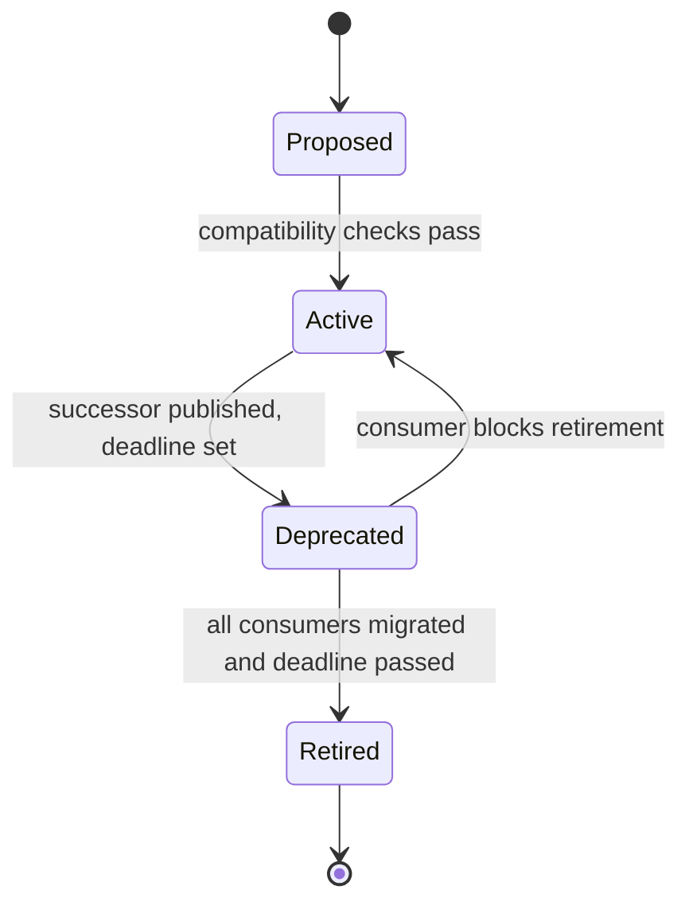

Each schema version moves through states. Retirement is reached only when migrations are complete, and the arrow back from deprecated to active shows that a consumer that is not ready is a legitimate reason to delay retirement. Without that arrow, deadlines get enforced by breaking someone.

### 9.5 Ownership and governance

A contract needs an owner who answers questions and approves changes. The minimum record per event type is the owner, the meaning, the schema and versions, the partition key, the ordering and delivery guarantees consumers may rely on, the sensitivity of the fields, the retention, and the deprecation policy. For a wider treatment of data ownership across an enterprise, see [Data Architecture](../18_Enterprise_Architecture/CH06_Data_Architecture.md).

Three enforcement points keep contracts honest:

1. **Build-time compatibility checks** in the producer's pipeline, so an incompatible schema fails the build.
2. **Consumer contract tests** that run the consumer's parsing and business logic against sample events of every live version, and fail when a producer change would break them.
3. **Runtime validation at the producer**, which rejects an event that does not conform before it reaches the broker. Invalid events in a log cannot be removed, and they will hurt every consumer that replays.

## 10. Fan-Out, Consumer Ownership, and Backpressure

Fan-out lets billing, fulfillment, analytics, and notification consumers react to one event independently. The producer cannot assume that every consumer has finished when publication succeeds, so each consumer must own its own lag, failure, retry, and recovery signals. A slow or failing consumer must not silently block unrelated subscribers.

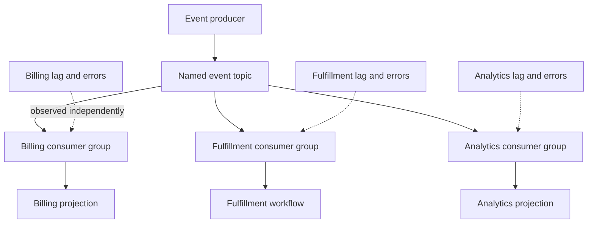

The diagram shows one topic and three groups, each with its own position and its own metrics. A group that falls behind consumes only its own backlog, and the producer and the other groups are unaffected. The consequence for ownership is that every subscription needs a named team, a lag objective, and an on-call route. A subscription with no owner is the commonest source of silent failure in fan-out designs.

### 10.1 Consumer lag and backpressure

**Consumer lag** is the distance between the newest event on the broker and the last event the consumer has processed. It can be measured as a count of events, or better as the age of the oldest unprocessed event, because a count says nothing about how stale the consumer's view is. **Backpressure** is the way a system tells fast producers to slow down or, in a broker-based design, the way the broker absorbs the difference.

A broker decouples rates, so the producer is rarely slowed. The backlog grows instead. Lag grows whenever the arrival rate exceeds the consumer's capacity, and the arithmetic is linear. Illustratively, arrivals of 1,200 events per second against a capacity of 1,000 per second add 200 events per second of backlog. After 15 minutes the backlog is 200 × 900 = 180,000 events. If arrivals then fall to 600 per second, the net drain is 1,000 − 600 = 400 per second, so recovery takes 180,000 / 400 = 450 seconds. The age of the oldest event during the burst is the backlog divided by capacity: 180,000 / 1,000 = 180 seconds at the peak. That is the figure to compare with the consumer's freshness requirement.

The design responses, in order of preference:

- **Scale the consumer out**, up to the partition count from the section on ordering.
- **Reduce the cost per event**, for example by batching writes.
- **Shed or defer low-value work**, such as sampling analytics events during a burst, if the contract allows.
- **Bound the backlog** with retention limits so a stalled consumer cannot exhaust broker storage. Expiry is data loss for that consumer and must be a decision.
- **Limit in-flight work** inside the consumer. One that pulls events faster than its database can write builds an unbounded in-memory queue and fails with memory exhaustion. Pull only what can be processed, and pause the subscription when a downstream dependency is failing.

Fan-out has a second hazard: a shared dependency. If three consumers write to one database, a slow one can starve the others, so each consumer should own its state.

## 11. Retry and Dead-Letter Paths

Consumers fail for three different reasons, and each needs a different response. A **transient failure** (a timeout, a throttled dependency) will probably succeed later. A **data failure** (a payload that violates the schema, an unknown reference) will fail every time. A **defect** (a bug in the consumer) fails on every event that reaches the faulty code path. Treating all three as "retry" is the mistake. Transient failures need delay and a limit, data failures need quarantine, and defects need a fix followed by replay.

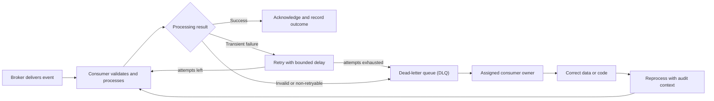

The diagram has two entrances to the **dead-letter queue (DLQ)**: an event whose retries are exhausted and an event that is non-retryable from the first attempt. The loop back through the owner is the part teams omit. A DLQ with no owner and no replay path is a place where business events are lost slowly.

### 11.1 Bounded retry with backoff

A retry policy has four parameters: the maximum number of attempts, the delay before each attempt, a cap on that delay, and randomization (jitter). Exponential backoff doubles the delay each time. Without a cap, delays grow unreasonably, and without jitter, many consumers that failed together retry together and hit the recovering dependency in synchronized waves.

Illustratively, a base delay of 1 second, doubling, capped at 30 seconds, with 6 attempts gives waits of 1, 2, 4, 8, 16, and 30 seconds, a total of 61 seconds before dead-lettering. If a dependency outage lasts 10 minutes, every event that arrives during it exhausts its retries after about a minute and goes to the DLQ. That is the wrong outcome for a transient outage, because it creates a large manual backlog. Two designs address this. A **circuit breaker** stops calling a failing dependency and pauses the subscription, so events wait on the broker (where they are safe) instead of being dead-lettered. Alternatively, delayed retry topics with longer intervals (one minute, ten minutes, one hour) separate long outages from short ones.

### 11.2 Poison messages and blocking

A **poison message** is one that can never be processed successfully. If the consumer retries it in place, it blocks its partition, and with per-key ordering every event behind it waits. After a bounded number of attempts, move the event aside and continue. Moving it aside breaks per-key order, as the section on ordering warned, so the consumer must either be order-tolerant through versions, or pause only the affected key while the event is quarantined. Choose per event type, and write the choice in the contract.

### 11.3 Operating the DLQ

A dead-letter queue is an operational queue with access control, retention, and a remediation procedure.

- **Alert on age and volume**, not only count. One event that has waited three days is more serious than fifty from the last five minutes.
- **Record context** with each dead-lettered event: the consumer, the error class, the attempt count, the schema version, and the correlation identifier.
- **Check before replay** that the consumer now handles the event version, and that the side effect has not already happened. The inbox from the idempotency section makes a replay of an already-applied event harmless.
- **Protect the contents.** Dead-lettered payloads contain the same data as the topic, so the DLQ needs the same access restrictions, as the security section below sets out.

## 12. Replay and Reprocessing

Replay means reading events again from an earlier position. It has three common purposes: recovering after a consumer defect, building a new consumer's state from history, and rebuilding a projection after its schema changed. Only a retained log supports it cheaply, which is the reason section 5 treats replay as a deciding factor.

Replay is safe only under conditions the design must establish beforehand.

1. **Idempotent effects.** Replayed events reach consumers that have already applied them. Without the inbox or versioned upserts from section 6, a replay doubles every effect. The inbox retention window must cover the replay horizon, or events older than the window are processed as new.
2. **Isolated effects.** A rebuild of a read model writes only to that model, so it can run beside live traffic. A replay that triggers e-mails or payments is dangerous. Separate the part of the consumer that updates state from the part that causes external effects, and disable the second during a rebuild.
3. **Ordered and bounded.** Replay a defined range, by offset or time, per partition, and record the range. A replay into a live consumer group interleaves old and new events for the same key, so prefer a separate consumer group writing to a new copy of the state, followed by a switch.
4. **Compatible readers.** The replay reads every schema version in the range, so the consumer needs the upcasters from section 9.

Illustrative duration: a log of 400,000,000 retained events replayed at 5,000 events per second per worker with 12 workers (one per partition) reads at 60,000 per second, so 400,000,000 / 60,000 ≈ 6,667 seconds, about 1.9 hours. During that time live events still arrive, so the replay must finish and then catch up on the lag it accumulated. The new state should be switched in only when its lag is within the freshness target.

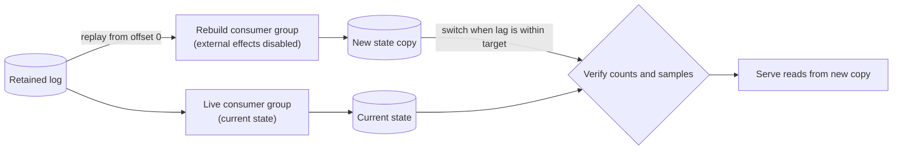

The figure keeps the live path untouched while the rebuild runs, and it makes the cutover a verified step with a way back, since the old state still exists. [Event Sourcing](CH11_Event_Sourcing.md) and [CQRS (Command Query Responsibility Segregation)](CH09_CQRS.md) rely on this rebuild mechanism, and they own its detailed use.

## 13. Observability of Choreographed Flows

In a choreographed flow, no component owns the overall process. `OrderAccepted` leads to a billing reaction, which publishes `PaymentCaptured`, which leads to a shipping reaction. Each step is simple and the whole is invisible unless the design makes it visible. Logs, metrics, and tracing in general are owned by Part 14. This section states what an event-driven design must supply.

### 13.1 Propagating identity through events

The envelope from section 9 carries a `correlationId` that stays constant for one business action and a `causationId` that names the immediate parent event. A consumer copies the correlation identifier into every event it publishes and logs it with every line, and sets the causation identifier to the identifier of the event it is reacting to. With these fields, a query on one correlation identifier returns the whole chain, and the causation links rebuild its tree.

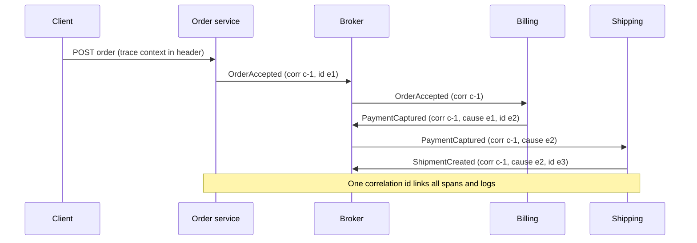

Distributed tracing across a broker uses the same idea. The producer writes the trace context into event headers, and the consumer starts a new span linked to it. Because a consumer may process an event minutes later, a single long span is misleading. A link between a publish span and a separate processing span records the relationship and keeps durations meaningful. See [Tracing](../14_Observability/CH03_Tracing.md) and [OpenTelemetry](../14_Observability/CH04_OpenTelemetry.md).

### 13.2 What to measure

| Signal | Why it matters | Typical alert |
| --- | --- | --- |
| Consumer lag as age of oldest event | Direct freshness measure per subscription | Above the freshness target for 5 minutes |
| Outbox oldest unpublished age | Publication delay on the producer side | Above publication target |
| Processing error rate by class | Separates transient, data, and defect failures | Sudden rise in one class |
| DLQ age and volume | Quarantined business events | Any event older than the remediation target |
| Duplicate-skip rate in the inbox | Duplicate load and redelivery health | Large deviation from baseline |
| End-to-end latency per correlation id | Time from the first event to the last effect | Percentile above the business objective |

End-to-end latency needs a defined end. A choreographed flow does not announce completion, so the design must name the final event whose arrival marks the business outcome, and record time from the first event to that one. A flow that stalls midway produces no error. It produces a missing final event, and the way to detect it is a timer or a reconciliation query that looks for flows with a start and no end after the expected duration. When the number of steps and the need for a visible state machine grow, the [Saga Pattern](CH10_Saga_Pattern.md) with an orchestrator gives that visibility directly.

## 14. Security of Event Streams

An event stream is a shared data store with many readers, and it is often exempt from the controls applied to the services that own the data. The identity, authorization, and data-protection foundations are owned by Part 15: [Authentication](../15_Security/CH02_Authentication.md), [Authorization](../15_Security/CH03_Authorization.md), and [Zero Trust](../15_Security/CH08_Zero_Trust.md). This section applies them to brokers.

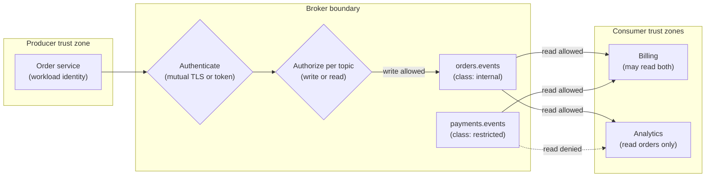

The figure places two checks at the broker boundary. Authentication establishes which workload is connecting. Authorization decides which topics that workload may write or read. The denied path from Analytics to the payments topic is the case to test.

### 14.1 Authentication and authorization per topic

- **Authenticate every producer and consumer** with a workload identity, using mutual Transport Layer Security (TLS) or short-lived tokens, and not a shared credential. A shared credential makes it impossible to say who published an event or to revoke one consumer.
- **Authorize per topic and per action.** Producers get write access only to topics they own, which prevents a compromised service from forging another team's events. Consumers get read access only to topics they need. Grant access to groups of topics by naming convention only if the convention is enforced.
- **Treat the right to publish as the right to assert a fact.** A forged `PaymentCaptured` event triggers shipping. Restricting write access is therefore as important as restricting reads, and the `producer` field in the envelope should be checked against the authenticated identity, not trusted from the payload.
- **Encrypt in transit** between clients and brokers and between brokers, and encrypt storage at rest. A retained log keeps data for its whole retention period.

### 14.2 Data classification in events

Every event type should carry a data classification in the contract registry, such as public, internal, confidential, or restricted, with the fields that cause the classification. The classification decides the topic's access list, retention, and whether the payload may contain the data at all.

- **Event notification** (section 4) keeps sensitive fields off the broker, since consumers fetch them under the owner's access checks. It trades extra callback load for control.
- **Event-carried state transfer** puts the data in front of every subscriber, so only fields that all authorized subscribers may see belong in the payload. Where subscribers have different entitlements, publish separate topics by classification, and not one wide topic with a hope that consumers ignore the sensitive fields.
- **Personal data and deletion.** A retained log cannot easily delete one person's record, because events are immutable. Options are to keep personal data out of events and send a reference, to encrypt the personal fields per subject and delete the key when erasure is required, or to publish only on short-retention topics. Legal duties differ by jurisdiction, so confirm the requirement with the organization's privacy function before choosing.
- **Secondary stores.** The DLQ, the outbox, the inbox, logs that print payloads, and replay copies all hold the same data. Apply the same classification to each.

Secrets used by clients to authenticate belong in the platform's secret store, as covered in [Secrets Management](../15_Security/CH09_Secrets_Management.md).

## 15. Failure and Quality-Attribute Scenarios

Each scenario states a stimulus, the expected response, and a measurable success criterion. All figures are illustrative targets for a hypothetical system, and a real design would set them from its own requirements.

| # | Attribute | Stimulus | Expected response | Success criterion |
| --- | --- | --- | --- | --- |
| 1 | Resilience | Broker unavailable for 30 minutes | Order service keeps accepting orders. Outbox rows accumulate. The relay drains after recovery | Zero lost events. Oldest unpublished age alarms within 2 minutes. Backlog drained within 15 minutes of recovery |
| 2 | Correctness | A consumer is killed mid-batch during a deployment | The broker redelivers. The inbox skips already-applied events | Zero duplicate effects across a test of 10,000 events with repeated kills |
| 3 | Performance | Arrival rate is 20% above consumer capacity for 15 minutes | Lag grows, then recovers. Autoscaling adds workers up to the partition count | Oldest event age stays under 5 minutes, and recovery completes within 10 minutes of the burst ending |
| 4 | Correctness | A producer deploys schema v2 before a consumer is upgraded | The tolerant consumer ignores the new optional field | Zero consumer errors attributable to the change. The contract test fails the build if the change is incompatible |
| 5 | Recoverability | A consumer defect corrupted a projection for 6 hours | Fix the defect, replay the range into a separate group, verify, then switch | Rebuild finishes within 4 hours. Row-count and checksum comparisons match before switch |
| 6 | Security | The Analytics identity attempts to read the payments topic | The broker denies the request and logs it | 100% of unauthorized reads denied and an alert raised within 1 minute |
| 7 | Operability | One event cannot be processed by Fulfillment | The event reaches the DLQ after the retry limit. Other events continue | Healthy-event latency is unaffected. DLQ item is triaged within 1 business day |

### 15.1 Reading the scenarios

Scenario 1 is the justification for the outbox. Without it, the outcome would be lost events, and the criterion "zero lost events" could not be met. The 15-minute drain target is checkable by arithmetic. If 30 minutes of orders at 40 per second accumulate, the backlog is 40 × 1,800 = 72,000 rows. A relay publishing 500 per second while 40 per second keep arriving nets 460 per second, so draining takes 72,000 / 460 ≈ 157 seconds, comfortably inside the target. If the relay managed only 60 per second, the net would be 20 per second and the drain would take 3,600 seconds, so the target would fail. The scenario tells the team to measure relay throughput, not assume it.

Scenario 3 is bounded by the partition count, a design-time decision. Scenario 5 depends on the replay conditions in section 12. Scenarios without a number are not testable.

## 16. Worked Case: Order Fulfillment at an Illustrative Retailer

Harbor Goods is a hypothetical online retailer used only for this case. Its figures are assumptions chosen to show the reasoning. It takes 600,000 orders a day, with a peak of 60 orders per second. Each order produces about 5 events across its life, so the peak event rate is 60 × 5 = 300 events per second, and the daily volume is 600,000 × 5 = 3,000,000 events. A single team currently runs a monolith that calls billing, warehouse, and notification code in one transaction. Checkout latency has grown with each added step, and a warehouse slowdown now fails checkouts.

### 16.1 Context and target

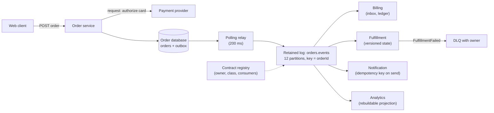

The card authorization stays a synchronous request because the customer needs the answer before the order is accepted. Everything after acceptance is an event. This keeps the checkout path short and stable while the reactions run at their own pace.

### 16.2 Decisions and rejected alternatives

| Decision | Chosen | Rejected | Reason |
| --- | --- | --- | --- |
| Publication | Transactional outbox with polling relay | Publish after commit | The after-commit path has a lost-event window. At 600,000 orders a day and an assumed 1 failure in 100,000 it would silently lose 6 orders a day |
| Publication (2) | Polling relay | Change-data-capture relay | No new infrastructure for the first release. Revisit if publication latency or database load becomes a problem |
| Broker shape | Retained log | Queue per consumer | Analytics must rebuild after defects, and new consumers must read history |
| Event style | Notification for payment data, state transfer for order summary | One wide event for all | Limits exposure of card-related data and keeps the contract narrow |
| Partition key | `orderId` | `customerId` | Order of one order's events matters. Customer key risks the hot-key problem in section 7 |
| Partition count | 12 | 4 | See arithmetic below |
| Coordination | Choreography for 3 reactions | Orchestrated saga now | Three independent reactions need no central state. Revisit if steps with compensations exceed what choreography can show |
| Consumer correctness | Inbox for Billing, versioned upsert for Fulfillment, idempotency key for Notification | Rely on exactly-once delivery | Delivery cannot cover external effects |

**Partition arithmetic.** Peak rate is 300 events per second. A Billing worker handles 80 events per second because each event is a database write. Needed workers are 300 / 80 = 3.75, so 4. With 50% headroom, 4 × 1.5 = 6. Doubling for expected growth gives 12 partitions. Four partitions would cap the consumer at four workers, which is exactly the no-headroom figure, and the count is hard to change later.

**Inbox sizing.** Billing keeps 14 days of event identifiers, chosen to exceed the replay horizon of 7 days of log retention. 3,000,000 × 14 = 42,000,000 rows. At an assumed 100 bytes per row, that is 4.2 gigabytes, which is acceptable.

**Duplicate exposure without the inbox.** Billing runs 6 instances, commits every 200 events, and is deployed 3 times a day with ungraceful stops. Expected redelivery per stop is about 200 / 2 = 100 events, so 6 × 100 × 3 = 1,800 duplicates a day across all event types. If one fifth are `OrderAccepted` events that Billing charges for, that is 360 duplicate charges a day. At an average of 40 currency units each, the exposure is 360 × 40 = 14,400 currency units daily. The inbox removes this by design.

### 16.3 Validation evidence

The team does not accept the design on argument. It collects evidence against the scenarios in section 15.

1. **Duplicate and reorder test.** Every event in a sample of 10,000 is published twice, in shuffled order for each order. Final state in Billing and Fulfillment equals the single-ordered run. Pass criterion: zero differences.
2. **Kill test.** Consumers are killed repeatedly during the run. Pass criterion: the count of ledger entries equals the count of distinct accepted orders.
3. **Broker outage drill.** The broker is stopped for 20 minutes at peak. The outbox accumulates 300 × 1,200 = 360,000 rows. The relay publishes 1,000 per second while 300 per second still arrive, so the net drain is 700 per second and recovery takes 360,000 / 700 ≈ 514 seconds, about 8.6 minutes, inside the 15-minute target. The drill measures the real relay rate. If it is below 300 per second the system never recovers, and the team adds a second relay instance partitioned by aggregate hash.
4. **Schema drill.** A producer adds an optional field in staging. Consumer contract tests pass, and a deliberately incompatible change fails the build.
5. **Access and rebuild drills.** The Analytics identity is denied the payments topic and the denial is logged. Analytics is rebuilt from offset 0 into a new copy, and counts match before the switch.

### 16.4 Consequences accepted

Customers may see an order as accepted before the confirmation e-mail goes out, and the confirmation screen says so. The warehouse view lags the order view by seconds, and a support tool shows the lag. The team now operates a broker, a registry, and DLQ remediation, and it has accepted the fixed cost because the checkout path no longer depends on the warehouse.

## 17. Common Mistakes and Anti-Patterns

| Anti-pattern | Cause | Consequence |
| --- | --- | --- |
| Dual write (commit, then publish) | Treating the database and broker as one transaction | Orders with no event, found only by customer complaints or reconciliation |
| Assuming exactly-once delivery | Reading a product claim as a guarantee for all effects | Duplicate e-mails and charges when a consumer restarts or an external call repeats |
| Command disguised as an event | A producer wants a specific reaction but publishes a broadcast | No component owns the outcome. Failures cannot be attributed, and consumers cannot refuse |
| Event as remote procedure call | Publishing, then waiting for a reply event on the same path | The latency and coupling of a synchronous call plus the complexity of correlation |
| One giant event | "Nobody should have to call us" | Wide contract, sensitive data exposed to all subscribers, and breaking changes for unrelated consumers |
| Exposing the database or event store as the contract | Reading table changes directly, or publishing internal domain events | Every internal refactoring breaks consumers |
| Hot partition key | Key chosen for ordering without checking load | One partition lags while others idle, and adding workers does not help |
| Unbounded retry in place | A failing event is retried forever on its partition | A poison message blocks every event behind it for that key |
| Ownerless dead-letter queue | The DLQ is created and never monitored | Business events are lost slowly and discovered late |
| Silent semantic change | Same field name and type, different meaning | No registry detects it. Consumers compute wrong results with no errors |
| Replay with live external effects | No separation of state updates from effects | A rebuild sends thousands of repeated e-mails or payments |

Two causes recur: unstated assumptions about delivery, order, or timing, and no named owner for a contract, subscription, or dead-letter queue. A review that asks who owns each item and how its health is known removes most of the table.

## 18. Comparison With Related Patterns and a Decision Flow

Event-driven architecture is often combined with the neighbouring patterns, and it is easy to adopt one when the problem needs another. Each sibling is owned by its own chapter and is summarized here only to place it relative to events.

- **Request/response** is a caller waiting for an answer. It is simple, gives immediate success or failure, and couples availability and latency.
- **[CQRS (Command Query Responsibility Segregation)](CH09_CQRS.md)** separates write and read models. Events are the usual way to update the read model, so CQRS often depends on EDA, but EDA does not require CQRS.
- **[Saga Pattern](CH10_Saga_Pattern.md)** coordinates a multi-step business transaction with compensations. It can be built on events (choreography) or on a coordinator (orchestration). Events alone do not provide compensation or visible progress.
- **[Event Sourcing](CH11_Event_Sourcing.md)** stores state as a sequence of events. It is a persistence choice, and the events it stores are not the integration contract. A system can use EDA without event sourcing, which is the more common case.

| Concern | Request/response | Event-driven | CQRS | Saga | Event sourcing |
| --- | --- | --- | --- | --- | --- |
| Primary purpose | Get an answer or an action now | Decouple reactions in time | Separate read and write models | Coordinate a multi-step outcome | Store state as history |
| Coupling | Temporal and availability | Contract only | Between write and read model | Between steps and the coordinator | Between stored events and code |
| Consistency | Immediate within the call | Eventual | Eventual read model | Eventual, with compensations | Rebuildable, current state derived |
| Failure visibility | Immediate error | Lag and DLQ signals | Projection lag | Saga state | Stream integrity |
| Main added cost | Cascading failure | Duplicates, order, schema governance | Two models to keep aligned | Compensation design | Versioning old events forever |
| Typical combination | User path | Consequences of facts | Needs events or equivalent | Uses events or commands | Publishes integration events |

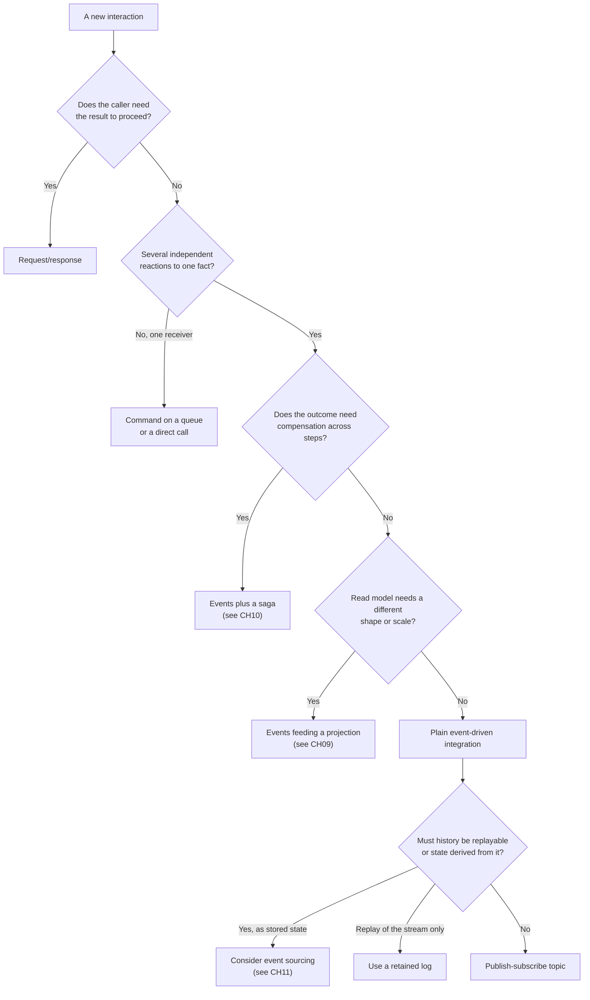

The flow asks the cheapest questions first. The caller's need for an answer decides between a request and everything else. Only after that do compensation, read-model shape, and replay lead to the sibling patterns. A path that ends at a request is a legitimate result, and the pattern is not meant for every interaction.

## 19. Design-Review Checklist

Use these questions in a review. An answer of "we have not decided" is a finding.

**Purpose and types**

- [ ] Each event is a past-tense fact published by its owner, and each command has one addressee.
- [ ] Each event type is marked as notification, state transfer, domain, or integration, with a reason.
- [ ] Interactions that need an immediate answer remain requests.

**Broker and delivery**

- [ ] The broker shape (queue, topic, log) matches replay and fan-out needs.
- [ ] Producers wait for durable acknowledgement and handle failure.
- [ ] Every consumer is designed for at-least-once delivery.

**Correctness**

- [ ] Each consumer has a stated idempotency mechanism and a tested duplicate and reorder case.
- [ ] The inbox window exceeds the replay and redelivery horizon.
- [ ] State changes and publication use an outbox, and the relay's throughput and oldest-row age are measured.
- [ ] The partition key matches the unit of consistency, the hot-key risk has been calculated, and the partition count has headroom.

**Contracts**

- [ ] Each contract has an owner, versions, key, ordering promise, classification, and consumer list.
- [ ] Compatibility checks and consumer contract tests run in the pipeline.
- [ ] Retirement of a version requires evidence of consumer migration.

**Failure and recovery**

- [ ] Retries are bounded, with backoff and jitter, and a circuit breaker pauses the subscription during outages.
- [ ] Poison messages go to a DLQ with an owner, an age alert, and a documented replay procedure.
- [ ] Replay keeps external effects disabled and writes to a separate copy.

**Operations and security**

- [ ] Per-subscription lag is measured as event age against a freshness target.
- [ ] Correlation and causation identifiers flow through every event, and trace context is in headers.
- [ ] Every client has its own identity, with per-topic read and write permissions.
- [ ] Sensitive fields are classified, kept off broad topics, and protected in the DLQ, outbox, inbox, and logs.

## 20. Exercises

Each exercise has a brief answer outline. Attempt it before reading the outline.

1. **Classify.** For `ReserveStock`, `StockReserved`, `GetCurrentPrice`, and `CustomerMoved`, state whether each is a command, query, or event, and who should publish or receive it.
   *Outline:* `ReserveStock` is a command to the inventory owner. `StockReserved` is an event published by inventory after it decides. `GetCurrentPrice` is a query and should be a request. `CustomerMoved` is an event published by the customer owner, possibly carrying the new address as state transfer.

2. **Duplicate load.** A consumer handles 1,000,000 events a day, commits every 250 events, runs 10 instances, and is deployed twice a day with ungraceful stops. Estimate daily duplicates and the exposure if each effect costs 12 currency units.
   *Outline:* Per stop, 250 / 2 = 125. Daily, 10 × 125 × 2 = 2,500, which is 0.25% of volume. Exposure is 2,500 × 12 = 30,000 currency units without idempotency. Choose an inbox because the effect accumulates.

3. **Hot key.** Peak is 3,000 events per second, a worker handles 500 per second, and one customer produces 30% of events under a customer key. What happens, and what are the options?
   *Outline:* The hot key sends 900 per second to one partition. Backlog grows by 900 − 500 = 400 per second, so 120,000 events after 5 minutes (300 seconds), and draining takes 120,000 / 500 = 240 seconds once arrivals stop. More partitions do not help. Options are a finer key if order allows, a faster consumer, a dedicated topic for that tenant, or accepting lag.

4. **Outbox recovery.** The broker is down for 10 minutes at 200 events per second. The relay publishes 800 per second. How long does recovery take, and which signal would alert you?
   *Outline:* Backlog is 200 × 600 = 120,000 rows. Net drain is 800 − 200 = 600 per second, so 120,000 / 600 = 200 seconds. Alert on the age of the oldest unpublished row.

5. **Rename a field.** The producer wants to rename `qty` to `quantity` in `ItemAdded`. Plan the change.
   *Outline:* Expand with both fields, migrate consumers while tracking adoption, contract after the deprecation date. Old events in the log keep the old field.

6. **Pick the pattern.** A refund requires reversing a payment, restocking, and notifying, and a failure in restocking must trigger a compensation. A separate dashboard needs order totals by region. Which patterns apply?
   *Outline:* The refund needs a saga, orchestrated if progress must be visible, on top of events or commands. The dashboard is a read model fed by events, which is CQRS with a projection. Neither needs event sourcing unless history is the stored state.

7. **Replay time.** A rebuild must reread 90,000,000 events with 8 workers at 2,500 per second each. How long will it take, and what must be true before switching?
   *Outline:* Combined rate is 8 × 2,500 = 20,000 per second, so 90,000,000 / 20,000 = 4,500 seconds, which is 75 minutes. Then the rebuild must catch up on events that arrived meanwhile, with external effects disabled and counts verified before the switch.

## 21. Summary

Event-driven architecture trades the simplicity of a call stack for independence in time and in evolution. The trade pays off when several parties react to one fact, when timing needs differ, and when the contract is owned. It costs duplicates, partial ordering, schema governance, and an operations discipline built around lag and quarantine. The chapter's outcomes map to its sections as follows.

| Outcome from the introduction | Where it is taught | What to retain |
| --- | --- | --- |
| 1. Define an event and separate it from commands, queries, and messages | Sections 2 and 4 | An event is a past-tense fact from its owner and cannot be refused |
| 2. Choose among notification, state transfer, and domain events | Sections 4 and 14 | Choose by payload need, sensitivity, and boundary |
| 3. Distinguish queues, topics, and logs, and state delivery semantics | Section 5 | Design every consumer for at-least-once delivery |
| 4. Compute duplicate load and design an idempotent consumer | Sections 5 and 6 | Use versioned upserts or an inbox in the same transaction |
| 5. Reason about ordering, keys, hot keys, and partition changes | Section 7 | Order per key, size partitions for peak, and avoid key changes |
| 6. Explain dual-write and implement the outbox | Section 8 | Write state and event in one transaction, publish at least once |
| 7. Design an envelope and schema-evolution policy | Section 9 | Expand, migrate, contract, gated by consumer adoption |

Sections 10 to 14 cover operation and security, and sections 15 to 20 give scenarios, a worked case, anti-patterns, comparison, a checklist, and exercises. Write the assumptions down: how often an event may arrive, in what order, with what meaning, readable by whom, and who is paged when a subscription stalls. The next patterns, [CQRS](CH09_CQRS.md), [Saga](CH10_Saga_Pattern.md), and [Event Sourcing](CH11_Event_Sourcing.md), build on these foundations.
