# Serverless

Part: [20 — Architecture Patterns](PART_OVERVIEW.md) · Status: Revised (in-depth rewrite)

## 1. Introduction

Serverless is an architecture pattern in which the team writes small units of application logic, or packages a container, and a cloud provider runs it on demand. The provider allocates the machines, starts and stops execution environments, scales their number with load, and bills by use. The servers still exist. What changes is who owns the capacity plan: instead of deciding how many instances to run, the team describes what should run when an event arrives and accepts the limits the platform sets on that execution.

The pattern is attractive for workloads with uneven or unpredictable demand, for glue between managed services, and for teams that want to ship small features without operating a fleet. It is risky when it is chosen without understanding the contract the platform imposes. A function can be started twice for one event. It can be frozen mid-work or discarded between calls. It can be throttled by a quota nobody planned for, and it can cost more than a small always-on server at steady volume. Each of these is predictable once the execution model is understood, and each is hard to diagnose when it is not.

This first part of the chapter owns the pattern definition, the execution model, and the economics. After it you should be able to:

1. Distinguish Function as a Service (FaaS), Backend as a Service (BaaS), and serverless containers, and say what each asks of the team.
2. Trace one invocation from trigger to side effect and name who holds the event at each step.
3. Reason about concurrency, scaling, timeouts, and cold starts with arithmetic, and choose a mitigation that matches the cost of the problem.
4. Keep state outside the execution environment and design handlers that stay correct when an event is delivered more than once.
5. Compare per-invocation pricing with always-on capacity using the workload's own numbers.
6. Map the pattern to the AWS (Amazon Web Services), Azure, and Google Cloud products without assuming that similarly named features give identical guarantees.

The boundaries with neighbouring material are deliberate:

- Provider service mechanics (limits, quotas, configuration, and pricing meters) belong to Part 09. [Serverless Compute (Part 09)](../09_Cloud_Computing/CH11_Serverless.md) teaches them at product level, and [Containers](../09_Cloud_Computing/CH07_Containers.md) teaches Cloud Run, Azure Container Apps, and AWS Fargate as container services. This chapter recaps the mechanisms that drive architectural decisions and links there for the rest.
- Choosing a runtime and placement from workload evidence is the method of [Compute Placement and Runtime Architecture](../10_Cloud_Architecture/CH05_Compute_Placement_and_Runtime_Architecture.md). This chapter supplies the serverless side of that comparison.
- Event and broker mechanics (events versus commands, subscriptions, ordering, delivery guarantees) belong to [Event-Driven Architecture](CH07_Event_Driven_Architecture.md). Messaging products are covered in [Messaging](../09_Cloud_Computing/CH12_Messaging.md). Serverless handlers are very often event consumers, and this chapter treats only what is specific to running consumers as functions.
- The general theory of safe retries is owned by [Idempotency](../07_System_Design_and_Distributed_Systems/CH16_Idempotency.md) and [Distributed Transactions](../07_System_Design_and_Distributed_Systems/CH12_Distributed_Transactions.md). This chapter applies it to function invocation.
- Observability tooling belongs to Part 14, for example [Tracing](../14_Observability/CH03_Tracing.md), and identity and authorization to Part 15, for example [Authentication](../15_Security/CH02_Authentication.md). Deployment practice belongs to Part 13.

All prices and quantities in this chapter are illustrative. They exist to show how to reason, and they are neither quotes from any provider nor measurements of any real system. Provider limits and defaults change, so the text names the mechanism and tells you to verify the current value in the official documentation.

## 2. What Serverless Means as an Architecture Pattern

The word is used for several different things, and the confusion causes real design errors. A useful definition has four properties. A workload is serverless to the degree that all four hold.

1. **No capacity management.** The team does not choose instance counts or sizes for the fleet. It may still choose a memory size per function or a limit on how far scaling may go.
2. **Scaling follows demand, including to zero.** Execution environments appear when events arrive and disappear when they stop. Idle time does not run up a compute charge unless the team asks the provider to keep capacity warm.
3. **Billing follows use.** The meter counts requests, execution time weighted by configured memory or CPU, and adjacent services, not provisioned hours.
4. **The provider owns the platform below the handler.** Operating system patching, host placement, zone distribution, and the scaling controller are the provider's responsibility.

Products differ in how fully they meet these properties. A function service that always keeps one warm instance meets the second property only partly. A managed database that bills by capacity unit and scales automatically is described as serverless by its vendor but has nothing to do with running application code. This chapter is about the execution side: the pattern of running application logic this way.

### 2.1 The forces that favor the pattern

An architecture pattern is justified by forces, so state them before choosing it.

- **Demand is uneven or unpredictable.** A workload that is idle most of the day and busy in bursts wastes capacity on always-on servers. Pay-per-use billing turns the idle time into zero cost.
- **The team is small relative to the surface area.** Operating a fleet needs patching, capacity reviews, and on-call knowledge. Handing those to the provider frees attention for product logic.
- **Work is naturally event-shaped.** An object arrives in storage, a message lands on a queue, a timer fires, a webhook is received. Each is a discrete unit with a clear start and finish.
- **Time to first deployment matters.** Wiring a trigger to a handler is faster than provisioning an application platform, which suits prototypes and small internal features.

The forces that argue against it are equally concrete.

- **Steady, high utilization.** If capacity would be busy most of the time anyway, per-invocation pricing usually costs more than renting that capacity. The cost model section works the arithmetic.
- **Latency intolerance at the tail.** Interactive paths with strict tail latency targets must manage cold starts explicitly.
- **Long or heavy work.** Platform timeouts, memory ceilings, and lack of specialized hardware rule out some jobs.
- **Strong locality or state needs.** Workloads that depend on large in-memory working sets, local disk state, or persistent connections fit badly.
- **Portability requirements.** Triggers, permissions, and event shapes are provider-specific. The business logic ports easily, and the glue does not.

### 2.2 Three forms: FaaS, BaaS, and serverless containers

Three forms of serverless are commonly combined in one system, and each places different obligations on the team.

**Function as a Service (FaaS)** runs a handler function that the platform calls with an event. The team supplies code (or a package) in a supported runtime, and the platform supplies everything around it: the trigger integration, the execution environment, the retry behavior of the trigger, and scaling. The unit of design is the handler plus its trigger. FaaS gives the finest-grained billing and the tightest platform limits.

**Backend as a Service (BaaS)** replaces application code with managed capabilities that clients or other components call directly: managed authentication, a managed database, object storage, a managed queue, a push notification service. There is no handler for the team to write for that capability. The design work moves to configuration, access rules, data modelling, and the contracts at the edges. BaaS shrinks the code surface the most, and it concentrates risk in security rules, because a misconfigured access policy on a client-facing store is the vulnerability.

**Serverless containers** run a container image, usually a Hypertext Transfer Protocol (HTTP) server or a batch job, on provider-managed capacity that scales with load and can scale to zero. The team keeps its existing frameworks and process model and gives up less to the platform contract. In exchange, it carries more: the image, its base layers, and the application server's concurrency behavior. Many instances may serve requests at once, which changes how connection pools and in-memory state behave.

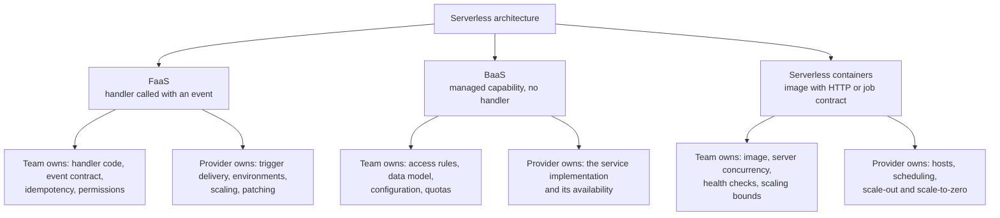

The diagram separates what the team keeps from what the provider takes in each form. Two implications follow. First, moving from FaaS to a serverless container hands the team more responsibility and more freedom in one step: it can run any framework and any duration the container platform allows, and it must now own the image and the server's concurrency settings. Second, a system built mostly from BaaS has little code to test and a large amount of configuration to review. The review checklist must therefore include access-policy and quota review, not only code review.

### 2.3 Serverless is not a service boundary

A function is a deployment mechanism. It is not automatically a microservice. A microservice, as [Microservices](CH05_Microservices.md) defines it, is an independently deployable unit with its own data and a single owning team. Ten functions that share one database schema, ship together, and call each other synchronously form one application with ten entry points. Conversely, one function with its own table and a documented event contract can be a perfectly good service. Ownership, data, and contract decide the boundary. The execution mechanism only decides how the boundary is run. This matters later when functions start calling functions, because a hidden chain of synchronous calls is how serverless systems recreate the coupling that service boundaries were meant to remove.

## 3. Structure and Responsibilities: How One Invocation Flows

A serverless system has the same four parts regardless of provider: an event source, a trigger or invocation layer, an execution environment that runs the handler, and the services the handler reads and writes. The architect's job is to assign responsibility for each step, because most defects in serverless systems happen at the handoffs.

- The **event source** produces the work: a client request through an HTTP front end, an object notification, a message on a queue, a schedule, or a change record from a database.
- The **trigger layer** is provider code that receives the event, decides whether the caller waits, finds or creates an execution environment, and applies a retry policy if the handler fails. The team configures it and does not write it.
- The **execution environment** runs the handler under a memory size, a CPU share, a maximum duration, and an execution identity.
- The **handler** is the team's code. It validates input, performs bounded work, and produces side effects.
- The **downstream services** hold durable state and perform business effects: databases, object stores, queues, external Application Programming Interfaces (APIs).

### 3.1 The invocation path end to end

The sequence below traces an asynchronous invocation, such as an object upload that triggers processing. It shows four distinct places where the event can be held, delayed, or repeated.

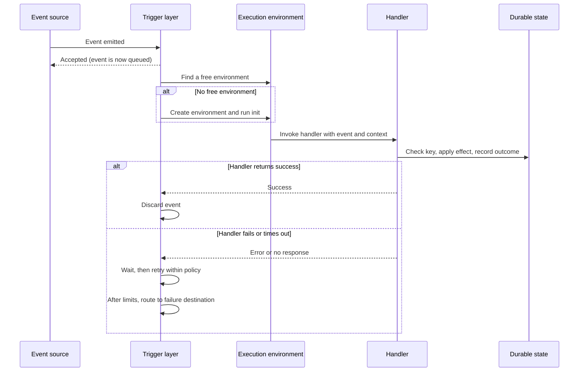

Read the diagram as a list of ownership questions.

- **At acceptance,** the source learns only that the trigger layer took the event. It does not learn that the work happened. The caller must not treat acceptance as completion.
- **At environment selection,** the platform may have to create an environment. This is the cold start, and the caller experiences it as extra latency on that one event. Cold starts are covered in their own section.
- **At handler execution,** the handler may succeed on the work and still fail to report success, for example because it ran out of time after the side effect. The platform sees a failure and retries. This is why the handler must tolerate repeats.
- **At the end,** an event that fails past its retry limits needs a destination that an owner watches. Without one, the event disappears or sits unseen.

Synchronous invocation differs in one respect. The caller waits on the connection for the response, so the caller owns the retry decision and sees errors and timeouts directly. An HTTP request through a gateway behaves this way. Polling-based sources, where the platform reads from a queue or stream and hands batches to the handler, differ again: the retry behavior is the source's, and a failed batch is returned to the source or retried in place depending on configuration. Part 09 teaches the three invocation models by provider. The architectural rule is to know, for every trigger, which model applies, because it fixes who retries and who sees failure.

### 3.2 Responsibility split in practice

The split that works consistently is the following.

| Concern | Provider | Team |
|---|---|---|
| Delivering the event to a handler | Delivery, queuing before invocation, and the retry loop configured on the trigger | Choosing the trigger type, setting retry limits, naming a failure destination |
| Execution environment | Creating, reusing, freezing, and destroying environments | Memory size, timeout, packaging, initialization code |
| Scaling | Adding and removing environments within quotas | Setting concurrency limits that protect downstream systems, requesting quota increases ahead of need |
| Identity | Issuing credentials to the execution identity | Granting that identity the narrowest permissions it needs |
| Correctness of repeated events | Nothing. Delivery is at least once on most triggers | Idempotent handlers and a deduplication strategy |
| Observability | Raw platform metrics and log capture | Structured logs, correlation identifiers, alerts on age and errors |
| Cost | The meter | Budgets, limits, and review of what scales with traffic |

The row on repeated events is the one teams discover late. The platform's guarantee is delivery, not exactly-once effect. Everything after the handler starts is the team's responsibility.

### 3.3 Treat the trigger as an input boundary

A trigger delivers input from outside the handler's trust and sizing assumptions. An object notification names a key chosen by an uploader. An HTTP body can be any size the front end allows. A queue message can come from a producer on an older schema. The handler must validate the schema, enforce size and dimension limits, and reject or divert what it cannot process. For public HTTP triggers, authentication and request throttling belong at the front end, which [Authentication](../15_Security/CH02_Authentication.md) covers, and they should not be left to the function. A function that processes untrusted input without limits will have its duration, memory, and bill chosen by the sender.

## 4. The Execution Model: Triggers, Concurrency, Scaling, and Timeouts

Four properties of the execution model decide most design outcomes: what starts the handler, how many copies run at once, how fast copies are added, and how long one copy may run.

### 4.1 Event triggers

Triggers fall into a few families, and the family sets the invocation model.

- **Request triggers** come from an HTTP front end, an API gateway, or a direct call from another service. The caller waits for a response. Retry is the caller's decision.
- **Event notifications** come from a storage service, a scheduler, or a managed event bus. The platform takes the event, queues it, and calls the handler without a waiting caller. The platform retries within a configured policy.
- **Polled sources** are queues, streams, and change feeds. A platform component reads batches and invokes the handler. Failure handling depends on the source: a failed queue batch becomes visible again after a timeout, and a failed stream batch is retried in place and blocks that shard or partition until it succeeds or expires.
- **Schedules** call the handler at a time, with no payload that depends on external state. The usual traps are overlapping runs when one run exceeds the interval and missed or duplicated runs around deployment.

The choice of trigger is an architectural decision, not a wiring detail. A queue between producer and handler absorbs bursts and gives the team a place to measure backlog and age. A direct asynchronous event gives lower latency and fewer parts but leaves less room to see and control the backlog. The [Event-Driven Architecture](CH07_Event_Driven_Architecture.md) chapter explains the event and queue semantics behind that choice.

### 4.2 Concurrency

Concurrency is the number of invocations in progress at one moment. It is the central quantity in serverless capacity, and it is computed with Little's Law: the average number of items in a system equals the arrival rate times the average time each spends in it.

$$\text{concurrency} = \text{arrival rate} \times \text{average duration}$$

Worked example (illustrative). A handler takes 120 milliseconds on average, and the service receives 200 requests per second at its normal level.

- Normal concurrency: 200 × 0.12 = 24 invocations in progress.
- A sale event raises traffic tenfold to 2,000 requests per second: 2,000 × 0.12 = 240 invocations in progress.
- A slow dependency doubles the duration to 240 milliseconds at the normal 200 requests per second: 200 × 0.24 = 48 invocations in progress.

The third line is the one that surprises people. Concurrency rises when a dependency slows down even though the request rate has not changed, so a latency problem becomes a capacity problem and then a quota problem. A platform that scales out freely makes the slow dependency more loaded, because more simultaneous callers now hit it.

Platforms use one of two concurrency shapes inside an execution environment.

- **One invocation per environment at a time.** The platform creates a new environment for each simultaneous invocation. Global variables are never touched by two requests at once, and concurrency equals the number of busy environments. This is the classic FaaS behavior of AWS Lambda.
- **Many invocations per instance.** One environment, often a container instance, serves several requests at once up to a configured limit. Cloud Run works this way, and some Azure Functions hosting plans do too. A global connection pool is shared by all requests in flight, handler code must be thread-safe, and CPU is shared across them.

Moving a workload between the two shapes changes correctness assumptions as well as cost, which is why a port from a function platform to a container platform needs a review of shared mutable state, not only a deployment change.

### 4.3 Scaling

Scaling is the platform adding or removing execution environments as concurrency changes. Three limits shape it, and the names differ by provider while the concepts do not.

- **A ceiling on total concurrency** for an account, region, plan, or function. When the ceiling is reached, new invocations are throttled. A synchronous caller sees an error, and an asynchronous source retries according to its policy.
- **A rate limit on growth.** The platform can add only so many environments per unit of time, so a very sharp spike can outrun scaling even when the ceiling is high.
- **A team-set cap on one function.** Teams use it to reserve capacity for a critical function, or to limit a function so that it cannot overwhelm a database or exhaust the shared pool.

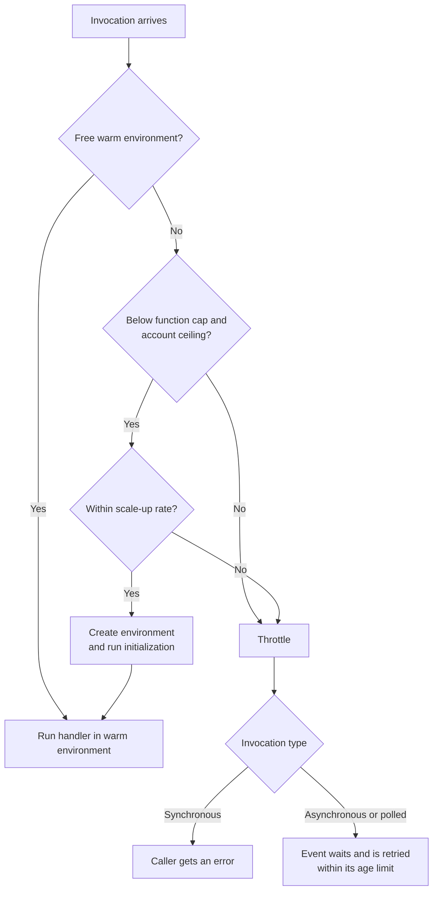

The flow shows three different outcomes from one arrival. A warm hit is cheap and fast. A new environment costs initialization time. A throttle becomes either an error to the caller or a delay that is bounded by retry and age policy. Two consequences matter for design. First, throttling is a normal operating mode under load, so synchronous callers need a retry policy with backoff and a clear user-facing behavior, and asynchronous paths need an age alarm so delay does not go unseen. Second, the scale-up rate limit means that a launch or a marketing event needs a quota and warm-capacity plan agreed in advance, not discovered at peak.

### 4.4 Downstream protection

Free scaling moves the bottleneck downstream. A relational database with a fixed connection limit does not scale with the handler. Continuing the example, 240 concurrent environments, each holding one connection, open 240 connections. If the database accepts 100 connections (illustrative), 140 handlers fail on connect, retry, and add load. Three controls apply, and they can be combined.

1. **Cap concurrency** of the function or of the event source mapping below the downstream limit, leaving room for other clients. With a cap of 60, the queue absorbs the rest and its age grows instead of the database failing.
2. **Pool connections outside the handler.** A managed database proxy or a connection pool service multiplexes many short-lived callers onto fewer database connections.
3. **Use a store designed for many small clients,** such as a key-value service accessed over HTTP, for the hottest paths.

Capping concurrency trades latency for protection. That trade is correct when the work can wait, and wrong for a user-facing request that cannot. Decide per path, and record the reason with the cap.

### 4.5 Timeouts

Every function has a maximum duration, set by the team up to a platform ceiling. The ceiling differs by provider and plan, so verify the current value for the product and hosting plan in use. Three rules apply.

- **Set the timeout from the work, not from the ceiling.** A timeout several times longer than the 99th percentile (p99) duration gives a hung call time to hold a concurrency slot and to cost money. A timeout shorter than a legitimate slow case turns it into repeated failure.
- **Align timeouts across layers.** The caller's timeout must be longer than the handler's, and a queue's visibility or lease period must be longer than the handler's timeout. If the queue makes a message visible again while the first invocation is still running, a second invocation starts on the same message. Provider documentation gives a recommended ratio for each source. Verify it for the source you use.
- **Leave time to fail cleanly.** A handler should check the remaining time in its context and stop starting new work near the deadline, so it can record a checkpoint or return the unprocessed items to the source.

Work that cannot finish inside the ceiling needs a different shape: split it into steps driven by a workflow, process it in a container job, or move it to a long-running service. The decision section later in the chapter returns to this.

## 5. Cold Starts and the Runtime Lifecycle

An execution environment does not exist until an event needs it. Creating one takes time, and that time lands on the first invocation it serves. This is the cold start. An invocation served by an existing environment is a warm start. Cold start behavior is the most discussed property of serverless and the most often misjudged, because the effect depends on the runtime, the package, the initialization code, the traffic shape, and the provider.

### 5.1 The lifecycle

An environment moves through a small set of states, and understanding them tells you what you can and cannot keep between invocations.

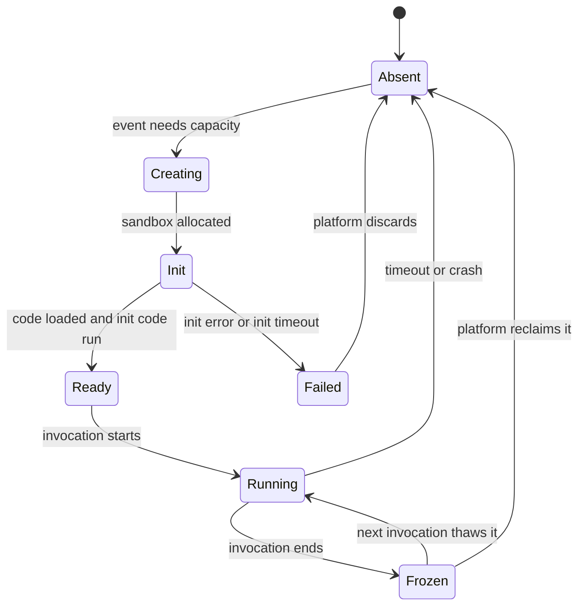

Four phases matter.

1. **Creating** allocates an isolated sandbox with the configured memory and CPU share. This phase belongs to the provider.
2. **Init** downloads and unpacks the code package or image, starts the language runtime, and runs the team's initialization code: imports, global variables, client construction, configuration loading, and any connection setup. Init runs once per environment, not once per invocation.
3. **Running** executes the handler with the event. It repeats for every invocation the environment serves.
4. **Frozen** is the idle state between invocations on platforms that suspend the environment. CPU is not available while frozen, and the platform may reclaim the environment at any moment without notice.

The lifecycle explains the cost structure of a cold start: creating plus init, paid by one unlucky invocation. It also explains the rules for state. Anything created in init survives into later invocations only if the same environment is reused, and reuse is a performance optimization with no guarantee behind it. Background work started in one invocation may not run while the environment is frozen, so a handler must finish its work, including flushing logs and metrics, before it returns.

### 5.2 What a cold start costs, with arithmetic

A cold start is an added latency on a fraction of requests. Both the size and the fraction matter, and the fraction is set by the traffic shape.

Worked example (illustrative). A handler runs in 60 milliseconds when warm. Init takes 800 milliseconds in this runtime and package. A cold invocation therefore takes about 860 milliseconds, ignoring sandbox creation time.

- **Steady traffic of 50 requests per second.** Concurrency is about 50 × 0.06 = 3. Three environments stay warm. Cold starts occur only when environments are reclaimed or when a deployment replaces them. The share of cold invocations is a small fraction of one percent, so p99 latency stays near the warm value.
- **Spiky traffic that jumps from near zero to 240 concurrent invocations.** About 240 environments must be created. If 1,000 requests arrive during the ramp, about 240 of them, or 24 percent, are cold. The p50 latency may still look fine, but p95 and p99 now sit near 860 milliseconds. The tail, not the average, shows the problem.
- **Infrequent traffic of one request every ten minutes.** If the platform reclaims idle environments sooner than ten minutes, nearly every request is cold. An interactive path with that pattern has an 860-millisecond response time on almost every call, and no average hides it.

The three patterns need different answers. Steady traffic needs nothing. A spike needs pre-provisioned capacity or a design that does not mind the delay. Infrequent traffic needs either acceptance of the latency or a warm instance kept on purpose.

### 5.3 Reducing cold start cost

Mitigations fall into three groups, ordered here from cheapest to most expensive.

**Make init smaller.**

- Load only what the handler needs. A function that imports a full software development kit to call one service pays for the unused modules on every cold start.
- Keep the package or image small. Download and unpack time grows with size.
- Defer rarely used work. Build a client on first use if most invocations do not need it, but be aware that this moves cost into the first request that does.
- Choose a runtime with a lighter start where the choice is open. Runtimes that compile ahead of time or that start quickly differ from those that load a large virtual machine and a framework. Measure instead of assuming.
- Avoid heavy frameworks that scan classpaths or build large dependency graphs at startup. This is a frequent source of seconds-long init in Java services moved to functions.

**Restore from a snapshot.** Some platforms can take a snapshot of an initialized environment and restore it for new instances, which skips most of init for supported runtimes. This shifts work from every cold start to publish time, and it imposes rules: values created before the snapshot, such as random seeds, unique identifiers, and network connections, may be duplicated or stale after restore, so initialization code must be written to tolerate it. Check the provider's documentation for the runtimes and conditions that support it.

**Keep capacity warm.** Providers offer a way to hold a number of initialized environments ready: provisioned concurrency on AWS Lambda, pre-warmed or always-ready instances on some Azure Functions plans, and minimum instances on Cloud Run. This removes cold starts up to the warm count and charges for the idle capacity, which makes it a cost decision.

Worked example (illustrative). To keep 10 environments of 0.5 gigabyte (GB) warm for a 30-day month at an illustrative price of $0.000005 per GB-second: 10 × 0.5 GB × 2,592,000 seconds = 12,960,000 GB-seconds, and 12,960,000 × $0.000005 = $64.80 per month. Whether that is worth paying depends on what the 860-millisecond tail costs the business. For a checkout path where slow responses lose orders, it is cheap. For an internal nightly batch it is waste. Warm capacity can also be scheduled: raising it before a known peak and lowering it afterward cuts most of the idle charge.

### 5.4 Hidden latency in the cold path

Cold start latency is not only the platform's. Four additions are the team's responsibility and are often unmeasured.

- **Network attachment.** A function attached to a private network may need extra setup in the cold path on some platforms. Newer platform designs have reduced this, so verify current behavior.
- **Secret and configuration fetches in init.** A call to a secrets service in init adds its latency, and a failure there fails init.
- **First connection to a database.** Opening a connection and negotiating TLS (Transport Layer Security) takes round trips. Reusing the connection across invocations helps, but only after the first one.
- **Lazy loading of code or models.** Machine-learning models and large lookup tables loaded on first use make that request slow.

The practical rule is to measure cold and warm latency separately, in production, with a metric or log field that marks an invocation as cold. A single latency average combines them and hides the problem. Platforms expose an init duration, and the team should chart it and alert on its growth after dependency upgrades, because init time creeps up as dependencies are added.

### 5.5 When cold starts are the wrong thing to worry about

Cold starts matter for synchronous, latency-sensitive calls. They matter much less for asynchronous processing, where an added second is invisible next to queue time, and for batch work, where it is amortized over many invocations. Spending effort to eliminate cold starts on a path whose users never notice them is wasted. The inverse error is also common: a team accepts cold starts on a synchronous path, measures only the average, and discovers the tail after launch. The test is simple. Ask what a response time at the 99th percentile equal to the cold path would do to a user or a caller, and design to that answer.

## 6. Statelessness and External State

Functions should treat each invocation as potentially isolated. The platform may run two consecutive events in the same environment, in different environments, or in two environments at the same time. It may discard an environment between any two events. Code that is correct under all of these is stateless in the sense that matters: nothing it needs to remain correct lives only inside the environment.

Stateless does not mean state-free. It means that durable state lives in a service built to hold it, and local state is a disposable cache.

### 6.1 Where state lives

Each kind of state has a natural home, chosen by how long it must live and who must see it.

| Kind of state | Examples | Where it belongs |
|---|---|---|
| Business records | Orders, accounts, documents | A database or object store owned by the capability |
| Deduplication and idempotency records | Processed event identifiers, request keys | A store with conditional writes and expiry |
| Workflow progress | Which step ran, what is awaited, compensation owed | A workflow service or a state table |
| Shared counters and locks | Rate counters, leases | A store with atomic operations |
| Disposable cache | Parsed configuration, an open client, a loaded lookup table | Process memory, rebuilt on demand |
| Scratch data | A downloaded file being transformed | The environment's temporary directory, deleted by the handler |

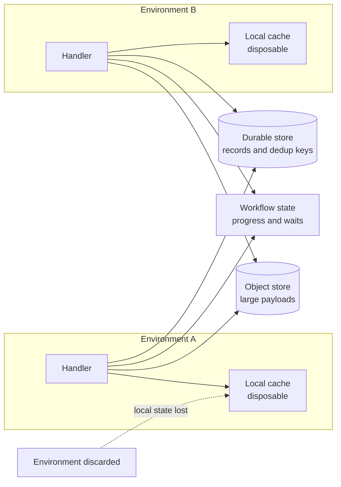

The diagram shows two environments serving the same function at the same time. Each has a private cache that the other cannot see, so two requests for the same user can see different cached values. Both write through to the same durable store, which is the only place a fact can be trusted. The dashed edge is the design test: if discarding an environment loses anything that matters, the design is wrong. Practical consequences follow. A cache must tolerate being stale and must be safe to rebuild. A counter kept in a global variable undercounts, because each environment counts separately. A lock held in memory protects nothing across environments. Scratch files in the temporary directory can persist into the next invocation of the same environment, so a handler that appends to a file without cleaning it can leak data from one request into another. That is a correctness and a confidentiality defect.

### 6.2 Payloads and the claim-check approach

Triggers and responses carry payload size limits that vary by provider and invocation type, so verify the current figures for the product in use. When an event may carry a large body, such as an image or a document, put the body in object storage and pass a reference. The handler reads the object, processes it, and writes the result back. This is the claim-check approach. It keeps messages small, avoids size failures, and lets a retry re-read the same input. It adds one more failure point, the read, and it requires the handler's identity to have read access to exactly the objects it needs.

### 6.3 Connections are state too

An open database connection or client is state held by the environment. Create clients during init so that warm invocations reuse them, and handle the case where a reused connection has been closed by the server or by a network device while the environment was frozen. A handler that assumes the connection is alive will fail on the first call after a long idle period. Retry once on a connection error with a fresh connection, and treat repeated failure as a real error.

### 6.4 When the work needs durable memory

Work that spans several steps, waits for a person, or runs longer than the timeout needs durable state that survives between invocations: a workflow service that records progress, or a state table the handlers update. The handler's job is then to read the current step, do one bounded piece of work, record the new step, and exit. A function that sleeps while waiting holds a concurrency slot and bills for the wait, and a function that holds progress in memory loses it when the environment goes. Workflow composition is covered in a later section of this chapter.

## 7. Idempotency and Retry Semantics of Asynchronous Invocation

Most triggers deliver an event at least once. A retry can arrive after the handler already performed its effect, because the failure that triggered the retry happened after the effect or because the success signal never reached the platform. A handler that is not safe to run twice will occasionally charge a customer twice, send duplicate messages, or create duplicate records. The cause is the delivery model, so adding care inside the handler does not remove it. The design must make the repeat harmless.

### 7.1 Why repeats happen

Four causes cover most cases, and each is normal operation.

1. **The handler failed after the effect.** It wrote to the database, then crashed or timed out before returning. The platform sees failure and retries.
2. **The success signal was lost.** The handler returned, but the platform lost the response. It treats the invocation as unfinished.
3. **A queue's visibility period expired.** The first invocation was still running when the message became visible to another poller, so two invocations work on one message.
4. **The producer sent twice.** An upstream retry or a producer that publishes at least once delivers the same logical event under two message identifiers.

The first three are repeats of one delivery. The fourth is a duplicate event with different delivery identifiers. A deduplication key must therefore come from the business meaning of the event, such as an order identifier plus an operation name, and not from a message identifier the platform assigns.

### 7.2 Retry policy of asynchronous invocation

Asynchronous invocation has a policy with three parts: how many times to retry, how long to keep trying, and where to send an event that has exhausted both. On AWS Lambda these are the maximum retry attempts, the maximum event age, and a failure destination such as a queue, topic, or event bus. Azure Functions and Google Cloud offer similar controls through the trigger's own settings, for example queue dequeue counts with a poison queue for Azure Storage queues, or retry settings on a Google Cloud event subscription. The defaults differ by product and trigger, and some triggers retry indefinitely unless limited, so read the current documentation and set the policy explicitly. An unset policy is a decision made by the provider's default.

Policy choices have consequences.

- **Retry count.** Too few loses events on brief outages. Too many multiplies load during an outage, as every failing event keeps calling a sick dependency.
- **Maximum age.** It bounds how stale an event may be when finally processed. An event that is useful for five minutes should not be processed after six hours.
- **Failure destination.** It must have an owner, an alarm on its depth, and a documented replay procedure. An unwatched dead-letter queue is a place where data goes to be forgotten.
- **Backoff.** Immediate retries against an overloaded dependency worsen the overload. Prefer delays that grow, with jitter.

### 7.3 Idempotent handler design

A handler is idempotent if running it twice with the same input leaves the system in the same state as running it once. Three techniques achieve that, and they combine.

- **Natural idempotence.** Make the operation a set operation instead of an increment: write "status is shipped" instead of "add one shipment". Writes keyed by a business identifier overwrite instead of duplicating.
- **A deduplication record.** Before acting, claim the event's key with a conditional write that fails if the key exists. Skip the effect if the claim fails. Expire records after the longest period a repeat can plausibly arrive.
- **Idempotency keys on downstream calls.** When the effect is an external call, such as a payment, send a stable key so that the downstream system deduplicates. This closes the gap where the external call succeeded and the handler failed before recording it.

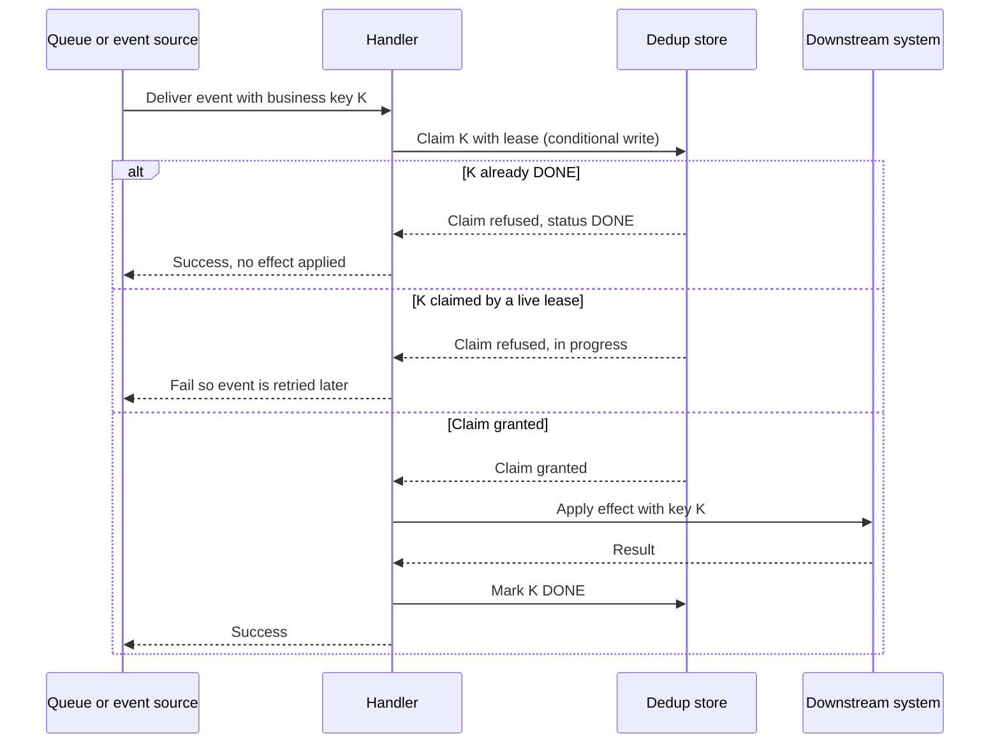

The diagram separates three outcomes. A repeat after completion is absorbed silently, which is the desired behavior. A repeat while another invocation holds a live claim is refused and retried later, which prevents two invocations from acting at once. A first delivery runs the effect and records completion. The lease matters: if the handler crashes after claiming, the claim must expire so that a later retry can take over, or the event is lost forever. The gap that remains is a crash between the downstream effect and the DONE mark. The retry will then call the downstream system again, which is why the downstream call also carries the key. The two layers cover each other.

### 7.4 A handler that follows the pattern

The Python handler below consumes a batch from a queue, claims each message, and reports only the failed messages so that successful ones are not retried. It assumes a table with partition key `pk`, a time-to-live (TTL) attribute named `expires_at`, and a function `apply_effect` that accepts the idempotency key. Treat it as an illustration of the structure. Check the current event shape and the partial batch response setting in the provider documentation before use.

```python
import json
import os
import time

import boto3
from botocore.exceptions import ClientError

table = boto3.resource("dynamodb").Table(os.environ["DEDUP_TABLE"])  # created in init, reused
LEASE_SECONDS = 60
RETAIN_SECONDS = 7 * 24 * 3600


def claim(key: str) -> str:
    now = int(time.time())
    try:
        table.put_item(
            Item={"pk": key, "status": "IN_PROGRESS", "lease_until": now + LEASE_SECONDS,
                  "expires_at": now + RETAIN_SECONDS},
            ConditionExpression="attribute_not_exists(pk) OR (#s = :ip AND lease_until < :now)",
            ExpressionAttributeNames={"#s": "status"},
            ExpressionAttributeValues={":ip": "IN_PROGRESS", ":now": now},
        )
        return "GRANTED"
    except ClientError as err:
        if err.response["Error"]["Code"] != "ConditionalCheckFailedException":
            raise
    item = table.get_item(Key={"pk": key}, ConsistentRead=True).get("Item", {})
    return "DONE" if item.get("status") == "DONE" else "BUSY"


def handler(event, context):
    failures = []
    for record in event["Records"]:
        body = json.loads(record["body"])
        key = f'{body["order_id"]}:{body["operation"]}'  # business key, not the message id
        try:
            state = claim(key)
            if state == "DONE":
                continue
            if state == "BUSY":
                failures.append({"itemIdentifier": record["messageId"]})
                continue
            apply_effect(body, idempotency_key=key)
            table.update_item(Key={"pk": key}, UpdateExpression="SET #s = :d",
                              ExpressionAttributeNames={"#s": "status"},
                              ExpressionAttributeValues={":d": "DONE"})
        except Exception:
            failures.append({"itemIdentifier": record["messageId"]})
    return {"batchItemFailures": failures}
```

Three points about the code matter more than its syntax. The key is built from business fields, so a duplicate with a different message identifier is still caught. The failed items are returned individually, so a poison message does not force the whole batch to repeat. The claim is a single conditional write, so two concurrent invocations cannot both win it.

### 7.5 Configuring the trigger so the handler's assumptions hold

The infrastructure must match the handler. The AWS Serverless Application Model (SAM) template below, written as Infrastructure as Code (IaC), wires a queue to the function with a failure queue, partial batch reporting, a concurrency cap, and a visibility period longer than the function timeout. The values are examples. Choose them from the work and verify property names and limits against the current provider documentation.

```yaml
AWSTemplateFormatVersion: "2010-09-09"
Transform: AWS::Serverless-2016-10-31

Resources:
  OrderQueue:
    Type: AWS::SQS::Queue
    Properties:
      VisibilityTimeout: 180
      RedrivePolicy:
        deadLetterTargetArn: !GetAtt OrderDeadLetterQueue.Arn
        maxReceiveCount: 5

  OrderDeadLetterQueue:
    Type: AWS::SQS::Queue
    Properties:
      MessageRetentionPeriod: 1209600

  OrderFunction:
    Type: AWS::Serverless::Function
    Properties:
      Runtime: python3.12
      Handler: app.handler
      MemorySize: 512
      Timeout: 30
      Environment:
        Variables:
          DEDUP_TABLE: !Ref DedupTable
      Events:
        Orders:
          Type: SQS
          Properties:
            Queue: !GetAtt OrderQueue.Arn
            BatchSize: 10
            FunctionResponseTypes:
              - ReportBatchItemFailures
            ScalingConfig:
              MaximumConcurrency: 20
```

The queue's visibility timeout of 180 seconds is six times the function timeout of 30 seconds, which follows the guidance that the visibility period should exceed the function timeout by a wide margin so that a slow invocation does not overlap with a redelivery. The failure queue receives a message after five receives, and a person or an automated process owns it. The concurrency cap of 20 is the downstream protection discussed earlier, set from the downstream limit and not from the function's own capacity. The table definition and permissions are omitted for brevity.

Deployment mechanics for this template, including pipelines and safe rollout, belong to Part 13.

## 8. The Cost Model: Per-Invocation Pricing Versus Always-On Capacity

Serverless pricing is a different shape of curve, not a discount. Always-on capacity costs a fixed amount per hour whether or not it is used, and the cost per request falls as utilization rises. Per-invocation pricing costs nothing when idle and a roughly constant amount per request. The two curves cross at some volume, and the crossing point is the number that decides the choice.

### 8.1 The meters

Function platforms meter some combination of the following. The names and rates vary by provider and change over time, so take current figures from the provider's pricing pages.

- **Requests.** A charge per million invocations.
- **Compute time weighted by size.** Duration multiplied by configured memory, expressed as gigabyte-seconds (GB-seconds). Some platforms also meter CPU time or allocate CPU in proportion to memory. A larger memory setting costs more per second and can finish sooner, so the cheapest setting is found by measurement and is sometimes the larger one.
- **Warm capacity.** A charge for provisioned or minimum instances, billed for the time they are held, used or not.
- **Adjacent services.** Log ingestion and storage, data transfer, gateway requests, queue requests, workflow state transitions, and secret retrievals. These are billed separately and are often the surprise.

This chapter uses clearly labelled illustrative prices. They are round numbers chosen to keep arithmetic readable.

| Illustrative meter | Value used in this chapter |
|---|---|
| Per-invocation request charge | $0.20 per million requests |
| Compute charge | $0.00002 per GB-second |
| Always-on instance (2 virtual CPUs, 4 GB) | $0.04 per hour |
| Log ingestion | $0.50 per GB |
| Hours per month | 730 |

### 8.2 Scenario A: low, steady volume

A service receives 3,000,000 requests per month. Each runs 120 milliseconds at 0.5 GB.

- Compute: 3,000,000 × 0.12 s × 0.5 GB = 180,000 GB-seconds. At $0.00002, that is $3.60.
- Requests: 3 million × $0.20 per million = $0.60.
- Function total: $4.20 per month.

An always-on alternative needs at least two instances for availability across failures. Two instances for 730 hours at $0.04 per hour cost 2 × 730 × $0.04 = $58.40 per month. The function is roughly fourteen times cheaper, because the instances sit nearly idle: 3,000,000 requests in a month is an average of 3,000,000 ÷ 2,628,000 seconds, about 1.1 requests per second.

### 8.3 The break-even volume

The function's cost per request is the request charge plus the compute charge for one invocation.

- Request charge per request: $0.20 ÷ 1,000,000 = $0.0000002.
- Compute per request: 0.12 s × 0.5 GB × $0.00002 = $0.0000012.
- Total per request: $0.0000014.

Against the $58.40 two-instance floor, break-even is $58.40 ÷ $0.0000014 = about 41.7 million requests per month, or about 15.9 requests per second averaged over a month (41,714,286 ÷ 2,628,000). That sounds like a clear boundary, but it is misleading, because two instances can serve far more than 15.9 requests per second. Break-even against the minimum floor tells you where the cheaper option flips for a small service. For a larger service, the comparison must use the number of instances the peak demands.

### 8.4 Scenario B: high, sustained volume

The same request now arrives at 300,000,000 per month, an average of about 114 requests per second (300,000,000 ÷ 2,628,000). Peak traffic is three times the average, about 342 requests per second.

- Function cost: 300,000,000 × $0.0000014 = $420 per month.
- Container capacity: assume, illustratively, that one instance handles 40 requests per second at acceptable latency. Peak needs 342 ÷ 40 = 8.55, so 9 instances. Add one for failure tolerance, 10 instances, always on: 10 × 730 × $0.04 = $292 per month.

At this volume the always-on option is about 30 percent cheaper on compute ($292 versus $420), and it is a fixed cost that does not rise with a traffic spike. The function remains worth considering if the team's cost of operating a fleet exceeds the difference, but the compute argument has reversed. This is the result behind the common observation that serverless is economical at low and uneven volume and expensive at high and steady volume.

Autoscaling the container fleet narrows the gap. If instances scale with traffic so that the average fleet size is 5 instead of 10, the cost falls to about $146, and the always-on choice gets cheaper still. The honest comparison therefore includes how well the container platform tracks demand, and not only a worst-case fleet.

### 8.5 Adjacent costs can dominate

Return to Scenario A. Suppose each invocation writes 2 kilobytes of logs. That is 3,000,000 × 2 KB = 6,000,000 KB, about 6 GB per month, and at $0.50 per GB the log charge is $3.00. Logs now cost nearly as much as the compute ($3.60). With verbose logging of 20 KB per request, the log charge becomes $30, seven times the function's own cost of $4.20. Per-invocation pricing makes anything that scales with request count a cost driver, and logs, gateway requests, and workflow transitions all do. Review them together with the function.

### 8.6 Runaway cost

Pay-per-use billing has no ceiling unless the team sets one. Four patterns produce surprising bills, and each can be prevented at design time.

1. **Retry amplification.** A handler that fails after most of its work, on an event retried several times, bills each attempt. Retries against an unhealthy dependency multiply cost at the moment value is lowest. Bound retries and age, and use backoff.
2. **Recursive triggers.** A function that writes to the bucket or queue that triggers it starts itself. The loop runs until a limit stops it. Separate input and output locations, and set a concurrency cap and a budget alarm as a second line of defense.
3. **Unbounded fan-out.** One event that spawns thousands of invocations, each of which spawns more, multiplies cost and downstream load. Cap the fan-out width and bound the depth.
4. **Hung calls billed to the timeout.** A handler waiting on a dependency that never answers is billed until its timeout. If the timeout is set to the platform maximum, one stuck dependency turns every invocation into a long, expensive one.

Controls that apply to all four: a concurrency cap on every function, a billing alarm with a threshold close enough to the normal level to trip early, cost allocation tags per function or service, and a periodic review of the most expensive functions by cost per business outcome, such as cost per completed order. Total cost per outcome is the metric that connects the bill to the product.

### 8.7 What the arithmetic does not include

The comparisons above cover compute. A complete decision adds the cost of engineering time to operate the alternative, the cost of tail latency to the business, the cost of rewriting if the platform's limits are later exceeded, and the cost of the extra services that serverless architectures tend to need, such as queues, workflow engines, and gateways. A fleet that costs $292 per month and needs an engineer one day a month for patching and scaling reviews is not necessarily cheaper than a $420 function. State these assumptions in the decision record, so that the choice can be revisited when volume changes.

## 9. Provider Mappings by Mechanism

The three major providers implement the same pattern with different products and different guarantees. This section describes each by mechanism. Part 09's [Serverless Compute](../09_Cloud_Computing/CH11_Serverless.md) chapter teaches the product-level detail, and every limit named here as a category should be checked against current documentation before it is used in a design.

### 9.1 AWS Lambda

AWS Lambda is a function service with a one-invocation-per-environment model on its standard configuration. The team uploads a package or a container image and configures memory, timeout, an execution role, and triggers. CPU is allocated in relation to the memory setting. Invocation can be synchronous, asynchronous with an internal queue and a configurable retry and age policy, or driven by an event source mapping that polls queues and streams on the team's behalf. Concurrency is limited at the account and region level, and a function can have reserved concurrency that both guarantees capacity and caps the function. Provisioned concurrency holds initialized environments ready. A snapshot-restore feature exists for some runtimes. Lambda charges for requests and for duration weighted by memory. Verify current runtimes, limits, and pricing.

### 9.2 Azure Functions

Azure Functions is a function host that runs on several hosting plans, and the plan decides the scaling behavior, the cold start behavior, the network options, and the cost model. Plans range from a usage-billed plan that scales to zero, through plans with pre-warmed or always-ready instances, to plans on dedicated capacity. Triggers and bindings are declared next to the function and connect it to storage queues, Service Bus, Event Hubs, Event Grid, HTTP, and timers. Because the plan, and not only the function, governs behavior, an Azure design must name the plan. Plan names and features have changed over time, so verify the options currently offered. Durable Functions adds a durable workflow model on the same host.

### 9.3 Google Cloud Run functions and Cloud Run

Google Cloud offers functions and containers on a shared runtime family. Cloud Run functions runs a function as a source-based deployment, and Cloud Run runs a container image as an HTTP service or as a job. A Cloud Run instance can serve many requests at once, up to a configured concurrency, which makes connection pooling and thread safety a design matter. Scaling is bounded by team-set minimum and maximum instance counts, and a minimum above zero keeps warm capacity. Event delivery into functions typically passes through Eventarc or Pub/Sub, so retry behavior comes from the delivery service as much as from the runtime. Verify the current relationship between Cloud Run functions and the earlier generation of Cloud Functions, because naming and capabilities have shifted.

### 9.4 Comparison of guarantees and responsibilities

The table compares what the provider promises and what stays with the team. It is hedged because details vary by product tier and change over time.

| Concern | AWS Lambda | Azure Functions | Google Cloud Run functions and Cloud Run |
|---|---|---|---|
| Concurrency inside one environment | One invocation at a time on the standard model | Depends on plan and configuration. Verify per plan | Many requests per instance, up to a configurable limit |
| Where scaling limits apply | Account and region concurrency, optional per-function reservation | Plan and app scale-out limits. Verify per plan | Team-set minimum and maximum instances, plus project and region quotas |
| Warm capacity option | Provisioned concurrency | Pre-warmed or always-ready instances on some plans | Minimum instances |
| Cold start mitigation beyond warm capacity | Snapshot restore for some runtimes | Plan choice. Verify | Startup CPU boost and image optimization. Verify |
| Delivery guarantee of event triggers | At least once. Duplicates possible | At least once for most triggers. Duplicates possible | At least once through the delivery service. Duplicates possible |
| Asynchronous retry and failure destination | Configurable retry count, event age, failure destination | Set per trigger, for example poison queues or dead-letter settings | Set by the Pub/Sub or Eventarc subscription |
| Maximum execution duration | Provider-defined ceiling. Verify | Depends on plan. Verify | Provider-defined ceiling per service type. Verify |
| Platform runs and patches | Hosts, managed runtimes, scaling controller | Hosts, managed runtimes, scaling controller | Hosts, managed runtimes or base images, scaling controller |
| Team owns | Handler, idempotency, role permissions, concurrency caps, alarms | Handler, idempotency, plan choice, identity permissions, alarms | Handler or image, idempotency, service identity, instance bounds, alarms |
| Billing shape | Requests and memory-weighted duration, plus warm capacity | Depends on plan. Usage-based, or per instance | Request and instance time, with different rates when warm or idle. Verify |

Two points deserve attention. First, every provider gives at-least-once delivery on the usual triggers, so idempotent handlers are mandatory everywhere. Second, the differences that change a design are concurrency inside the environment and how scaling limits are scoped, because they alter correctness and capacity planning. Similar names hide different behavior, so a function that runs well on one platform should be retested under the other's concurrency model before it is trusted there.

### 9.5 Portability in practice

Business logic written against a narrow interface moves between platforms with modest effort. The trigger wiring, event payload shapes, identity configuration, and deployment templates do not, and they are usually most of the integration work. A team that cares about portability can keep handlers thin: a small adapter converts the provider's event into a domain input, and the domain code has no dependency on the platform. This is the same ports-and-adapters separation described in [Hexagonal Architecture](CH02_Hexagonal_Architecture.md), applied at the edge of a function. It reduces migration cost and does not remove it, and it should be paid for only when a credible reason to move exists.

## 10. Quality-Attribute Consequences and Failure Modes

The pattern's effect on each quality attribute follows from the execution model, and the reasoning is stated here so the trade-offs are explicit.

| Attribute | Effect | Reasoning |
|---|---|---|
| Scalability | Strong for bursts, bounded by quotas and scale rate | Environments appear on demand, but ceilings and growth limits apply, and downstream stores do not scale with them |
| Availability | Good for the compute tier, set by the weakest dependency | Providers spread functions across zones, and the handler is only as available as the stores and external APIs it calls |
| Latency | Variable at the tail | Cold starts add latency to a fraction of requests, and chained calls add up |
| Cost | Favorable at low or uneven volume, unfavorable at steady high volume | Per-invocation pricing against fixed capacity, as the cost model section showed |
| Operability | Less fleet work, more distributed-system work | No hosts to patch, but many small units to observe and correlate |
| Security | Smaller attack surface per unit, more permissions to manage | Each function needs its own narrow identity, and many functions means many policies |
| Portability | Weaker | Triggers, identity, and event shapes are provider-specific |

### 10.1 Failure modes and anti-patterns

Each of the following is a recurring failure, with its cause and its consequence.

- **Function chains.** Function A calls B synchronously, which calls C. Cause: reuse of small units as if they were library calls. Consequence: latency adds across hops, each caller holds a concurrency slot and bills while it waits, a retry at any level multiplies work, and a failure in C surfaces as a timeout in A. Replace chains with a queue between steps or a workflow service that owns the sequence.
- **Unbounded fan-out.** A single event triggers a very large number of invocations with no cap. Cause: scaling is free to the author, so the width is never set. Consequence: quota exhaustion that starves unrelated functions, a flood against a downstream service, and a large bill. Cap the width, batch the work, and place a queue in front of the consumers.
- **Hidden cold-start latency.** An interactive path is tested with warm traffic and shipped with only average latency charted. Cause: cold and warm are not measured separately. Consequence: users at the tail see slow responses that no dashboard reports. Mark cold invocations, chart the tail, and decide on warm capacity from the measurement.
- **Runaway cost.** The patterns of the cost model section: recursion, retry amplification, uncapped fan-out, and large timeouts. Cause: no cap and no early alarm. Consequence: a surprise bill that can arrive before anyone looks. Cap concurrency and alarm on spend.
- **Non-idempotent handlers behind at-least-once triggers.** Cause: the author tested only the successful path. Consequence: duplicate effects at a low rate that appears only under load or during incidents, which makes it hard to reproduce.
- **Process-local state treated as truth.** Cause: a global variable that works in one environment. Consequence: inconsistency that depends on which environment served a request.
- **Over-privileged shared execution role.** One broad role is attached to every function for convenience. Cause: policy authoring effort is deferred. Consequence: any one compromised function reaches every resource.
- **Silent poison events.** A failure queue with no owner and no alarm. Cause: the failure path is configured and never operated. Consequence: lost business events found weeks later.

### 10.2 A quality scenario with a measurable criterion

A quality scenario states a stimulus, a response, and a measure so that the design can be tested.

- **Stimulus.** Traffic to an interactive API function rises from 20 to 400 requests per second in 30 seconds, with an average duration of 100 milliseconds.
- **Expected response.** Concurrency rises from 20 × 0.1 = 2 to 400 × 0.1 = 40 invocations. The platform creates about 38 additional environments, each with an 800-millisecond init (illustrative).
- **Measure.** At least 99 percent of requests complete within 500 milliseconds during the ramp, and no request is throttled.
- **Result of the reasoning.** Without warm capacity, up to 38 requests in the ramp take about 900 milliseconds. If more than 1 percent of ramp requests are cold, the measure fails. If the ramp delivers about 6,300 requests (an average of 210 per second over 30 seconds), 38 cold requests are about 0.6 percent, so the measure passes. If the ramp is sharper, or each new environment serves only one request before the ramp ends, the share rises, and warm capacity of 40 environments or a relaxed target is needed.

The scenario shows why the test uses the traffic shape and the percentile, and why the design decision, warm capacity or acceptance, follows from a number and not from a preference. The later sections of the chapter apply the same method to workflows and to the choice between serverless, containers, and virtual machines.

## 11. Composing Workflows Without Hiding Failure

One function rarely completes a business process. An order needs validation, a stock reservation, a payment authorization, and a confirmation, and each step can fail in its own way. The question for this chapter is where the knowledge of the sequence lives, because that decides who sees a failure, who retries, and who undoes completed work. Three compositions are common, and they differ mainly in how much failure they hide.

### 11.1 Three ways to compose

**A function chain** has one function call the next synchronously. The sequence lives in code spread across the functions. It is the cheapest to write and the hardest to operate, for the reasons in the anti-pattern list above: latency adds, every caller bills while it waits, and a failure at the end appears as a timeout at the start.

**Orchestration** puts the sequence in one place. A workflow service (AWS Step Functions, Azure Durable Functions or Logic Apps, Google Cloud Workflows) holds a state machine that calls each step, records progress durably, applies retry and catch rules per step, and can wait for hours or days without holding a function slot. Steps stay small and stateless. The orchestrator is the state.

**Choreography** has no central owner. Each function reacts to an event and emits the next one. The sequence is the sum of subscriptions. It couples services loosely and scales cleanly. It also makes the process invisible, because no component can answer the question "where is order 4417 now?" without joining logs from every participant. [Event-Driven Architecture](CH07_Event_Driven_Architecture.md) teaches the event semantics behind it.

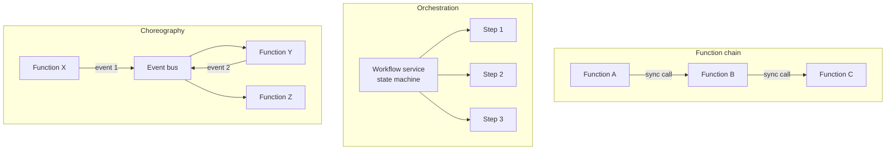

The diagram shows where the sequence lives in each style: in the call stack, in one state machine, or in the subscriptions around a bus. The choice follows from the process. Use orchestration when the process has an owner, branches, waits, or compensations, because those need a place to be recorded. Use choreography when steps are independent reactions that different teams own, and the business needs no single view of progress. Avoid chains for anything beyond a trivial two-step call, and replace them as soon as a third hop appears.

### 11.2 An orchestrated order process

The state machine below is the order process most teams start with. It has a business branch (invalid order, declined payment), a technical branch (transient failure with bounded retry), and a compensation (release the reservation).

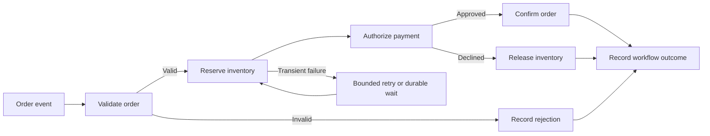

Read it for three properties. Business outcomes (rejection, decline) are ordinary branches and not errors, so they do not trigger retries. Technical failures are retried a bounded number of times and then fall through to a catch path. Every path ends at the audit step, so an operator can always find a terminal record. The orchestrator makes the process visible, and it does not make it atomic. Reserving inventory and authorizing payment touch two systems, and no single transaction spans them. A decline after a reservation needs the explicit release step. Some actions cannot be undone at all, such as an email already sent, and the design must say so. [Saga Pattern](CH10_Saga_Pattern.md) owns the compensation theory, and [Distributed Transactions](../07_System_Design_and_Distributed_Systems/CH12_Distributed_Transactions.md) explains why atomicity is unavailable. This chapter takes the result as given and focuses on running the saga on managed services.

### 11.3 Retries and error handling per step

A workflow gives each step its own policy, which a chain cannot. A step definition needs four decisions: which errors are retried, how often, how the delay grows, and where control goes when retries are exhausted. The fragment below uses the Amazon States Language of AWS Step Functions. Other engines express the same four decisions in their own syntax, and the property names should be checked against the current documentation.

```json
{
  "ReserveInventory": {
    "Type": "Task",
    "Resource": "arn:aws:states:::lambda:invoke",
    "TimeoutSeconds": 30,
    "Retry": [
      {
        "ErrorEquals": ["TransientError", "States.Timeout"],
        "IntervalSeconds": 2,
        "BackoffRate": 2.0,
        "MaxAttempts": 3,
        "JitterStrategy": "FULL"
      }
    ],
    "Catch": [
      { "ErrorEquals": ["OutOfStock"], "Next": "RecordRejection" },
      { "ErrorEquals": ["States.ALL"], "Next": "ReleaseAndFail", "ResultPath": "$.error" }
    ],
    "Next": "AuthorizePayment"
  }
}
```

The retry list names only errors that can succeed on a second try. A business error such as `OutOfStock` is caught and routed, because repeating it changes nothing. The delay arithmetic is simple: with a 2-second interval and a backoff rate of 2.0, the three retries wait 2, 4, and 8 seconds, so a persistent failure consumes about 14 seconds of waiting plus the attempts themselves before the catch path runs. The step timeout bounds each attempt, and the jitter setting spreads retries from many executions so they do not hit a recovering dependency at once. The final `States.ALL` catch is a safety net, and it must lead to a compensating or terminal state and never to silence.

Compare this with independent retries in a chain of three functions where each layer retries a failed call three times (initial attempt included). The last function can run up to 3 × 3 × 3 = 27 times for one request, while the user sees one error. Centralizing retry policy in one place removes that multiplication.

### 11.4 Idempotency across steps

Orchestrators retry steps, and some engines can deliver a step more than once. Every step therefore follows the rules of the idempotency section: a business key, a conditional claim, and a stable key on downstream calls. The workflow adds one useful key. The execution identifier is stable across retries of the same run, so a step can combine it with the step name to form a deduplication key, for example `exec-93a7:reserve-inventory`. Starting the workflow also needs protection. If the same order event starts two executions, the process runs twice, so use the order identifier as the execution name or a deduplication key at start, on engines that support it.

State passed between steps should be small. Large payloads belong in object storage with a reference passed through the workflow, as in the claim-check approach, because engines limit the size of state and charge by transition or by duration. Sensitive data in state is visible to anyone who can read execution history, so pass identifiers and not the data.

### 11.5 Choosing a workflow style

Costs differ in shape. As an illustration, suppose a standard workflow bills $0.000025 per state transition (illustrative). The order process above has about 6 transitions on the happy path, so one order costs 6 × $0.000025 = $0.00015, and one million orders cost $150. An express style that bills by duration is cheaper for high-volume short processes and keeps less history, which suits flows that finish in seconds and need no per-step audit. Standard workflows suit long, rare, auditable processes. Pick by process length and volume, and record the choice.

The operational payoff of orchestration is the execution history: for any order, the states it passed through, the inputs and outputs, and the point of failure. Pair it with the correlation identifier rule from the observability section so that function logs join to the execution.

Orchestration is a dependency. The state machine definition is a deployment artifact in a provider-specific language, and it adds a service to the availability chain. That cost is usually worth paying for processes with compensation or waits. It is not worth paying for a two-step flow that a queue and one function handle.

## 12. Choosing the Execution Model From the Workload

Functions, serverless containers, and always-on capacity (containers on a cluster or virtual machines) all run application code. The choice is made from measured workload properties, using the method of [Compute Placement and Runtime Architecture](../10_Cloud_Architecture/CH05_Compute_Placement_and_Runtime_Architecture.md). This section gives the serverless side of that comparison and a way to apply it quickly.

### 12.1 Decision flow

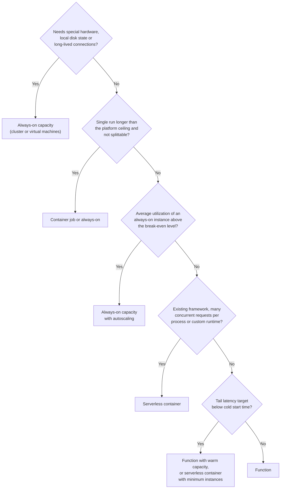

The order of questions puts hard constraints first, since no price comparison rescues a platform that cannot run the job. Utilization comes next because it is the strongest cost signal. Programming model and latency then separate the serverless forms. The flow gives a starting point, and a measurement of the candidate under the real traffic shape confirms it.

### 12.2 Break-even utilization, worked

The prices below are the illustrative ones from the cost model section. A function costs $0.0000014 per request at 120 milliseconds and 0.5 GB. An always-on instance costs $0.04 per hour and, by assumption, serves 40 requests per second at acceptable latency.

- Requests the instance could serve per hour at full load: 40 × 3,600 = 144,000.
- Instance cost per request at utilization $u$: $0.04 ÷ (144,000 × u) = $0.000000278 ÷ u.
- Break-even where that equals $0.0000014: $u$ = 0.000000278 ÷ 0.0000014 = about 0.20.

Below about 20 percent average utilization of the instance, the function is cheaper per request in this illustration, and above it the instance is. Scenario B in the cost model section agrees: 114 requests per second against a capacity of 400 (ten instances) is about 29 percent utilization, and the instance fleet came out cheaper ($292 versus $420). The break-even level depends on the duration and memory of the handler, so recompute it from the workload's own numbers. The calculation also ignores the engineering time needed to run a fleet, which pushes the true break-even toward higher utilization.

A serverless container changes the per-request cost through concurrency. Suppose one 2 GB instance serves 10 requests at once, each running 0.12 seconds, at the same illustrative compute rate. The instance bills 0.12 × 2 × $0.00002 = $0.0000048 for the 10 requests, which is $0.00000048 per request, plus $0.0000002 request charge, so $0.00000068 per request. That is about half the function's $0.0000014. The advantage holds only when requests overlap. If traffic is sparse and the instance serves one request at a time, the same instance bills $0.0000048 + $0.0000002 = $0.000005 per request, more than three times the function. Concurrency per instance is therefore the number to verify before choosing.

### 12.3 Comparing the three execution models

| Property | Functions | Serverless containers | Always-on capacity |
|---|---|---|---|
| Idle cost | None unless warm capacity is bought | None at zero minimum instances | Full fixed cost |
| Cold start | Per environment. Mitigated by warm capacity or snapshots | Per instance, usually larger images start slower | None once running |
| Time limit per run | Platform ceiling, verify for the product | Higher ceilings, and job forms exist. Verify | Unbounded |
| Concurrency inside a unit | Usually one invocation | Many requests per instance | Many, set by the team |
| Framework and runtime freedom | Supported runtimes and packaging | Any container the platform runs | Anything |
| Hardware options | Limited | Limited, some accelerators on some platforms. Verify | Wide |
| Operating burden | Lowest | Image and server tuning | Highest: patching, capacity, scaling |
| Cost shape | Best when idle share is high | Best with overlapping requests and uneven load | Best at steady high utilization |
| Provider coupling | Highest (triggers, events) | Lower (the image ports) | Lowest |

### 12.4 Mixed systems are normal

One system usually uses several models. A common split is functions for event glue and bursty background tasks, a serverless container for the main API that already uses a web framework, and an always-on cluster for a steady stateful core such as a search index. Decide per component from its workload and write each decision, with its measured inputs and the revisit trigger, into an architecture decision record, following [Architecture Decision Records](../21_Architecture_Documentation/CH03_ADR_Architecture_Decision_Record.md). A typical trigger is average utilization crossing the break-even level for a full quarter.

## 13. Security, Observability, and Testing at Pattern Level

Serverless moves the infrastructure layer to the provider and leaves the application layer, identity, and event handling with the team. Three practices need pattern-level treatment here. Tool-level detail belongs to Part 14 and Part 15.

### 13.1 Security

**Least privilege per function.** Each function has its own execution identity, and each identity gets only the actions and resources that function needs. A shared broad role turns one compromised or exploited function into access to everything, as the anti-pattern list noted. The policy below grants a thumbnail function read access to one prefix of an input bucket and write access to one output bucket. The bucket names are illustrative.

```json
{
  "Version": "2012-10-17",
  "Statement": [
    {
      "Effect": "Allow",
      "Action": "s3:GetObject",
      "Resource": "arn:aws:s3:::example-uploads/incoming/*"
    },
    {
      "Effect": "Allow",
      "Action": "s3:PutObject",
      "Resource": "arn:aws:s3:::example-derived/thumbnails/*"
    }
  ]
}
```

Reading from one place and writing to another also closes the recursive trigger loop described in the cost model section. [Authorization](../15_Security/CH03_Authorization.md) teaches policy design, and the same principle applies on Azure with managed identities and role assignments and on Google Cloud with service accounts.

**Event-source trust.** A handler must not assume that an event is honest because it arrived through the platform. Three questions apply to every trigger. Who can produce this event: can an outside party write to the bucket, topic, or queue? Is the payload validated for schema, size, and range before use? Is the sender authenticated where the trigger is an HTTP endpoint or a webhook, using a signature or a token checked at the front end? Event data that flows into a shell command, a query, or a file path is an injection risk exactly as in any other application, and object keys chosen by uploaders are a common vector.

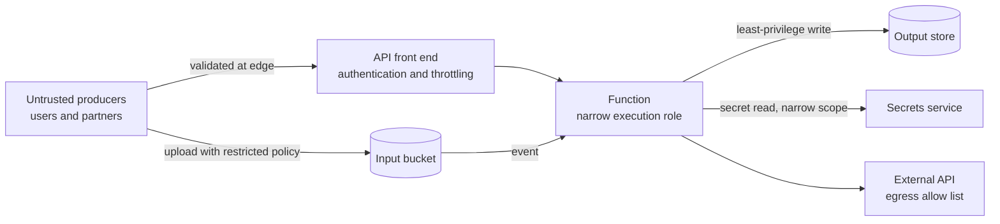

The diagram marks where trust changes. Everything left of the function is untrusted input, and every edge to the right is an authority the function's identity holds. The review reads each edge: is the input validated, and is the authority the smallest that works. Secrets are fetched at runtime from a secrets service with a narrow grant, not placed in plain environment variables or code. [Secrets Management](../15_Security/CH09_Secrets_Management.md) covers rotation, and a function that caches a secret in init must handle a rotated value.

**Dependencies.** Packages and base images are still the team's responsibility. Pin versions, scan them in the pipeline, and rebuild when advisories appear. The provider patches the host and managed runtime, and no one patches a library bundled inside the package except the team.

### 13.2 Observability

Many short-lived units are harder to follow than a few long-lived servers, so correlation is the central practice.

- **Structured logs.** Emit one JSON log line per significant step with the correlation identifier, function name, version, business key, outcome, and duration. [Logs](../14_Observability/CH01_Logs.md) covers structure and retention. Cost matters here, since log volume scales with requests.
- **Correlation across hops.** Carry one identifier, preferably the trace context, through events, queue messages, and workflow state, and set it in every log line. Without it, a failure in step four cannot be tied to the request that began in step one. [Tracing](../14_Observability/CH03_Tracing.md) and [OpenTelemetry](../14_Observability/CH04_OpenTelemetry.md) describe propagation. Asynchronous hops break context unless the producer puts it in message attributes and the consumer restores it.
- **Metrics that match the pattern.** Per function: invocations, errors, throttles, duration at p50 and p99, init duration, and the cold-start share. Per queue: depth and age of the oldest message. Per failure destination: depth. Concurrency against cap, and spend per function. [Metrics](../14_Observability/CH02_Metrics.md) covers metric design.
- **Alerts on symptoms.** Alert on oldest-message age against the freshness target, on failure-destination depth above zero, on error rate, and on throttles. Alerting on CPU or instance counts has no meaning here.
- **Flush before returning.** On platforms that freeze the environment, logs and spans still buffered at return can be delayed or lost, so flush before the handler returns.

### 13.3 Testing

The platform contract is part of the system's behavior, so tests need three layers.

1. **Unit tests** run the domain logic with plain inputs and no platform. The thin-adapter design from the portability discussion makes this cheap, and these tests carry most of the coverage.
2. **Contract and handler tests** call the handler with recorded event samples, including a duplicate event, a batch with one bad record, an oversized payload, and a malformed body. They assert the idempotency and partial-failure behavior: delivering the same event twice leaves one effect, and a poison record is reported alone.
3. **Integration tests in a real account or an isolated environment** exercise triggers, permissions, timeouts, and quotas that local emulators do not reproduce faithfully. Emulators are useful for fast feedback and cannot confirm that the execution role is sufficient, that the visibility timeout exceeds the function timeout, or that throttling behaves as expected. Treat a passing emulator as partial evidence.

Add a load test for the traffic shape that matters, ramping from the quiet level to the peak, and chart cold share, throttles, queue age, and downstream saturation. The quality scenarios in the next section turn these into pass or fail criteria. Deployment of the test environments belongs to Part 13.

## 14. Failure and Quality-Attribute Scenarios

The cold-start ramp in the quality-attribute section is one scenario. Four more cover the failures that most often reach production. Each states a stimulus, the response the design should produce, and a measure that a test can pass or fail. All numbers are illustrative.

### 14.1 Burst against a limited database

- **Stimulus.** 60,000 messages arrive on a queue within 60 seconds, a rate of 1,000 messages per second. The consumer function is capped at 20 concurrent batches, and each batch of 10 messages takes 2 seconds against a database that accepts 100 connections.
- **Response.** The queue absorbs the burst, and the consumers process at the cap.
- **Arithmetic.** One concurrent batch handles 10 ÷ 2 = 5 messages per second, so 20 batches handle 100 per second. During the 60-second burst 6,000 are processed and 54,000 wait. Draining takes 54,000 ÷ 100 = 540 seconds, which is 9 minutes.
- **Measure.** Open database connections stay at 20 or below (well under 100), no message is lost, and the oldest message age peaks near 9 minutes, below an illustrative freshness target of 15 minutes. If the target were 5 minutes, the last message (arriving at 60 seconds) must finish by 360 seconds, so 60,000 ÷ 360 = about 167 messages per second is needed, which is 167 ÷ 5 = about 34 concurrent batches. Thirty-four connections is still under 100, so the cap could rise to 34.

### 14.2 Duplicate delivery

- **Stimulus.** A test harness sends 10,000 order events and re-sends a random 5 percent, which is 500 duplicates, some while the first copy is still running.
- **Response.** Claims refuse the repeats, and downstream calls carry the business key.
- **Measure.** Exactly 10,000 effects are recorded, zero duplicates, and the count of refused claims plus the count of busy retries equals 500 or more.

### 14.3 Poison message

- **Stimulus.** One message in a batch of 10 has a malformed body that always fails.
- **Response.** The handler reports that one item as failed, and the nine others succeed and are deleted. The failed item returns after the 180-second visibility period and fails again, up to 5 receives.
- **Arithmetic.** In the worst case the poison message reaches the failure queue after about 5 × 180 = 900 seconds, 15 minutes.
- **Measure.** The nine good messages show no added delay, the alarm on failure-queue depth fires within 5 minutes of the first message arriving there, and an owner replays or discards it following the runbook. A [runbook](../21_Architecture_Documentation/CH07_Runbooks.md) for this path should exist before launch.

### 14.4 Shared concurrency exhausted by a batch job

- **Stimulus.** An account has a concurrency ceiling of 1,000 (illustrative). A reprocessing job scales to 900 concurrent invocations while an interactive API needs 150.
- **Response without a design.** 900 + 150 = 1,050, which is 50 above the ceiling, so some API requests are throttled even though the API did nothing wrong.
- **Response with a design.** Reserve 200 concurrent invocations for the API and cap the batch function at 700, leaving 1,000 − 200 − 700 = 100 unassigned for other functions.
- **Measure.** API throttles are zero while the batch runs at its cap, and the batch finishes later by a computed amount: at 700 instead of 900 concurrent, it takes 900 ÷ 700 = about 1.29 times as long, a 29 percent increase, which the business accepts.

These scenarios share one lesson. In serverless systems the capacity decisions are expressed as caps, reservations, and policy values, and so they are testable configuration. A review that checks only code will miss them.

## 15. Worked Case: Image Metadata Processing

Fernleaf Photos is a hypothetical photo-sharing service with a small platform team. Everything in this case, including the organization, volumes, and prices, is illustrative. Users upload images. Each upload needs metadata extraction (dimensions, format, camera fields) and three thumbnails. The thumbnails should appear within 30 seconds for 99 percent of uploads. Several times a year the team also reprocesses the whole stored archive when the thumbnail format changes.

### 15.1 Workload evidence

- 150,000 uploads per day, an average of 150,000 ÷ 86,400 = about 1.74 per second.
- Evening peaks about 10 times the average, so about 17.4 per second.
- Processing takes 2 seconds on average at 1 GB of memory, with a 99th percentile near 9 seconds.
- The archive holds 12,000,000 images to reprocess when the format changes.
- Peak concurrency by Little's Law: 17.4 × 2 = about 35 invocations. Average concurrency: 1.74 × 2 = about 3.5.

### 15.2 Design

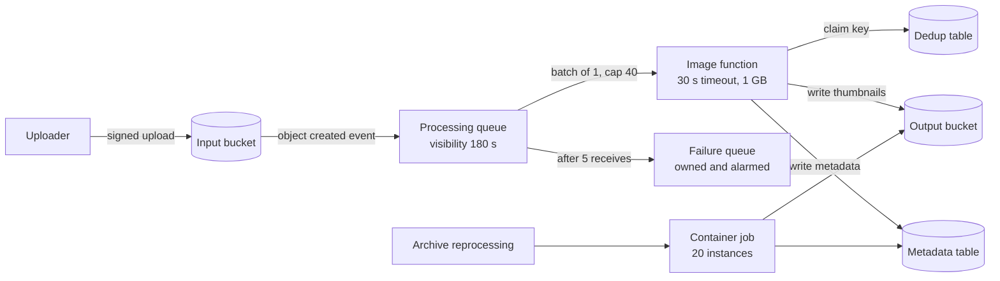

The upload path is asynchronous: the user is told the upload succeeded as soon as the object lands, and the thumbnail appears later. A queue sits between the bucket event and the function so the team can cap concurrency at 40, watch backlog age, and give poison images an owned destination. The function validates before decoding and rejects images larger than 25 MB or 12,000 pixels on a side (illustrative design limits). The memory bound comes from arithmetic: a 12,000 × 12,000 image has 144,000,000 pixels, and at 4 bytes per pixel decoded it takes 576 MB, which leaves room for the resize buffers inside 1 GB. Without the limit, a crafted image would choose the function's memory use. The function writes to a different bucket than it reads from, so it cannot trigger itself. Its role permits reading one prefix and writing two stores, as in the policy shown earlier. Each message is claimed with the object key and version as the business key, and the output writes are keyed by the same value, so a repeat overwrites with identical content.

### 15.3 Cost evidence

- **Function path.** Per image: 2 s × 1 GB × $0.00002 = $0.00004 compute, plus $0.0000002 for the request, about $0.0000402. Per month (4,500,000 uploads): 4,500,000 × $0.00004 = $180 compute, plus 4,500,000 × $0.0000002 = $0.90, total $180.90.
- **Always-on alternative.** Assume an instance processes 4 images at once, so peak 35 concurrent needs 9 instances, and one more for failure tolerance makes 10. Cost: 10 × 730 × $0.04 = $292 per month. Average utilization is 3.5 ÷ 40 = about 9 percent, far below the 20 percent break-even computed earlier.
- **Reprocessing as functions.** 12,000,000 × $0.0000402 = $482.40, and the run would consume most of the shared concurrency.
- **Reprocessing as a container job.** 20 instances at 4 images each and 2 seconds per image process 20 × 4 ÷ 2 = 40 images per second. The run takes 12,000,000 ÷ 40 = 300,000 seconds, which is 83.3 hours, and costs 20 × 83.3 × $0.04 = about $66.67, roughly one seventh of the function cost, because the instances run fully busy.

### 15.4 Decisions and rejected alternatives

| Decision | Chosen | Rejected | Reason |
|---|---|---|---|
| Processing time | Asynchronous, queue-buffered | Process inside the upload request | A slow or cold function would delay the user, and bursts would hit the front end directly |
| Execution for uploads | Functions | Always-on fleet of 10 instances | $180.90 versus $292 per month at 9 percent utilization, with no fleet to patch |
| Execution for archive | Container job | Functions | About $66.67 versus $482.40, and it keeps the shared concurrency free for uploads |
| Composition | One function does extraction and thumbnails | A workflow or a chain of two functions | Both steps share one input, one failure domain, and one retry rule, so a workflow adds a service without adding recovery value |
| Retry handling | 5 receives, then failure queue | Unlimited retries | A bad image would loop and bill indefinitely |

### 15.5 Validation evidence

The team accepts the design when a load test in an isolated account shows the following. The expected values come from the arithmetic above, and the report records the measured values next to them.

1. A ramp from 2 to 20 uploads per second over 60 seconds ends with oldest message age under 30 seconds, because capacity of 40 ÷ 2 = 20 images per second is at least the peak of 17.4. Throttles are zero.
2. A replay with 5 percent duplicate events leaves exactly one set of outputs per image.
3. A malformed file reaches the failure queue and raises the alarm, while the rest of the batch completes.
4. A 12,000 × 12,000 image processes within the memory limit, and a larger image is rejected before decode.
5. The archive job runs concurrently with the upload test, and the upload path shows no throttling.
6. The cost report shows cost per completed image within the arithmetic estimate, and the log volume per image is recorded because logs scale with uploads.

The same business capability therefore uses two runtime shapes under separate contracts and owners, and the revisit trigger is average upload utilization of an always-on instance crossing 20 percent for a quarter.

## 16. Common Mistakes and Anti-Patterns

The failure-mode list in the quality-attribute section covers chains, fan-out, cold starts, runaway cost, and state errors. The mistakes below appear mostly during design and operation of the whole system. Each has a cause, a consequence, and a correction.

| Mistake | Cause | Consequence | Correction |
|---|---|---|---|
| One function per tiny operation | Function granularity set by convenience | Hundreds of deployables with shared data and no owner, slow reviews, many policies | Group by capability and data ownership, and split only for different scaling or permissions |
| Sleeping or polling inside a function | Reusing server habits for waiting | The invocation holds a slot and bills for the wait, and hits the timeout | Use a workflow wait, a timer event, or a queue with a delay |
| Retrying business errors | One retry rule applied to every error | Declined payments and invalid inputs repeat and add load with no chance of success | Retry only transient errors and route business outcomes as branches |
| Leaving retry and age defaults unset | Assuming the platform's defaults fit | Events retry for long periods or disappear, depending on the product | Set count, age, and a failure destination explicitly |
| Large payloads in events and workflow state | Convenience of passing everything along | Size failures, higher cost, and sensitive data visible in execution history | Store the body in object storage and pass a reference |
| Logging full payloads | Debugging habit | Log cost that scales with traffic and personal data in logs | Log identifiers and outcomes, and sample detail |
| Testing only with an emulator | Fast local feedback | Wrong role, timeout, or quota is found in production | Add integration and load tests in a real account |
| An orchestrator for every flow | Pattern enthusiasm | Extra cost and a new dependency for flows that need one queue | Orchestrate processes with compensation, waits, or branches |
| Choosing serverless without utilization data | Fashion or a single low-volume pilot | Costs invert after growth, found at the invoice | Compute break-even from measured volume and set a revisit trigger |

Most rows share a root cause: a property of the platform was assumed and not looked up or tested. The design-review checklist below turns them into questions.

## 17. Pattern Comparison and Trade-Offs

Serverless is an execution style that combines with structural patterns, so the comparison is about what each choice optimizes and what it costs. The neighbours are [Microservices](CH05_Microservices.md) on container platforms, [Event-Driven Architecture](CH07_Event_Driven_Architecture.md), and a [Layered](CH01_Layered_Architecture.md) application deployed as one unit.

| Dimension | Serverless functions | Microservices on containers | Event-driven architecture | Layered single deployable |
|---|---|---|---|---|
| Primary concern | Run code without capacity management | Independent deployment by service ownership | Decouple producers from consumers in time | Separate responsibilities inside one unit |
| Unit of scaling | Invocation (environment per concurrent call) | Service instances, set by the team | Consumer groups or handlers | The whole application |
| Idle cost | None, unless warm capacity is bought | Full instance cost, or small with autoscaling | Depends on consumer hosting | Full instance cost |
| Tail latency | Cold starts add variance | Stable once running | Queue time dominates | Stable |
| Failure visibility | Per invocation, needs correlation | Per service, needs tracing | Hidden in backlog unless age is watched | One process, simple |
| Operating burden | Low infrastructure, high configuration | High: cluster, networking, rollout | Medium: broker and consumers | Low to medium |
| Strongest fit | Bursty, event-shaped, glue work | Large systems with many teams | Asynchronous integration and fan-out | Small to medium systems with steady load |
| Main risk | Hidden coupling and cost at steady load | Distributed-system complexity | Duplicates, ordering, invisible backlog | Scaling and release coupling |

The patterns combine well: serverless handlers are often the consumers in an event-driven design, and a microservice may be hosted on a serverless container. The wrong combination is a function chain used as a service mesh. Choose the structural pattern from team and data boundaries, and choose serverless as the execution style where the workload evidence supports it.

## 18. Design-Review Checklist

Use these questions in an architecture review. A "no" or "unknown" is a finding.

**Fit and economics**

- [ ] Is the workload uneven, event-shaped, or small enough that per-use billing fits, and is the evidence measured?
- [ ] Is the break-even utilization computed with the workload's own duration and memory, with a revisit trigger recorded?
- [ ] Are adjacent costs (logs, gateway, queue, workflow transitions) estimated with the functions?
- [ ] Is there a spend alarm and a concurrency cap on every function?

**Execution model**

- [ ] Is the invocation type (synchronous, asynchronous, polled) known for every trigger, along with who retries?
- [ ] Are timeouts set from measured p99 duration, and is the queue visibility period longer than the function timeout?
- [ ] Are downstream limits protected by caps, pooling, or a queue, with the arithmetic written down?
- [ ] Are cold and warm latency measured separately on every synchronous path, and is the mitigation matched to the cost?

**Correctness**

- [ ] Does every handler tolerate repeats, using a business key and a conditional claim or natural idempotence?
- [ ] Is durable state outside the environment, and is local state a disposable cache?
- [ ] Do retries, age limits, and a failure destination exist, with an owner, an alarm, and a replay procedure?
- [ ] Are workflows used where compensation, waits, or branching exist, and are chains absent?

**Security and operations**

- [ ] Does each function have its own narrow identity, and are event sources and inputs validated?
- [ ] Are secrets fetched from a secrets service, and are dependencies pinned and scanned?
- [ ] Is a correlation identifier carried across every hop, and are alerts based on age, errors, throttles, and failure-queue depth?
- [ ] Do tests include duplicates, a poison record, an oversized input, and a load ramp in a real account?

## 19. Exercises

Prices are the illustrative ones from the cost model section ($0.20 per million requests, $0.00002 per GB-second, $0.04 per instance-hour).

1. **Concurrency.** A function handles 80 requests per second at 250 milliseconds. A dependency then slows it to 600 milliseconds, and the function has a cap of 30. What happens?
   *Outline.* Normal concurrency is 80 × 0.25 = 20. At 600 ms it needs 80 × 0.6 = 48, above the cap of 30. The sustainable rate is 30 ÷ 0.6 = 50 requests per second, so about 30 requests per second are throttled. A synchronous caller sees errors, and a queued path builds backlog. The cap protected the dependency at the cost of availability, and the decision should be explicit.
2. **Break-even.** A function runs 200 ms at 1 GB. An instance serves 20 requests per second. At what average utilization does the instance become cheaper per request?
   *Outline.* Function cost: 0.2 × 1 × $0.00002 = $0.000004, plus $0.0000002 = $0.0000042. Instance: 20 × 3,600 = 72,000 requests per hour at full load, so $0.04 ÷ 72,000 = $0.000000556 ÷ utilization. Break-even is 0.000000556 ÷ 0.0000042 = about 0.13, so 13 percent. State that fleet operating effort moves it higher.
3. **Cold start tail.** A handler runs 50 ms warm with 1.2 s init. A ramp sends 2,000 requests and creates 60 environments. Is a p99 target of 500 ms met?
   *Outline.* About 60 of 2,000 requests, 3 percent, are cold at about 1.25 s, so p99 is near 1.25 s and the target fails, while p50 looks healthy. Options: 60 warm environments or a scheduled warm count before known ramps, a smaller init, snapshot restore where supported, or a relaxed target if the path is asynchronous.
4. **Idempotent webhook.** A payment provider delivers the same webhook up to three times. Design the handler.
   *Outline.* Derive the business key from the provider's event identifier and operation, claim it with a conditional write and a lease, apply the effect with the key on any downstream call, mark done, and return success on repeats. Expire records after the provider's maximum redelivery window. Test with concurrent duplicates.
5. **Orchestration or choreography.** A refund needs approval by a person, a payment reversal, and a customer email, and finance wants to see its state. Which style?
   *Outline.* Orchestration. The process has a wait for a person, a step that needs compensation handling, and a requirement for a single view of progress. Choreography would hide state across subscriptions. Keep the payload small, retry only transient errors, and use the execution identifier in step keys.
6. **Timeout alignment.** A queue-triggered function has a 45-second timeout and the queue's visibility period is 60 seconds. What is wrong, and what do you change?
   *Outline.* A slow invocation can still be running when the message becomes visible again, so two invocations process one message. Raise the visibility period to several times the timeout, as the 180-second period for a 30-second timeout earlier in the chapter, for example 270 seconds here, and confirm the ratio the provider recommends. Also keep idempotency in place.
7. **Recursive trigger.** A function writes three derived files into the bucket that triggers it. How many invocations does one upload cause after five generations, and how do you stop it?
   *Outline.* One upload starts 1 invocation, which creates 3 objects, which start 3, then 9, 27, 81, and 243, so generation five alone is 243 invocations and the series is unbounded without a stop. Write to a separate bucket or prefix excluded from the trigger, cap concurrency, and alarm on spend.

## 20. Summary

Serverless gives up capacity management in exchange for a platform contract, and the architecture work is to understand that contract and design inside it. The summary maps to the outcomes listed in the Introduction.

1. **Forms of serverless.** FaaS, BaaS, and serverless containers shift different obligations to the team: handlers and idempotency, access rules and quotas, or images and server concurrency. A function is a deployment mechanism and never a service boundary by itself.
2. **Tracing one invocation.** The event passes through acceptance, environment selection, handler execution, and a retry or failure destination. Acceptance is not completion, and the team owns what happens after the handler starts.
3. **Concurrency, scaling, timeouts, and cold starts.** Concurrency equals arrival rate times duration, so a slow dependency becomes a capacity problem. Cold starts are measured on the tail and matched to the cost of the problem, and caps protect downstream stores.
4. **State and repeats.** Durable state lives outside the environment. Handlers use business keys, conditional claims, and downstream idempotency keys, and workflows add durable progress, per-step retry, and explicit compensation, as [Saga Pattern](CH10_Saga_Pattern.md) and [Event-Driven Architecture](CH07_Event_Driven_Architecture.md) describe.
5. **Cost comparison.** Break-even utilization, computed from the workload's own duration and memory, decides between functions, serverless containers, and always-on capacity, and adjacent costs and runaway patterns are part of the comparison.
6. **Provider mappings.** AWS Lambda, Azure Functions, and Google Cloud Run functions and Cloud Run implement the pattern with different concurrency and scaling scopes, so similar names do not mean identical guarantees. Verify current limits.

Security, observability, and testing apply at pattern level: a narrow identity per function, validated event sources, correlation across hops, alerts on age and failure-queue depth, and tests that include duplicates, poison records, and load ramps. The worked case showed the method end to end, with decisions, rejected alternatives, and arithmetic evidence. The design-review checklist condenses it for use in reviews. The next chapters in this part continue with [CQRS](CH09_CQRS.md) and the [Saga Pattern](CH10_Saga_Pattern.md).

Serverless is a deployment and execution choice, not an absence of architecture. Use it where managed scaling and event integration outweigh runtime limits, externalize durable state, make retries safe, and measure cost and cold behavior against the workload contract.
