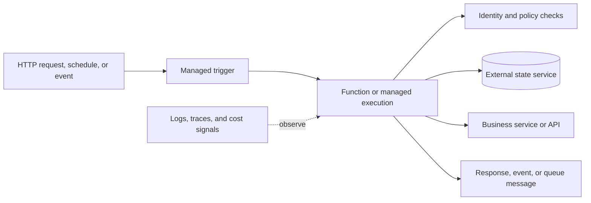
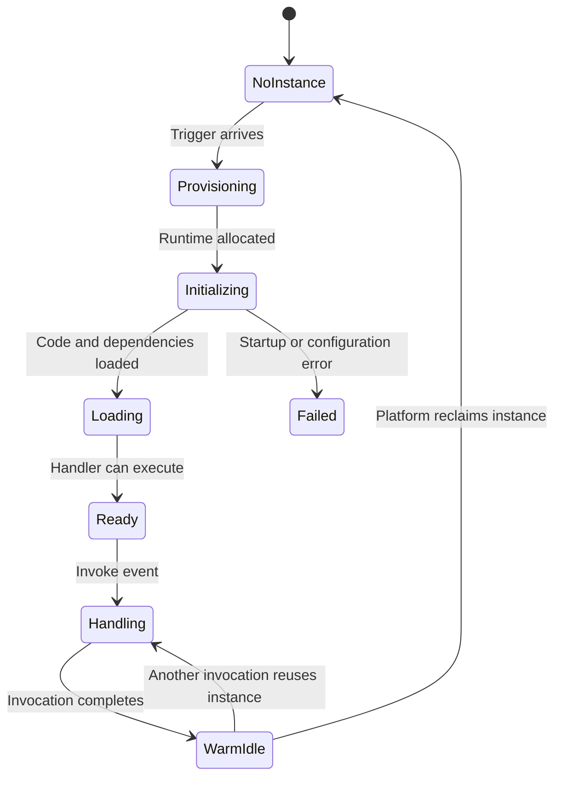
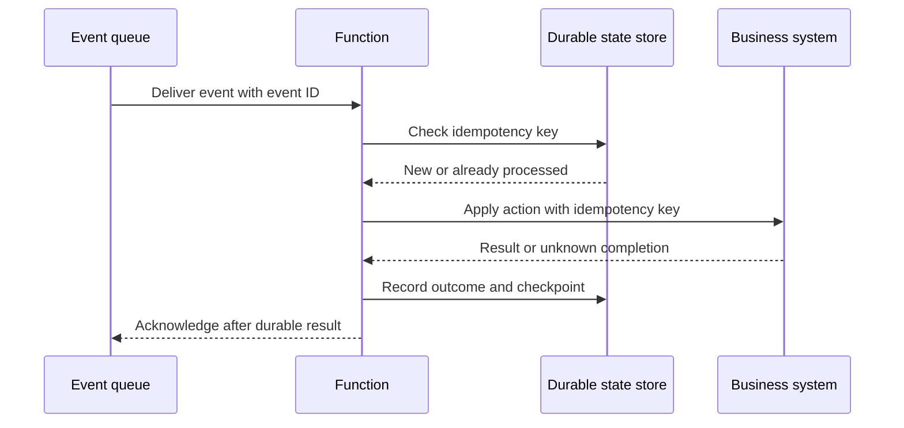
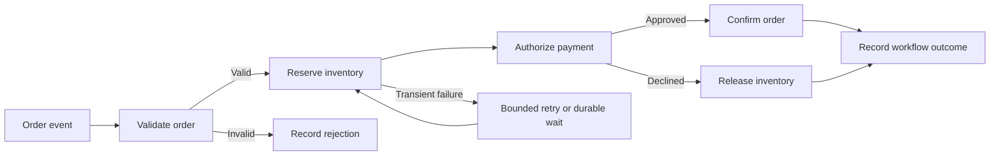
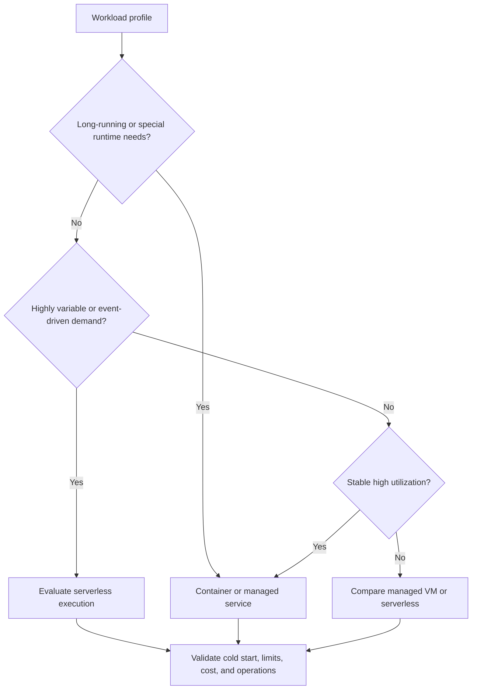

# Serverless

Part: [20 — Architecture Patterns](PART_OVERVIEW.md)

Serverless architecture uses managed execution and supporting services so teams provision less infrastructure directly. The provider still operates servers; the application remains responsible for state, event contracts, security, failure handling, observability, and cost. Part 09 owns provider serverless services; Part 13 owns delivery practices.

## Compose Event-Triggered Execution

A function or managed execution unit starts from an event, request, schedule, or queue message. It performs bounded work and may persist state externally. Serverless is a useful fit for variable or bursty workloads when startup, duration, concurrency, and runtime constraints match the task.

Keep execution bounded and idempotent where retries may occur. Treat the trigger as an input boundary with authentication, schema validation, and size limits. A function is not automatically a microservice; its contract and ownership determine whether it is an independent service boundary.

## Account for Cold Starts and Runtime Lifecycle

An execution environment may need to be allocated, initialized, load code and dependencies, and establish connections before processing. Reuse can reduce warm latency but is not guaranteed; global in-memory state may be reset, duplicated, or shared unpredictably. Do not use process-local state as the source of truth.

Measure cold and warm invocation latency separately. Keep initialization lean, manage connection reuse safely, and select pre-warming only when its latency benefit justifies idle cost. Long startup code can erase the advantage of a small function.

## Externalize State and Preserve Idempotency

Functions should treat each invocation as potentially isolated. Persist durable workflow state, deduplication keys, and checkpoints in managed storage or workflow services. A retry may happen after the side effect succeeded but before acknowledgment; idempotency or reconciliation prevents duplicate charges, notifications, or records.

In-memory caches can accelerate work but must be treated as disposable. Define deduplication retention, replay policy, and behavior when the external side effect is uncertain. Durable workflows help when execution spans multiple steps or waits for human input.

## Compose Workflows Without Hiding Failure

Multiple functions can form a workflow, but chaining synchronous invocations can create latency and retry multiplication. Use an orchestrator or event choreography when steps need durable state, branching, compensation, or long waits. Define timeouts, retry policies, and ownership per step, and keep correlation identifiers across the workflow.

Do not assume that a workflow orchestrator makes multi-system operations atomic. Compensations may be required, and some actions are irreversible. Part 07 owns detailed distributed transaction patterns; this chapter focuses on choosing managed composition and exposing operational state.

## Choose Execution From the Workload

Compare serverless with containers or virtual machines based on runtime limits, startup sensitivity, steady utilization, duration, hardware requirements, state, and operational capability. Serverless reduces infrastructure management but can introduce invocation limits, cold starts, platform-specific behavior, and cost sensitivity at sustained high volume.

The decision is workload- and pricing-model-specific. Benchmark realistic traffic and include idle baseline, invocation count, duration, retries, storage, and network. Provider-specific products belong in Part 09, where portability and service details are compared.

## Worked Case: Image Metadata Processing

An application processes uploaded images to extract metadata and create thumbnails. Event-triggered functions scale with upload bursts and write results to object storage. A durable queue separates upload acceptance from processing; each invocation records an idempotency key and limits image dimensions to bound CPU and memory. A poison image moves to an owned dead-letter path after bounded retries.

The team measures cold-start and warm latency, processing duration by image size, retry rate, queue age, storage cost, and total cost per completed image. Sustained bulk reprocessing runs as a container job because its steady utilization and duration differ from the bursty user-upload path. The same business capability uses two runtime shapes under distinct contracts and ownership.

## Review Questions

1. Which server and application responsibilities remain despite managed execution?
2. How does the cold-start lifecycle affect interactive latency?
3. Why must state and idempotency be external to a transient invocation?
4. Which workflow failures require compensation or human intervention?
5. What workload evidence favors serverless over a container or virtual machine?

Serverless is a deployment and execution choice, not an absence of architecture. Use it where managed scaling and event integration outweigh runtime limits, externalize durable state, make retries safe, and measure cost and cold behavior against the workload contract.
