# CQRS: Command Query Responsibility Segregation

Part: [20 — Architecture Patterns](PART_OVERVIEW.md) · Status: Revised (in-depth rewrite)

## 1. Introduction

Command Query Responsibility Segregation (CQRS) is an architectural pattern that gives the operations that change state and the operations that read state separate models. A command path accepts requests such as "reserve this seat" or "change this address", checks the rules, and updates the authoritative data. A query path answers questions such as "show me my open orders" from a model shaped for that question. The two paths can be separate classes over one database table, separate schemas in one database, or separate stores kept in step by a projection process. Each step toward more separation buys independence and costs consistency, operations, and code.

Most systems begin with one model that serves both jobs: the same entity classes and the same tables handle a write and the screen that displays the result. That works until the two jobs pull the model in different directions. Writes want a normalized shape that protects invariants. Reads want wide, pre-joined, filtered shapes, and often at a volume many times higher than writes. Teams that force one model to serve both usually end up with entities full of optional fields, queries with six joins, and a write path slowed by indexes that only reads need.

For an engineer moving into architecture, the useful skill is deciding when that tension is large enough to justify a second model, and how much separation to buy. Most of the failure stories around this pattern come from adopting the full form for a system that needed only a light form, or from promising users read-after-write behavior that an asynchronous projection cannot give.

This chapter owns the general CQRS pattern: the separation principle, the variants, command and query handling, projection and synchronisation choices, the consistency effects the user sees, and the conditions under which the pattern pays off. After this first part of the chapter you should be able to:

1. Distinguish command-query separation as a method-level principle from CQRS as an architectural pattern.
2. Name the forces that justify a separate read model and the forces that argue against one.
3. Trace a command and a query end to end through each of the main variants.
4. Design a command handler with validation at the right layers, and a denormalized query model for a specific screen.
5. Choose a synchronisation mechanism and state its failure behavior.
6. Compute projection lag, staleness windows, and the staleness a user can observe, and design the user experience around them.
7. Decide, for a given workload, whether CQRS pays off.

The boundaries with neighbouring material are deliberate:

- Event Sourcing (storing state as an append-only sequence of events) is owned by [Event Sourcing](CH11_Event_Sourcing.md). CQRS does not require it. This chapter recaps the combination and links to the owner.
- Event and broker mechanics (delivery guarantees, ordering, consumer groups) are owned by [Event-Driven Architecture](CH07_Event_Driven_Architecture.md). This chapter uses them as a transport for projections.
- Long-running multi-step workflows across services belong to the [Saga Pattern](CH10_Saga_Pattern.md).
- Database mechanics, including replication, read replicas, and materialized views, belong to Part 06: [Denormalization](../06_Databases_and_Storage/CH02_Denormalization.md), [Transactions](../06_Databases_and_Storage/CH08_Transactions.md), and [Replication](../06_Databases_and_Storage/CH07_Replication.md). The distributed-systems treatment of the pattern is in [CQRS in System Design](../07_System_Design_and_Distributed_Systems/CH14_CQRS.md), and retry-safe processing is in [Idempotency](../07_System_Design_and_Distributed_Systems/CH16_Idempotency.md).
- The service boundaries that often surround a CQRS component are covered in [Microservices](CH05_Microservices.md).

All numbers in this chapter are illustrative. They show how to reason, and they are not measurements of any real system.

## 2. Command-Query Separation and CQRS

The two names are close, and the confusion between them causes much of the bad advice about the pattern. They sit at different levels of a design.

### 2.1 Command-query separation as a principle

Command-Query Separation (CQS) is a rule about individual methods, formulated by Bertrand Meyer in his work on object-oriented design. A method is either a command, which changes state and returns nothing useful, or a query, which returns a value and changes nothing observable. Asking a question should not change the answer.

The benefit is local reasoning. If `balance()` is a pure query, a caller can call it twice, cache it, or call it in a log statement without side effects. If a method both changes state and returns a value, callers cannot tell whether calling it again is safe.

```java
// Violates CQS: reading the next number also changes the sequence.
long nextInvoiceNumber() { return counter++; }

// Respects CQS: the query is pure, the command is explicit.
long currentInvoiceNumber() { return counter; }
void advanceInvoiceNumber() { counter++; }
```

CQS has well-known practical exceptions. A stack's `pop` returns a value and removes it. An atomic `incrementAndGet` must do both steps in one operation, or two concurrent callers could receive the same number. The principle is a default for ordinary code, and concurrency is a legitimate reason to break it. CQS costs nothing architecturally. It needs no second database and no infrastructure, and it is the baseline from which CQRS starts.

### 2.2 CQRS as an architecture

CQRS lifts the same idea from methods to models. The term is generally credited to Greg Young, who described it as an extension of CQS applied at the level of objects and services. Instead of one object model that is both written and read, there are two: a write model that receives commands and enforces rules, and a read model that serves queries.

Three properties define the pattern, whatever its variant:

1. **Commands and queries use different interfaces.** A command names an intent and carries the data needed to carry it out. A query names a question and returns a result. They do not share request and response types.
2. **The write side is shaped for invariants.** It is organized around the rules that must hold, such as "available stock never goes below zero" or "an order cannot ship before payment is authorized".
3. **The read side is shaped for the question.** It returns exactly the fields a screen or an API consumer needs, in the shape that is cheapest to produce. It has no obligation to look like the write model.

The "responsibility" in the name matters. The write model is responsible for correctness. The read model is responsible for answering quickly and conveniently. Giving each one job lets each be designed, tuned, scaled, and changed on its own terms.

### 2.3 The two compared

| Aspect | CQS | CQRS |
| --- | --- | --- |
| Level | Method or function | Model, component, or service |
| Rule | A method either changes state or returns a value | Commands and queries use separate models and paths |
| Infrastructure needed | None | None for the light forms, a synchronisation mechanism for the heavy forms |
| Consistency effect | None | None for shared-store forms, an observable delay for asynchronous projections |
| Typical cost | Occasional awkward API | Duplicate model code, and with separate stores a second data copy to operate |
| Can be adopted alone | Yes | Builds on CQS at the model level |

A system can follow CQS everywhere and never be CQRS. A system with a CQRS read model whose command handlers still return values (for example the new entity identifier) has not violated anything important, because the rule that matters at the architectural level is the separation of models, not the return type of every handler.

Two misconceptions are worth removing early. First, CQRS does not require two databases. A single relational database with write-oriented tables and a read-oriented view is CQRS. Second, CQRS does not require messaging, an event broker, or Event Sourcing. Those are mechanisms that some variants use to move data from the write model to the read model, and each is optional.

## 3. Forces: Why Separate, and Why Not

A pattern is a response to forces, and CQRS is a response to a specific set. Reading them in the right order prevents adopting it for the wrong reason.

### 3.1 Forces that favour separation

1. **Read and write workloads differ in volume.** Many systems read far more than they write. If a product catalog takes 50 reads for every write, scaling the single model for reads also scales the write path, and every extra index added for a query slows every write.
2. **Read and write shapes differ.** A write touches one aggregate (an order and its lines). A read screen may need the order, the customer name, the shipping status, and the running total for the customer's last 30 days. Joining these at read time is expensive, and storing them joined on the write side corrupts the write model's normalization.
3. **Different invariants and different consumers.** Writes enforce business rules. Reads often serve many consumers (a mobile screen, a partner Application Programming Interface (API), a reporting tool), each needing a different projection of the same facts.
4. **Different security and audit rules.** A command may require stricter authorization and an audit record, while a read of a public view requires neither. Separate paths make these rules explicit and testable.
5. **Different change rates and teams.** The people who evolve the screen shapes are often not the people who guard the domain rules. Separate models let the two change independently.
6. **Different technology fit.** A relational store suits the transactional write side. A search index, a document store, or a cache may suit a read shape better.

### 3.2 Forces that argue against separation

1. **Simple create, read, update, and delete (CRUD) domains.** If the screens map one-to-one to tables and there are few rules, a second model is duplicated code with no payoff.
2. **Low volume.** If one database handles both loads with headroom, scaling is not the problem.
3. **A need for immediate consistency everywhere.** Asynchronous variants give up read-after-write by default. If every read must see the latest write, the design must either use a shared store or pay for extra mechanisms.
4. **Operational capability.** Every extra data copy adds monitoring, rebuild, and recovery work. A team without the habit of operating derived data will find projection drift hard to detect.
5. **Team size.** A three-person team maintaining two models and a synchronisation path spends a visible share of its capacity on plumbing.

### 3.3 The decision in one line

The pattern is justified when the cost of forcing one model to serve two jobs exceeds the cost of synchronising two models. That cost comparison is the whole decision. Later sections on consistency and on adoption work through it with numbers. A useful first screen is to try cheaper alternatives, as the next subsection lists.

### 3.4 Alternatives to try first

| Symptom | Cheaper first response | When it is not enough |
| --- | --- | --- |
| Slow read queries | Add or correct an index, rewrite the query | The query needs data that no single table holds |
| Repeated expensive aggregates | A database materialized view or a cache with a time to live (TTL) | The view cannot be refreshed within the required freshness |
| Read load saturates the primary | A read replica of the same schema | Reads need a different shape, not only more capacity |
| Entities cluttered with display fields | Separate query classes (data transfer objects) over the same tables | Query volume still hurts writes |
| Many consumers need different shapes | Per-consumer views | Shapes need data from several services |

Replication and read-replica mechanics, including replication lag, are owned by [Replication](../06_Databases_and_Storage/CH07_Replication.md), and database materialized views by [Denormalization](../06_Databases_and_Storage/CH02_Denormalization.md). CQRS becomes the answer when these cheaper tools cannot reach the required shape, volume, or independence.

## 4. Structure and the End-to-End Flow

### 4.1 Components and responsibilities

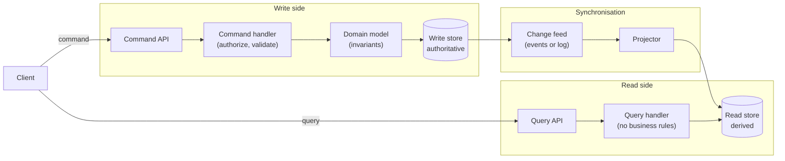

The diagram shows one direction of data flow between the two sides: commands change the write store, a change feed carries the facts out, and a projector builds the read store. Queries never touch the write store in this variant. Three consequences follow.

1. **The write store is the single authoritative copy.** The read store is derived and can in principle be rebuilt from it. When the two disagree, the write store is right.
2. **The synchronisation block is where the pattern's cost lives.** Everything that can go wrong (delay, loss, duplicates, reordering, drift) happens in the feed and projector. Later sections treat these in detail.
3. **The two sides scale and fail independently.** If the read store is down, commands still succeed and changes accumulate in the feed. If the write store is down, existing read data is still served, in a stale state.

Responsibilities by component:

| Component | Responsibility | Must not |
| --- | --- | --- |
| Command handler | Authorize, validate input, load the aggregate, call domain behavior, persist | Return query-shaped data, join across unrelated aggregates |
| Domain model | Enforce invariants and produce state changes | Know about screens or read shapes |
| Write store | Hold authoritative state with transactional guarantees | Be queried by arbitrary screens |
| Change feed | Carry committed changes in order, per aggregate | Carry changes that were not committed |
| Projector | Turn changes into read records idempotently | Make business decisions |
| Query handler | Read, filter, page, and shape results | Change state or trigger business effects |
| Read store | Serve the shapes the queries need | Be treated as a source of truth |

### 4.2 A command and a query, step by step

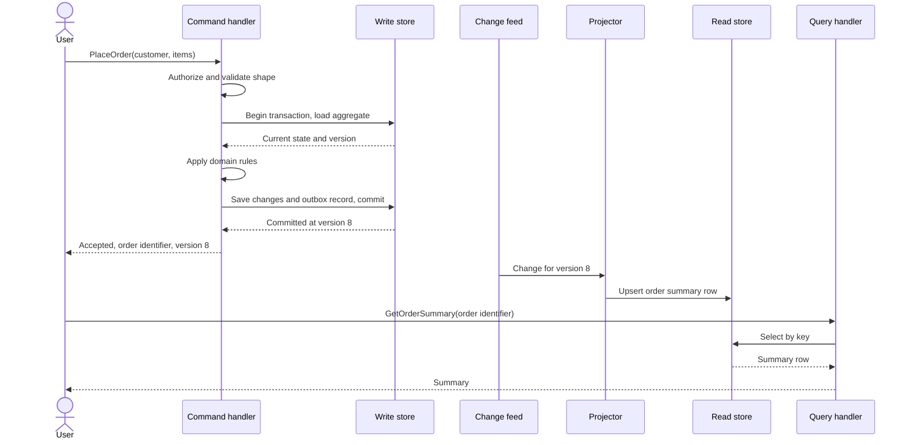

Read the diagram as two flows joined by the change feed. The command flow ends when the transaction commits and the caller is told the outcome. The user's confirmation does not wait for the projector. That is the source of both the pattern's speed and its main visible side effect: a query issued immediately afterwards may reach the read store before the projector has written the new row. Section 9 quantifies that window.

Steps worth attention:

1. **Validation happens in layers.** Shape checks (required fields, formats) run before the store is touched. Business rules run against loaded state inside the transaction. Section 6 explains why the split matters.
2. **The outbox record is written in the same transaction as the state change.** It guarantees that a committed change always has a feed entry. Section 8 explains the mechanism.
3. **The command response carries a version.** Returning the committed version lets the client later ask the read side for "at least version 8", which is the basis of read-your-writes techniques in section 9.
4. **The query handler is thin.** It performs no business rules, so it can be scaled, cached, and replaced independently.

### 4.3 What each side may share

Separate does not mean that nothing is shared. Some sharing is harmless and some defeats the pattern.

- **Shared and fine:** value types such as money and identifiers, the authorization subsystem, and the schema of events or feed records that form the contract between the sides.
- **Shared and risky:** entity classes used by both sides. Once the read side imports the write model's entities, a write-side refactor breaks queries, and the two models are no longer independent.
- **Not shared:** the query model's classes. Each query returns its own flat type.

A practical test is whether the read side can be rebuilt, redeployed, or rewritten in another technology without a change in the write side beyond the feed contract. If it cannot, the separation is nominal.

## 5. Variants of the Pattern

The pattern has no single shape. Four variants are common, ordered by how much they separate. Choosing among them is the main design decision, and each step up adds cost that must be paid back by a specific benefit.

```mermaid
flowchart TB
    subgraph V1["Variant 1: separate handlers, one model"]
        A1["Command handler"] --> AS[("One schema")]
        A2["Query handler"] --> AS
    end
    subgraph V2["Variant 2: separate models, one database"]
        B1["Command handler"] --> BW[("Write tables")]
        BW -->|"same transaction or view"| BR[("Read tables or views")]
        B2["Query handler"] --> BR
    end
    subgraph V3["Variant 3: separate stores, state-fed"]
        C1["Command handler"] --> CW[("Write store")]
        CW -->|"outbox or change data capture"| CP["Projector"]
        CP --> CR[("Read store")]
        C2["Query handler"] --> CR
    end
    subgraph V4["Variant 4: separate stores, event-fed"]
        D1["Command handler"] --> DE[("Event store")]
        DE -->|"event stream"| DP["Projector"]
        DP --> DR[("Read store")]
        D2["Query handler"] --> DR
    end
```

The diagram arranges the variants by where the second copy of data appears and how it is updated. Variants 1 and 2 keep everything in one database, so they keep one transaction boundary. Variants 3 and 4 introduce a second store and therefore a gap in time between the two copies.

### 5.1 Variant 1: separate handlers over one model

Both paths use the same entities and tables, but the code is organized as command handlers and query handlers. Commands load entities, apply rules, and save. Queries bypass the entities and use projections straight from the tables, such as a query that selects only the columns a screen needs.

What it buys: it removes display concerns from the domain entities, makes each use case a small class, and lets queries be tuned without changing the domain. It also gives a place to put authorization and audit that differ between commands and queries.

What it costs: almost nothing. There is no second data copy and no consistency gap. It is the usual first step, and for many systems it is the last one needed.

What it does not buy: independent read scaling, a different read shape stored in advance, or a different storage technology.

### 5.2 Variant 2: separate models in one database

The write side keeps normalized tables. The read side gets its own tables or views, such as a denormalized `order_summary` table or a database-maintained materialized view. Two ways keep it current:

- **Same transaction.** The command handler updates the summary row inside the same transaction as the write. The read model is always consistent with the write, and the cost is added write latency and coupling of the write path to every read shape.
- **Database mechanism.** A view, a trigger, or a scheduled refresh of a materialized view maintains the read tables. Freshness is bounded by the refresh method. The mechanics and refresh options are owned by [Denormalization](../06_Databases_and_Storage/CH02_Denormalization.md).

What it buys: query shapes that do not need joins at read time, no new infrastructure, and, with the same-transaction approach, no staleness. What it costs: every read shape taxes every write, reads and writes still share the same database capacity, and the schema of the read tables is coupled to the database engine's features.

### 5.3 Variant 3: separate stores fed from state changes

The write store is the system of record. Committed changes are published through an outbox table or by change data capture (CDC), which reads the database's committed change log. A projector applies them to a separate read store, which may be a different engine such as a search index or a document store.

What it buys: independent scaling and technology of the read side, a read model shaped without regard to the write schema, and isolation of read load from the primary. What it costs: eventual consistency, a projector to build and operate, and a recovery path for the read store. This is the variant most people mean by "full CQRS", and it is the one the remaining sections treat in the most detail.

### 5.4 Variant 4: separate stores fed by events

When the write side stores its state as a sequence of events (Event Sourcing, owned by [Event Sourcing](CH11_Event_Sourcing.md)), the events themselves are the feed. A projector consumes them and builds as many read models as needed. Rebuilding a read model means replaying the events from the start.

What it buys: a natural, complete feed with no extra outbox, and the ability to build new read models from history. What it costs: everything Event Sourcing costs, including event schema evolution, replay time, and a different mental model of state. CQRS does not require this variant. Choosing Event Sourcing to get CQRS is a mistake, and choosing it because the audit and replay value justifies it is a separate decision that CQRS then benefits from.

### 5.5 Choosing a variant

| Question | Points toward |
| --- | --- |
| Is the problem code clarity or mixed display and domain logic? | Variant 1 |
| Do reads need a pre-joined shape, and is the database load acceptable? | Variant 2 |
| Is read volume or read technology different enough to need its own store? | Variant 3 |
| Do audit and history replay justify event-stored state already? | Variant 4 |
| Must every read see the latest write? | Variant 1, or Variant 2 with same-transaction updates |

A common mistake is jumping to Variant 3 or Variant 4 because they look like the pattern's "real" form. They are the forms with the highest cost. The smallest variant that removes the observed pain is the correct one, and moving up later is possible because each variant keeps the command and query interfaces separate. Evolution between variants is covered later under adoption.

## 6. Command Handling and Validation

### 6.1 What a command is

A command expresses an intent to change state, named in the language of the business: `PlaceOrder`, `CancelReservation`, `ChangeShippingAddress`. It differs from a create or update call in three ways.

1. **It can be rejected.** `PlaceOrder` for an out-of-stock item fails with a business reason. A command is a request, not a fact.
2. **It names the intent, not the data change.** `CancelReservation` is clearer and safer than "set status to cancelled", because the handler can enforce the rules for cancelling (refund windows, who may cancel).
3. **It is handled once, by one handler.** Exactly one component owns each command type, which makes the rules for it easy to find.

A command is distinct from an event. A command is imperative and may fail (`PlaceOrder`). An event is a past-tense fact that already happened (`OrderPlaced`). Mixing the two leads to handlers that reject facts. The event mechanics are owned by [Event-Driven Architecture](CH07_Event_Driven_Architecture.md).

### 6.2 The handler pipeline

A command handler runs the same stages for every command, which is why they are often arranged as a pipeline.

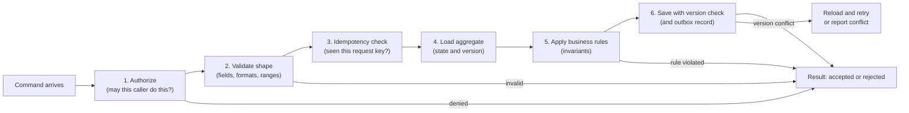

The pipeline places each check where it can be answered most cheaply. Authorization and shape checks need only the command and the caller, so they run before any database access. The idempotency check needs a small lookup. Business rules need the loaded aggregate, so they run only after the earlier stages have filtered out requests that cannot succeed. The version check at save time is the last line of defense against two commands modifying the same aggregate concurrently.

### 6.3 Validation at the right layer

Putting all validation in one place causes problems both ways. If everything is checked in the domain model, malformed requests consume a database load. If everything is checked at the edge, rules that depend on current state are checked against stale information. Split by what the check needs:

| Check | Needs | Where it runs | Example |
| --- | --- | --- | --- |
| Authorization | Caller identity, command type | Before loading state | Only account owners may withdraw |
| Shape and format | The command alone | Before loading state | Quantity is a positive integer, email has the right form |
| Reference validity | A lookup | Before or inside the transaction | The product exists |
| Invariant | Current aggregate state | Inside the transaction, in the domain model | Available stock covers the quantity |
| Uniqueness | The whole data set | The store, by a unique constraint | No two accounts with the same email |

Two of these rows deserve emphasis. Invariants must be checked on the same state that will be saved, inside the transaction. A check against the read model is wrong because the read model may be stale: a command handler that consults a projection to see whether stock is available can approve an order against stock that was already taken. The write store is the only valid source for invariant checks. Uniqueness should be enforced by the store, with a unique index, because an application-level check followed by an insert has a race between the two steps.

### 6.4 A command handler in Java 21 with Spring Boot

The following handler places an order, checks the invariant on loaded state, and saves with an optimistic version check. It is a compact illustration and omits transport and error mapping.

```java
public record PlaceOrder(String requestKey, String customerId,
                         List<Line> lines) {
    public record Line(String sku, int quantity) {}
}

public sealed interface CommandResult {
    record Accepted(String orderId, long version) implements CommandResult {}
    record Rejected(String reason) implements CommandResult {}
}

@Service
public class PlaceOrderHandler {
    private final OrderRepository orders;
    private final StockRepository stock;
    private final OutboxRepository outbox;
    private final ProcessedRequests processed;

    // constructor omitted

    @Transactional
    public CommandResult handle(PlaceOrder cmd) {
        if (cmd.lines().isEmpty() || cmd.lines().stream().anyMatch(l -> l.quantity() <= 0)) {
            return new CommandResult.Rejected("INVALID_LINES");
        }
        var previous = processed.find(cmd.requestKey());
        if (previous.isPresent()) {
            return previous.get(); // same key, same answer
        }
        for (var line : cmd.lines()) {
            // Atomic conditional update: fails when stock would go negative.
            int updated = stock.reserve(line.sku(), line.quantity());
            if (updated == 0) {
                return new CommandResult.Rejected("OUT_OF_STOCK:" + line.sku());
            }
        }
        Order order = Order.place(cmd.customerId(), cmd.lines());
        orders.save(order);
        outbox.add(new OrderPlaced(order.id(), order.version(), order.total()));
        CommandResult result = new CommandResult.Accepted(order.id(), order.version());
        processed.record(cmd.requestKey(), result);
        return result;
    }
}
```

Notes on the choices:

1. The handler returns a sealed result so the caller must deal with both outcomes. A rejection is an ordinary business result, not an exception.
2. `stock.reserve` is a conditional update, such as `UPDATE stock SET available = available - ? WHERE sku = ? AND available >= ?`. The row count tells whether the invariant held. This avoids a read followed by a write, which races under concurrency.
3. The order, the stock change, the outbox record, and the processed-request record commit in one transaction. If any fails, none are visible.
4. The processed-request lookup makes retries safe. A client that timed out and resends the same request key gets the original answer and does not place a second order. The general mechanics are in [Idempotency](../07_System_Design_and_Distributed_Systems/CH16_Idempotency.md).

### 6.5 Concurrency and conflicts

Two commands may modify the same aggregate at once. The usual protection is optimistic concurrency: each aggregate carries a version, and a save succeeds only if the version in the store still matches the version that was loaded. The losing command gets a conflict. Its handler can retry from a fresh load, which is safe when the command is a pure intent that re-evaluates rules, or return a conflict when a person must decide.

Pessimistic locking (holding a lock between load and save) is an alternative when conflicts are frequent and retries are costly. The cost is lower concurrency and the risk of long-held locks. The mechanics are in [Transactions](../06_Databases_and_Storage/CH08_Transactions.md). Whichever is chosen, it applies to the write side only. Queries should never take locks on write-side data.

### 6.6 What a command should return

A command may return a small acknowledgement: the outcome, the identifier of what was created, and the committed version. It should not return a query-shaped view of the data. Returning the full updated entity feels convenient and quietly rebuilds the coupling the pattern removes, because the command handler now has to know every shape a client wants. If the client needs a view after the command, it queries the read side, using the version from the acknowledgement to avoid stale answers (section 9).

## 7. The Read Model and Query Design

### 7.1 Design the read model from the query

The read model is designed backwards from the questions it must answer. The write model is designed from the domain, and the read model from a list of concrete queries, each with an expected volume and a freshness requirement. For each query, write down:

1. The exact fields returned and their shape.
2. The filters and sort orders used.
3. The key or keys used to fetch it.
4. How many requests per second it receives at peak, and the latency target.
5. How stale it may be.

The last two items decide whether a query needs its own read model at all. A report run twice a day with a 15-minute freshness allowance does not.

### 7.2 One view per question

A read model is usually many small views, not one general one. Each view is denormalized to answer one family of queries with a single key lookup or a single index range scan. Duplicating data across views is expected. The same order total may appear in a customer's order list, a daily sales table, and a search document. This is the intended trade: storage and write-time work are spent to save read-time work.

For an order system, three views may exist:

| View | Key | Serves | Contains |
| --- | --- | --- | --- |
| `order_summary` | order identifier | Order detail screen | Status, total, customer name, line count |
| `customer_recent_orders` | customer identifier and placed time | "My orders" list | Order identifier, status, total, placed time |
| `daily_sales` | date and product category | Dashboard | Order count, revenue |

Each is built from the same order changes and shaped for a different consumer. Adding a fourth view later, for example orders by delivery region, does not touch the command side. That is the independence the pattern is bought for.

### 7.3 Denormalized views in SQL

Using Structured Query Language (SQL) in a relational read store, the first two views look like this:

```sql
CREATE TABLE order_summary (
    order_id       TEXT PRIMARY KEY,
    customer_id    TEXT        NOT NULL,
    customer_name  TEXT        NOT NULL,
    status         TEXT        NOT NULL,
    line_count     INTEGER     NOT NULL,
    total_cents    BIGINT      NOT NULL,
    placed_at      TIMESTAMPTZ NOT NULL,
    source_version BIGINT      NOT NULL
);

CREATE TABLE customer_recent_orders (
    customer_id    TEXT        NOT NULL,
    placed_at      TIMESTAMPTZ NOT NULL,
    order_id       TEXT        NOT NULL,
    status         TEXT        NOT NULL,
    total_cents    BIGINT      NOT NULL,
    source_version BIGINT      NOT NULL,
    PRIMARY KEY (customer_id, placed_at DESC, order_id)
);
```

Features of the design that matter:

1. **No foreign keys to the write model.** The read store is a separate copy. It holds the customer name as a value, not as a reference that must be resolved at query time.
2. **A `source_version` column in every row.** It records the version of the write-side aggregate that produced the row. Projectors use it to ignore stale or duplicate updates, and clients use it to check freshness (section 9).
3. **A primary key that matches the access path.** The "my orders" query reads one customer's latest orders with a single index range scan on the primary key, and needs no sort.

The matching queries are simple on purpose:

```sql
-- Order detail: one key lookup.
SELECT * FROM order_summary WHERE order_id = $1;

-- My recent orders: one index range scan, no join.
SELECT order_id, status, total_cents, placed_at
FROM customer_recent_orders
WHERE customer_id = $1
ORDER BY placed_at DESC
LIMIT 20;
```

### 7.4 The query side in Java 21

The query handler returns flat records. It does not use the domain entities and it does not apply rules.

```java
public record OrderSummaryView(String orderId, String customerName,
                               String status, int lineCount,
                               long totalCents, long sourceVersion) {}

@Repository
public class OrderQueries {
    private final JdbcTemplate jdbc;

    // constructor omitted

    public Optional<OrderSummaryView> summary(String orderId) {
        return jdbc.query(
            "SELECT order_id, customer_name, status, line_count, total_cents, source_version "
                + "FROM order_summary WHERE order_id = ?",
            (rs, n) -> new OrderSummaryView(rs.getString(1), rs.getString(2),
                rs.getString(3), rs.getInt(4), rs.getLong(5), rs.getLong(6)),
            orderId).stream().findFirst();
    }
}
```

The returned view includes `sourceVersion` so that callers can tell how fresh the answer is. The query uses a parameter placeholder and not string concatenation, which closes the injection risk that otherwise appears when read-side code is written quickly.

### 7.5 Choosing the read store

The read store is chosen for the query, independently of the write store.

| Query shape | Candidate read store | Reason |
| --- | --- | --- |
| Lookup by key, small rows | Key-value or document store, or a relational table | One-key access |
| Filter by several attributes with text search | Search index | Inverted index and ranking |
| Time-bucketed aggregates | Relational table with rollups, or a time-series store | Pre-aggregated rows |
| Sorted per-user lists | Wide-column or relational table keyed by user and time | One partition per user |

Using a different engine for reads is a real benefit and a real cost. Each engine needs its own operations, backup, access control, and expertise. A relational read table in the same database engine is often enough. Choose a different engine only when the query needs capabilities the write engine lacks.

### 7.6 Security on the read side

A read model copies data, and the copy must carry its protection. Personal data stored in a denormalized view is still personal data. Apply the same access control, encryption at rest, and retention or deletion rules to the read store as to the write store. A deletion request must reach the projections too, so deletion has to appear in the feed as a change the projector applies, or the read copy will outlive the source. Authorization on queries is the query handler's job, because the read store has no domain rules: a query handler for "my orders" must filter by the caller's customer identifier and must not trust an identifier supplied in the request.

## 8. Synchronisation Between Write and Read Models

When the read model lives in a separate store, something must carry changes from one to the other. The choice of mechanism fixes four properties of the pattern: how stale the read side can be, whether a committed change can be lost, whether duplicates reach the projector, and what order changes arrive in.

### 8.1 The mechanisms compared

| Mechanism | How it works | Staleness | Can lose a change? | Main cost |
| --- | --- | --- | --- | --- |
| Same transaction | Command handler updates the read tables with the write | None | No | Write latency, shared database |
| Dual write | Handler writes to the write store, then to the read store, as two separate operations | Short | Yes, when the process fails between the two | Silent divergence |
| Outbox and relay | Change recorded in the write transaction, a relay publishes it later | Relay delay | No | Relay to operate, duplicates possible |
| Change data capture (CDC) | A reader of the database's committed change log publishes changes | Log reader delay | No | Couples to table schema, tool to operate |
| Polling or scheduled refresh | The read side queries the write side for changes since a marker | Poll interval | No, if the marker is reliable | Load on the write store, longer staleness |
| Event stream from event-stored state | Events are the write record and the feed | Consumer delay | No | Requires Event Sourcing |

Dual write deserves a sharper statement because it is the first idea most teams reach for. Between the commit to the write store and the update of the read store there is a window in which the process can crash, the network can fail, or the read store can reject the write. In that window the two copies disagree, and nothing records that an update is owed. No later step repairs it. The remaining mechanisms exist to close this window, and the outbox and CDC close it by making the change durable in the same commit as the state.

### 8.2 The transactional outbox

The outbox pattern writes the change into an `outbox` table in the same database transaction as the state change. A separate relay reads unpublished rows and sends them to the feed. Because the state and the outbox row commit together, a committed change always has an outbox row and an uncommitted change never does.

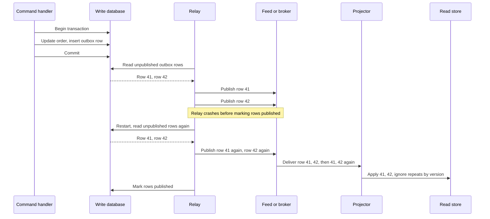

The sequence shows the guarantee and its price. A crash after publishing but before marking the rows as published causes a republish, so delivery is at least once. The projector sees duplicates, and it must tolerate them. This is the standard trade: the system never loses a committed change, and it accepts duplicates. Duplicate tolerance is the projector's responsibility, covered in section 8.4. Broker delivery semantics and ordering are owned by [Event-Driven Architecture](CH07_Event_Driven_Architecture.md).

Operational points for the outbox:

1. **Ordering.** The relay should publish rows for the same aggregate in commit order. Partitioning the feed by aggregate identifier preserves per-aggregate order while allowing parallel consumers.
2. **Cleanup.** Published rows must be deleted or archived, or the table grows without bound and the relay's scan slows down.
3. **Monitoring.** The age of the oldest unpublished row is the most useful health signal. A growing age means the relay is failing or lagging.

### 8.3 Change data capture and polling

CDC reads the database's committed change log and turns row changes into feed records, so the command handler needs no outbox code. It captures every change to the watched tables, which is both its strength (nothing can be forgotten) and its weakness (the feed exposes the table schema, so a column rename becomes a feed contract change). An outbox row, by contrast, is an explicit message the team designs. The log, replication, and failover mechanics that CDC relies on are owned by [Replication](../06_Databases_and_Storage/CH07_Replication.md).

Polling has the read side ask the write store periodically for changes since a stored marker, such as a last-modified time or an increasing sequence number. It needs no extra infrastructure and suits low volume and relaxed freshness. Two traps apply. A timestamp marker can miss rows that commit with an earlier time than rows already seen, since transactions commit out of timestamp order, and deletes are invisible unless the write side records them as marked rows. Use a sequence assigned at commit, or the outbox, when correctness matters.

### 8.4 The projector

The projector applies each change to the read store. Three properties make it correct.

**Idempotent.** Applying the same change twice leaves the same result. A version guard achieves this: the update applies only if the incoming version is newer than the stored one.

```sql
INSERT INTO order_summary
    (order_id, customer_id, customer_name, status, line_count,
     total_cents, placed_at, source_version)
VALUES ($1, $2, $3, $4, $5, $6, $7, $8)
ON CONFLICT (order_id) DO UPDATE
SET status         = EXCLUDED.status,
    line_count     = EXCLUDED.line_count,
    total_cents    = EXCLUDED.total_cents,
    source_version = EXCLUDED.source_version
WHERE order_summary.source_version < EXCLUDED.source_version;
```

If a change with version 7 arrives after version 8 was applied, the `WHERE` clause skips it. If version 8 arrives twice, the second run changes nothing. The statement uses the `ON CONFLICT` upsert syntax of PostgreSQL. Other engines have their own equivalents.

**Order-tolerant.** Some changes depend on others. A version guard handles whole-row replacement. Changes that add to a value (increment a counter) are not safe under reordering or duplicates, so project state snapshots, or record applied change identifiers in the same transaction as the update, so a repeat is detected and ignored.

**Checkpointed.** The projector records the position of the last change it applied, in the same transaction as the read update when the read store allows it. After a crash it resumes from the checkpoint. The checkpoint gives the projector a measurable lag: the gap between the newest committed change and the checkpoint.

### 8.5 Handling deletes, corrections, and failures

1. **Deletes.** A change feed must carry deletions as explicit events or marked rows. A projector that only handles inserts and updates leaves deleted records visible in the read model forever. A deletion request for personal data is a case of this.
2. **Corrections.** If the write side corrects an earlier value, the new version overwrites the old, and the projector needs no special handling. When a correction changes how earlier changes should have been projected (a fixed rule), the read model must be rebuilt rather than patched, which later sections on rebuilding cover.
3. **Poison changes.** A change that the projector cannot apply (bad data, missing dependency) must not block the stream. The usual response is to retry a bounded number of times, move the change to a dead-letter record with its error, alert, and continue. Dropping it silently leaves permanent drift, and blocking the stream makes lag grow for all aggregates because of one record.
4. **Dependent data.** If a view contains the customer name and the customer renames, every order view for that customer is out of date. Either project the customer-name change into every affected row, or keep the name in a separate small lookup that the view joins at read time. The first is faster to read and more work to write, which is the general trade.

### 8.6 Where the read side can run

For small systems the projector can run inside the same service as the query side, as a background consumer. It then scales and fails with that service. For larger systems it runs as its own deployable, which lets projection capacity be sized to the feed rate instead of the query rate. The Python projection worker in the chapter's code examples (linked at the end of the chapter) polls an event store, applies events to read models, and records progress, and shows the same moving parts at small scale.


## 9. Eventual Consistency and the User Experience

### 9.1 What eventual consistency means here

When the read model is updated asynchronously, the two models are consistent only after the feed has been delivered and the projector has applied it. Between the commit and that moment, the read model shows an older state. If no further commands arrive, the read model converges on the write model. That behavior is called eventual consistency, and the interval is the staleness window. The general theory of consistency models is owned by Part 07. What matters for this pattern is the effect on the person using the screen.

The staleness window is not a single number. It is the sum of the stages a change passes through:

$$
\text{window} = t_{\text{commit to relay}} + t_{\text{transport}} + t_{\text{queue wait}} + t_{\text{apply}}
$$

Each term has a different cause and a different remedy, so measuring them separately is more useful than measuring the total.

### 9.2 Worked staleness arithmetic (illustrative)

Take an order system with a transactional outbox. Assume the following illustrative values:

| Stage | Assumed value | Reasoning |
| --- | --- | --- |
| Relay polling interval | 200 ms | The relay checks the outbox every 200 ms |
| Wait for the relay | 0 to 200 ms, mean 100 ms | A change commits at a random point within the interval |
| Transport through the feed | 20 ms | Publish and delivery |
| Projector apply time | 10 ms | One upsert per change |
| Projector queue wait in steady state | about 40 ms | See the utilization calculation below |

**Steady state.** The mean staleness window is 100 + 20 + 40 + 10 = 170 ms. The worst steady-state case, where the change commits just after a poll, is 200 + 20 + 40 + 10 = 270 ms. Against a user who reads the screen about one second after pressing a button, the read model is current in nearly every case under these assumptions.

**Queue wait.** If changes arrive at 400 per second and the projector applies them at 500 per second, utilization is 400 / 500 = 0.8. Waiting time grows steeply as utilization approaches 1, so a projector sized close to the peak arrival rate has little spare capacity. At 0.8 the queue is short. The 40 ms figure is an assumed value for that regime, and it should be measured, not derived.

**A burst.** Suppose a promotion raises arrivals to 2,000 changes per second for 10 seconds, while capacity stays at 500 per second.

1. Backlog added during the burst: (2,000 - 500) × 10 = 15,000 changes.
2. Lag at the end of the burst: 15,000 / 500 = 30 seconds, since the projector needs that long to work through what is queued.
3. After the burst, arrivals return to 400 per second. Net drain rate: 500 - 400 = 100 changes per second.
4. Time to catch up: 15,000 / 100 = 150 seconds.

So a 10-second burst produces about 30 seconds of peak staleness and 2.5 minutes before the read side is current again. A user who places an order at the end of the burst and refreshes after one second sees nothing for roughly 30 seconds. A projector with twice the capacity (1,000 per second) would have a backlog of (2,000 - 1,000) × 10 = 10,000, a peak lag of 10 seconds, and a catch-up time of 10,000 / (1,000 - 400) ≈ 17 seconds. Spare projector capacity matters more than the projector's average speed.

The arithmetic leads to the first design rule: size the projector for the burst you want to tolerate, and alert on lag, not on projector processing rate, because a projector can be busy and still fall behind.

### 9.3 What the user sees

The staleness window turns into one of a small number of user-visible failures:

| Surface symptom | Cause | Example |
| --- | --- | --- |
| The item just created is missing from a list | List read before the projector applied the insert | The user adds an address and the address list does not show it |
| The old value reappears after an edit | Edit saved, read returned the previous version | The user changes a name, the page reloads and shows the old name |
| A total is lower than the user expects | Aggregate view not yet updated | A dashboard misses the latest order |
| The user repeats the action | The user believes the first attempt failed | A second order is placed, a duplicate |

The last row has a business cost. A user who sees no result tries again, so a stale read can lead to a duplicate command. Idempotent command handling with a request key (section 6) removes the harm, but the experience remains confusing.

### 9.4 Techniques to hide or bound the window

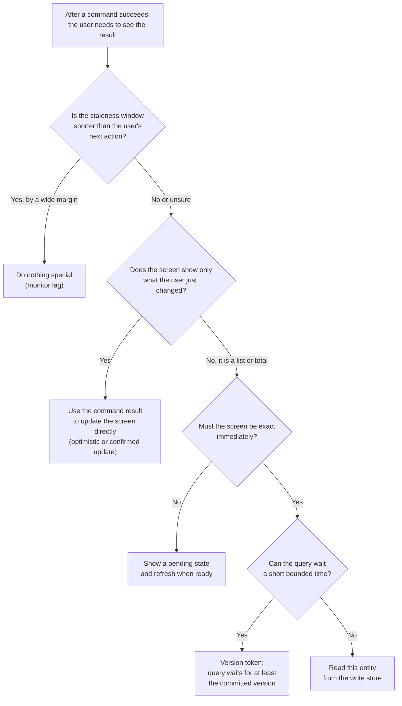

The decision tree orders the techniques from cheapest to most expensive and gives a reason for each step.

1. **Do nothing.** If the window is hundreds of milliseconds and users cannot act faster, no technique is needed. Monitor it anyway, because the burst example shows the window can grow with no change in code.
2. **Update from the command result.** The client applies the change locally using the data it just sent and the acknowledgement. No query is needed for that item. This covers many screens, such as a form that returns to a detail view of the object just saved. The risk is showing data that the server later rejects or changes, so it suits operations that are confirmed before the screen updates.
3. **Show a pending state.** The screen says "updating" and reloads when the version arrives. Honest and cheap, and acceptable when exactness is not urgent.
4. **Version token.** The command returns the committed version. The query carries it, and the query handler waits until the read model shows at least that version, up to a short timeout, then answers. This gives read-your-writes for that caller, at the cost of latency during lag.
5. **Read from the write store.** For a small set of reads that must be exact, such as the detail view of an order the user just placed, the query goes to the write store. This is the strongest option and has the highest cost: it puts load back on the write side and couples that query to the write schema. Use it for few, selected reads.

### 9.5 A version-token read in Java 21

```java
public Optional<OrderSummaryView> summaryAtLeast(String orderId,
                                                  long minVersion,
                                                  Duration maxWait)
        throws InterruptedException {
    long deadline = System.nanoTime() + maxWait.toNanos();
    while (true) {
        Optional<OrderSummaryView> view = queries.summary(orderId);
        if (view.isPresent() && view.get().sourceVersion() >= minVersion) {
            return view;
        }
        if (System.nanoTime() >= deadline) {
            return view; // possibly stale, caller shows a pending state
        }
        Thread.sleep(25);
    }
}
```

The method returns as soon as the row's version reaches the requested one, and gives up at the deadline. On timeout it returns what it has, and the caller can mark the response as possibly stale. A short maximum wait, for example a few hundred milliseconds, covers the normal window. During a burst the wait is spent and the caller falls back to the pending state, which is the correct degradation. A loop that polls the store is a simple choice. Where polling volume is a concern, the read side can notify waiting requests when the projector advances.

The following sequence shows the technique end to end.

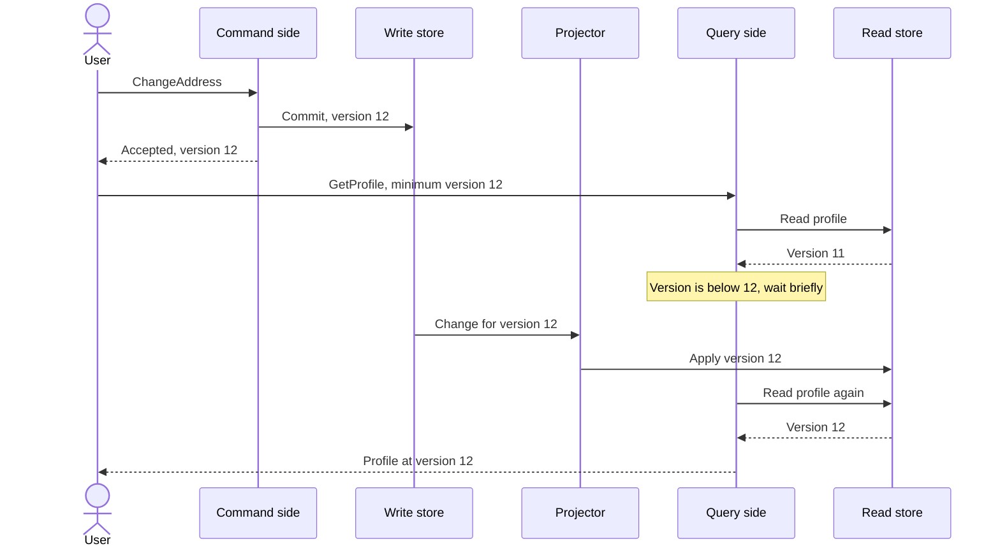

The query side never returns version 11 to this caller. Other callers who did not ask for a minimum version may still see version 11 for a short time, which is acceptable because they did not make the change. This is why the technique is called read-your-writes and not strong consistency: it protects one caller's view of their own change, and says nothing about other readers.

### 9.6 Stating the contract

Each query should have a documented freshness contract that the team can test and monitor: "customer order list: p95 (95th percentile) staleness under 2 seconds, alert at 5 seconds, and exact for the caller's own latest order via version token." Without a stated contract, nobody can tell a lagging projector from a normal one, and product owners find out about staleness from users. Expose the projection watermark (the newest applied version or position) and lag as metrics, and where staleness matters to the user, in the response itself.

## 10. When CQRS Pays Off and When It Does Not

### 10.1 The cost model

The pattern's costs are concrete, and they are paid every month, not once. For the heavy variants (separate stores), count:

1. **Code.** Two models, two sets of types, mapping between feed records and read rows. A rough, illustrative expectation is that a feature touches more files than it would in a single-model design.
2. **Infrastructure.** A second store, a relay or CDC reader, a feed, a projector deployment, each with provisioning, security, backups, and upgrades.
3. **Consistency.** The staleness window and the techniques of section 9, which affect every screen that reads a derived model.
4. **Operations.** Lag monitoring, dead-letter handling, rebuild procedures, and on-call knowledge of all of it.
5. **Testing.** Tests for the projector under duplicates, reordering, and restarts, and tests of the user experience under lag.

The benefits are equally concrete: read scaling independent of writes, read shapes that fit the screens, isolation of write latency from read load, the freedom to change or add read stores, and a place to apply different security and audit rules to each side.

### 10.2 A break-even illustration

Suppose a catalog service handles 2,000 reads per second and 20 writes per second at peak, and a single database serves both. Each read needs a join over four tables, costing an assumed 8 ms of database work. Each write costs an assumed 5 ms. All numbers are illustrative.

1. Database work per second from reads: 2,000 × 8 ms = 16,000 ms, or 16 seconds of work per second. That needs at least 16 database workers busy in parallel.
2. Database work per second from writes: 20 × 5 ms = 100 ms, or 0.1 workers.
3. Reads account for 16 / 16.1, or about 99.4 percent of the load, so scaling the database for reads scales a write path that barely needs it.

With a denormalized read table fetched by key, assume each read costs 0.5 ms of work. Reads then need 2,000 × 0.5 ms = 1,000 ms, or 1 worker of capacity, a sixteenfold reduction. The extra cost is that each write must also produce a projection, say 3 ms in the projector and 20 changes per second, or 0.06 workers. The read side gains capacity in the thousands of requests per second range using little more.

A few conclusions follow. The gain is large because reads dominate and the read shape needs a join. If reads were 40 per second, the join cost would be 0.32 workers and the pattern would buy nothing. If the same join could be removed by an index or a materialized view in one database, Variant 2 would capture most of the gain with no staleness. The numbers show that the decision turns on three measurable inputs: the read-to-write ratio, the read cost per request in the current model, and what a cheaper alternative can reach.

### 10.3 A decision tree

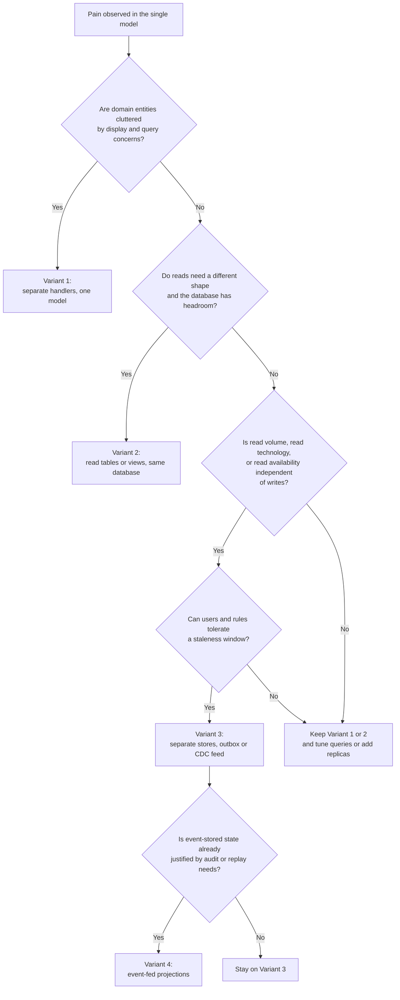

The tree asks the cheapest questions first and moves to separate stores only when the earlier answers rule out the lighter variants. The path through the "staleness window" question is the one most often skipped: a team measures read load and finds it high, then adopts asynchronous projections without asking whether the screens can tolerate them. The final question about event-stored state keeps Variant 4 a consequence of an independent decision, as the boundary with [Event Sourcing](CH11_Event_Sourcing.md) requires.

### 10.4 Signals that CQRS pays off

1. Measured read volume far exceeds write volume and the read cost is dominated by joins or aggregates that cannot be reduced by indexing.
2. Several consumers need different shapes of the same data, and the shapes keep changing.
3. Read and write sides have different availability needs. For example, reads must stay available during a write-side migration.
4. The domain has real invariants and workflows that deserve a model of their own, while screens evolve fast.
5. The read side needs a technology the write store lacks, such as full-text search.
6. The team can operate derived data: it has lag alerts, rebuild procedures, and owners.

### 10.5 Signals that it does not

1. The application is mostly CRUD with few rules.
2. A single database meets both loads with headroom, and the slow queries have not been tuned yet.
3. Users or regulations require that every read see the latest committed state, and there is no cheaper way than a shared store.
4. The team is small and lacks the capacity to operate a second store and its synchronisation.
5. The reason given for adopting is a preference for the pattern, or a resemblance to a larger company's architecture, and not a measured problem.

### 10.6 Where CQRS applies within a system

The pattern is applied to a part of a system and not to all of it. Even a system that benefits from separate read stores for its catalog and order history often leaves its user-profile or settings screens as simple CRUD. Applying the pattern per bounded context, and sometimes per aggregate, keeps its cost in proportion to its value. Applying it uniformly across a system is a recurring cause of slow delivery, and the later section on anti-patterns treats it. How CQRS sits within service boundaries is discussed in [Microservices](CH05_Microservices.md), and the workflow coordination that often accompanies it in the [Saga Pattern](CH10_Saga_Pattern.md).

## 11. Adopting CQRS Incrementally

Section 5 described four variants. This section covers how a live system moves between them, because most systems arrive at the heavy variants from a single model, and the order of the steps decides how much risk each one carries.

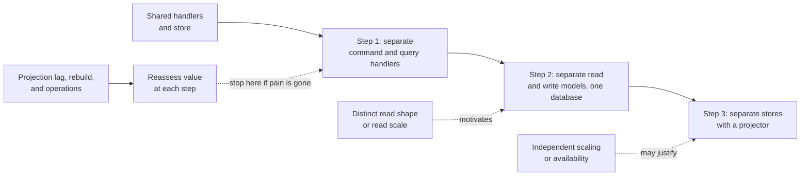

The diagram shows a one-way ladder with a review gate. Each step is entered because a named pain justifies it, and the review gate asks whether the pain has gone before climbing again. The chapter's central advice is to stop at the lowest step that removes the observed pain.

### 11.1 Steps 1 and 2: handlers, then a read table

Step 1 moves one use case at a time to a command handler and a query class that reads flat records, leaving the tables untouched. It is reversible and creates no consistency gap. Step 2 adds one read table for the single query that remains slow, filled in the same transaction as the write. If that query now takes one key lookup, no second store is needed.

### 11.2 Step 3: a separate store

Moving to a separate store changes the guarantees, so it needs a safe path:

1. Stand up the feed (outbox or CDC) while the existing read path still serves traffic.
2. Build the projector and fill the new read store from a snapshot of the write store, recording the position where the snapshot was taken.
3. Let the projector catch up from that position until lag is within the contract.
4. Compare the new read store with the old query result for the same keys (a shadow read), and log differences without serving them.
5. Route a small share of traffic for one query to the new store, watch errors and lag, then raise the share.
6. Keep the old path available until the new store has run through a full business cycle, such as a month-end, without a difference.

This is the same reversible-cutover discipline used elsewhere in the handbook. The rollback is a routing change, because the write store never stopped being authoritative.

Do not introduce separate stores for architectural symmetry. A cheaper query, an index, or a materialized view often solves the problem with fewer moving parts, as the alternatives table in section 3.4 lists.

## 12. Rebuilding and Versioning Projections

A read model is derived state. Its value depends on the ability to throw it away and build it again, because projection code has bugs, views change shape, and stores get lost. A team that cannot rebuild a view does not have a read model. It has a second source of truth that nobody planned.

### 12.1 When a rebuild is needed

1. **A projector bug** wrote wrong values for some period.
2. **A new view** must be filled with history, such as orders by delivery region.
3. **A changed view shape**, such as splitting a name field into two.
4. **Store loss or corruption** of the read store.
5. **A changed rule** in how earlier changes are projected, as section 8.5 noted.

### 12.2 The rebuild flow

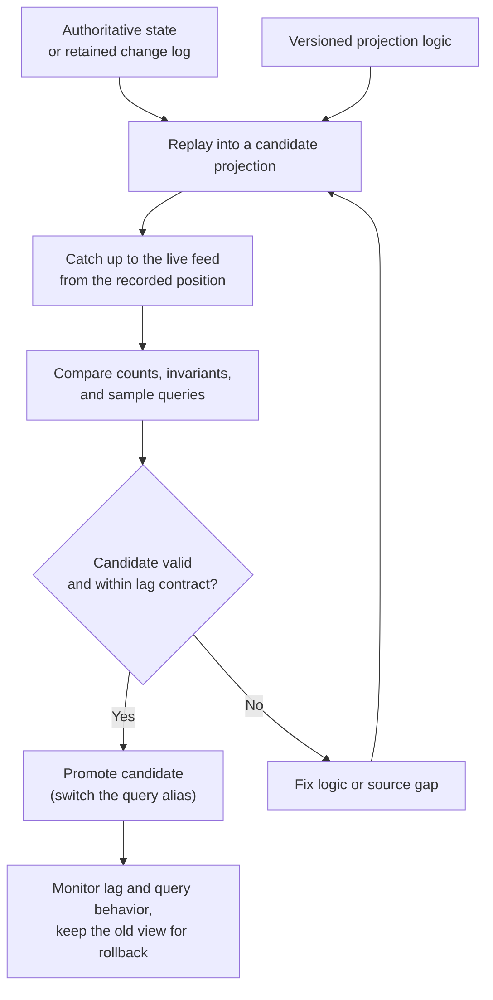

The flow builds the new view beside the live one and switches only after validation. Rebuilding in place would expose half-built data to users, so the candidate has its own table or index and the queries reach it through an alias, a view name, or a configuration value that can be changed in one step. After promotion the old view is kept until the rollback window closes.

### 12.3 Where the source comes from

An outbox is a delivery mechanism and not an archive, so a full rebuild from it is impossible once published rows are purged. Most teams scan the write store, which loses history the store does not keep, and then switch to the feed from a recorded position. A retained log or event store allows replay from position zero, which is one reason Variant 4 exists (see [Event Sourcing](CH11_Event_Sourcing.md)).

### 12.4 Making a scan consistent with the feed

A scan of a live write store takes time, and changes arrive during it. The usual method:

1. Record the feed position P at the start (the newest change already published).
2. Scan all aggregates and write rows to the candidate, each tagged with its `source_version`.
3. Start applying the feed from position P. Changes already included in the scan have versions no newer than the row's, so the version guard of section 8.4 skips them. Newer ones apply.

The version guard that makes live projection safe also makes the rebuild safe. Without it, the scan would need to freeze writes.

### 12.5 Versioning projection logic

Treat the projector's mapping as versioned code that produces a versioned view.

1. **Name the view with its version**, for example `order_summary_v3`, reached through an alias, and store the projection version beside the checkpoint.
2. **Additive changes** (a new nullable column) can be applied to the existing view with a backfill. **Breaking changes** (a removed or reinterpreted column) need a new version and a rebuild.
3. **Run old and new in parallel**: the old projector keeps serving while the new one builds `v4`, and the alias moves when validation passes.

The query contract has its own versioning: add fields, and remove one only when no client reads it.

### 12.6 Validation and capacity

Validate a candidate with checks that do not depend on the projector's own logic:

- **Counts**: the number of rows per key range against the number of aggregates in the write store.
- **Invariants**: for example, the sum of line totals equals the order total, and the daily revenue equals the sum of order totals for that day, computed from the write store.
- **Sample queries**: the same 1,000 keys read from the old and new view, with differences listed and explained.

A rebuild competes with production traffic. Throttle the scan, read from a replica where the lag is acceptable (owned by [Replication](../06_Databases_and_Storage/CH07_Replication.md)), checkpoint progress, and estimate duration first: 12 million aggregates at an assumed 4,000 rows per second take 12,000,000 / 4,000 = 3,000 seconds, or 50 minutes, plus catch-up of changes that arrived meanwhile.

## 13. Authorization, Idempotency, and Testing the Two Sides

Three concerns look different on the two sides and are easy to get wrong when they are treated as one.

### 13.1 Authorization on commands and on queries

A command asks whether this caller may perform this action on this aggregate, decided from the caller, the command type, and often current state such as ownership. A rejection carries a reason code, and every outcome is audited. A query asks which rows and fields this caller may see, applied as a filter on the caller and the row owner or tenant. The result is smaller or empty, and only sensitive reads are audited.

Two consequences matter. First, a command that depends on state-based permission (only the order owner may cancel) must check against the write store, inside the transaction. Checking against a projection can allow a cancellation by someone whose ownership was removed a moment earlier. Second, the read model holds its own copy of access data, such as the tenant identifier on every row, and a change in permissions must reach it. When permissions change, the lag of that change is a security window. For revocation that must take effect at once, enforce the check on the authoritative path or keep the access data in a store both sides read directly, and document the window for everything else.

Query authorization is applied in the query handler as a filter taken from the authenticated caller, never from request parameters, as section 7.6 noted. Field-level protection (hiding a price from some roles) is best done by having a separate view per audience, not by hiding columns in application code.

### 13.2 Idempotency across the whole path

Section 6.4 showed the request key at the handler. The wider rules:

1. **The client generates the key** per intended action and reuses it for retries of that action only.
2. **The key and the result are stored in the same transaction** as the state change.
3. **The key has a lifetime** at least as long as the longest plausible retry window, then is deleted.
4. **Same key with a different payload** is a client error and is rejected.
5. **The projector has its own protection**, the version guard of section 8.4. The key guards against client retries, and the version guard against feed redelivery.

The general mechanics and trade-offs are owned by [Idempotency](../07_System_Design_and_Distributed_Systems/CH16_Idempotency.md).

### 13.3 Testing the two sides

The sides have different test strategies, which is itself a benefit of the separation.

- **Command handler:** each rule accepts and rejects the right inputs, version conflicts occur, and replayed request keys return the original result. Use unit tests on the domain model and integration tests on a real database, including two parallel commands on one aggregate where exactly one wins.
- **Projector:** feed a scripted sequence with duplicates, reordering, a restart from a checkpoint, and a poison change, then compare the read model with an expected table.
- **Query handler:** filtering, paging, and the authorization filter over a seeded read store.
- **Contract:** tests on the feed record schema, run in both pipelines.
- **User experience:** inject delay into the projector and check that screens show a pending state and not wrong data. a random sequence of commands, runs them against the write side, waits for the projector to drain, then rebuilds a fresh view by scan and compares it with the live view. Any difference means the live projector and the rebuild logic disagree, which is a bug in one of them. Running it on every build catches most projector defects before production.

The runnable lag demonstration in the code examples linked at the end of the chapter shows the effect that the user-experience test must cover.

## 14. Failure and Quality-Attribute Scenarios

A quality-attribute scenario states a stimulus, the response the system should give, and a measure that decides pass or fail. The scenarios below apply to Variant 3. All numbers are illustrative targets, set to show the form. Replace them with the values from the freshness contracts of section 9.6.

### 14.1 Projector health as a state machine

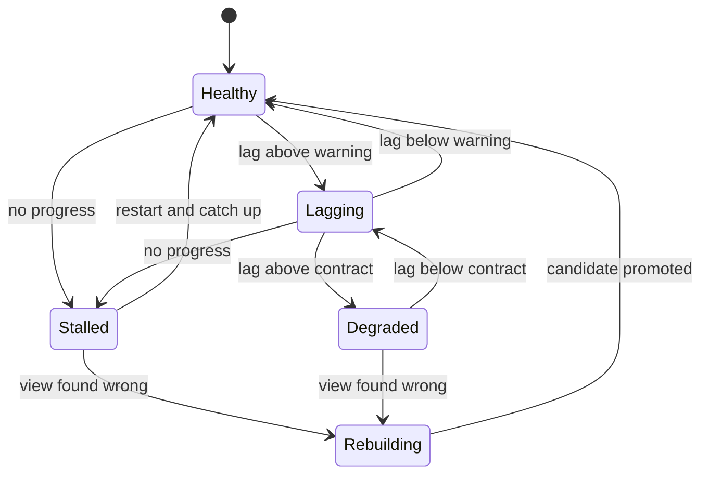

The states drive behavior on the query side. In `Healthy` the read store serves normally. In `Lagging` the version-token wait is likely to time out, so screens show pending states. In `Degraded` the contract is broken, a page goes to the owner, and selected reads route to the write store. `Stalled` means the checkpoint is not advancing even though changes exist, which needs its own alert. `Rebuilding` follows section 12.

### 14.2 The scenarios

| # | Stimulus | Expected response | Success criterion |
| --- | --- | --- | --- |
| 1 | Read store becomes unavailable for 10 minutes | Commands continue and changes accumulate in the feed. Queries return an error or fall back for selected reads | Command success rate stays at or above 99.9 percent. After recovery the projector drains the backlog and lag returns under 5 seconds within 2 times the outage length |
| 2 | Projector crashes after applying a change but before saving the checkpoint | On restart it reapplies from the last checkpoint | Zero duplicate effects in the read store (verified by the convergence test), and no gap |
| 3 | Relay publishes the same outbox row twice | The projector ignores the repeat | Read store row identical to a single delivery, version unchanged |
| 4 | Burst of 2,000 changes per second for 10 seconds, capacity 1,000 per second | Backlog builds, then drains. A lag alert fires | Peak lag at or below 10 seconds (section 9.2 arithmetic), alert within 60 seconds, drained within 30 seconds |
| 5 | A poison change cannot be applied | Retry a bounded number of times, then dead-letter it and continue | Other aggregates' lag unaffected (stays under 5 seconds), dead-letter alert raised, no silent drop |
| 6 | The user changes an address and opens the profile at once | The query waits for the version token | The profile shows the new address in at least 99 percent of cases within 500 ms of the request, and otherwise shows a pending state, never a wrong value without a marker |
| 7 | A projector bug is found that miscalculated totals for 3 days | Build a corrected candidate view, validate, promote | Zero downtime for queries, validation differences for the affected days equal zero, rollback available for the agreed window |
| 8 | A user requests deletion of personal data | Delete in the write store and publish the deletion to all projections | Deleted record absent from all read stores within the agreed period, verified by a query for the key in each |
| 9 | Write store fails over to a replica with a small replication gap | Changes in the gap may be lost to the feed. Detect and repair | Reconciliation job finds the difference and corrects the read model within one reconciliation cycle |

Scenario 9 touches a hazard that the other scenarios do not. If the feed is derived from a replica that lags or from a database that loses acknowledged commits at failover, the read model can hold changes that the write store no longer has, or miss ones that it does. A periodic reconciliation, which compares row counts and checksums by key range between the stores and repairs the differences, is the safety net, and it is also the detector for projector bugs that tests missed. The database-level failover behavior is owned by [Replication](../06_Databases_and_Storage/CH07_Replication.md).

Every criterion needs a signal: projection lag (newest committed position minus the checkpoint), oldest unpublished outbox row age, time since the checkpoint last moved, dead-letter count, version-token timeouts, and reconciliation differences. Alert on lag crossing the contract, on a stalled checkpoint, and on dead letters, not on processing rate alone.

## 15. Worked Case: Account Activity Dashboard (Illustrative)

This case follows one hypothetical organization, a retail bank's digital channel team of eight engineers. The organization and all numbers are invented for the exercise. It shows the reasoning, and it does not represent a real system.

### 15.1 Starting point and measurements

The team runs an account service on one relational database. The dashboard shows, per account, the balance, the last 20 transactions, and spending totals by category for the last 30 days. It was built on the transaction entities with a five-table join. Measurements at the daily peak hour:

| Measurement | Value |
| --- | --- |
| Dashboard reads | 600 per second |
| Transaction writes | 25 per second |
| Mean database work per dashboard read | 30 ms |
| Mean database work per write | 6 ms |
| Dashboard p95 latency | 1,400 ms against a target of 400 ms |
| Business freshness requirement | Dashboard totals within 5 seconds, own latest transaction visible at once |

Database work per second: reads 600 × 30 ms = 18,000 ms, writes 25 × 6 ms = 150 ms. Reads are 18,000 / 18,150, about 99.2 percent of the load. The database has 16 usable workers. Reads alone need 18 workers of capacity, so the system is saturated and the writes, which are the critical path, queue behind reads.

### 15.2 Decisions and rejected alternatives

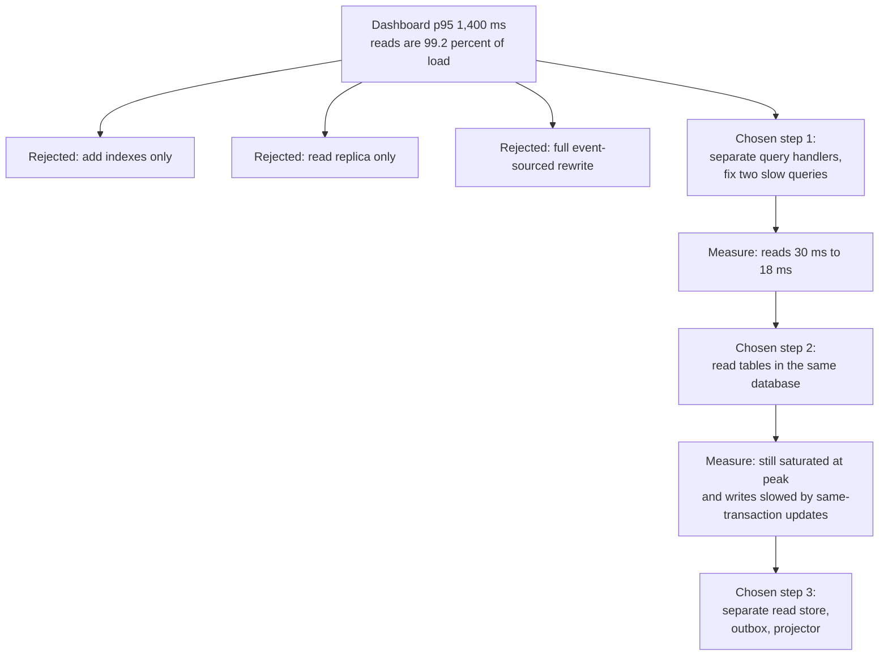

The diagram records the decision path. The team tried the cheaper steps first and measured after each, so the move to a separate store has evidence behind it.

1. **Indexes only.** Tried in step 1. Two missing indexes explained part of the cost, and work per read fell from 30 ms to 18 ms. Reads then needed 600 × 18 = 10,800 ms, or 10.8 workers, still 67.5 percent of capacity, with the five-table join remaining.
2. **A read replica.** Rejected because it copies the same schema, so each read still costs the join, and replica lag adds staleness without removing it.
3. **Event Sourcing.** Rejected because nothing in the requirements asks for replay beyond what the ledger already keeps, and the team has no event-store experience. See [Event Sourcing](CH11_Event_Sourcing.md).
4. **Same-database read tables (step 2).** Tried. A denormalized summary updated in the write transaction cut reads to 4 ms, but writes rose from 6 ms to 14 ms. Total work: 600 × 4 + 25 × 14 = 2,400 + 350 = 2,750 ms per second, about 2.8 workers. Capacity was fine, but the nightly rollup jobs and the dashboard share a database with the ledger, so a read-side incident would still affect transaction writes. Ownership and availability, not raw capacity, tipped the decision.
5. **Separate read store (step 3).** Chosen, with the denormalized view `account_dashboard` built by an outbox-fed projector.

### 15.3 The chosen design

- The write side keeps the ledger as is. The transaction handler writes the ledger entry and an outbox row in one transaction, with a request key.
- A relay publishes outbox rows to a feed partitioned by account identifier, so one account's changes arrive in order.
- The projector updates two views, `account_dashboard` and `account_category_totals`, with a version guard on `source_version`.
- The balance after the user's own transaction uses the version token of section 9.5 with a 400 ms maximum wait, then shows a pending marker. The detail screen for the latest transaction reads the write store (section 9.4).

### 15.4 Sizing and arithmetic

1. **Read store load.** At an assumed 0.8 ms of work per read, 600 reads per second need 600 × 0.8 = 480 ms of work per second, or 0.48 workers. A single small node covers this with headroom for a 3x peak (1.44 workers).
2. **Projector load.** Each transaction touches two views at an assumed 4 ms each, so 8 ms per change. At 25 changes per second: 25 × 8 = 200 ms per second, 0.2 workers. Peak of 5x (125 per second) gives 1.0 workers, so the projector runs with 2 workers for spare capacity, rated at 2 / 0.008 = 250 changes per second.
3. **Burst.** At 500 changes per second for 60 seconds against 250 per second: backlog (500 - 250) × 60 = 15,000, lag at the end 15,000 / 250 = 60 seconds, drain at 250 - 25 = 225 per second takes 15,000 / 225 ≈ 67 seconds. The 5-second contract would break for about two minutes, so the team autoscales the projector on lag up to 6 workers, rated at 750 per second, which absorbs the burst with no backlog.
4. **Write path.** Writes cost about 6 ms plus 1 ms for the outbox insert, so ledger load is 25 × 7 = 175 ms per second, and dashboard reads no longer touch it.

### 15.5 Validation evidence

The team accepts the change only when the following are observed in a staging replay of one recorded week of anonymized traffic and then in a staged rollout:

| Check | Result required |
| --- | --- |
| Dashboard p95 latency | At or below 400 ms |
| Projection lag at the 99th percentile | At or below 5 seconds, including during a replayed salary-day burst |
| Ledger write p95 | No worse than the baseline plus 2 ms |
| Convergence test | Zero differences after 10,000 random command sequences |
| Shadow read comparison | Zero unexplained differences over 7 days for 100 percent of dashboard keys |
| Fallback drill | Read store stopped for 10 minutes, commands unaffected, dashboard shows a degraded banner |
| Rebuild drill | Candidate rebuilt from a ledger scan and validated, with the arithmetic of section 12.6 for duration |

Rollout then proceeds at 1, 10, 50, and 100 percent of dashboard traffic, with the old query path kept for a month. The pattern was adopted because measured reads dominated, the join could not be removed by indexing, ledger availability needed isolation, and the business accepted the staleness contract. Account-settings screens stay plain CRUD, as section 10.6 recommends.

## 16. Common Mistakes and Anti-Patterns

| Anti-pattern | Cause | Consequence |
| --- | --- | --- |
| CQRS everywhere | The pattern is applied to every context because it was adopted as a standard | Slow delivery and duplicate code in contexts that were simple CRUD |
| Separate stores on day one | Treating Variant 3 as the real pattern | Operational cost and staleness with no measured need |
| Dual writes to the two stores | The simplest way to fill the read store | Silent divergence after the first crash between the two writes |
| Checking invariants against the read model | The read model is convenient and fast | Approvals based on stale state, such as selling stock that is gone |
| Promising read-after-write with an async feed | The contract is never written down | Users see missing data and repeat actions, creating duplicates |
| Non-idempotent projector | Increment-style updates with at-least-once delivery | Totals drift upward after each redelivery |
| No rebuild path | Read store treated as primary after launch | A bug or store loss is permanent, and fixes require manual edits |
| Command returns a query-shaped entity | Convenience for the client | The handler is coupled to every screen, and the separation is lost |
| Shared entities across both sides | Reusing classes to avoid mapping | A write-side refactor breaks queries |
| No lag monitoring | The projector is assumed to work | Staleness is discovered by users |
| Forgetting deletes in projections | The projector handles insert and update only | Deleted or erased data stays visible |
| Event Sourcing adopted for CQRS | Belief that the two are inseparable | Replay and schema-evolution costs paid for a benefit an outbox already gives |

A common thread runs through the list: most of these are failures of adoption, not of the pattern. A team that can state the freshness contract, the owner, and the rebuild path for each read model avoids most of the table.

## 17. Comparison With Neighbouring Approaches

### 17.1 Trade-off table

The pattern is one of several answers to read and write pressure. Neighbours are recapped here only to compare, and each has an owner chapter.

| Aspect | Plain CRUD with read replicas | CQRS (Variants 1 and 2) | CQRS (Variants 3 and 4) | Event Sourcing alone | Event-Driven Architecture alone |
| --- | --- | --- | --- | --- | --- |
| Core idea | One model, extra read copies of the same schema | Two models, one database | Two models, separate stores | State stored as events | Components react to published events |
| Read shape | Same as write schema | Independent, pre-joined | Independent, any engine | Needs projections to query | Not addressed |
| Read scaling | Replicas | Shared database capacity | Independent | Needs projections | Not addressed |
| Consistency seen by the user | Replica lag | Immediate (same transaction) or refresh delay | Eventual, staleness window | Immediate on the stream, eventual on projections | Eventual |
| Added infrastructure | Replicas | Little | Feed, projector, second store | Event store | Broker |
| History and replay | No | No | Only with retained log | Yes, by design | Only with retention |
| Main risk | Replica lag surprises | Read tables tax writes | Projection drift and operations | Schema evolution, replay time | Ordering, duplicates, coupling |
| Owner chapter | [Replication](../06_Databases_and_Storage/CH07_Replication.md) | This chapter | This chapter | [Event Sourcing](CH11_Event_Sourcing.md) | [Event-Driven Architecture](CH07_Event_Driven_Architecture.md) |

Replicas copy the schema and not the shape, so they add read capacity but cannot remove an expensive join. Event Sourcing stores write-side state and often pairs with CQRS, but each can be used alone. Event-driven architecture supplies the transport a projector may use and does not by itself provide separated models.

### 17.2 Choosing among them

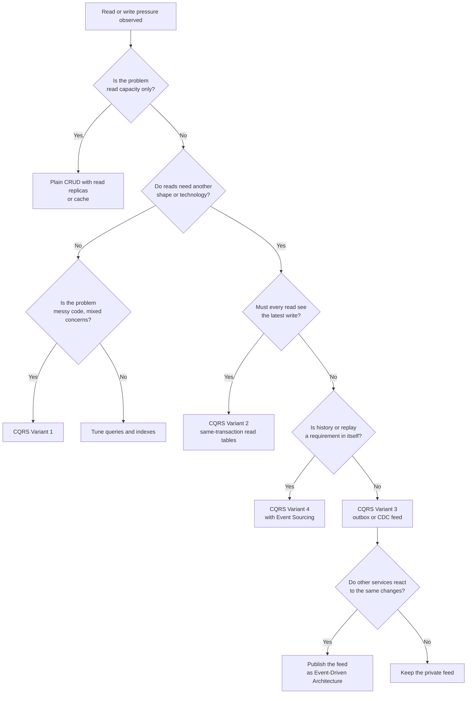

The flowchart separates three questions that are often mixed: capacity (replicas), shape (CQRS), and history (Event Sourcing). The last branch notes that the same change feed may serve other services, at which point it becomes an integration contract that [Event-Driven Architecture](CH07_Event_Driven_Architecture.md) governs, with the added versioning discipline that implies.

## 18. Design-Review Checklist

Use these questions in a review. A "no" is a finding to record with an owner.

1. **Justification.** Is the pain measured, were the cheaper alternatives of section 3.4 ruled out with evidence, is the variant the smallest that removes the pain, and is the pattern limited to the contexts that need it?
2. **Write side.** Is each command an intent with one handler, are invariants and uniqueness checked on the write store, does each command carry a request key, and is concurrency handled with a defined conflict response?
3. **Synchronisation.** Is there no dual write, is the projector idempotent and checkpointed, do deletes and corrections travel in the feed, and is there a dead-letter path with an alert?
4. **Read side.** Is each view designed from a named query with volume and freshness figures, does each row carry `source_version`, are authorization filters taken from the authenticated caller, and do retention, deletion, and encryption apply to the read store?
5. **Consistency.** Is a freshness contract documented per query, and does each screen that follows a command have a defined technique from section 9.4?
6. **Operations.** Are lag, checkpoint progress, outbox age, and dead letters alerted against the contract, is a rebuild rehearsed with a rollback window, is there a reconciliation job, and does a named team own each read model?
7. **Testing.** Do tests cover duplicates, reordering, restarts, poison changes, and convergence?

## 19. Exercises

1. **Name the level.** A team says their service "does CQRS" because no method both returns data and changes state. Explain what they have, and what further evidence you would ask for.
   *Outline:* This is CQS, a method-level rule (section 2.1). CQRS needs separate models and paths. Ask whether the command and query sides use different types, and whether any read shape is stored in advance.
2. **Pick the variant.** An internal tool has 15 reads per second and 2 writes per second. Its entities hold display-only fields, and reports use three joins. Choose a variant and justify.
   *Outline:* Variant 1. The volume is low, the pain is code clarity, and a cheap index or view handles the joins. Separate stores would add cost with no measured need (sections 5.5 and 10.5).
3. **Staleness arithmetic.** A relay polls every 500 ms, transport takes 30 ms, queue wait is 20 ms, and apply takes 10 ms. Give the mean and worst steady-state staleness. Then a burst of 800 changes per second for 5 seconds hits a projector rated at 400 per second, with a normal rate of 100 per second. Give the peak lag and the catch-up time.
   *Outline:* Mean 250 + 30 + 20 + 10 = 310 ms, worst 500 + 30 + 20 + 10 = 560 ms. Backlog (800 - 400) × 5 = 2,000, peak lag 2,000 / 400 = 5 seconds, drain rate 400 - 100 = 300 per second, catch-up 2,000 / 300 ≈ 6.7 seconds.
4. **Find the bug.** A projector increments `order_count` for a customer on each `OrderPlaced` change, and totals drift upward after relay restarts. Explain and fix it.
   *Outline:* At-least-once delivery makes the increment non-idempotent (section 8.4). Project a recomputed state with a version guard, or store applied change identifiers in the same transaction as the increment.
5. **Reject the shortcut.** A developer proposes that the stock check in `PlaceOrder` read the `stock_view` projection for speed. Give two failure scenarios and the correct design.
   *Outline:* A lagging projection approves orders against taken stock, and two concurrent orders both pass. Use a conditional update on the write store (section 6.4).
6. **Design the user experience.** After a user changes a notification setting, the settings screen shows the old value. Offer three techniques and choose one.
   *Outline:* Update from the command result, pending state, or version token (section 9.4). The command result is cheapest because the screen shows only what was just changed.
7. **Plan a rebuild.** A bug miscalculated category totals for the last 3 days. The write store holds 20 million transactions, a scan runs at 5,000 rows per second, and arrivals are 50 per second. Estimate duration and describe a safe cutover.
   *Outline:* 20,000,000 / 5,000 = 4,000 seconds, about 67 minutes. Changes arriving meanwhile: 4,000 × 50 = 200,000, caught up at 5,000 - 50 = 4,950 per second, about 40 seconds. Build a candidate view, apply the feed from the recorded position, validate by counts and invariants, switch the alias, and keep the old view for rollback (sections 12.2 to 12.6).
8. **Argue against.** A proposal applies CQRS with separate stores to an administration module with 5 users. Write the objection and the alternative.
   *Outline:* Volume is negligible, there is no read-shape problem, and the staleness and operational cost outweigh any benefit (sections 3.2 and 10.5). Use plain CRUD, or Variant 1 if code clarity is the issue.

## 20. Summary

CQRS gives commands and queries separate models. Command-Query Separation is a method-level rule, and CQRS lifts the idea to models, with four variants that trade added independence for added cost (sections 2 and 5). The following maps the chapter to the outcomes stated in the Introduction.

| Outcome | Where it was taught |
| --- | --- |
| 1. Distinguish CQS from CQRS | Section 2 |
| 2. Name the forces for and against a separate read model | Sections 3 and 10 |
| 3. Trace a command and query through each variant | Sections 4 and 5 |
| 4. Design a command handler and a denormalized query model | Sections 6, 7, and 13 |
| 5. Choose a synchronisation mechanism and state its failure behavior | Sections 8, 12, and 14 |
| 6. Compute projection lag and staleness and design the user experience | Sections 9 and 15 |
| 7. Decide whether CQRS pays off | Sections 10, 11, 16, 17, and 18 |

Three ideas carry most of the weight. Start at the least complex separation and climb only when measurements justify it. Treat the read model as derived, rebuildable data with a stated freshness contract and an owner. Check invariants on the authoritative store, and design every screen that follows a command for the staleness window.

### 20.1 Code examples

The chapter's runnable Python examples are in `code/python/cqrs-chapter/`:

- [01_command_side.py](../code/python/cqrs-chapter/01_command_side.py) shows a command handler with validation.
- [02_query_side.py](../code/python/cqrs-chapter/02_query_side.py) shows a query handler over a read model.
- [03_projection_worker.py](../code/python/cqrs-chapter/03_projection_worker.py) shows a projector applying changes and recording progress.
- [04_eventual_consistency_lag_demo.py](../code/python/cqrs-chapter/04_eventual_consistency_lag_demo.py) shows the lag between a write and its appearance in the read model.
