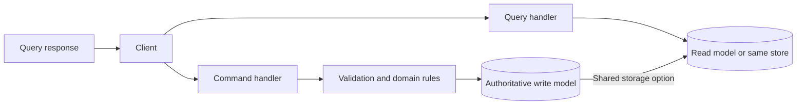
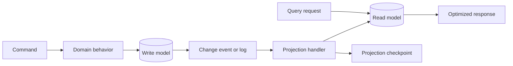
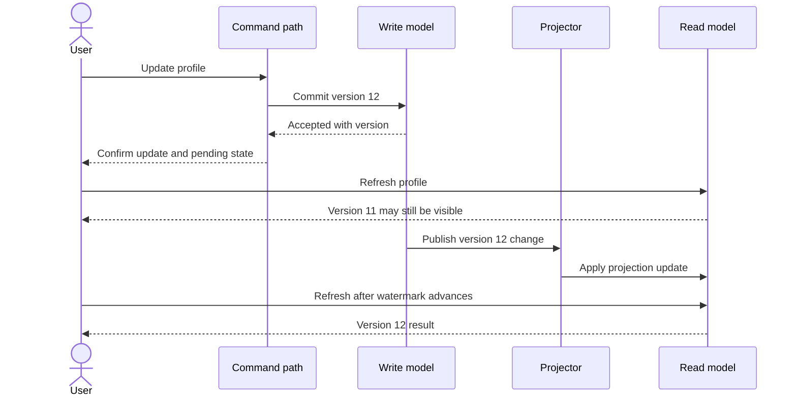
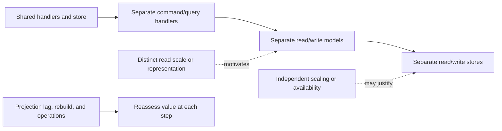
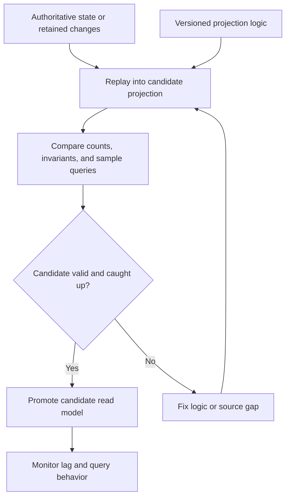

# CQRS: Command Query Responsibility Segregation

Part: [20 — Architecture Patterns](PART_OVERVIEW.md)

Command Query Responsibility Segregation (CQRS) separates operations that change state from operations that read state. The separation can exist at the code-handler level while sharing one database, or extend to independently optimized read models with asynchronous projections. The latter introduces lag, rebuild, and operational costs. Part 07 CH14 owns distributed CQRS mechanics; Part 06 owns database materialized-view mechanics.

## Separate Command and Query Responsibilities

Commands express requested state changes and can be accepted or rejected; queries return a representation without changing authoritative state. Separating handlers clarifies validation, authorization, and performance needs. It does not require separate databases or event sourcing.

Start with separate application paths on one store when read/write logic differs but data shape and scaling do not. Keep the command result explicit: accepted, rejected, or pending. A query should not secretly trigger a business mutation.

## Build a Read Projection When Needed

An independently optimized read model can combine data, precompute summaries, or serve a high-volume query shape. A projector consumes write-side changes and updates the read model. This decouples read scaling and representation, but adds another data copy, schema, recovery path, and correctness contract.

Projection updates should be idempotent and observable. Define how deletes, corrections, and out-of-order updates affect the read model. If no reliable change feed exists, compare polling with a periodic rebuild. Include the freshness cost in that choice.

## Make Read Lag Visible

An asynchronous projection may lag behind the authoritative write. The user can observe stale information immediately after a command. Decide whether the application needs read-your-writes behavior, a pending state, a direct write-model read, or a bounded wait. Do not promise strong consistency while serving an eventually updated projection.

Expose projection watermark, update delay, and failure state where staleness matters. A version token can let a client wait until its query observes at least the version returned by a command. If that delay exceeds the product contract, use a different consistency path rather than hiding lag.

## Adopt CQRS Incrementally

The adoption spectrum ranges from distinct command and query handlers on one model to separate logical models on one database, then separate stores and independently scaled projections. Each step increases operational and consistency complexity. Move along the spectrum only when workload, ownership, or representation requirements justify the cost.

Do not introduce separate stores merely to achieve architectural symmetry. Consider read/write ratios, query complexity, data ownership, consistency expectations, and operational capability. Simpler query optimization or a materialized view may solve the problem with less moving parts.

## Rebuild and Recover Projections

Read models are derived state and should be rebuildable from authoritative data or a retained change log. A rebuild needs versioned projection logic, capacity planning, checkpointing, validation, and a safe cutover. Rebuilding into the active model can expose partial state; prefer an isolated candidate and atomic or controlled promotion where possible.

A rebuild may compete with production writes and reads. Throttle it, monitor source load, and document how to resume after interruption. Preserve the old projection until the new one passes validation and rollback criteria.

## Worked Case: Account Activity Dashboard

An account system processes transactions accurately in its write model but struggles to serve a dashboard that joins transactions, balances, and categorized totals. The team first separates query handlers and measures load. It then adds a read projection because dashboard query volume and response shape differ substantially. The projection includes a version watermark and updates asynchronously.

After a transaction, the response states that the dashboard is refreshing; a transaction detail view reads the authoritative path for read-your-writes. The team rebuilds the projection into a candidate model, validates balances and totals, then promotes it. If projection lag exceeds the user expectation, the system alerts its owner and temporarily routes targeted reads to the authoritative store.

## Review Questions

1. What value does separating command and query handlers provide without separate stores?
2. Which product behavior exposes projection lag to users?
3. When is a materialized view simpler than full CQRS?
4. How is a projection rebuilt without serving partial data?
5. Which operational owner responds when lag exceeds its contract?

CQRS is useful when state-changing and read workloads have genuinely different needs. Start at the least complex separation, make lag and recovery explicit when projections are asynchronous, and adopt separate stores only when their benefits exceed their operational cost.
