# Saga Pattern

Part: [20 — Architecture Patterns](PART_OVERVIEW.md) · Status: Revised (in-depth rewrite)

## 1. Introduction

A saga is a way to complete one business operation that spans several services, each with its own database, when no single transaction can cover all of them. The operation is split into a sequence of local transactions. Each local transaction commits on its own. If a later step cannot complete, the saga runs compensating actions that offset the effect of the steps already committed, so the business ends in an outcome it can accept, such as "order rejected, customer not charged".

The idea is older than microservices. Hector Garcia-Molina and Kenneth Salem described sagas in 1987 as a way to break a long-lived database transaction into shorter ones so that locks are not held for the whole duration. The modern use of the term keeps that shape (a sequence of committed steps with compensations) and applies it to a different problem: services that own separate data stores and cannot share a transaction at all.

For an engineer moving into architecture, the useful skill is deciding where a saga is the right tool, how to design each step so that failure is survivable, and what the business will see while the saga is half done. A saga gives up the isolation of a database transaction and replaces rollback with compensation, and both changes leak into product behaviour. This chapter makes those costs explicit.

After this first part of the chapter you should be able to:

1. Explain why a transaction cannot span services in a practical system, and what a saga guarantees in its place.
2. Choose between orchestration and choreography with stated criteria.
3. Design a saga state machine and decide what must be persisted about each saga instance.
4. Classify each step as compensable, pivot, or retryable, and design compensations that are semantic undo rather than literal rollback.
5. Work through the failure probabilities and retry budgets of a saga with shown arithmetic.
6. Name the isolation anomalies a saga permits and apply a countermeasure for each.

The ownership boundaries with neighbouring material are deliberate:

- Part 07 owns distributed-transaction theory, including two-phase commit (2PC), in-doubt transactions, and the dual-write problem. See [Distributed Transactions](../07_System_Design_and_Distributed_Systems/CH12_Distributed_Transactions.md) and the systems-level [Saga Pattern](../07_System_Design_and_Distributed_Systems/CH13_Saga_Pattern.md) chapter. This chapter recaps them in a few sentences where needed.
- Part 06 owns database transaction mechanisms such as ACID properties (Atomicity, Consistency, Isolation, Durability), isolation levels, and locking: [Transactions](../06_Databases_and_Storage/CH08_Transactions.md).
- [Event-Driven Architecture](CH07_Event_Driven_Architecture.md) owns event delivery mechanics, including the transactional outbox, which this chapter relies on and recaps.
- [Microservices](CH05_Microservices.md) owns service boundaries and data ownership, [CQRS](CH09_CQRS.md) owns the read-model view of a workflow, and [Event Sourcing](CH11_Event_Sourcing.md) owns storing state as an event log.
- Idempotency mechanics belong to [Idempotency](../07_System_Design_and_Distributed_Systems/CH16_Idempotency.md). This chapter states what each saga step needs from it.

All numbers in this chapter are illustrative. They show how to reason, and they are not measurements of any real system.

## 2. The Foundational Model

### 2.1 The problem: no practical transaction across services

Consider placing an order in a system where the order service, inventory service, and payment service each own a database. The business wants one outcome: either the order is accepted, stock is held, and the card is authorized, or none of these happened. Inside one database this is a transaction, and the database gives all-or-nothing behaviour through its commit and rollback machinery.

Across services the same guarantee needs an atomic commit protocol, with 2PC as the classic one. In 2PC a coordinator asks every participant to prepare, and only if all vote yes does it tell them to commit. Part 07 [Distributed Transactions](../07_System_Design_and_Distributed_Systems/CH12_Distributed_Transactions.md) covers the protocol and its weakness: a participant that has voted yes must hold its locks until the coordinator answers, so a coordinator crash leaves participants blocked and "in doubt". For a service architecture three further obstacles apply:

- **Participants may not support it.** A payment provider reached over a public application programming interface (API), an email service, or a carrier system exposes no prepare phase.
- **Locks cross team boundaries.** Holding a row lock in the inventory database while waiting for a slow payment call lets one team's latency stall another team's throughput.
- **Availability multiplies.** A 2PC transaction commits only if every participant is reachable at the same time. If three services each have 99.9% availability and failures are independent (an assumption), all three are available together with probability $0.999^3 \approx 0.997$. The operation is unavailable about 0.3% of the time, three times the 0.1% of any single service, before counting the coordinator.

The dual-write problem is the same difficulty in a smaller form: a service that updates its database and then publishes an event can crash between the two. The outbox pattern, owned by [Event-Driven Architecture](CH07_Event_Driven_Architecture.md), writes the event to a table in the same local transaction and publishes it afterwards. Sagas depend on that mechanism for reliable step messages.

The saga accepts the situation as it is. Instead of making several databases commit atomically, it makes each database commit its own step and arranges for the business to recover when a later step fails.

### 2.2 A saga as local transactions plus compensations

A saga for an operation with $n$ steps is defined by two ordered sets:

- **Forward steps** $T_1, T_2, \dots, T_n$. Each $T_i$ is a local transaction in one service. It commits independently and is immediately visible to anyone who reads that service.
- **Compensations** $C_1, C_2, \dots, C_{n-1}$. Each $C_i$ is a local transaction that semantically offsets the effect of $T_i$.

If every forward step succeeds, the saga completes. If $T_k$ fails, the saga runs $C_{k-1}, C_{k-2}, \dots, C_1$, normally in reverse order, and ends in a compensated state. The failed step $T_k$ itself needs no compensation, because its local transaction rolled back.

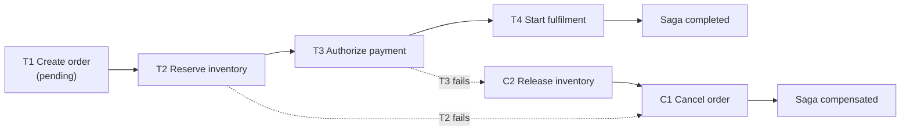

The diagram shows the two paths through a saga. The solid path is the forward path. A failure at $T_3$ sends control back along the dashed path, running $C_2$ and then $C_1$. A failure at $T_2$ needs only $C_1$. The number of compensations that run depends on how far the saga got, which means the amount of recovery work, and the time the business spends in an intermediate state, grows with the position of the failure.

Two properties of this definition shape the rest of the chapter. First, each $T_i$ is visible to other readers as soon as it commits, so the saga exposes intermediate states. Second, $C_i$ is a new local transaction that moves state forward to an acceptable position. It is not a rollback that restores a previous database state, so it must be designed, tested, and made idempotent like any other business operation.

### 2.3 What a saga guarantees and what it gives up

A saga provides a weaker set of properties than a database transaction. It is useful to compare them one by one, because each difference becomes a design task.

| Property | Database transaction | Saga |
| --- | --- | --- |
| Atomicity | All changes commit or none do | Every step commits alone. Atomicity is eventual: the saga ends either completed or compensated, but not in one instant |
| Consistency | Constraints hold at commit | Local constraints hold per step. Cross-service invariants hold only when the saga ends |
| Isolation | Concurrent transactions do not see partial work | Absent. Other requests can read and change data between steps |
| Durability | Committed data survives crashes | Per step, through each service's database. The saga's own progress must also be made durable |

The practical summary is often written as ACD without the I. Atomicity and consistency are achieved late, and isolation has to be rebuilt by hand where the business needs it (see the section on isolation anomalies below).

A saga also needs a liveness guarantee that a transaction does not: every started saga must eventually reach a terminal state. A transaction ends because the database ends it. A saga ends only if the system keeps trying, so a saga that stops making progress is a defect with a business cost, such as stock held forever or a customer charged without an order.

### 2.4 Types of step

Not every step can be undone, and this fact organizes the whole design. The chapter uses three step types, defined fully in the section on compensating actions:

- **Compensable steps** can be semantically undone by a compensation.
- The **pivot** is the step after which the saga commits to finishing and no longer compensates.
- **Retryable steps** come after the pivot, are guaranteed or designed to eventually succeed, and are retried until they do.

A saga with this shape has a compensable prefix, one pivot, and a retryable suffix. That structure lets a designer say exactly which failures cause compensation and which cause retries, and it keeps compensation from having to undo things that cannot be undone.

## 3. Forces and Context: When a Saga Fits

A saga is justified by forces in the context, not by the presence of several services. The forces below favour the pattern when they hold together.

- **Data is split by ownership.** Each service owns its store, as the [Microservices](CH05_Microservices.md) chapter requires, so no single database can hold the transaction.
- **The business can accept intermediate states.** "Order pending" and "payment held" are meaningful to the user and to operations. If a half-done state is dangerous or unacceptable, a saga is the wrong tool.
- **Every step has a meaningful undo, or an acceptable reason it does not.** A reservation can be released and a card hold voided. A sent letter cannot be recalled, so it must be placed after the pivot.
- **The workflow is long or involves slow or external parties.** Holding locks across a minutes-long or days-long process is not acceptable, and external parties cannot join 2PC.
- **The team can operate durable workflow state.** A saga requires persistent progress records, timeouts, retries, alerts, and a human path for stuck instances.

Forces against a saga:

- **A single service boundary can hold the data.** If two capabilities are always changed together and need strict consistency, merging them into one service and using one local transaction is simpler than a saga. The [Microservices](CH05_Microservices.md) chapter treats boundary redesign as the first option.
- **Strict isolation is required.** Operations such as transferring a balance between two accounts that must never be seen half-complete are hard to build as sagas.
- **The team lacks tooling for idempotency and monitoring.** A saga with unreliable duplicate handling can double-charge customers.

A short decision test follows. If the answer to every question is yes, adopt a saga. A no on the second question points to boundary redesign, and a no on the others points to a different design or to preparatory work first.

1. Does the operation write to more than one service's data store?
2. Is redrawing the boundaries so that one service owns the whole invariant impractical?
3. Can the business tolerate and display intermediate states?
4. Can each step before the pivot be semantically undone?
5. Can the team operate durable state, retries, and stuck-saga handling?

## 4. Orchestration and Choreography

A saga needs something to decide which step runs next, remember how far the saga got, and trigger compensations. Where that knowledge lives defines the two coordination styles.

### 4.1 Orchestration

In orchestration, one component, the orchestrator, holds the saga definition and state for each instance. It sends a command to a participant, waits for the reply, records the result, and chooses the next command. Participants do not know they are part of a saga. They execute a command and reply.

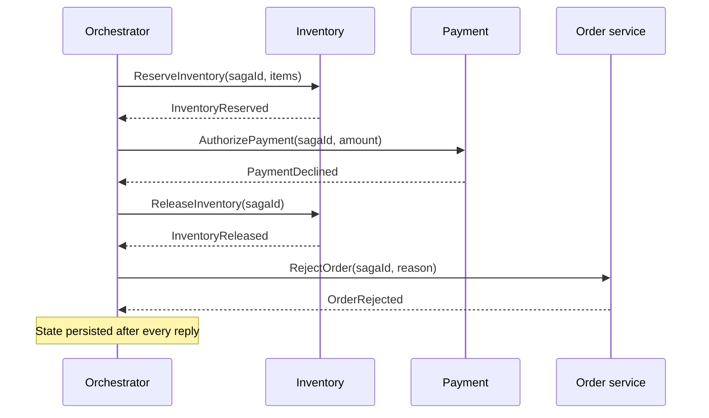

The sequence shows a failure path. The orchestrator reserves stock, receives a payment decline, and issues the compensation to inventory itself. Three consequences follow. The complete workflow is readable in one place, so a new engineer can learn it from one definition. Compensation order is decided by one component, which makes reverse-order rules and conditional branches easy to express. And the orchestrator needs durable state and becomes a dependency of every saga it runs, so its availability and its code quality bound the workflow's.

The risk specific to orchestration is that the orchestrator accumulates business rules and becomes a god service. Keep its logic to sequencing, branching on step outcomes, timeouts, and retries. Rules such as "is this item reservable" stay in the inventory service, which owns that data.

Orchestrators exist as hand-written services, as workflow engines, and as managed state-machine services. The choice affects durability, versioning of in-flight sagas, and operations, and the product details change quickly, so verify the current behaviour of any engine against its own documentation before relying on it.

### 4.2 Choreography

In choreography, no component holds the whole saga. Each service listens for events, performs its local transaction, and publishes an event describing the outcome. The next participant reacts to that event. Compensation is also event-driven: a service that sees a failure event runs its own compensation and publishes another event.

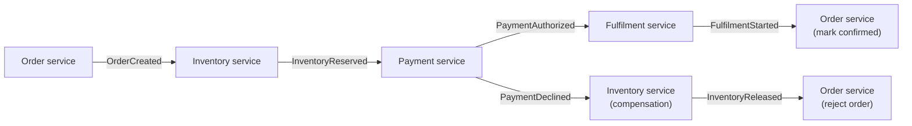

Reading this diagram requires tracing event names from service to service, and that is the central cost of the style. The sequence is not written anywhere as a single artifact. It exists as the sum of subscriptions. Each service needs to know which events to react to, and the order service appears three times because it participates at the start and at both ends of the flow.

Choreography has advantages for short workflows. There is no central component to build, scale, or make highly available, and services are loosely coupled to each other through events rather than to an orchestrator through commands. The disadvantages grow with the number of steps:

- **The workflow is hard to see.** Answering "what happens when payment declines" means finding every subscriber of that event.
- **Cyclic dependencies appear.** Service A reacts to B's event and B reacts to A's, and the cycle may only show up under a particular failure.
- **Adding a step changes several services.** Inserting a fraud check between inventory and payment means changing who listens to which event.
- **There is no natural place for a saga-level timeout.** Something must notice that an expected event never arrived.
- **Tracking state per saga is distributed.** Answering "where is order 7421" requires correlating events across services.

Every event must carry a correlation identifier (ID) such as the saga ID, and every consumer must be idempotent because event delivery is typically at-least-once. The delivery guarantees and the outbox are covered in [Event-Driven Architecture](CH07_Event_Driven_Architecture.md).

### 4.3 Trade-off comparison

| Concern | Orchestration | Choreography |
| --- | --- | --- |
| Where the workflow is defined | One saga definition in the orchestrator | Spread across subscriptions in every participant |
| Coupling | Orchestrator knows each participant's commands, participants know nothing of the saga | Participants know the events they consume and emit |
| Visibility of progress | Direct: read the saga instance state | Reconstructed from events and traces |
| Adding or reordering a step | Change the orchestrator, plus the participant for a new step | Change every service whose subscriptions shift |
| Compensation logic | Ordered and conditional in one place | Each service decides locally, ordering is implicit |
| Saga-level timeouts | Natural: the orchestrator owns a clock | Needs a separate timer or watchdog component |
| Single point of failure | The orchestrator must be made highly available | None for coordination, but the broker is shared |
| Risk | Orchestrator grows into a god service | Hidden cycles and untraceable flows |
| Fits best | Many steps, branches, deadlines, audit needs | Few steps, linear flow, clear event ownership |

The table shows that neither style removes complexity. Orchestration concentrates it in one place where it can be tested and reviewed, and choreography spreads it so that no single place shows the whole picture.

### 4.4 A decision framework

The decision rests on observable properties of the workflow. The tree below turns them into a sequence of questions.

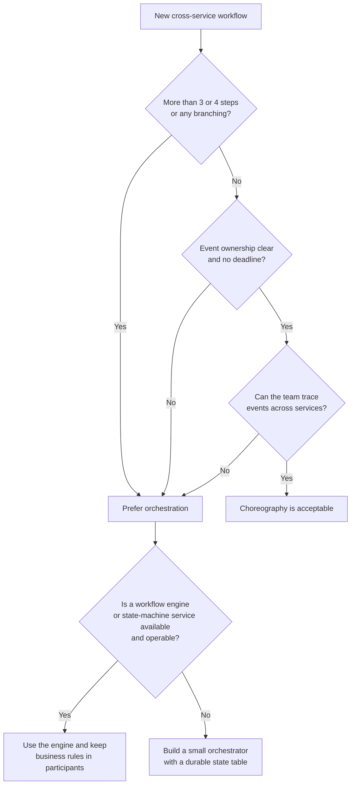

The tree is biased toward orchestration on purpose. The costs of choreography, invisibility and implicit ordering, show up late, when the workflow has grown and the original authors have moved on. Choreography is chosen when the flow is short, its events are owned by clear services, and the team already traces events across services well.

Two further points complete the framework. First, the choice can be made per saga and not per system. A short notification fan-out can be choreographed while a payment-and-fulfilment flow is orchestrated. Second, a hybrid is common: an orchestrator runs the transactional core of the saga, and the participants publish ordinary domain events for other consumers, such as analytics, that do not take part in the saga. Those consumers must not become hidden saga steps. If a consumer's failure should cause compensation, it belongs in the saga definition.

The concern that the orchestrator is a single point of failure is real but manageable. Its state is durable, so a replacement instance resumes from the last persisted step, which the next section shows.

## 5. The Saga State Machine and Its Persistence

An orchestrator that keeps progress only in memory loses every in-flight saga when it restarts. The core of a production orchestrator is therefore a state machine whose every transition is written to durable storage before the next action is taken.

### 5.1 The lifecycle of a saga instance

Each saga instance moves through a small set of states. The instance-level states are separate from the per-step states, and mixing them is a common source of confusion.

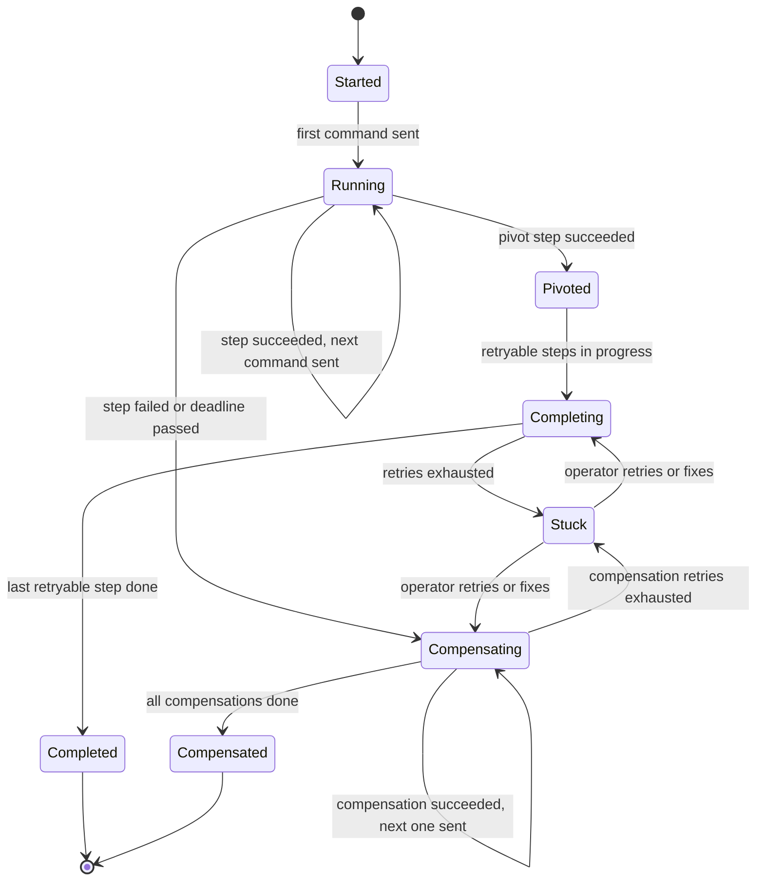

Four points in the diagram matter for design. The saga leaves `Running` in one of two directions, so the pivot is a one-way gate: once the instance is `Pivoted`, there is no transition back to `Compensating`. `Compensated` and `Completed` are the two normal terminal states, and the business must treat `Compensated` as a legitimate result, not as an error. `Stuck` is a first-class state with an owner, because a saga whose retries are exhausted must be visible and must have a human path out. And the loop on `Running` and `Compensating` shows that progress is a sequence of small persisted transitions, each of which can be resumed after a crash.

The step-level states are simpler: `PENDING`, `SENT`, `SUCCEEDED`, `FAILED`, `COMPENSATING`, `COMPENSATED`. Recording `SENT` before a reply arrives is what lets a restarted orchestrator know that a command may be in flight and must be checked, not blindly re-sent.

### 5.2 What to persist per saga

At a minimum the orchestrator persists, for each instance:

- The saga ID and the saga type and definition version. Version matters because a saga that started under definition 3 must finish under definition 3 even after definition 4 is deployed.
- The instance state and the index of the current step.
- The business payload needed by later steps and compensations, such as order ID, reservation ID, and authorization ID. A compensation needs the identifiers returned by forward steps, so these results must be stored.
- A deadline for the whole saga and for the current step.
- Attempt counts, the last error, and timestamps for diagnosis.
- An optimistic-lock version number so that two orchestrator instances cannot advance the same saga concurrently.

A compact state table in Structured Query Language (SQL) shows these fields.

```sql
CREATE TABLE saga_instance (
    saga_id         UUID PRIMARY KEY,
    saga_type       VARCHAR(64)  NOT NULL,
    definition_ver  INT          NOT NULL,
    state           VARCHAR(16)  NOT NULL,   -- RUNNING, PIVOTED, COMPENSATING, COMPLETED, COMPENSATED, STUCK
    current_step    INT          NOT NULL,
    payload         JSONB        NOT NULL,   -- ids returned by earlier steps
    attempts        INT          NOT NULL DEFAULT 0,
    deadline_at     TIMESTAMPTZ  NOT NULL,
    next_action_at  TIMESTAMPTZ  NOT NULL,   -- retry or timeout wake-up time
    last_error      TEXT,
    row_version     BIGINT       NOT NULL DEFAULT 0,
    updated_at      TIMESTAMPTZ  NOT NULL DEFAULT now()
);

CREATE INDEX saga_due_idx ON saga_instance (next_action_at)
    WHERE state IN ('RUNNING', 'PIVOTED', 'COMPENSATING');
```

The partial index serves the loop that finds sagas whose `next_action_at` has passed, which is how timeouts and retries are driven. A state transition is an `UPDATE ... SET state = ?, row_version = row_version + 1 WHERE saga_id = ? AND row_version = ?`. If zero rows are updated, another worker advanced the saga first and the current worker backs off.

### 5.3 The orchestrator loop and crash recovery

The orchestrator is a loop that selects a due saga, performs one transition, and persists the result. The sketch below is pseudo-code in Python style. It omits the transport and shows the order of operations, which carries the correctness argument.

```python
def advance(saga_id):
    saga = store.load(saga_id)                      # includes row_version
    if saga.state in TERMINAL:
        return
    step = definition(saga).step_at(saga.current_step, saga.state)

    # 1. Persist intent before sending, so a crash leaves a record of "maybe sent"
    store.save(saga.with_step_status(step, "SENT"), expect_version=saga.row_version)

    # 2. The command carries a stable key: same saga and step give the same key
    key = f"{saga.saga_id}:{step.name}:{step.direction}"
    reply = participant(step).send(step.command(saga.payload), idempotency_key=key)

    # 3. Persist the outcome and the next step in one local transaction
    if reply.ok:
        store.save(saga.after_success(step, reply.data), expect_version=saga.row_version + 1)
    elif reply.business_rejection:
        store.save(saga.begin_compensation(step, reply.reason), expect_version=saga.row_version + 1)
    else:  # timeout or transport error, outcome unknown
        store.save(saga.schedule_retry(step, backoff(saga.attempts)), expect_version=saga.row_version + 1)
```

Three details make this correct. The record of intent is written before the send, so after a crash the orchestrator finds a step in `SENT` and knows the outcome is unknown. The idempotency key is derived from saga ID, step name, and direction, so a re-send after the crash is deduplicated by the participant and does not repeat the side effect. And the outcome and the next step are written together, so a reader never sees a step marked successful with no next action recorded.

Crash recovery needs no special code path. On restart, the orchestrator queries for due sagas. A saga whose current step is `SENT` is re-sent with the same key. If the first attempt had reached the participant, the participant returns the stored result. If not, it performs the step. The duplicate-safe participant is what turns "at-least-once sending" into "effectively once". The mechanics of idempotency keys and deduplication are in [Idempotency](../07_System_Design_and_Distributed_Systems/CH16_Idempotency.md).

Reply messages from participants need the same transactional care on the sending side. A participant that commits its local state and then crashes before sending the reply leaves the orchestrator waiting. Participants write replies through the outbox, as described in [Event-Driven Architecture](CH07_Event_Driven_Architecture.md), and the orchestrator's deadline timer covers the case where no reply ever arrives.

A runnable version of an orchestrator state machine with a durable store, a retry policy, and crash recovery is in [the Python saga orchestrator example](../code/python/saga-pattern-chapter/01_saga_orchestrator_state_machine.py). It demonstrates a happy path, reverse-order compensation after a failure, and resuming from stored state.

## 6. Designing Compensating Actions

### 6.1 Compensation is semantic undo

A database rollback restores the exact earlier state and leaves no trace. A compensation cannot do either, because the forward step committed and other actors may have observed or built on it. A compensation is a new business operation whose purpose is to bring the business back to an acceptable position, and the position often differs from the original one.

Examples show how far "undo" can be from literal reversal:

- A stock **reservation** is compensated by a **release**. The inventory count returns to its earlier value unless another order took the stock in between, and the history shows both events.
- A card **authorization hold** is compensated by a **void**. No money moved, so the customer sees the hold disappear.
- A **captured payment** is compensated by a **refund**, a separate money movement that may take days to appear on a statement and may carry a fee. The business is not restored to its earlier state. It has paid to reverse.
- A **sent email** cannot be unsent. The nearest compensation is a correction email, which changes what the customer knows and does not erase what they were told.
- A **shipment handed to a carrier** may be intercepted at cost, or returned, or left alone with a credit issued.

Because compensation is a business operation, three rules apply. The compensation is designed with the business owner, who decides what "acceptable" means. It records history instead of deleting it, since an audit trail of "reserved, then released" is useful. And it is allowed to produce a different state than the original, as long as that state is defined.

### 6.2 Compensable steps, the pivot, and retryable steps

Steps fall into three classes, and the classes determine the saga's shape.

- **Compensable steps** come first. They have a compensation and may be undone if the saga must abort. Examples: create a pending order, reserve inventory, hold funds.
- The **pivot transaction** is the step that decides the saga's outcome. If it succeeds, the saga will run to completion. If it fails, the saga compensates. The pivot is typically the first step that is not compensable, or the last compensable step whose success makes finishing the preferred path. It is a business decision, so it is placed deliberately and recorded.
- **Retryable steps** come after the pivot. They are designed so that they can always eventually succeed, by being idempotent and by relying only on facts already guaranteed. Examples: capture an already authorized payment, send a confirmation, update a reporting record. Failures here are retried, not compensated.

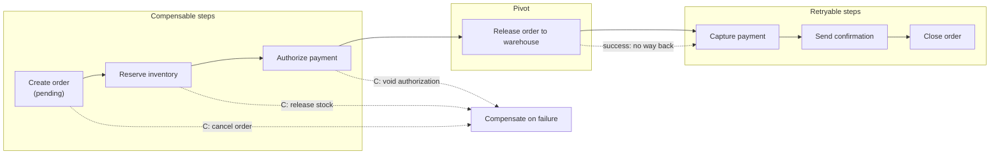

The diagram groups steps by what may happen to them on failure. Everything left of the pivot may be undone, and everything right of it is retried forward. The consequences are concrete. Steps that cannot be undone, such as sending customer email or releasing goods for physical picking, must be placed at or after the pivot. A step whose failure should abort the saga must be placed before it, so that every failure with an available compensation can be handled by compensating. This is why saga design often involves reordering steps: moving a step with a hard-to-reverse effect later reduces the amount of compensation that can ever be needed.

A heuristic follows from this. Order the steps by increasing cost of reversal and by decreasing probability of business rejection. Cheap-to-reverse steps that are likely to fail, such as a credit check, go first. Costly steps that rarely fail, such as dispatch, go last. The worked example later in the chapter measures the effect with numbers.

Compensations themselves must be retryable, in the sense that they should eventually succeed once started. A compensation that can legitimately fail, such as a refund rejected because the card has expired, needs a defined fallback, such as issuing store credit or opening a manual case, and the saga needs the `Stuck` state to hold such cases.

### 6.3 Designing a compensation

Every compensation should satisfy five requirements.

1. **Idempotent.** The orchestrator may send it twice. Running it twice must have the effect of running it once.
2. **Commutative with a late forward step.** A compensation can arrive before the forward command it undoes, because of retries and message reordering. The service must handle "release reservation R" when R was never recorded, by recording that R is cancelled so that a delayed "reserve R" is then ignored.
3. **Tolerant of changed state.** Other activity may have happened since the forward step. The compensation must produce an acceptable outcome in the current state and not assume the state is as it was.
4. **Complete for what it can undo, and explicit about what it cannot.** A partial compensation records what remains, so a human or a later step can finish the job.
5. **Authorized and logged like any business operation.** A refund is money movement and needs the same controls as a payment.

Requirement two is subtle and worth a concrete form. The inventory service below treats a release as a durable fact, so a late reserve cannot resurrect a cancelled reservation. The Java 21 sketch uses Spring Boot and `JdbcTemplate`, with `reservation` keyed by the saga ID.

```java
@Transactional
public void release(UUID sagaId) {
    // Record the cancellation even if no reservation exists yet
    int updated = jdbc.update("""
        INSERT INTO reservation (saga_id, status, qty)
        VALUES (?, 'RELEASED', 0)
        ON CONFLICT (saga_id) DO UPDATE
           SET status = 'RELEASED'
         WHERE reservation.status = 'RESERVED'
        """, sagaId);
    if (updated == 1) {
        jdbc.update("""
            UPDATE stock s SET available = available + r.qty
              FROM reservation_line r
             WHERE r.saga_id = ? AND r.sku = s.sku
            """, sagaId);
    }
}

@Transactional
public ReserveResult reserve(UUID sagaId, List<Line> lines) {
    var existing = jdbc.queryForList(
        "SELECT status FROM reservation WHERE saga_id = ?", String.class, sagaId);
    if (!existing.isEmpty()) {
        // Duplicate command, or a release that arrived first
        return ReserveResult.of(existing.get(0));
    }
    // ... check and decrement stock, insert reservation and lines, status RESERVED
}
```

If `release` is delivered twice, the second conflict does not update because the status is no longer `RESERVED`, so stock is restored once. If `release` arrives first, a `RELEASED` row exists and the later `reserve` returns that status without touching stock. The sketch uses PostgreSQL syntax for `ON CONFLICT` and omits error handling, but the two properties it shows, idempotent release and tolerance for out-of-order arrival, are the ones every compensation needs.

### 6.4 Steps that cannot be undone

Some effects cannot be compensated at a reasonable cost. Three techniques keep them from ruining the saga.

- **Defer them.** Place the step after the pivot, so the saga reaches it only when it is committed to completing. Sending a confirmation email after payment capture is the standard case.
- **Split the step into a reversible and an irreversible half.** Authorize and capture is the clearest example. Authorization is reversible and is done before the pivot. Capture is the irreversible half and is done after.
- **Use a reservation state.** Create the effect in a pending form that is invisible or inert, such as an order in `PENDING` status, then promote it to `CONFIRMED` after the pivot. Aborting means deleting or cancelling a pending record, not recalling a published fact.

When none of these fit, for example when a third-party system requires an irreversible call early, the design has to accept that failure after that call needs manual or contractual remediation. The saga then records the situation as `Stuck` with an owner, rather than claiming a clean compensation. This should be a deliberate decision with a known frequency, since the rest of the design can usually be arranged to avoid it.

## 7. Worked Scenario: Order Fulfilment with Failure Arithmetic

This scenario is illustrative. The rates are assumed to show how to reason and are not measurements.

### 7.1 The flow

An online retailer places an order through six steps:

| Step | Service | Class | Forward action | Compensation |
| --- | --- | --- | --- | --- |
| T1 | Order | Compensable | Create order in `PENDING` | Cancel order |
| T2 | Inventory | Compensable | Reserve stock | Release stock |
| T3 | Payment | Compensable | Authorize card hold | Void authorization |
| T4 | Warehouse | Pivot | Release order for picking | Not available |
| T5 | Payment | Retryable | Capture authorized amount | Not applicable |
| T6 | Notification | Retryable | Send confirmation, close order | Not applicable |

Assume 10,000 orders a day, a 2% rate at which T2 finds no stock, and a 3% rate at which T3 is declined among orders that reach it. Both are business rejections, and retrying will not change them.

### 7.2 Compensation volume

Orders rejected at T2: $10{,}000 \times 0.02 = 200$. These need one compensation, C1.

Orders reaching T3: $10{,}000 \times 0.98 = 9{,}800$. Declined at T3: $9{,}800 \times 0.03 = 294$. These need C2 and C1, two compensations each.

Orders reaching the pivot: $9{,}800 - 294 = 9{,}506$, so the pivot is reached by $9{,}506 / 10{,}000 = 95.06\%$ of orders. Total saga compensations: $200 + 294 = 494$ a day, $4.94\%$ of orders.

Compensation actions executed: $200 \times 1 + 294 \times 2 = 788$ a day. If the saga was written the other way round, with payment authorization before inventory reservation, the declines would be $10{,}000 \times 0.03 = 300$ needing C1 only, and the stock failures would be $9{,}700 \times 0.02 = 194$ needing a void and a cancel, giving $300 + 194 \times 2 = 688$ compensation actions. Here the order matters little for volume, but it matters for cost: voiding a card hold is a call to an external provider, while releasing stock is internal. The designer should count external compensations, which are slower and may cost money. In the original order a declined authorization places no hold, so no void is ever needed before the pivot: the 294 declines run only an internal release and a cancel. In the alternative order, the 194 stock failures each follow a successful authorization, so 194 voids are sent to the external provider, and 194 customers see a card hold that is then voided because stock was missing. The original order therefore avoids 194 external calls and one customer-visible side effect a day, at the price of 294 internal stock releases. The ordering is a measurable trade-off.

### 7.3 Retry budget and transient failures

Separately from business rejections, calls fail for transient reasons, such as a timeout. Assume each remote call has a 5% chance of a transient failure per attempt, independently (an assumption that is weaker in real outages), and the orchestrator allows 3 attempts with delays of 1 s and 2 s between them.

Probability that all 3 attempts of one call fail: $0.05^3 = 0.000125$, or $0.0125\%$.

An order that reaches the pivot makes five remote step calls after T1: T2, T3, T4, T5, and T6. Probability that at least one of the five exhausts its retries:

$$1 - (1 - 0.000125)^5 \approx 5 \times 0.000125 = 0.000625$$

That is $0.0625\%$, about $6$ of the $10{,}000$ daily orders, which would end in a retry-exhausted condition. Before the pivot such an order compensates. After the pivot it enters `Stuck`, because no compensation exists for a retryable step. Six cases a day is a number an operations team can read, and the arithmetic shows why a saga needs a dashboard for stuck instances and not only an error log.

Expected attempts per call: $1 + 0.05 + 0.05^2 = 1.0525$. In normal conditions retries add $5.25\%$ extra calls to each participant. In an outage of one participant, every call fails and attempts are 3 per call, a threefold load on a service that is already struggling. A retry budget limits this: cap retries at a fixed fraction of traffic and spread them with exponential backoff and jitter, so that a failing service is not pushed over.

Worst-case time spent on one step with 3 attempts, 2 s timeout each, and 1 s plus 2 s delays: $3 \times 2 + 1 + 2 = 9$ s. Five steps could consume $45$ s before the saga gives up on all of them, so the saga-level deadline should be set above the step budgets and below the point where holding stock or a card hold becomes costly. An order spending 45 s in the worst case before compensation is acceptable for a checkout, and the same value would be unacceptable if the customer is waiting on a synchronous response. The status shown to the customer, `PENDING`, should be returned immediately.

Compensations also fail. Of the 788 compensation actions a day, assuming the same 5% transient failure and 3 attempts, the expected number that exhaust their retries is $788 \times 0.000125 \approx 0.099$, roughly one every ten days. Rare but not zero, and without a path for it the failure shows as an order in `PENDING` and stock held forever.

## 8. Timeouts, Retries, and Stuck-Saga Recovery

### 8.1 Three clocks

A saga needs three separate time limits, and each answers a different question.

- **Call timeout.** How long the orchestrator waits for one reply before treating the outcome as unknown. It is set from the participant's observed latency, usually a high percentile with headroom.
- **Step deadline.** How long all attempts at one step, including backoff delays, may take. It caps the retry loop.
- **Saga deadline.** How long the whole instance may stay non-terminal before it is forced toward compensation (before the pivot) or escalated (after it). It is set from the business cost of holding resources, such as stock or a card hold.

The `next_action_at` and `deadline_at` columns in the state table from section 5.2 implement these clocks. A single scheduler loop that selects rows whose `next_action_at` has passed drives retries, timeouts, and escalations without per-saga timers in memory, so a restart loses nothing.

### 8.2 Classifying a failure before reacting

The orchestrator must not treat every error the same way. Three classes lead to three different reactions:

| Class | Example | Reaction |
| --- | --- | --- |
| Business rejection | Card declined, item out of stock | Do not retry. Begin compensation (before the pivot) |
| Transient | Timeout, connection reset, service unavailable | Retry with backoff and jitter until the step deadline |
| Unknown outcome | Timeout after the request may have been processed | Reconcile with the participant using the idempotency key, then decide |

Retrying a business rejection wastes the deadline and can repeat a harmful call. Compensating after a transient error abandons work that would have succeeded. The unknown-outcome class is the dangerous one, and section 9 treats it in detail.

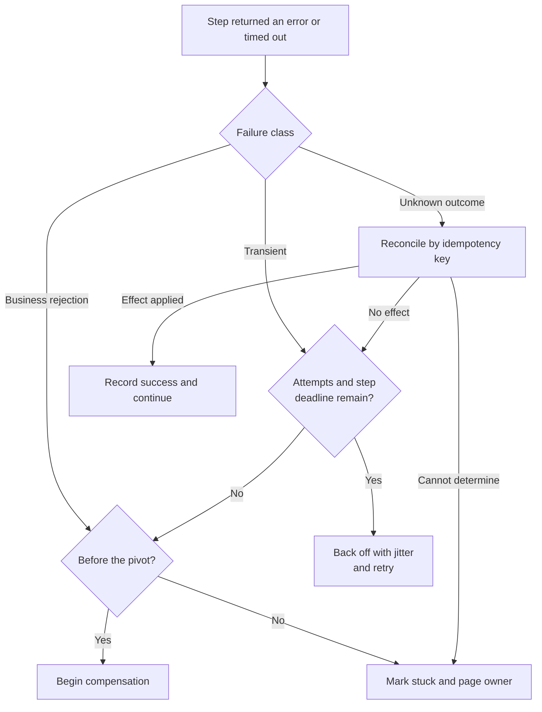

The diagram shows that exhausted retries lead to the same decision as a business rejection: compensate if the pivot has not been crossed, and stop and escalate if it has. A retryable step after the pivot cannot be compensated, so the only safe automatic exits are success and a stuck state with an owner.

### 8.3 Backoff, jitter, and retry budgets

Retries from many sagas at once can overload a recovering participant. Three controls limit the harm:

- **Exponential backoff.** The delay doubles each attempt, such as 1 s, 2 s, 4 s, up to a cap.
- **Jitter.** A random fraction is added or subtracted so that sagas that failed together do not retry together.
- **A retry budget.** Retries are limited to a fraction of the participant's normal traffic, for example 10%, so that a total outage cannot triple the load.

Illustrative arithmetic: a participant normally receives 100 requests a second from the orchestrator. With a 10% retry budget the orchestrator may send at most 10 retries a second on top, a worst-case load of 110 requests a second. Without the budget, a full outage with 3 attempts per call produces up to $100 \times 3 = 300$ requests a second, three times normal load, against a service that is trying to recover. The excess retries are not discarded permanently. They stay in the due-queue with a later `next_action_at`, so the saga deadline, not the budget, decides when the saga gives up.

### 8.4 Stuck sagas

A saga is stuck when it is non-terminal, has exhausted automatic recovery, and needs a decision. Causes include a participant that stays down past the deadline, a compensation that is legitimately rejected, a code defect in a step, and a message that was lost before an outbox was added. The recovery design has four parts:

1. **Detect by age, not by error.** Query for instances in `RUNNING`, `COMPENSATING`, or `PIVOTED` whose `updated_at` is older than the saga deadline plus a grace period. An instance that silently waits produces no error log, so detection must come from state.
2. **Assign an owner.** Each saga type names a team. A stuck instance creates a ticket or page for that team, not for a general queue.
3. **Offer safe operator actions.** Retry the current step, skip a step with a recorded reason, force compensation, or mark resolved with a note. Each action is itself a persisted, audited transition, and an operator cannot move an instance to a state the state machine forbids.
4. **Fix the cause, then replay.** Because steps are idempotent, a bulk retry after a defect fix is safe. The operator tool should show how many instances are affected before the replay runs.

Illustrative sizing: with 10,000 orders a day and the 0.0625% retry-exhaustion rate computed in section 7.3, about 6 instances a day need attention. If a participant is down for 30 minutes, orders arriving in that window all reach the retry limit together. At a steady 10,000 a day (about 6.9 a minute), roughly $6.9 \times 30 \approx 208$ sagas are affected. A replay tool that handles one instance at a time would take hours, so the tool must support filtering by saga type, step, and time window, and replay in bulk under the same retry budget.

## 9. Idempotency and Unknown Outcomes Across Steps

[Idempotency](../07_System_Design_and_Distributed_Systems/CH16_Idempotency.md) owns the general mechanics. This section states what a saga adds: keys that stay stable across the steps and across retries, and a procedure for the unknown outcome.

### 9.1 Key design for steps and compensations

Every command the orchestrator sends carries a key. The key must identify the intended effect, not the attempt. Three rules apply.

- **Same effect, same key.** The key for "reserve inventory for saga S" is the same on the first attempt and on every retry. A key generated fresh per attempt defeats deduplication.
- **Different effect, different key.** The forward step and its compensation use different keys, such as `S:reserve:forward` and `S:reserve:compensate`. Otherwise the participant could return the stored forward result when asked to compensate.
- **The participant stores the key with the result in the same local transaction as the effect.** If the key is stored separately, a crash between the two writes lets a retry apply the effect twice or lose the stored result.

External providers may impose their own key rules, including a retention window after which a key is forgotten. The saga's deadline must fit inside that window, or a late retry may repeat the side effect. Verify the window in the provider's own documentation.

### 9.2 The unknown outcome and reconciliation

When a call times out, three worlds are possible: the request never arrived, it arrived and is still running, or it completed and the reply was lost. Retrying with the same key is safe in all three if the participant deduplicates. When the participant cannot deduplicate, for example an older system, the orchestrator must query before retrying.

A reconciliation query asks the participant for the state of the effect by key: "does a reservation for S exist, and in what status". The orchestrator then acts on the answer:

| Answer | Meaning | Action |
| --- | --- | --- |
| Effect applied | Reply was lost | Record success with the returned data, continue |
| Effect absent | Request never ran | Retry with the same key |
| Effect in progress | Still running | Wait up to the step deadline, then ask again |
| Unavailable | Participant down | Keep the step in `SENT`, back off |

The participant should expose this query for every step that has a side effect. When it does not, the saga cannot tell "absent" from "unavailable" and must treat the case as stuck, so the review checklist in section 18 asks for the query on each participant.

### 9.3 Worked example: a lost reply

Illustrative sequence. The orchestrator sends `AuthorizePayment` with key `S1:authorize:forward` for 120.00. The payment service creates a hold of 120.00 and commits. Its reply is lost. The orchestrator times out after 2 s and retries with the same key. The payment service finds the key, returns the stored hold ID, and creates no second hold. Customer exposure: one hold of 120.00.

Without the stable key, the retry creates a second hold. The customer's available limit is reduced by $2 \times 120.00 = 240.00$ for the length of the hold. If the saga then compensates with a void of only the hold ID it knows about, 120.00 stays held until the issuer expires it, and the hold ID of the second is never recorded. The arithmetic shows the consequence of a missing key: a customer-visible hold that no system will release.

## 10. Compensation Ordering and Partial Failure

### 10.1 Reverse order and when to break it

Running compensations in reverse order is the default because later steps may depend on earlier ones. A payment hold may reference the order, so the hold is voided before the order is cancelled. The rule has exceptions:

- **Independent steps** may compensate in parallel to shorten recovery time.
- **Cost-ordered recovery** may run the compensation that frees the scarcest resource first, such as releasing stock before refunding, when stock is the contended asset.
- **Dependency in the other direction** may force a different order. A compensation that needs data held by an earlier step, such as the order's address for a return label, must run before that step is cancelled.

The decision is made once per saga definition and written in it, not left to each service.

### 10.2 Parallel steps and branching

A saga may issue independent commands together, for example reserving stock and running a fraud check in parallel, and wait for all replies. Compensation then has to account for each branch's own outcome.

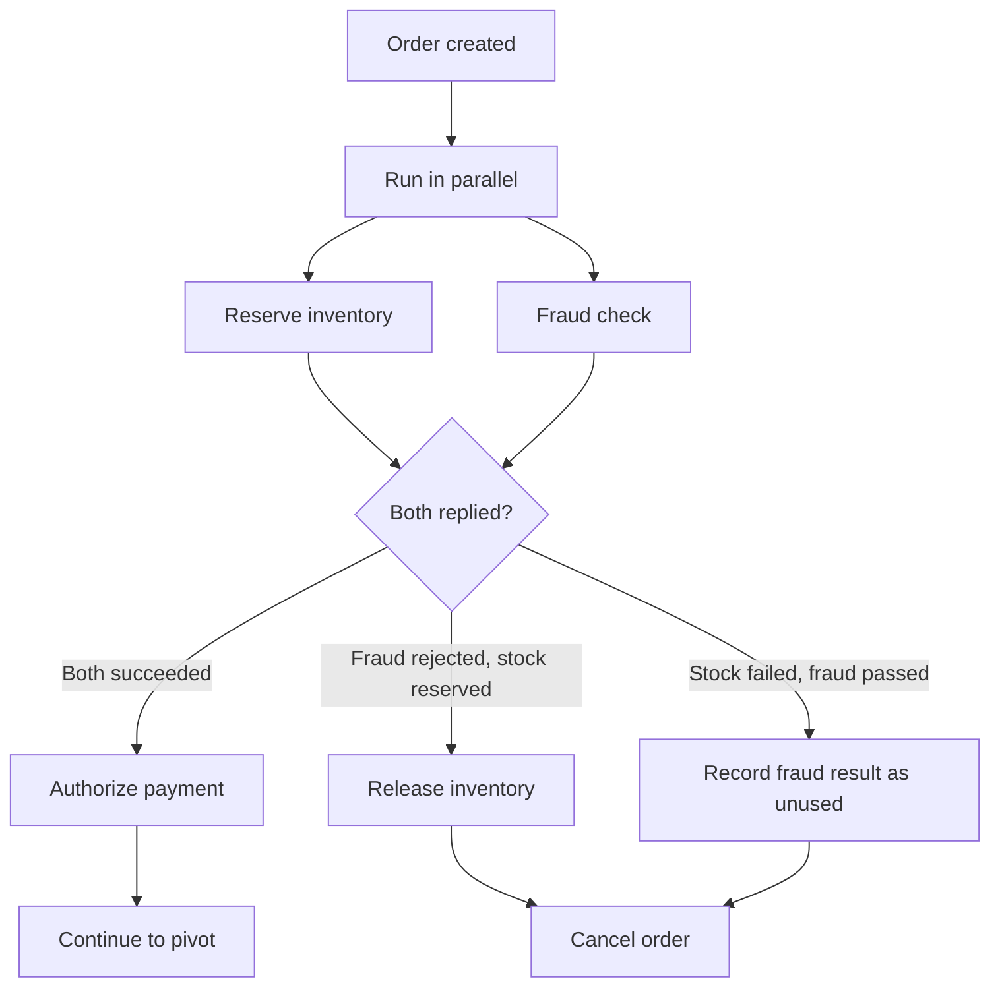

The diagram shows that the join point has more outcomes than success and failure. Each combination of branch results needs a defined compensation set. A fraud check is read-only and needs no undo, while a reservation does, so the table of compensations is driven by which branches changed state. With $k$ parallel branches there are $2^k$ outcome combinations, so keep the fork width small (two or three) or collapse branches into one participant.

### 10.3 When a compensation fails

A compensation can fail for three reasons: a transient fault, a state change that makes it impossible, or a business rule. The first is retried like any step. The second and third need a fallback:

- A refund to an expired card falls back to store credit or a manual payout case.
- A stock release for a product that was withdrawn is recorded and the count is reconciled by a warehouse process.
- A cancellation that a carrier refuses becomes a return flow.

The instance enters `Stuck` with a reason code and the list of compensations that did complete. Recording partial compensation is essential, because the operator needs to know exactly which effects remain.

Illustrative arithmetic: suppose a saga has three compensations, each with a 0.0125% chance of exhausting retries. The chance that at least one fails is about $3 \times 0.000125 = 0.000375$. Across the 494 compensated sagas a day from section 7.2, the expected number of partially compensated sagas is $494 \times 0.000375 \approx 0.19$ a day, roughly one per five days. This is rare enough to handle manually, and common enough that the tooling and the owner must exist before launch.

## 11. Isolation Anomalies and Countermeasures

### 11.1 What goes wrong without isolation

Because each step commits and becomes visible, concurrent sagas and ordinary requests can see and change data in intermediate states. Three anomalies matter in practice.

- **Lost update.** One saga overwrites a change made by another saga between steps. Example: saga A reads an order total, saga B applies a discount, and saga A's later step writes the stale total.
- **Dirty read.** A reader sees data written by a saga step that later gets compensated. Example: a dashboard counts an order as confirmed, and the saga then compensates it.
- **Non-repeatable read.** A saga reads the same data twice and gets different values because another saga changed it between steps.

### 11.2 Countermeasures

The countermeasures below come from the saga literature and are applied per data item, not globally.

| Countermeasure | Mechanism | Example |
| --- | --- | --- |
| Semantic lock | A flag marks a record as being changed by an unfinished saga. Other sagas wait, fail, or treat it as provisional | Order status `PENDING` blocks edits until the saga ends |
| Commutative updates | Design operations so the order does not matter | Increment and decrement stock counters, not set absolute values |
| Pessimistic view | Reorder steps so a risky update comes late and dirty reads are less harmful | Move the step whose compensation is costly after the pivot |
| Reread value | Before overwriting, reread and check the value is unchanged | Compare the order version before writing the total |
| Version file | Record operations and apply them in a defined order | Keep a log of requests so out-of-order arrivals are handled |
| By value | Choose the strategy by business risk | Use a saga for low-risk orders, a stricter mechanism for high-value ones |

Two of these deserve a concrete form. A semantic lock is a status column that other code respects:

```sql
-- Edit is allowed only when no saga holds the order
UPDATE orders
   SET shipping_address = :addr, row_version = row_version + 1
 WHERE order_id = :id
   AND status NOT IN ('PENDING', 'COMPENSATING')
   AND row_version = :seen_version;
```

If zero rows are updated, the caller is told the order is being processed and may retry later. The lock is advisory in the sense that only code that checks the status respects it, so every writer of the table must follow the rule, and the saga must release the lock in every terminal state, including `Compensated` and `Stuck`. A stuck saga that never releases its semantic lock blocks the record indefinitely, so the stuck-saga alert in section 8.4 doubles as a lock-leak alert.

A reread value is the optimistic check shown above through `row_version`. It is cheap and detects lost updates, but it can only fail the second writer and cannot merge their intent. For counters, commutative updates avoid the conflict entirely: `UPDATE stock SET available = available - 2` gives the right result in either order, while `SET available = 98` depends on what was read earlier.

### 11.3 Choosing which to apply

Not every anomaly needs prevention. A decision by consequence:

- If a dirty read affects only a display, such as a count that briefly includes an order that is later rejected, label the state (for example "processing") and accept it.
- If a dirty read affects money or legal commitments, use a semantic lock or reorder steps so the visible state is only the final one.
- If lost updates are possible on shared data, use a reread value or commutative updates.

The aim is to spend isolation effort only where the business consequence justifies it. Provisional states shown to users should be named so that the user's expectation matches the data.

## 12. Observability and Auditing of Saga State

### 12.1 What to emit

A saga spreads its work across services, so no single service log tells the story. Four signals together reconstruct it.

- **Durable state.** The saga table is the source of truth for "where is order 7421", and support staff can query it.
- **Structured events.** Every transition emits an event with saga ID, saga type, definition version, step, direction (forward or compensate), attempt number, outcome, and duration.
- **Traces.** The saga ID and trace context propagate through every command and reply, so a trace viewer shows the saga as one tree across services. See [Observability](../14_Observability/PART_OVERVIEW.md) for tracing mechanics.
- **Metrics.** Aggregates computed from the events.

### 12.2 Metrics and alerts

| Metric | What it reveals | Alert idea |
| --- | --- | --- |
| Started, completed, compensated, stuck counts per type | Outcome mix | Compensation rate far above its baseline |
| Saga duration percentiles | Normal speed | A high percentile exceeding the customer-facing target |
| Age of the oldest non-terminal instance | Silent stalls | Older than the saga deadline plus grace |
| Attempts per step | Participant health | Retry ratio above the retry budget |
| Stuck count and time in `Stuck` | Operational debt | Any instance stuck beyond the ownership target |
| Compensation failure count | Business exposure | Any non-zero value |

Age-based alerts catch what error-based alerts miss, because a lost message produces no error. Illustrative threshold: if the saga deadline is 10 minutes and the grace is 5, alert when the oldest non-terminal instance exceeds 15 minutes.

### 12.3 Audit trail

For money, stock, and legal commitments the history of transitions is evidence. An append-only transition log records each change with time, actor (orchestrator or named operator), previous and new state, step, and the reason code for any manual action. The orchestrator should write the log row in the same transaction as the state change, so state and history cannot diverge. This table is a small form of the event log that [Event Sourcing](CH11_Event_Sourcing.md) teaches in full, and the saga does not need the whole technique to get the audit benefit.

Customer-visible status is a projection of the state: `PENDING` while running or compensating, `CONFIRMED` for `Completed`, `REJECTED` for `Compensated` with a reason, and `NEEDS_ATTENTION` for `Stuck`. A read model for this view is the subject of [CQRS](CH09_CQRS.md). The internal detail stays internal, and the support tool shows the full history.

## 13. Security: Authorization Across Steps

A saga runs on behalf of a user but executes through service-to-service calls, often long after the user's request returned. Four security questions follow.

### 13.1 Whose authority does each step use

A step executes in a different service, and the service must decide whether the call is allowed. Two models exist:

- **Delegated user identity.** The orchestrator forwards the user's token. Each service authorizes the user. The weakness is that tokens expire, and a saga that waits hours or retries past expiry cannot use the original token.
- **Service identity with a recorded user context.** The orchestrator authenticates as itself, and passes the user ID and the authorization decision made at the start as signed claims or fields. Each participant authorizes the service to perform that command type and validates the claims.

The second model fits long-running sagas. The authorization check against the user is made once, when the saga starts, and recorded in the saga payload. Compensation then does not depend on the user still being logged in or still having permission.

### 13.2 Least privilege and command scoping

The orchestrator holds credentials that can trigger changes in many services, which makes it a high-value target. Limit the damage:

- Give the orchestrator permission only for the commands in its saga definitions, per participant, not general administrative rights.
- Participants reject commands whose type is not in the orchestrator's allow list, and reject compensation commands for sagas they never saw.
- Keep operator actions (retry, skip, force compensation) behind their own role, with two-person approval for money-moving compensations such as refunds above a set amount.

### 13.3 Integrity and confidentiality of saga data

The saga payload holds identifiers and sometimes personal or payment-related data. Store references, not card numbers or full personal records. Encrypt the payload at rest if it holds sensitive fields, and apply the retention rules the organization has for audit logs. Commands and replies are authenticated and integrity-protected on the transport, and a participant verifies that the saga ID in a command matches a command it is allowed to accept, so a forged compensation cannot release another customer's stock.

Replay is also a security issue. A captured command that is replayed with a valid key and a valid credential would be deduplicated, so the effect is not applied twice, but a replayed compensation with a fresh key would be applied. This is why compensation keys are derived from the saga and step, and not accepted from callers freely.

## 14. Failure and Quality-Attribute Scenarios

Each scenario states the stimulus, the expected response, and a measurable success criterion. The numbers are illustrative targets, not benchmarks.

### 14.1 Scenarios

| # | Quality attribute | Stimulus | Expected response | Measurable criterion |
| --- | --- | --- | --- | --- |
| S1 | Availability | Payment service unavailable for 20 minutes | Sagas wait within retry budget. Sagas passing their deadline compensate if before the pivot. Order intake continues returning `PENDING` | Order intake error rate stays under 0.1%. No saga is non-terminal beyond its deadline plus 5 minutes after the service recovers |
| S2 | Recoverability | Orchestrator process killed mid-saga | Another instance resumes from persisted state and re-sends with stable keys | Zero duplicate side effects in a test with 1,000 kills at random points. Resume starts within 30 s |
| S3 | Consistency | Duplicate delivery of every command | Participants deduplicate by key | Reserved stock equals ordered quantity for 100% of test sagas |
| S4 | Correctness | Compensation message arrives before the forward message | Participant records the cancellation and ignores the late forward command | No reservation is created for a cancelled saga in 10,000 reordered runs |
| S5 | Operability | A bug sends 300 sagas to `Stuck` | Operator filters by type and step, fixes the cause, replays under a retry budget | All 300 reach a terminal state within 1 hour of the fix. Participant load stays under 110% of normal |
| S6 | Performance | Peak of 3 times normal volume | Orchestrator scales out workers, row-version checks prevent double advance | Saga duration at a high percentile stays within 2 times the normal value |
| S7 | Security | Operator tries to force a refund above the approval limit | Second approval required | No refund above the limit without two recorded approvals |

### 14.2 Timeline of a participant outage

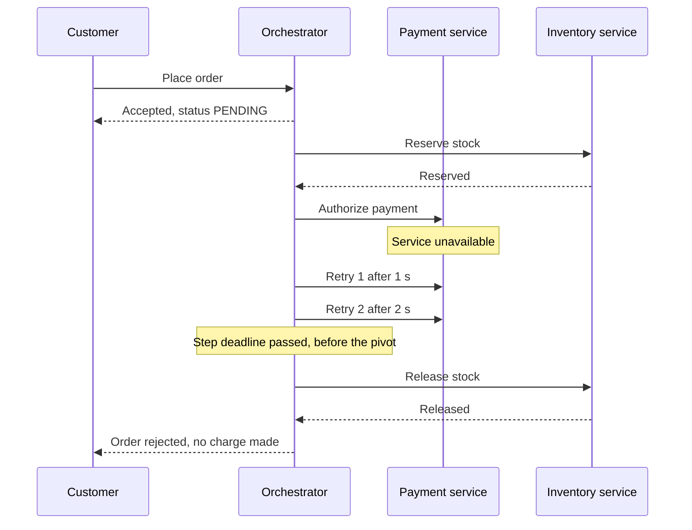

The timeline shows scenario S1 for a saga whose deadline expires during the outage. The customer receives an immediate `PENDING` response and a later rejection, and no payment was taken because the authorization never succeeded. The criterion of "no charge made" is checked by comparing the payment service's records with the set of compensated sagas, which leads to the reconciliation job in section 12.

## 15. Worked Case Study: An Online Ticketing Organization (Illustrative)

This case study uses a hypothetical organization to show how the decisions fit together. The organization, the volumes, and the numbers are invented for teaching.

### 15.1 Context

A ticketing company sells seats for live events. It has separate services for orders, seat inventory, payment, ticket issuing, and notification, each owned by a different team with its own database. Demand spikes when popular events go on sale. Assumed volumes: a normal day has 20,000 orders, and a major on-sale produces 2,000 orders in the first minute. Seats are scarce, so a seat held by an abandoned order costs revenue. Tickets are issued as signed digital documents and, once issued, are redeemable at the gate, so issuing is an effect that cannot be quietly undone.

### 15.2 Decisions

| Decision | Choice | Rejected alternative | Reason |
| --- | --- | --- | --- |
| Coordination | Orchestration with a small durable orchestrator on the existing relational database | Choreography | Seven steps with branching, a 5-minute hold deadline, and an audit need. Event tracing across five teams was not yet mature |
| Atomic commit | Saga | 2PC across order, inventory, and payment | The payment provider has no prepare phase, and holding seat locks while waiting for a payment call would stall the on-sale |
| Pivot | Ticket issuing | Payment authorization | Issuing is the first irreversible effect. Authorization can be voided |
| Step order | Seat hold, then payment authorization, then pivot | Authorize first | Seat failures are frequent in on-sales, and a void is an external call |
| Isolation | Semantic lock on the seat (`HELD` status with expiry) | Row locks held across steps | Prevents double sale and keeps the database lock window to one local transaction |
| Idempotency | Keys derived from saga ID, step, direction | Per-attempt random keys | Retries must not double-hold seats or double-authorize |
| Stuck handling | Owner per saga type, bulk replay tool, age alert | Error-log alerting | A lost message produces no error |

### 15.3 The flow

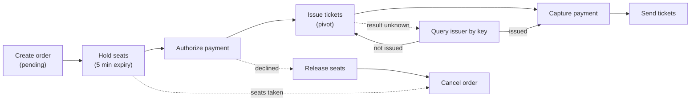

The pivot is issuing. Before it, a failure releases seats and cancels the order. After it, capture and delivery are retried until they succeed. An unknown issuing result triggers a query by key before any retry, because issuing twice would create two redeemable tickets.

### 15.4 Arithmetic and validation

Hold expiry is the backstop for seat locks. If the orchestrator is down for longer than 5 minutes, the seat hold expires by itself, so seats return to sale without a compensation. Illustrative load calculation for the on-sale: 2,000 orders in 60 s is about 33 sagas a second. Each saga makes 6 remote calls on the forward path, so the orchestrator sends about $33 \times 6 \approx 200$ commands a second. If 40% of the orders lose the race for popular seats and are rejected at the hold step, they run one compensation each: $2{,}000 \times 0.4 = 800$ cancellations, and the other 1,200 continue to payment. If 5% of those are declined, $1{,}200 \times 0.05 = 60$ run two compensations (release seats and cancel order), and 1,140 reach the pivot.

Validation evidence the team would collect before launch:

- A load test at 3 times the expected on-sale rate, checking that the count of issued tickets equals the count of captured payments for every completed saga.
- A fault-injection test that kills the orchestrator 1,000 times at random points, checking for zero duplicate holds and zero duplicate tickets (scenarios S2 and S3).
- A reorder test sending compensation before the forward command (S4).
- A reconciliation job that compares issued tickets, captured payments, and saga states nightly, with a target of zero unexplained differences.
- A game-day exercise in which the payment service is stopped for 20 minutes (S1), measuring the time to reach terminal states afterward.

## 16. Common Mistakes and Anti-Patterns

| Anti-pattern | Cause | Consequence |
| --- | --- | --- |
| Treating compensation as rollback | Assuming undo restores the old state | Missing cases such as non-refundable fees and changed stock, and customers see unexpected states |
| Placing an irreversible step early | Order follows data flow, not reversibility | Failures after it need manual remediation, and compensation volume grows |
| Orchestrator in memory only | Simplicity | A restart loses in-flight sagas, leaving held stock and holds |
| Per-attempt idempotency keys | Key generated in the retry loop | Duplicate effects such as double holds or double charges |
| No saga deadline | Assumption that steps always finish | Silent stalls, with resources held indefinitely |
| Retrying business rejections | No failure classification | Wasted time and repeated harmful calls |
| Compensation without its own retries and owner | Assuming undo cannot fail | Partial recovery with no one responsible |
| God orchestrator | Business rules placed in the coordinator | Changes to one service's rules require orchestrator releases, and teams couple |
| Hidden saga steps via events | A consumer's failure should trigger undo but sits outside the definition | Inconsistent outcomes with no record |
| Ignoring isolation | Assuming sagas are transactions | Lost updates and dirty reads on money and stock |
| Using a saga to avoid a boundary fix | Services that always change together | Large coordination cost for what one local transaction would solve |
| No customer-visible state | Hiding intermediate states | Support cannot explain `PENDING`, and users retry and create duplicates |

Each row follows the same shape: a plausible shortcut, then a failure that appears under load, concurrency, or partial outage and is hard to reproduce in a happy-path test. The checklist in section 18 turns the most frequent into review questions.

## 17. Comparing the Saga with Alternatives

### 17.1 Trade-off table

| Dimension | Saga | Two-phase commit | Eventual consistency by events only | Workflow engine |
| --- | --- | --- | --- | --- |
| Atomicity | Eventual, by compensation | Atomic at commit | None across services, each reacts independently | Eventual, as for a saga, with engine-managed state |
| Isolation | None, countermeasures needed | Locks give isolation while in doubt | None | None |
| Blocking | Non-blocking, intermediate states visible | Participants hold locks until the coordinator decides | Non-blocking | Non-blocking |
| Participant requirements | A local transaction, a compensation, idempotency | A prepare and commit interface | Idempotent consumers | Idempotent activities |
| Failure handling | Compensation, retries, stuck state | Coordinator recovery, in-doubt resolution | Retry and dead-letter | Retries, timers, compensation as code |
| Visibility | Saga state or event traces | Coordinator log | Event traces | Engine history |
| Fits | Business processes with acceptable intermediate states | Few participants under one trust and technology boundary | Loose, one-way reactions without rollback need | Long-running, branching, human steps |

Part 07 explains 2PC and its in-doubt problem in [Distributed Transactions](../07_System_Design_and_Distributed_Systems/CH12_Distributed_Transactions.md). The short form: it provides atomicity at the cost of blocking and of requiring every participant to support the protocol. Events alone suit cases where nothing needs undoing, such as updating a search index. A workflow engine is a way of building an orchestrated saga, with durable state, timers, and retries supplied by the product. It does not remove the need for compensation design, idempotency, or isolation countermeasures.

### 17.2 Decision flowchart

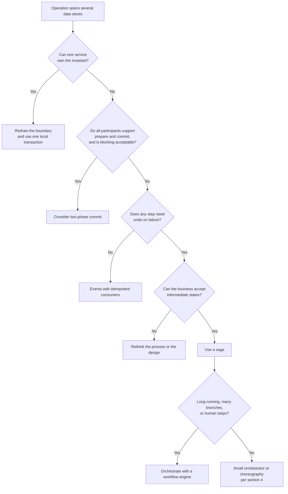

The flowchart puts boundary redesign first because it removes the problem at lowest cost, and it places the choice among saga implementations last because that choice is reversible with less effort than the choice to use a saga at all.

## 18. Design-Review Checklist

Use these questions in a design review of a saga.

1. Is the operation's invariant impossible to place inside one service, and has boundary redesign been considered?
2. Is each step classified as compensable, pivot, or retryable, with the pivot recorded and justified?
3. Is every irreversible effect at or after the pivot, or split into a reversible and irreversible half?
4. Does each compensation have a defined business outcome, a note on what it cannot undo, and an owner?
5. Are forward steps and compensations idempotent, with keys that are stable across retries and distinct between forward and compensation?
6. Does each participant handle a compensation that arrives before its forward command?
7. Does each participant expose a query to find the state of an effect by key?
8. Is saga state persisted before each send and after each reply, with a row version or equivalent guard against concurrent advance?
9. Is the definition version stored so in-flight sagas finish under their own version?
10. Are call timeouts, step deadlines, and the saga deadline set and justified?
11. Are failures classified, so business rejections are not retried and unknown outcomes are reconciled?
12. Is there a retry budget and backoff with jitter?
13. Is the `Stuck` state defined, with an owner, an alert based on age, and safe operator actions?
14. Which isolation anomalies can occur, and which countermeasure covers each money or stock item?
15. Are semantic locks released in every terminal state?
16. Is there an audit trail written with each transition?
17. Is the customer-visible status defined for pending, rejected, confirmed, and needs-attention?
18. Is authorization checked once at the start and recorded, and are the orchestrator's permissions limited to its commands?
19. Are operator actions role-restricted, with extra approval for money movement?
20. Have the failure scenarios in section 14 been tested, including orchestrator kill, duplicate delivery, and reordering?

## 19. Exercises

1. **Place the pivot.** A travel booking has steps: hold seat, authorize payment, issue ticket, email itinerary. Classify each step and place the pivot. Outline: hold and authorize are compensable, issue is the pivot because carrier cancellation costs a fee, email is retryable and placed after the pivot.
2. **Reorder for cost.** Using the rates in section 7 (2% stock failure, 3% decline), compute the external void calls per 10,000 orders for each step order. Outline: authorize-first gives $9{,}700 \times 0.02 = 194$ voids, and reserve-first gives none before the pivot. Discuss the customer-visible hold.
3. **Retry arithmetic.** A call fails transiently 2% of the time with 4 attempts. Compute the probability that all attempts fail and the expected attempts per call. Outline: $0.02^4 = 1.6 \times 10^{-7}$, and expected attempts $1 + 0.02 + 0.02^2 + 0.02^3 = 1.020408$.
4. **Out-of-order compensation.** Describe how a payment service should respond to `Void(S9)` when it has no record of `S9`. Outline: record `S9` as voided, return success, and reject a later `Authorize(S9)` as cancelled.
5. **Choose the coordination style.** A five-step workflow owned by three teams with a 24-hour human approval step. Pick a style. Outline: orchestration, ideally on a workflow engine because of the long wait, durable timers, and visibility needs.
6. **Find the lost update.** Two sagas change the shipping address and the order total on the same order. Identify the anomaly and two countermeasures. Outline: lost update, countered by a reread version check or by splitting the fields into separate updates that commute.
7. **Stuck-saga drill.** After an outage, 400 sagas sit in `Stuck`. Design the replay. Outline: filter by type, step, and time window, check the cause is fixed, replay under a retry budget, audit each action, and verify terminal states and reconciliation counts.
8. **Authorization over time.** A saga outlives the user's token. Explain how to authorize compensation. Outline: authorize at the start, record the decision, and let the orchestrator authenticate as itself with limited per-command permissions.

## 20. Code Examples

The runnable files under [code/python/saga-pattern-chapter](../code/python/saga-pattern-chapter/) are Python scripts that run without external services.

- [01_saga_orchestrator_state_machine.py](../code/python/saga-pattern-chapter/01_saga_orchestrator_state_machine.py) shows a durable orchestrator with a happy path, reverse-order compensation, and resume from stored state.
- [02_compensating_transaction_craftsmanship.py](../code/python/saga-pattern-chapter/02_compensating_transaction_craftsmanship.py) shows idempotent compensations and handling of out-of-order arrival.
- [03_saga_failure_recovery_patterns.py](../code/python/saga-pattern-chapter/03_saga_failure_recovery_patterns.py) shows retries, backoff, timeouts, and stuck-saga handling.
- [04_saga_observability_and_idempotency.py](../code/python/saga-pattern-chapter/04_saga_observability_and_idempotency.py) shows idempotency keys and the emission of saga events.

## 21. Summary

The chapter's introduction set six outcomes. Each is mapped to where it was delivered.

| Outcome | Where covered |
| --- | --- |
| Explain why a transaction cannot span services and what a saga guarantees instead | Sections 2 and 3 |
| Choose between orchestration and choreography with stated criteria | Section 4 and the flowchart in section 17 |
| Design a saga state machine and decide what to persist | Section 5 and sections 8 and 12 |
| Classify steps as compensable, pivot, or retryable and design semantic compensations | Sections 6 and 10 |
| Work through failure probabilities and retry budgets with arithmetic | Sections 7, 8, 10, and 15 |
| Name the isolation anomalies and apply a countermeasure for each | Section 11 |

A saga trades isolation and instant atomicity for availability and independence between services. It works when the business accepts visible intermediate states, each step before the pivot has a defined undo, and the team operates durable state, idempotency, deadlines, and a stuck-saga path. Where the invariant fits in one service, a local transaction is simpler. Where participants support prepare and commit under one boundary and blocking is acceptable, two-phase commit is an option. In the remaining cases, design the saga around reversibility, give every instance a terminal state and an owner, and test the failure scenarios before launch.
