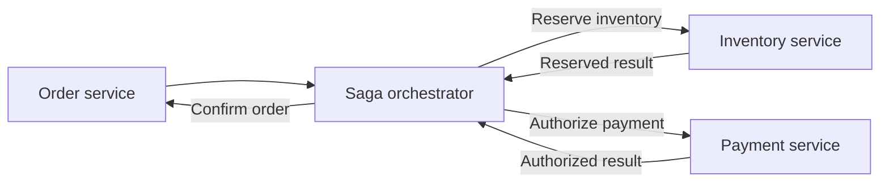
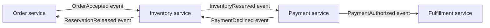
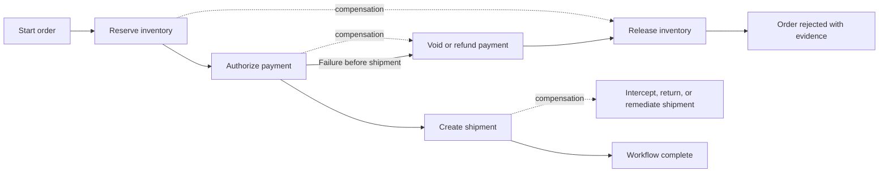
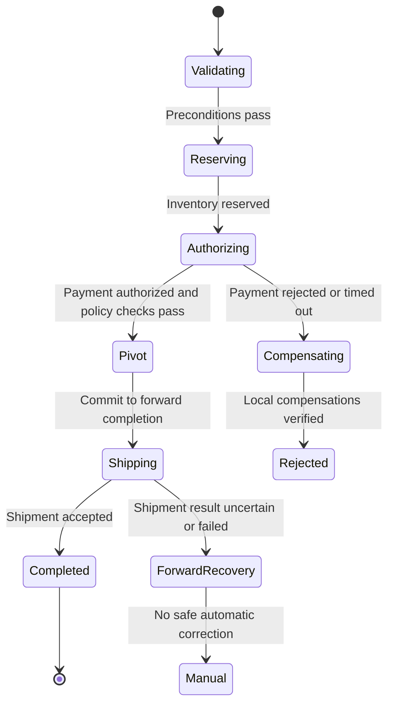
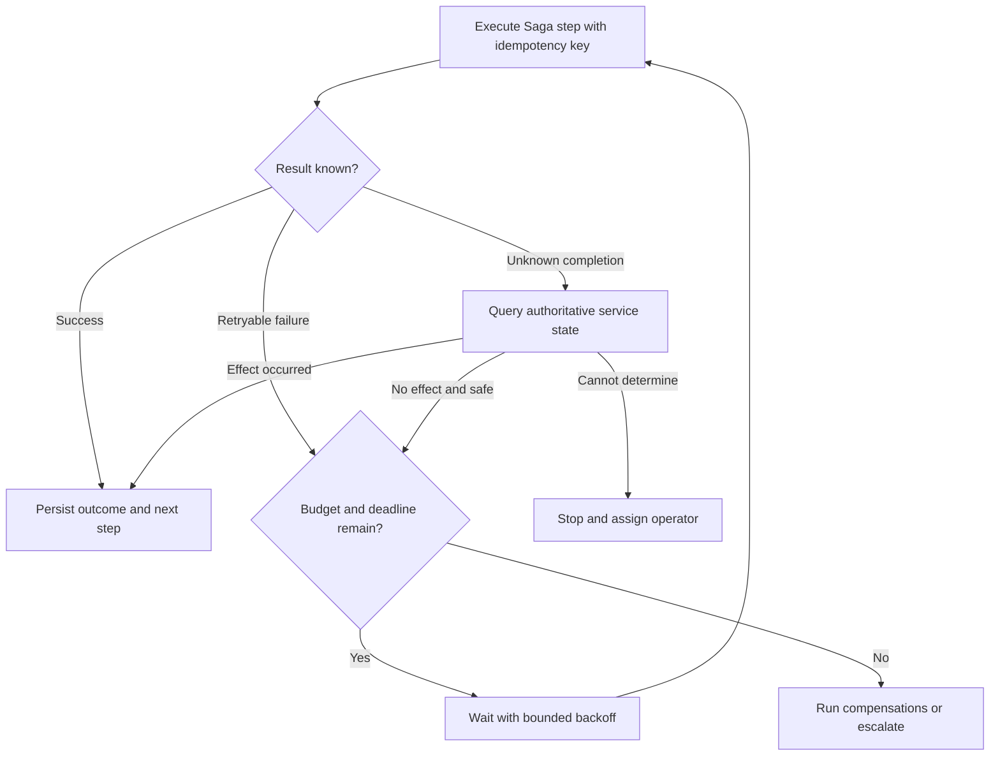
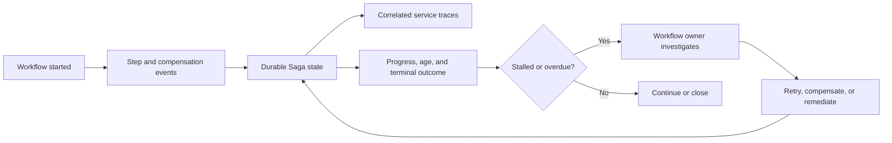

# Saga Pattern

Part: [20 — Architecture Patterns](PART_OVERVIEW.md)

A Saga coordinates a business transaction across multiple services when one atomic database transaction cannot span the workflow. Each step commits local state; if a later step fails, the workflow may run compensating actions to reach an acceptable business outcome. Compensation is not rollback: an email, shipment, or external payment may be irreversible or require a new action to offset it.

Part 07 CH13 owns Saga mechanics in distributed systems; Part 06 CH08 owns database transaction mechanisms. This chapter focuses on the pattern choice, responsibility boundaries, and business consequences.

## Choose Orchestration or Choreography

An orchestrated Saga uses a coordinator to issue commands and track progress. A choreographed Saga has services react to events without a central coordinator. Orchestration makes workflow state and sequence visible but can centralize logic; choreography reduces central control but can obscure the complete process and create event coupling.

Use orchestration when the workflow has many conditional steps, explicit deadlines, or a need for centralized progress and compensation. Keep the orchestrator focused on workflow state rather than embedding every service's business rules.

Choreography suits short workflows with clear event ownership and limited branching. It requires correlation, observability, and a way to determine workflow completion across consumers. Avoid accidental cycles in which services emit events that trigger each other indefinitely.

## Model Forward Steps and Compensations

For each forward action, identify a compensating action, its limits, and the point beyond which recovery changes from compensation to remediation. A compensation may release a reservation, issue a refund, or create a correction record; it does not erase history. Define idempotency, retry limits, and expected outcomes for both forward and compensating steps.

Compensation order often reverses completed forward work, but business semantics may differ. A refund can fail; inventory may no longer be available; a shipment may not be stoppable. Record partial compensation and assign an owner when the system cannot return to the prior business state.

## Identify the Pivot and Irreversible Effects

The pivot is the point after which the Saga chooses to complete rather than compensate, often because later actions are irreversible or expensive to reverse. Place the pivot deliberately and define what evidence permits crossing it. Before the pivot, the workflow may retry or compensate; after it, the system may need forward recovery, manual intervention, or customer communication.

The pivot is a business decision, not necessarily one technical event. Make it observable and persist it with workflow state. A timeout near the pivot can leave an unknown outcome; reconcile authoritative service state before retrying or compensating.

## Handle Retries, Idempotency, and Failure

Each command needs a stable workflow and step identifier so duplicate deliveries do not repeat side effects. Bound retries by deadline and failure type. Use durable state to resume after process loss. Define how dead-letter or stalled workflows are surfaced, who owns them, and whether replay is safe after business state changes.

Do not equate message delivery with step completion. Persist the request, operation identifier, result, and checkpoint consistently enough to recover. Compensation itself can fail and needs its own retry, alert, and manual path.

## Observe the Workflow as a Whole

Track Saga instance ID, current step, elapsed time, retries, compensation state, terminal outcome, and downstream correlation IDs. Alert on age and stalled steps as well as errors. A healthy individual service can still participate in a stuck business workflow.

Define customer-visible status for pending, rejected, completed, and manual-recovery outcomes. Avoid leaking internal failure detail, but provide support teams enough evidence to explain what happened and what remains to be done.

## Worked Case: Travel Booking

A travel booking workflow reserves a seat, authorizes payment, and issues a ticket. Before ticket issuance, a payment failure releases the seat. Ticket issuance is the pivot because reversal requires a carrier cancellation and may incur a fee. If the issuance response times out, the orchestrator queries the carrier using an idempotency key before retrying or refunding.

If cancellation fails after payment authorization, the Saga marks the case for manual recovery and keeps the user informed. The service records workflow progress and carrier request IDs. Operations monitors aged booking instances and compensation failures; it does not treat the payment service's success metric as proof that the booking completed.

## Review Questions

1. Which workflow makes orchestration preferable to choreography?
2. What business result does each compensation produce, and what can it not undo?
3. Where is the pivot, and how is it detected after an uncertain timeout?
4. Which identifiers make retries and replay safe?
5. Who owns a stalled Saga and communicates partial completion?

Use a Saga when a business process spans local transactions and can tolerate explicit intermediate states. Model compensation and irreversible effects honestly, persist progress, make retries safe, and assign ownership for workflows that cannot recover automatically.
