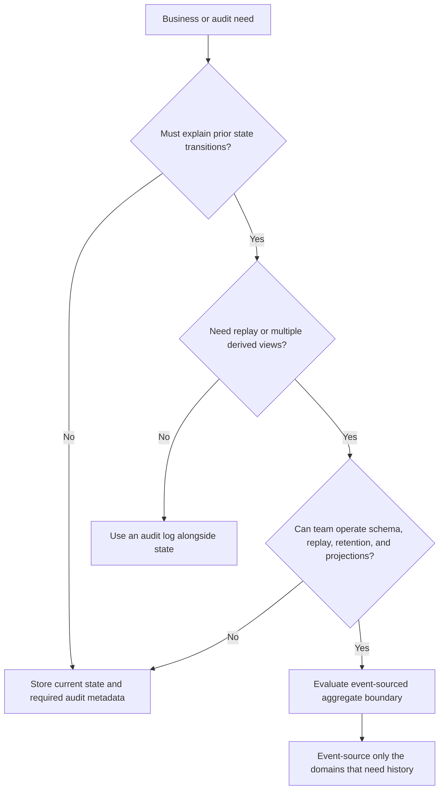
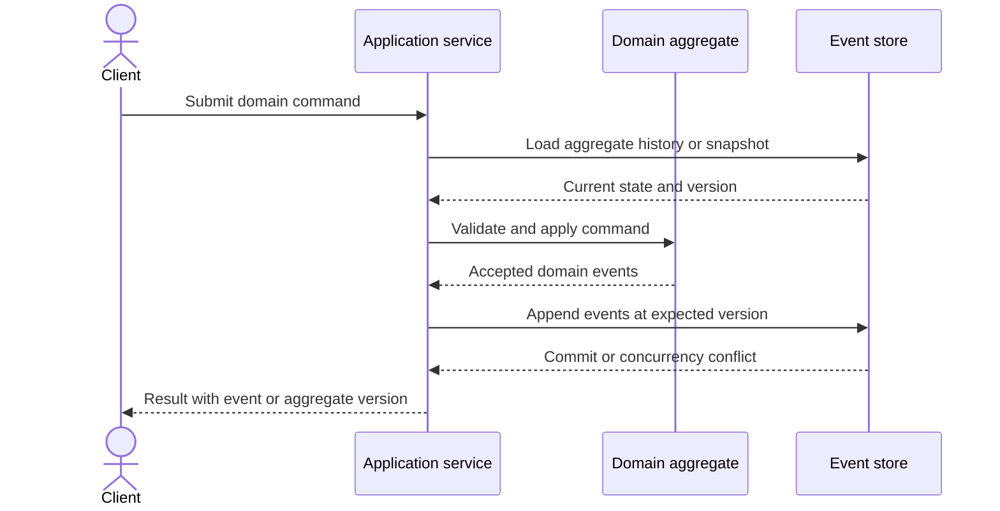
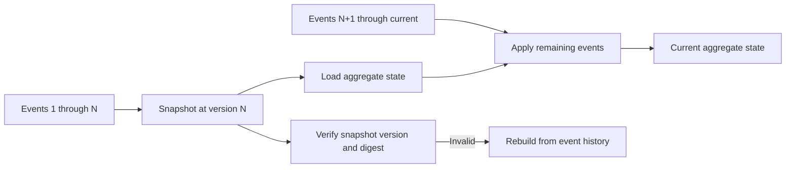
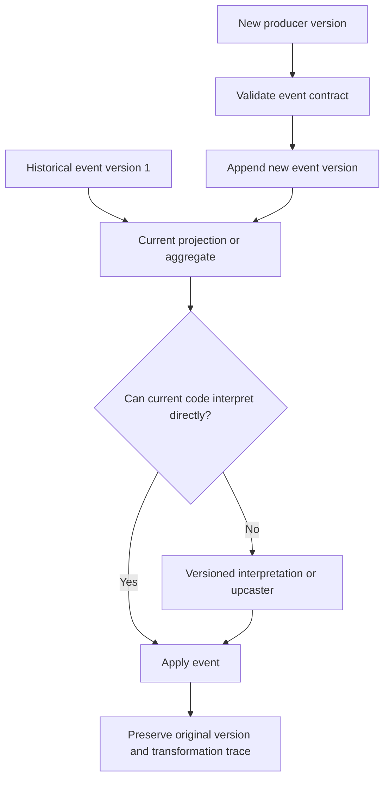
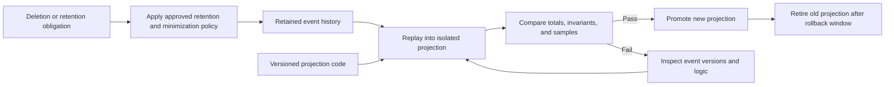

# Event Sourcing

Part: [20 — Architecture Patterns](PART_OVERVIEW.md)

Event sourcing stores accepted domain changes as an append-only history from which current state and derived views can be reconstructed. It is useful when auditability, temporal reconstruction, or multiple evolving projections justify the operational and data-lifecycle cost. Part 07 CH15 owns detailed event-store mechanics; Part 06 owns storage-engine behavior. This chapter focuses on the architecture choice and consequences.

## Decide Whether History Is a Requirement

Use event sourcing when the sequence of accepted changes has durable business meaning: financial ledgers, entitlement history, or regulated case progression. It is not simply a way to replace database updates with event records. If consumers only need current state and no replay or audit need exists, ordinary state storage is often simpler.

The decision is often selective. A system can event-source its ledger or case aggregate while storing catalogs and preferences as current state. Avoid extending the pattern to every entity for architectural uniformity.

## Relate Commands, Events, and State

An aggregate receives a command, validates domain invariants, and emits accepted events. Current state is derived from the event sequence. Events are immutable records of facts. Part 07 CH15 explains event-store append, concurrency, replay, and event evolution mechanics; here the key architectural consequence is that event identity and meaning become long-lived contracts.

Keep the event vocabulary aligned with business facts. An event such as `PaymentAuthorized` should not be renamed casually if historical records and consumers depend on it. Commands can be rejected; committed events are part of the durable history and require a correction strategy rather than in-place editing.

## Reconstruct State and Use Snapshots Carefully

Replay applies events in order to reconstruct aggregate state. Long histories increase load time, so snapshots can store derived state at a known version and replay only the tail. A snapshot is disposable acceleration data, not a new source of truth; verify that it corresponds to the event version and can be regenerated.

Snapshot frequency trades load time against storage and build cost. Test full replay and snapshot recovery. Do not use snapshots to conceal an event history that has become too large or whose schema cannot be interpreted; those are lifecycle issues requiring explicit remediation.

## Evolve Event Schemas and Projections

Events can outlive the code that wrote them. Schema evolution may use additive fields, versioned event types, or upcasting old records into the current model during replay. Each approach affects read paths, storage, and audit fidelity. Preserve original facts and record any transformation so derived state can be explained.

Projections are derived views for queries and integrations. They can be rebuilt or evolved independently, but consumers depend on their semantics and freshness. Design projection ownership, update lag, failure handling, and rebuild capacity. Part 07 owns the projection mechanics; Part 19 covers cross-engine performance considerations.

## Plan Rebuild, Retention, and Privacy

Event histories can grow indefinitely unless retention, archival, and legal requirements are explicit. Rebuilds consume compute and may affect production if they compete for storage or replay capacity. PII (Personally Identifiable Information) in immutable events creates deletion and correction challenges; avoid placing unnecessary sensitive data in events, and plan indirection, redaction, cryptographic erasure, or legally approved retention strategies before adoption.

Event sourcing does not make deletion impossible, but immutable history changes the design. Separate identity or sensitive payload from durable facts where possible, maintain a traceable data inventory, and engage privacy/legal owners before the event contract is committed.

## Worked Case: Financial Ledger

A financial ledger must explain how an account balance changed over time and support reconciliation. The team event-sources ledger postings, while storing customer preferences as ordinary current state. Each posting is immutable, attributed, and linked to a business reference. Balance projections support account queries and can be rebuilt from the ledger.

The architecture review tests replay against known ledger totals, snapshot recovery, projection lag, and schema evolution. Sensitive identity fields are held in a governed profile store; ledger events retain only the identifiers and facts required for accounting and audit. Corrections use compensating postings rather than editing history. The team budgets rebuild capacity and defines a projection owner and reconciliation alerts.

## Review Questions

1. Which business requirement justifies retaining every accepted state change?
2. Which aggregates should remain ordinary state rather than event-sourced?
3. What role does a snapshot play, and how is it verified?
4. How do consumers handle historical event versions and projection rebuilds?
5. How do retention and deletion obligations affect event design?

Event sourcing is an architectural commitment to history, not a default persistence style. Adopt it selectively when replay or audit value exceeds schema, storage, projection, privacy, and operational costs, and make derived views rebuildable and accountable.
