# Event Sourcing

Part: [20 — Architecture Patterns](PART_OVERVIEW.md) · Status: Revised (in-depth rewrite)

## 1. Introduction

Most systems store the current state of each business object and overwrite it when something changes. An order row holds its latest status, and the previous statuses are gone unless someone adds an audit table. Event sourcing reverses that choice. The system stores every accepted change as an immutable event, in order, and treats that history as the source of truth. The current state of an object is not stored as the primary record. It is computed by applying the object's events from the beginning.

The pattern earns its place when the history itself has business value: a ledger that must explain every balance, a case file whose progression is regulated, an entitlement whose past values must be reproducible. It also adds permanent obligations. Events become long-lived contracts, history grows without bound, derived views lag behind writes, and personal data inside immutable records needs a deliberate plan. A team that adopts the pattern for fashion, or for every entity in the system, pays these costs without receiving the benefit.

After this first part of the chapter you should be able to:

1. Explain current state as a fold (a left-to-right reduction) over an append-only event log, and write the rebuild function.
2. Decide whether an aggregate needs event sourcing, an audit log beside current state, or ordinary state storage.
3. Design an event store table and the append operation, including the expected-version check.
4. Estimate the conflict rate of optimistic concurrency from write rates, and decide when an aggregate is too contended.
5. Name and size events, and recognise events that are merely database updates in disguise.
6. Evolve stored events with versioning and upcasting without rewriting history.
7. Compute the replay cost of an aggregate and choose a snapshot interval.
8. Design projections, rebuild them, and answer temporal and audit questions.
9. Describe the costs honestly, including eventual consistency, storage growth, migration difficulty, and personal-data erasure at the mechanism level.

The boundaries with neighbouring material are deliberate:

- Command Query Responsibility Segregation (CQRS) owns the separation of read and write models. See [CQRS](CH09_CQRS.md). Event sourcing is often paired with it because projections are natural read models, but neither pattern requires the other.
- Event-driven architecture owns event delivery to other services, brokers, and the transactional outbox. See [Event-Driven Architecture](CH07_Event_Driven_Architecture.md). This chapter covers the events inside one service's store and recaps delivery only where it affects the design.
- The saga pattern owns coordination of multi-service business transactions. See [Saga Pattern](CH10_Saga_Pattern.md).
- Part 06 owns database storage mechanics such as indexes, transactions, and replication. See [Transactions](../06_Databases_and_Storage/CH08_Transactions.md) and [Indexes](../06_Databases_and_Storage/CH03_Indexes.md). The system-design view of event stores is in [Event Sourcing (Part 07)](../07_System_Design_and_Distributed_Systems/CH15_Event_Sourcing.md).
- Privacy and security consequences belong to Part 15 and Part 17. See [Secrets Management](../15_Security/CH09_Secrets_Management.md) for key handling and [AI Safety, Security, Privacy, and Governance Architecture](../17_AI_Architecture/CH12_AI_Safety_Security_Privacy_and_Governance_Architecture.md) for governance. This chapter states the design consequence and recaps the mechanism.

All numbers in this chapter are illustrative. They show how to reason, and they are not measurements of any real system. Code uses Java 21 with Spring Boot, Python 3, and standard Structured Query Language (SQL).

## 2. Forces and the Decision to Event-Source

A pattern is justified by forces that are present in the context, so this section lists them before any mechanism is taught.

Forces that favour event sourcing:

- **The sequence of changes has business meaning.** A balance of 120 is less informative than "opened with 100, deposited 50, withdrew 30". Regulated or disputed domains (financial postings, claims, entitlements) need to explain how a state came to be.
- **Temporal questions are asked.** Questions such as "what did we believe the balance was at 14:00 yesterday?" or "which rule version applied when this was approved?" need history, and an overwritten row cannot answer them.
- **Several views of the same facts are needed, and they change over time.** Each new report or search index can be built by replaying history, instead of being reconstructed from a current-state table that has already lost information.
- **Writes are naturally small facts.** Domains where the unit of change is a business fact ("shipment dispatched") fit an append-only log well.
- **Audit evidence must be tamper-evident by design.** Because the store only appends, the audit trail is the data, and cannot drift from it.

Forces that argue against it:

- **Nobody needs the history.** If consumers need only current state and no replay or audit exists, ordinary storage is simpler and cheaper.
- **The team cannot operate the consequences.** Event schemas, replay capacity, projection lag, and erasure obligations are recurring work.
- **The domain is mostly create, read, update, and delete (CRUD).** A catalogue of preferences gains little from a log of "preference changed".
- **Aggregates are heavily contended.** A single hot object written by many actors conflicts under optimistic concurrency (see the concurrency section).
- **Strong read-after-write consistency is required everywhere.** Projections are derived and lag the log.

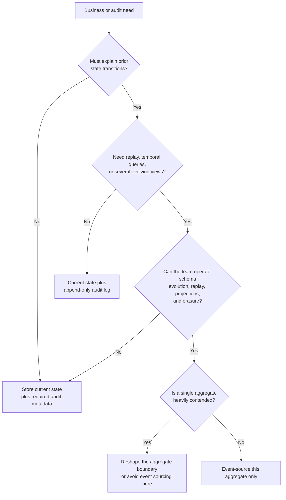

The diagram shows that event sourcing is the last answer in a sequence of questions. An audit log beside current state satisfies many "we must keep history" requirements at lower cost, because the current state remains the source of truth and no replay is needed. The distinction matters: with an audit log, state and log can disagree if a bug updates one and not the other. With event sourcing, the log is the state, so they cannot disagree, but every reader of state now depends on replay logic.

The decision is selective by aggregate, not by system. A system can event-source its ledger postings and its case files while storing the product catalogue and user preferences as ordinary rows. Applying the pattern uniformly for architectural neatness multiplies the cost without multiplying the benefit.

## 3. The Foundational Model: State as a Fold over an Append-Only Log

Three definitions carry the whole pattern.

- A **command** is a request to do something, such as "withdraw 30". It can be rejected.
- An **event** is a record that something happened, such as `FundsWithdrawn`. It is named in the past tense, is immutable, and is never deleted by normal operation. A committed event is a fact, even if it later turns out to be a mistake. The correction is a new event.
- A **stream** is the ordered sequence of events for one aggregate (one consistency boundary, defined in the next section). Each event has a version, its position in the stream, starting at 1.

Current state is a function of the stream. Writing the function as a fold makes the idea exact: given an initial state $s_0$ and a transition function $f$ that applies one event to a state,

$$s_n = f(\ldots f(f(s_0, e_1), e_2) \ldots, e_n)$$

The function $f$ must be deterministic and free of side effects. It does not validate, call other systems, read the clock, or generate identifiers. All of that happens when the command is decided, and the results are recorded inside the event. If `f` consulted the clock, replaying last year's events would produce a different state from the one the system had last year.

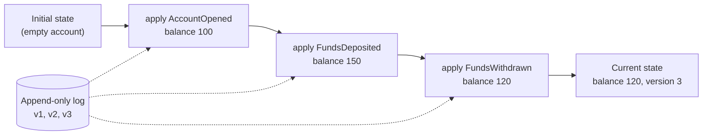

The diagram shows that state is derived and the log is primary. The consequence is that any bug in `f` is a bug in every historical reading, and fixing it changes what old streams compute. That is a feature when the old reading was wrong and a hazard when other systems have acted on it. It is the reason `f` is covered by replay tests against known histories.

The rebuild function is short. This version works over a Python event list and keeps command decisions separate from state transition:

```python
from dataclasses import dataclass, replace
from functools import reduce

@dataclass(frozen=True)
class Account:
    balance: int = 0      # minor currency units
    version: int = 0

def apply(state: Account, event: dict) -> Account:
    kind = event["type"]
    if kind == "AccountOpened":
        return replace(state, balance=event["initial_balance"], version=event["version"])
    if kind == "FundsDeposited":
        return replace(state, balance=state.balance + event["amount"], version=event["version"])
    if kind == "FundsWithdrawn":
        return replace(state, balance=state.balance - event["amount"], version=event["version"])
    raise ValueError(f"unknown event type {kind}")

def rebuild(events: list[dict]) -> Account:
    return reduce(apply, events, Account())
```

Two properties of this function matter in practice. It rejects unknown event types loudly, because silently skipping an event would produce a wrong balance with no error. And it never checks business rules such as "no overdraft", because an event already committed has passed those rules at the time. Rule checks live in the command side, shown in the next section. A complete runnable aggregate with an in-memory store is in [01_event_sourced_aggregate.py](../code/python/event-sourcing-chapter/01_event_sourced_aggregate.py).

### 3.1 What the model gives and takes

The model gives a complete history, deterministic reconstruction, and the ability to derive new views later. It takes away the simple read: there is no row to select. Every read of current state is either a replay, a snapshot plus replay, or a read from a projection. The rest of the chapter is largely about making those three reads fast, correct, and maintainable.

## 4. Aggregates and the Event Store

### 4.1 The aggregate as consistency boundary

An **aggregate**, in the domain-driven design sense, is a cluster of objects that is changed as one unit and enforces its invariants (rules that must always hold) inside that unit. In an event-sourced system the aggregate has a stream, and the stream is the unit of atomic append and of concurrency control. The event store can guarantee that appends to one stream are ordered and atomic. It does not promise anything across streams, so an invariant that spans two streams cannot be enforced by one append. That is the job of a process manager or [Saga Pattern](CH10_Saga_Pattern.md).

The practical rule is that an aggregate should be the smallest set of facts that must be consistent together. "Account balance must not go below zero" lives in one `Account` stream. "Total exposure across all accounts of a customer must stay under a limit" spans streams and needs a different mechanism.

### 4.2 From command to events

A command handler follows a fixed sequence: load, decide, append.

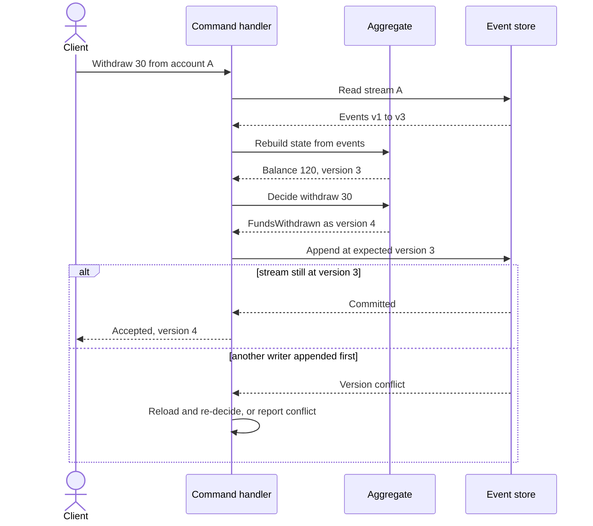

The diagram shows where each responsibility sits. The aggregate decides, using only the rebuilt state and the command. The store enforces order. The handler owns the retry policy. Note that the decision is made on a read that can be stale by the time of the append, which is why the append carries the expected version. The next section works through what happens when it fails.

The decision step returns events and does not write them. This keeps domain code testable with no database: given a history and a command, assert the resulting events. A common test style is given-when-then, where the given part is a list of past events.

### 4.3 The event store table

An event store needs very little: ordered, atomic, durable append per stream, read by stream, and some way to read all events in a global order for projections. A relational table is enough to start with, and Part 06 covers how the engine behind it behaves.

```sql
CREATE TABLE event_store (
    aggregate_id   UUID         NOT NULL,
    version        BIGINT       NOT NULL,
    event_type     TEXT         NOT NULL,
    schema_version INT          NOT NULL,
    payload        JSONB        NOT NULL,
    metadata       JSONB        NOT NULL,   -- causation id, correlation id, actor
    occurred_at    TIMESTAMPTZ  NOT NULL,
    global_seq     BIGINT GENERATED ALWAYS AS IDENTITY,
    PRIMARY KEY (aggregate_id, version)
);

CREATE INDEX event_store_global_seq ON event_store (global_seq);
```

The composite primary key `(aggregate_id, version)` is the concurrency control. Two writers that both try to insert version 4 for the same aggregate cannot both succeed, because the second insert violates the key. No explicit lock is needed. Several things are worth noting.

- `schema_version` is stored with each event so readers know which shape they are reading. The evolution section returns to it.
- `metadata` carries who and why: the actor, a correlation identifier for the request, and a causation identifier for the event or command that led to this one. These make audit queries possible.
- `global_seq` gives projections a single scan order. Sequence values can become visible out of commit order, because a transaction with a lower number may commit after one with a higher number. A projector that checkpoints on the highest number it has seen can skip an event that commits late. Designs handle this with a visibility delay, a gap check, or a store that provides a reliable global position. The detail depends on the database, so verify the behaviour of the engine you choose.
- No update or delete statement should ever be issued against this table by application code. Enforce that with database permissions, so only the insert privilege is granted to the application role.

### 4.4 Append in Spring Boot

The append method in Java 21 with Spring Boot's `JdbcTemplate` shows the whole concurrency mechanism in a few lines:

```java
public sealed interface AccountEvent permits AccountOpened, FundsDeposited, FundsWithdrawn {
    long version();
}
public record AccountOpened(long version, long initialBalance) implements AccountEvent {}
public record FundsDeposited(long version, long amount) implements AccountEvent {}
public record FundsWithdrawn(long version, long amount) implements AccountEvent {}

@Repository
public class JdbcEventStore {
    private final JdbcTemplate jdbc;
    private final EventSerializer serializer;

    public JdbcEventStore(JdbcTemplate jdbc, EventSerializer serializer) {
        this.jdbc = jdbc;
        this.serializer = serializer;
    }

    @Transactional
    public void append(UUID aggregateId, long expectedVersion, List<AccountEvent> events) {
        long next = expectedVersion;
        try {
            for (AccountEvent e : events) {
                next++;
                jdbc.update("""
                    INSERT INTO event_store
                      (aggregate_id, version, event_type, schema_version, payload, metadata, occurred_at)
                    VALUES (?, ?, ?, ?, ?::jsonb, ?::jsonb, now())
                    """, aggregateId, next, serializer.typeName(e),
                         serializer.schemaVersion(e), serializer.toJson(e), "{}");
            }
        } catch (DuplicateKeyException ex) {
            throw new ConcurrencyConflictException(aggregateId, expectedVersion, ex);
        }
    }

    public static long apply(long balance, AccountEvent e) {
        return switch (e) {
            case AccountOpened o   -> o.initialBalance();
            case FundsDeposited d  -> balance + d.amount();
            case FundsWithdrawn w  -> balance - w.amount();
        };
    }
}
```

The `sealed` interface makes the `switch` exhaustive, so adding an event type without handling it in `apply` fails at compile time. This is the Java counterpart of the Python function that rejects unknown types. A transaction around the loop makes a multi-event append atomic: either every event of the command is stored, or none is.

Dedicated event store products exist, and the choice between them and a relational table is a storage question owned by Part 06 and [Event Sourcing (Part 07)](../07_System_Design_and_Distributed_Systems/CH15_Event_Sourcing.md). The semantics above (ordered per-stream append with an expected version) are what any store must provide.

## 5. Optimistic Concurrency and Contention

### 5.1 Why optimistic

Pessimistic locking would hold a lock on the stream from load to append. That blocks other writers for the whole decision and forces the store to offer locks. Optimistic concurrency assumes conflicts are rare, lets writers proceed in parallel, and detects the rare collision at append time through the expected version. The cost of a conflict is a wasted decision and a retry. The benefit is that no lock is held across the load, decide, and append steps.

When a conflict is raised, the handler has two choices.

1. **Reload and re-decide.** Read the events that arrived, rebuild state, and run the command again. This is correct when the command is still meaningful on the new state. "Withdraw 30" may now be rejected for insufficient funds, and that is the right answer.
2. **Report the conflict.** Return the conflict to the caller when the user's intent depended on the stale view, for example an edit made against a version of a document the user was shown.

A third choice, blind retry of the same events at the new version, is wrong. The events were decided against old state, so they may now violate an invariant.

### 5.2 Worked contention arithmetic

Suppose commands arrive at one aggregate as a Poisson process (random, independent arrivals) at rate $\lambda$ per second. Each command has a window $w$ between its read and its append, covering the load, the decision, and the append round trip. The command conflicts if at least one other command appends during that window. The probability that at least one arrival occurs in the window is

$$p = 1 - e^{-\lambda w}$$

Take $w = 20$ ms $= 0.02$ s (illustrative).

| Writes per second to this aggregate | $\lambda w$ | Conflict probability $p$ | Expected attempts $1/(1-p)$ |
| --- | --- | --- | --- |
| 1 | 0.02 | $1 - e^{-0.02} \approx 0.020$ (2.0%) | about 1.02 |
| 10 | 0.20 | $1 - e^{-0.20} \approx 0.181$ (18.1%) | about 1.22 |
| 50 | 1.00 | $1 - e^{-1.0} \approx 0.632$ (63.2%) | about 2.72 |

The expected attempts are $1/(1-p) = e^{\lambda w}$, and at $\lambda w = 1$ that is $e \approx 2.72$. This is an approximation. It treats retries as if they were independent of the arrival process, and in a real system retries add load and raise conflicts further, so the figures understate the problem at the high end.

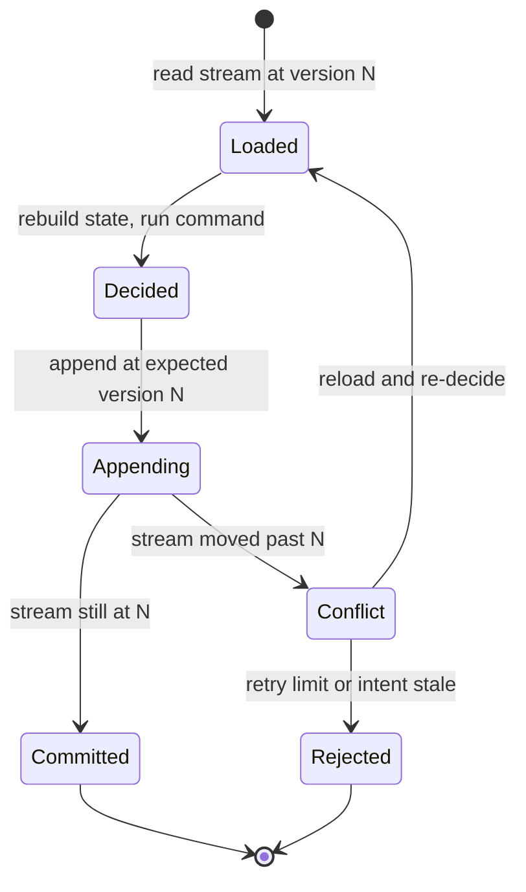

The diagram shows that a conflict is a normal state transition with two exits. The retry limit is part of the design. Without it, a hot aggregate under load can spend most of its capacity on repeated attempts.

### 5.3 What to do about a hot aggregate

The numbers show why a few writes per second to one stream is comfortable and fifty is not. When an aggregate is too contended, the options are ordered by how much they change the design.

- **Shorten the window.** Keep the decision free of remote calls. Every remote call inside the window multiplies $w$ and the conflict rate.
- **Serialise at the entry.** Route all commands for one aggregate to one worker, for example by partitioning a queue on the aggregate identifier. Conflicts then arise only from other routes. Part 07 owns partitioning mechanics.
- **Split the aggregate.** A "warehouse inventory" stream that every order touches can be split into one stream per stock-keeping unit and location. The invariant then has to be enforceable at that smaller granularity.
- **Change the invariant.** If "never oversell" can be relaxed to "oversell rarely and compensate", the decision no longer needs the whole state, and writes can be commutative facts.
- **Stop event-sourcing this aggregate.** A counter with ten thousand increments per second is better as a different kind of record.

An aggregate that needs to be this contended is often a sign of a boundary drawn around data rather than around an invariant, which the anti-patterns discussion in the next section returns to.

## 6. Event Design: Naming, Granularity, and Content

An event is a contract that outlives the code that wrote it. Design it as carefully as a public interface, because stored events are read for as long as the stream exists, and by code that has not been written yet.

### 6.1 Naming

Name events for what happened in the language of the business, in the past tense, at the level a domain expert would use.

| Weak name | Why it fails | Better name |
| --- | --- | --- |
| `OrderUpdated` | Says nothing about what changed or why | `OrderShippingAddressChanged`, `OrderCancelled` |
| `AccountRowSaved` | Describes storage, not the domain | `FundsDeposited` |
| `StatusChanged` | Forces every reader to inspect fields to know the meaning | `ClaimApproved`, `ClaimRejected` |
| `CreateInvoice` | A command, not a fact | `InvoiceIssued` |

A useful test is whether the name would make sense on a whiteboard in front of the people who run the process. Once published, treat a rename as a schema change, because stored records and consumers depend on the type name.

### 6.2 Granularity

An event should capture one business fact, together with the information needed to apply it without consulting anything else. Two failure directions exist.

- **Too coarse.** `OrderChanged` with a full copy of the new order is a state snapshot labelled as an event. Readers cannot tell what changed without diffing, and intent is lost. Because the event carries all fields, every future field addition touches every producer.
- **Too fine.** Emitting one event per field assignment (`NameSet`, `StreetSet`, `CitySet`) separates facts that belong together and lets a reader see an impossible intermediate state, such as a new street with the old city.

A command that changes several things that always change together should emit one event. A command with several independent outcomes should emit several, appended atomically in one transaction. When intent differs, use different events even if the fields overlap: `ShippingAddressCorrected` (fixing a typing error) and `CustomerRelocated` (a real move) may carry the same fields and still drive different downstream behaviour.

### 6.3 Content and metadata

Place in the payload the facts the decision produced, including values computed at decision time: the price applied, the exchange rate used, the rule version that fired. Recording these makes replay independent of the world as it was when the event was written. Without them, replaying a past event would recompute a value with today's rate and produce a different history.

Place in the metadata the information that explains the event: the actor, a correlation identifier for the originating request, a causation identifier pointing at the command or event that triggered it, and the time. Keep sensitive personal data out of the payload when an identifier will do, for reasons covered in the personal-data section.

### 6.4 Anti-patterns in event design

1. **Events as CRUD records.** `CustomerCreated`, `CustomerUpdated`, `CustomerDeleted`, each with full row contents. The log then contains the same information as an audit table, without the business meaning that justified the pattern. The consequence is that every projection must diff consecutive events to infer intent, and the cost of event sourcing has been paid without receiving its benefit.
2. **Giant aggregates.** One stream for a whole customer, tenant, or "order book" that grows with every action of every actor. Streams become long, replays slow, and concurrent writers conflict constantly, as the arithmetic of the previous section showed. The remedy is to draw the boundary around one invariant.
3. **Unversioned events.** No `schema_version` and no policy for change. The first field rename then breaks replay of every older stream, which is discovered in production when the oldest stream is loaded.
4. **Commands stored as events.** Recording a request before it was accepted turns the log into a queue of intentions. Rejected commands are not facts and should not appear in the aggregate's history.
5. **Events that depend on external state to be interpreted.** An event carrying only a product identifier, whose meaning requires reading a catalogue that has since changed, cannot be replayed faithfully.
6. **Leaking the internal model.** Publishing the aggregate's internal events to every other service couples them to internal structure. Translating to a separate, stable integration event is the job of the delivery design in [Event-Driven Architecture](CH07_Event_Driven_Architecture.md).

## 7. Snapshots and Replay Cost

### 7.1 The replay-cost problem

Replay cost grows linearly with stream length. Loading an aggregate with $n$ events costs roughly $n \times c$, where $c$ is the time to fetch, deserialise, and apply one event. Many aggregates stay short and never need help: an order with a dozen events replays in well under a millisecond at the figures below. Long-lived aggregates such as an account with years of activity are where cost accumulates.

Worked example (illustrative). Assume $c = 20\ \mu s$ per event, including fetch, deserialisation, and apply.

- Aggregate with 5,000 events: $5{,}000 \times 20\ \mu s = 100$ ms per command, before any business logic.
- At 10 commands per second on that aggregate, replay alone consumes $10 \times 100\ \text{ms} = 1.0$ second of work per second. The aggregate cannot keep up on one worker.

### 7.2 Snapshot plus tail

A **snapshot** is a stored copy of an aggregate's derived state at a known version. Loading then reads the latest snapshot and replays only the events after it (the tail).

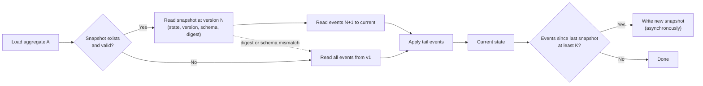

The diagram shows that a snapshot is an optimisation with a fallback. A missing or invalid snapshot never blocks a read, because full replay is always available. The snapshot carries the schema version of the state shape it holds, because a code change to the aggregate class can make an old snapshot unreadable. A mismatch means discard and replay, which is why the event log, not the snapshot, is the source of truth.

### 7.3 Choosing the interval

Take a snapshot every $K$ events. The tail after a snapshot is between 0 and $K$ events, so on average $K/2$.

Using the 5,000-event aggregate and $c = 20\ \mu s$ (illustrative), with snapshot load assumed to cost 1 ms:

| Interval $K$ | Average tail | Average load time | Worst-case load time | Snapshots over 5,000 events |
| --- | --- | --- | --- | --- |
| None | 5,000 (full) | 100 ms | 100 ms | 0 |
| 1,000 | 500 | 1 + 10 = 11 ms | 1 + 20 = 21 ms | 5 |
| 500 | 250 | 1 + 5 = 6 ms | 1 + 10 = 11 ms | 10 |
| 100 | 50 | 1 + 1 = 2 ms | 1 + 2 = 3 ms | 50 |

Storage cost of snapshots, if each is 4 KB and only the latest is kept: for 2,000,000 aggregates that is $2{,}000{,}000 \times 4\ \text{KB} = 8{,}000{,}000\ \text{KB} \approx 8$ GB. If every snapshot is retained, multiply by the number taken per aggregate. Retaining only the latest is usually enough because older ones can be regenerated.

The trade-off is write work against read latency. A smaller $K$ writes snapshots more often (more storage writes and a compute cost to serialise state) and shortens loads. For most aggregates a modest $K$ based on measured load time is enough. A target such as "load under 10 ms at the 99th percentile" turns the choice into arithmetic: pick the largest $K$ whose worst-case load meets the target.

### 7.4 Operating snapshots

- **Write them off the command path.** A background task or a post-commit hook writes the snapshot, so command latency does not include serialisation.
- **Verify before trust.** Store the version, a state schema version, and a digest of the serialised state. Check them on load, and fall back to replay on mismatch.
- **Test both paths.** A property test that rebuilds from snapshot plus tail and from full replay, and compares results, catches a snapshot that diverged from `apply`.
- **Do not hide a lifecycle problem.** If an aggregate needs a snapshot every 100 events, ask whether the stream is a giant aggregate.

A runnable illustration is in [02_snapshotting.py](../code/python/event-sourcing-chapter/02_snapshotting.py). It models a warehouse-bin inventory counter in an in-memory store, takes a snapshot of counts and version after every configurable number of events, loads by snapshot plus tail, and asserts that the result equals a full replay. For clarity it takes the snapshot synchronously inside `append`, and its snapshot carries no schema version or digest, so the off-path writing and verification described above are left for you to add.

## 8. Schema Evolution and Upcasting of Stored Events

### 8.1 Why events cannot simply be migrated

In a current-state database a schema change is a migration that rewrites rows. In an event store the old events are facts and the history is the audit record. Rewriting them in place destroys the evidence that justified the pattern, and on a large store it is a long, risky operation. The aim is therefore to keep old events as they were written, and teach readers how to understand them.

Changes fall into three classes:

1. **Additive and compatible.** A new optional field. Old events lack it, and readers apply a default. This is the cheapest change and should be preferred.
2. **Reshaping.** A field is renamed, split, merged, or changes meaning (for example, a single `amount` becomes `amount` plus `currency`). Old and new shapes differ, and readers need a transformation.
3. **Semantic.** The meaning of the event changes while the shape does not, such as a different tax rule. No mechanical transformation exists, and the right answer is usually a new event type.

### 8.2 Strategies

| Strategy | How it works | Strength | Cost |
| --- | --- | --- | --- |
| Tolerant reader | Readers ignore unknown fields and default missing ones | No code between store and reader for additive changes | Limited to additive changes |
| Weak schema with explicit versions | Each event stores `schema_version`, and readers branch on it | Simple, explicit | Branching spreads through the code if not contained |
| Upcasting | A chain of small functions transforms version $n$ into $n+1$ at read time, before the aggregate sees it | Aggregate code handles only the latest shape | Chain grows with every version, and upcasters need tests |
| New event type | Stop writing the old type, start writing a new one, keep reading both | Honest for semantic change | Both types stay in the system |
| Copy-and-transform migration | Write a new store with converted events, then switch | Clean store afterwards | Rewrites history, needs an audit argument, high effort |

Upcasting is the usual default for reshaping changes. It keeps the stored bytes untouched, localises version knowledge in one place, and makes each step small enough to test with sample events from each version.

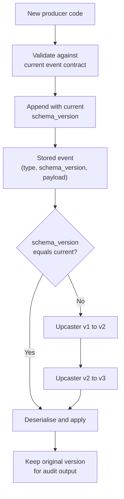

The diagram shows two things. On the read side, each older event passes through a chain of single-step transformations until it reaches the current shape, so the aggregate knows only one shape. On the write side, producers always write the newest version, so the amount of old data stops growing. The implication for operations is that the upcaster chain is permanent as long as old events exist, and it needs a test that feeds a stored sample of every historical version through the chain.

### 8.3 An upcaster example

Suppose version 1 of `FundsDeposited` held only `amount`, and version 2 adds `currency`. All older events were made in a single currency, known from the account.

```python
def upcast_funds_deposited_v1_to_v2(payload: dict, default_currency: str) -> dict:
    # Fact from history: v1 events carried no currency, the account had one.
    return {**payload, "currency": default_currency}

UPCASTERS = {("FundsDeposited", 1): upcast_funds_deposited_v1_to_v2}

def read_event(raw: dict, current_versions: dict, default_currency: str) -> dict:
    event_type, version, payload = raw["type"], raw["schema_version"], raw["payload"]
    while version < current_versions[event_type]:
        payload = UPCASTERS[(event_type, version)](payload, default_currency)
        version += 1
    return {"type": event_type, "payload": payload, "original_version": raw["schema_version"]}
```

The default currency comes from outside the event, which is a choice to record: it is an assumption about history, and it is valid only because every account had one currency. Where such an assumption cannot be justified, the upcaster should not invent data, and the field should be modelled as unknown. A fuller runnable chain over several versions is in [03_event_upcasting.py](../code/python/event-sourcing-chapter/03_event_upcasting.py).

### 8.4 Rules that keep evolution safe

- **Never change the meaning of a stored version.** A new meaning is a new version or a new type.
- **Version from the first event.** Retrofitting `schema_version` later means guessing which shape each old event has.
- **Make upcasters pure.** They should not read other streams or the clock. Anything needing external lookup belongs in a one-time migration with an explicit audit note.
- **Keep the original version in audit output.** Reports about history should show what was recorded and note any transformation, so a reader can distinguish recorded fact from interpretation.
- **Retire a version only by migration.** If an old shape is to be removed from the code, first convert and re-store the affected streams under a documented procedure, and see the migration discussion in the costs section.

## 9. Projections and Rebuilds

### 9.1 What a projection is

A **projection** is a read model built by folding events into a shape suited to a query: an account balance table, a search index, a monthly statement, a fraud feature set. The idea is the same fold as aggregate rebuild, applied across many streams and kept up to date as new events arrive. Reading a projection avoids replay entirely, which is why queries over many aggregates ("all accounts with a negative balance") are answered from projections and not from the event store.

Projections are where event sourcing and [CQRS](CH09_CQRS.md) meet, and CQRS owns the full treatment of separating read and write models. The recap is this: a projection is one way to build a read model, and CQRS can exist without event sourcing by deriving read models from state changes in another way. Event sourcing adds that any new read model can be built from history, and so can an old one. How events reach a projector across services, including the transactional outbox, belongs to [Event-Driven Architecture](CH07_Event_Driven_Architecture.md). Inside one service the projector can read the store by `global_seq` and keep its own checkpoint.

A projector must be **idempotent**, meaning applying the same event twice has the same effect as applying it once, because delivery and restarts produce duplicates. The usual technique is to store the last applied position with the projected data in one transaction, so a crash cannot leave data updated and the checkpoint behind.

```sql
-- Projector step, one transaction: update the view and advance the checkpoint together.
UPDATE account_balance
   SET balance = balance + :amount, last_global_seq = :seq
 WHERE account_id = :account AND last_global_seq < :seq;

UPDATE projector_checkpoint SET position = :seq WHERE name = 'account_balance';
```

### 9.2 Rebuilding a projection

Rebuilds are the pattern's characteristic operation. They are used when projection logic is fixed, when a new view is added, or when a projection is lost.

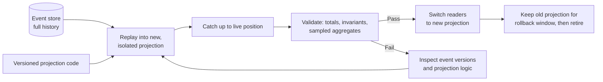

The diagram shows a blue-green style rebuild. The new projection is built beside the old one, validated while readers still use the old one, and swapped only after checks pass. Rebuilding in place is faster to write and riskier, because readers see partial data during the rebuild and the old view is gone if the new logic is wrong.

Worked example of rebuild time (illustrative). Assume 50 events per second on average, each event 400 bytes.

- Events per day: $50 \times 86{,}400 = 4{,}320{,}000$.
- Events per year: $4{,}320{,}000 \times 365 = 1{,}576{,}800{,}000$, about 1.58 billion.
- Raw event data per year: $4{,}320{,}000 \times 400\ \text{bytes} \times 365 \approx 631$ GB.
- A single projector that applies $20{,}000$ events per second needs $1{,}576{,}800{,}000 / 20{,}000 = 78{,}840$ seconds, about 21.9 hours.
- Partitioned by aggregate identifier over 8 parallel projectors: $78{,}840 / 8 = 9{,}855$ seconds, about 2.7 hours, if the store and the target keep up and the work splits evenly.

The consequence is that rebuild time is a capacity planning figure that grows with history. A rebuild that took minutes in the first month takes hours after two years. Plan for it: parallelise by aggregate, rate-limit replay so production reads are not starved, and consider periodic projection snapshots for views that must rebuild quickly.

### 9.3 Projection ownership and failure handling

Each projection needs an owner, a freshness objective, and a policy for poison events (events the projector cannot process). Skipping silently produces wrong views, and halting blocks all later events. Common handling is to stop that projection, alert, park the event for inspection, and continue others. Because projections can always be rebuilt, the cost of a projection bug is bounded by the rebuild time plus the period readers saw wrong data.

## 10. Temporal Queries and Audit Benefits

### 10.1 Time-travel reads

Because every change is stored with its order and time, the state at any earlier point is the fold of events up to that point. "What was the balance of account A at version 57?" is a replay that stops at 57. "What was it at 14:00 yesterday?" is a replay of events with `occurred_at` up to that time.

```sql
SELECT version, event_type, schema_version, payload
  FROM event_store
 WHERE aggregate_id = :id
   AND occurred_at <= :as_of
 ORDER BY version;
```

The results are fed through the same upcasting and `apply` code used in production. That is an advantage over a reconstruction script written for the occasion, because there is one definition of state and the answer shows what the system itself would have computed.

Two kinds of time need distinguishing, and conflating them is a common error.

- **Event time** (when the business fact occurred) and **recording time** (when the system stored it) differ when events are entered late or imported. Store both when the difference matters, and state which one a query uses.
- **Reading history with today's logic** and **reading it with the logic of the day** give different answers. The first is what replay does by default. The second needs the rule version recorded in the event, which is one reason to record decision-time values in the payload.

### 10.2 Audit and investigation

The same properties support audit.

- **Explanation.** Each state is traceable to the events that produced it, with actor and correlation metadata.
- **Corrections without erasure.** A wrong deposit is corrected by an event such as `DepositReversed`, so the original mistake and its fix both remain visible. This is how ledgers have worked in accounting practice for a long time.
- **Reproduction of incidents.** A defect report can be reproduced by replaying the stream of the affected aggregate into a test.
- **Retroactive analysis.** A new fraud rule can be run over history to find past matches, without a data backfill project.

The audit value rests on the store's integrity. An append-only table that an administrator can update undermines it. Enforce append-only through permissions, and for strong evidence consider hash-chaining events or exporting periodic digests to a separate store. These are design options with their own cost, not defaults.

An event log is not automatically a complete audit trail. Reads, failed commands, and administrative changes outside the aggregate do not appear in it. If auditors need those, they require a separate record.

## 11. The Costs: Consistency, Storage, and Migration

### 11.1 Eventual consistency between write and read

A command is acknowledged when its events are committed. A projection updates later. In between, a query against the projection returns the old view.

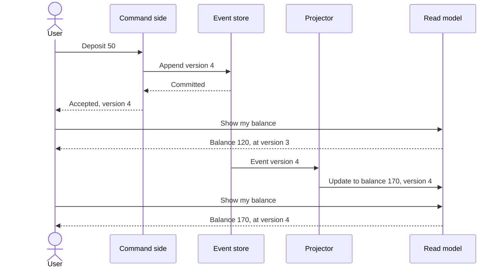

The diagram shows the window in which the user sees a result that contradicts the success just reported. The window is the projection lag. Illustratively, with a typical lag of 200 ms and writes followed by a read within 1 s, a visible fraction of reads in that period are stale, and the effect is noticeable when users reload immediately after acting.

Mitigations, from cheapest to most costly:

- **Return the new version and state** in the command response, so the interface can show the result without querying.
- **Read your own writes.** Pass the returned version with the next query, and make the read model wait briefly until it has reached that version, or fall back to replaying the aggregate.
- **Query the aggregate directly** for the small set of screens that need strong consistency, using snapshot plus tail.
- **State the freshness expectation** in the service level objective for each projection, so product owners know what to expect.

Do not use read-model data to enforce invariants in the command side. A decision based on a stale projection can accept a command the current stream would reject. Decisions use the aggregate's own stream.

### 11.2 Storage growth

History only grows. Using the earlier illustrative figure of about 631 GB of raw events per year at 50 events per second, and assuming indexes and metadata add 50 percent (an assumption to measure, not a constant), the footprint is about $631 \times 1.5 \approx 947$ GB per year. Five years of constant rate is about 4.7 TB before replication. Costs come from storage, backup, restore time, and the replay time that scales with it.

Practical responses:

- **Partition or archive by age.** Closed aggregates can have their streams moved to cheaper storage, with a documented path to read them again. Part 06 owns the storage mechanics.
- **Snapshots do not reduce history.** They reduce replay, not storage.
- **Archive with care for open streams.** Cutting the head off a live stream breaks replay unless a snapshot or an opening event replaces it. A technique some teams use is to close a stream with a summary event and start a new one for the same business object, carrying the summary forward. This changes identity handling and needs deliberate design.
- **Set retention from requirements.** Keep what legal, audit, and business needs demand, and no more. Retention also bears on personal data, as the next section shows.

### 11.3 Migration difficulty

Changing a current-state schema is routine. Changing the stored history is hard, and several kinds of migration are worth naming.

- **Event schema changes** are handled by upcasting, as described earlier. The cost is the growing chain.
- **Aggregate boundary changes**, such as splitting a giant stream into two, require rewriting history into new streams and re-pointing consumers. The new streams need to preserve the order and the audit story, and the work is a data migration with validation by replaying both and comparing results.
- **Store changes**, from one database or product to another, need a copy preserving per-stream order, versions, and metadata, a way to catch up writes during cutover, and a parallel run in which both stores are compared.
- **Domain model changes** that make old events meaningless have no mechanical path. The usual answer is a new event type and an explicit bridge.

These migrations are why the decision to event-source an aggregate is hard to reverse, a point the adoption and exit discussion later in the chapter picks up. The cost should be weighed at the start, when the benefit is still speculative, and not discovered during the first boundary change.

## 12. Personal Data and Erasure

### 12.1 The conflict

Immutable history and erasure obligations pull in opposite directions. Privacy rules in many jurisdictions give individuals rights to have personal data deleted or corrected in some circumstances, and those rules also contain exceptions, such as legal retention duties. This chapter does not interpret any law. The design consequence is that personal data placed in immutable events is hard to remove later, so the decision about what to store must be made before the first event is written. Legal and privacy owners decide what the obligations are, and architecture makes them achievable. The wider treatment of privacy and governance is in [AI Safety, Security, Privacy, and Governance Architecture](../17_AI_Architecture/CH12_AI_Safety_Security_Privacy_and_Governance_Architecture.md), and key management is in [Secrets Management](../15_Security/CH09_Secrets_Management.md).

Personal data also spreads beyond the store: copies exist in projections, snapshots, search indexes, backups, and any events delivered to other services. An erasure plan covers all of them.

### 12.2 Mechanisms

Several mechanisms exist, listed from the one that avoids the problem to the ones that repair it. Each has trade-offs, and whether a given one satisfies a given obligation is a decision for the responsible legal owner.

1. **Minimise.** Keep personal data out of events whenever an identifier will do. A `FundsDeposited` event needs the account identifier, not the holder's name.
2. **Reference a separate profile store.** Events carry a stable pseudonymous identifier, and names, addresses, and similar fields live in a mutable store. Erasure deletes or anonymises the profile record, and the events then reference an identifier that no longer maps to a person. Whether the remaining data counts as anonymous depends on what else could re-identify it.
3. **Crypto-shredding.** Encrypt personal fields in the event payload with a key specific to the data subject, and store the keys separately. To erase, destroy the key. The ciphertext in the log stays, but cannot be read. This keeps the log append-only and keeps ordering and structure intact.
4. **Redaction by migration.** Rewrite affected events with fields removed or masked. It works on stores without per-subject keys but alters the history, so it needs an explicit audit decision and a plan for backups.

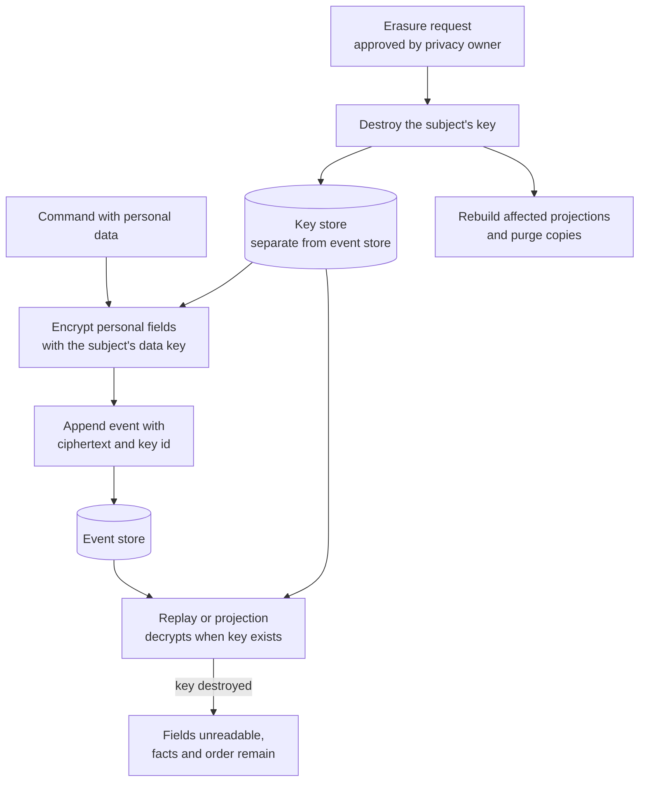

The diagram shows that erasure acts on the key store and not the event log, so the log never needs updating. Implications follow directly. The key store becomes critical: losing keys by accident causes unintended erasure, and weak key access control exposes the data. Projections, snapshots, and caches hold decrypted copies and must be rebuilt or purged. Backups that contain the key defeat the purpose, so key backups follow the retention rules of the data they protect. Readers must tolerate a missing key by returning a defined placeholder, not an error, otherwise replay of an erased subject fails. Finally, the approach applies to personal fields only. Non-personal facts, such as the amount and timing, remain visible.

### 12.3 Design checklist for personal data

- Is each personal field in an event necessary, or can an identifier replace it?
- Is there a map of where each personal field travels (events, projections, snapshots, logs, delivered events, backups)?
- Is there an agreed erasure procedure, with an owner, that covers every copy?
- Does replay of an erased subject succeed, producing placeholders?
- Have privacy and legal owners approved the event contract before it is published, since changing it later means a new version of an already stored shape?

## 13. Adoption and Exit

This section is the adoption and exit discussion that the introduction promised. It covers the three decisions that bracket the pattern's life: whether to start, how to move an existing CRUD aggregate onto it, and how to leave if the benefit does not materialise.

### 13.1 Adopting for one aggregate

The earlier decision flow ends in "event-source this aggregate only". Turn that into a trial with an explicit test before committing.

1. **Name the question the history must answer.** Write down two or three questions that current state cannot answer, such as "which rule version approved this posting?" If nobody can name one, stop.
2. **Pick the aggregate with the most valuable history and the lowest contention.** A ledger account or a claim file usually qualifies. A shared inventory pool does not.
3. **Keep everything else as ordinary state.** The first event-sourced aggregate should touch a small number of other components, so a retreat stays cheap.
4. **Fix the operating baseline before writing events.** Decide the event contract review process, the version field, the snapshot target, the projection owner, and the personal-data plan. These are the recurring costs from earlier sections.
5. **Set an exit review date.** After two quarters, compare the questions answered against the work spent.

Illustrative cost arithmetic. Assume an engineer-day costs 800 currency units, and compare event sourcing with a current-state table plus an audit table for one aggregate.

| Recurring work per year | Event sourcing (days) | State plus audit table (days) |
| --- | --- | --- |
| Event or audit schema changes (6 changes) | 12 (2 days each, upcasters and tests) | 3 (0.5 day each) |
| Projection operation and fixes | 6 | 0 |
| Rebuild rehearsals (2 per year) | 4 | 0 |
| Erasure and key handling | 3 | 2 |
| Total | 25 | 5 |

The difference is $25 - 5 = 20$ days, or $20 \times 800 = 16{,}000$ units a year. Suppose that without full history the team runs 40 reconciliation investigations a year at 1.5 days each. That is $40 \times 1.5 = 60$ days, or $60 \times 800 = 48{,}000$ units. If event sourcing removes those investigations, the net benefit is $48{,}000 - 16{,}000 = 32{,}000$ units a year. The break-even is $16{,}000 / (1.5 \times 800) = 16{,}000 / 1{,}200 \approx 13.3$, so about 14 investigations a year. Below that number, the audit table wins. The figures are invented to show the shape of the argument. Substitute measured values, and include one-off build cost and the storage growth from the earlier section.

### 13.2 Migrating an aggregate from CRUD

A CRUD aggregate has current state and, at best, an audit trail. The migration cannot invent history that was never recorded.

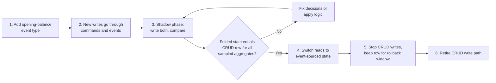

The diagram shows a staged move in which each step can be reversed until the last. Details that decide success:

- **Opening event.** For each existing row, append one event such as `AccountMigrated` carrying the state at cutover. The stream's history starts there. Label it as a migration event so an auditor can see that earlier history lives in the legacy audit table.
- **Optional backfill.** If the legacy audit table is reliable, convert its rows into events flagged as reconstructed. Treat the result as interpretation, not recorded fact, and say so in the metadata.
- **Shadow comparison.** During the shadow phase, the folded state from the new stream is compared with the legacy row for every aggregate touched. A difference exposes a business rule that the old code applied implicitly, usually in a database trigger or a batch job.
- **Cutover reversibility.** Keep the legacy row updated, by a projection if necessary, until the rollback window closes. A rollback during that window is then a switch of the read path.
- **Pacing.** Migrate one aggregate type, then one tenant or cohort at a time, so the blast radius of a flaw in an event contract is small.

### 13.3 Leaving event sourcing

Leaving is possible because the log can feed any state shape. It is still a project, and it should be designed as one before adoption.

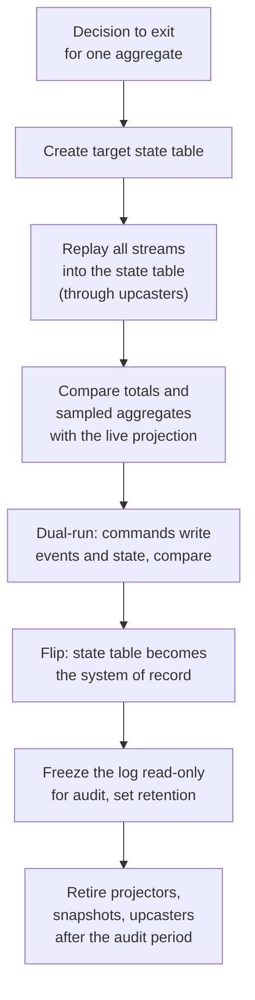

The diagram shows that exit is a projection to a state store followed by a controlled change of the system of record. The consequences to plan for:

- **The log can remain as an audit archive.** The business reason for keeping it, and the retention period, come from legal and audit owners. Upcasters must be retained as long as the archive is readable.
- **History needed by users must be reproduced.** If product features read past states, the state store needs history tables or the feature goes away.
- **Time and cost scale with history.** Reuse the rebuild arithmetic: 1.58 billion events at 20,000 events per second take about 21.9 hours on one worker. Partitioning shortens this in the same way as for a rebuild.
- **Personal data.** Erasure now applies to the new state store as well as the archive, so the crypto-shredding plan must cover both until the archive is deleted.

Exit is rarely the sign of a failed pattern. It is often the right outcome when the questions that justified the log stopped being asked.

## 14. Operating an Event-Sourced System

### 14.1 Event store choices by class

Choose the store by the semantics you need: ordered atomic append per stream with an expected version, read by stream, and an ordered read of everything for projectors. Two classes cover most options. Product features and limits change, so verify the current documentation of any candidate. The mechanics of the engines belong to Part 06, for example [Transactions](../06_Databases_and_Storage/CH08_Transactions.md), [Replication](../06_Databases_and_Storage/CH07_Replication.md), and [PostgreSQL](../06_Databases_and_Storage/CH11_PostgreSQL.md).

| Concern | Relational table in an existing database | Purpose-built event log or event store product |
| --- | --- | --- |
| Per-stream append with expected version | Primary key on stream and version, as shown earlier | Usually a built-in expected-version feature |
| Global read order for projectors | Sequence column with the visibility caveat above | Often a built-in global position, check its guarantees |
| Operational familiarity | High, existing backup, monitoring, and access control | New system to run or buy, new skills |
| Transactions with other data | Can share a transaction, which makes the outbox simple | Separate system, so atomic updates to other stores are not available |
| Subscriptions and catch-up | Built by the team (polling, notifications) | Commonly provided, check delivery guarantees |
| Scaling by many streams | Depends on engine, partitioning, and hardware | Depends on product, check its sharding model |
| Lock-in | Low | Higher, the API shapes your projectors |

A relational table is a sensible start for a first aggregate with modest volume. A purpose-built log is worth evaluating when subscriptions, very large stream counts, or retention features are central. Decide with a load test that uses your event sizes and your projector design, and treat vendor claims as hypotheses.

### 14.2 Throughput and replay-time arithmetic

Illustrative figures. Average 50 events per second, peak 5 times the average, so $50 \times 5 = 250$ events per second. Suppose each append transaction takes 2 ms, so one connection performs $1 / 0.002 = 500$ appends per second if appends are sequential. Peak demand of 250 per second therefore needs one busy connection at 50 percent utilisation. With 4 connections the append path has $4 \times 500 = 2{,}000$ per second of headroom, about 8 times the peak. Batching several events per transaction raises throughput further, and the contention analysis from the earlier section still applies per stream.

Replay is a different capacity problem, because it reads the entire history. Using the earlier total of 1,576,800,000 events a year:

| Replay rate (events per second) | Time for one year of history |
| --- | --- |
| 20,000 | $1{,}576{,}800{,}000 / 20{,}000 = 78{,}840$ s, about 21.9 h |
| 160,000 (8 partitions of 20,000) | $1{,}576{,}800{,}000 / 160{,}000 = 9{,}855$ s, about 2.7 h |
| 10,000 (rate-limited in production) | $1{,}576{,}800{,}000 / 10{,}000 = 157{,}680$ s, about 43.8 h |

The last row shows the price of protecting production. Rebuilds that must run beside live traffic take longer, and the plan should say which row is real for each projection.

### 14.3 Backups and restore

The event log is the system of record, so its backup is the most important backup. Part 06 owns the mechanics, and the design questions here are about what to promise.

- **Recovery point objective (RPO).** Restoring from nightly snapshots loses up to a day of events. Continuous archiving of the write-ahead log or equivalent reduces that to seconds or minutes, at the cost of operating it.
- **Restore time.** Illustratively, restoring 947 GB at an effective 200 MB per second takes about $947{,}000 / 200 = 4{,}735$ s, roughly 1.3 hours, before replaying any archived log. Rehearse it, because untested backups fail in ways arithmetic cannot predict.
- **Projections and snapshots are rebuildable.** They need not be backed up as the system of record, though restoring them speeds recovery. Back up the checkpoint table only with its projection.
- **Keys and profile stores.** Crypto-shredding keys and pseudonym maps are as critical as the log. Restoring the log without them leaves personal fields unreadable. Restoring old keys revives erased data, so key backups follow the erasure rules.
- **Consistency across stores.** After a restore to an earlier point, projections and downstream consumers may be ahead of the log. Plan for rebuilding projections and for telling consumers about the gap.

### 14.4 Replay in production

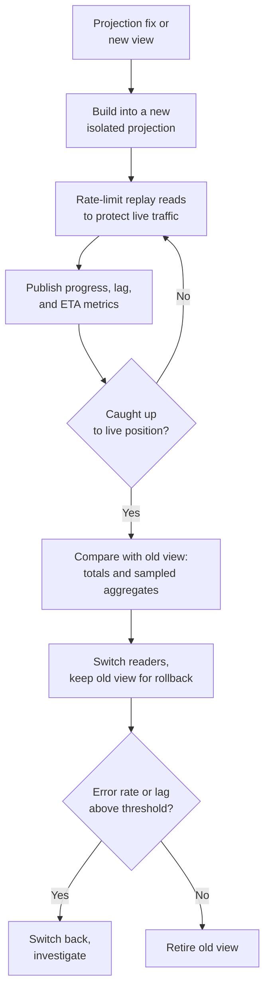

The diagram shows replay as a monitored operation with an escape route. The practices behind it:

- **Replay is read load.** It competes with queries for the store. Set a rate limit and an alert on store latency.
- **Never replay side effects.** A projector that sends email or calls a payment service would repeat them. Separate pure projections from reactions, and send reactions only for live events.
- **Make replays observable.** Track position, events per second, and an estimated finish time.
- **Rehearse.** Run a rebuild in a non-production environment on a copy of production volume at least twice a year, so the figure in the table above is measured.

### 14.5 Testing with given-when-then

Because decisions return events and `apply` is pure, aggregates can be tested with no database. The given part is a list of past events, the when part is a command, and the then part is the expected events or the expected rejection.

```python
def test_withdrawal_rejected_when_balance_too_low():
    given = [opened(initial_balance=100), deposited(amount=50)]   # balance 150
    with pytest.raises(InsufficientFunds):
        decide(rebuild(given), Withdraw(amount=200))

def test_withdrawal_emits_event():
    given = [opened(initial_balance=100)]
    events = decide(rebuild(given), Withdraw(amount=30))
    assert events == [FundsWithdrawn(version=2, amount=30)]
```

Add these kinds of tests as well:

- **Golden histories.** Store real, anonymised streams from each schema version, replay them, and assert the final state. This catches changes to `apply` that alter old readings.
- **Upcaster chain tests** with a sample of every historical version.
- **Snapshot equivalence.** The state from snapshot plus tail equals the state from full replay.
- **Projection tests.** Fold a known event list and compare the view, and run the same list twice to prove idempotence.
- **Concurrency tests.** Two commands on one stream, one must receive a conflict.

### 14.6 Security and access control for the log

The log contains every fact the aggregate ever recorded, so access to it is broader than access to any single row. Part 15 owns the controls, see [Authorization](../15_Security/CH03_Authorization.md), [Encryption](../15_Security/CH10_Encryption.md), and [Secrets Management](../15_Security/CH09_Secrets_Management.md). Recapped as design rules:

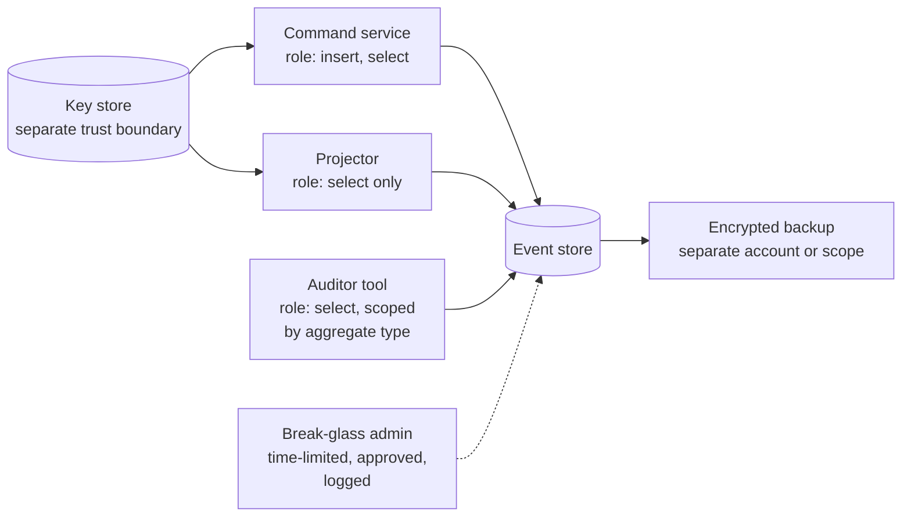

The diagram shows least privilege by role. The command service can insert and read but not update or delete, projectors can only read, and auditors see only the stream types they audit. Consequences to design for: a projector with write access to the store could rewrite history, so it must not have it. Encryption at rest and in transit apply as for any database. Field-level encryption for personal data needs a separate key store, as in the erasure section. Administrative access to the table is the largest risk to the audit claim, so it is time-limited, approved, and itself logged outside the store. Metadata such as actor identifiers is personal data in many contexts, so access to it follows the same rules as the payload.

## 15. Failure and Quality-Attribute Scenarios

Each scenario states the stimulus, the expected response, and a measurable success criterion. The thresholds are illustrative targets to replace with your own objectives.

| # | Stimulus | Expected response | Success criterion |
| --- | --- | --- | --- |
| 1 | Two commands target one stream at the same version | One append commits, the other receives a conflict, reloads, and re-decides | 0 duplicate versions in the store, and no more than 3 attempts per command at the 99th percentile |
| 2 | Projector process crashes mid-batch | It restarts from its checkpoint and reapplies events idempotently | Projection equals a full rebuild on sampled aggregates, 0 double-applied events |
| 3 | Projection lag grows after a traffic spike | Alert fires, replay is not started on the same store without throttling, readers see freshness metadata | Lag back under 5 s within 10 min, alert raised within 2 min of crossing the threshold |
| 4 | Poison event the projector cannot process | That projection halts and alerts, the event is parked, other projections continue | Other projections stay within their lag objective, parked event triaged within 1 working day |
| 5 | Snapshot is stale or from an older state schema | Load falls back to full replay | Correct state returned, load time within 10 times the snapshot path, and a snapshot rewritten afterwards |
| 6 | New code version changes the shape of a stored event | Upcaster handles old versions, deploy gate runs the golden histories | 0 failed golden histories before release, no replay error in production for 30 days |
| 7 | Event store primary is lost | Restore or promote a replica, replay archived log, rebuild projections | RPO at most 60 s of events, restore of the log within the target (illustratively 2 h), projection rebuild plan executed |
| 8 | Approved erasure request for one data subject | Key destroyed, projections and caches purged, replay of the stream succeeds with placeholders | Subject's personal fields unreadable in every copy within the agreed period, 0 replay failures |

Two of these deserve a closer look because they combine mechanisms.

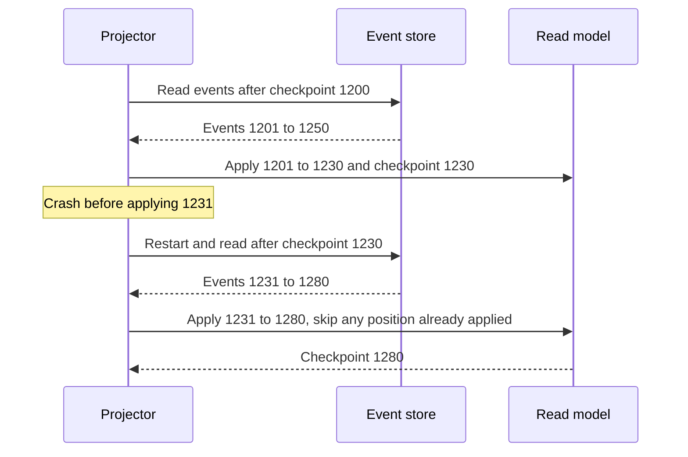

The diagram shows scenario 2. The view and the checkpoint advance in one transaction, so the restart resumes at the right position, and the position guard makes a repeated delivery harmless. For scenario 7, the evidence is the last rehearsal's measured restore time. A plan whose numbers have never been measured is a hypothesis, not a recovery objective.

## 16. Worked Case: A Financial Ledger

This case is a hypothetical organization, invented to show the reasoning. All figures are illustrative.

### 16.1 Context

Harbour Credit Union is a fictional member-owned bank with 180,000 member accounts and an average of 90,000 postings (ledger entries) a day. Its auditors ask for an explanation of any balance on any past date. Today it stores a balance column and a separate audit table that a nightly batch fills. Reconciliation investigations (the audit table disagreeing with the balance) happen about 40 times a year at 1.5 engineer-days each. Regulators require the posting history to be kept for seven years (an assumed requirement for this case, stated by the organization's compliance owner).

### 16.2 Decisions and rejected alternatives

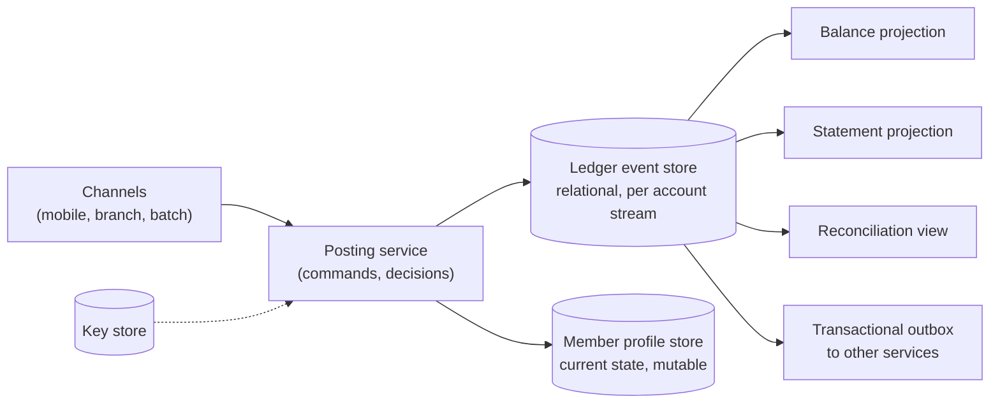

The diagram shows the chosen shape: only ledger postings are event-sourced, and members' profile data stays in an ordinary store. The decisions:

| Decision | Chosen | Rejected alternative | Reason |
| --- | --- | --- | --- |
| Which aggregates | Ledger account streams | Every entity in the system | History matters only for postings, other data has no replay or audit question |
| Store | Relational table in the existing database | Purpose-built event store product | Volume is modest (below), team operates the database, outbox shares the transaction |
| Contention | Settlement accounts split into one stream per account per business day | One long stream per settlement account | Avoids a giant aggregate, see the arithmetic below |
| Corrections | Compensating postings | Editing or deleting events | Auditors require both the error and the fix |
| Personal data | Pseudonymous member identifier in events, names in profile store | Names and addresses in event payloads | Erasure becomes a profile change, and the events stay unchanged |
| Alternative to ES | Not adopted: state plus audit table | State plus audit table with stricter batch | The table could still disagree with state, which is the problem being solved |

### 16.3 Arithmetic

- Postings per year: $90{,}000 \times 365 = 32{,}850{,}000$.
- Storage at 350 bytes per event: $32{,}850{,}000 \times 350 = 11{,}497{,}500{,}000$ bytes, about 11.5 GB a year. With 50 percent index and metadata overhead, about 17.2 GB a year. Seven years: $17.2 \times 7 \approx 120$ GB. This size supports the relational choice.
- Average stream length: $32{,}850{,}000 / 180{,}000 = 182.5$ postings per account per year, so about 913 after 5 years. Replay at 20 µs per event is $913 \times 20\ \mu s \approx 18$ ms, so ordinary accounts need no snapshots.
- A settlement account receives 5,000 postings a day, which is $5{,}000 \times 365 = 1{,}825{,}000$ a year. Replay would take $1{,}825{,}000 \times 20\ \mu s = 36.5$ s. That is unusable as one stream. With one stream per business day, a day's stream replays in $5{,}000 \times 20\ \mu s = 100$ ms, and a snapshot of the day's end totals carries the balance forward.
- Contention on a settlement stream: 5,000 per day is $5{,}000 / 86{,}400 \approx 0.058$ per second on average. If the peak is 20 times the average, that is about 1.16 per second. With a 20 ms window, $\lambda w = 1.16 \times 0.02 = 0.023$, so the conflict probability is $1 - e^{-0.023} \approx 2.3\%$. Acceptable.
- Rebuild of the balance projection over 5 years: $32{,}850{,}000 \times 5 = 164{,}250{,}000$ events. At 20,000 per second that is $164{,}250{,}000 / 20{,}000 = 8{,}212.5$ s, about 2.3 hours.

### 16.4 Validation evidence

The team would accept the design on the following evidence, which is stated here as the plan and its illustrative pass criteria.

1. **Shadow run.** For 30 days, every posting writes both the legacy row and the event stream. The folded balance must equal the legacy balance for all 180,000 accounts each night, with 0 differences left unexplained.
2. **Replay test.** A full rebuild of the balance projection in a test environment on production-sized data finishes within the 2.3-hour estimate, plus 50 percent margin.
3. **Golden histories.** One stored stream from each schema version replays to the expected balance.
4. **Failure drills.** Scenarios 2, 5, and 7 from the previous section are run, with measured results recorded.
5. **Audit sample.** Auditors pick 25 accounts and 25 dates. The system must reproduce each balance and list the postings and rule versions behind it, within one working day.
6. **Erasure drill.** One test member's profile is erased in a copy of the environment, and replay of their stream succeeds with placeholders.

The exit review after two quarters compares the number of reconciliation investigations with the break-even of about 14 a year from the adoption section.

## 17. Common Mistakes and Anti-Patterns

The event design anti-patterns appear earlier. These are mistakes at the system and operating level.

| Mistake | Cause | Consequence | Remedy |
| --- | --- | --- | --- |
| Event-sourcing the whole system | Pattern chosen for consistency of style | Cost of upcasting, replay, and erasure applied to data that never needed history | Decide per aggregate with named history questions |
| Side effects or clock reads inside `apply` | State transition mixed with decision logic | Replay sends duplicates or computes different state from the original | Decide outside `apply`, store computed values in the event |
| Deciding from a projection | Projection is convenient and fast | Stale view accepts a command the stream would reject | Decide only from the aggregate's own stream |
| Publishing events directly to a broker after commit, with no outbox | Two writes assumed to succeed together | A crash between them loses or duplicates deliveries | Use the outbox described in [Event-Driven Architecture](CH07_Event_Driven_Architecture.md) |
| Treating the snapshot as the truth | Snapshot is fast so it gets trusted | A divergent snapshot gives wrong state with no way to detect it | Verify version and digest, keep full replay as the fallback |
| Editing or deleting stored events to fix a mistake | Looks like the quickest repair | Audit evidence destroyed and consumers disagree with the store | Append a corrective event |
| Never rehearsing a rebuild | The need seems distant | First real rebuild is during an incident and takes longer than the outage allows | Rehearse twice a year and record the time |
| No monitoring of stream length and projection lag | Metrics added only for the command path | Giant aggregates and stale views are found by users | Alert on the 99th-percentile stream length and each projection's lag |
| Personal data in payloads with no plan | Erasure treated as a later problem | Deleting data needs rewriting history across stores and backups | Minimise, use pseudonyms or crypto-shredding before the first event |
| Using the log as the integration contract | Other teams read the store directly | Internal event changes break other services | Publish separate, versioned integration events |
| Expecting free audit | History confused with governance | Log writable by administrators, reads and failed commands missing | Restrict writers, define what auditors need, and record it separately |

Two patterns recur across these rows. The first is mixing the decision with its recording, so that replay re-runs a decision. The second is trusting a derived artefact (projection, snapshot, integration event) as if it were the log. Each derived artefact needs a rule for what to do when it disagrees with the log, and the rule is always that the log wins.

## 18. Pattern Comparison and Trade-offs

Event sourcing is often confused with patterns that also produce a stream of changes. **Change data capture (CDC)** reads the committed changes of a database from its transaction log and publishes them. The events describe row changes, not business facts, and the database state remains the source of truth. Delivery and the outbox are covered in [Event-Driven Architecture](CH07_Event_Driven_Architecture.md), and log-based replication in [Replication](../06_Databases_and_Storage/CH07_Replication.md). CQRS separates read and write models, and is covered in [CQRS](CH09_CQRS.md).

| Dimension | Current state (CRUD) with audit table | Event sourcing | CQRS (without event sourcing) | CDC |
| --- | --- | --- | --- | --- |
| Source of truth | Current-state table | Event log | Write-side state store | Source database |
| History | Audit rows, can drift from state | Complete by construction | Not provided by the pattern | Row-change stream, retention limited by the log |
| Read of current state | Direct select | Snapshot plus tail, or projection | Read model | Not its purpose |
| Business meaning of changes | Low unless audit rows are designed | High, if events are named well | Not addressed | Low, row-level |
| Temporal queries | Hard | Natural | Not provided | Limited |
| Consistency of reads | Strong | Eventual for projections | Eventual for read models | Eventual for consumers |
| Schema change cost | Migration | Upcasters, permanent | Migration plus read model changes | Consumers must adapt to row changes |
| Personal-data erasure | Delete rows | Needs minimisation or crypto-shredding | Delete in both models | Delete at source, downstream copies need handling |
| Main operating cost | Low | High: replay, projections, versions | Medium: two models | Medium: connector, ordering, lag |
| Best fit | Most business data | Domains where history is the asset | Differing read and write shapes | Feeding other systems from existing state |

Read the table by cost. If the first column satisfies the requirement, stop there. If the need is only to feed other systems, CDC from a state store is cheaper than the whole pattern. If the pressure is read performance and shape, CQRS alone is enough. Event sourcing is chosen when history is itself a requirement.

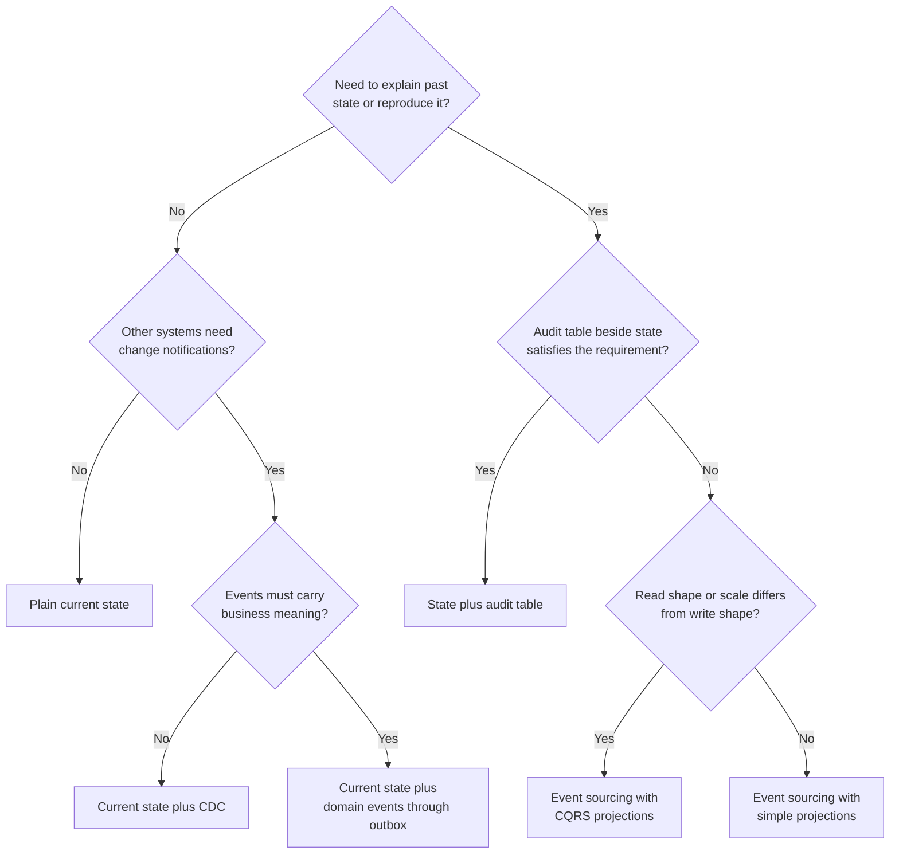

The diagram turns the table into a path. Every route ends at the cheapest pattern that meets the requirement, and the two event-sourced leaves are reached only when an audit table is insufficient. A team that reaches a leaf should write down the question that sent it there. That sentence is the evidence for the adoption review.

## 19. Design-Review Checklist

Use this list in a design review for an event-sourced aggregate. Each item should have a named answer or an accepted risk.

### 19.1 Justification

- Which history questions does the log answer, and who asks them?
- Why is an audit table beside current state insufficient?
- Is the aggregate boundary drawn around one invariant, and what is its expected stream length and write rate?

### 19.2 Events

- Are events named in the business's past-tense language, one fact each, without CRUD-style `Updated` events?
- Do payloads include decision-time values, and does metadata record actor, correlation, and causation?
- Is every event versioned from the first write, with a tested upcaster for each change?

### 19.3 Store and concurrency

- Is the expected-version check enforced by the store, and is the retry or conflict policy defined?
- Is append-only enforced by permissions, and is the global read order safe for projectors?

### 19.4 Reads and replay

- Is each projection idempotent, owned, and covered by a freshness objective?
- Is the rebuild time known from a rehearsal, and can a rebuild run without harming live traffic?
- Do snapshots carry version, schema, and digest, with full replay as fallback?

### 19.5 Operations and security

- Are RPO, restore time, and key backups rehearsed?
- Do roles separate writers, readers, and administrators, with break-glass access logged outside the store?
- Is there a monitored alert on projection lag, stream length, and poison events?

### 19.6 Privacy and exit

- Is personal data minimised, and is the erasure mechanism tested across projections, snapshots, and backups?
- Is there an exit plan, with a review date and a break-even figure from measured costs?

## 20. Exercises

Answer outlines follow each exercise. Compare your reasoning to the outline, not just the final figure.

1. **Decide.** A team proposes event sourcing for a product catalogue, a shopping basket, and a payment ledger. Which, if any, qualify?
   *Outline:* The payment ledger, because history and audit matter. The basket is short-lived with no replay need, so ordinary state. The catalogue needs current state, and an audit table is enough unless price history is a stated requirement.
2. **Concurrency arithmetic.** An aggregate receives 25 writes a second with a 20 ms window. Compute the conflict probability and suggest actions.
   *Outline:* $\lambda w = 0.5$, so $p = 1 - e^{-0.5} \approx 0.393$ (39.3%), and expected attempts are about $e^{0.5} \approx 1.65$. Shorten the window, serialise by partition key, or split the aggregate.
3. **Snapshot interval.** Replay costs 20 µs per event, snapshot load costs 1 ms, and the target is a worst-case load of 5 ms. Find the largest interval $K$.
   *Outline:* $1\ \text{ms} + K \times 0.02\ \text{ms} \le 5\ \text{ms}$ gives $K \le 200$ events.
4. **Evolve an event.** `ShipmentDispatched` v1 has a `carrier` string. v2 needs a `carrier_id` from a catalogue. What do you do?
   *Outline:* Add `carrier_id` with an upcaster only if the mapping from names to identifiers is certain. Otherwise record it as unknown for old events. Keep the original value for audit output, and test with a sample of v1 events.
5. **Rebuild plan.** A projection must be rebuilt from 800 million events. Replay reads 12,500 events a second per projector, and production leaves room for 4 projectors. Estimate the time.
   *Outline:* $800{,}000{,}000 / (12{,}500 \times 4) = 16{,}000$ s, about 4.4 hours, assuming even partitioning. Add margin, throttle against live reads, validate before switching.
6. **Erasure.** A member requests erasure, and their name is in 1,200 events. Describe two designs and the work for each.
   *Outline:* Crypto-shredding: destroy the member's key, purge projections and caches, confirm replay uses placeholders. Profile-store design: events never held the name, so delete the profile row. Confirm backup and key retention rules with the privacy owner.
7. **Migration.** Describe how to move an `Order` CRUD table to event sourcing with a reversible cutover.
   *Outline:* Opening event per order, commands and events for new writes, shadow comparison against the row, switch reads, keep the row during a rollback window, then retire the CRUD write path.
8. **Exit.** After a year the team finds nobody has used replay or temporal queries. Outline the exit.
   *Outline:* Project all streams to a state table through upcasters, verify totals, dual-run, switch the system of record, freeze the log for the audit period, then retire projectors and snapshots.

## 21. Summary and Code Examples

### 21.1 Summary mapped to the chapter outcomes

| Outcome from the Introduction | Where it is covered | Key takeaway |
| --- | --- | --- |
| 1. State as a fold | Section 3 | State is `apply` over events, and `apply` is deterministic and rejects unknown types |
| 2. Decide whether to event-source | Sections 2, 13, 18 | Event sourcing is the last answer, chosen per aggregate, after an audit table fails |
| 3. Event store and append | Section 4, 14 | Primary key on stream and version enforces order and concurrency |
| 4. Conflict rate | Section 5 | $p = 1 - e^{-\lambda w}$, a hot aggregate needs a smaller boundary |
| 5. Naming and sizing events | Section 6, 17 | One business fact per event, with decision-time values |
| 6. Evolving events | Section 8 | Upcast at read time and never rewrite history |
| 7. Replay cost and snapshots | Sections 7, 14 | Choose $K$ from a load-time target |
| 8. Projections and temporal questions | Sections 9, 10 | Rebuild beside the old view and validate before the switch |
| 9. Honest costs | Sections 11, 12, 15, 16 | Eventual consistency, growth, migration, and erasure are planned costs |

Event sourcing is an architectural commitment to history, not a default persistence style. Adopt it for the aggregates whose history justifies the lifecycle cost, keep the log authoritative, make every derived view rebuildable, and define the exit before the entry.

### 21.2 Code examples

All files are in `code/python/event-sourcing-chapter/` and use in-memory stores.

- [01_event_sourced_aggregate.py](../code/python/event-sourcing-chapter/01_event_sourced_aggregate.py): an `Account` aggregate rebuilt by folding events, with the expected-version check on append.
- [02_snapshotting.py](../code/python/event-sourcing-chapter/02_snapshotting.py): snapshot plus tail loading for an inventory counter, with a check that it equals full replay.
- [03_event_upcasting.py](../code/python/event-sourcing-chapter/03_event_upcasting.py): a chain of single-step upcasters taking stored user-registration events from versions 1 and 2 to the current shape.
- [04_event_store_and_projection.py](../code/python/event-sourcing-chapter/04_event_store_and_projection.py): an event store that pushes events to a projection, building an order summary read model. Its header comment points to an older CQRS chapter name, and the current one is [CQRS](CH09_CQRS.md).
