# Actor Model

Part: [20 — Architecture Patterns](PART_OVERVIEW.md) · Status: Revised (in-depth rewrite)

## 1. Introduction

The actor model structures a program as a set of small, isolated entities called actors. Each actor owns some private state, has an address that other actors can send messages to, and processes the messages it receives one at a time. Actors never reach into each other's memory. They only send messages and, in response to a message, they may change their own state, send further messages, or create new actors. The model was introduced as a formal model of computation by Carl Hewitt and colleagues in the early 1970s, and it later became the basis of several programming languages and runtime libraries. Frameworks such as Erlang/OTP (Open Telecom Platform), Akka, and Microsoft Orleans are built around it, each with its own details that should be checked in their documentation before relying on a specific guarantee.

The pattern attracts architects for one reason. Most concurrency bugs come from several threads touching the same mutable state, and most distributed-systems bugs come from components that assume a remote call behaves like a local one. The actor model removes the first class of bug by construction, because state has exactly one owner that handles one message at a time. It makes the second class visible, because every interaction is already an asynchronous message that can be delayed, lost, or answered late. The price is that the design must be expressed as message protocols and failure policies, and that familiar tools such as call stacks, transactions across objects, and synchronous return values are no longer available.

After this first part of the chapter you should be able to:

1. Define an actor and state what it owns, what it can do in response to a message, and what it cannot do.
2. Explain why serial message processing removes the need for locks around actor state, and where that guarantee stops.
3. Reason about mailboxes, addressing, and location transparency, including why a remote actor is not a local object.
4. Design a supervision hierarchy and apply the "let it crash" philosophy with explicit restart policies.
5. State which ordering and delivery guarantees an actor system can reasonably offer by default, and add reliability on top of at-most-once delivery.
6. Size a bounded mailbox with queueing arithmetic and choose an overload policy.
7. Compare actors with threads and locks and with Communicating Sequential Processes (CSP) channels, and pick between them for a given workload.

The boundaries with neighbouring material are deliberate:

- Operating-system threads, processes, and scheduling belong to Part 05 ([Processes and Threads](../05_Networking_and_OS/CH24_Processes_and_Threads.md)). This chapter recaps only what is needed to compare with actors.
- Distributed-systems theory belongs to Part 07: [Partitioning](../07_System_Design_and_Distributed_Systems/CH11_Partitioning.md), [Ordering Guarantees](../07_System_Design_and_Distributed_Systems/CH18_Ordering_Guarantees.md), [Idempotency](../07_System_Design_and_Distributed_Systems/CH16_Idempotency.md), [Exactly-Once Processing](../07_System_Design_and_Distributed_Systems/CH17_Exactly_Once_Processing.md), and [Deduplication](../07_System_Design_and_Distributed_Systems/CH19_Deduplication.md). This chapter recaps their conclusions where actors depend on them.
- Brokers, topics, and event routing belong to [Event-Driven Architecture](CH07_Event_Driven_Architecture.md). An actor mailbox is a private queue inside one actor, and a broker is shared infrastructure between systems.
- Sibling patterns that also move data between isolated parts are the [Pipeline Pattern](CH13_Pipeline_Pattern.md) and the [Microkernel Architecture](CH15_Microkernel_Architecture.md). They are compared with actors only where the difference changes a design decision.

All numbers in this chapter are illustrative. They show how to reason, and they are not measurements of any real system.

### 1.1 Forces and context

A design pushes toward actors when several of the following forces are present together.

- **Many independent stateful entities.** The workload consists of many small units that each have their own state and lifecycle, such as shopping carts, device sessions, game rooms, or accounts. Most operations touch one entity, and entities interact through occasional messages.
- **Contention on shared mutable state.** Locks around shared structures have become a source of latency spikes or defects. Giving each piece of state one owner replaces lock reasoning with ownership reasoning.
- **Failure is expected and should stay local.** The system must keep serving most entities while a few misbehave or crash, and recovery should be automatic.
- **Natural asynchrony.** Callers do not need an answer on the same call stack, and request and reply can be separate messages.
- **A path to distribution.** The same programming model should work within one process and across several nodes.

Forces that argue against the pattern include workloads dominated by large shared data structures that need whole-set queries, strong multi-entity transactions that cannot be split, short-lived batch computations where simple data parallelism fits better, and teams without the operational tooling to observe message flows. A request that needs a consistent view across thousands of entities is awkward, because each actor knows only its own state.

## 2. The Foundational Model: Actors, State, and Behaviour

An actor combines four things.

1. **Identity.** An address that other actors use to send messages. The address is stable even if the actor's internal state changes. Holding an address gives the right to send, not the right to inspect.
2. **Private state.** Data that only the actor reads and writes. It can be a counter, a shopping cart, a connection, or a finite state machine position.
3. **Behaviour.** A function from the current state and an incoming message to a new state and a set of effects. The behaviour can change over time, for example from "waiting for payment" to "paid".
4. **A mailbox.** A queue of messages that have arrived but have not yet been processed.

In response to one message, an actor can do exactly three kinds of things: send messages to addresses it knows, create new actors, and decide how it will handle the next message, including by updating its state. It does not return a value to the sender through a call stack. If the sender needs an answer, the sender includes its own address in the request, and the receiver sends a reply message to that address.

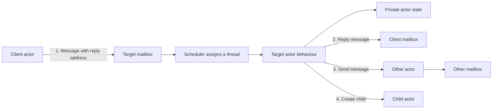

The diagram shows the topology. State is reachable only through the behaviour, so every change to it happens inside a message handler. The scheduler is separate from the actor: an actor is not a thread. A runtime can host a very large number of actors on a small pool of threads, giving a thread to an actor only while it has a message to process. This is why actor systems commonly describe actors as cheap to create, though the exact per-actor memory cost depends on the runtime and should be measured rather than assumed.

The consequence for design is that interaction is always explicit. Any dependency between two parts of the system appears as a message type with a defined meaning. This makes protocols testable and visible, and it also means that the architect must define those protocols, since there is no shared object whose method signatures define them implicitly.

### 2.1 A minimal hand-rolled actor

The following Python sketch shows the essentials with `asyncio`. It is a teaching aid, not a framework: it has no supervision, no remote delivery, and no persistence.

```python
import asyncio


class Actor:
    def __init__(self, mailbox_size: int = 100) -> None:
        self._mailbox: asyncio.Queue = asyncio.Queue(maxsize=mailbox_size)
        self._task: asyncio.Task | None = None

    def start(self) -> None:
        self._task = asyncio.create_task(self._run())

    async def tell(self, message) -> None:
        await self._mailbox.put(message)  # waits while the mailbox is full

    def try_tell(self, message) -> bool:
        try:
            self._mailbox.put_nowait(message)
            return True
        except asyncio.QueueFull:
            return False

    async def _run(self) -> None:
        while True:
            message = await self._mailbox.get()
            await self.receive(message)  # one message at a time

    async def receive(self, message) -> None:
        raise NotImplementedError


class Counter(Actor):
    def __init__(self) -> None:
        super().__init__()
        self._count = 0  # private state, touched only inside receive

    async def receive(self, message) -> None:
        kind, reply_to = message
        if kind == "increment":
            self._count += 1
        elif kind == "get":
            reply_to.set_result(self._count)


async def main() -> None:
    counter = Counter()
    counter.start()
    for _ in range(1000):
        await counter.tell(("increment", None))
    reply = asyncio.get_running_loop().create_future()
    await counter.tell(("get", reply))
    print(await reply)  # 1000


asyncio.run(main())
```

Several design points are visible even in this small example. The reply address is a `Future` passed inside the message, so the caller never touches `_count`. The counter's state is not guarded by a lock because only `_run` calls `receive`, and `_run` handles one message before reading the next. The `get` message is queued behind the increments, so it observes all of them. The `tell` method waits when the mailbox is full, which is a simple form of backpressure covered later in this chapter.

## 3. Mailboxes and Asynchronous Message Passing

A send is asynchronous: the sender hands the message to the runtime and continues without waiting for the receiver to process it. The message is placed in the receiver's mailbox. When the runtime gives the receiver a turn, it takes the next message out and runs the behaviour.

This has four direct consequences for a designer.

1. **Sending does not mean processing.** When `tell` returns, the message may be queued behind thousands of others, may be lost if the node fails, or may never be handled. Completion must be confirmed by a reply message if it matters.
2. **A mailbox is a queue with a policy.** Capacity (bounded or not), ordering (first in, first out, or by priority), durability (memory or disk), and what happens when it is full are all design decisions. Many runtimes default to an unbounded in-memory first-in, first-out mailbox. Check what your runtime does and decide whether it is acceptable.
3. **Messages should be immutable and self-contained.** If a sender keeps a reference to a mutable object it sent and changes it later, the receiver and sender now share state and the isolation guarantee is gone. Send copies or immutable values.
4. **Messages cross a boundary, so they need a schema.** Once actors may be on different nodes, messages are serialized. A message type is a contract that must be versioned as carefully as an API, as covered in Part 08.

### 3.1 Request and reply

Because there is no return value, the request and reply pattern is built from two messages. The request carries a correlation identifier and a reply address. The reply carries the same correlation identifier. The sender should also set a timeout, since the reply may never arrive.

```python
import asyncio
import uuid
from dataclasses import dataclass


@dataclass(frozen=True)
class Reserve:
    request_id: str
    sku: str
    quantity: int
    reply_to: asyncio.Future


async def ask(actor, sku: str, quantity: int, timeout: float = 2.0):
    reply = asyncio.get_running_loop().create_future()
    await actor.tell(Reserve(str(uuid.uuid4()), sku, quantity, reply))
    return await asyncio.wait_for(reply, timeout)  # raises TimeoutError if no reply
```

A timeout on the asker tells it that it stopped waiting. It does not tell it whether the receiver processed the request. If the message was processed and the reply was lost, a retry will repeat the effect. The remedy is to make the operation idempotent using the request identifier, which Part 07 covers in [Idempotency](../07_System_Design_and_Distributed_Systems/CH16_Idempotency.md) and which a later section of this chapter applies to actors.

### 3.2 Mailbox versus broker queue

A mailbox looks like a message queue but has a different role. A broker queue is shared infrastructure, durable by design, consumed by competing consumers, and decouples separate applications over time. A mailbox is private to one actor, usually held in memory, and consumed by exactly one handler. Brokers are owned by [Event-Driven Architecture](CH07_Event_Driven_Architecture.md). An actor system can sit behind a broker, reading from a topic and routing each event to the actor that owns the entity, so the two are complementary.

## 4. One Message at a Time: Why Locks Disappear

The central guarantee of the model is that an actor handles at most one message at a time. The runtime does not start the handler for message 2 until the handler for message 1 has returned. Because only the actor's own handler touches its state, and handlers never overlap, no two threads can read or write that state concurrently.

This replaces a locking argument with an ownership argument. With locks, correctness depends on every access to shared data taking the same lock in the same order. With actors, correctness depends on one rule: state is touched only inside the owning actor's handler. The rule can be checked by inspection of one class, and it holds no matter how many threads the scheduler uses.

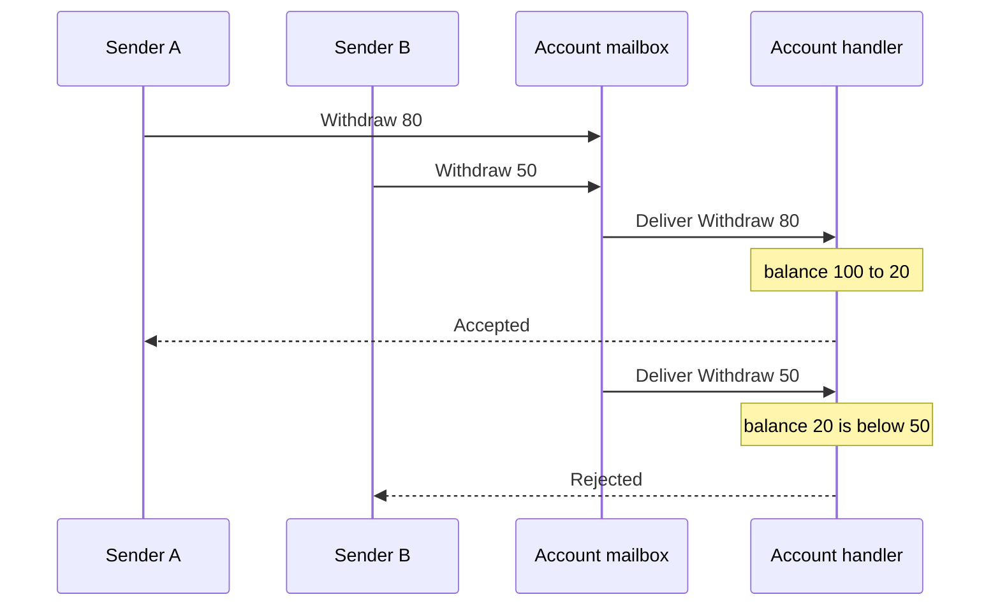

The sequence shows two concurrent senders racing to withdraw from an account with a balance of 100. The mailbox serializes the two requests into some order, and each handler run sees the effect of the previous one. The outcome depends on the order in which the messages arrived, which is a legitimate non-deterministic choice, but the balance can never go negative from a race inside the handler. The check and the update are one indivisible step because they happen inside one handler run.

### 4.1 Where the guarantee stops

The guarantee is narrower than it first sounds, and the edge cases are where actor systems fail in practice.

- **Atomicity is per message, not per conversation.** If handling a business operation takes three messages across two actors, other messages can interleave between them. A debit in one actor followed by a credit in another is not atomic. Compensation or a saga is needed, as described in the [Saga Pattern](CH10_Saga_Pattern.md).
- **Waiting inside a handler breaks serialization of useful work.** If a handler blocks on a database call, no other message to that actor is processed meanwhile. A handler that waits for a reply from an actor that is waiting for a reply from the first one deadlocks. Handlers should start the asynchronous work and return, handling the result as a later message.
- **Interleaving across awaits.** In an `asyncio` style implementation, if a handler awaits something inside `receive`, the next message is not started because `_run` awaits `receive`. Frameworks that allow a handler to return before an asynchronous step completes can process another message while the first is pending, so state may change between the two halves. Know which style your runtime uses.
- **Leaked references.** Returning a reference to internal mutable state, or capturing it in a callback that runs on another thread, reintroduces data races. State must not escape the actor.
- **External effects are not rolled back.** If a handler updates state, calls a payment service, and then fails, the state change and the external call do not form a transaction.

The practical rule is to treat each handler as a short, non-blocking, atomic step on private state, and to represent anything longer as a protocol among several messages.

## 5. Addressing and Location Transparency

Actors are reached through addresses, sometimes called references. A sender needs an address to send, and it obtains addresses in three ways: it is given one in a message (for example, a reply address), it receives one when it creates a child, or it looks one up in a registry or by a naming convention. Because an address is a capability, not knowing the address of an actor is a form of access control inside the system.

**Location transparency** means that the sender uses the same operation to send a message regardless of whether the target actor is in the same process, on another thread, or on another machine. The runtime resolves the address to a location and delivers the message there. If the actor moves, the address stays valid and the runtime updates its routing.

This gives real benefits. Code can be developed and tested in one process and deployed across a cluster. Actors can be moved to balance load or to recover from a failed node without changing senders.

It also gives a hazard that senior engineers must not ignore. A local send and a remote send have the same syntax but different properties.

| Property | Local send (same process) | Remote send (other node) |
| --- | --- | --- |
| Latency | Microseconds or less, small variance | Milliseconds, with a long tail |
| Message loss | Only if the process dies | Possible on network faults, node crashes, and overflow |
| Message size | Reference can be passed | Must be serialized, so size and format matter |
| Failure signal | Process failure is total | Partial failure and silence are normal |
| Message type | Any in-memory object | Must be serializable and versioned |

The right reading of location transparency is that the programming model is uniform, and the design must still assume remote semantics. A protocol that is correct only if sends are never lost is not correct in a distributed deployment. Many designs therefore treat every send as potentially remote from the start, so that moving an actor to another node does not expose a hidden assumption.

### 5.1 Addresses and identity in a cluster

When actors represent entities such as an order, the system needs to find the actor for order 4711 without knowing the node. Two common approaches exist. In a **directory approach**, a registry maps entity identity to a current actor address. In a **hash-based approach**, the identity is hashed to a partition, and each partition is owned by one node, so the owner is computed. Part 07's [Partitioning](../07_System_Design_and_Distributed_Systems/CH11_Partitioning.md) explains the underlying mechanics, including rebalancing. The consequence for actors is that an address should be derived from a stable business key, not from a node name, because nodes come and go.

The later sections on variants return to how virtual and sharded actors use this to keep exactly one live instance per entity.

## 6. Creating Actors and Supervision Hierarchies

An actor can create other actors. The creator becomes the parent, and the new actor is its child. Repeated creation forms a tree with one root. In the supervision model, the parent is responsible for the failures of its children. This is the basis of fault handling in the actor model, and the design of the tree is one of the main architectural decisions in an actor system.

### 6.1 The "let it crash" philosophy

Traditional defensive programming tries to anticipate every error inside the component that might fail, with nested error handling that grows hard to reason about and often leaves a component running in a half-valid state. The "let it crash" philosophy, associated with the Erlang community, takes the opposite position. A component handles the errors it expects and understands. For anything else it stops, and a supervisor, which sits outside the failing component and has a wider view, decides what to do. The reasoning is as follows.

- A component that has hit an unexpected error cannot be trusted to continue, because its state may be corrupt.
- Restarting from a known initial state is simpler to reason about than repairing an unknown state.
- Separating the work from the recovery policy lets the policy be written once and applied uniformly.

The philosophy applies only when restart is cheap and safe. If a crash can lose data that was held only in memory, state must be persisted or reconstructable, which later parts of this chapter treat in the stateful actors discussion. It also does not replace validation of external input. Rejecting a malformed message with an error reply is normal behaviour, while a crash is for conditions the actor did not anticipate.

### 6.2 Supervisor decisions

When a child fails, the supervisor decides which of a small set of actions to take. Runtimes name them differently, but the set is generally the following.

| Directive | Effect | Appropriate when |
| --- | --- | --- |
| Resume | Keep the child and its state, continue with the next message | The failure was in handling one message and left state valid |
| Restart | Discard the child's state, create a fresh instance, keep the same address | The failure is probably transient or state may be corrupt |
| Stop | Terminate the child permanently | The failure is deterministic or the child is no longer needed |
| Escalate | Fail the supervisor itself, passing the decision to its parent | The supervisor cannot decide, or the problem affects shared resources |

A supervisor also applies a **strategy** to siblings. In a one-for-one strategy, only the failed child is affected. In an all-for-one strategy, all children are restarted together, which is appropriate when children depend on each other so closely that one failing leaves the others in an inconsistent state. The default choice should be one-for-one, because all-for-one spreads a local fault to healthy siblings.

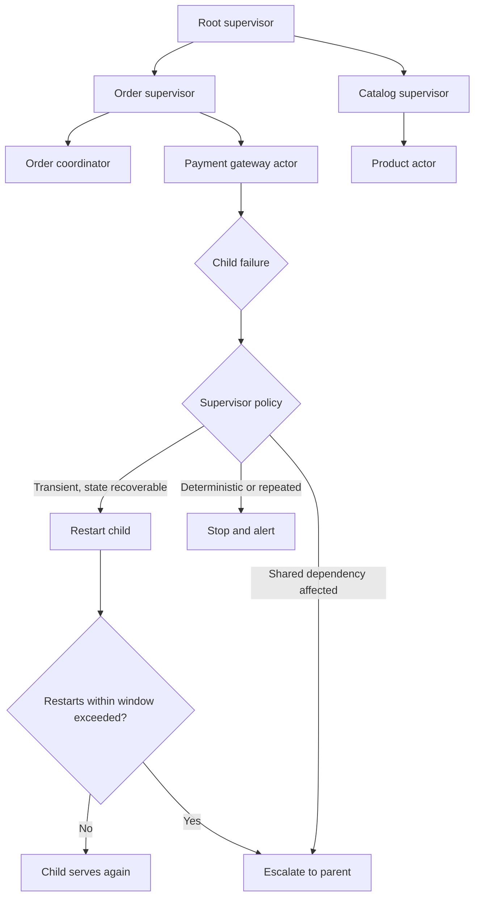

The tree shows both the structure and the decision. The supervisors form fault boundaries: a failure in the payment gateway actor is handled by the order supervisor and does not reach the catalog. The restart limit is the guard against the main hazard of supervision, which is a restart loop. A child with a deterministic fault, such as a message that always triggers a bug, restarts, receives the same message, and fails again, consuming resources indefinitely. A limit of the form "no more than N restarts in T seconds, then escalate" turns an infinite loop into an escalation that a human or a higher-level policy can act on.

### 6.3 A worked supervision scenario

Illustrative numbers: a payment gateway actor wraps a connection to an external provider. The order supervisor allows 3 restarts in 60 seconds with a delay between restarts that doubles from 1 second.

1. Failure 1 at t = 0 s: the connection is reset. The actor restarts after 1 s and re-establishes the connection. Normal service resumes at t = 1 s.
2. Failure 2 at t = 5 s: the provider returns a malformed reply that the actor does not handle. It restarts after 2 s. The restart count in the window is 2.
3. Failure 3 at t = 10 s: the same malformed reply arrives again from a queued retry. Restart after 4 s. Count is 3.
4. Failure 4 at t = 20 s: count would be 4, which exceeds 3 in 60 s. The supervisor escalates. The order supervisor now decides, and its own policy stops the payment actor and raises an alert, while orders that do not need payment continue to be handled.

The elapsed time from first failure to alert is 20 s, and the maximum time the payment path was unavailable under the policy before escalation is 1 + 2 + 4 = 7 s of restart delay, plus the failure processing itself. Without the limit, the loop would continue and hide a deterministic defect behind a stream of restarts. The numbers are examples of a policy shape, not defaults of any framework.

### 6.4 Failure notification and dependents

A restarted child keeps its address, so other actors that hold the address continue to work. A stopped child does not. Actors that depend on it need to learn it has stopped. Most runtimes offer a watch or monitor facility, where an actor asks to be told when another actor terminates. Use it for dependencies whose absence changes behaviour, such as a coordinator that must abandon a task if its worker stops.

Messages in the child's mailbox at the time of the failure are an edge case to decide on deliberately. Depending on the runtime, the failed message may be dropped, the remaining messages may be kept for the restarted instance, or they may go to a dead-letter destination. State which one applies to each actor, because it determines whether work is lost or processed twice.

## 7. Message Ordering Guarantees

Ordering is where intuition from single-threaded code misleads. Actor systems commonly offer a narrow guarantee and nothing broader.

- **Per sender-receiver pair ordering.** If actor A sends message 1 and then message 2 to actor B, B will process 1 before 2, provided both arrive. This is the guarantee commonly described for actor runtimes, and it is a property of one pair.
- **No global ordering.** Messages from different senders to the same receiver are interleaved in an arbitrary order. A system with no shared clock or sequencer cannot promise otherwise.
- **No ordering across receivers.** If A sends m1 to B and then m2 to C, and B forwards to C, C may receive the forwarded message after m2 or before it.

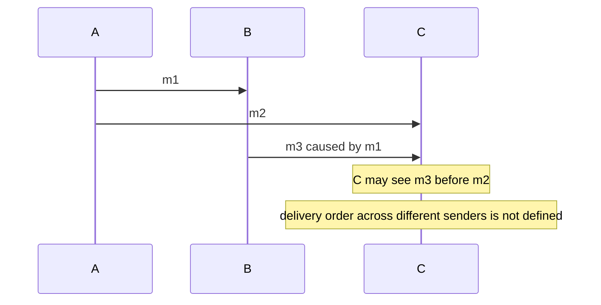

The sequence shows a causal hazard. m3 was caused by m1, which A sent before m2, yet C may see m3 before m2, because the paths A to C and A to B to C have independent delays. Any protocol that depends on C seeing m2 first is wrong unless it carries its own ordering information.

Practical remedies, in order of preference, are the following.

1. **Funnel related messages through one actor.** If order matters among messages about one entity, route all of them to the actor that owns the entity. Its mailbox then defines the order.
2. **Carry sequence numbers.** The sender adds a per-entity sequence number. The receiver processes in order, buffers early messages, and drops or ignores duplicates. This is a small local version of the mechanisms discussed in Part 07's [Ordering Guarantees](../07_System_Design_and_Distributed_Systems/CH18_Ordering_Guarantees.md).
3. **Use a request and reply step to create a happens-before relationship.** If A needs m2 to be processed after m1, A waits for B's acknowledgement of m1 before sending m2.

Also check what a retry does. If A resends m1 after a timeout, the retransmission can arrive after m2, which breaks the per-pair guarantee as seen by the application. Sequence numbers handle this case as well.

## 8. Delivery Guarantees: At-Most-Once as the Default

Delivery semantics describe how many times a receiver may see a message. Part 07 owns the theory, and [Exactly-Once Processing](../07_System_Design_and_Distributed_Systems/CH17_Exactly_Once_Processing.md) explains why exactly-once delivery over an unreliable network is not achievable on its own and is approximated by combining at-least-once delivery with idempotent handling. The recap needed here is short.

- **At-most-once.** The system sends the message once and does not retry. The message is received zero or one times. It can be lost.
- **At-least-once.** The sender retries until acknowledged. The message is received one or more times. It can be duplicated.
- **Effectively exactly-once.** At-least-once delivery combined with a receiver that detects duplicates so the effect happens once.

Actor runtimes commonly default to at-most-once for sends, usually described as "fire and forget". The reasoning is that retry policy depends on the application, so the runtime does not impose its cost or its duplicates. Local in-process sends are in practice reliable until the process dies, while remote sends can be lost to network faults, node failure, or a full mailbox. Confirm the default of the runtime you use, since it differs between products.

### 8.1 Adding reliability

Reliability is built above the default by combining three mechanisms.

1. **Acknowledgement.** The receiver replies when it has processed, or durably recorded, the message.
2. **Retry with a timeout and backoff.** The sender keeps a pending message with a retry timer until it sees an acknowledgement, and gives up after a limit.
3. **Idempotent receiver.** The receiver remembers the identifiers of recently handled messages, or makes the operation naturally idempotent, so a duplicate does not repeat the effect.

```python
class Inventory(Actor):
    def __init__(self) -> None:
        super().__init__()
        self._stock = {"sku-1": 10}
        self._results: dict[str, bool] = {}  # request_id -> outcome

    async def receive(self, message) -> None:
        if message.request_id in self._results:  # duplicate retry
            message.reply_to.set_result(self._results[message.request_id])
            return
        ok = self._stock.get(message.sku, 0) >= message.quantity
        if ok:
            self._stock[message.sku] -= message.quantity
        self._results[message.request_id] = ok
        message.reply_to.set_result(ok)
```

The receiver stores the outcome by request identifier, so a retry after a lost reply gets the original answer and the stock is decremented once. The `_results` dictionary grows without bound in this sketch. A real implementation bounds it by time or count and pairs the retention window with the sender's maximum retry window, because a duplicate arriving after the entry was evicted would be processed again. If the results must survive a crash, they must be persisted together with the stock change, which belongs to the later discussion of stateful actors.

The sender side of the same mechanism needs a bounded retry budget. Unlimited retries from many senders to a struggling actor amplify the overload that caused the timeouts, which connects to the next section.

## 9. Backpressure and Bounded Mailboxes

When senders produce messages faster than the actor can process them, the mailbox grows. This is the arithmetic of a queue, and it is easiest to reason about with a few quantities.

- Service rate $\mu$ is the number of messages per second the actor can process. It is the reciprocal of the mean handler time.
- Arrival rate $\lambda$ is the number of messages per second sent to it.
- Utilization is $\rho = \lambda / \mu$.
- Little's law states that the average number in the system equals arrival rate times average time in the system, $L = \lambda W$.

### 9.1 Worked example: an unbounded mailbox under overload

Illustrative numbers. A reservation actor takes 5 ms per message on average, so $\mu = 1 / 0.005 = 200$ messages per second. During a surge, $\lambda = 250$ messages per second.

1. The queue grows at $\lambda - \mu = 250 - 200 = 50$ messages per second.
2. After 10 minutes (600 s), the backlog is $50 \times 600 = 30{,}000$ messages.
3. A message arriving at that point waits about $30{,}000 / 200 = 150$ s before it is processed.
4. If each queued message holds 1 KB, the backlog uses about $30{,}000 \times 1\,\text{KB} = 30$ MB. That is small here, but the figure scales with message size and number of actors, so a few thousand overloaded actors can exhaust memory.

Two things are wrong with this picture even before memory runs out. The wait of 150 s is far longer than any caller's timeout, so most callers have already given up and retried, adding load. The actor is also spending its capacity on replies nobody is waiting for. Unbounded queues turn overload into delay and then into memory exhaustion, and hide the problem until it is large.

### 9.2 Sizing a bounded mailbox

Bound the mailbox so that the worst-case wait stays within the caller's deadline. If the caller's deadline is 2 s and the service rate is 200 messages per second, then by Little's law the mailbox bound should not exceed $2 \times 200 = 400$ messages. A message that is queued behind 400 others will wait about 2 s. A bound of 400 therefore keeps every accepted message inside the deadline, at the cost of rejecting messages beyond it, which is the point.

Utilization also affects typical queue length. For a simple single-server queue with random arrivals and random service times (the M/M/1 model, a textbook idealization that real workloads only approximate), the mean number in the system is $\rho / (1 - \rho)$. At $\rho = 0.5$ it is 1. At $\rho = 0.9$ it is 9. At $\rho = 0.95$ it is 19. The queue length grows sharply as utilization approaches 1, so an actor that runs at 95 percent of its capacity has a mean queue about 19 times longer than one at 50 percent. Plan capacity so that a single stateful actor sits well below saturation at expected peak.

### 9.3 Overload policies

When the mailbox is full, the runtime or the sender must do something. The choices are different trade-offs.

| Policy | Effect | Suitable for |
| --- | --- | --- |
| Block or suspend the sender | Sender waits for space, pushing delay upstream | Internal pipelines where slowing the producer is acceptable |
| Reject with an error | Sender gets an immediate failure and can retry later or tell its caller | Request and reply interactions with deadlines |
| Drop newest | Incoming message is discarded | Optional, low-value messages such as a repeated status update |
| Drop oldest | Oldest queued message is discarded | Latest-value data, such as a position update, where stale items are worthless |
| Prioritize | Important messages overtake others | Control messages, health checks, and cancellation |

Blocking the sender is backpressure in the strict sense: the slow consumer's limit propagates to producers. It works only if the sender can afford to wait, and it can cascade, since a blocked actor stops serving its own mailbox. In an actor system, a handler that blocks is itself a defect, so backpressure is generally implemented by a credit scheme or by rejecting with a signal, not by suspending a thread.

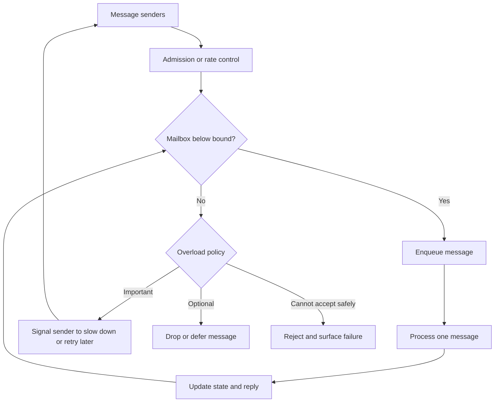

The diagram shows overload as a control loop. A full mailbox is a signal, and the policy decides how the signal reaches the senders. The loop back to the senders matters: if a rejected sender immediately retries without a delay, the retries become part of the arrival rate. Senders should use exponential backoff with jitter and a retry budget. The right metrics to watch are mailbox depth, age of the oldest message, rejection rate, and handler time, since depth alone does not show a slow handler.

A bound also protects other actors. Without it, one hot entity, such as a very popular product, can build a large backlog that dominates memory and scheduler time for all actors in the node. Per-actor bounds contain the damage to one entity. Where one entity needs more throughput than a single serial handler gives, the state must be partitioned into several actors, for example by splitting a counter into shards that are summed on read, because adding threads cannot make one serial mailbox faster.

## 10. Comparison with Threads and Locks, and with CSP Channels

### 10.1 Actors versus threads and locks

In the shared-memory model, threads run concurrently and coordinate through locks, atomic variables, and condition variables around shared data. Part 05's [Processes and Threads](../05_Networking_and_OS/CH24_Processes_and_Threads.md) covers the mechanisms. The comparison for a designer is as follows.

| Aspect | Threads and locks | Actors |
| --- | --- | --- |
| Where state lives | Shared, protected by locks | Private to one actor |
| Correctness argument | Every access follows the lock protocol | State touched only in the owner's handler |
| Typical bugs | Data races, deadlock from lock ordering, priority inversion | Protocol bugs, mailbox overload, lost or reordered messages |
| Failure handling | Exceptions in a thread, often process-wide impact | Supervision tree with per-actor recovery |
| Cost per unit of concurrency | An operating-system thread, with a stack and kernel scheduling cost | A runtime object scheduled onto a small thread pool |
| Distribution | A separate mechanism, such as remote calls | Same model, with a remote transport |
| Latency of one operation | Direct call, shortest path | Enqueue, schedule, dispatch, extra hop |
| Observability | Stack traces, thread dumps | Message traces, mailbox metrics |

Threads and locks are the better fit when state is large and shared, when operations need a consistent view over many items under one lock, or when the lowest possible latency for a local operation is required. Actors are the better fit when state decomposes naturally into many independent entities, when isolation of failure matters, or when distribution is expected. Actors do not remove deadlock: two actors that each wait for a reply from the other deadlock, and the solution is the same one: avoid circular waits and use timeouts.

### 10.2 Actors versus CSP channels

Communicating Sequential Processes, a model introduced by Tony Hoare, structures programs as independent processes that communicate over channels. Go's goroutines and channels are the best known mainstream descendant. The two models look similar but differ in what is named and how communication synchronizes.

| Aspect | Actors | CSP-style channels |
| --- | --- | --- |
| What a sender names | The receiving actor's address | A channel, which is independent of any process |
| Coupling | Sender knows the receiver | Sender and receiver know only the channel |
| Buffering | Mailbox, usually asynchronous | Often unbuffered (rendezvous) or with a fixed buffer |
| Sender blocking | Send normally returns at once | An unbuffered send waits for a receiver |
| Identity | Actors have identity and a lifecycle | Processes are anonymous, channels are first-class values |
| Receiver selection | Handles messages as they arrive | A process can choose among several channels |
| Failure model | Built-in supervision in mature runtimes | Left to the program |
| Typical home | Entity-oriented systems, distributed runtimes | Pipelines and worker pools within a process |

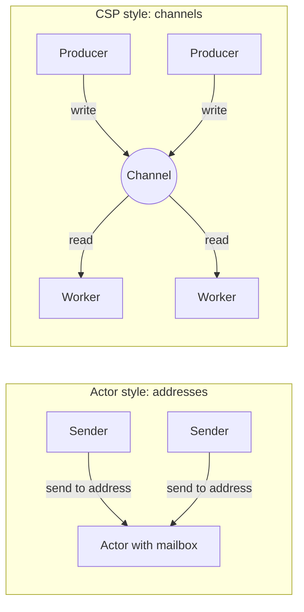

The diagram contrasts the two couplings. In the actor style, many senders target one addressable owner of state, which gives a natural home for entity state. In the channel style, many producers and workers share an anonymous channel, which gives a natural home for work distribution, where any worker can take the next item. The consequence is that channels suit stateless fan-out and pipelines (see the [Pipeline Pattern](CH13_Pipeline_Pattern.md)), while actors suit stateful entities where all messages about one entity must reach one owner. In practice, systems often combine them, and the choice depends on whether the central problem is distributing work or owning state.

Actors are easy to confuse with neighbouring patterns. A broker decouples applications through durable shared queues, a [Microkernel Architecture](CH15_Microkernel_Architecture.md) decouples a stable core from replaceable extensions, and a pipeline decomposes processing into stages. Actors can implement parts of each, but the defining property of actors is private state owned by an addressable, supervised unit.

## 11. Messages as State Transitions

Sections 2 to 10 described the mechanics of an actor. This section treats the actor as a protocol participant. The behaviour of an actor is a function from the current state and a received message to a new state and a set of effects. When that function is written down as a table of states and messages, the protocol can be reviewed, tested, and versioned like any other interface.

### 11.1 One state machine per actor

Most entity actors have a lifecycle, and the lifecycle is a finite state machine. Each message type is legal in some states and meaningless in others. Writing the machine out forces three decisions that are otherwise made accidentally in scattered conditionals: which messages are accepted in each state, what the actor replies when a message arrives in a state where it does not apply, and which transitions are terminal.

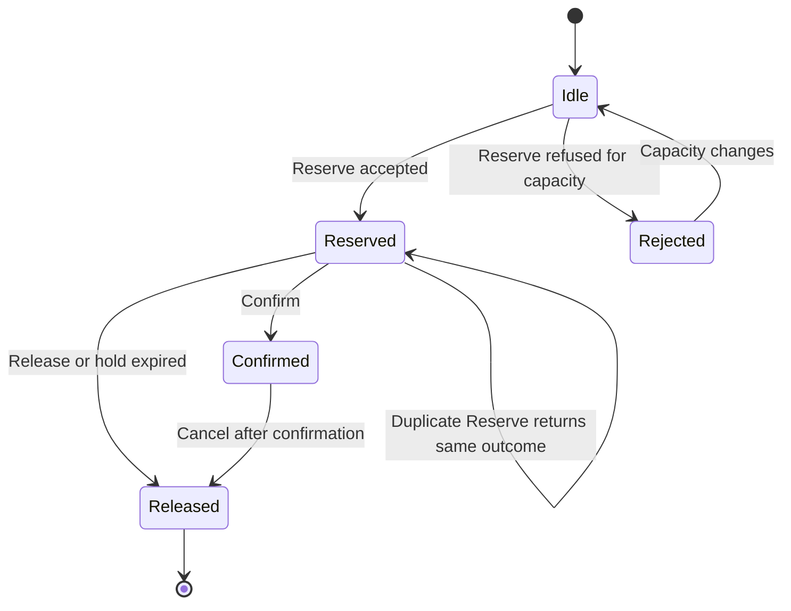

Read the diagram as a contract. A `Reserve` in state `Reserved` is not an error, because retries are expected. A `Confirm` in state `Released` must produce a defined rejection, because the hold may have expired while the confirmation was in flight. The diagram also shows what is absent: there is no transition from `Released` back to `Confirmed`, so no handler may produce one.

A compact way to keep the machine honest is to separate the decision from the effects. The handler computes the next state and a list of effects as a pure step, and a thin outer layer applies them.

```python
from dataclasses import dataclass


@dataclass(frozen=True)
class Reserve:
    request_id: str
    quantity: int


@dataclass(frozen=True)
class Release:
    request_id: str


def step(state: dict, message):
    """Return (new_state, replies). Pure: no I/O, easy to unit test."""
    held = state["held"]  # request_id -> quantity
    free = state["capacity"] - sum(held.values())
    if isinstance(message, Reserve):
        if message.request_id in held:  # duplicate is idempotent
            return state, [("reserved", message.request_id)]
        if message.quantity > free:
            return state, [("rejected", message.request_id)]
        new_held = {**held, message.request_id: message.quantity}
        return {**state, "held": new_held}, [("reserved", message.request_id)]
    if isinstance(message, Release):
        new_held = {k: v for k, v in held.items() if k != message.request_id}
        return {**state, "held": new_held}, [("released", message.request_id)]
    return state, [("unknown_message", None)]
```

Because `step` has no side effects, a test can feed it any sequence of messages and assert the resulting state and replies. The actor's `receive` calls `step`, stores the new state, and sends the replies. The same function is reused later for recovery by replay.

### 11.2 Request and reply with timeouts

A fire-and-forget send (usually called `tell`) places a message in the mailbox and returns. A request and reply (usually called `ask`) is a `tell` plus a correlation identifier, a reply address, and a deadline. The choice between them is a protocol decision.

| Aspect | Tell (fire and forget) | Ask (request and reply) |
| --- | --- | --- |
| Sender learns the outcome | No | Yes, or a timeout |
| Resources held by the sender | None | A pending reply slot until answered or timed out |
| Failure signal | None unless the protocol adds one | Timeout, which is ambiguous |
| Coupling | Low | Higher, because the sender waits for a specific answer |
| Typical use | Notifications, commands whose result arrives as a later event | Queries and commands where the caller must decide next |

Use `tell` for the default interaction and add a reply message only when the sender must act on the outcome. The common mistake is to wrap every send in an ask, which turns an asynchronous design back into synchronous calls with a mailbox in the middle. A chain of asks across several actors multiplies latency and creates the circular-wait deadlock described in section 4.1.

A timeout on an ask has three possible meanings: the request was lost, the request is still queued, or it was processed and the reply was lost. The sender cannot tell which. The protocol must therefore define what a timeout allows the sender to do. Two safe options exist. The sender may retry with the same request identifier, which is safe only if the receiver is idempotent. Or the sender may query the outcome with a separate `GetStatus(request_id)` message before deciding. Choosing a deadline also matters. A deadline should be shorter than the deadline of the caller above it, so that the actor gives up and reports before its own caller does. For example, if an interface promises an answer in 2 s, an inner ask to an actor should use something like 800 ms, leaving time for one retry or a clean error reply.

### 11.3 Idempotent handling by request identifier

Section 8.1 showed a results map keyed by request identifier. In the state-machine view, idempotency is a property of the transition table: replaying the same message in the state it produced must return the same reply and leave the state unchanged. In the sketch above, `Reserve` in a state that already holds the request identifier returns the same outcome and changes nothing. `Release` of an unknown identifier removes nothing and still replies, so a retried release is harmless.

Two rules keep this reliable.

1. The identifier must come from the original sender and stay the same across retries. An identifier generated by the receiver on each attempt defeats the mechanism.
2. The record of handled identifiers must live as long as retries can occur. If the sender retries for up to 30 s, the receiver must remember identifiers for at least 30 s plus clock and queueing slack, and it must store them in the same durable write as the state change when the actor persists state.

### 11.4 Versioned messages

Messages are an interface between components that are deployed at different times. A rolling deployment means that for some period a node running version 2 sends to a node running version 1. Treat message evolution like API evolution, as described in Part 08.

- **Add optional fields only.** A new field gets a default, and a receiver that does not know the field ignores it.
- **Never change the meaning of an existing field.** Introduce a new field or a new message type instead.
- **Carry a schema version or use a self-describing format.** The receiver can then route to the correct decoder.
- **Deploy receivers first.** Roll out the version that can read the new message before the version that sends it.
- **Keep old types readable as long as stored state or in-flight messages may contain them.** If actor state or a journal is persisted, old message shapes live as long as the data does, which section 13 returns to.

A message that cannot be decoded should not crash the actor in a loop. Route it to a dead-letter destination with the raw bytes and the error, and continue. Section 14 covers the monitoring of that destination.

### 11.5 Keeping effects recoverable

State transitions stay inside the actor, and external effects, such as calling a payment provider or publishing an event, are the hard part. If the actor updates state and then crashes before sending the effect, the effect is lost. If it sends the effect first and then crashes before updating state, the effect may repeat after restart. The safe pattern is to record the intent in the actor's durable state, perform the effect, and mark it done, using an idempotency key so that a repeat after a crash is harmless. This is the same reasoning as the outbox approach used with the [Saga Pattern](CH10_Saga_Pattern.md).

## 12. Placement, Passivation, and Cluster Membership

Section 5 explained that an address should derive from a stable business key. This section covers how a cluster turns that key into a running actor on some node, how it keeps memory in check, and what it does when membership changes.

### 12.1 Sharding: one live instance per key

A common design for entity actors is **sharding**. The key is hashed into one of a fixed number of **shards**, and each shard is assigned to one node. A shard coordinator, or a deterministic assignment function, records the mapping. The runtime creates the actor for a key on first use, inside the node that owns its shard. All messages for that key are routed to that node, so a single mailbox serializes them.

Using a fixed shard count that is much larger than the node count keeps rebalancing cheap. Illustrative numbers: with 1,024 shards and 8 nodes, each node owns 128 shards. When a ninth node joins, the cluster moves about 1,024 / 9 ≈ 114 shards to it, which is roughly 11 percent of the data and traffic, not a full reshuffle. Part 07 explains the general mechanics in [Partitioning](../07_System_Design_and_Distributed_Systems/CH11_Partitioning.md).

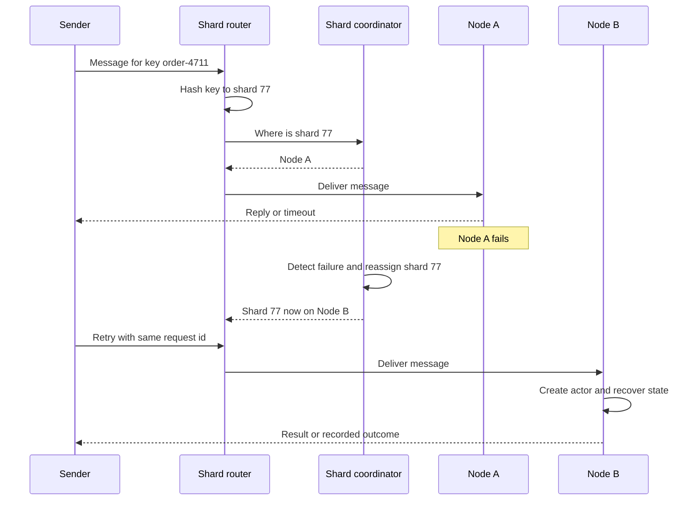

The sequence shows the full path of a message and the failure branch. Messages sent to a shard while it has no owner must be buffered briefly or rejected, and the choice is part of the protocol: a bounded buffer with a short deadline keeps callers informed. A retry reaches the new owner only if the sender uses the same address derivation and the same request identifier. The new owner starts an empty actor, so state must come from storage, which section 13 covers.

Some frameworks call this style a virtual actor or grain, where the runtime activates an actor on demand and the application never creates or destroys it explicitly. The programming model removes lifecycle code, but the questions in this chapter about delivery, ordering, and recovery still apply, and the exact guarantees differ by product and must be verified.

### 12.2 Passivation and activation

A system with millions of entities cannot keep every actor in memory. **Passivation** stops an idle actor after a period of inactivity and releases its memory. The next message for that key triggers **activation**: a new instance is created and its state is loaded.

Illustrative arithmetic: a service has 2,000,000 customer sessions, of which 5 percent are active at any moment. Each live actor with its state uses about 4 KB. Keeping all in memory costs 2,000,000 × 4 KB = 8,000,000 KB, about 8 GB. Keeping only the active ones costs 100,000 × 4 KB = 400,000 KB, about 400 MB. Passivation reduces the working set by a factor of 20 here, at the cost of a load on each activation.

The idle timeout is a trade-off. A short timeout saves memory but causes repeated activations for entities with bursty traffic, each of which reads storage. A long timeout holds memory for entities that will not return. Choose it from the observed gap between messages for an entity, and measure the activation rate. Two edge cases need care. Messages that arrive while the actor is passivating must be buffered and delivered to the next instance, not dropped. And an actor with pending work, such as a timer or an unacknowledged outbound message, must not passivate until that work completes or is persisted.

### 12.3 Placement decisions

Where a stateful actor lives affects latency and failure behaviour.

- **Co-locate by affinity.** Actors that exchange many messages benefit from one node, because local sends avoid serialization. Sharding by a common parent key, such as the customer for all of that customer's orders, achieves this.
- **Spread hot keys.** A single hot key cannot be sped up by more nodes. Split its state, as section 9 described for a counter.
- **Keep the owner count at one.** Two live instances of the same key are the main correctness risk, as the next subsection explains.
- **Spread across failure domains.** Shard owners and their storage replicas should not share a rack or availability zone unless the recovery arithmetic allows it.

### 12.4 Cluster membership and split-brain

A cluster must decide which nodes are members. Nodes exchange heartbeats, and a failure detector marks a node as suspected when heartbeats stop. The detector cannot distinguish a crashed node from a slow node or a network partition. Gossip-based membership, covered in [Gossip Protocols](../07_System_Design_and_Distributed_Systems/CH09_Gossip_Protocols.md), spreads these suspicions between nodes.

The hazard is **split-brain**: after a partition, two groups of nodes each believe the other is gone, and each reassigns the same shards, so two instances of the same actor accept writes. For an actor that owns money or inventory, that is a data-corruption scenario. Common mitigations, whose availability and defaults depend on the framework, include the following.

1. **A majority rule.** Only the group that holds more than half of the expected members continues to host singleton actors and shards. The minority group stops them. This is the same quorum reasoning as in [Consensus](../07_System_Design_and_Distributed_Systems/CH07_Consensus.md) and [Leader Election](../07_System_Design_and_Distributed_Systems/CH08_Leader_Election.md).
2. **A lease.** A node may host a shard only while it holds a time-limited lease from a coordination service, and it must stop when the lease expires. The lease length must exceed clock drift and pauses, such as long garbage collection, or two owners can overlap.
3. **A fencing token in storage.** Every write from an actor carries an ownership version, and storage rejects writes from an older owner. This protects state even if a stale instance keeps running for a short time.

Each mitigation trades availability for safety. The minority side becomes unavailable, which is the correct choice for state that must not diverge. For data that can tolerate divergence and later merge, the design can choose availability instead, but that choice belongs in the requirements, not in a framework default.

## 13. Persistent Actors and Recovery

An in-memory actor that restarts or moves loses its state. For entities whose state matters, the actor must persist it. Two strategies cover most designs, and they can be combined.

### 13.1 State snapshot versus event journal

- **Snapshot of current state.** After handling a message, the actor writes its whole state to storage under its key. Recovery reads the latest snapshot. This is simple and fast to recover, but each write carries the full state, and history is lost.
- **Event journal.** The actor appends the events that result from each message and rebuilds state by replaying them. Recovery cost grows with the journal length. This is the pattern taught in [Event Sourcing](CH11_Event_Sourcing.md), which also covers event schemas, upcasting, and projections. Here it is applied to one actor.
- **Journal plus periodic snapshot.** The actor writes events and, every N events, a snapshot that records the journal position. Recovery loads the newest snapshot and replays only the events after it.

The order of operations in a handler decides the failure behaviour. A safe sequence is: validate the message, compute the events with the pure step function from section 11.1, persist the events, apply them to memory, then send replies and effects. If the actor crashes before the persist, nothing changed and the sender will time out and retry. If it crashes after the persist and before the reply, the retry is detected as a duplicate by the identifier stored in the journal, and the recorded outcome is returned. Replying before persisting can acknowledge a change that is then lost, so it should be avoided for state that matters.

```python
def handle(self, message):
    events, replies = decide(self.state, message)  # pure decision
    self.journal.append(self.key, events)  # durable write first
    self.state = apply_all(self.state, events)  # then update memory
    for reply in replies:  # replies only after the write
        reply.send()
```

The pattern keeps the single-writer property: only this actor appends to this key's journal. Section 12.4's fencing token is what makes that property hold during a failover.

### 13.2 Recovery by replay, and the role of snapshots

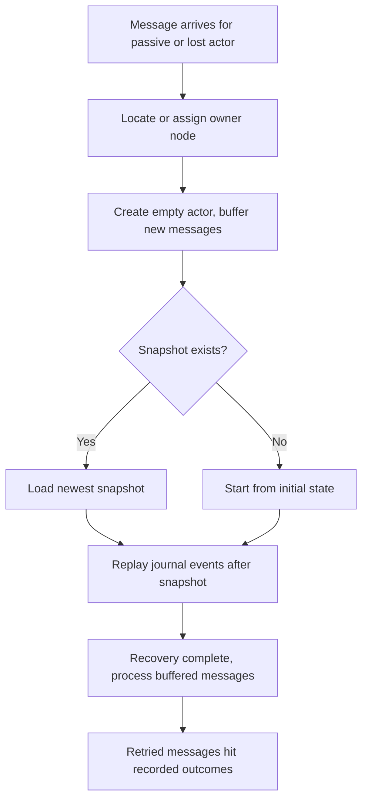

The flow shows that the actor accepts no message for processing until recovery completes. Messages that arrive during recovery wait in the mailbox, which therefore needs capacity and a deadline, or callers will time out during recovery. Recovery time is the quantity to design.

### 13.3 Worked recovery-time arithmetic

Illustrative numbers for a reservation actor. Replay applies an event in 0.05 ms, loading a snapshot takes 20 ms, and reading events from storage takes 5 ms per 100 events plus 10 ms of fixed latency.

1. **Journal only, 50,000 events.** Read time is $10 + (50{,}000 / 100) \times 5 = 10 + 2{,}500 = 2{,}510$ ms. Replay time is $50{,}000 \times 0.05 = 2{,}500$ ms. Total is about 5,010 ms, roughly 5 s.
2. **Snapshot every 1,000 events, worst case 999 events since the last one.** Snapshot load is 20 ms. Read time is $10 + \lceil 999/100 \rceil \times 5 = 10 + 50 = 60$ ms. Replay is $999 \times 0.05 \approx 50$ ms. Total is about 130 ms.

Snapshots cut the recovery time from about 5 s to about 130 ms in this example, a factor of about 38. If the service level objective for a failed-over actor to answer again is 1 s, the journal-only design fails it and the snapshot design meets it with room. The cost is the snapshot write, here once per 1,000 events, and the need to version snapshots as the state shape changes.

A shard failover recovers many actors, not one. If a failed node owned 128 shards that hold 20,000 active actors, and recovery is performed lazily on the first message to each, the cluster does not pay all 20,000 recoveries at once, but the first request to each pays the 130 ms. If instead all are recovered eagerly with 16 parallel recoveries, the work takes $20{,}000 \times 130 / 16 = 162{,}500$ ms, about 163 s. Lazy activation is the reason a hot spot of recoveries rarely appears, and it is a reason to prefer on-demand recovery for large populations.

### 13.4 Pitfalls of persistent actors

- **Persisting too much.** Large state written on every message turns the storage into the bottleneck. Persist events or deltas.
- **Journal growth.** Without snapshots and retention, recovery time grows without limit.
- **Schema drift.** Old events must stay readable, as section 11.4 noted. Test recovery from journals written by the previous version.
- **Non-deterministic replay.** If `apply` reads the clock or random numbers, replay produces a different state. Decisions that need time or randomness must record the value in the event.
- **Dual writes.** Persisting an event and publishing it to a broker are two writes. Use an outbox or a relay that publishes from the journal, so the broker sees every persisted event at least once and consumers handle duplicates, as described in [Event-Driven Architecture](CH07_Event_Driven_Architecture.md).

## 14. Testing, Observability, and Security of Message Boundaries

### 14.1 Testing actors

Actor tests are protocol tests. Four layers give good coverage at reasonable cost.

1. **Pure transition tests.** Because the decision step is a pure function (section 11.1), unit tests feed message sequences and assert state and replies. Include duplicates, out-of-order messages, and messages that are illegal in the current state. Property-based tests that generate random message sequences and check invariants, such as "held quantity never exceeds capacity", find ordering bugs that example tests miss.
2. **Single-actor tests with a test harness.** Run the real actor with a fake clock and a probe that plays the sender. Assert replies, timeouts, and that an unhandled message goes to dead letters. A fake clock makes timers and idle timeouts deterministic.
3. **Recovery tests.** Write events, kill the actor at each step of the handler, restart, and assert the state and that retried messages return the recorded outcome. Do this for each crash point: before persist, after persist before reply, and after reply.
4. **Cluster and fault tests.** Run several nodes, then partition the network, pause a node, and fail a node during load. Assert that no key has two live owners and that recovery meets its time budget. Because timing matters, run these in a controlled environment and repeat them, since a single pass proves little about races.

Tests should avoid fixed sleeps. Wait for an observable condition with a timeout, such as a message received by the probe, so tests are neither slow nor flaky.

### 14.2 Observability

Actors hide call stacks, so the telemetry must be designed in. The signals below are the minimum for an operable system.

| Signal | What it shows | Typical use |
| --- | --- | --- |
| Mailbox depth | Messages waiting per actor type | Early overload warning |
| Age of the oldest message | Waiting time of the head of the queue | Detects a stuck or slow handler better than depth alone |
| Processing latency | Handler duration, as percentiles | Finds slow handlers that cause queueing |
| Throughput per type | Messages handled per second | Capacity planning |
| Restart and stop counts | Supervisor decisions | Detects crash loops and bad deployments |
| Dead letters | Messages that could not be delivered or decoded | Detects routing errors, version skew, and stopped actors |
| Activation and passivation rate | Actor lifecycle churn | Tunes the idle timeout |
| Recovery duration | Time from activation to ready | Checks the recovery budget |

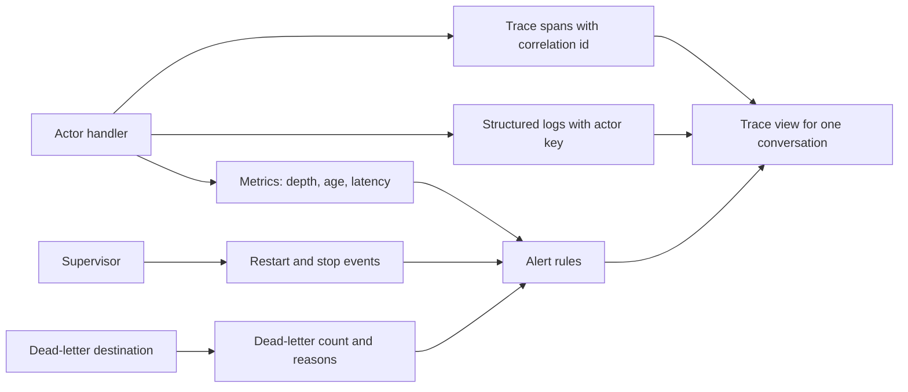

The diagram shows three telemetry paths feeding two uses: alerts for known conditions and a triage view for one conversation. The correlation identifier is the key to the triage view. Because a business operation spans several messages and actors, every message should carry the same correlation identifier and a causation identifier naming the message that caused it. Without them, an incident reduces to guessing which of millions of mailbox entries belong together. Avoid using the actor key as a metric label, because millions of keys create unbounded metric cardinality. Put the key in logs and traces, and aggregate metrics by actor type and shard.

Alert on symptoms. A rising age of the oldest message for one actor type, for example above half of the caller deadline, is more actionable than a raw depth number, since a depth of 300 is fine for a fast handler and a problem for a slow one. Dead letters deserve their own rule: a small steady rate may be normal for late replies to stopped askers, while a jump after a deployment points to a version mismatch.

### 14.3 Security of message boundaries

Inside one process, a message is a trusted in-memory value. Across a node boundary it is input from a network, and several threats apply.

- **Spoofed senders.** Remote transport should authenticate nodes, for example with mutual Transport Layer Security (TLS), so only cluster members can join and send. The sender address in a message is data, and a handler that grants rights based on an address inside the payload is trusting the sender's claim.
- **Untrusted deserialization.** Deserializing arbitrary types from bytes can execute unintended code in some serialization libraries. Use an explicit schema with a closed set of message types, and reject unknown types. Do not use a format that instantiates classes named by the payload.
- **Authorization at the actor.** An actor that exposes commands, such as `Release` or `Cancel`, must check that the caller is allowed to act on that entity. The cluster network being private does not remove this duty, because a compromised service inside it can send valid messages. Carry the caller identity or a verified token in the message and check it in the handler.
- **Message size and rate.** Limit message size at the transport and at decoding, and apply per-sender rate limits at the entry point, so one client cannot fill a mailbox. This ties to the overload policies in section 9.3.
- **Sensitive data in journals and dead letters.** Persisted events and dead-letter copies retain payloads. Minimize personal data in messages, and encrypt or tokenize it where required.
- **Address guessing.** An address derived from a predictable business key, such as a sequential order number, lets anyone who can reach the entry point try other keys. Authorization, not secrecy of the address, must protect the entity.

The boundary between a public interface and the actor system is where these checks belong. The entry layer authenticates the caller, validates and size-limits the request, converts it to an internal message, and only then sends it to the actor. Inside the cluster, handlers still validate state transitions, as section 11 described, but they do not need to re-parse hostile input.

## 15. Failure and Quality-Attribute Scenarios

A quality scenario states a stimulus, the response the system should give, and a measure that can be checked. The scenarios below apply to the reservation service used in the case study. All targets are illustrative and must be replaced by the targets of a real system.

### 15.1 Node failure during load

- **Stimulus.** One of eight nodes stops without warning during peak traffic.
- **Expected response.** The failure detector suspects the node, the coordinator reassigns its shards, and callers retry with the same request identifiers. Affected actors recover on first use from snapshot and journal.
- **Measure.** Detection and reassignment complete within 10 s. After reassignment, 99 percent of retried requests complete within 1 s. No request identifier produces two different outcomes. Zero reservations are lost for requests that were acknowledged.
- **Evidence.** A fault-injection run that kills a node under replayed peak load, with a check of the journal for duplicate or missing outcomes.

### 15.2 Network partition

- **Stimulus.** A partition splits the cluster into a group of five nodes and a group of three.
- **Expected response.** The majority group continues. The minority group stops hosting shards and rejects requests with a retryable error. After healing, the minority nodes rejoin and discard any local state that was not persisted.
- **Measure.** At no time do two groups accept writes for the same key. Fencing rejects 100 percent of writes from the old owner. Requests routed to the majority side keep their latency target.
- **Evidence.** A test that partitions the network while a writer sends to every key, followed by an audit that no journal has two writers for one version.

### 15.3 Overload from a hot key

- **Stimulus.** A promotional product receives 5 times the normal message rate to one key.
- **Expected response.** The key's mailbox hits its bound, new requests for that key are rejected with a retryable error, and other keys are unaffected.
- **Measure.** Rejected requests are answered within 50 ms. The p99 latency of other keys changes by no more than 10 percent. The oldest message age for the hot key stays below 1 s.
- **Evidence.** A load test with a skewed key distribution.

### 15.4 Poison message

- **Stimulus.** A message that always throws in the handler is delivered.
- **Expected response.** The supervisor restarts the actor, the actor recovers, the same message is not redelivered after a limit is reached, and it is moved to a dead-letter destination.
- **Measure.** The actor restarts at most 3 times in 60 s, then stops or skips the message. An alert fires within 1 minute. Other messages for the entity are processed after the skip.
- **Evidence.** A test that injects the message and asserts the restart count, the dead letter, and the alert.

### 15.5 Rolling deployment with message version skew

- **Stimulus.** A new version that adds an optional field to `Reserve` is deployed node by node over 20 minutes.
- **Expected response.** Old and new nodes interoperate. Old nodes ignore the new field and new nodes supply a default for messages without it.
- **Measure.** Dead-letter decode errors stay at zero during the rollout. Rolling back the new version leaves state readable.
- **Evidence.** A compatibility test that replays recorded messages of the old version against the new code and the reverse.

### 15.6 Slow dependency

- **Stimulus.** The payment provider's response time rises from 100 ms to 3 s.
- **Expected response.** The payment gateway actor times out at 800 ms and replies with a retryable failure. A circuit breaker stops sending for 30 s after repeated failures. Reservation actors are not blocked, because the call is asynchronous.
- **Measure.** Reservation p99 latency stays below 300 ms. The gateway's mailbox depth stays below its bound. Pending ask slots do not accumulate beyond the retry budget.
- **Evidence.** A test that delays the provider stub and watches reservation latency and gateway mailbox age.

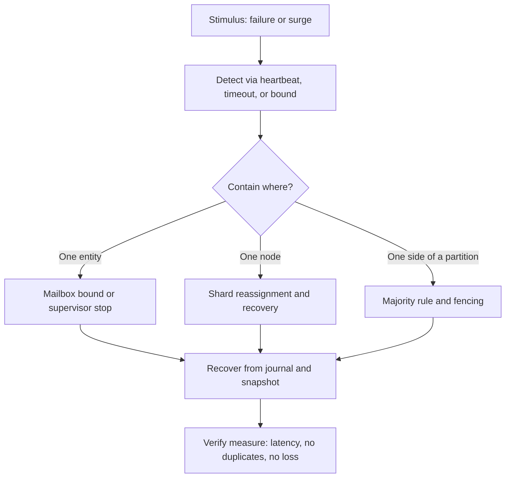

The diagram groups the scenarios by the scale of containment. Each scenario succeeds when the failure stays inside the smallest boundary that can absorb it and when recovery is verified against a measure. A scenario without a measure is a hope. Run these scenarios in a test environment before launch and again after significant changes to the cluster or the messages.

## 16. Worked Case: Reservation Coordinator for a Ticket Sale

This case applies the chapter to one hypothetical organization. Everything about it, including its name, volumes, and test results, is illustrative and invented for teaching.

### 16.1 Context and requirements

Harbor Tickets is a fictional ticketing company. For large events it opens a sale at a fixed time, and demand arrives within seconds. The reservation coordinator holds seats for a customer for 8 minutes while payment completes. Requirements:

- No seat is ever held or sold twice.
- During the sale peak of 4,800 reserve requests per second for one event, p99 latency for a reserve reply is at most 300 ms.
- If a node fails, affected sections answer again within 250 ms of the first retry after reassignment.
- Acknowledged holds survive a node failure.
- Retries by customers' browsers and by the payment service must not create duplicate holds.

### 16.2 Decision 1: the unit of ownership

The team considers three granularities for the actor that owns seat state. The handler takes 0.8 ms on average, so one actor serves $\mu = 1 / 0.0008 = 1{,}250$ messages per second.

| Option | Load on the busiest actor | Utilization | Verdict |
| --- | --- | --- | --- |
| One actor per event | 4,800 per second | $4{,}800 / 1{,}250 = 3.84$ | Impossible, the mailbox grows without limit |
| One actor per seat | A few per second | Very low | Possible, but a request for several adjacent seats needs a multi-actor transaction |
| One actor per section (60 sections) | Hottest section 12 percent of 4,800 = 576 per second | $576 / 1{,}250 \approx 0.46$ | Chosen |

A request for adjacent seats in one section is handled atomically inside one handler. The mean number in the system for the hottest section under the M/M/1 idealization is $0.46 / 0.54 \approx 0.85$, so queueing delay is small. Requests spanning two sections are rare and are modeled as two holds with a compensation step, following the [Saga Pattern](CH10_Saga_Pattern.md).

### 16.3 Decision 2: protocol and state

The section actor accepts `Reserve(request_id, seats, customer)`, `Confirm(request_id)`, `Release(request_id)`, and an internal `HoldExpired(request_id)` timer message. State is a map from seat to `free`, `held(request_id, expiry)`, or `sold`. Each request identifier appears at most once in the hold table, so a duplicate `Reserve` returns the existing outcome. The state machine matches section 11.1. All messages carry a schema version, and new fields are optional.

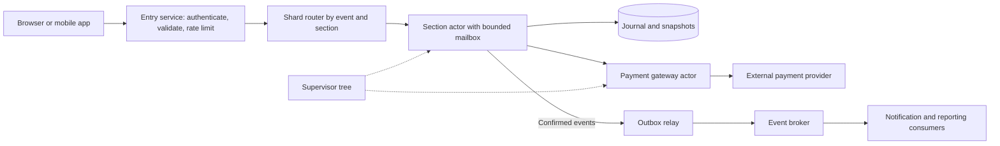

The diagram shows the data path. Customers never address actors directly. The entry service performs authentication and rate limiting, so the trust boundary of section 14.3 is explicit. The only durable shared state is the journal. The broker receives events through an outbox relay, which avoids the dual-write problem from section 13.4.

### 16.4 Decision 3: persistence and recovery

Hold and sale events are journaled before replies are sent. The section actor writes a snapshot every 500 events. A section is expected to accumulate about 4,000 events in a sale, counting reserves, releases, and confirmations.

Recovery arithmetic, with the cost model from section 13.3:

1. Journal only: read $10 + (4{,}000 / 100) \times 5 = 210$ ms, replay $4{,}000 \times 0.05 = 200$ ms, total 410 ms. This misses the 250 ms budget.
2. Snapshot every 500 events, worst case 499 events since the last: snapshot load 20 ms, read $10 + 5 \times 5 = 35$ ms, replay $499 \times 0.05 \approx 25$ ms, total about 80 ms. This meets the budget with room.

The team chooses snapshots at 500 events. A fencing version is stored with each journal append, so a stale owner after a partition cannot write.

### 16.5 Decision 4: capacity and overload

Total work at peak is $4{,}800 \times 0.8$ ms $= 3{,}840$ ms of handler time per second, which is 3.84 cores fully busy. The team chooses a target utilization of at most 50 percent after the loss of one node. With three nodes of 4 cores each, normal utilization is $3.84 / 12 = 32$ percent. After one node fails, 8 cores remain, so utilization is $3.84 / 8 = 48$ percent, under the target. Two nodes would not survive a node loss within the target ($3.84 / 4 = 96$ percent), so three is the minimum.

The caller deadline for a reserve is 1.5 s. By Little's law the mailbox bound is at most $1.5 \times 1{,}250 = 1{,}875$ messages. The team sets the bound at 1,500 to leave margin. When a mailbox is full, the actor rejects new `Reserve` requests with a retryable error, while `Confirm` and `Release` use a separate priority path so a customer who has already paid is not blocked by a flood of new requests. The entry service applies per-customer rate limits, and clients retry with exponential backoff and jitter within a budget of three attempts.

### 16.6 Decision 5: supervision and the payment gateway

Section actors are supervised one-for-one. A section actor that fails restarts from its journal, with at most 3 restarts in 60 s, and then stops and alerts. The payment gateway actor wraps the external provider and times out at 800 ms. It is separate from section actors, so a slow provider cannot block a section's mailbox. The section actor sends a payment request and handles the result as a later message, which keeps handlers short.

### 16.7 Alternatives that were rejected

| Alternative | Reason for rejection |
| --- | --- |
| Row locks in a relational database for each seat | At 576 hot requests per second on one section, lock waits and retries on adjacent-seat requests would dominate, and the team would still need an expiry mechanism. A fair option at lower volume, and simpler to operate. |
| A broker queue with competing workers and optimistic concurrency | Workers would race on the same section, causing version conflicts and retries that raise load exactly at the peak. Per-section serialization avoids the conflicts. |
| One actor per event | Utilization of 3.84 makes it impossible, as the table in 16.2 shows. |
| A distributed lock service per section | Adds a network round trip and a failure mode to every reservation and still needs the same expiry and idempotency logic. |
| In-memory actors without persistence | A node failure would release or lose acknowledged holds, which violates a stated requirement. |

### 16.8 Validation evidence

The team defines the following checks before launch. The results listed are illustrative values for this teaching case.

| Check | Method | Illustrative result | Target |
| --- | --- | --- | --- |
| Peak latency | Replay 4,800 reserve requests per second for 10 minutes | p99 of 210 ms | 300 ms |
| Node failure | Kill one of three nodes at peak | Reassignment in 7 s, retried requests p99 of 400 ms in the first 10 s | 10 s reassignment |
| Recovery time | Fail an owner after 4,000 events | 85 ms to ready | 250 ms |
| Duplicate holds | Replay every request twice with the same identifier | 0 duplicate holds in the audit | 0 |
| Partition | Isolate one node from the other two | Minority rejected writes, 0 journals with two writers | 0 |
| Hot key | Send 5 times the rate to one section | Rejects in under 50 ms, other sections' p99 changed by 6 percent | 10 percent |

The decision record notes what would change the design: if sales grow so that the hottest section exceeds 1,000 requests per second ($\rho = 0.8$ and a mean queue of 4), the section is split into row-level actors with a coordinator for adjacent-seat requests, at the cost of more message steps.

## 17. Common Mistakes and Anti-Patterns

| Anti-pattern | Cause | Consequence |
| --- | --- | --- |
| Blocking inside a handler | A database or remote call made synchronously | The mailbox stalls, latency spikes, and circular waits become possible |
| Unbounded mailboxes | The framework default is accepted | Overload becomes memory growth and long delays, as shown in section 9.1 |
| Ask everywhere | Habit from request-response design | Chained timeouts, deadlocks, and lost asynchrony |
| God actor | One actor owns many unrelated entities | A single mailbox limits throughput, as in section 16.2 |
| Leaking state | Returning a mutable reference or sharing a collection | Data races return, and isolation is lost |
| Assuming exactly-once delivery | A reliable local test hides loss | Lost or duplicated effects in production |
| Restart loops | No restart limit or backoff | A deterministic fault hides behind constant restarts and burns resources |
| Replying before persisting | Optimizing for latency | An acknowledged change is lost after a crash |
| Treating remote as local | Location transparency taken literally | Timeouts, serialization costs, and partial failure appear late |
| Two live owners of a key | No majority rule, lease, or fencing | Divergent state and corrupted data after a partition |
| Non-deterministic replay | Reading time or random values in the apply step | Recovered state differs from the original |
| Actors for everything | Pattern enthusiasm | Message overhead and protocol complexity where a function call or a simple queue would do |
| No correlation identifiers | Telemetry added late | Incidents cannot be traced across messages |

Each row has the same remedy pattern: make the decision explicit in the design, bound it, and test it with the scenarios of section 15.

## 18. Pattern Comparison and Decision Guide

The table compares the actor model with the main alternatives for coordinating concurrent work. Sections 3.2 and 10 gave the details, and the sibling chapters own their patterns.

| Dimension | Actors | Threads and locks | Queue with workers | [Event-Driven Architecture](CH07_Event_Driven_Architecture.md) | [Pipeline Pattern](CH13_Pipeline_Pattern.md) |
| --- | --- | --- | --- | --- | --- |
| Primary concern | Owned stateful entities | Shared in-memory state | Distributing independent tasks | Decoupling systems by events | Staged transformation of data |
| Where state lives | Inside each actor | Shared, protected by locks | Mostly in external storage | In services and the event log | In stage buffers and outputs |
| Ordering | Per sender and receiver pair, per entity mailbox | Whatever the locks enforce | Not guaranteed across workers | Per partition, if the broker offers it | Per stage, by the stage order |
| Failure containment | Supervision per actor | Process-wide in most cases | Retry or dead-letter per task | Consumer-level retry and replay | Stage-level retry |
| Scaling unit | Shards of entities | Threads on one machine | Workers | Consumers and partitions | Stages and their parallelism |
| Operational cost | Message tracing, cluster membership | Thread dumps and lock analysis | Broker operations | Broker, schemas, consumer lag | Buffer sizing, stage tuning |
| Best fit | Many independent stateful entities | Large shared structures, lowest local latency | Stateless jobs | Cross-team integration | Streaming transformations |
| Weak fit | Global queries across entities | Distribution and fault isolation | Per-entity ordering and state | Low-latency request and reply | Entity-specific state |

Systems combine these. An event-driven backbone can feed events to entity actors, an actor can hand a batch to a pipeline, and a worker queue can run the stateless jobs an actor starts. The decision depends on where the state lives and what must be ordered.

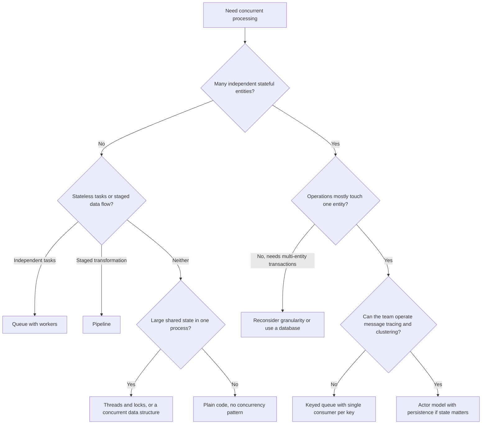

The flowchart puts the central question first: whether the workload is many independent stateful entities. If so, the next checks are whether operations stay within one entity and whether the team can operate the result. A keyed queue with one consumer per key gives much of the ordering benefit at lower cost, and it is an honest alternative when the team lacks actor tooling. The flowchart is a starting point for a design review, not a substitute for the measurements in sections 9 and 13.

## 19. Design-Review Checklist

Use these questions when reviewing an actor design.

- [ ] Each actor type has a stated owner of state, and no state is shared or leaked.
- [ ] Each actor has a state machine, with defined replies for messages that are illegal in a state.
- [ ] Handlers are short and non-blocking, and long work is split into messages.
- [ ] Mailboxes are bounded, with a chosen overload policy and a bound derived from the caller deadline.
- [ ] Every ask has a timeout shorter than its caller's deadline, and every retry reuses the request identifier.
- [ ] Receivers are idempotent, and the retention of handled identifiers covers the maximum retry window.
- [ ] Ordering assumptions are limited to per sender and receiver pairs or per entity, with sequence numbers where more is needed.
- [ ] Messages are immutable, versioned, and compatible in both directions during rolling deployment.
- [ ] The supervision tree, restart limits, and escalation paths are drawn and justified.
- [ ] Persistent state has a recovery time computed and tested against its budget, with snapshots where needed.
- [ ] Replay is deterministic, and external effects use an outbox or an idempotency key.
- [ ] Placement gives one live owner per key, and the split-brain mitigation is stated.
- [ ] Telemetry covers mailbox depth, oldest message age, handler latency, restarts, and dead letters, with correlation identifiers.
- [ ] Remote transport is authenticated, deserialization is restricted, and handlers authorize callers.
- [ ] Failure scenarios have stimulus, response, and measure, and have been run.
- [ ] The decision record explains why actors were chosen over locks, queues, and a database.

## 20. Exercises

1. **Mailbox sizing.** An actor handles a message in 4 ms and its callers time out after 1 s. What is the highest sensible mailbox bound, and what happens at 300 messages per second arrival?
   *Outline.* $\mu = 250$ per second, bound $\le 1 \times 250 = 250$ messages. At 300 per second the backlog grows by 50 per second, so the bound fills in about 5 s and the actor must reject. The fix is more sharding or a faster handler, not a larger bound.
2. **State machine.** Draw the state machine of a ride-booking actor with states requested, matched, started, completed, and cancelled. Which messages are idempotent?
   *Outline.* Cancel in cancelled, and Complete in completed, return the same outcome. Start in requested is illegal and gets a defined rejection. No transition leaves completed.
3. **Ordering.** Actor A sends `Create` to B and then `Update` to C. B sends `Link` to C when it processes `Create`. C receives `Update` before `Link`. Why, and how is it fixed?
   *Outline.* No ordering exists across different senders or paths. Fix by routing both through the owner of the entity, adding sequence numbers, or having A wait for B's acknowledgement.
4. **Recovery arithmetic.** An actor has 20,000 journal events. Reading costs 10 ms plus 5 ms per 100 events, and replay costs 0.05 ms per event. Compute recovery without a snapshot, and with a snapshot every 2,000 events (snapshot load 20 ms).
   *Outline.* Without: $10 + 200 \times 5 = 1{,}010$ ms read plus $1{,}000$ ms replay, 2,010 ms. With a worst case of 1,999 events: $20 + (10 + 20 \times 5) + 1{,}999 \times 0.05 \approx 20 + 110 + 100 = 230$ ms.
5. **Split-brain.** Eight nodes split into five and three. Which side hosts the shards and why? What if it splits four and four?
   *Outline.* The five-node side has a majority. With four and four, neither has a majority, so neither continues unless an external tiebreaker exists, trading availability for safety.
6. **Supervision.** A child fails on a deterministic message. Describe the behaviour with and without a restart limit, and propose a policy.
   *Outline.* Without a limit, an endless restart loop. With the limit of 3 in 60 s and backoff, escalate, move the message to dead letters, and alert.
7. **Pattern choice.** A team builds image resizing for uploads and a shopping cart service. Which suits actors?
   *Outline.* Carts are stateful entities with per-entity ordering, a good fit. Resizing is stateless and parallel, a fit for workers or a pipeline.
8. **Security review.** List three threats at the boundary of an actor cluster that accepts customer requests and the control for each.
   *Outline.* Forged senders (mutual TLS), hostile payloads (schema-restricted decoding, size limits), unauthorized commands (authorization in the handler), plus rate limits for flooding.

## 21. Summary

The chapter's introduction set seven outcomes. This table maps each to the sections where it is taught.

| Outcome | Where it is covered |
| --- | --- |
| Define an actor, its ownership, and its limits | Sections 2 and 11 |
| Explain why serial processing removes locks and where that stops | Section 4 |
| Reason about mailboxes, addressing, and location transparency | Sections 3, 5, and 12 |
| Design supervision with explicit restart policy | Sections 6 and 15.4 |
| State ordering and delivery guarantees and add reliability | Sections 7, 8, and 11.3 |
| Size a bounded mailbox and choose an overload policy | Sections 9 and 16.5 |
| Compare with threads, channels, and neighbouring patterns | Sections 10 and 18 |

The actor model fits workloads of many independent stateful entities where failure should stay local. The design work lies in the message protocol, the mailbox bound, the supervision policy, and the recovery and placement rules. Serial handling removes data races inside an actor, and everything between actors remains a distributed-systems problem: messages can be lost, duplicated, delayed, and reordered, and nodes can be partitioned. The practical discipline is to write each actor as a small state machine, make every handler idempotent, bound every queue, persist what must survive, give every key one owner, measure the behaviour under failure, and choose a simpler pattern when the workload does not have the shape that actors serve.
