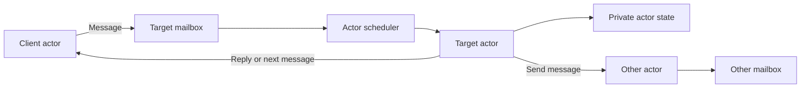
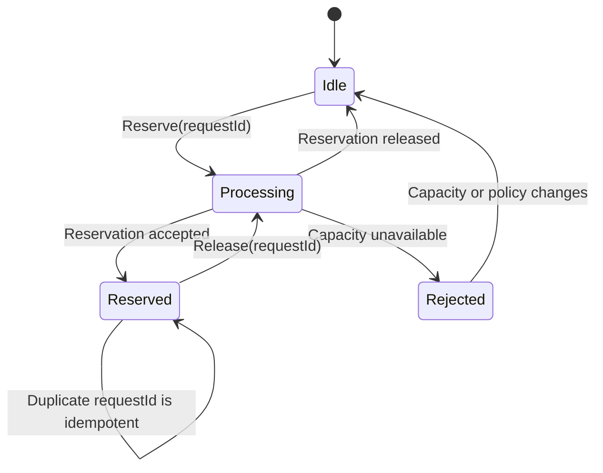
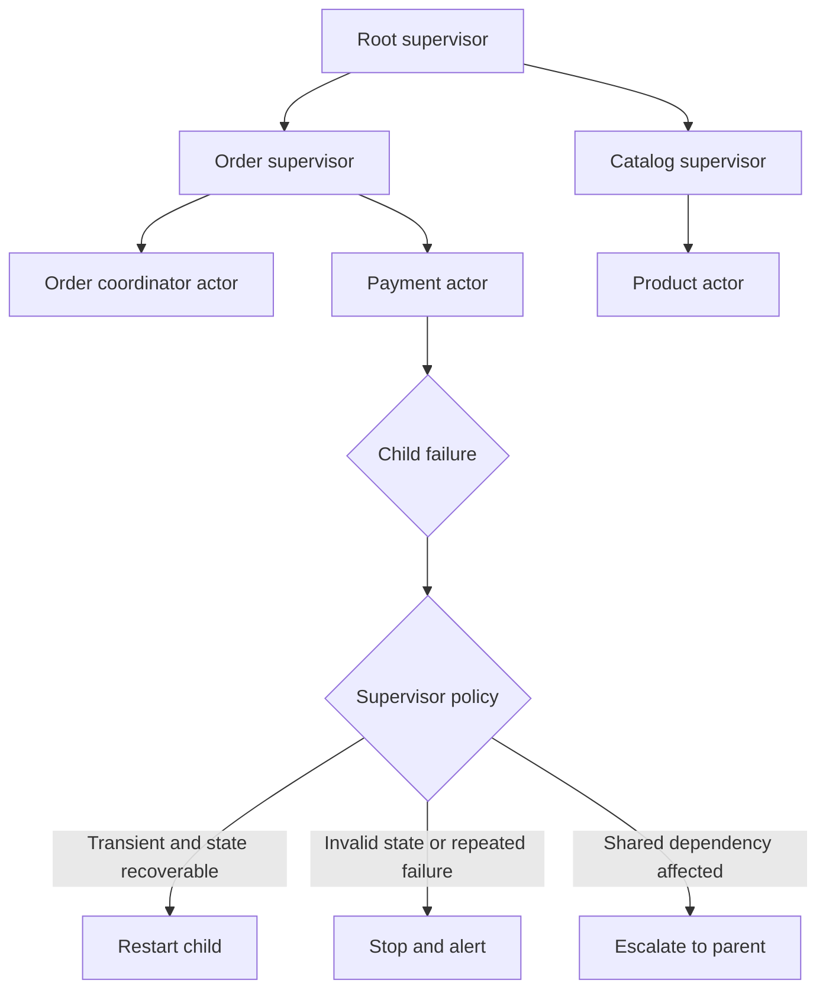
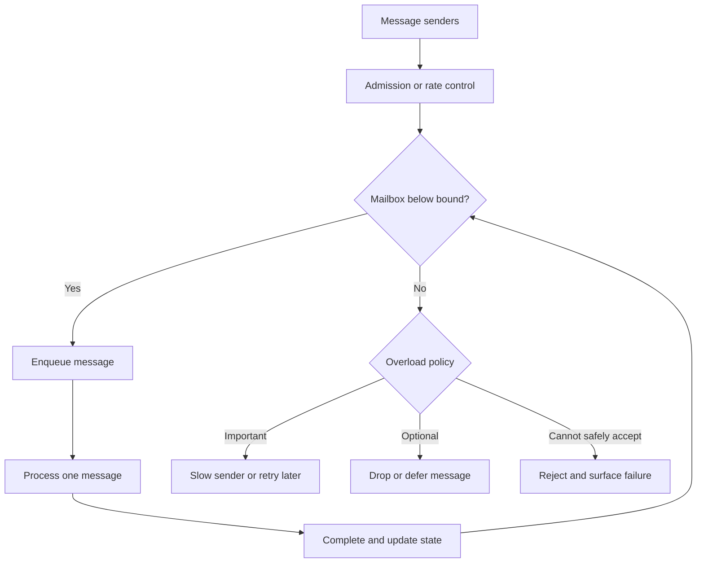
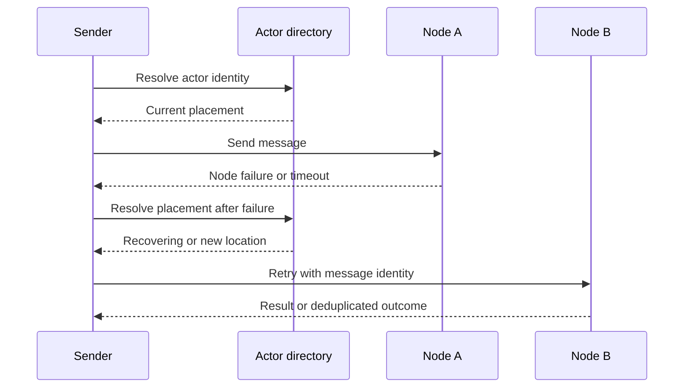

# Actor Model

Part: [20 — Architecture Patterns](PART_OVERVIEW.md)

The Actor Model structures computation as isolated actors that own state and communicate by messages. An actor processes its mailbox serially in the common model, which can simplify local state reasoning while supporting concurrency across actors. Distribution introduces message delivery, placement, supervision, and recovery concerns. Part 05 owns operating-system threads and processes; Part 07 owns distributed delivery semantics.

## Model Actors, State, and Mailboxes

An actor has an identity, private state, behavior, and mailbox. It processes a message, may update local state, send messages, and create or stop actors. Other actors do not directly mutate its state. This isolation reduces shared-memory coordination but does not remove the need to design message contracts and lifecycle.

A mailbox is a queueing boundary. Define whether messages are prioritized, bounded, durable, or in memory, and what happens when the actor is unavailable. A mailbox with unbounded growth can convert overload into memory exhaustion.

## Treat Messages as State Transitions

An actor's behavior maps a received message and current state to a new state and side effects. Explicit message types make allowed transitions testable. A request/reply protocol should define timeout and correlation; fire-and-forget delivery should not be mistaken for confirmed completion.

Keep state transitions inside the actor and make external side effects recoverable. If an actor persists state, define how mailbox messages relate to durable writes and restart recovery; an in-memory actor restart does not restore lost state automatically.

## Supervise Failures

A supervisor monitors child actors and applies a restart, stop, resume, or escalation strategy. Restarting can recover from transient faults, but repeatedly restarting a deterministic failure creates a loop. Define which state is recreated, whether messages are redelivered, and how dependent actors learn that a child has stopped or changed identity.

Supervision boundaries should align with fault containment and recovery ownership. Restarting all siblings can amplify a local fault; restarting only one child may violate invariants if shared state is inconsistent. Test failure sequences and inspect supervision events in production.

## Control Mailbox Overload

Messages can arrive faster than an actor processes them. Bound mailbox size or admission rate, shed optional work, prioritize deadlines, or apply backpressure where the sender can react. Fairness matters when many senders share one actor. A long-running handler blocks subsequent messages to that actor in a serial mailbox model.

Monitor mailbox depth, oldest-message age, processing time, and rejection. Do not add more actors to a single stateful identity without a partitioning plan; parallelism requires deciding which actor owns each piece of state.

## Place and Recover Actors Deliberately

Location transparency can simplify sending messages, but remote actors introduce network latency, serialization, partial failure, and deployment coupling. A local call and remote message should not be assumed to share latency or reliability semantics. Use stable actor identity and placement rules when state must survive process movement or restart.

For remote messages, define delivery guarantees, duplicate handling, timeouts, security identity, and state persistence. A retry can duplicate side effects unless the receiver or workflow uses idempotency. Part 07 owns the underlying delivery and consistency models.

## Worked Case: Reservation Coordinator

An order system uses an actor per reservation key to serialize changes to a bounded inventory allocation. The actor processes reserve and release messages, while a supervisor restarts stateless coordinators and recovers durable reservation state from storage. The mailbox is bounded and admission rejects low-priority bulk requests during a surge.

If the actor's node fails after writing a reservation but before replying, the caller retries with the same request ID. The recovered actor checks durable state and returns the existing result. A supervisor stops an actor after repeated invalid-state failures and alerts the inventory owner rather than restarting indefinitely. The team monitors mailbox age, reservation conflicts, restart rate, and duplicate suppression.

## Review Questions

1. Which state belongs privately to an actor, and what messages may change it?
2. What is the mailbox overload policy?
3. Which failures should trigger restart, stop, or escalation?
4. How does a remote actor differ from a local method call?
5. What prevents duplicate side effects after timeout and retry?

The Actor Model is useful when isolated stateful entities and message-driven concurrency match the workload. Keep ownership and transitions explicit, bound mailboxes, supervise according to recovery semantics, and treat remote messaging as a distributed system rather than a transparent local call.
