# Pipeline Pattern

Part: [20 — Architecture Patterns](PART_OVERVIEW.md) · Status: Revised (in-depth rewrite)

## 1. Introduction

A pipeline splits a processing task into an ordered series of stages. Each stage receives an item, performs one transformation or check, and hands the result to the next stage. Items flow through the series, and several items can be in different stages at the same moment. The shape is familiar from a Unix shell command that joins programs with a pipe character, and from a compiler that moves source text through lexing, parsing, analysis, and code generation. In architecture the same shape appears in document ingestion, payment file processing, media transcoding, data cleaning, request handling, and the preparation of training data.

The pattern is attractive because each stage can be understood, tested, scaled, and replaced on its own, and because the boundaries between stages are natural places to recover from failure. It has costs. Every boundary adds serialization, scheduling, buffering, and a contract that two pieces of code must keep. The slowest stage sets the throughput of the whole line. Buffers between stages can hide a sustained imbalance until memory or disk runs out. A failure in the middle of a chain raises the question of which side effects have already happened.

This chapter owns the general definition of the pipeline pattern, its decision criteria, and its consequences. After this part of the chapter you should be able to:

1. Define a stage, a pipe, and a filter, and state the interface rules that make stages composable.
2. Choose between batch and streaming execution for a given workload.
3. Specify the data contract between two stages and recognise coupling that bypasses it.
4. Size a bounded buffer, apply backpressure, and compute the throughput of a multi-stage line from its slowest stage.
5. Use Little's law, stated with its conditions, to estimate concurrency and queue delay.
6. Add parallelism to a stage without breaking required ordering.
7. Classify failures, bound retries, route poison items to a dead-letter queue (DLQ), and make stages idempotent.
8. Change a schema between stages while old items are still in flight.

The boundaries with neighbouring material are deliberate:

- A Continuous Integration and Continuous Delivery (CI/CD) pipeline, which builds, tests, and releases software, shares the name and part of the shape. It is a delivery practice, and its tooling and design belong to [CI/CD](../13_DevOps/CH02_CI_CD.md) in Part 13. This chapter covers the architectural pattern for data and work flowing through a running system, and does not cover build and release automation.
- Brokers, delivery semantics, and event contracts belong to [Event-Driven Architecture](CH07_Event_Driven_Architecture.md). A pipeline often uses a broker between stages, and this chapter recaps only what the pipeline design needs from it.
- Stateful entities that communicate by messages belong to the [Actor Model](CH12_Actor_Model.md). Extension of a host through loadable modules belongs to [Plugin Architecture](CH14_Plugin_Architecture.md) and [Microkernel Architecture](CH15_Microkernel_Architecture.md). Those patterns can implement a stage, but they have different goals.
- Stream-processing semantics and queueing theory belong to Part 07. The Little's law derivation is in [Non-Functional Requirements](../07_System_Design_and_Distributed_Systems/CH02_Non_Functional_Requirements.md). Checkpointing, watermarks, and exactly-once output are in [Exactly-Once Processing](../07_System_Design_and_Distributed_Systems/CH17_Exactly_Once_Processing.md) and [Ordering Guarantees](../07_System_Design_and_Distributed_Systems/CH18_Ordering_Guarantees.md). Retry-safe effects and duplicate suppression are in [Idempotency](../07_System_Design_and_Distributed_Systems/CH16_Idempotency.md) and [Deduplication](../07_System_Design_and_Distributed_Systems/CH19_Deduplication.md). Partition design is in [Partitioning](../07_System_Design_and_Distributed_Systems/CH11_Partitioning.md). This chapter applies their conclusions to pipeline stages.

All numbers in this chapter are illustrative. They show how to reason and are not measurements of any real system.

## 2. The Foundational Model: Pipes and Filters

The classic name for the pattern is pipes and filters. A **filter** (this chapter also says **stage**) is a processing step that reads items from an input, transforms or checks them, and writes results to an output. A **pipe** is the connection that carries items from one stage to the next. A **pipeline** is a series of stages joined by pipes, with a source at one end and a sink at the other.

Four rules define the pattern. Each one removes a kind of coupling.

1. **Single responsibility.** A stage does one job that can be named in a short phrase: validate, normalize, enrich, classify, persist. A stage that does several jobs cannot be tested, scaled, or replaced on one axis.
2. **Uniform interface.** Every stage accepts and produces items through the same kind of interface, so any stage can follow any stage whose output type matches its input type. The uniformity is what makes reordering, inserting, and removing stages cheap.
3. **No knowledge of neighbours.** A stage does not know which stage is upstream or downstream, or how many instances exist. It sees an input and an output.
4. **No shared mutable state between stages.** Everything one stage needs from another travels in the item. State that belongs to a stage stays inside it.

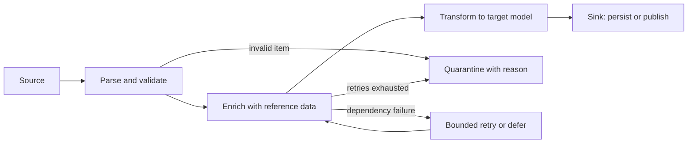

The diagram shows the happy path as a straight line and the failure paths as branches that leave it. Each stage has one input, one success output, and an explicit failure output. The implication is that failure handling is part of the stage contract and not an afterthought. A stage that can only succeed or crash forces every caller to invent its own recovery. A stage that returns a typed failure lets the pipeline route that failure by policy.

### 2.1 Composition as the main benefit

When stages share an interface, a pipeline is itself a stage. The pipeline from parse to transform takes a raw record and produces a target record, so it can be placed inside a larger pipeline. This is the same property as function composition: if `f` maps `A` to `B` and `g` maps `B` to `C`, then composing them maps `A` to `C`. The practical effect is that teams can build large processing flows from small, individually tested pieces, and can test a stage with plain input and output values, with no broker or scheduler.

The following Java 21 sketch shows typed stages. A stage returns a `Result`, which is either a value or a named failure. The `then` method composes two stages and short-circuits on failure, so a failed item never reaches the later stage.

```java
public sealed interface Result<T> {
    record Ok<T>(T value) implements Result<T> {}
    record Failed<T>(String stage, String reason) implements Result<T> {}
}

@FunctionalInterface
public interface Stage<I, O> {
    Result<O> apply(I input);

    default <R> Stage<I, R> then(Stage<O, R> next) {
        return in -> switch (apply(in)) {
            case Result.Ok<O> ok -> next.apply(ok.value());
            case Result.Failed<O> f -> new Result.Failed<R>(f.stage(), f.reason());
        };
    }
}
```

A small pipeline built from it:

```java
record RawOrder(String text) {}
record ParsedOrder(String id, long cents) {}
record PricedOrder(String id, long cents, long taxCents) {}

Stage<RawOrder, ParsedOrder> parse = raw -> {
    String[] parts = raw.text().split(":");
    if (parts.length != 2) return new Result.Failed<>("parse", "expected id:cents");
    try {
        return new Result.Ok<>(new ParsedOrder(parts[0], Long.parseLong(parts[1])));
    } catch (NumberFormatException e) {
        return new Result.Failed<>("parse", "cents is not a number");
    }
};

Stage<ParsedOrder, PricedOrder> price =
    p -> new Result.Ok<>(new PricedOrder(p.id(), p.cents(), p.cents() / 5));

Stage<RawOrder, PricedOrder> pipeline = parse.then(price);
```

The types do the checking: `parse.then(price)` compiles only because the output type of `parse` equals the input type of `price`. The sketch runs stages in one thread, in one process. That is a legitimate pipeline, and it is the cheapest one. The later sections show what changes when a queue sits between stages, and when stages run in parallel or in separate processes.

### 2.2 Pipe implementations

A pipe can be implemented in several ways, and the choice sets the failure and latency behaviour of the boundary.

| Pipe | What it is | Buffer | Failure behaviour | Typical use |
| --- | --- | --- | --- | --- |
| Direct call | Stage returns, next stage is called in the same thread | None | Failure propagates as a return value or exception | Short in-process chains where all stages are fast |
| In-memory bounded queue | Queue between threads in one process | Bounded by items | Lost on process crash | Parallel stages in one process |
| Durable queue or log | Broker topic or queue between processes | Bounded by retention and storage | Survives process crash, adds delivery semantics | Stages owned by different teams or scaled separately |
| Files or object storage | Stage writes a file, next stage reads it | Bounded by storage | Survives crash, coarse granularity | Batch pipelines |

Moving down the table buys isolation and recovery and costs latency, serialization, and operational surface. A good design uses the cheapest pipe that satisfies the recovery and scaling requirement for that boundary, and different boundaries in one pipeline can use different pipes.

## 3. Forces: When a Pipeline Fits and When It Does Not

### 3.1 Forces that favour a pipeline

- **Work decomposes into steps with different resource profiles.** If one step is processor-bound, another waits on a remote service, and a third writes to storage, separating them lets each be sized and tuned for its own resource.
- **Steps change at different rates or belong to different teams.** A stable validation stage and a frequently updated enrichment stage gain from separate release paths.
- **Recovery needs a boundary.** If a failure should resume from the last completed step and not from the beginning, the stage boundary is the natural checkpoint.
- **Inspection is valuable.** Counting items entering and leaving each stage gives an exact picture of where work is lost, delayed, or rejected.
- **Throughput matters more than the latency of one item.** Overlapping stages across many items raises the rate at which work completes.

### 3.2 Forces that argue against a pipeline

- **Steps are tightly entangled.** If each step needs the intermediate state of the previous two, the stage boundaries will leak and the contracts become large.
- **Fine granularity.** Splitting every function into a stage adds serialization and scheduling costs that exceed the work done. A stage should do enough work to amortize its boundary.
- **Strict end-to-end latency for a single item.** Each queue adds waiting time. A request that must complete in a few milliseconds may not afford several queue hops.
- **Non-linear control flow.** If processing needs loops, many conditional branches, or shared evolving state, a pipeline becomes a tangle of special cases. The [Blackboard Pattern](CH17_Blackboard_Pattern.md) addresses shared evolving state, and the [Saga Pattern](CH10_Saga_Pattern.md) addresses long-running workflows with compensation.

### 3.3 A decision heuristic

Ask three questions in order. First, can the work be described as a mostly linear series of transformations on one item at a time? If not, a pipeline fits poorly. Second, do at least two steps differ in resource profile, rate of change, or recovery needs? If not, a single function or module is simpler. Third, which boundaries need a durable pipe and which can be direct calls? The answer to the third question determines most of the cost.

## 4. Execution Models: Batch and Streaming

The same stages can be driven in two ways, and the choice changes latency, recovery, and flow control more than the stage code does.

A **batch** pipeline processes a bounded input. The set of items is known or closed, each stage works through a large part or all of it, and the job has a start and an end. Results are available when the job finishes. A **streaming** pipeline processes an unbounded input. Items arrive continuously, each stage works on items as they come, and results appear continuously with no end of input. A **micro-batch** design sits between them: items are grouped into small batches, for example by count or by a short time window, and each group is processed as a unit.

### 4.1 How the two models differ

- **Latency and throughput.** Batch amortizes per-item overhead, such as opening a connection or committing a transaction, across many items, and delivers high throughput with a long wait for the first result. Streaming minimizes the time from arrival to result for each item and often pays more overhead per item.
- **Completeness.** A batch stage can see the whole input, so it can sort, compute totals, join globally, or deduplicate across the set. A streaming stage never sees the whole input and has to decide when enough has arrived, which raises questions of windows and late items. Those semantics are treated in Part 07 and are not re-derived here.
- **Recovery.** Batch inputs are usually immutable files or tables, so a failed stage can be rerun from the output of the previous stage. Streaming needs a recorded position in the input, such as an offset or checkpoint, so that after a crash processing can resume without losing or repeating more than the design allows.
- **Flow control.** In batch, the storage between stages acts as the buffer, and the next stage starts when it is ready. In streaming, buffers are live queues and need explicit bounds and backpressure, covered in the section on bounded buffers.
- **Capacity.** Batch capacity can be provisioned for the duration of a run and released afterwards. A streaming pipeline holds capacity continuously, sized for its peak input rate.

### 4.2 Worked example: why batching a stage raises throughput

Suppose a persist stage writes to a relational database. In this illustrative case a commit costs 5 ms regardless of how many rows it carries (up to a few hundred), and each row costs 0.1 ms on top.

- One row per commit: $5 + 0.1 = 5.1$ ms per item, so one writer completes $1000 / 5.1 \approx 196$ items per second.
- 100 rows per commit: $5 + 100 \times 0.1 = 15$ ms per 100 items, so one writer completes $100 / 0.015 \approx 6{,}667$ items per second.

Batching raised the stage's capacity by about 34 times. The price is waiting. If items arrive at 1,000 per second, a batch of 100 fills in 100 ms, so the first item in a batch waits about 100 ms and the last waits almost nothing, an average added delay near 50 ms. The usual design flushes on whichever comes first, a size limit or a time limit, for example 100 items or 50 ms. The time limit bounds the delay when traffic is low, and the size limit bounds the batch when traffic is high. This is micro-batching inside one stage of an otherwise streaming pipeline, and it shows that batch versus streaming is a choice that can be made per stage as well as per pipeline.

### 4.3 Choosing the execution model

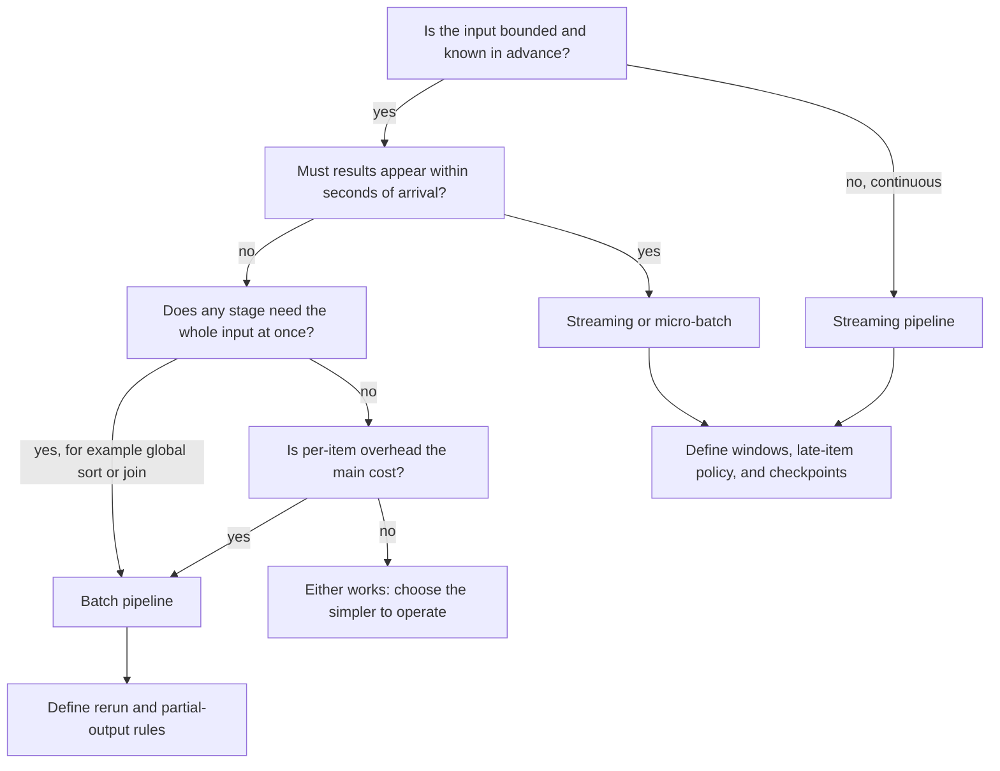

The tree starts from the facts that cannot be negotiated, whether the input ends and how fresh results must be, and only then reaches preferences. The implication is that a team should not pick streaming because it is current practice. Streaming adds window, lateness, and checkpoint decisions that a nightly batch never faces. Equally, a batch design cannot meet a freshness requirement measured in seconds. The leaf nodes name the extra design work each choice brings, which is where the cost sits.

Because stages are typed functions over items, the same stage code can often serve both models. A backfill of historical data can run through the stages as a batch, and new data can run through them as a stream. What differs is the driver and the pipe, and keeping stage logic free of driver assumptions is what makes this reuse possible.

## 5. Stage Boundaries, Coupling, and Data Contracts

### 5.1 Where to put a boundary

A stage boundary costs serialization, a pipe, an extra place to fail, and a contract to maintain. It should buy something. The criteria that justify a boundary are these:

- **Different resource profile.** A processor-bound step and a step that waits on a remote service want different concurrency settings, and separating them lets each be tuned.
- **Different rate of change or owner.** Code that changes weekly and code that changes yearly benefit from separate release paths.
- **A recovery point.** After a stage completes, its output is a durable fact, and a later failure restarts from there.
- **A scaling difference.** If one step needs ten instances and the next needs two, one process would have to take the larger number for both.
- **A trust or permission difference.** A stage that handles sensitive fields can be isolated from stages that do not need them.

A boundary that satisfies none of these should be a function call inside a stage. The common error is the reverse of the large stage: splitting a computation into many trivial stages because each step is conceptually separate. The cost shows up as latency, as serialization on every hop, and as a larger number of contracts and dashboards.

### 5.2 What a data contract contains

The contract between two stages is wider than a schema. A schema says which fields exist and what types they have. The contract also needs the following.

- **Identity.** A stable item identifier that survives retries and replays, so that a repeated item can be recognised. It should be assigned at the source or the first stage and never regenerated downstream.
- **Ordering information.** An ordering key, such as the account or document identifier, and a sequence or position within that key if order matters.
- **Time.** Which timestamp is meant. Event time, when the thing happened, and processing time, when a stage handled it, differ, and mixing them produces wrong windows and wrong ageing rules.
- **Semantics.** Units, ranges, and normalization. For example, an amount is in minor currency units and is not negative, or all timestamps are in Coordinated Universal Time (UTC). Semantics that are not written down become implicit coupling.
- **Failure shape.** The format of a failure record, including the stage name, a machine-readable reason code, and enough of the original item to diagnose it.
- **Version and owner.** A schema version and a named team that answers for the contract.

An envelope makes the non-payload parts explicit:

```java
import java.time.Instant;

public record Envelope<T>(
    String itemId,        // stable across retries and replays
    String orderingKey,   // for example the account identifier
    long sequence,        // position within the ordering key
    int schemaVersion,    // version of the payload schema
    Instant eventTime,    // when the thing happened, not when it was processed
    T payload) {}
```

The envelope separates what the pipeline machinery needs, such as identity, order, and version, from what the business logic transforms. Retry, deduplication, partitioning, and schema handling can then be written once against the envelope and reused for every stage.

### 5.3 Coupling that bypasses the contract

Stages are coupled in several ways, and only some of them go through the contract.

- **Temporal coupling.** Stage B must be running when stage A emits. A durable pipe removes this, at the cost of delivery semantics.
- **Schema coupling.** B depends on the field names and types A emits. This is the coupling the contract exists to manage.
- **Semantic coupling.** B assumes A has already normalized dates or removed duplicates, but the contract does not say so. When A changes, B produces wrong results without any error.
- **Hidden-state coupling.** B reads data that A wrote to a shared table, cache, or file, and the item does not carry it.

Hidden state between stages is the most damaging, so it is worth examining.

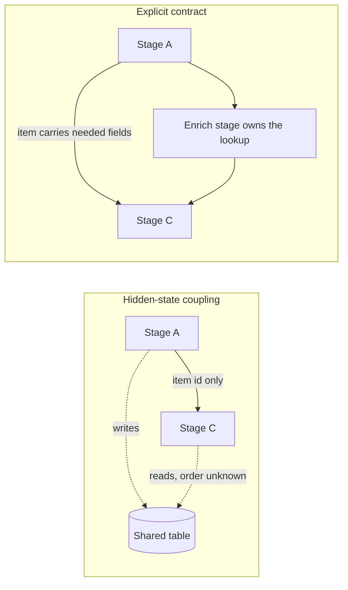

On the left, stage C works only if stage A has already written a row and nothing has changed it since. The ordering dependency is not visible in the pipeline definition. Three consequences follow. First, replaying stage C later reads the current state of the table, which may differ from the state at the original time, so results change between runs. Second, C cannot be tested with an input value alone, because a correct test needs the table set up to match. Third, the pipeline cannot reorder, parallelize, or retry freely, because those actions change when the table is written and read.

On the right, the values C needs travel in the item, or a named enrichment stage owns the lookup and puts the result in the item. The dependency is now in the pipeline definition, the contract states it, and a replay reproduces the original input. When a stage genuinely needs reference data that changes, such as an exchange-rate table, the contract should state which version or timestamp of that data the stage used, so results can be explained afterwards.

### 5.4 The god stage

The opposite error is a god stage that parses, validates, enriches, routes, and writes. It appears when the first version of a pipeline is one large function and every new requirement is added to it. Its symptoms are many reasons to change, a long configuration list, a failure log that mixes unrelated errors, and scaling that is all or nothing. The repair is to split along the boundary criteria above, resource profile, owner, and recovery point, and not along every function. Splitting also gives each new stage its own failure shape, which makes the error record more informative than a single "processing failed".

## 6. Bounded Buffers, Backpressure, and Throughput

A buffer between two stages lets a fast stage run ahead of a slow one for a short time. It absorbs bursts. It cannot absorb a sustained imbalance, because a buffer that fills only postpones the moment the imbalance has to be handled.

### 6.1 The slowest stage sets the throughput

In steady state, items cannot leave a pipeline faster than they pass its slowest stage. Take an illustrative three-stage line where stage A completes 800 items per second, stage B 300, and stage C 600, with a queue between each pair, and suppose the source offers 800 items per second.

- Sustained throughput is $\min(800, 300, 600) = 300$ items per second, limited by B.
- The queue in front of B grows at $800 - 300 = 500$ items per second if nothing slows A.
- With an unbounded queue and 2 KB items, that is $500 \times 3600 = 1{,}800{,}000$ items per hour, or about 3.6 GB of buffered data per hour. Memory or disk eventually fills, and the failure appears in the queue or in A, far from its cause in B.
- C receives only 300 items per second, so it runs at $300 / 600 = 50\%$ utilization. Doubling the capacity of A or C changes the end-to-end rate by nothing.
- Doubling B to 600 items per second raises the line to $\min(800, 600, 600) = 600$ items per second, and C becomes the limit.

The last two points are the practical rule: capacity added anywhere except at the current bottleneck is wasted, and removing a bottleneck moves the limit to the next stage. The section on measuring a pipeline returns to this movement.

A bounded queue also bounds delay. If the queue in front of B holds at most 1,000 items and B drains 300 per second, an item that enters a full queue waits about $1000 / 300 \approx 3.3$ seconds. A deadline for the item gives the queue size: capacity is the drain rate multiplied by the delay the item can tolerate.

### 6.2 Backpressure

**Backpressure** is a signal from a slower consumer to a faster producer that tells the producer to reduce its rate. Without it, the only options are unbounded growth or silent loss. Pipelines use four main mechanisms.

1. **Blocking on a full bounded queue.** The producer's `put` call waits until space is free. This is the simplest form and works inside one process. The wait propagates upstream: when A blocks, A's own input queue fills and A's producer blocks in turn.
2. **Demand or credit.** The consumer tells the producer how many items it is ready to take, and the producer sends no more than that. The consumer pulls at its own pace.
3. **Rejection at the edge.** When the source is outside the pipeline, such as a client uploading documents, the entry point returns an explicit "try later" status when the first queue is above a threshold. The client keeps the retry responsibility.
4. **Lag on a durable log.** When the pipe is a retained log, consumers read at their own pace and the backlog, called lag, is the buffer. Producers are not blocked. The bound is the log's retention and storage, and the signal is the lag metric, which someone must watch and act on. Brokers and their delivery semantics belong to [Event-Driven Architecture](CH07_Event_Driven_Architecture.md).

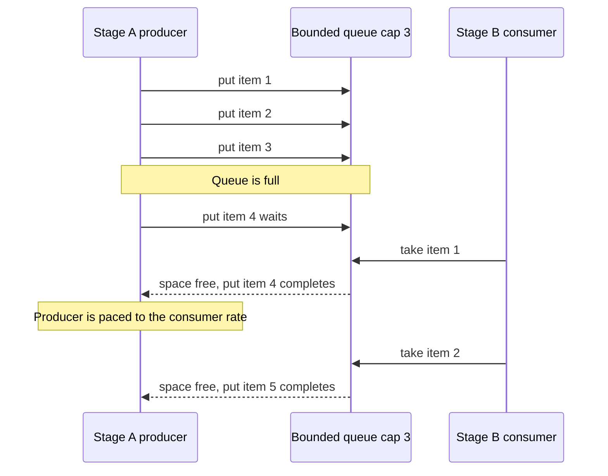

The diagram shows that once the queue is full, the producer's pace equals the consumer's pace. The queue no longer absorbs the difference, and the producer carries it as waiting time. The implication is that backpressure moves the cost of imbalance to the place that can best respond to it. A blocked producer can slow its own source, shed optional work, or reject at the edge. An unbounded queue gives the producer no information at all.

A minimal Python version with threads and bounded queues shows the mechanism. Each `put` blocks when the next queue is full.

```python
import queue
import threading

DONE = object()  # end-of-input marker passed down the line

def run_stage(fn, inbox: queue.Queue, outbox: queue.Queue) -> None:
    while (item := inbox.get()) is not DONE:
        outbox.put(fn(item))  # blocks when outbox is full
    outbox.put(DONE)

q_parse = queue.Queue(maxsize=100)
q_price = queue.Queue(maxsize=100)
q_out = queue.Queue(maxsize=100)

threading.Thread(target=run_stage, args=(str.strip, q_parse, q_price)).start()
threading.Thread(target=run_stage, args=(str.upper, q_price, q_out)).start()
```

Production code adds a timeout to `put` so that a stuck consumer cannot hold a producer forever, since indefinite blocking can tie up threads and connections. When the timeout expires, the stage applies its overload policy, described next.

### 6.3 Little's law, stated carefully

Little's law relates three averages. For a system observed over a long period in which arrivals and departures balance, so that items do not accumulate without limit, the average number of items in the system equals the average arrival rate multiplied by the average time an item spends in the system:

$$L = \lambda W$$

Here $L$ is the average number of items in the system, $\lambda$ is the average arrival rate (which equals the throughput in a stable system), and $W$ is the average time an item spends in the system. The law needs no assumption about the distribution of arrivals or service times. It does need the three quantities to describe the same boundary and the same period. The boundary can be a worker pool, a queue, one stage, or the whole line. The law says nothing about peaks, percentiles, or a period when the backlog is growing. It also does not predict $W$ from $\lambda$ by itself. Queueing theory beyond this relation belongs to Part 07.

Worked example, illustrative. Stage B must sustain $\lambda = 200$ items per second, and each item needs a mean service time of 40 ms.

- Items being served on average: $L_{service} = 200 \times 0.040 = 8$. At least 8 items must be in service at once, so at least 8 workers are required. With exactly 8 workers they would be fully busy, with no spare capacity for variation, so a design would add headroom. With 10 workers the utilization is $8 / 10 = 80\%$.
- Suppose a dashboard shows that items wait a mean of 100 ms in the queue before service. Then $L_{queue} = 200 \times 0.100 = 20$ items wait on average. The mean time in the stage is $0.100 + 0.040 = 0.140$ s, and $L = 200 \times 0.140 = 28$ items are in the stage on average.
- Rearranged, the law gives the delay from a gauge. If the queue-depth gauge averages 60 items at the same 200 items per second, the mean wait is $60 / 200 = 0.3$ s, without tracing any single item.
- Rearranged the other way, it bounds a concurrency-limited stage. If stage B calls a remote service that takes 250 ms per call and B is allowed 20 concurrent calls, its maximum rate is $\lambda = L / W = 20 / 0.25 = 80$ items per second, whatever the number of workers or queue size.

The caution is that these are means. A stage whose mean wait is 300 ms can have a tail of items waiting several seconds, so a latency deadline should be tested against a high percentile and not against the mean. Little's law is most useful for sizing worker pools and for turning queue-depth metrics into delay estimates.

### 6.4 Overload policies

A full queue with a producer that cannot wait forces a choice. The choice should be made in the design and not by whichever component runs out of memory first.

| Policy | Use when | Consequence |
| --- | --- | --- |
| Block with a deadline | The producer is internal and can tolerate a short wait | Delay moves upstream, and a deadline expiry needs a further policy |
| Reject at the edge | The source is external and can retry | The client sees an error or status, and the retry responsibility moves to it |
| Shed the newest item | Work is optional and each item is independent | Recent data is lost, and shedding must be counted |
| Shed the oldest item | Freshness matters more than completeness, as with a sensor reading that a later reading supersedes | Old data is lost, and consumers must accept gaps |
| Spill to durable storage | Loss is unacceptable and a delay is acceptable | Storage growth, a replay path, and an owner for the spill |
| Degrade the work | An optional stage can be skipped | Output has reduced quality, and the item must record what was skipped |

Whatever the policy, every dropped, rejected, or degraded item increments a counter by reason, so that loss is visible in the metrics. A policy that discards work silently has turned an overload into data corruption.

The failure mode that these policies prevent is the unbounded queue. Its effects accumulate in order: memory or storage grows, the delay for each new item rises until results arrive after they are useful, a crash or restart discards everything held in memory, and the restart itself adds load as the backlog is reprocessed. The queue also hides the imbalance, since every stage looks healthy until the resource runs out. Bounded queues turn the same imbalance into an immediate and local signal.

## 7. Parallelism per Stage and Ordering

Stages can process independent items concurrently to increase throughput. Ordering constraints may apply globally, per key, or not at all. Partitioning by key can preserve local order while allowing different keys to progress in parallel. Define how a failed item affects later work and whether reordering changes business meaning.

### 7.1 Three forms of parallelism

- **Pipeline parallelism.** Different stages work on different items at the same time. This is the basic benefit of the pattern and needs no extra design, because each item still passes through the stages in order.
- **Competing workers.** Several instances of one stage take items from the same queue. Throughput rises roughly with the number of workers until a shared resource limits it. Items can finish out of order, because two workers take items 1 and 2 and the second may finish first.
- **Keyed lanes.** Items are routed to one of several lanes by a key, such as the account identifier, and each lane is processed by one worker in order. Items with the same key stay in order, and items with different keys run in parallel.

### 7.2 Ordering scopes

Order is a requirement to be stated, not a default to be preserved. There are three scopes.

- **No ordering.** Items are independent, and any completion order is acceptable. Competing workers are the simplest and give the best load balance.
- **Per-key ordering.** Items for the same entity must be handled in order, but entities are independent. Keyed lanes provide this. Most business pipelines need only this scope, for example all events for one account in sequence.
- **Global ordering.** The sink must receive items in the order they entered. With parallel workers this requires a resequencer that holds finished items until all earlier items are done. The resequencer's buffer must hold everything that arrives while the slowest in-flight item finishes, and the head-of-line item sets the delay for those behind it.

The cost rises with the scope. A requirement for global order can quietly cap a parallel stage at the speed of its slowest item. Part 07 treats ordering guarantees in detail in [Ordering Guarantees](../07_System_Design_and_Distributed_Systems/CH18_Ordering_Guarantees.md) and partitioning in [Partitioning](../07_System_Design_and_Distributed_Systems/CH11_Partitioning.md). The pipeline design needs the practical consequence: choose the narrowest scope that preserves business meaning, and write it in the stage contract.

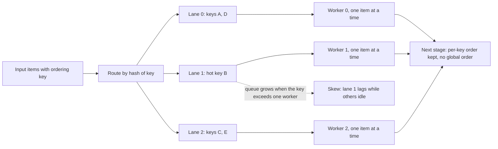

The diagram shows why per-key order costs parallelism. Within a lane, one worker handles one item at a time, so a lane can never run faster than a single worker. When load per key is even, the lanes stay balanced. When one key carries a large share, its lane becomes the limit while the other workers sit idle, and adding more workers elsewhere does not help.

### 7.3 Worked arithmetic: sizing lanes and finding the hot key

Suppose stage B needs 20 ms per item. One worker completes $1 / 0.020 = 50$ items per second. The stage must sustain 300 items per second.

- Workers required: $300 / 50 = 6$. With a headroom target of about 75% utilization, use 8 workers, giving $8 \times 50 = 400$ items per second of capacity and $300 / 400 = 75\%$ utilization.
- Keyed lanes, uniform keys: with 8 lanes, each lane receives $300 / 8 = 37.5$ items per second against its capacity of 50, so each lane runs at 75%.
- Keyed lanes, one hot key: if one key accounts for 25% of traffic, it sends $0.25 \times 300 = 75$ items per second to a lane that can process 50. That lane's backlog grows by $75 - 50 = 25$ items per second, and every other key hashed to the same lane waits behind it. The other seven lanes remain at lower utilization, so the stage has spare capacity overall and still falls behind for one key.
- Global order with a resequencer: if an occasional item takes 500 ms and the input rate is 300 items per second, about $0.5 \times 300 = 150$ items finish or arrive behind it while it runs, so the resequencer must buffer on the order of 150 items, and each of those items is delayed by up to 0.5 s.

Remedies for the hot key depend on what order the business needs. If per-key order is required in full, shorten the per-item work, give the key a dedicated worker with more capacity, or run that lane on a faster resource. If only order among a subset of operations matters, include a finer sub-key in the ordering key. If the operations on the key are commutative, such as adding to a counter, the stage can drop the order requirement for them and use competing workers. Monitoring should report per-lane queue depth and age, because a mean across lanes hides the skewed one.

## 8. Error Handling, Retries, and Dead-Letter Handling

### 8.1 Classify the failure first

The correct response to a failure depends on its cause, so a stage must tell the causes apart before it acts.

| Class | Example | Response |
| --- | --- | --- |
| Transient | Timeout, throttling response, brief dependency outage | Retry with a bound |
| Item-permanent | Malformed record, violated business rule, unsupported format | Quarantine the item with a reason, never retry unchanged |
| Systemic | A defect in the stage or a broken dependency that fails most items | Pause consumption and alert, so that a defect does not become a mass quarantine |
| Unknown outcome | Timeout after the stage sent a side effect, so it may have happened | Reconcile or rely on an idempotent effect before retrying |

The systemic class is the one most often missed. If a bad release fails every item and each failure is sent to a dead-letter queue, a code defect becomes a large manual repair. A stage should watch its failure rate and stop taking new work when the rate crosses a threshold, leaving the items in the queue where they are safe.

### 8.2 Bounded retries and their cost

A retry policy has a maximum number of attempts, a delay between attempts that grows, usually exponentially, random variation called jitter so that many workers do not retry at the same instant, and an overall deadline.

Illustrative arithmetic. Allow one initial attempt and three retries with delays of 1, 2, and 4 seconds.

- A failing item waits $1 + 2 + 4 = 7$ seconds in total before it is given up.
- If the dependency is completely down, each item makes 4 calls. At 300 items per second, the dependency receives up to $300 \times 4 = 1{,}200$ calls per second, which can slow its recovery. A limit on retries as a fraction of normal traffic, or a circuit breaker that stops calls after repeated failure, caps this amplification.
- If the worker sleeps through the delays, each blocked worker loses $50 \times 7 = 350$ item-slots of capacity at the 50 items per second rate of the earlier example. With 8 workers, a short outage can stall the whole stage.

Where the wait happens is a design choice. Waiting in the worker keeps order within the lane and blocks the lane. Moving the item to a delay queue frees the worker and lets later items pass, which reorders items for the same key. If per-key order matters, either block the lane, or park every later item for that key behind the failed one. State which in the contract.

### 8.3 Quarantine and dead-letter handling

An item that cannot be processed is moved to a **dead-letter queue (DLQ)**, also called a quarantine, with enough context to diagnose and replay it: the original item, the stage, the reason code, the attempt count, and timestamps. The item then follows a lifecycle that the design should define in full.

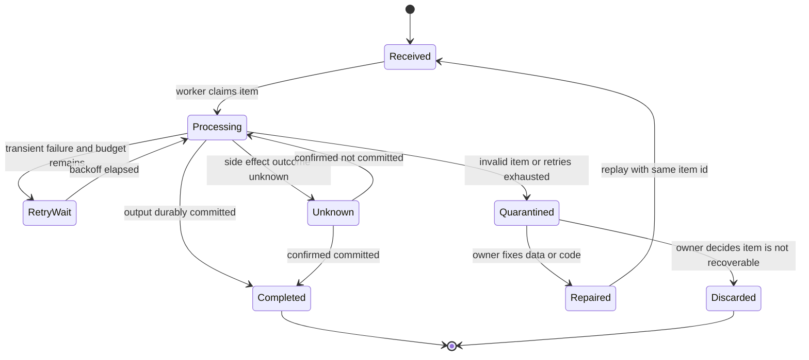

The diagram has two features that a plain retry loop lacks. The `Unknown` state exists because a stage can write to an external system and fail before recording that it did. Moving from `Unknown` back to `Processing` is safe only after a check by item identifier, or when the effect is idempotent, as the next section describes. The `Repaired` to `Received` edge shows that replay re-enters the pipeline with the same item identifier, so deduplication and idempotent effects recognise it.

Operating a DLQ needs several decisions made in advance. Someone owns it and is alerted when its depth or the age of its oldest item crosses a threshold. Access is restricted, because quarantined items hold the same data as the main flow and sometimes more context. Retention is set so that items are not lost before repair nor kept forever. Replay is a tested tool and not a manual script. Finally, a work item must not be acknowledged to the source until its output is durably recorded or it is safely quarantined, otherwise a crash between acknowledgement and effect silently loses it. Delivery semantics at the broker are covered in [Event-Driven Architecture](CH07_Event_Driven_Architecture.md).

## 9. Idempotent Stages

A stage is **idempotent** when applying it to the same item more than once leaves the same final effect as applying it once. Pipelines need this property because the mechanisms that make them reliable, retries, replays from a DLQ, and at-least-once delivery from a durable pipe, all cause the same item to be processed more than once. Part 07 treats the theory in [Idempotency](../07_System_Design_and_Distributed_Systems/CH16_Idempotency.md), [Deduplication](../07_System_Design_and_Distributed_Systems/CH19_Deduplication.md), and [Exactly-Once Processing](../07_System_Design_and_Distributed_Systems/CH17_Exactly_Once_Processing.md). The practical rule is that exactly-once effect is built from at-least-once delivery plus an idempotent effect.

Four techniques make a stage idempotent, in rough order of preference.

1. **Natural idempotency.** Choose operations that are safe to repeat. Setting a field to a value, or an upsert keyed by item identifier, gives the same result when repeated. Incrementing a counter does not.
2. **Deterministic output identity.** Derive the output key from the input identifier, so a repeated run overwrites the same output record instead of adding a second one.
3. **Recorded identifiers in the same transaction as the effect.** The stage writes the item identifier to a processed table in the same transaction as its output. A repeat finds the identifier and skips. This needs the output and the table in one transactional store.
4. **Versioned or conditional writes.** The write succeeds only if the item's sequence is newer than the stored one, which also rejects a stale item that arrives late.

A sketch of technique 3, using the syntax of PostgreSQL:

```sql
BEGIN;
INSERT INTO processed (item_id, stage) VALUES ($1, 'enrich')
    ON CONFLICT (item_id, stage) DO NOTHING;
-- if no row was inserted, the item was already handled: skip the next statement
INSERT INTO enriched (item_id, payload) VALUES ($1, $2);
COMMIT;
```

Effects that leave the system, such as sending an email or charging a card, cannot join the transaction. For those, pass the item identifier as an idempotency key if the receiving service supports one, or record intent in the same transaction and let a separate relay send it, as in the transactional outbox described in [Event-Driven Architecture](CH07_Event_Driven_Architecture.md). The key must come from the item and be stable across retries. A key generated inside the retry loop is different on each attempt and protects nothing.

## 10. Schema Evolution Between Stages

Schema change in a pipeline is harder than in a request and response API, because work is stored between stages. At any moment the queues, the DLQ, and possibly files hold items written under older schemas, while stages run in mixed versions during a rolling deployment. A change must therefore work for old items read by new code, and for new items read by old code.

- **Backward compatibility** means new code can read items written by older code.
- **Forward compatibility** means older code can read items written by newer code, usually by ignoring fields it does not know.

A pipeline needs both for the duration of a rollout. Four rules keep changes compatible. Add fields as optional, with a defined default. Never rename, retype, or reuse a field in place. Have readers ignore unknown fields. Carry a schema version in the envelope so that a stage can choose the correct reader. Part 08 discusses the same concerns for interfaces in [Versioning](../08_API_Architecture/CH10_Versioning.md), and [Event-Driven Architecture](CH07_Event_Driven_Architecture.md) covers event contracts.

A change that cannot be made compatible, such as splitting one field into two, uses an expand and contract sequence.

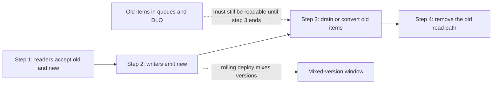

The order matters. For a stage that is both reader of its upstream and writer to its downstream, upgrade readers first, so working from the sink toward the source, and only then change what is written. Step 3 is the one that is often forgotten. If the backlog is 1,800,000 items and the stage drains 300 per second, the backlog takes $1{,}800{,}000 / 300 = 6{,}000$ seconds, which is 100 minutes, to clear. Items in the DLQ may stay far longer, since they wait for a person. The old read path can be removed only after those are replayed, converted, or discarded. Skipping this step turns a replay several weeks later into a failure.

## 11. Measuring a Pipeline and Following the Bottleneck

The earlier sections each ended with something to measure. Together they form the minimum set of signals for a pipeline. Metric design and tooling belong to Part 14, in [Metrics](../14_Observability/CH02_Metrics.md) and [Tracing](../14_Observability/CH03_Tracing.md). The pipeline-specific content is which signals to collect and how to read them.

For each stage, collect the input rate, the output rate, the service time per item, the number of busy workers, the depth and the age of the oldest item in the queue in front of it, and counts of retries, quarantined items, and shed items by reason. Age matters as much as depth, because a queue of 1,000 items that drains in a second is healthy and a queue of 1,000 items that has not moved for an hour is not.

The bottleneck has a recognisable signature. The queue in front of it is persistently full or growing, with old items at its head. The queues after it are nearly empty, and the stages after it show low utilization because they are starved. The stages before it are blocked or shedding, depending on the overload policy.

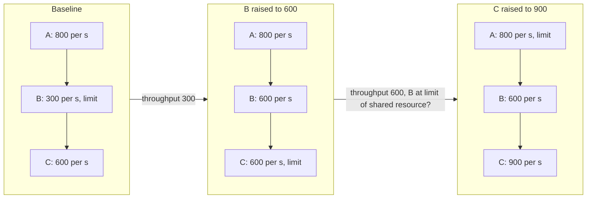

In this illustrative sequence the end-to-end rate is 300, then 600, then 600 or less. The last step shows the usual surprise. Raising C from 600 to 900 does not raise the line to 800, because B still caps it at 600. The line reaches 800 only when B is also raised, and then A, the source, is the limit. The sequence also teaches a sequencing rule: change one stage, remeasure, and find the new limit before spending on the next.

Scaling a stage can move the limit to a place outside the pipeline. Raising B from 300 to 600 items per second doubles its load on any database, remote service, or file system it uses. If another stage shares that resource, the line may slow down instead of speeding up, because the shared resource is now the bottleneck. Before adding workers, check the downstream limits and the ordering constraints from the earlier sections.

## 12. Stage Contracts and Testing Stages in Isolation

Section 5 described what a contract contains. A contract is only useful if it is executable, so each stage should ship with tests that state the contract and fail when either side breaks it. Three levels of test cover a pipeline, and each answers a different question.

1. **Stage tests.** Call the stage as a function with an input value and compare the result. Because a stage has no knowledge of its neighbours and no shared mutable state, this needs no broker, scheduler, or database. The `parse` stage in section 2 is tested with a handful of strings, including malformed ones, and each failure case asserts the stage name and reason code. These tests are fast, so they can cover many edge cases.
2. **Contract tests.** Check that the output of the upstream stage is a valid input of the downstream stage. The upstream team publishes example items, called fixtures, for the normal case, each failure shape, and each supported schema version. The downstream team runs its stage over those fixtures in its own build. When the upstream team changes an output, their build fails before the downstream stage is deployed. A schema validator on the fixtures catches structural drift, and assertions on semantics, such as "amount is non-negative minor units", catch the semantic coupling described in section 5.3.
3. **Pipeline tests.** Run a small set of items through the whole line with real pipes in a test environment. These tests check wiring, serialization, ordering, backpressure, and replay. They are slower and fewer, and they should not repeat the edge cases already covered by stage tests.

A property worth testing at the stage level is determinism. Given the same input and the same reference-data version, the stage returns the same output. Determinism is what makes replay (section 14) trustworthy, and a test that runs each fixture twice and compares the results catches accidental use of the clock, random numbers, or unordered collections.

```java
@Test
void parseRejectsNonNumericCents() {
    Result<ParsedOrder> r = parse.apply(new RawOrder("A17:abc"));
    assertEquals(new Result.Failed<ParsedOrder>("parse", "cents is not a number"), r);
}

@Test
void priceIsDeterministic() {
    var in = new ParsedOrder("A17", 1000);
    assertEquals(price.apply(in), price.apply(in));
}
```

Two kinds of defect escape these tests, and the pipeline tests exist for them. The first is an interaction under load, such as a queue bound that is too small for the batch size of the upstream stage. The second is a failure injected between stages, for example a worker killed after it committed an effect and before it acknowledged the item. A test that kills a worker at that point and then checks that the effect appears once is the most valuable single pipeline test, because it exercises the unknown-outcome path from section 8.

## 13. Observability and Tracing Across Stages

Section 11 listed per-stage metrics. Metrics show that something is slow or failing. They do not show which item, or why. A pipeline needs two further signals, logs keyed by item identifier and a trace that follows an item across stages. Metric and trace tooling belong to Part 14, in [Metrics](../14_Observability/CH02_Metrics.md) and [Tracing](../14_Observability/CH03_Tracing.md). This section covers what the pipeline must do so that those tools work.

The central rule is that the correlation data travels in the envelope. Every stage copies the item identifier and the trace context from the incoming envelope to the outgoing one, and writes both on each log line. A durable pipe does not carry call context by itself, so a stage that omits the copy breaks the trace at that boundary.

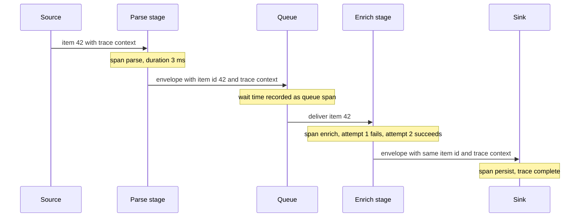

The diagram shows one trace made of stage spans and queue-wait spans. The queue span matters most. Total latency for an item is the sum of service times and waits, and in a loaded pipeline the waits usually dominate. A trace that records only service time would show fast stages and a slow item with no explanation. Retries appear as extra attempts inside one span, so the cost of a retry is visible for that item.

Two practical limits apply. Tracing every item at high volume is costly, so sampling is normal, and the sample should always include quarantined items and items older than a latency threshold, since those are the ones an operator will ask about. Batch stages combine many items into one unit of work, so a batch span should link to the trace context of each item it carries and not pick one parent.

Alerts should follow the symptoms in section 11 and not individual errors. Useful conditions are the age of the oldest item in a queue above its deadline, a quarantine rate above a threshold, a gap between the input and output rates of a stage that persists beyond a tolerance, and consumer lag growing for a period longer than a normal burst. Each alert names the stage and links to the dashboard for it.

## 14. Replay, Reprocessing, and Exactly-Once Effects

### 14.1 Why replay is a design requirement

A pipeline will need to process items again. Causes include a defect fixed in a stage, a corrected reference table, a new stage that must be applied to history, a recovery after a crash, and the repair of quarantined items. Replay is easy when stages are deterministic, items carry stable identifiers, and the input is retained. It is hard when stages read hidden state, generate new identifiers, or when the source is discarded after the first pass.

Three decisions make replay safe.

- **Retain the input.** The first durable copy of each item, the raw input, is kept long enough to cover the longest repair window. Replaying from a later stage's output is possible only if that output is also retained.
- **Keep identity stable.** A replayed item keeps its original identifier, so deduplication and idempotent effects recognise it.
- **Version the reference data.** A replay that uses today's exchange-rate table instead of the original can change results. Either record the reference version in the item, or decide explicitly that the replay should use the current version, and label the output as reprocessed.

### 14.2 Checkpoints and where to resume

A **checkpoint** is a durable record of how far a stage has progressed, such as an input offset or the identifier of the last completed batch. After a crash, the stage resumes from its checkpoint. The order of two actions decides the failure behaviour.

- **Effect, then checkpoint.** A crash between the two repeats the last items. The result is at-least-once processing, which is safe if the effect is idempotent.
- **Checkpoint, then effect.** A crash between the two skips the last items. The result is at-most-once processing, which loses work.

Almost every pipeline chooses the first order and makes effects idempotent. This is the practical content of exactly-once effect: the pipeline delivers items at least once, and the stage makes the repeat harmless. Where the stage's output and its checkpoint can be written in one transaction, the pair becomes atomic and the repeated window disappears. Streaming engines provide this as a feature for some sinks, and the guarantees and their limits are in [Exactly-Once Processing](../07_System_Design_and_Distributed_Systems/CH17_Exactly_Once_Processing.md).

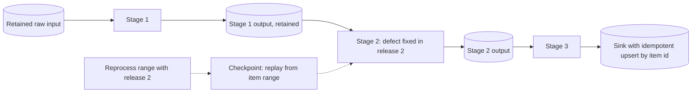

The diagram shows that replay starts at the earliest stage whose output is wrong, not at the source. Because stage 1's output is retained and stage 2 is deterministic, the team re-runs from stage 2 over the affected range. The sink's upsert by item identifier replaces the faulty records without creating duplicates. If the sink were an append-only log, consumers would have to apply the later version, so the contract should include a sequence or version that lets them choose.

### 14.3 Worked arithmetic: replay time and retention

Illustrative figures. A defect in stage 2 corrupted 6 hours of output. The line normally handles 300 items per second, which is $6 \times 3600 \times 300 = 6{,}480{,}000$ items in the window. Stage 2 can run at 600 items per second when it is not limited by stage 1, and live traffic still needs 300 of that capacity.

- Spare capacity for replay: $600 - 300 = 300$ items per second.
- Replay time: $6{,}480{,}000 / 300 = 21{,}600$ seconds, which is 6 hours.
- If live traffic must not slow, the replay finishes in 6 hours, the same as the window length. Doubling stage 2 capacity to 900 gives spare capacity of 600, so the replay takes $6{,}480{,}000 / 600 = 10{,}800$ seconds, or 3 hours.
- Retention: a window of 6 hours is repairable only if stage 1 output is retained for at least the time to detect the defect plus the replay time. If detection takes 2 days and replay 6 hours, retention needs to exceed 2 days and 6 hours, and a 24-hour retention would make the repair impossible.

Replay traffic competes with live traffic for the same stages, so it should run through a separate lane with its own rate limit, and its progress should be reported as a metric of its own.

## 15. Security and Data Classification per Stage

A pipeline is a series of processes that each see the data, and each pipe stores it. The more stages and queues, the more copies exist and the more places an access control can be missed. Part 15 owns the security mechanisms. The pipeline-specific decisions are where data is classified, which stages may see which fields, and what the pipes and the DLQ store.

- **Classify at the earliest stage that can.** If a classification stage runs late, earlier stages and their queues hold unclassified data and must be treated as holding the most sensitive class. Placing a lightweight classification or tagging step first lets later stages apply policy by label.
- **Least privilege per stage.** Each stage runs with an identity that can read only its input pipe and write only its output pipe and its own store. A stage that enriches with reference data needs no access to the raw documents beyond the item it holds.
- **Minimize fields in the envelope.** Pass only the fields later stages need. If a stage needs to know that a person exists but not their name, pass a token. Smaller items are also cheaper to move.
- **Encrypt pipes and retained data.** Durable queues, object storage, and files hold data at rest, so they need encryption and a retention period that matches the class of the data.
- **Treat the DLQ as production data.** It holds raw failing items, often with more context than the main flow, and it is read by humans. It needs the same access control, retention, and deletion rules as the source, and failure records should avoid copying sensitive fields into logs.
- **Validate at the trust boundary.** The first stage treats input from outside as untrusted. Size limits, type checks, and format checks belong there, so later stages can assume a validated item.

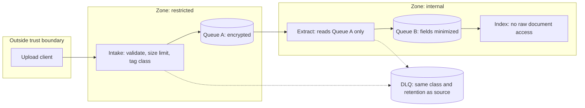

The diagram shows classification and validation at the boundary, a narrower field set in later queues, and a DLQ drawn inside the protected zone. The implication is that the number of stores is the unit of risk. Adding a stage adds an identity, a queue, and a retention policy, which is one more reason to hold to the boundary criteria in section 5.1.

## 16. Failure and Quality-Attribute Scenarios

Each scenario gives a stimulus, the expected response, and a measurable success criterion. All figures are illustrative targets and should be replaced with the numbers of the real system.

| Scenario | Stimulus | Expected response | Success criterion |
| --- | --- | --- | --- |
| Burst larger than capacity | Input runs at 800 items per second for 10 minutes against a stage limit of 300 | Bounded queue fills, backpressure reaches the edge, the entry point rejects with a retry status | No out-of-memory event, rejected count equals offered minus accepted, no accepted item lost, queue age stays below its 60 second limit |
| Dependency outage | Remote service fails for 5 minutes | Retries with backoff and jitter, circuit breaker opens, consumption pauses, items stay in the queue | Calls to the dependency never exceed 1.5 times normal rate, no item quarantined for a transient cause, backlog drains within 2 times the outage length after recovery |
| Poison item | One malformed item arrives among 1,000,000 | Item is quarantined with reason code after one attempt, the lane continues | Other items in the lane delayed by under 1 second, DLQ record has stage, reason, and original item |
| Bad release | New stage version fails 80% of items | Failure-rate threshold of 5% pauses consumption and alerts | Fewer than 1,000 items quarantined, rollback and resume restores processing without manual item repair |
| Worker crash mid-effect | Worker killed after writing output and before acknowledging | Item is delivered again, idempotent write makes the repeat harmless | Sink holds exactly one record for the item identifier in 100 of 100 injected-crash runs |
| Hot key | One key sends 25% of traffic | Lane lags only for that key, alert on per-lane age, remediation per section 7.3 | Other lanes stay under 80% utilization, hot lane age alert fires within 2 minutes |
| Schema rollout | Stage upgrade adds a field during a rolling deploy | Old and new versions interoperate, old items still readable | Zero schema-related failures during rollout, old read path removed only when backlog and DLQ hold no old-version item |
| Replay after defect | 6 hours of faulty output | Targeted reprocess from retained stage output through a separate lane | Replay completes within 6 hours at the spare capacity computed in section 14.3, live latency unchanged beyond 10% |

A scenario is useful only when it is exercised. Each row should map to a test in the pipeline test suite from section 12, run on a schedule in a test environment, and the results kept as evidence for design reviews.

## 17. Worked Case: Claims Document Ingestion

**This case is illustrative.** The organization, "Northfield Claims", and all figures are invented to show reasoning and do not describe a real company.

### 17.1 Context and requirements

Northfield accepts scanned claim documents from customers and partner offices. Each document goes through intake validation, text extraction, sensitivity classification by a remote service, metadata creation, and publication to a search index. Requirements:

- Normal load 20 documents per second, bursts to 60 per second lasting up to 15 minutes after a partner office uploads a backlog.
- 95% of documents searchable within 5 minutes of acceptance.
- No document lost once accepted, and no duplicate records.
- Documents can contain personal data, so access follows the classification.
- The classification provider limits Northfield to 25 concurrent requests, and each call takes about 400 ms.

### 17.2 Capacity arithmetic

Per-stage service times, measured in a test environment and rounded: intake 10 ms, extraction 800 ms, classification 400 ms (remote), metadata 20 ms, publication 50 ms.

| Stage | Workers | Capacity per second | Check |
| --- | --- | --- | --- |
| Intake | 4 | $4 / 0.010 = 400$ | Far above burst of 60 |
| Extraction | 60 | $60 / 0.8 = 75$ | Above burst of 60, 80% utilization at burst |
| Classification | 25 (provider limit) | $25 / 0.4 = 62.5$ | Above burst of 60 at 96% utilization |
| Metadata | 4 | $4 / 0.020 = 200$ | Ample |
| Publication | 8 | $8 / 0.050 = 160$ | Ample |

The line limit is $\min(400, 75, 62.5, 200, 160) = 62.5$ documents per second, set by the provider quota. A 15-minute burst at 60 per second is 54,000 documents, and normal load is 20 per second, which uses $20 / 62.5 = 32\%$ of the line. The burst leaves classification at 96% utilization, so there is almost no headroom.

Little's law check for extraction at burst: $L = \lambda W = 60 \times 0.8 = 48$ items in service, so 60 workers give $48 / 60 = 80\%$ utilization, matching the table.

Backlog check. If a partner uploads 100,000 documents at once and the entry point accepted them, classification would drain at 62.5 per second while live load of 20 per second also needs capacity. Spare capacity is $62.5 - 20 = 42.5$ per second, so the backlog takes $100{,}000 / 42.5 \approx 2{,}353$ seconds, about 39 minutes. That misses the 5-minute objective for the tail of the backlog, which is why the entry point must not accept unbounded bulk work.

### 17.3 Decisions and rejected alternatives

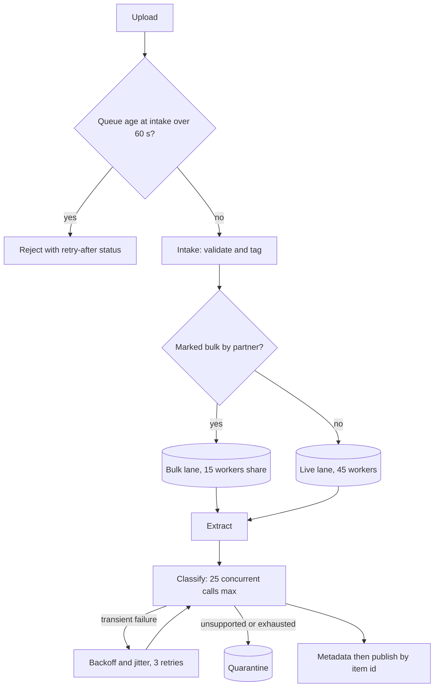

The decisions were these.

1. **Bounded queues with rejection at the edge.** Accepted work has a bounded wait. Rejected uploads are retried by the client with the retry-after value. Rejected alternative: accept everything into a large durable queue. It would never reject, but the 39-minute backlog arithmetic shows it would break the 5-minute objective for many accepted documents, and the failure would be seen by searchers and not by uploaders.
2. **Separate lanes for bulk and live traffic.** Bulk uploads use at most 15 of the 60 extraction workers, so live documents keep roughly 45 workers, which is $45 / 0.8 = 56$ documents per second of extraction capacity, above the live rate of 20. Rejected alternative: a single shared queue. A partner backlog would delay every live document behind it.
3. **Do not scale classification past the provider quota.** Adding extraction workers beyond 75 per second gains nothing, since classification caps the line at 62.5. The team negotiates a higher quota only if sustained load requires it. Rejected alternative: add many classification workers. Calls above the quota would be throttled, and the retries would multiply the load on the provider.
4. **Idempotent publication by document identifier.** The document identifier is assigned at intake and used as the index key, so a repeat after a worker crash overwrites the same record. Rejected alternative: generate the record identifier at publication, which would produce duplicates after a replay.
5. **Classification before metadata creation, tags at intake.** Intake tags the document as unclassified-restricted, so queues and extraction hold it under the strictest policy until classification completes. Rejected alternative: classify last, which would leave raw text in internal queues with unknown sensitivity.

### 17.4 Validation evidence

The team ran the scenarios from section 16 in a test environment with synthetic documents and recorded these results (illustrative).

- A 60 per second burst for 15 minutes produced no rejections, classification utilization of 94%, and a maximum queue age of 38 seconds. The 95th percentile time to searchable was 2.1 minutes, within the 5-minute objective.
- A 100,000-document bulk upload was accepted at the rate the edge threshold allowed and rejected beyond it, with 100% of accepted documents searchable and no live-lane document waiting over 20 seconds.
- Killing extraction workers at random during a 10,000-document run, and repeating the run 20 times, left exactly 10,000 index records each time.
- A simulated classifier outage of 5 minutes opened the circuit breaker, paused consumption, and drained the backlog in 8 minutes after recovery, under the 2 times outage-length criterion, with no document quarantined for a transient cause.
- A deliberately corrupt file was quarantined after one attempt with the stage name and reason, and a replay after the file was repaired produced one index record.

Bottleneck migration was visible in the dashboards. Before the extraction pool was set to 60 workers, extraction was the limit at about 35 per second. After the change, the limit moved to classification at 62.5 per second, where the provider quota is the next boundary and the next decision belongs to a conversation with the provider, not to more code.

## 18. Common Mistakes and Anti-Patterns

| Anti-pattern | Cause | Consequence |
| --- | --- | --- |
| Unbounded queues | Default queue settings, a wish never to reject | Memory or disk exhaustion, rising latency, a restart that adds load from the backlog, and a failure far from its cause |
| Scaling a non-bottleneck stage | Optimizing the stage the team owns or the one with the most visible cost | No throughput gain, extra cost, and a bottleneck that stays where it was |
| Retrying everything | A single generic retry policy | Permanent failures retried to exhaustion, wasted capacity, and amplified load on a failing dependency |
| No dead-letter path | Treating failures as rare | A poison item blocks a lane, or failures are dropped and work is lost without a record |
| Dead-letter queue with no owner | Quarantine seen as a technical feature | Items age unseen, repairs never happen, and data stays beyond its retention period |
| Non-idempotent side effects | Assuming a stage runs once | Duplicate emails, double charges, or repeated records after retries and replay |
| Hidden shared state between stages | A shared table or cache used as a shortcut | Replays give different results, stages cannot be tested alone or reordered |
| Global ordering by default | Order assumed to matter everywhere | A parallel stage capped at the speed of its slowest item and a large resequencer buffer |
| God stage | Every requirement added to the first function | Many reasons to change, all-or-nothing scaling, and vague error records |
| Stage per function | Splitting by concept and not by boundary criteria | Serialization and queue wait exceed the work, and many contracts and dashboards to maintain |
| Acknowledging before the effect is durable | Optimizing for fast acknowledgement | A crash loses items silently |
| Schema change without a drain plan | Treating a queue as transient | Old items in queues or the DLQ fail on replay weeks later |
| Mean-only monitoring | Dashboards showing averages | A skewed lane or a long tail is hidden, and deadline misses go unseen |

Most rows share a root cause: a decision that the design should have made, such as a bound, an owner, an order scope, or a retry class, was left to a default. The checklist in section 20 turns each of those decisions into a question.

## 19. Comparison with Neighbouring Patterns and Choosing

Pipelines overlap with several patterns that also move work between components. Each sibling owns its own definition, and this section compares them only on the points that decide a choice.

| Aspect | Pipeline | [Event-Driven](CH07_Event_Driven_Architecture.md) | [Actor Model](CH12_Actor_Model.md) | [Microkernel](CH15_Microkernel_Architecture.md) | [Blackboard](CH17_Blackboard_Pattern.md) |
| --- | --- | --- | --- | --- | --- |
| Main idea | Ordered stages transform each item | Producers publish facts, consumers react independently | Stateful entities communicate by messages | A small core hosts extensions | Independent specialists work on shared evolving state |
| Control flow | Fixed, mostly linear order | Decided by subscriptions, no central order | Decided by messages between actors | Core selects which extension runs | Control component picks the next specialist |
| State | Items carry state, stages hold little | Events carry facts, consumers keep own state | Each actor owns private state | Core and extensions keep own state | Shared structure holds the state |
| Best fit | Repeated transformation of many items | Decoupled reactions to business events | Many independent stateful entities | Variation in features without changing the core | Problems with no fixed solution sequence |
| Main cost | Slowest stage limits throughput, contracts per boundary | Hard to see end-to-end flow, delivery semantics | Debugging message flows, mailbox growth | Core interface stability | Control complexity, contention on shared state |
| Relation | Can run on event pipes and can implement a stage as an actor or extension | Provides the pipe for a pipeline | Can host a stage or a keyed lane | Can load stages as extensions | Chosen instead when order is not fixed |

The table shows that these patterns can be combined. A pipeline commonly uses an event pipe between stages, a stage may be implemented as a set of actors holding per-key state, and a stage may load its rule set through a plugin mechanism. The decision therefore concerns the control structure of the work, and not the technology of each part.

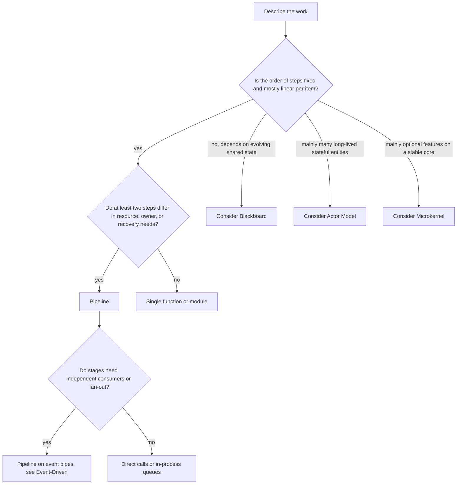

The flowchart separates the shape of the problem first. If the work is not a linear flow, the later questions about pipes do not apply, and a sibling pattern is a better starting point. If it is linear, the remaining question is whether a boundary buys anything, which returns to the criteria in section 5.1.

## 20. Design-Review Checklist

- Each stage has one named responsibility, and each boundary meets at least one criterion in section 5.1.
- The contract states identity, ordering key, time semantics, units, failure shape, version, and owner.
- Stages have stage tests and fixtures, and downstream builds run them as contract tests.
- Every queue has a bound, a policy for overload, and a metric for depth and age.
- The slowest stage is known, with its capacity computed and measured, and downstream limits are checked before scaling it.
- The ordering scope is stated per stage, and hot-key behaviour is analysed.
- Failures are classified as transient, permanent, systemic, or unknown outcome, with a response for each.
- Retries have a count, backoff with jitter, a deadline, and an amplification limit.
- The DLQ has an owner, access control, retention, an alert, and a tested replay tool.
- Every effect is idempotent, and the idempotency key comes from the item and is stable across retries.
- Items are acknowledged only after output is durable or safely quarantined.
- Raw input or stage output is retained long enough to cover detection time plus replay time.
- Schema changes follow expand and contract, with a drain plan for queues and the DLQ.
- Correlation identifiers and trace context travel in the envelope, and queue waits appear in traces.
- Data is classified early, each stage has least privilege, and the DLQ is protected as production data.
- Scenarios in section 16 have tests with recorded results.

## 21. Exercises

1. **Bottleneck.** A line has stages at 500, 120, and 300 items per second with a source offering 400. State the throughput, the growth rate of each queue, the utilization of the third stage, and the result of doubling the first stage. *Outline:* throughput is 120, the queue before the second stage grows by $400 - 120 = 280$ per second, the third stage runs at $120 / 300 = 40\%$, and doubling the first stage changes nothing.
2. **Little's law.** A stage serves 150 items per second with a mean service time of 60 ms and a mean queue wait of 90 ms. How many workers are needed and how many items are in the stage? *Outline:* in service $150 \times 0.06 = 9$ workers minimum, so add headroom, for example 12 for 75% utilization. In the stage $150 \times 0.15 = 22.5$ items on average.
3. **Queue bound.** An item may wait at most 2 seconds before a stage that drains 250 per second. Size the queue. *Outline:* $250 \times 2 = 500$ items, and state what the producer does when it is full.
4. **Ordering.** An account pipeline needs per-account order, with 8 lanes at 50 items per second each and traffic of 300 per second where one account sends 30%. Is the line adequate? *Outline:* the hot account sends 90 per second to one lane of capacity 50, so that lane falls behind by 40 per second even though total capacity of 400 exceeds 300. Remedies: finer ordering key, faster lane, or removal of order for commutative operations.
5. **Retry and idempotency.** A stage charges a card and then records the result, and may time out after the charge. Design the safe retry. *Outline:* send an idempotency key derived from the item identifier, treat timeout as unknown outcome, query by key before retrying or rely on the provider's duplicate rejection, and record the result in the same transaction as the identifier.
6. **Schema.** Split a `name` field into `given` and `family` while 2,400,000 items sit in queues and the stage drains 400 per second. Give the sequence and the minimum waiting time before removing the old path. *Outline:* readers accept both, writers emit both, drain, then remove. Drain time is $2{,}400{,}000 / 400 = 6{,}000$ seconds, which is 100 minutes, plus the DLQ.
7. **Replay.** A defect corrupted 4 hours of output at 200 items per second. Spare capacity is 100 per second. How long is the replay and what retention is needed if detection takes 12 hours? *Outline:* items $4 \times 3600 \times 200 = 2{,}880{,}000$, replay $2{,}880{,}000 / 100 = 28{,}800$ seconds which is 8 hours, retention over 20 hours of the affected stage's input.
8. **Pattern choice.** A fraud-analysis system lets rule modules add hints to a shared case file until a verdict is reached, in no fixed order. Pipeline or another pattern? *Outline:* the order is not fixed and state is shared and evolving, so a blackboard fits better. A pipeline could still feed cases into it.

## 22. Summary

The pipeline pattern splits work into stages joined by pipes, so each stage can be tested, scaled, and replaced on its own. The chapter's outcomes map to its sections as follows.

| Outcome from the introduction | Where it is taught |
| --- | --- |
| Define stage, pipe, filter, and the interface rules | Section 2 |
| Choose between batch and streaming | Section 4 |
| Specify the data contract and recognise bypassing coupling | Sections 5 and 12 |
| Size a bounded buffer, apply backpressure, compute throughput | Section 6 |
| Use Little's law with its conditions | Sections 6.3 and 17.2 |
| Add parallelism without breaking ordering | Section 7 |
| Classify failures, bound retries, use a DLQ, make stages idempotent | Sections 8, 9, and 14 |
| Change a schema while items are in flight | Section 10 |

The decisions that matter most are small ones made early and written down: where the boundaries go, how large each queue is and what happens when it fills, which order scope each stage needs, which failures are retried, who owns the DLQ, and how a repeated item is made harmless. Measure each stage, find the current limit, and change one thing at a time, because removing a bottleneck only moves it. Section 11 is the practical guide for that work, and sections 16 and 20 turn the chapter into tests and review questions. For sibling patterns, continue to [Event-Driven Architecture](CH07_Event_Driven_Architecture.md) for the pipes, [Actor Model](CH12_Actor_Model.md) for stateful lanes, and [Blackboard Pattern](CH17_Blackboard_Pattern.md) for work with no fixed order.
