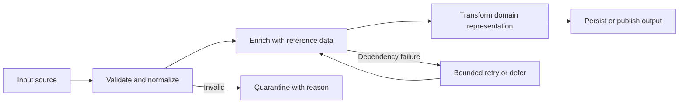
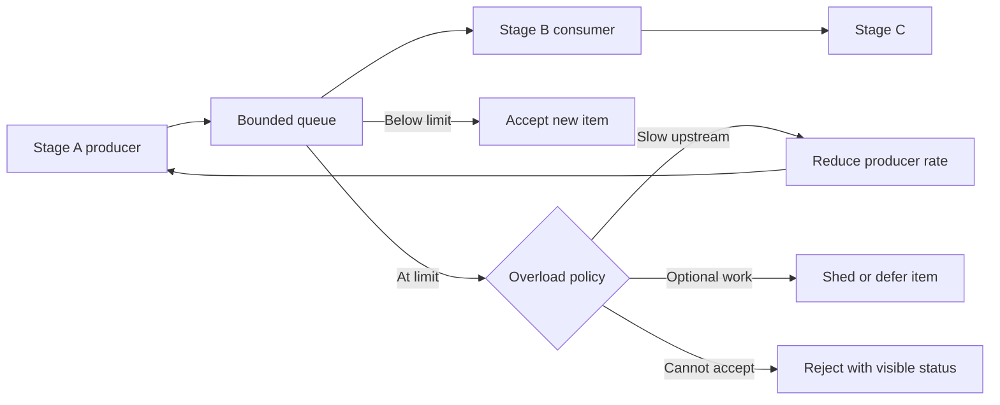
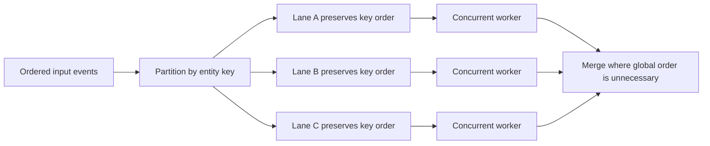
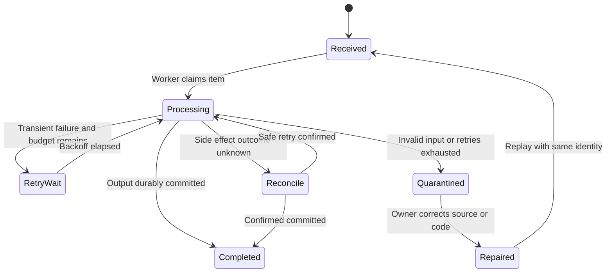
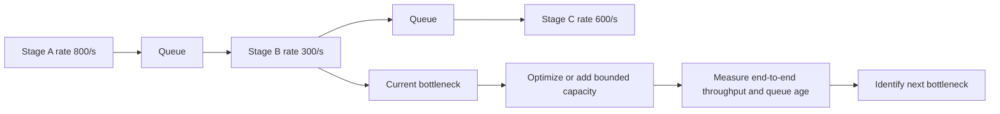

# Pipeline Pattern

Part: [20 — Architecture Patterns](PART_OVERVIEW.md)

The Pipeline Pattern composes processing stages that transform or validate data and pass results to the next stage. It is useful when work can be decomposed into cohesive transformations with explicit ordering and recovery boundaries. It is distinct from a Continuous Integration/Continuous Delivery (CI/CD) pipeline, which automates software build and release. Part 07 owns stream-processing semantics; Part 13 owns delivery pipelines.

## Compose Stages With Explicit Contracts

Each stage accepts a defined input, performs one responsibility, and emits an output or failure. Contracts should include schema, ordering, idempotency, timeout, and ownership. A pipeline can run synchronously, asynchronously with queues, or as a stream; those execution choices affect latency and recovery.

Keep stage contracts stable enough that one implementation can change without rewriting the whole pipeline. Avoid splitting every function into a separate stage; each boundary adds serialization, scheduling, observability, and failure-handling cost.

## Bound Queues and Apply Backpressure

Queues decouple stage rates but can hide sustained imbalance. Queue depth grows when producer throughput exceeds consumer throughput. That queue consumes memory or durable storage. Bound queue depth and define whether producers slow down, work is rejected, or low-priority items are shed. Track age as well as count.

Backpressure should propagate far enough to prevent upstream resource exhaustion. Indefinite blocking can tie up threads and connections; use deadlines and bounded waits. Durable pipelines need capacity planning and a named owner for queue storage and retention.

## Parallelize Without Losing Required Ordering

Stages can process independent items concurrently to increase throughput. Ordering constraints may apply globally, per key, or not at all. Partitioning by key can preserve local order while allowing different keys to progress in parallel. Define how a failed item affects later work and whether reordering changes business meaning.

Avoid a global merge when consumers do not require total ordering. For per-customer or per-account ordering, partition by that key. Document the constraint. Monitor skew: one hot key can dominate a lane and reduce effective parallelism.

## Retry and Recover Stage Failures

A stage failure can be transient, permanent, or caused by invalid input. Retry only bounded transient failures, preserve item identity, and make side effects idempotent. Quarantine poison items with diagnostic metadata and a remediation owner. Recovery should resume from a checkpoint or durable queue without repeating completed side effects.

Do not acknowledge work before the stage's durable effect is recorded. A stage can write to an external system and fail before its checkpoint. Reconcile by item ID or idempotency key before retrying. Dead-letter or quarantine queues require access, retention, and alert policies.

## Find the Throughput Bottleneck

Pipeline throughput is bounded by its slowest stage or shared resource. Adding capacity to a non-bottleneck stage may increase queue growth without increasing completed work. Measure per-stage service time, concurrency, queue depth and age, errors, and output rate. After improving one stage, remeasure because the limiting stage can move.

The rates are illustrative. Stage capacity depends on payload size, resource sharing, and error rate. Scale only after checking downstream limits and ordering constraints. More consumers can increase database load or contention and make overall completion worse.

## Worked Case: Document Ingestion

A document pipeline validates uploads, extracts text, classifies sensitivity, creates search metadata, and publishes a searchable record. Extraction is CPU-heavy; classification depends on a remote service; publication has strict access-control checks. Each stage has a bounded queue and versioned contract. The classifier stage applies bounded retry and sends invalid or unsupported formats to quarantine.

During a large upload burst, extraction becomes the bottleneck. The team adds a bounded worker pool and backpressure to upload acceptance, but avoids scaling classification beyond its provider quota. Per-document IDs make retries idempotent. Queue age and per-stage completion rate reveal when extraction recovers and classification becomes the new limiter.

## Review Questions

1. Which stages have stable, independently testable contracts?
2. What queue policy prevents a slow stage from exhausting upstream memory?
3. Which ordering guarantees are required globally or only per key?
4. How are retries made safe when a side effect may have completed?
5. Which measurements identify bottleneck migration?

The Pipeline Pattern clarifies transformations and recovery boundaries when stages have distinct responsibilities. Keep queues bounded, state ordering and retry semantics explicitly, and measure each stage so optimization follows the actual throughput constraint.
