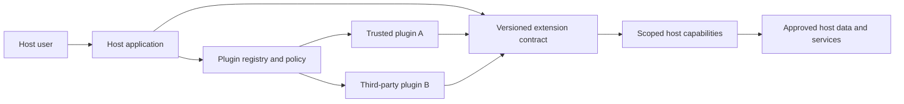
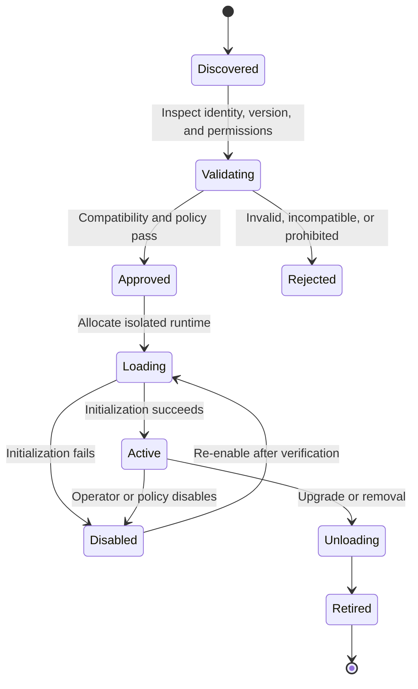
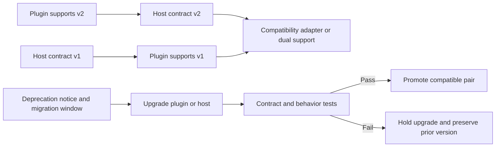
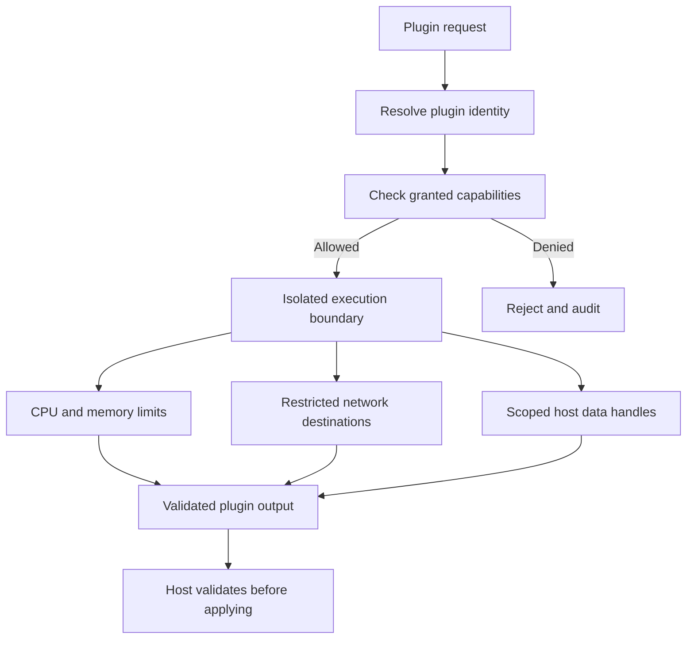
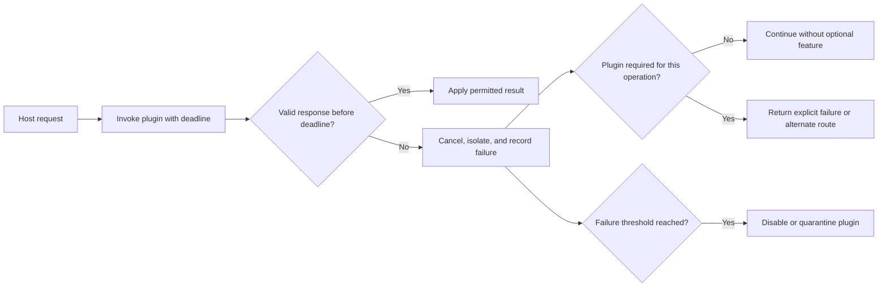

# Plugin Architecture

Part: [20 — Architecture Patterns](PART_OVERVIEW.md)

Plugin architecture lets independently developed extensions add behavior to a host through defined extension points. It can support a product ecosystem, optional features, or organization-specific integrations without modifying the core for every extension. It also introduces compatibility, trust, lifecycle, resource, and failure-isolation requirements.

## Define the Host and Extension Boundary

The host owns lifecycle, capabilities, policy, and the extension contract. Plugins implement a bounded interface and receive only the capabilities they need. The host should not expose arbitrary filesystem, network, or process access by default. Keep core workflows functional when optional plugins are absent or disabled.

Extension points should be stable, named, and narrow. Avoid allowing a plugin to mutate host internals or bypass business policy. When a plugin needs more capability, make the permission explicit and reviewable rather than adding a broad “trusted” switch.

## Discover, Validate, Load, and Unload

Plugins may be installed, discovered, validated, loaded, enabled, disabled, upgraded, or removed. Validate identity, signature or provenance as applicable, compatibility, requested permissions, and resource limits before activation. Loading should fail closed when required checks fail, while preserving host availability when the extension is optional.

Define upgrade behavior for active requests, plugin state, rollback, and data migration. A failed unload must not corrupt host state. Record plugin identity and version in logs and outputs so operators can attribute behavior.

## Version Contracts and Compatibility

Host and plugin versions evolve independently. Version the extension contract, specify supported ranges, and define how deprecated capabilities behave. Use compatibility tests against representative host versions. Semantic changes can break plugins even when method signatures remain unchanged, so document behavior, limits, and error contracts.

Avoid indefinite support for obsolete contracts, which multiplies host complexity. Publish deprecation dates, test utilities, and migration examples. If an adapter translates between versions, make the supported feature subset explicit rather than implying full compatibility.

## Isolate Permissions and Resources

Plugins may be buggy or malicious. Decide whether they run in-process, as separate processes, or in a sandboxed runtime. In-process execution offers low latency but shares memory and crash risk. Process or sandbox boundaries improve isolation but add serialization, resource, deployment, and debugging costs. Enforce least privilege regardless of placement.

Treat plugin output as untrusted input. Validate schema, size, authorization, and business invariants before state changes. Limit execution time and concurrency, and define cancellation and cleanup. Permission changes should take effect without requiring plugin authors to self-enforce policy.

## Contain Plugin Failure

A plugin can hang, crash, return invalid output, leak memory, or overwhelm a shared dependency. Decide which failures disable the plugin, retry, isolate the request, or degrade host functionality. Optional extensions should not become critical path dependencies unless the product contract requires them.

Monitor invocation latency, error rate, resource use, permission denials, and disabled state by plugin version. A circuit breaker or bulkhead can protect the host, but the product should explain degraded capability. Avoid silent plugin fallback when it changes security or business outcomes.

## Worked Case: Document Import Extensions

A document-management product supports third-party importers for storage providers. The host exposes a narrow import contract, scoped credentials, file-size limits, and a validation callback. Plugins run in separate processes because they handle untrusted documents and have different dependency lifecycles. The host records plugin version and source identifier for each imported document.

When a new host version changes the import metadata contract, the registry marks old plugins for deprecation and tests migration against a compatibility suite. A plugin that exceeds execution time is canceled and disabled after a threshold; other import paths remain available. Credentials are issued for one tenant and one operation, and the host validates paths and document metadata before storage.

## Review Questions

1. Which capabilities should the host expose to a plugin?
2. What checks occur before discovery becomes activation?
3. How are semantic contract changes and deprecation handled?
4. Which isolation boundary matches the plugin's trust and latency needs?
5. What happens when an optional or required plugin fails?

Plugin architecture creates controlled extensibility only when contracts, permissions, lifecycle, and failure behavior are explicit. Keep the host authoritative, isolate untrusted extensions proportionately, and make compatibility and operational ownership part of the extension ecosystem.
