# Plugin Architecture

Part: [20 — Architecture Patterns](PART_OVERVIEW.md) · Status: Revised (in-depth rewrite)

## 1. Introduction

A plugin architecture splits a product into a host and a set of extensions. The host owns the workflow, the data, and the rules. The extensions add behavior at points the host chooses to open, and they are built, released, and often owned by people who are not on the host team. The pattern is attractive because the set of things a product must do is larger than the set of things its core team can build. Customers need an importer for their storage system, a validator for their regulation, or a report in their format, and each of those would otherwise become a change request against the core.

The pattern is expensive for a specific reason. The moment code written by someone else runs inside your product, three things that were private become public: the shape of your internal interfaces, the timing of your releases, and the quality of code you did not review. The extension contract becomes a promise that outlives the team that wrote it. The plugin's failures are experienced by the host's users as the host's failures. And a plugin that is allowed to do too much turns the host's security boundary into the plugin author's security boundary.

For an engineer moving into architecture, the useful skill is deciding which behavior should be extensible at all, how narrow the contract should be, and how much isolation the trust level of the plugin authors justifies. This chapter is the first of two parts. After this part you should be able to:

1. Name the forces that justify a plugin architecture and the forces that argue for a simpler design.
2. Describe the roles of the host, the extension point, the plugin, and the registry, and say what each owns.
3. Design an extension point as a narrow, stable contract and distinguish the interfaces a plugin calls from the interfaces a plugin implements.
4. Trace how a host discovers, validates, loads, and calls a plugin, and compare the main discovery and loading mechanisms.
5. Define a plugin lifecycle with explicit states and say what each transition must guarantee.
6. Version an extension Application Programming Interface (API) and work out compatibility with semantic-versioning arithmetic.
7. Choose a dependency isolation level for plugins and state what it costs.
8. Design a host API around capabilities so that a plugin receives only what it needs.

The boundaries with neighbouring material are deliberate:

- The closest sibling is [Microkernel Architecture](CH15_Microkernel_Architecture.md). A plugin architecture extends a product with optional behavior that a user or operator may add or remove. A microkernel keeps a minimal core and hosts system services, and its extensions are often required. This chapter owns the general host and plugin lifecycle and isolation model. The microkernel chapter owns the stable-core argument and the required-versus-optional split.
- [Hexagonal Architecture](CH02_Hexagonal_Architecture.md) describes ports and adapters for one application. A plugin extension point is a port that third parties implement, which adds versioning, discovery, and trust questions that a single-team port does not have.
- Security foundations belong to Part 15. This chapter states the architecture-level trust model for third-party plugins and links to [Supply Chain Security](../15_Security/CH15_Supply_Chain_Security.md), [Container Security](../15_Security/CH14_Container_Security.md), and [Threat Modeling](../15_Security/CH12_Threat_Modeling.md) for the underlying techniques.
- General API versioning practice for network interfaces belongs to [Versioning](../08_API_Architecture/CH10_Versioning.md). This chapter applies the same ideas to in-process and out-of-process extension contracts.

Later sections of this chapter cover sandboxing and permission enforcement, failure containment, and the review practice for plugin ecosystems. All numbers in this chapter are illustrative. They show how to reason and are not measurements of any real system. The product, plugins, and package names used in examples are invented for teaching.

## 2. Forces and Context

A plugin architecture is a response to a particular combination of pressures. If those pressures are absent, a simpler structure is cheaper and safer.

### 2.1 Forces that favor plugins

- **Open-ended variation.** The set of integrations, formats, rules, or commands is large, grows over time, and differs by customer. A product that supports hundreds of file formats cannot ship hundreds of branches in its core.
- **Different rates of change.** The core changes quarterly and the variation changes weekly. Coupling their release cycles slows both.
- **Different owners.** The people who know the variation, such as a partner, a customer's platform team, or a community, are not the core team. The pattern moves the change to the people with the knowledge.
- **Optional deployment.** Not every installation needs every capability. Removing unused code reduces attack surface, memory, and startup time.
- **Product ecosystem.** The host's value grows with the number of extensions, so the contract is a business asset and not only a technical detail.

### 2.2 Forces against plugins

- **A contract to keep.** Every extension point is a public interface. Once a plugin depends on it, changing it costs coordination with people the host team cannot instruct.
- **Untrusted or semi-trusted code.** Plugin authors may be careless or hostile. The host must decide how much to believe them.
- **Testing surface.** The host cannot test every combination of plugins. Defects appear in combinations nobody exercised.
- **Operational attribution.** When a request is slow or wrong, operators must discover whether the host or a plugin caused it. Without plugin identity in logs and metrics this takes hours.
- **Behavior hidden from the core.** Logic that lives in plugins is not visible to the core team's reviews, so invariants that the core assumed can be broken.

### 2.3 When to choose something simpler

The pattern is usually the wrong choice in four situations. First, when there are two or three variants known in advance and all are written by the host team. A strategy interface with a configuration switch gives the same flexibility with no discovery, lifecycle, or compatibility machinery. Second, when variation is better expressed as data, for example rules in a table or a workflow definition, than as code. Third, when every extension needs privileged access to internals. A plugin that needs to reach inside the core has no stable contract, and the honest structure is a modular monolith with modules owned by one team. Fourth, when the variation must be one deployed system with strong transactional behavior across all the pieces. Extensions run at arm's length, and the pattern assumes the host can call them without sharing their fate.

A useful test is whether the host team can name the extension point and write its contract in one page without referring to any internal class. If it cannot, the boundary is not ready.

### 2.4 Plugin audiences and trust levels

The most consequential context question is who writes the plugins, because it determines how much isolation the design needs. The levels below recur throughout the chapter.

| Audience | Example | Typical trust | Implication |
| --- | --- | --- | --- |
| Same team, same repository | Built-in exporters packaged as plugins | High, reviewed with the core | Isolation is mostly for modularity, not defense |
| Same organization, other teams | Internal integrations | Medium, accountable but unreviewed by the host team | Contract tests and resource limits matter more than hardening |
| Customer-written | A customer's own validator, deployed on their installation | Medium to low, the customer bears the consequences | Scope capabilities and isolate from other tenants |
| Public marketplace | Third-party plugins installed by any user | Low, author identity may be weak | Assume hostile code, require strong isolation and review |

A plugin architecture that serves several audiences at once, which is common, must apply the strictest level to anything that crosses a tenant or privilege boundary. Designing for the highest-trust audience and later admitting the lowest-trust one is the usual source of retrofitted sandboxes that nobody can afford.

## 3. The Foundational Model: Host, Plugin, and Contract

Every plugin architecture, whatever the language or runtime, has the same small set of roles. Naming them precisely makes later design arguments shorter.

- **Host.** The application that owns the user-facing workflow, the persistent data, the policy, and the lifecycle of plugins. The host is the authority. A plugin is never the system of record for anything the host promises to keep.
- **Extension point.** A named place in the host's workflow where behavior may be supplied from outside. Examples are "export a report", "validate an upload", and "add a command". An extension point has a purpose, an input, an expected output, and rules about timing and failure.
- **Extension contract.** The written and typed definition of an extension point. It has two directions that are easy to blur. The **host API** is what the plugin calls on the host, and the **Service Provider Interface (SPI)** is what the plugin implements and the host calls. They evolve under different rules, which the versioning discussion later in this chapter explains.
- **Plugin.** A separately built and versioned unit that implements one or more extension points and declares what it needs from the host. A plugin has an identity, a version, a list of requested capabilities, and an entry point.
- **Registry.** The host component that knows which plugins are installed, their versions, their state, and the policy that applies to them. It decides what may load and which plugin answers which extension point.
- **Host services.** The capabilities the host hands to a plugin, such as read access to a document or permission to write a file in a scratch area. They are the only way a plugin touches the outside world.

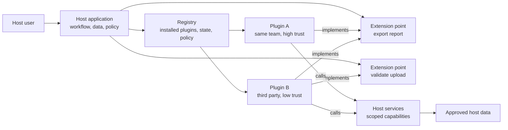

The diagram shows three properties that define the pattern. First, the host depends on the extension point and not on any plugin. Plugin A and Plugin B are interchangeable behind the same contract, so the host can ship with neither and still run its core workflow. Second, plugins never reach the data directly. The only path from a plugin to host data goes through host services, which is where permissions are enforced. Third, the registry sits between the host and the plugins. The host asks the registry "who implements export report", which lets policy decide the answer. The practical implication is that three things must be designed with care: the extension points (what is open), the host services (what is lent), and the registry (what is allowed).

### 3.1 Cardinality of an extension point

An extension point has a cardinality that must be written into its contract, because it changes what the host does with the result.

- **Exactly one active provider.** The host selects one plugin, for example a storage backend chosen by configuration. Selection rules, defaults, and what happens when none is installed belong in the contract.
- **Many providers, host picks by key.** For example, one exporter per file format. The host routes by an identifier such as the format name. Two plugins claiming the same key is a conflict that the registry must resolve or reject.
- **Many providers, all called.** For example, upload validators. The host calls each and combines results. The combination rule matters. Does one failure reject the upload, and what is the call order? An unordered "all called" point whose results depend on order is a defect waiting for a second plugin.
- **Chain of providers.** Each plugin receives the previous one's output, as in a filter pipeline. This is the most fragile form, because a plugin early in the chain can change what later plugins see. State the ordering rule explicitly.

### 3.2 Where the host stays in control

Four decisions stay with the host regardless of what plugins do. The host decides whether a plugin loads, because the registry applies policy. The host decides what a plugin may see and do, because host services enforce scope. The host decides when a plugin is called and for how long, because it sets deadlines. And the host decides what to do with the result, because it validates plugin output before applying it. A design in which any of these four moves into the plugin has turned the host into a library that the plugin drives, and the safety properties of the architecture are gone.

## 4. Extension Points and Stable Contracts

An extension point is only as stable as the contract behind it, and the contract is where most plugin architectures succeed or fail. The design goal is a contract that is narrow enough to keep for years and complete enough that plugin authors never ask for internals.

### 4.1 What a contract must state

A signature alone is not a contract. A plugin author who reads only the types will make wrong assumptions about everything the types do not say. A complete extension contract answers these questions:

1. **Purpose and trigger.** When does the host call this point, and what is the plugin expected to accomplish?
2. **Input and output.** What data goes in, what must come out, and what are the size limits? Prefer plain data structures over host objects.
3. **Threading and re-entrancy.** May the host call the plugin from several threads at once? May the plugin call back into the host while handling a call?
4. **Time.** What deadline applies, and what does cancellation look like? A plugin that blocks forever must be a defined case and not a surprise.
5. **State.** May the plugin keep state between calls? If instances are created per call or per tenant, say so.
6. **Errors.** Which failures are expected and typed, and which are treated as defects? Define how the host treats an unexpected exception.
7. **Idempotency and side effects.** May the host retry a call? Which side effects may the plugin perform, and through which host services?
8. **Ordering and uniqueness.** For points with several providers, how are conflicts and order decided?

The behavioral answers matter more than the typed ones, because they are the part that changes silently. A host that begins calling plugins concurrently after years of sequential calls has broken the contract even though no signature changed.

### 4.2 Keep the surface narrow

Each method or field exposed is something the host must keep working. Three rules keep surfaces small.

- **Pass data, not objects.** A plugin that receives the host's internal `Document` class can call any method on it. A plugin that receives an immutable `ExportRequest` holding the fields the point needs can do nothing else. The immutable value also serializes cleanly if the plugin later moves out of process.
- **One reason to exist per point.** A point that combines "validate" and "transform" cannot evolve either behavior independently. Split it.
- **Return decisions, not commands.** A validator returns findings and the host decides what to do with them. If the plugin may call `host.rejectUpload()` directly, the plugin now controls host workflow, and every plugin author needs to understand that workflow.

An extension API that exposes internal classes is the commonest cause of a leaky contract. Once a plugin depends on an internal type, that type can no longer be refactored without a breaking release. Anti-patterns of this kind are expanded later in the chapter.

### 4.3 A small example

The following Java 21 interface defines a hypothetical `Exporter` extension point for a reporting product called Parcelview. It is the SPI, meaning the interface plugins implement. The request and result are immutable records, and the host services object is the only door back to the host.

```java
package parcelview.api;

public interface Exporter {

    /** Stable identifier, for example "csv". Unique per host instance. */
    String format();

    /** Called on a worker thread. Must finish within the host deadline. */
    ExportResult export(ExportRequest request, HostServices host)
            throws ExportException;
}

public record ExportRequest(String reportId, java.util.List<Row> rows,
                            java.util.Map<String, String> options) { }

public record ExportResult(String fileName, long sizeBytes) { }
```

Four design decisions in this small listing are worth stating. `format()` is the routing key, so the point has "many providers, host picks by key" cardinality. The Javadoc states thread and time rules that the type cannot express. `ExportException` is the typed, expected failure, so any other exception is treated by the host as a plugin defect. And `HostServices` is passed in per call, which means the plugin holds no global reference to the host and the host can hand different capabilities to different plugins. The capability-based design of `HostServices` is covered later in this chapter.

### 4.4 Choosing extension points

Open an extension point only when there are at least two real implementations or a committed external author. A point opened for a hypothetical second implementation is a contract with no feedback. Prefer to build the first two implementations in the host repository as built-in plugins against the same contract. If the host's own exporters cannot be written against the public contract without side doors, external authors will not manage either. This practice, often called "dogfooding" the API, is the cheapest available test of whether the contract is complete.

### 4.5 Contracts as tests

A contract written in prose rots. A **contract test kit** is a shared test suite that any plugin can run against its own implementation, and that the host runs against built-in plugins. The kit asserts the behavioral rules: the plugin returns within the deadline, rejects oversized input with the typed error, and is safe to call twice. Publishing the kit gives plugin authors a way to check compatibility before they release, and it gives the host a regression suite for the behavioral half of the contract.

## 5. How a Host Discovers, Loads, and Calls a Plugin

The foundational model becomes concrete when one plugin is followed from the filesystem to a completed call. The sequence below uses the Parcelview exporter. The same shape applies to any host, and the individual mechanisms vary and are compared in the next section.

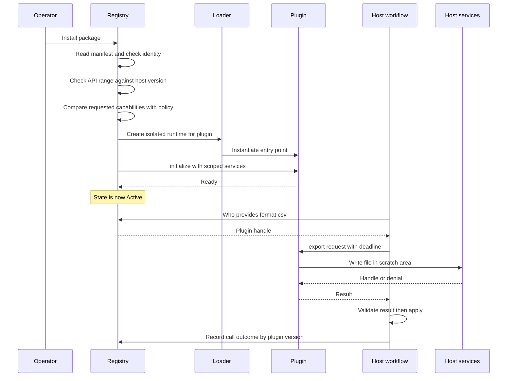

### 5.1 Discovery and admission

Discovery answers "what plugins exist". The registry finds packages in a configured location or through a language mechanism, and it reads each package's metadata before running any of its code. This ordering is deliberate. Reading a manifest executes nothing, so the host can reject a package on identity, version range, or requested capabilities without having executed a line the author wrote. Loading code is the first point at which the plugin can act, and by that moment the admission decision should already have been made.

Admission checks, in a sensible order, are:

1. **Identity.** The package declares a unique plugin identifier. Duplicate identifiers are a conflict.
2. **Provenance.** The package comes from an allowed source and, where policy requires, carries a signature or integrity digest the host can verify. The techniques are in Part 15 and the [Supply Chain Security](../15_Security/CH15_Supply_Chain_Security.md) chapter.
3. **Compatibility.** The plugin's declared range of extension API versions includes the host's version. The arithmetic is worked later in the chapter.
4. **Requested capabilities.** The capabilities the plugin asks for are compared with what policy allows for this plugin's trust level. A plugin that requests more than policy grants is rejected or held for approval.
5. **Dependencies.** Anything the plugin requires from other plugins or libraries is resolvable.

### 5.2 Instantiation and initialization

After admission, the loader creates the runtime in which plugin code will live. That might be a dedicated class loader, a new process, or a sandbox instance. It then instantiates the plugin's entry point. Instantiation should be cheap and free of side effects. Real work, such as opening connections or reading configuration, belongs in an explicit initialization step that the host controls, receives a bounded time budget, and can fail without breaking the host. Separating "construct" from "initialize" lets the host list what exists without starting it, and lets it cancel an initialization that never returns.

### 5.3 Invocation

For each call, the host routes to a provider, attaches a deadline, passes immutable input and a scoped host services object, and receives output. Four obligations apply on the host side:

- **Deadline and cancellation.** Every call has a deadline, and the host has a way to stop work that exceeds it.
- **Output validation.** The host checks size, shape, and business invariants on what the plugin returned before it changes any host state.
- **Attribution.** Each call is recorded with the plugin identifier and version, duration, and outcome, so that a slow or incorrect result can be traced to its source.
- **Failure policy.** The contract says whether a failing plugin degrades the operation or fails it. This is developed in the later section on containing plugin failure.

Implications of the sequence: admission is complete before execution, every call has a bounded and attributed outcome, and the plugin has no way to reach host data except through the services object passed to it. If any of those three properties is missing from a host, the corresponding failure mode, which is hostile code at load time, unbounded calls, or unattributed behavior, is present.

## 6. Discovery and Loading Mechanisms

Hosts find and load plugins in four common ways. They differ in how the plugin declares itself, when code is first executed, what isolation is possible, and what can be checked before loading.

### 6.1 Classpath scanning with a service loader

In the Java platform, `java.util.ServiceLoader` implements a service-provider pattern. The host defines an interface, and each plugin jar lists its implementing classes in a file named after the interface under `META-INF/services/`. For the Parcelview interface the file is `META-INF/services/parcelview.api.Exporter`, and each line names a class such as `acme.csv.CsvExporter`. The host asks for all providers and receives lazily instantiated objects.

```java
import java.net.URL;
import java.net.URLClassLoader;
import java.nio.file.Path;
import java.util.*;

public final class JarPluginLoader {

    public List<Exporter> load(Path jar, ClassLoader hostLoader) throws Exception {
        URL[] urls = { jar.toUri().toURL() };
        // One loader per plugin, with the host loader as parent
        URLClassLoader pluginLoader = new URLClassLoader(urls, hostLoader);

        List<Exporter> found = new ArrayList<>();
        Iterator<Exporter> it = ServiceLoader.load(Exporter.class, pluginLoader).iterator();
        while (true) {
            try {
                if (!it.hasNext()) break;
                found.add(it.next());            // instantiates the provider
            } catch (ServiceConfigurationError e) {
                // A bad provider entry. Record it and stop reading this jar.
                System.err.println("Plugin " + jar + " rejected: " + e.getMessage());
                break;
            }
        }
        return found;
    }
}
```

The listing makes several mechanisms visible. The `URLClassLoader` created per plugin is what gives each plugin its own namespace, and the next sections on dependency isolation build on it. `ServiceLoader` instantiates providers lazily, which means a malformed entry surfaces as a `ServiceConfigurationError` during iteration and not at construction time. The loop therefore wraps iteration, and it stops at the first error because continuing after one is a behavior the host should verify on its target Java version before relying on it. Class loading and provider instantiation run plugin static initializers, so this code is the point at which the plugin first executes. Any admission check must happen before this call.

Strengths of the approach are that it is small, standard, and needs no framework. Weaknesses are that metadata is limited to class names, there is no built-in version negotiation, there is no built-in unload, and all providers on one classpath share one namespace unless the host creates loaders as shown.

### 6.2 Module systems

A module system adds declared dependencies and encapsulation. With the Java Platform Module System (JPMS), the host module declares that it uses a service, and a plugin module declares that it provides an implementation:

```java
module parcelview.core {
    requires parcelview.api;
    uses parcelview.api.Exporter;
}

module acme.csv {
    requires parcelview.api;
    provides parcelview.api.Exporter with acme.csv.CsvExporter;
}
```

JPMS checks at resolution time that required modules exist, and it hides packages that the module does not export, so a plugin cannot reach into the host's internal packages even by reflection unless the host module opens them. Plugin modules can be placed in a separate `ModuleLayer` created by the host, which allows a plugin set to be resolved together and to be dropped when the layer is no longer referenced. The Java Open Services Gateway initiative (OSGi) framework is an older, richer module system for the Java platform. It gives each bundle its own class loader, resolves declared package imports and exports, and models bundle lifecycle states such as installed, resolved, starting, active, stopping, and uninstalled. That lifecycle is a good model even for hosts that do not use OSGi, and the lifecycle section in this chapter generalizes it.

Module systems cost configuration effort and a learning curve. Libraries that were not written for modules can be awkward to wrap. The reward is declared, checked dependencies and strong encapsulation, which are exactly what a long-lived plugin ecosystem needs.

### 6.3 Dynamic import and entry points

Dynamic languages load code by name at run time. In Python, a package advertises plugins through **entry points**, which are metadata recorded at install time in a named group. A plugin package declares its exporter in `pyproject.toml`:

```toml
[project.entry-points."parcelview.exporters"]
csv = "parcelview_csv.exporter:CsvExporter"
```

The host reads that metadata without importing the plugin, and imports only the ones it admits:

```python
from importlib.metadata import entry_points

ALLOWED = {"csv", "xlsx"}  # admission policy

def discover(group: str = "parcelview.exporters") -> dict[str, type]:
    found: dict[str, type] = {}
    for ep in entry_points(group=group):
        if ep.name not in ALLOWED:
            continue                      # rejected before any plugin code runs
        try:
            found[ep.name] = ep.load()    # imports the module and resolves the attribute
        except Exception as exc:          # one broken plugin must not stop the host
            print(f"plugin {ep.name} failed to load: {exc}")
    return found
```

The `group=` keyword form of `entry_points` is available in current Python versions, but check the version the host targets. The admission policy runs on names read from metadata, so rejected plugins are never imported. The `ep.load()` call is the first execution of plugin code, and the broad `except` is deliberate, because a plugin import can fail in arbitrary ways and the host must continue.

The lower-level form is `importlib.import_module(name)`, which loads a module from a path the host chooses. JavaScript offers the equivalent `import()` expression. Dynamic import is the lightest mechanism and the easiest to start with. Its limits are that all loaded code shares one process-wide module table, so there is no namespace separation between plugins, two plugins that need different versions of the same library will conflict, and unloading a module reliably is difficult because references to it stay alive elsewhere. These limits, and the options for working around them, are the subject of the dependency isolation section.

### 6.4 Manifest-based plugins

In a manifest-based design, the plugin package carries a declarative file that the host reads before any code is loaded. Many product ecosystems, including developer tools and browsers, use some form of manifest. The format varies, but the useful content is consistent. This example is a JavaScript Object Notation (JSON) file:

```json
{
  "id": "acme.csv",
  "version": "1.4.2",
  "requiresApi": ">=2.1 <3.0",
  "entryPoint": "acme.csv.CsvExporter",
  "capabilities": ["report.read", "scratch.write"],
  "publisher": "acme"
}
```

A manifest separates what the plugin claims from what the plugin does. The host can display requested capabilities to an administrator, evaluate policy, filter by compatible API range, and index the plugin catalog without running any plugin. The manifest is also the natural place for the host to check a signature or digest. Its weakness is that it can disagree with the code. A manifest that lists `report.read` while the code tries to write to the network must not result in network access, which is why a manifest alone is an input to policy and not the enforcement. Enforcement belongs to the host services and the isolation boundary, as the capability-based host API section explains.

Manifest-based designs often combine with another mechanism. The manifest names the entry point and the host then uses a service loader, a module system, or dynamic import to load it. The two layers complement each other, with the manifest answering "should this load" and the language mechanism answering "how".

### 6.5 Comparing the mechanisms

| Mechanism | Declared by | Checks before code runs | Namespace separation | Unload | Typical fit |
| --- | --- | --- | --- | --- | --- |
| Service loader on classpath | Provider configuration file | Few, class names only | Only if host creates loaders | Hard without loader discipline | Same-team or internal plugins |
| Module system | Module descriptors | Resolution of dependencies and exports | Strong, with layers or bundles | Possible, with care | Long-lived ecosystems on one runtime |
| Dynamic import or entry point | Package metadata or path | Name and metadata only | None in one process | Unreliable | Scripting hosts, tools, data pipelines |
| Manifest plus any loader | Separate declarative file | Identity, range, capabilities, signature | Depends on the loader | Depends on the loader | Public ecosystems with an admission policy |

The table suggests a decision rule. Choose a manifest-based admission layer whenever plugin authors are outside the host team, because pre-load checks are the cheapest security control available. Choose the loading mechanism by the isolation required: a module system or separate processes if plugins must not interfere with each other, and dynamic import only when plugins are trusted and few. The mechanisms are not exclusive, and mature hosts use a manifest for admission, a module or class loader for namespaces, and a process boundary for plugins that must be contained.

## 7. Plugin Lifecycle

A plugin is not simply loaded or not loaded. It moves through states, and each transition has a guarantee the host must keep. Making the states explicit lets operators see what a plugin is doing, lets the host recover from partial failures, and gives upgrades a defined order.

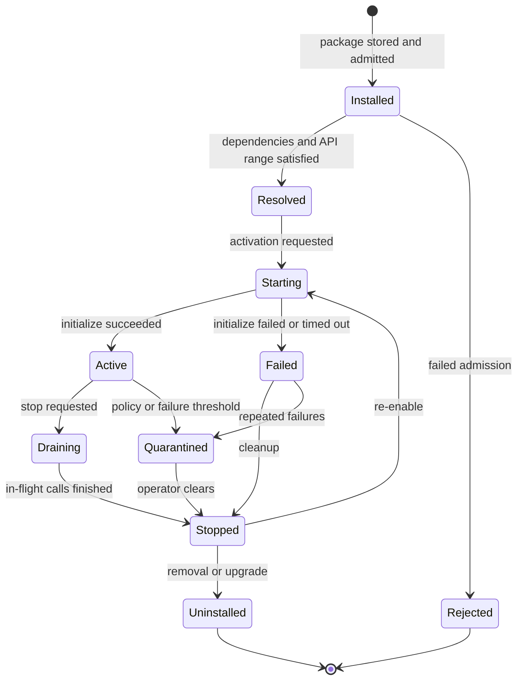

### 7.1 State by state

**Installed.** The package is stored and has passed admission checks (identity, provenance, declared API range, requested capabilities). No plugin code has run. Installation should be reversible and idempotent, so an installer retried after a crash does not create a second copy.

**Resolved.** The host has verified that everything the plugin needs is available: the matching API version, required libraries, and other plugins it depends on. Resolution is a pure check and should not start anything. Splitting it from activation lets the host compute a start order and reject an unsatisfiable set before any plugin runs.

**Starting and Active.** Activation creates the isolated runtime, instantiates the entry point, and runs initialization under a time budget. Only after initialization succeeds does the registry make the plugin visible to extension points. A plugin that registers itself before it is ready invites calls into half-initialized state. The rule is that visibility follows readiness.

**Draining.** A stop request does not abort work already in progress. The registry first removes the plugin from routing, so no new call arrives. In-flight calls finish or hit their deadline. Only then does deactivation run the plugin's shutdown hook. Skipping the draining state is the usual cause of corrupted partial outputs during upgrades.

**Stopped and Uninstalled.** Deactivation releases resources the plugin acquired: threads, connections, scratch files, and registrations. Uninstalling removes the package. The host should verify release and not trust it. A plugin that leaves a non-daemon thread running, or a registered callback inside host code, prevents unload.

**Failed and Quarantined.** Failure during start or repeated failure while active moves the plugin to states that exclude it from routing but keep it visible to operators with a reason. Quarantine is the host's response to a plugin that misbehaves repeatedly, and it needs an operator action or a policy timer to leave. Silent automatic re-enabling of a plugin that crashes every minute converts a defect into a recurring incident.

### 7.2 Unloading is the hard part

Starting a plugin is easy. Removing it cleanly is hard, and the difficulty depends on the mechanism chosen earlier. On the Java platform, a class loader can be reclaimed by the garbage collector only when nothing reachable still references the loader, any class it loaded, or any instance of those classes. A single stray reference, such as a plugin object stored in a host static map, a thread the plugin started that was never stopped, or a thread-local value, keeps the whole plugin in memory. Repeated reload then exhibits a steady memory growth, commonly called a class loader leak. In a dynamic-import host such as Python, reliable unloading is not a supported operation in the general case, because other references to the module and its objects persist.

Two practical rules follow. First, where a host must support frequent replacement, prefer a process or sandbox boundary, because ending a process releases everything. Second, where a host runs plugins in-process, treat "restart the host" as the supported way to remove plugin code completely, and make upgrades an operation that happens at a quiet time with a drain. An architecture that promises hot reload without a plan for stray references has promised a memory leak.

### 7.3 Upgrade and rollback

An upgrade is a sequence of lifecycle transitions: install the new version beside the old one, resolve it, start it, shift routing, drain the old one, and uninstall it. Keeping the old version installed until the new one proves healthy makes rollback a routing change and not a reinstall. Two rules apply to state. Plugin-owned data that persists between versions needs a migration step that is itself versioned and reversible, or the plugin must declare that it keeps no state. And the host must never store plugin-internal data in a host-owned format that only one plugin version can read, because that makes rollback unsafe.

### 7.4 Worked example: activation order and a failed initialization

Suppose a host has four installed plugins. Plugin `geo` depends on `maps-core`. Plugin `csv` depends on nothing. Plugin `audit` depends on `geo`. Resolution computes a start order from dependencies: `maps-core`, then `geo`, then `audit`, with `csv` placed anywhere. Say the initialization of `geo` exceeds its 5-second budget (illustrative). The state of `geo` becomes Failed. Because `audit` depends on `geo`, it cannot move from Resolved to Starting and is reported as blocked with the reason "dependency geo failed". Plugins `maps-core` and `csv` remain Active, so the host serves every operation that does not need `geo` or `audit`. The registry has done three useful things: it limited the blast radius to the dependency chain, it kept a precise reason for each plugin's state, and it left the host running. A host that treats any plugin start failure as a host start failure would have taken down all four.

## 8. Versioning and Compatibility of the Extension API

Host and plugins are released by different people on different schedules. The extension API is therefore the one place where a version number does real work, because it is the only thing that tells the host whether a given plugin can safely run. The aim is to let the host evolve without breaking plugins it has never seen.

### 8.1 Two surfaces, two rules

The contract has two directions, introduced earlier as the host API and the SPI. The compatibility rules are different for each, and confusing them is the most common versioning mistake.

- **Host API (the plugin calls the host).** The host is the provider and the plugin is the consumer. Adding a method is safe, since old plugins never call it. Removing or changing a method breaks callers.
- **SPI (the host calls the plugin).** The plugin is the provider and the host is the consumer. Adding an abstract method to an interface that plugins implement breaks every existing plugin, because it does not implement the new method. Adding a method with a default implementation is safe. Requiring a new behavior from plugins, such as a new field in the output, breaks plugins that do not produce it.

The same logic applies to data. For the data the host passes to a plugin, adding optional fields is safe and removing or reinterpreting fields is breaking. For the data a plugin returns to the host, the direction reverses: a host that begins rejecting results it used to accept has tightened the contract and broken existing plugins, while a host that accepts more is safe. A short rule captures it: the provider of an interface may add, but may not remove or tighten, and a party that must implement an interface cannot be handed new obligations without a major version.

Behavior changes are the third source of breakage. The host starting to call plugins concurrently, shortening the deadline, or changing the units of an option leaves every signature intact and breaks plugins that depended on the old behavior. The contract's behavioral statements need versions as much as its types do.

### 8.2 Semantic versioning

**Semantic Versioning (SemVer)** is a convention for version numbers written `MAJOR.MINOR.PATCH`. By the published specification, the major number increases for incompatible API changes, the minor number increases for backward-compatible additions of functionality, and the patch number increases for backward-compatible fixes. Versions below `1.0.0` carry no stability promise at all, so an extension API intended for an ecosystem should reach `1.0.0` before external authors depend on it. SemVer is only as honest as the people who apply it. The extension API needs a rule for classifying a change, and the two-surface rules above supply it.

| Change to extension API | Surface | Classification | Reason |
| --- | --- | --- | --- |
| Add a new method to `HostServices` | Host API | Minor | Old plugins never call it |
| Add an abstract method to `Exporter` | SPI | Major | Old plugins lack an implementation |
| Add a method with a default body to `Exporter` | SPI | Minor | Old plugins inherit the default |
| Add an optional key to `ExportRequest.options` | Host API data | Minor | Old plugins ignore it |
| Reject plugin output larger than before | SPI behavior | Major | Previously valid results now fail |
| Fix a bug where the host passed a wrong value | Either | Patch | Contract unchanged, behavior corrected |
| Remove a deprecated method | Host API | Major | Callers of the method break |

### 8.3 Range arithmetic

Each plugin declares the range of API versions it works with, and the host declares the version it implements. The admission check is a plain comparison. Take a host that implements extension API version `2.4.0`.

- Plugin declares `>=2.1 <3.0`. The host version satisfies both bounds, since $2.1 \le 2.4 < 3.0$. Admitted.
- Plugin declares `>=2.6 <3.0`. The host is older than the lower bound, since $2.4 < 2.6$. Rejected with the reason "plugin needs API 2.6 or later". This is the case where a plugin author used a newer method.
- Plugin declares `>=1.0 <2.0`. The host's major number is outside the range, since $2.4 \ge 2.0$. Rejected. Old plugins stay compatible with a new major only through an explicit adapter, described below.
- After the host upgrades to `3.0.0`, every plugin that declared `<3.0` is refused until its author publishes a build that has been tested against 3.0.

The lower bound is the subtle part. It should be the oldest version that provides everything the plugin actually uses. If an author builds against `2.4`, calls a method added in `2.3`, and declares `>=2.1`, the plugin will be admitted on a `2.2` host and fail at run time. On the Java platform, that failure appears as a `NoSuchMethodError`. Build tooling or an API-checking step should compute the lower bound from what the plugin references and not from what the author remembers. The upper bound `<3.0` expresses trust in SemVer. It is a promise by the author that no breaking change occurs before the next major version, and it is why host teams must keep to the classification above.

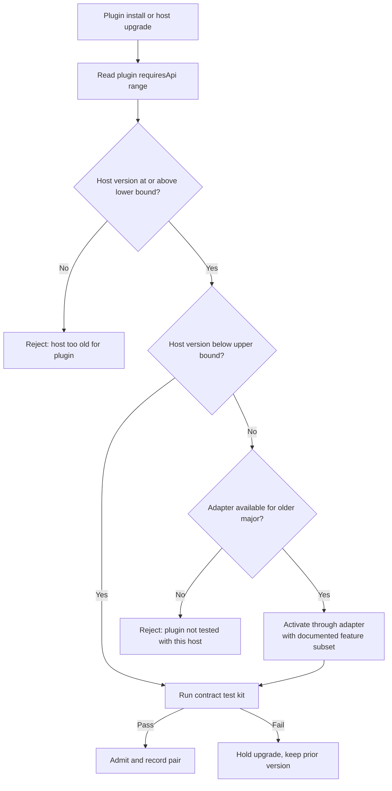

The flowchart separates three outcomes that tooling often merges. A range mismatch is a cheap, declared check and happens before any code runs. A contract-test failure is an evidence-based check on behavior the range cannot express. An adapter path is a deliberate, bounded exception. The implication for operators is that a rejection should always say which of the three occurred, because the remedy differs: upgrade the host, upgrade the plugin, or accept a reduced feature set.

### 8.4 Deprecation and the cost of compatibility

Each supported API generation costs the host test time and code. A deprecation policy sets the price. A typical policy states that a feature is marked deprecated in a minor release, kept working for a defined window, and removed only in the next major release. Suppose, illustratively, that the host ships a minor release every 3 months and promises a 12-month window. The window then spans $12 / 3 = 4$ minor releases, and plugin authors have that long to migrate.

The compatibility matrix has a cost that can be computed. If the host supports 3 API versions at once (for example `2.4`, `2.5`, and `3.0`), each of 40 certified plugins keeps its latest 2 releases, and each combination takes 4 minutes of automated testing, the matrix is $3 \times 2 \times 40 = 240$ runs. That is $240 \times 4 = 960$ minutes, or 16 hours sequentially, and 2 hours when 8 runs execute in parallel. Adding one more supported API version raises the run count to 320 and the sequential time to about 21.3 hours. These numbers are invented, and the point is the shape of the growth: the matrix is a product of three factors, and each additional supported generation multiplies the cost for every plugin.

An **adapter** translates an older contract to the current one so that an older plugin continues to run. It reduces breakage for authors and increases the host's maintenance. The adapter's documentation must name the subset of features that work and not imply full compatibility, since a plugin that depends on a removed behavior will fail in ways the adapter cannot hide. For general guidance on versioning network interfaces and managing deprecation, see [Versioning](../08_API_Architecture/CH10_Versioning.md).

## 9. Dependency Isolation Between Plugins

Plugins bring their own libraries. When two plugins need different versions of the same library, and both run in the host's process with one shared namespace, one of them gets the wrong version. This is the dependency conflict problem, and the isolation level chosen to solve it is among the costliest decisions in the architecture.

### 9.1 The conflict

Suppose plugin `csv` needs library `jsonlib` version `1.x` and plugin `xlsx` needs `jsonlib` version `3.x`, and the two major versions are not compatible. With a single shared namespace, whichever version loads first wins, and the second plugin fails at some later point with a missing method or a changed behavior. The failure can depend on load order, which makes it intermittent across installations. The conflict is a plain consequence of sharing, and removing it requires giving each plugin its own view of the libraries.

### 9.2 Class loader isolation

On the Java platform, a class is identified by its name and the class loader that defined it. Two class loaders can each define a class with the same name, and the two classes are distinct types. This is the mechanism for isolation. The host creates one loader per plugin, and each loader holds that plugin's own libraries. With **parent-first delegation**, a loader asks its parent before looking in its own path, which means classes visible to the parent always win. The usual arrangement is shown below.

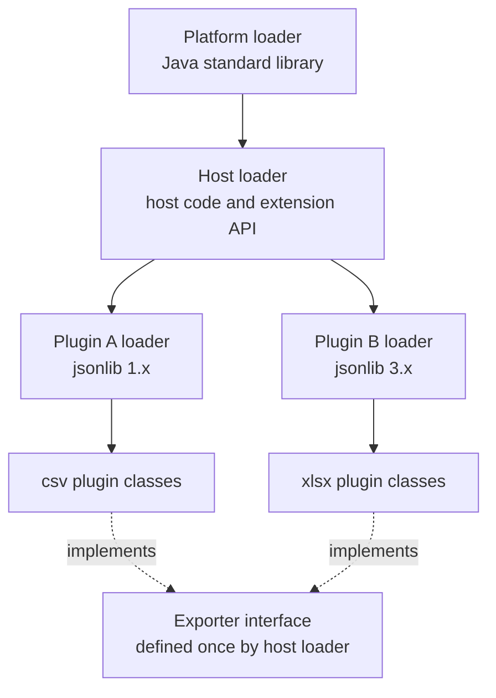

The diagram shows the design rule that makes the arrangement work. The extension API classes, such as the `Exporter` interface and the types in its signatures, must be defined by one loader that both the host and every plugin can see, which is the host loader here. If a plugin jar also bundled its own copy of those classes and loaded them in its own loader, the host would receive an object whose `Exporter` type is not the host's `Exporter` type, and a cast would fail with a `ClassCastException` even though the names match. The implication is that plugin authors depend on the API as a provided dependency and do not package it, and the host should reject packages that contain API classes. The second implication is that anything that appears in the API signature, including third-party types, becomes shared and loses its isolation. The API should expose only types from the host's own API package and the standard library.

Libraries inside each plugin loader stay private. Plugin A sees `jsonlib` 1.x and plugin B sees `jsonlib` 3.x, and neither is aware of the other. Variations include a **child-first** loader, where a plugin's own classes take precedence over the parent's, which lets a plugin override a library the host happens to expose, at the risk of unexpected type mismatches. Child-first loading for packages in the API is a defect.

### 9.3 Process isolation

A separate process gives each plugin its own address space, its own copy of every library, and its own memory limit. It solves the library conflict for any language, including ones with no class loader equivalent. For a Python host, per-plugin processes, or per-plugin virtual environments with a subprocess, are the practical answer to conflicting dependencies. Crashes stay inside the process, an out-of-memory condition ends that process and not the host, and unloading is the end of the process.

The cost is the boundary. Every call crosses an inter-process channel, so inputs and outputs must be serialized, and the extension contract must be expressible as data. Object references cannot cross. A call that was a method invocation becomes a message with latency, a possibility of timeout with an unknown outcome, and a need to handle a plugin process that has died.

### 9.4 Comparing the isolation levels

| Level | Library isolation | Fault isolation | Call cost | Resource cost | Typical use |
| --- | --- | --- | --- | --- | --- |
| Shared namespace in process | None | None, a crash or leak affects the host | Method call | Lowest | Trusted plugins with agreed library versions |
| Class loader or module per plugin | Per plugin, for libraries | None for crashes, infinite loops, and memory use | Method call | Duplicate library classes | Many cooperating plugins on one runtime |
| Separate process per plugin | Complete | Crash and memory contained, Central Processing Unit (CPU) limits possible through the operating system | Serialized message | One runtime per plugin | Untrusted or heavy plugins, mixed languages |
| Container or virtual machine per plugin | Complete, plus filesystem and network separation | Strongest at the operating system level | Network or channel call | Largest | Multi-tenant hosts, public marketplaces |

Isolation of libraries and isolation of faults are separate properties. A class loader per plugin separates versions of libraries, yet a plugin in an infinite loop still consumes a host thread, and a plugin that allocates without limit still exhausts the host's memory. A design that needs fault containment must go to a process or stronger boundary, and the later section on containing plugin failure builds on that. Sandboxed runtimes, such as WebAssembly (Wasm) runtimes, sit between the process and in-process levels. They are designed to run untrusted code with memory isolation and a limited set of host-provided functions inside the host's process. The guarantees depend on the runtime and its configuration, so verify them for the product in use before depending on them.

### 9.5 Worked example: what each level costs

Consider a host with 12 plugins, evaluated with illustrative numbers. The shared library used by every plugin is 8 megabytes (MB) of loaded classes, and a bare plugin runtime in its own process needs 120 MB.

- **Shared namespace.** The library is loaded once, so 8 MB for the shared library. A conflict between versions cannot be resolved.
- **Loader per plugin.** If all 12 load a private copy, the cost is $12 \times 8 = 96$ MB. That is 88 MB above the shared case. The conflict is resolved. If only the 2 plugins that conflict get private copies, the cost is $8 + 2 \times 8 = 24$ MB.
- **Process per plugin.** The baseline is $12 \times 120 = 1{,}440$ MB, about 15 times the loader-per-plugin figure ($1{,}440 / 96 = 15$), before counting any plugin work.

Call cost behaves differently. Assume a user request makes 50 plugin calls. An in-process call that costs about 1 microsecond adds $50 \times 1 = 50$ microseconds. An inter-process call that costs about 0.3 milliseconds adds $50 \times 0.3 = 15$ milliseconds. Against a 200 millisecond latency target, the process boundary spends 7.5% of the budget ($15 / 200$). The right design combines these costs with trust: batch the 50 calls into 5 calls to cut boundary cost tenfold to 1.5 milliseconds, or keep trusted, chatty plugins in process and put only untrusted, coarse-grained plugins in separate processes. The lesson is that call granularity is part of the isolation decision. A fine-grained extension point is cheap in process and expensive across a boundary, so extension points that may need isolation later should be designed coarse from the start.

## 10. Capability-Based Host APIs

Isolation limits what a plugin can break. A capability-based host API limits what a plugin can do. The idea comes from capability-based security: a program can use an object only if it has been handed a reference to that object, and holding the reference is the proof of permission.

### 10.1 Ambient authority versus capabilities

In a design with **ambient authority**, plugin code can reach powerful operations by name, because they are available to every piece of code in the process. A Java plugin can call `Files.delete` or open a socket, and a Python plugin can import `subprocess`. The host's only control is to review code or install a filter. Permissions then reduce to a deny list that must anticipate every dangerous operation.

In a **capability-based** design, the plugin starts with nothing. Everything it may do arrives as an object passed in by the host, and the object is already scoped. The plugin cannot ask for "the filesystem", but it can receive a `ScratchSpace` object that writes inside one directory with a size cap. The host's decision about what to hand over is the policy, and the policy is visible in code, because it is the argument list of the call. Where the runtime can enforce the absence of ambient authority, for example in a WebAssembly-style sandbox that exposes only the functions the host supplies, the capability list is enforced by the runtime and not by convention. In an ordinary in-process Java or Python host, ambient authority still exists, and capabilities are a design discipline backed by process or operating-system limits. This difference is why the isolation boundary and the capability design are separate decisions that must be made together.

### 10.2 How the grant flows

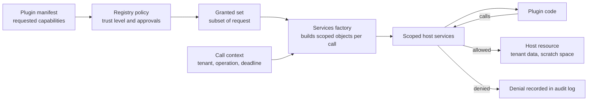

The flow has two inputs that meet in the factory. The manifest and policy decide which kinds of capability the plugin may hold, and the call context decides what each one is scoped to for this call. The granted set is the intersection of what the plugin requested and what policy allows, never the larger of the two. The implication is that a plugin installed once can still receive different scopes per call. A capability for `report.read` becomes, for the current call, read access to one report of one tenant, and it expires when the call returns. A leaked reference to the object is then close to useless.

### 10.3 A small example

The earlier `HostServices` interface can be implemented as a scoped object. The following hypothetical host class returns a capability only if it was granted, and it builds each capability for one tenant and one call.

```java
final class ScopedServices implements HostServices {
    private final Set<String> granted;
    private final String tenantId;
    private final Path scratchDir;
    private final AuditLog audit;

    ScopedServices(Set<String> granted, String tenantId, Path scratchDir, AuditLog audit) {
        this.granted = Set.copyOf(granted);
        this.tenantId = tenantId;
        this.scratchDir = scratchDir;
        this.audit = audit;
    }

    @Override public ReportReader reports() {
        require("report.read");
        return new TenantReportReader(tenantId);          // sees only this tenant
    }

    @Override public ScratchSpace scratch() {
        require("scratch.write");
        return new ScratchSpace(scratchDir, 50L * 1024 * 1024);   // size-capped
    }

    private void require(String capability) {
        if (!granted.contains(capability)) {
            audit.denied(tenantId, capability);
            throw new CapabilityDeniedException(capability);
        }
    }
}
```

The class does four things that matter. It copies the granted set, so the plugin cannot grow it. It binds the tenant at construction, so the plugin cannot name another tenant. It returns narrow objects with a built-in cap, so the size limit does not depend on plugin cooperation. And it records every denial, so a plugin that probes for capabilities it was not granted becomes visible in telemetry.

### 10.4 Design rules for capabilities

1. **Least authority by construction.** Design capabilities at the grain of a task. `ScratchSpace` is better than `FileSystem`. A narrow capability needs no review of how it will be used.
2. **Attenuation.** The host can derive a weaker capability from a stronger one, such as a read-only view from a read-write handle, before passing it on. Plugins that delegate to helper code should do the same.
3. **No ambient escape hatches.** Do not add a `getHost()` method or a static `Host.instance()`. One such method returns every capability that was deliberately withheld.
4. **Scope to the call.** Bind tenant, operation, and deadline into the capability, and let it expire. Long-lived powerful references invite misuse.
5. **Request and grant are visible.** The capability list is part of the manifest, shown to an administrator at install time, and logged at activation, so reviewers see what a plugin can do before it runs.
6. **Capabilities are versioned too.** Adding a capability is a minor change to the host API. Narrowing the scope of an existing capability can break plugins and is a breaking change under the rules in the versioning section.

### 10.5 The trust model for third-party plugins

Capabilities are one layer of a layered trust model. The architecture-level view for third-party plugins has four statements. The plugin author is not trusted with host data by default. Admission, which includes provenance and compatibility, limits who gets to run. Capabilities limit what an admitted plugin can ask the host to do. Isolation, described in the previous section and in the later section on isolating permissions and resources, limits what a plugin can do without asking, such as consuming memory, reading process state, or reaching the network directly. Each layer assumes the one before it can fail. Admission can be fooled by a compromised publisher, which is the supply chain problem that Part 15 treats in [Supply Chain Security](../15_Security/CH15_Supply_Chain_Security.md). Capabilities fail when ambient authority exists. Isolation fails when the boundary is weaker than assumed. The practical consequence is that a design whose only defense is a manifest field, or only a code review, has a single point of failure. Threat modeling the extension boundary, using the method in [Threat Modeling](../15_Security/CH12_Threat_Modeling.md), is the way to check that each layer covers a different failure.

## 11. Isolating Permissions and Resources

Capabilities decide what a plugin may ask for. This section covers what the plugin can do without asking, and how much of the machine it may consume. The two controls are different in kind. A permission is a yes or no decision about an operation. A resource limit is a quantity, and exceeding it is a matter of degree that the host must meter. Both need enforcement outside the plugin's own code, because the plugin is the party being constrained.

### 11.1 Choosing the execution boundary

The boundary options were compared in the dependency isolation section. For permissions and resources the question is narrower: which boundary can enforce the limit the trust level requires?

- **In-process with capabilities.** Enforces what the host services expose. It cannot stop a plugin from using ambient authority, spinning a thread, or allocating memory. Suitable for plugins written by the host team or reviewed internal teams.
- **Separate process.** The operating system enforces memory, CPU time, open files, and, with a restricted account, filesystem access. The host holds the only channel to the plugin.
- **Sandboxed runtime.** A runtime such as a WebAssembly (Wasm) engine gives the plugin linear memory it cannot escape and only the functions the host registers. Whether it can also bound CPU time depends on the engine, so check the product in use.
- **Container or virtual machine.** Adds network and filesystem namespaces and a separate kernel view, with the highest cost per plugin. Part 15 covers the controls in [Container Security](../15_Security/CH14_Container_Security.md), and this chapter does not repeat them.

For the low-trust audiences in the earlier table, choose at least a separate process with an unprivileged account. For marketplace plugins that handle one tenant's data on behalf of another party, choose a container or sandbox with no network by default. The host's own core isolation, where a minimal kernel is protected from its extensions, is the subject of [Microkernel Architecture](CH15_Microkernel_Architecture.md), and this chapter assumes the same discipline for the host.

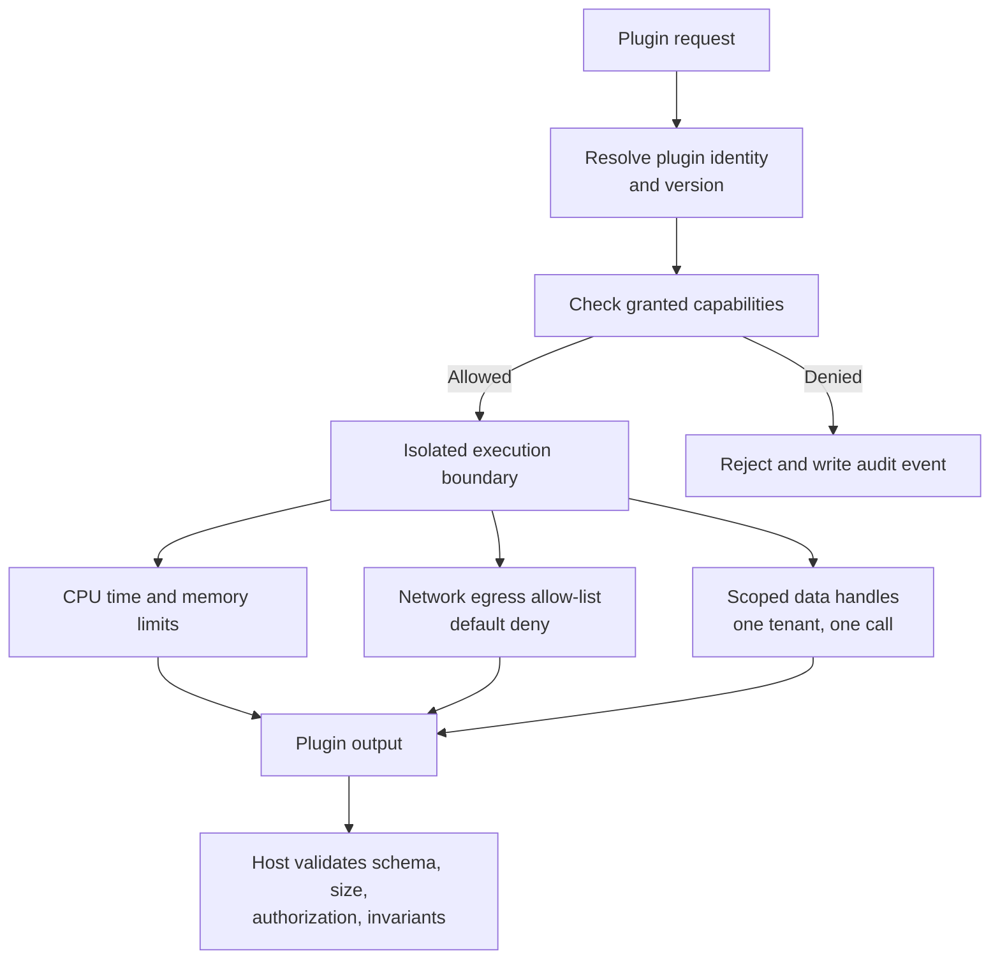

The diagram places three independent gates between a request and the host's data: policy, boundary limits, and output validation. A request that passes policy still runs under hard limits, and its result still passes host validation before it can change state. The implication is that a defect in one gate, such as an over-generous grant, is bounded by the others.

### 11.2 Permission dimensions to define

| Dimension | Question | Typical enforcement |
| --- | --- | --- |
| Data | Which records may the plugin read or write? | Scoped host service bound to tenant and call |
| Filesystem | Which paths may it touch? | Scratch directory only, size-capped, wiped after the call |
| Network | Which destinations may it reach? | Allow-list at the sandbox or egress proxy, default deny |
| Process | May it start child processes or load native code? | Denied by sandbox profile or runtime |
| Secrets | Which credentials may it hold? | Short-lived, per-operation tokens issued by the host |
| Host control | May it register routes, schedule jobs, or alter other plugins? | Not granted, or only through typed services |

Credentials deserve special care. A plugin that needs to read from a customer's storage account should receive a credential that names one tenant, one operation, and a short expiry, and should never receive the host's long-lived secret. Part 15 describes issuing such credentials in [Secrets Management](../15_Security/CH09_Secrets_Management.md).

### 11.3 Resource quotas and worked arithmetic

Every plugin needs a budget for each shared resource: memory, CPU time, concurrency, call rate, output size, and disk. The numbers below are illustrative and show how to derive limits from the host's capacity.

Take a host node with 32 gigabytes (GB) of memory. Reserve 8 GB for the host itself and the operating system, leaving $32 - 8 = 24$ GB for plugins. Each plugin process gets a limit of 512 megabytes (MB) per worker, with at most 2 workers, so a plugin at its ceiling holds $2 \times 512 = 1{,}024$ MB, which is 1 GB.

- If every installed plugin could run at its ceiling at once, the node supports $24 / 1 = 24$ plugins.
- The deployment has 40 plugins installed. Their reserved baseline is 1 worker each at 512 MB, so $40 \times 0.5 = 20$ GB, which fits in 24 GB with 4 GB spare.
- The sum of ceilings is $40 \times 1 = 40$ GB, so the memory overcommit ratio is $40 / 24 \approx 1.67$. A worst case in which more than 24 plugins burst together would exhaust memory and trigger the operating system's out-of-memory killer, which may choose the host.
- The host therefore adds a global pool of 24 worker slots. A plugin needing a second worker waits for a free slot. This turns a possible node failure into bounded queueing for the plugins that burst.

Time and rate limits follow the same reasoning. Suppose a call has a 2-second CPU budget and a 5-second wall-clock deadline (both illustrative), and the host serves 100 calls per minute per tenant to a given plugin. Concurrency is then bounded by Little's law, in which average concurrency equals arrival rate times average duration. At a mean call duration of 1.2 seconds, concurrency is $(100 / 60) \times 1.2 = 2$ calls, so a per-plugin concurrency cap of 8 leaves a 4 times margin for bursts. A cap of 2 would queue ordinary traffic, and a cap of 100 would defend nothing.

Quotas also need a per-tenant dimension, or one tenant's heavy use of a plugin starves the others. Divide a plugin's worker pool into fair shares, for example a guaranteed share per tenant with a shared burst pool, and reject over-quota calls with a typed error that the host can show to the user.

### 11.4 Enforcement is outside the plugin

Three rules keep the controls real. Limits are applied by the host or operating system and never by a plugin-supplied setting. Exceeding a limit ends the call, and repeated exceedance feeds the quarantine logic in the next section. And limits are visible in the manifest, so authors can design to them and administrators can review them. Output is also bounded: the host should read at most the declared maximum size from a plugin's reply and discard the rest, since an unbounded reply is a memory attack on the host. Treat plugin output as untrusted input, validating schema, size, authorization, and business invariants before any state change.

## 12. Containing Plugin Failure

A plugin can hang, crash, return invalid output, leak memory, or overwhelm a shared dependency. The host's goal is that a plugin failure costs the user one optional feature at worst, and never the whole product. This needs a policy decided per extension point, and mechanisms that apply it.

### 12.1 Classify failures and decide the response

| Failure | Detection | Immediate response | Repeated failure |
| --- | --- | --- | --- |
| Hang or slow call | Deadline expires | Cancel, then terminate after a grace period | Circuit opens |
| Crash or process exit | Channel closes, exit code | Restart with backoff, fail the call | Quarantine |
| Invalid output | Schema, size, or invariant check | Discard output, record reason | Quarantine, flag the version |
| Typed expected error | Contract error type | Report to the user as the plugin's error | Nothing, this is normal |
| Resource overrun | Limit hit | End the call, count against quota | Quarantine |
| Capability probing | Denial events | Audit, no effect on the call | Alert the security owner |

The contract must say, per extension point, whether the plugin is **optional** or **required** for the operation. An optional validator that times out lets the upload proceed with a visible note that the check did not run. A required validator that times out fails the upload with an explicit message. Silent fallback is dangerous when it changes a security or business outcome. A virus-scan plugin that times out must not be treated as "no virus found".

### 12.2 Mechanisms

- **Deadlines and cancellation.** Every call carries a deadline. The host signals cancellation first, waits a short grace period, and then terminates the thread, process, or sandbox instance. In-process threads cannot be killed safely on most runtimes, which is a further reason to place untrusted plugins in processes.
- **Bulkheads.** Each plugin gets its own worker pool. A plugin that hangs consumes its own workers and no one else's. This is the resource-limit design of the previous section applied to failure.
- **Circuit breaker.** After enough failures, the host stops calling the plugin for a cooling period and fails fast. After the period, it sends a small number of probe calls, and it closes the circuit again only if they succeed.
- **Crash isolation and restart.** A crashed plugin process is restarted with exponential backoff. The host must distinguish a crash caused by one request, which may be a poison input, from a plugin that crashes on start.
- **Quarantine.** When failures cross a threshold, the registry moves the plugin to the Quarantined state from the lifecycle section. It stays visible with a reason and leaves only through an operator action or an explicit timer.
- **Version-aware disable.** The registry can disable one version of a plugin and leave the previous version routable, which is why the upgrade procedure kept the old version installed.

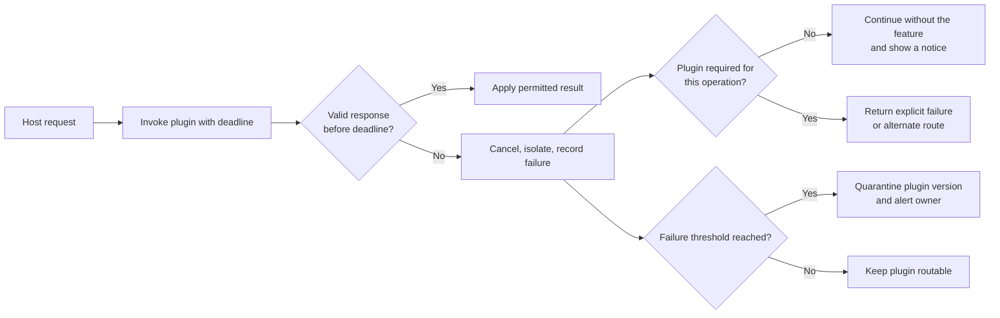

The diagram shows that containment has two independent outputs for each failure: what happens to this request and what happens to the plugin. Splitting them stops a single flaky call from disabling a plugin and stops a persistent fault from being retried forever. Operators gain a clean answer to "why was this feature missing", because the request path records degrade or fail, and the plugin path records quarantine.

### 12.3 Worked example: a hanging plugin

The numbers are illustrative. A plugin receives 100 calls per minute, which is about 1.67 per second. Its deadline is 5 seconds and its concurrency cap is 8. It begins hanging on every call.

- Without any cap, in-flight calls grow to $1.67 \times 5 \approx 8.3$ before the first timeouts return. Each hung call holds a host thread, so a shared thread pool of 200 would fill only after $200 / 1.67 = 120$ seconds, but a pool shared with other features degrades noticeably well before that.
- With the cap of 8 in its own bulkhead, the pool is full after about $8 / 1.67 \approx 4.8$ seconds. Later calls are rejected immediately and counted as failures.
- A breaker that opens at 10 failures within a window counts failures from about 5 seconds onward, since timeouts return then, and the immediate rejections add to them. The tenth failure arrives about $10 / 1.67 = 6$ seconds after the pool fills, so the circuit opens near $4.8 + 6 = 10.8$ seconds.
- From then on calls fail in microseconds. The host's other features were never starved because only the 8 plugin workers were consumed.

The design bounded the damage to about 11 seconds of degraded calls for one optional feature, with no effect on other routes. The same plugin without a bulkhead could have held shared threads for as long as callers kept arriving.

### 12.4 Observability for plugins

Containment relies on telemetry that names the plugin. Record, per plugin identifier and version, call count, latency percentiles, error rate by type, resource use, permission denials, circuit state, and lifecycle state. Add the plugin identifier and version to traces and logs so that a slow request can be attributed. Alerts should fire on a plugin version's error rate and not only on host error rate, since a failing optional plugin can leave the host's aggregate nearly healthy. Part 14 covers the underlying practice.

## 13. Testing Plugins and Their Compatibility

A plugin ecosystem is tested at three levels, and the host team owns the first two.

1. **Contract tests.** The published test kit from the contracts section runs against every plugin. It checks behavior: deadline respect, typed errors for bad input, idempotency, output limits, and clean shutdown within the drain time. A plugin that fails is not admitted to the certified list.
2. **Compatibility matrix.** The host runs the contract kit across the supported host versions and the certified plugin versions, using the multiplication from the versioning section. Run it on every host release candidate and on every new plugin release. The matrix is expensive, so limit it to the latest releases of certified plugins and to the supported API generations.
3. **Combination tests.** Plugins interact through shared host resources and through chains. Test the pairs most commonly installed together, and test the known-conflicting library pairs. Full combinatorial testing is impossible, since 40 plugins give $40 \times 39 / 2 = 780$ pairs, so choose pairs by installation frequency and by shared extension point.

Chaos-style tests belong here too. Inject a hang, a crash, an oversized reply, and a denied capability into a test plugin and check that the host meets the scenarios in the next section. Without such a test, the containment mechanisms are assumptions and not facts.

## 14. Packaging, Distribution, and Update Policy

How plugins reach the host determines how much of the earlier design can be trusted.

- **Package contents.** A package holds the manifest, the code, its private libraries, and a checksum. It never contains the extension API classes. A reproducible build lets the host or a reviewer verify that the published artifact came from the published source.
- **Distribution channels.** An internal catalog for same-organization plugins, a signed customer upload for customer-written ones, and a reviewed marketplace for public ones. Each channel states who can publish, what review occurs, and how a publisher is revoked. Provenance, signing, and software bills of materials are covered in [Supply Chain Security](../15_Security/CH15_Supply_Chain_Security.md) and [SBOM](../15_Security/CH16_SBOM.md).
- **Update policy.** Choose per channel between automatic updates, administrator-approved updates, and pinned versions. Automatic updates spread fixes quickly and spread defects equally quickly. A staged rollout, in which the new version serves a small share of calls and is compared against the old one, uses the side-by-side install described in the upgrade section.
- **Revocation.** The host needs a way to disable a published plugin version everywhere, even if the administrator ignores the notice. This is an emergency control and needs an audit trail.
- **Compatibility on host upgrade.** Before a host upgrade, the registry reports which installed plugins fall outside the new API range, so administrators do not discover the gap after the upgrade.

The trade-off is control against friction. A closed catalog with review gives safety and slows the ecosystem, and an open channel gives growth and moves the safety burden to isolation and capabilities. The audience table in the context section guides the choice.

## 15. Failure and Quality-Attribute Scenarios

A scenario states a stimulus, the response the architecture should produce, and a measurable criterion. The thresholds below are illustrative and should be replaced by values from the product's own objectives. Each scenario needs a test, ideally the chaos-style test from the testing section.

| Scenario | Stimulus | Expected response | Success criterion (illustrative) |
| --- | --- | --- | --- |
| Plugin hangs | An optional plugin never returns | Deadline, cancel, terminate, circuit opens | Other routes keep their normal latency, circuit open within 15 seconds, no host thread held past the 5-second deadline |
| Plugin crashes on input | A document makes a plugin process exit | Call fails with a typed error, process restarts with backoff | Host availability unchanged, next call served within 5 seconds, poison input recorded |
| Hostile capability probe | A plugin requests a capability it was not granted | Denied, audited, no state change | 100% of denials logged with plugin and version, alert raised after 10 denials in a minute |
| Resource exhaustion | A plugin allocates memory without limit | Boundary kills the worker, quota counted | Memory of other plugins and host unchanged, worker slot freed within 2 seconds |
| Incompatible host upgrade | Host moves to a new major API | Registry reports unsupported plugins before the upgrade | Zero plugins fail at runtime for range mismatch, each rejection names its reason |
| Bad plugin release | A new plugin version returns invalid output | Staged rollout detects, version quarantined, prior version routed | At most 5% of calls exposed, rollback in under 10 minutes |
| Supply chain compromise | A publisher's key is revoked | Registry disables all versions signed by the key | All affected installations disabled within 1 hour of revocation |
| Noisy tenant | One tenant floods a shared plugin | Per-tenant quota rejects excess calls | Other tenants' latency within 10% of baseline |

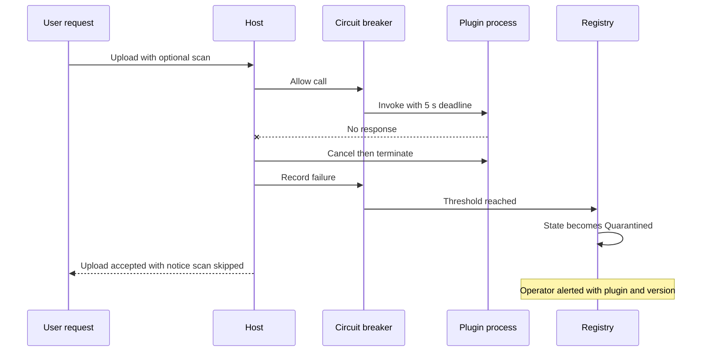

The sequence shows the host answering the user before any operator acts. The scenario table gives the acceptance numbers, and the sequence shows the order in which the mechanisms fire to reach them.

## 16. Worked Case: Document Import Extensions

The organization, Harborline Docs, its numbers, and its importers are invented for this chapter. Harborline sells a document-management product to regulated customers. Each customer stores source documents in a different system: file shares, object stores, and records systems. Harborline's core team of 9 engineers cannot build and maintain an importer for each. Partners and customer platform teams write importers, which handle untrusted documents and carry their own libraries.

### 16.1 Requirements and decisions

The requirements are that a failing importer must not stop other imports or the user interface, that one tenant's credentials never reach another tenant's importer, that importers can ship on their own schedule, and that imports sustain the daily volume.

**Decision 1: a narrow, coarse import contract.** The extension point is `import(batchRequest)`, cardinality "many providers, host picks by key" with the storage system name as the key. The request holds a source reference, tenant identifier, and limits. The result holds document bytes through a host-provided handle, and metadata as plain data. The contract states a 60-second deadline per batch of up to 20 documents, idempotent retry by source reference, and a maximum document size of 100 MB. The coarse grain was chosen because importers will run out of process.

**Decision 2: process isolation with a restricted account.** Each importer runs in its own process with a memory limit of 512 MB per worker and 2 workers. Its only channel is a local message pipe to the host. There is no direct network access, so source system calls go through a host egress proxy that checks the destination against the importer's manifest allow-list.

**Decision 3: per-operation credentials.** The host issues a token for one tenant, one source system, and 30 minutes of life, in line with the capability rules.

**Decision 4: manifest admission and signed packages.** The manifest declares the API range, capabilities, and egress destinations. The registry rejects unsigned packages and anything that bundles API classes.

**Decision 5: failure policy.** Importers are required for their own import jobs and optional for everything else. A failed batch retries twice, and a plugin version reaching the failure threshold is quarantined without affecting other importers.

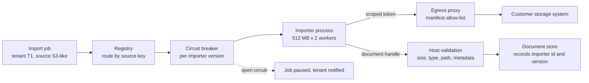

The diagram shows each trust boundary the data crosses. The importer never sees other tenants and never reaches the network except through the proxy. The host records importer version for every stored document, so a later defect can be traced to the documents it touched.

### 16.2 Capacity arithmetic

Assume 120,000 documents per day, of which 40% arrive in a 4-hour window, so $120{,}000 \times 0.4 = 48{,}000$ documents in $4 \times 3{,}600 = 14{,}400$ seconds, or $48{,}000 / 14{,}400 \approx 3.33$ documents per second. At a mean of 1.5 seconds per document, average concurrency is $3.33 \times 1.5 = 5$. Each importer is limited to 2 workers, and 14 importers share the node pool. The busiest source system carries 50% of volume, so its importer needs about $5 \times 0.5 = 2.5$ concurrent documents at peak. If each worker handles one document at a time, the busiest importer needs 3 workers at peak, which exceeds its limit of 2. The team therefore raises that single importer to 4 workers (3 needed plus one spare), using $4 \times 512 = 2$ GB, while others keep 2. Total ceilings are $13 \times 1 + 1 \times 2 = 15$ GB, inside the 24 GB plugin budget from the resource section, so the global worker pool does not need to shrink.

The process boundary cost is checked next. One pipe round trip costs about 0.3 milliseconds (illustrative), which is $0.3 / 1{,}500 = 0.02\%$ of a 1.5-second document, so the boundary is negligible at this call grain.

### 16.3 Rejected alternatives

- **All importers built by the core team.** With 14 importers and an assumed 3 weeks each, that is 42 engineer-weeks of initial work plus ongoing maintenance, and a customer-specific importer would still wait in the core backlog. Rejected because the core team has no knowledge of the customer systems.
- **In-process importers with class loaders.** Cheaper in memory, which would cost $14 \times 8 = 112$ MB of duplicate library classes against $14 \times 120 = 1{,}680$ MB for process baselines. Rejected because it cannot stop a hung importer from holding host threads or a memory leak from affecting the host, and the importers handle untrusted documents.
- **Customer-run webhooks.** The host would call a customer service for each document. This removes the packaging burden but moves document bytes across the network under the customer's operations and leaves the host with no control over credentials or resource use. Kept as an option for customers who will not install a plugin, with the comparison in the next section.
- **Embedding importers in the core as configuration only.** Rejected because format and authentication differences need code, not data.

### 16.4 Validation evidence

The team validated the design with three pieces of evidence. The contract kit was run against the 3 first-party importers and the 2 pilot partner importers. A chaos test injected a hang, a crash, an oversized reply, and a denied capability into each importer, 25 runs per fault, for $4 \times 25 = 100$ runs per importer. The acceptance criteria came from the scenario table: other importers' latency within 10% of baseline, the circuit open within 15 seconds, and no document stored from a rejected reply. A rollout rehearsal installed a second importer version beside the first, shifted 5% of jobs, and rolled back by a routing change. All results in this case are invented to show the form of evidence, and a real team would record its own measurements.

### 16.5 Consequences

The team accepted three costs. Every importer must be written for coarse batches, which partners find less convenient than a per-document call. The registry, egress proxy, and credential issuer are now components to operate. And a compatibility matrix of 2 supported API versions, 14 importers, and 2 releases each is $2 \times 14 \times 2 = 56$ runs per host release, which at 4 minutes each is 224 minutes sequentially, or 28 minutes with 8 runs in parallel.

## 17. Common Mistakes and Anti-Patterns

| Anti-pattern | Cause | Consequence |
| --- | --- | --- |
| Leaky extension API that exposes internal classes | Passing host objects to plugins because it is quick | Internals cannot be refactored without breaking plugins, and plugins reach data the host never meant to share |
| Plugin as system of record | Letting a plugin hold the only copy of state | Quarantine or removal of the plugin loses data and blocks rollback |
| Unbounded calls | No deadline or concurrency cap | One hung plugin consumes shared threads and the host stalls |
| Admission by manifest alone | Treating declared capabilities as enforced ones | A plugin that lies in its manifest still acts, since nothing enforces the grant |
| Ambient authority | Running plugins in-process with full runtime access, then adding a deny list | The list misses operations, and a hostile plugin has the host's privileges |
| Retrofitted isolation | Designing for trusted authors and later admitting a public marketplace | Contracts depend on object references and cannot cross a process boundary, so the sandbox costs a redesign |
| Silent fallback | Treating a failed plugin as success | A skipped security check looks like a passed one |
| Hot reload promise without leak control | Assuming unload works | Class loader or module leaks grow memory until restart |
| Versioning only the types | Ignoring behavioral change | Concurrency or deadline changes break plugins with no signature change |
| No plugin identity in telemetry | Aggregating metrics at host level | Operators cannot tell whether the host or a plugin caused a slow request |
| Opening a point for a hypothetical author | Speculative extensibility | A contract with no feedback that must still be kept |
| Everything is a plugin | Enthusiasm for the pattern | Core invariants spread across code the core team does not review, which is the microkernel and modular monolith question |

Two of these deserve a fuller note. The leaky API is the most common because it feels like a convenience at the time and has a delayed cost. A single `Document` object passed to a plugin is one reason the host can never change `Document`. And retrofitted isolation is the most expensive, since contract changes to move from object references to serialized data touch every plugin author.

## 18. Pattern Comparison and Decision Guide

Plugin architecture is often confused with its neighbours. The table compares it with the closest alternatives. The microkernel and layered rows summarize the sibling chapters and do not replace them.

| Aspect | Plugin architecture | [Microkernel](CH15_Microkernel_Architecture.md) | [Layered](CH01_Layered_Architecture.md) | Webhooks or API extension |
| --- | --- | --- | --- | --- |
| Main idea | Host with optional extensions at chosen points | Minimal core, services as required or optional extensions | Horizontal tiers with downward dependencies | Product calls or is called over a network by external code |
| Who writes variation | Third parties or other teams | Usually the platform's own teams and vendors | One team | Any external system owner |
| Extension is | Optional, installable | Often required for the system to function | Not an extension model | Optional, runs outside the product |
| Isolation | Chosen per trust level | Core protected from extensions | None between layers | Full, separate systems |
| Contract | In-process or local interface plus manifest | Core API and extension registry | Layer interfaces | HTTP or message schema, see [Versioning](../08_API_Architecture/CH10_Versioning.md) |
| Latency | Method call to local message | Similar to plugin | Method call | Network round trip |
| Operational load | Registry, lifecycle, compatibility matrix | Core stability and extension management | Low | Delivery, retries, security of endpoints |
| Best fit | Product ecosystem with open-ended variation | Systems needing a small stable kernel and swappable services | Ordinary business applications | Integrations where the other party runs its own code and infrastructure |
| Main risk | Contract rot, untrusted code in the process | Kernel API becomes the bottleneck for change | Layer leaks and rigid dependencies | Weak guarantees on delivery and latency |

The comparison suggests the usual composition. A layered application can expose plugin extension points at its service layer. A microkernel uses a plugin-like mechanism for its extensions, with the difference that its extensions can be mandatory. A host often offers both plugins for in-product behavior and webhooks for integrations where the other party refuses to install code. The deciding question for plugins against webhooks is who must run the code. If the host must run it for latency, access to local data, or a coherent user interface, the plugin is the answer. If the other party can run it on their own systems, a webhook avoids every isolation and compatibility cost in this chapter and adds network and delivery concerns instead.

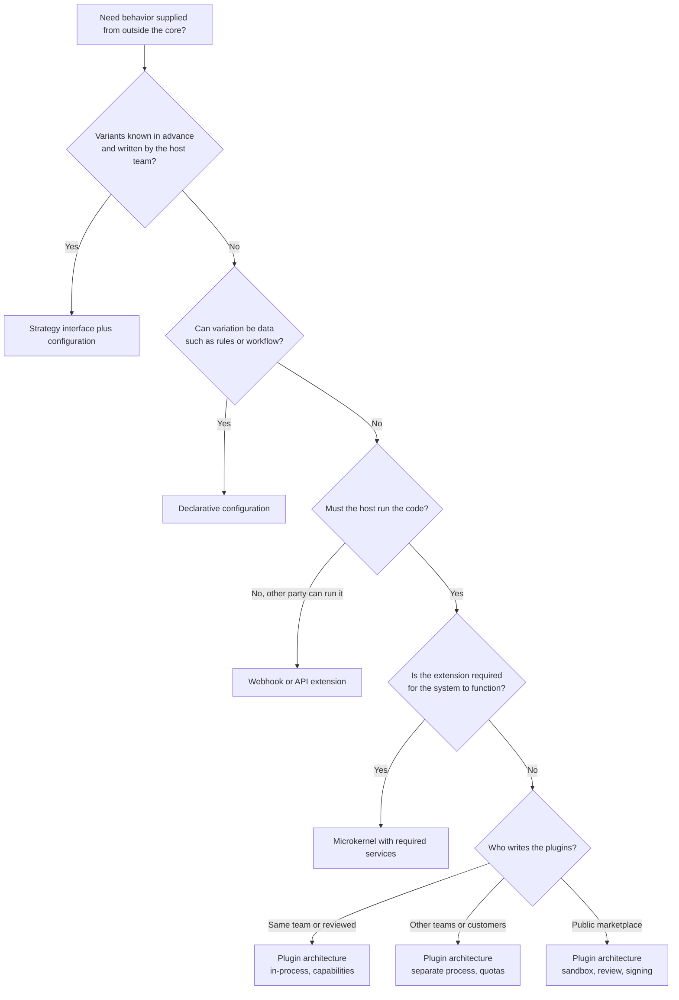

The flowchart orders the questions from cheapest answer to most expensive. Most requests end before the plugin branch, which is the intended result, since a plugin architecture is the most operationally demanding way to take variation from outside the team. The three terminal plugin boxes correspond to the audience table in the context section, and the isolation level is a consequence of the trust answer.

## 19. Design-Review Checklist

Use these questions in a review of a plugin architecture. Each should have a written answer.

- Is each extension point named, with purpose, cardinality, input, output, deadline, threading, state, errors, and retry rules?
- Does the contract expose only data and host-defined types, and do the host's own features use the same contract?
- Is admission complete before plugin code runs, including identity, provenance, compatibility, and requested capabilities?
- Are the lifecycle states explicit, including draining, failed, and quarantined, and does visibility follow readiness?
- Is the extension API versioned with separate rules for the host API and the SPI, and is the lower bound of each plugin's range computed and not guessed?
- Is the supported compatibility window stated, with the cost of the matrix calculated?
- Does the isolation level match the lowest-trust audience, and is call granularity compatible with a later boundary?
- Are capabilities scoped to tenant, operation, and call, with no ambient escape hatch?
- Does every plugin have limits for memory, CPU time, concurrency, call rate, and output size, derived from node capacity?
- Is each extension point marked optional or required, with a defined behavior on failure that never silently weakens a security outcome?
- Are there deadlines, bulkheads, circuit breakers, and quarantine, and has each been exercised by a fault-injection test?
- Do logs, metrics, and traces carry plugin identifier and version?
- Are upgrade, rollback, revocation, and unload procedures written and tested?
- Has the extension boundary been threat modeled, and do admission, capabilities, and isolation fail independently?

## 20. Exercises

1. **Extension point design.** A reporting product wants users to add custom chart types. Write the contract for the extension point in the eight areas of the contract section. Outline: purpose, cardinality (many providers keyed by chart name), immutable input data, rendered output as bounded data, deadline, per-call state, typed errors, and conflict rule for duplicate names.
2. **Version classification.** Classify these changes as major, minor, or patch: add an abstract method to an SPI interface, add an optional field to the data passed to plugins, make the host reject plugin output over 1 MB that was previously accepted, and fix a host bug that passed the wrong locale. Outline: major, minor, major (behavior tightening), patch.
3. **Range arithmetic.** A host implements API 3.2. Which plugins are admitted: `>=3.0 <4.0`, `>=3.3 <4.0`, `>=2.0 <3.0`? Outline: the first only, since 3.2 is below 3.3 and not below 3.0. Then say what an adapter would change for the third.
4. **Quota derivation.** A node has 64 GB, 12 GB is reserved for the host, each plugin worker has a limit of 1 GB, and plugins may run 2 workers. How many plugins can run at ceiling, and what pool size protects the node if 50 are installed? Outline: $(64 - 12) / 2 = 26$ plugins at ceiling, and a global pool of 52 worker slots, since 52 GB is the plugin budget at 1 GB each.
5. **Boundary cost.** A request makes 40 plugin calls, each crossing a process boundary at 0.25 ms, against a 150 ms target. Compute the share of the budget and one way to reduce it. Outline: $40 \times 0.25 = 10$ ms, which is $10 / 150 \approx 6.7\%$. Batch to 4 calls for 1 ms, about 0.7%.
6. **Failure policy.** A plugin checks uploaded files for malware and times out. Decide optional or required, and the user-visible behavior. Outline: required for the scan, so the upload is held or rejected with an explicit message. Treating timeout as clean is the silent fallback anti-pattern.
7. **Retrofit analysis.** A team built an in-process plugin API passing host `Order` objects and now wants a public marketplace. List what must change. Outline: replace objects with immutable data, make calls coarse, add manifest admission, scoped capabilities, process boundary, quotas, and a migration path with an adapter for existing plugins.
8. **Pattern choice.** A customer wants to push order events to its own analytics system. Plugin or webhook? Outline: webhook, since the customer can run its own code and the host avoids installing it. A plugin is justified only if the code must run inside the host for latency or local data.

## 21. Summary

The chapter's outcomes from the introduction map to the following points.

1. **Forces.** A plugin architecture is justified by open-ended variation, different change rates, and different owners, and it is the wrong choice for a few known variants, data-driven variation, or extensions that need internals.
2. **Roles.** The host owns workflow, data, and policy. Extension points define what is open, plugins implement them, the registry decides what may load, and host services are the only route back to host data.
3. **Contracts.** A narrow contract states behavior as well as types, passes data and not objects, separates the host API from the SPI, and is checked by a published test kit.
4. **Discovery and loading.** Admission by manifest comes before code runs. The loading mechanism is chosen by the isolation required, and construct and initialize are separate steps.
5. **Lifecycle.** Explicit states, draining, quarantine, and versioned upgrade and rollback give operators visibility, and unloading is the hard part that favors process boundaries.
6. **Versioning.** SemVer applied with different rules for the host API and the SPI, with range checks and a computed compatibility cost, lets the host evolve without breaking unseen plugins.
7. **Dependency isolation.** Class loaders or modules isolate libraries, and only process or stronger boundaries isolate faults, with call granularity as part of the decision.
8. **Capabilities, permissions, and resources.** Scoped capabilities limit what plugins ask for, and boundary limits and quotas derived from node capacity limit what they do without asking.
9. **Failure, quality, and operations.** Deadlines, bulkheads, breakers, and quarantine contain failure, scenario tests prove it, and plugin identity in telemetry makes it diagnosable.

Plugin architecture creates controlled extensibility only when contracts, permissions, lifecycle, and failure behavior are explicit. Keep the host authoritative, isolate untrusted extensions in proportion to their trust level, and make compatibility and operational ownership part of the extension ecosystem. The sibling chapter on [Microkernel Architecture](CH15_Microkernel_Architecture.md) continues with the stable-core and required-extension cases.
