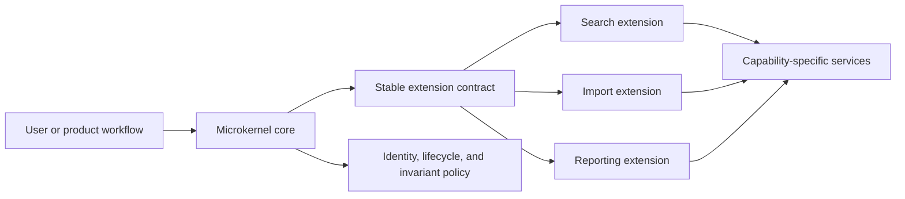
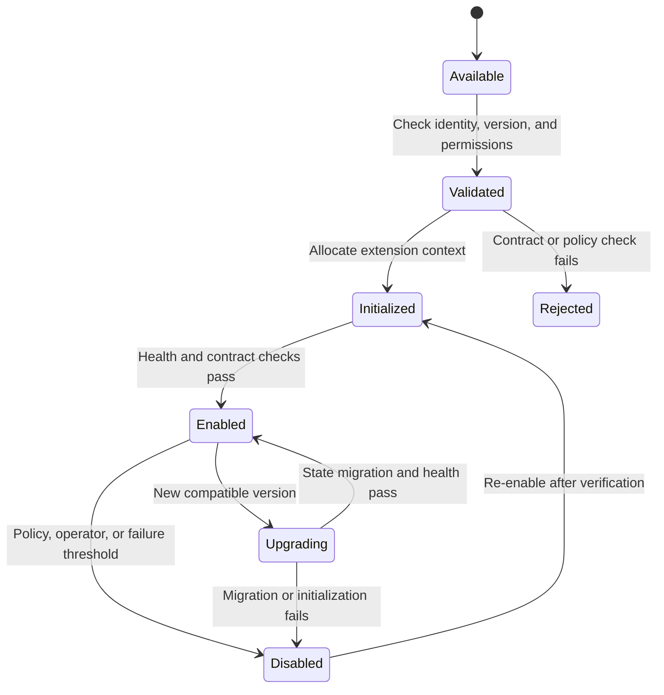
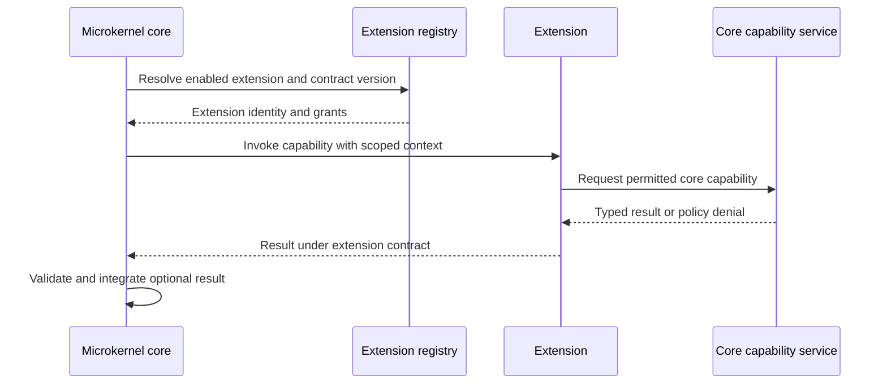
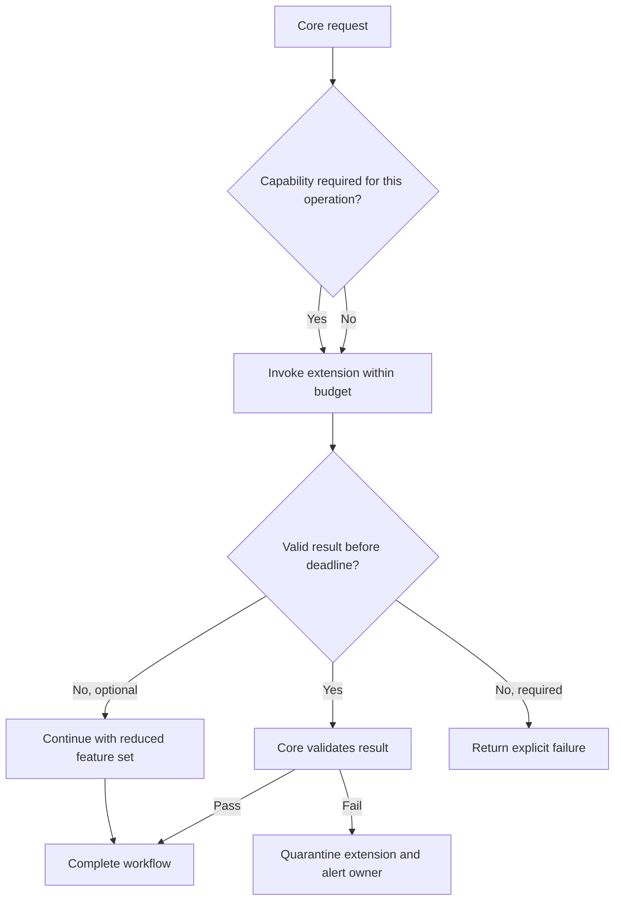
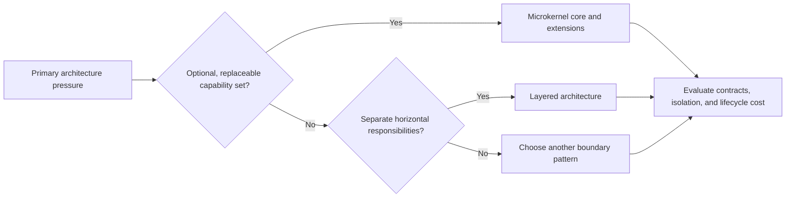

# Microkernel Architecture

Part: [20 — Architecture Patterns](PART_OVERVIEW.md)

Microkernel architecture keeps a minimal core responsible for essential system services while optional capabilities live in replaceable extensions. It fits extensible platforms or product families whose feature set varies by customer, deployment, or module. It is not simply a small executable or any application with plugins; the core-extension contract is the organizing architecture.

Part 20 CH14 owns general plugin-host lifecycle and isolation; this chapter focuses on the stable core, required versus optional capabilities, and failure consequences.

## Keep the Core Small and Stable

The core owns essential coordination, extension contracts, identity or lifecycle hooks where needed, and policy that must remain invariant. Extensions provide optional domain or product capabilities. Avoid moving a capability into the core merely because one extension is popular; do so when it becomes essential and its semantics belong to the platform's stable contract.

Define which capabilities are mandatory, which are optional, and what minimum product remains when extensions are absent. Keep the core contract small but sufficient; an underpowered core forces extensions to depend on one another or bypass platform policy.

## Load and Govern Extensions

The host discovers, validates, initializes, enables, disables, and upgrades extensions. The lifecycle needs compatibility, permission, state migration, and failure handling. A failed optional extension should not prevent the core from starting unless product policy explicitly requires it.

Record extension version, configuration, permissions, and health status. Upgrade and rollback should account for extension-owned data. A core upgrade that changes a contract needs a migration window or compatibility adapter for supported extensions.

## Define the Core-to-Extension Contract

The core should expose capability-oriented interfaces, not internal data structures that change every release. Extensions should declare required capabilities and versions. The contract must define error handling, timeouts, resource budgets, observability context, and whether an extension may alter shared state.

Keep business invariants in the core only when they apply across all extensions. Capability-specific policy belongs with the owning extension or domain service. The core validates extension outputs before they affect shared state.

## Contain Optional Feature Failure

Extensions can fail or consume excessive resources. Isolate execution proportionately, limit concurrency and memory, and define which features can degrade independently. An extension that runs in-process may share crash and memory risk; a separate process improves isolation but adds latency and deployment cost.

Track extension-specific latency, error rate, resource use, and disabled state. Optionality is a product contract: if a feature is needed for a legally or financially consequential result, it is not safe to omit silently.

## Compare Microkernel and Layered Organization

Layered architecture organizes responsibilities by horizontal concern and dependency direction. Microkernel organizes a stable core and replaceable capability extensions. They can coexist: the core and each extension may themselves use internal layers. Select microkernel when variability and extension lifecycle are central, not merely to obtain modular code.

Microkernel may be excessive for a fixed application with one deployment and no extension ecosystem. A layered design can be simpler when the main need is responsibility separation. The patterns solve different pressures and should not be compared as competing implementation checklists.

## Worked Case: Developer Workflow Platform

A developer platform supports common source control and build capabilities, with optional language analyzers, deployment targets, and organization-specific checks. The core handles identity, workflow lifecycle, extension registration, and policy. Extensions implement a versioned capability contract and declare permissions. A missing optional analyzer does not prevent a build from starting, but a required security policy check blocks release if unavailable.

The platform loads extensions after compatibility and permission checks, records version attribution in workflow traces, and isolates third-party extensions in separate processes. A core API change includes a deprecation window and contract tests. When one analyzer times out repeatedly, the platform disables it for affected workflows and reports degraded coverage rather than silently claiming full analysis.

## Review Questions

1. Which responsibilities must remain in the stable core?
2. What makes an extension optional versus required for a workflow?
3. How does the contract bound permissions, resource use, and compatibility?
4. Which extension failures can be isolated without invalidating the result?
5. Is variability central enough to justify microkernel lifecycle cost over layers?

Microkernel architecture is valuable when optional, replaceable capabilities define the product. Keep the core focused on invariant coordination, treat extensions as governed lifecycle participants, and make failure isolation and capability omission visible.
