# Microkernel Architecture

Part: [20 — Architecture Patterns](PART_OVERVIEW.md) · Status: Revised (in-depth rewrite)

## 1. Introduction

A microkernel architecture splits a system into a small core and a set of components. The core contains only what every deployment of the system needs and what must stay consistent across all components: a registry that knows which components exist, a way to route messages to them, control over their lifecycle, the security checks that apply to everyone, and shared configuration. Everything else, including most of the features a user would name, lives in components that the core loads, connects, and can replace. The pattern pays off when the feature set varies by customer, product edition, or deployment, and when the system must keep a stable center while its edges change often.

The pattern is easy to misuse. Teams label an application "microkernel" because it has a plug-in folder, then let the core grow until it holds most of the logic. The result is a large core that every component depends on, which is the opposite of the intent. The architect's work is to decide what the core is allowed to know, to keep the contract between the core and its components small and versioned, and to make sure one failing component cannot take the whole system down.

After the first part of this chapter you should be able to:

1. Define the core and a component, and explain why the split is by variability and stability rather than by layer.
2. Decide whether a given capability belongs in the core or in a component using explicit tests.
3. Describe the core services (registry, message routing, lifecycle, security, configuration) and write a minimal core in Java.
4. Trace a request end to end through the core and one or more components.
5. Explain how the idea differs between an operating system (OS) microkernel and an application-level microkernel.
6. Plan core stability and application programming interface (API) versioning so components can outlive core releases.
7. Reason with numbers about failure containment and about the latency cost of indirection.

The boundaries with neighboring material are deliberate:

- [Plugin Architecture](CH14_Plugin_Architecture.md) is the closest sibling. It owns how a host discovers, loads, versions, and isolates plugins. This chapter recaps that material where needed and concentrates on the stable minimal core, what is allowed inside it, and the consequences for failure and latency.
- Operating system internals, including processes, threads, and memory protection, belong to Part 05. See [Processes and Threads](../05_Networking_and_OS/CH24_Processes_and_Threads.md) for the mechanisms this chapter only recaps.
- [Layered Architecture](CH01_Layered_Architecture.md) and the [Pipeline Pattern](CH13_Pipeline_Pattern.md) are siblings that organize a system by responsibility or by data flow. They appear here by comparison.
- Interface versioning as a general discipline belongs to [Versioning](../08_API_Architecture/CH10_Versioning.md). This chapter applies it to the core contract.
- Service-level decomposition across a network is covered in [Microservices](CH05_Microservices.md).

All numbers in this chapter are illustrative. They show how to reason and are not measurements of any real system.

## 2. The Foundational Model: Core, Components, and Contract

Three elements define the pattern.

The **core** is the smallest body of code that must exist for the system to run and that no component can supply for itself. It is loaded first, it is the only element that knows about every component, and it is the only element that can start or stop one.

A **component** is a unit of capability that the core hosts. It might be a feature (reporting, import, search), an adapter to an external system, or a policy variant. A component does not call another component directly. It asks the core to deliver a message or to resolve a capability, and the core decides what happens.

The **contract** is everything a component may rely on: the API the core exposes, the message formats, the lifecycle callbacks, the ordering and delivery promises, and the error behavior. The contract is the real architecture. Code on either side can change freely as long as the contract holds.

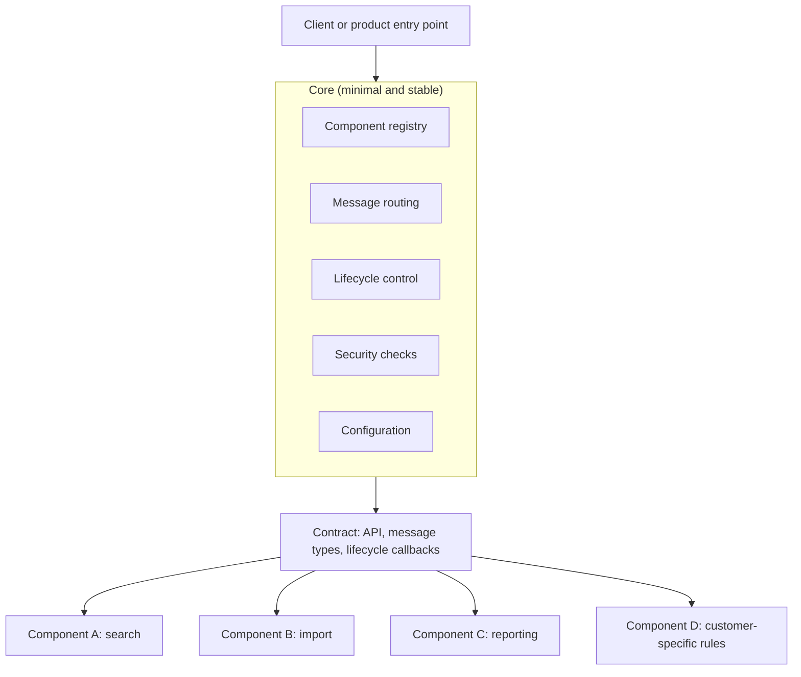

The diagram shows a star, not a stack. Every arrow passes through the core and the contract, and there are no arrows between components. This has two consequences. First, adding a component changes nothing in the others, so variability is cheap. Second, the core and contract are a shared dependency of everything, so any change to them has a wide blast radius. The rest of this chapter is largely about managing that second consequence: keeping the core small so it changes rarely, and versioning the contract so that changes do not break components.

Two properties distinguish the pattern from a general modular application. **Replaceability** means a component can be swapped for another that satisfies the same contract without touching the core. **Optionality** means the system has a defined behavior when a component is absent, either a reduced feature set or an explicit refusal. If neither holds, the system is a modular application whose modules happen to be loaded dynamically, and the lifecycle cost of a core and contract is not buying anything.

## 3. Forces and Context

A pattern is a response to forces, and the microkernel responds to a specific set. Check that these forces are present before adopting it.

**Variability that is structural, not incidental.** Different customers, editions, or deployments need different feature sets, and the set changes over time. A product sold in three editions where each edition enables a different subset of capabilities is a good fit. A product where every customer gets everything is not, because no one ever needs to leave a component out.

**A stable center and a volatile edge.** Some behavior changes rarely (identity, lifecycle, how work is dispatched) and some changes constantly (a new import format, a new report, a customer's custom rule). The pattern puts the first in the core and the second in components so that the volatile part can change on its own release schedule.

**Independent delivery of capabilities.** Different teams, or even different organizations, produce components. Third-party extension is the strongest force, because the core team cannot review or coordinate with the authors. If one team writes everything and releases together, the pattern's delivery benefit disappears.

**A need to bound the consequences of extension.** Extensions are written by people who may not know the whole system. The core must be able to refuse, limit, or remove a component without redeploying everything.

**Constraints that push against it.** Four constraints raise the price. A tight latency budget makes indirection expensive, which the section on the performance cost of indirection quantifies. A requirement for strong transactional consistency across capabilities is hard to meet when capabilities cannot call each other directly. A small team that owns everything gains little from the lifecycle machinery. A rapidly changing domain model makes the contract unstable, and an unstable contract defeats the pattern.

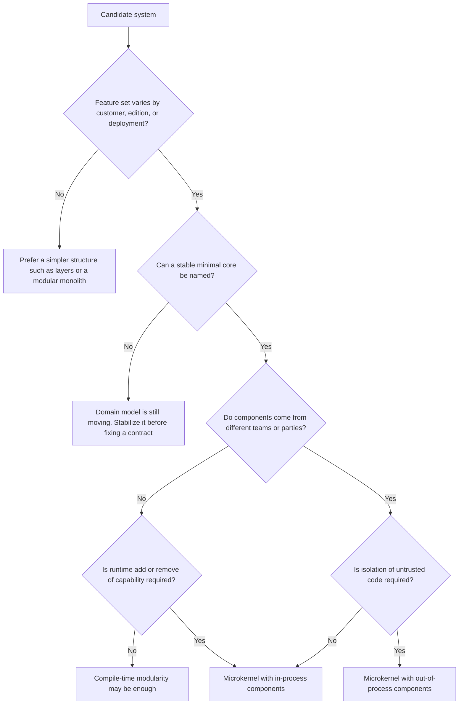

The decision tree makes the adoption test explicit. Notice that "runtime add or remove" and "different parties" are separate questions. A single team that wants only build-time variability can often get it from ordinary modules and build profiles, which cost far less than a runtime core. The pattern earns its cost when components arrive from outside the core team or must change while the system runs.

A useful practice is to write the forces as quality-attribute scenarios before choosing the pattern. For example: stimulus, a customer needs a new import format that the vendor does not ship; expected response, a partner delivers a component that is installed without a core release; measurable criterion, installation completes with no change to the core artifact and no restart of unrelated components. If the team cannot write at least two such scenarios, the pattern is probably premature.

## 4. What Belongs in the Core and What Belongs in Components

The central design question is the boundary. The core must be small enough to stay stable and large enough that components do not have to work around it. Both failures happen in practice.

### 4.1 Tests for core membership

Apply these tests to a capability in order. A capability belongs in the core only if it passes the first test or passes the second and third together.

1. **The independence test.** Can the system start and do nothing useful, but correctly, without this capability? If no, because the capability is how components are found, started, or kept apart, it is core. The registry and lifecycle control pass.
2. **The invariant test.** Must the capability behave identically for every component, so that a component cannot be allowed to vary it? Authentication, authorization decisions, and message ordering rules pass. A reporting format does not.
3. **The sharing test.** Is the capability needed by several components so that duplicating it would cause divergence, and is its meaning stable? A configuration lookup and a logging facade pass. A domain-specific calculation used by two components usually fails, because its meaning changes with the domain, and it should live in a shared library or a third component.

A capability that is merely popular fails all three. Popularity is a reason to optimize a component, not to move it into the core.

### 4.2 Placement by example

| Capability | Placement | Reason |
| --- | --- | --- |
| Component discovery and registration | Core | No component can register itself without it (independence) |
| Start, stop, and health state of components | Core | Only the core can see all components (independence) |
| Message routing and delivery rules | Core | Ordering and delivery must be uniform (invariant) |
| Authentication and permission checks | Core | Must not vary per component (invariant) |
| Configuration lookup | Core | Shared and stable (sharing) |
| Import of one file format | Component | Varies by customer, changes often |
| Report rendering | Component | Optional and volatile |
| A customer's pricing rule | Component | Specific to one deployment |
| Cross-component business workflow | Component or a separate coordinating component | Business policy changes, so it fails the invariant and sharing tests |

The last row deserves attention. A workflow that spans several components looks like a core concern because it touches everything. Putting it in the core makes the core know business rules, and each rule change then becomes a core release. Put it in a component whose job is coordination, and let it use the core's messaging like any other. It fails the invariant and sharing tests because business policy changes.

### 4.3 Core growth and its warning signs

A core grows by accretion. The usual path is that a component needs something, the core team adds a convenience method for it, and a second component then uses it. After a year the core exposes dozens of methods, several of which encode one component's assumptions. These signs indicate a core growing past its role:

- The core release cadence is driven by component feature requests rather than by platform needs.
- Core code contains names from the business domain, such as "invoice" or "patient", rather than from the platform, such as "component" or "message".
- Components cannot be tested without a full core, because they depend on many core methods.
- A change to one component's behavior requires a core change.

The remedy is a rule that the core accepts a new capability only after it passes the tests above and at least two independent components need it. Otherwise the capability is offered as a separate, optional component that others depend on explicitly.

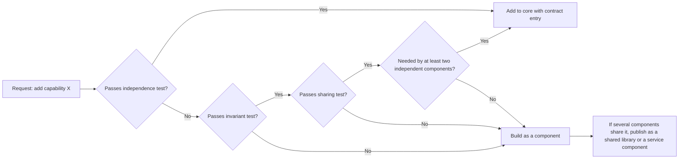

The flow in the diagram has a bias toward components by design. Moving a capability out of the core later is expensive, because every component that uses it must change and every external component author must be told. Moving a capability in is a local decision. The asymmetry argues for starting with a smaller core than seems comfortable.

## 5. Core Services

The tests in the previous section yield a short list of core services. Each is described here with its mechanism and with the decision it forces.

### 5.1 Component registry

The registry is the core's record of which components exist, what each offers, and what state each is in. A registry entry holds a component identifier, a version, the message types or capabilities the component handles, the permissions it was granted, its configuration, and its lifecycle state. Routing and lifecycle both read the registry, so it must give a consistent view: a component that is half registered, with its routes added but its start callback not yet complete, must not receive traffic.

Two design choices matter. First, registration should be atomic from the router's point of view. The core adds routes only after the component has started successfully, as the code later in this section does. Second, the registry should reject duplicate identifiers and conflicting claims. If two components both claim to be the only handler of a message type, the core must either refuse the second registration or apply a documented rule such as priority. Silent last-writer-wins is a common source of hard-to-explain behavior.

### 5.2 Message routing

Routing maps an incoming message to the component or components that should handle it. The simplest router uses the message type as a key into the registry. Richer routers add a destination component identifier, a priority, or a filter on message attributes. The core owns the router because delivery rules (ordering, timeouts, what happens when no handler exists) must be uniform. A component that built its own delivery would soon behave differently from its neighbors.

The router must define these behaviors explicitly: what a sender receives when no component handles the type, whether multiple handlers are allowed and in what order they run, how long the router waits before treating a handler as failed, and whether a message can be retried. The next sections show the effect of each on failure behavior.

### 5.3 Lifecycle control

Lifecycle control starts, stops, and restarts components and tracks their state. A component typically moves through the states registered, started, active, failed, and stopped. The core decides when a component is allowed to receive messages, calls its start and stop callbacks within a time limit, and records failures. The detailed plugin lifecycle, including discovery, validation, upgrade, and rollback, belongs to [Plugin Architecture](CH14_Plugin_Architecture.md). The minimum the core needs is a clear answer to three questions: what runs on start-up and in which order, what happens when a start callback fails, and how a component is stopped without losing in-flight work.

### 5.4 Security

The core is the natural enforcement point for security because it sees every interaction. It authenticates the caller, checks the caller's permission to use a message type, and checks that a component is permitted to call the capability it requests. Placing these checks in the core keeps them uniform and prevents a component from skipping them. The core should apply deny by default: a component receives only the capabilities it declared and was granted. The cost is that the core must understand the permission model, and a change to that model is a contract change.

### 5.5 Configuration

Configuration gives each component its settings without letting it read arbitrary system state. The core loads configuration, scopes it per component, and supplies it at start-up. Scoping matters for two reasons. Secrets for one component should not be visible to another. And changing one component's settings should not require touching others. Whether configuration can change at runtime is a decision with consequences: runtime change is convenient but means every component must handle a setting that changes under it.

### 5.6 A minimal core in Java 21

The following code is a deliberately small core that shows the registry, routing, lifecycle, and configuration. It omits security, persistence, and discovery so that the structure stays visible. It uses a virtual-thread executor and a timeout so that a slow component cannot block the caller indefinitely.

```java
import java.time.Duration;
import java.util.*;
import java.util.concurrent.*;

public record Message(String type, String correlationId, Map<String, String> payload) {}

public sealed interface Result {
    record Ok(Message reply) implements Result {}
    record Failed(String reason) implements Result {}
}

public interface CoreContext {
    Optional<String> config(String componentId, String key);
}

public interface Component {
    String id();
    Set<String> handles();
    void start(CoreContext ctx) throws Exception;
    Message handle(Message message) throws Exception;
    void stop();
}

public final class Core implements CoreContext, AutoCloseable {
    private final Map<String, Component> registry = new ConcurrentHashMap<>();
    private final Map<String, Component> routes = new ConcurrentHashMap<>();
    private final Map<String, String> settings;
    private final ExecutorService executor = Executors.newVirtualThreadPerTaskExecutor();

    public Core(Map<String, String> settings) {
        this.settings = Map.copyOf(settings);
    }

    @Override
    public Optional<String> config(String componentId, String key) {
        return Optional.ofNullable(settings.get(componentId + "." + key));
    }

    public synchronized void register(Component c) throws Exception {
        if (registry.containsKey(c.id())) {
            throw new IllegalStateException("duplicate component " + c.id());
        }
        for (String type : c.handles()) {
            if (routes.containsKey(type)) {
                throw new IllegalStateException("type already handled: " + type);
            }
        }
        c.start(this);
        registry.put(c.id(), c);
        for (String type : c.handles()) {
            routes.put(type, c);
        }
    }

    public Result dispatch(Message m, Duration timeout) {
        Component target = routes.get(m.type());
        if (target == null) {
            return new Result.Failed("no handler for " + m.type());
        }
        Future<Message> future = executor.submit(() -> target.handle(m));
        try {
            return new Result.Ok(future.get(timeout.toMillis(), TimeUnit.MILLISECONDS));
        } catch (TimeoutException e) {
            future.cancel(true);
            return new Result.Failed(target.id() + " timed out");
        } catch (ExecutionException e) {
            return new Result.Failed(target.id() + " failed: " + e.getCause());
        } catch (InterruptedException e) {
            Thread.currentThread().interrupt();
            return new Result.Failed("interrupted");
        }
    }

    @Override
    public void close() {
        registry.values().forEach(Component::stop);
        executor.close();
    }
}
```

Several design decisions are visible in about eighty lines. Registration starts the component before adding routes, so the router never sees a component that failed to start. Duplicate identifiers and conflicting message types are rejected rather than overwritten. The component receives a `CoreContext` that gives it only its own configuration keys, not the whole settings map, which is a small example of capability scoping. Dispatch returns a `Result` rather than throwing, so a caller cannot forget to handle failure, and a timeout or exception in one component becomes a value the core controls.

The sketch has limits that a production core must address. It is shown in one block for reading, and each public type would sit in its own file. It has no permission check, no health state after start-up, no restart policy, and no isolation: a component that spins in a tight loop still consumes a thread, and `cancel(true)` only interrupts cooperative code. The sections on failure containment and performance return to these gaps.

## 6. How a Request Travels Between Core and Components

Consider a document platform whose core handles identity, routing, and configuration, and whose components provide import and reporting. A user asks for a report on an imported file. The request passes the core several times, and each pass has a purpose.

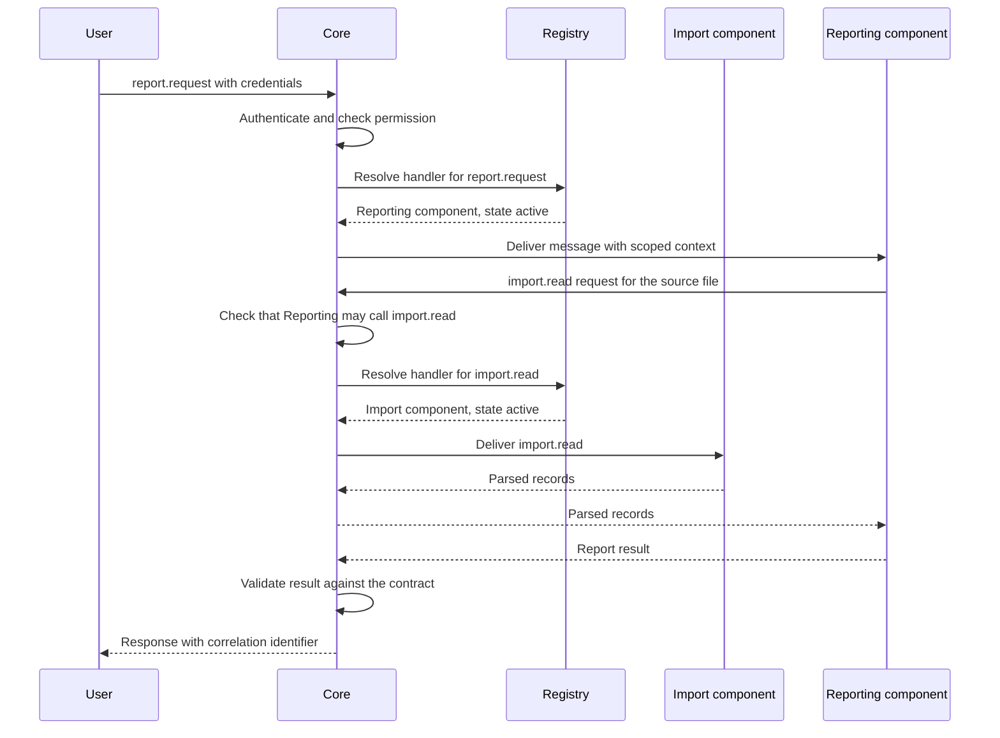

The sequence shows five properties worth stating plainly.

First, the user never talks to a component directly. The core is the only entry point, so authentication and permission checks happen once and cannot be bypassed by choosing a different path.

Second, the reporting component does not call the import component. It sends `import.read` to the core and the core finds the handler. This is what lets an operator replace the import component with another that handles the same message type, and it is what lets the core refuse the call if reporting was not granted that capability.

Third, the registry is consulted on each delivery, so a component's state at that moment decides whether it receives the message. If the import component has been disabled, resolution fails and the core returns a defined error to the reporting component, which then decides whether to produce a partial report or fail. The decision belongs to the component that understands the business meaning of the absence.

Fourth, the core validates results before they reach the user or shared state. A component can return something malformed, and an untrusted component should not be able to push bad data into the core's view of the world. The strength of validation depends on how much the core understands about the result. A core that treats payloads as opaque bytes can check only size and format, while a core that knows the schema can check meaning, at the price of knowing more.

Fifth, a correlation identifier travels with the message. Because the core sees every hop, it can attach the identifier once and emit a trace span for each delivery. Observability is a core service in practice even if the list of core services does not name it.

### 6.1 Synchronous and asynchronous delivery

The sequence above is a synchronous request and reply: the core waits for the component. Delivery can also be asynchronous, where the core accepts a message, returns an acknowledgement, and delivers it later through a queue. Synchronous delivery is simpler to reason about and to trace, and failure is immediate. Asynchronous delivery decouples sender and handler in time and absorbs bursts, but adds queue state to the core and introduces questions about duplicate delivery and ordering that [Event-Driven Architecture](CH07_Event_Driven_Architecture.md) treats in depth. A practical rule is to start with synchronous delivery for operations the caller needs a result from and to add asynchronous delivery for notifications, where the sender does not need an answer.

### 6.2 Where the call stack goes

In an in-process core, the call stack from the core into a component is an ordinary function call, and the core regains control when the call returns. That is fast but means a component can block the thread, throw an unexpected exception, or never return. The Java sketch earlier protects the caller with a timeout on a separate thread. Out-of-process components add a transport between core and component and make a hang visible as a timeout instead of a stuck thread. The next sections on communication and on isolation examine what each choice buys.

## 7. The Inter-Component Communication Model

Because components do not call each other directly, the communication model is part of the core's definition. There are three ways to connect a component to the core, and a system can use more than one.

### 7.1 Three connection styles

**In-process calls through an interface.** The component is loaded into the core's process and the core calls its methods. The Java sketch uses this style. A call costs about as much as a virtual method call plus the router's lookup. The component shares the core's memory, so it can corrupt the core or exhaust its heap.

**Messages over inter-process communication (IPC).** The component runs in its own process on the same host and exchanges serialized messages with the core over a pipe, a local socket, or shared memory. The cost is serialization plus a kernel transition per hop. The benefit is a process boundary, which the operating system enforces. Part 05 covers the mechanisms in [Processes and Threads](../05_Networking_and_OS/CH24_Processes_and_Threads.md) and [Sockets](../05_Networking_and_OS/CH16_Sockets.md).

**Messages over a network.** The component runs on another host and the core reaches it through a network protocol. This adds network latency and partial failure and takes the pattern close to a service-based design. See [Microservices](CH05_Microservices.md) for what the network changes.

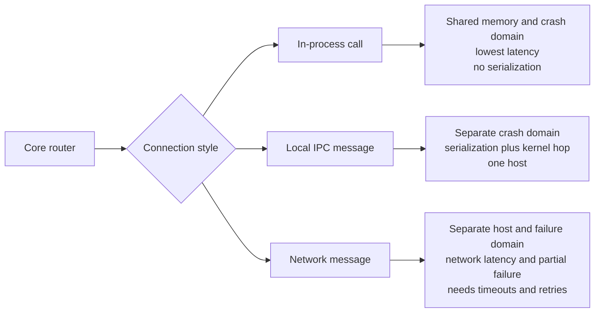

The diagram lines up each style with what it costs and what it protects. Moving down the chain from in-process to network buys isolation and costs latency and operational complexity. No style is right in general. The choice follows trust in the component and the latency budget, and the performance section later gives numbers.

A common mistake is to let the connection style leak into the contract. If component code calls a core method that takes a Java object, the contract is bound to in-process Java. If instead the contract defines a message with a type, version, and payload, the same component can later move out of process with a small adapter. A message-shaped contract is the cheaper starting point even for in-process components, because it keeps the option open.

### 7.2 A message envelope

A message-shaped contract needs a small, stable envelope. The following Python sketch shows an envelope with a type, a version, a correlation identifier, and a payload, plus the reading rule that makes evolution possible.

```python
import json
from dataclasses import dataclass, asdict, field

@dataclass(frozen=True)
class Envelope:
    type: str
    version: int
    correlation_id: str
    payload: dict = field(default_factory=dict)

    def to_wire(self) -> bytes:
        return json.dumps(asdict(self)).encode("utf-8")

    @staticmethod
    def from_wire(data: bytes) -> "Envelope":
        raw = json.loads(data)
        # Unknown top-level fields are ignored so newer cores can add fields.
        return Envelope(
            type=raw["type"],
            version=int(raw["version"]),
            correlation_id=raw["correlation_id"],
            payload=raw.get("payload", {}),
        )
```

The envelope has two jobs. The type routes the message, and the version tells the receiver which payload shape to expect. The reader ignores fields it does not know, which is what allows a newer core to add an envelope field without breaking an older component. The same rule applied to payloads is called a tolerant reader, and the versioning section returns to it.

### 7.3 The service registry as a lookup mechanism

Components sometimes need a capability, not a message type. For example, a reporting component may need "some component that can parse a file" rather than a particular import component. The registry can answer that by letting components register capabilities and by letting others ask for a capability by name. The core resolves the name to a component at call time, which means two things. The caller does not know which component answers. And if no component offers the capability, the caller gets a defined absence and must handle it.

A registry lookup can return a handle that the caller invokes directly, or it can stay a name that the core resolves on every message. The handle version is faster and cheaper but lets the caller keep a reference to a component that was later disabled, so it needs a way to be invalidated. The name-resolved version costs a lookup per call and cannot go stale. For the core's own routing, resolve per message. For high-frequency internal use inside one component family, handles are acceptable if the core can revoke them.

### 7.4 Delivery guarantees the core must state

A message-based contract needs written answers to a few questions, because components will rely on whatever behavior they observe.

- **Ordering.** Are two messages from the same sender to the same handler delivered in order? In-process synchronous delivery gives order by construction. Queues and multiple handler threads can break it.
- **At-most-once or at-least-once.** If a handler times out, may the core retry? A retry can run the operation twice, so handlers that perform side effects need idempotency, which [Idempotency](../07_System_Design_and_Distributed_Systems/CH16_Idempotency.md) explains.
- **Fan-out.** May a message have several handlers, and does one handler's failure affect the others?
- **Reply shape.** Is a reply required, optional, or forbidden?

The simplest defensible default is one handler per message type, ordered, at-most-once with an explicit timeout, and a required reply. Relax each only when a component demonstrably needs it, because each relaxation adds behavior that every component must handle.

## 8. The Operating System Origin and the Application-Level Pattern

The name comes from operating system design, and the two uses of it share an idea but differ in mechanism. Stating the difference carefully avoids borrowing claims from one setting that only hold in the other.

### 8.1 The operating system microkernel

An operating system kernel runs with full hardware privilege. In a monolithic kernel, such as the one in Linux, file systems, device drivers, and network stacks run inside that privileged kernel. In a microkernel design, the privileged part is reduced to a few mechanisms, usually address-space management, scheduling of threads, and inter-process communication. Services such as file systems and drivers run as ordinary user-space processes called servers, and applications reach them by sending messages through the kernel. Mach, the L4 family, and MINIX 3 are commonly cited examples of microkernel-style systems, though they differ considerably from each other in design.

The motivation is fault isolation and a small trusted base. A driver that crashes in user space can be restarted without taking the kernel down, and a smaller privileged codebase is easier to inspect. The cost is that operations that were a function call inside a monolithic kernel become messages with context switches, so IPC speed becomes the central engineering concern. The long-running debate between monolithic and microkernel designs in operating systems is largely about that cost and about practical factors such as driver ecosystems. Part 05 covers kernel and process internals; this chapter needs only the idea of a small privileged core plus unprivileged services that communicate by messages.

### 8.2 The application-level pattern

In software architecture, the term describes a different artifact. The core is an application-level runtime, not a hardware-privileged kernel. Components are plug-ins, modules, or services. Software architecture literature, including the pattern catalogs of the 1990s and later practitioner summaries, describes a core system plus extension modules, sometimes under the name plug-in architecture. The application pattern borrows three ideas from the operating system version: keep the center small, put variable services outside it, and let the center mediate communication.

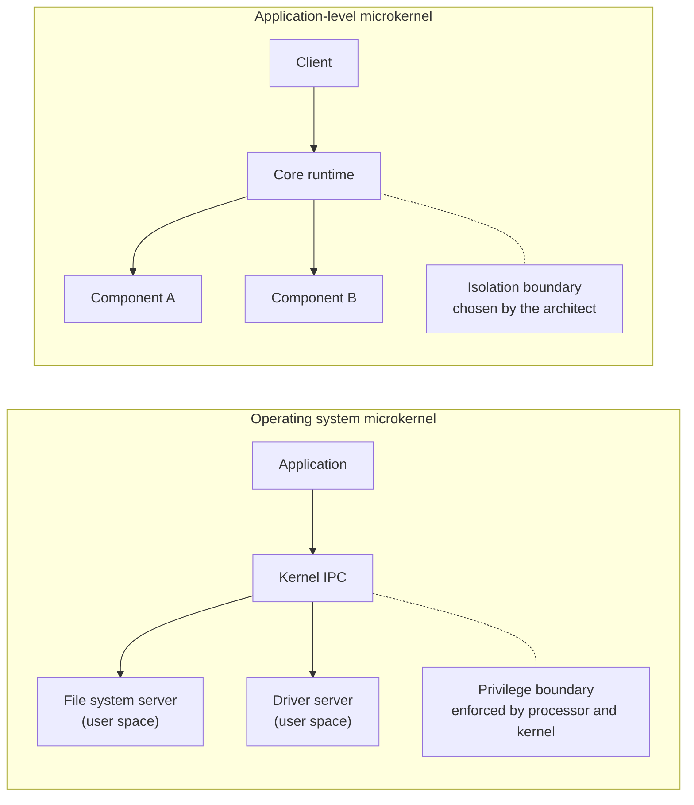

The diagram highlights the key difference at the bottom of each side. In the operating system, the privilege boundary is enforced by hardware and the kernel, and a server in user space cannot overwrite kernel memory regardless of what its code does. In the application, the boundary is whatever the architect builds. An in-process component shares memory with the core and enforces nothing by itself. A separate process enforces memory isolation through the operating system. A language sandbox or a container adds other limits.

### 8.3 What transfers and what does not

| Concept | Operating system microkernel | Application-level microkernel |
| --- | --- | --- |
| What the core is | Privileged kernel with a few primitives | Application runtime with registry, routing, lifecycle |
| What components are | User-space servers | Plug-ins, modules, or services |
| Who enforces isolation | Hardware and kernel | The architect's choice of boundary |
| Central cost | IPC and context switches | Indirection, contract maintenance |
| Typical reason | Fault isolation, small trusted base | Variability, extensibility |
| Main risk | Slow IPC | Fat core, unstable contract |

Three consequences follow. First, do not claim fault isolation for an in-process application microkernel, because the claim belongs to the operating system version. Second, performance lessons from operating system research, such as the weight of a context switch per message, apply directly only when components run out of process. Third, the application pattern's main concern is organizational as much as technical: it governs who can change what, and on what release schedule. The operating system design is mostly about trust and fault containment inside one machine.

## 9. Core Stability and API Versioning

The core is a dependency of every component, so its stability is the pattern's main asset and its main liability. A stable core lets components be written once and keep working. A core that changes its contract frequently forces every component author to track it, which turns a loosely coupled design into a tightly coupled one with extra steps.

[Plugin Architecture](CH14_Plugin_Architecture.md) owns the mechanics of plugin version declarations and compatibility checks at load time. This section covers what the core team must do to keep the contract stable, which is a discipline about change rather than a loading mechanism.

### 9.1 Classifying contract changes

Every change to the contract falls into one of four classes. The class determines the version increment and the obligations.

| Change | Example | Class | Effect on existing components |
| --- | --- | --- | --- |
| Add an optional capability | New message type, new optional payload field | Compatible | None if readers ignore unknown fields |
| Add a required behavior | Handler must now return a status field | Breaking | Components that omit it fail |
| Change meaning of an existing item | Field `size` changes from bytes to kilobytes | Breaking, and hard to detect | Components work but produce wrong results |
| Remove or rename | Delete a message type | Breaking | Components fail at call or load time |

The third row is the most dangerous because nothing fails loudly. A syntactic check cannot catch it, so changes of meaning should be treated as removal plus addition: introduce a new field with the new meaning, deprecate the old one, and remove it only after the deprecation window.

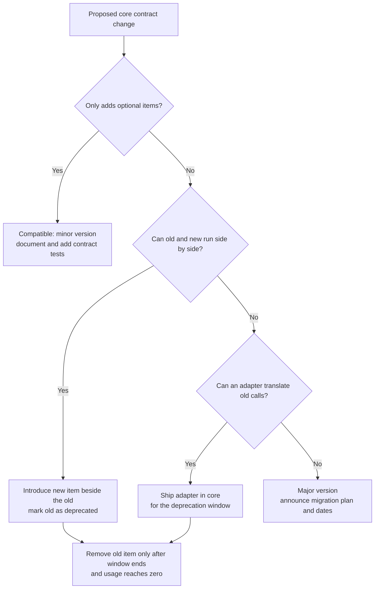

The tree prefers the cheapest compatible route. Adding is always preferred over changing, side-by-side items over adapters, and adapters over a major version. A major version is the last resort because it forces every component author to act, including authors the core team may not know.

### 9.2 Sizing the deprecation window

A deprecation window must be long enough that components can realistically migrate. The right length depends on how often components release, not on how fast the core team would like to move. Take an illustrative platform with components from a vendor, from partners, and from customers.

- Vendor components release monthly.
- Partner components release every quarter, which is 3 months.
- Customer-written components are updated about twice a year, which is a 6-month cycle.
- Allow one extra cycle for a component to receive the update after it is built, which is a further 1 month.

The window must cover the slowest realistic cycle plus slack, so 6 + 1 = 7 months. A 3-month window would strand customer components, and a 12-month window would keep two code paths in the core for twice as long as needed. During the window, the core carries both the old and the new contract path, which is the standing cost of stability. If the core ships a breaking change every year and supports the previous major, it carries at most two contract versions at once. Supporting three or four versions at once multiplies the test matrix, because each version needs contract tests against each core build.

### 9.3 Techniques that keep the contract stable

**Tolerant reader and conservative writer.** Components should ignore message fields they do not understand, and the core should send only fields the contract defines. The envelope sketch in the communication section follows this rule. Applied on both sides, it lets either side add optional fields without coordination.

**Capability negotiation instead of a single global version.** A component declares the capabilities it needs, such as `import.read` version 2, and the core states which versions it provides. Compatibility becomes a set check per capability rather than a comparison of one number, which allows the core to drop support for one old capability without invalidating components that do not use it. [Versioning](../08_API_Architecture/CH10_Versioning.md) covers general interface versioning strategies; this approach applies them per capability.

**Contract tests in the core's pipeline.** The core team keeps a suite of reference components, or a recorded set of messages and expected replies, and runs it on every core build. A breaking change then fails the build rather than a customer. Where external authors publish components, they can run the same suite on their own builds.

**A narrow, capability-oriented surface.** The less the core exposes, the less it can break. Expose operations such as "read a record by key" rather than the core's internal data structures. A component that depends on an internal class pins the core's implementation, and every refactor becomes a breaking change.

### 9.4 What stability costs

Stability is not free. The core team accepts slower evolution, carries compatibility code, and must say no to requests that would be quick to add but expensive to keep. A reasonable policy is to review each addition to the core API as a long-term commitment, with the questions: who will use this, what happens if we want to change it in two years, and can it be a component instead. The review is the same placement test from the section on what belongs in the core, applied at the level of a single method.

## 10. Isolation Between Components and Failure Containment

The pattern promises that a failing optional feature should not bring down the system. Whether that promise holds depends on the isolation boundary and on how the core reacts to failure. This section describes the failure modes, the boundaries available, and the arithmetic of what they buy.

### 10.1 How one component harms the rest

A component can damage the system in four ways, and each needs a different defense.

- **Crash.** An unhandled error, an out-of-memory condition, or a native fault ends the host process. In process, this ends the core as well.
- **Hang.** The component never returns. An in-process hang holds a thread and, if repeated, exhausts the pool.
- **Resource consumption.** The component uses memory, processor time, file handles, or connections beyond its share, starving others.
- **Wrong results.** The component returns plausible but incorrect data, which can corrupt shared state. This is the hardest to detect.

### 10.2 Boundaries, from weak to strong

| Boundary | Contains crash | Contains hang | Contains resource use | Cost |
| --- | --- | --- | --- | --- |
| Same process, same thread pool | No | No | No | Lowest |
| Same process, separate pool per component (bulkhead) | No | Partly | Partly | Low |
| Separate process | Yes | Yes (kill the process) | Yes (operating system limits) | Serialization and hops |
| Separate container or host | Yes | Yes | Yes, with quotas | Deployment and network cost |

A bulkhead gives each component its own limited pool of threads or concurrent calls, so a hanging component can exhaust only its own share. It is the cheapest useful step and does not stop a crash. The strongest boundary is the most expensive, and the right choice depends on how much the core trusts the component. A component written by the core's own team and tested with the core deserves less isolation than an unreviewed third-party component.

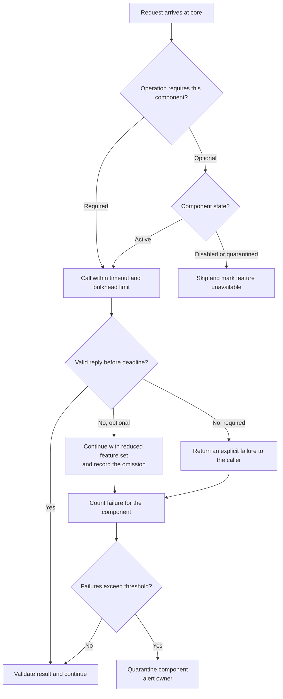

The diagram separates two decisions that are often conflated. The first is what the operation does when the component fails, which is a product decision: omit, degrade, or fail. The second is what the core does to the component, which is an operational decision: count failures and quarantine past a threshold. A component that fails once in a thousand calls may deserve no action, and one that fails every call should stop receiving traffic so it does not waste time budgets. The omission must be recorded and visible. If a legally or financially significant result silently drops a component's contribution, the system returns a wrong answer that looks right.

### 10.3 Availability arithmetic, illustrative

Suppose a platform has one core and six components. All numbers below are illustrative and assume independent failures.

- The core has availability 99.99%, so its failure probability is 0.0001.
- Each component has availability 99.9%, meaning its failure takes it, and anything sharing its process, out of service.
- A year has 8,760 hours, which is 525,600 minutes.

**All in one process.** Any component crash ends the process, so the system is up only if the core and all six components are up.

$$A = 0.9999 \times 0.999^{6}$$

$0.999^{2} = 0.998001$, $0.999^{3} = 0.997003$, and $0.999^{6} = 0.997003^{2} \approx 0.994015$. Then $A \approx 0.9999 \times 0.994015 \approx 0.99392$. Unavailability is about $0.006084$, which over 8,760 hours is about 53.3 hours a year.

**Components in separate processes.** A component crash now affects only requests that need it. The core alone is up 99.99% of the time, so its unavailability is $0.0001 \times 525{,}600 \approx 52.6$ minutes a year. A request that needs the core and one component has availability $0.9999 \times 0.999 = 0.99890001$, so unavailability is about $0.0011$, or about 9.6 hours a year. A request that needs the core and two components has $0.9999 \times 0.998001 \approx 0.997901$, about 18.4 hours a year.

| Design | Availability of a request that needs | Approximate downtime per year |
| --- | --- | --- |
| One process, any crash is fatal | Core and all six components, by shared fate | About 53 hours |
| Separate processes | Core only | About 53 minutes |
| Separate processes | Core and one component | About 9.6 hours |
| Separate processes | Core and two components | About 18.4 hours |

Three lessons follow from the arithmetic. Isolation helps most when requests need few components. A request that needs all six components has the same availability whether or not they are isolated, because it depends on all of them. In-process isolation of crashes is nil, so six modest components cost more than 50 hours a year in this example, and the core's own 99.99% is dwarfed by the components' contribution. Finally, the core is a shared dependency for everything, so its availability caps the whole system: no component design can exceed 99.99% here. The core therefore deserves the heaviest testing and the most conservative change policy.

### 10.4 A containment scenario

A quality scenario makes the goal measurable. Stimulus: the reporting component enters an infinite loop on a malformed input. Environment: normal load of 200 requests a second, of which 5% use reporting. Expected response: the core times out reporting calls after 2 seconds, other features continue, and the component is quarantined after repeated failures. Measure: requests that do not use reporting keep their median latency within 10% of the baseline, and the quarantine happens within 30 seconds.

The numbers show why a bulkhead matters. At 5% of 200, there are 10 reporting requests a second. Each holds a worker for up to 2 seconds before timing out, so about $10 \times 2 = 20$ workers are tied up on reporting at any moment. If the shared pool has 50 workers, 40% of capacity is gone. A reporting bulkhead of 8 workers caps the loss at 8 of 58 total workers (50 shared plus 8 reserved for reporting), about 14%, and the extra reporting requests are rejected quickly instead of queued. The system sheds the failing feature and protects the others.

### 10.5 Wrong results and shared state

Containment of crashes and hangs is easier than containment of wrong output. Two measures help. The core validates replies against the contract, as the earlier sequence showed, so that malformed data is rejected at the boundary. And components should not write shared state directly. They return proposed changes, and the core applies them under its own rules. Where components must write to a shared store, give each component its own area and its own credentials so that damage is attributable and recoverable.

## 11. Performance Cost of Indirection and Message Hops

The core mediates every interaction, so every interaction pays for the mediation. The cost is small per hop and can be large per request if a request makes many hops. This section turns that into arithmetic so the architect can check a design against its latency budget before building it.

### 11.1 What a hop costs

A hop is one delivery by the core: look up the handler, check permissions, deliver, and receive the reply. Its cost depends on the connection style from the communication section. The values below are illustrative assumptions chosen to show the reasoning, and real values must be measured on the target hardware and runtime.

| Style | Illustrative cost per hop | What it includes |
| --- | --- | --- |
| In-process routed call | 50 microseconds | Lookup, permission check, thread handoff |
| Local IPC | 300 microseconds | Serialization, kernel transitions, deserialization, plus routing |
| Network inside one data center | 1.1 milliseconds | Serialization, network round trip, routing |

### 11.2 A request with four hops

Take the report request from the earlier sequence, simplified to four core-mediated deliveries per user request: the core to reporting, reporting back through the core to import, and the results returning. Assume the components perform 8 milliseconds of real work in total.

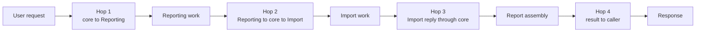

The diagram makes the multiplication visible: work segments are separated by hops, and each hop is a charge. With four hops and 8 milliseconds of work:

- **In process:** overhead is $4 \times 0.05 = 0.2$ ms. Total is $8 + 0.2 = 8.2$ ms, and overhead is $0.2 / 8.2 \approx 2.4\%$ of the total.
- **Local IPC:** overhead is $4 \times 0.3 = 1.2$ ms. Total is 9.2 ms, and overhead is $1.2 / 9.2 \approx 13\%$.
- **Network in a data center:** overhead is $4 \times 1.1 = 4.4$ ms. Total is 12.4 ms, and overhead is $4.4 / 12.4 \approx 35.5\%$.

| Style | Hops | Overhead | Total | Overhead share |
| --- | --- | --- | --- | --- |
| In process | 4 | 0.2 ms | 8.2 ms | About 2.4% |
| Local IPC | 4 | 1.2 ms | 9.2 ms | About 13% |
| Network | 4 | 4.4 ms | 12.4 ms | About 35.5% |

If the latency objective is 10 milliseconds for this operation, in-process and local IPC fit and the network style does not. If the work were 100 milliseconds, all three styles would be within 5% of the work, and the choice would be driven by isolation instead of speed. The overhead matters most when the work per hop is small.

### 11.3 Chatty components and the hop count

The most common performance fault in a microkernel is not the cost of a single hop but the number of hops. Suppose the reporting component asks the core for one record at a time and reads 20 records for a report. That adds 20 round trips of core-mediated lookups, and with local IPC the overhead rises by $20 \times 0.3 = 6$ ms over a single batched call. A batched `import.read` that returns the 20 records in one hop costs 0.3 ms plus slightly larger serialization. The design rule is to shape the contract around coarse operations. Offer batch and range operations in the contract, and discourage per-item calls, particularly across a process or network boundary.

### 11.4 Tail latency across hops

Each hop adds its own variability. If each delivery has an independent 1% chance of being slow, meaning it lands in the slowest 1% of deliveries, then a request with four hops has

$$P(\text{at least one slow hop}) = 1 - 0.99^{4} = 1 - 0.9606 \approx 0.0394$$

so about 3.9% of requests meet a slow hop, rather than 1%. The tail of the whole request is heavier than the tail of one hop. Longer hop chains make this worse, which is another reason to keep call chains short and to set timeouts that are consistent with the end-to-end objective rather than per hop only.

### 11.5 Core throughput and the bottleneck risk

The core also has a capacity limit. If all traffic passes through one router, the router's throughput limits the whole system. Illustrative reasoning: if each routed message costs 50 microseconds of core processing on one thread, a single thread handles at most $1 / 0.00005 = 20{,}000$ messages a second. A system doing 5,000 user requests a second with four hops each sends 20,000 messages a second through the core and sits at the limit before components do any work. Three remedies exist. Keep the router's work per message small, which means no heavy validation or logging in the hot path. Scale the router across threads or cores, which requires routes to be safe for concurrent reads. And reduce the hops by batching and by letting trusted, co-located components use a direct, core-issued handle for high-frequency calls. The anti-pattern of a core that becomes the bottleneck, and the other ways the pattern goes wrong, are treated later in the chapter.

### 11.6 Measuring instead of guessing

The arithmetic above is a design aid. Before committing to a connection style, measure the real hop cost with the real serialization format on the real runtime, and measure the hop count of the key requests from traces. The core is the right place to record per-hop timing, since it sees every hop. Compare measured totals with the budget, and revisit the connection style or the contract granularity when the numbers disagree.

## 12. Loading and Governing Extensions at the Core

[Plugin Architecture](CH14_Plugin_Architecture.md) owns discovery, packaging, class loading, and version declarations for plugins, and this section does not repeat them. What differs for a microkernel is that the loader is part of a core that also owns the registry, the routing, and the security model. Loading is therefore not only "make the code available". It is "admit a component into a system whose invariants the core must keep". Three things follow: the core resolves capabilities, it provides mandatory services without which no component may start, and a named group of people governs it.

### 12.1 The capability registry

Section 5.1 described a registry of components. A microkernel needs a second index, a **capability registry** that maps a capability name and version, such as `import.read` version 2, to the component that provides it. Components declare what they provide and what they require, and the core turns those declarations into a dependency graph before it starts anything.

The core applies four rules when it resolves the graph:

1. A component whose required capability has no provider is not started, and the core records the missing capability as the reason.
2. A component whose optional capability has no provider is started, and the core tells it that the capability is absent.
3. Start order is a topological order of the graph, so providers start before consumers. A cycle is rejected at admission, because no start order exists and a cycle usually means two components should be one.
4. When two components provide the same capability, the core applies a documented rule: refuse the second, select by explicit configuration, or select by priority. Silent selection by load order makes behavior depend on a file system listing.

A small illustration with three components: reporting requires `import.read`, import requires `config.read` (a core service), and an optional `export.pdf` provider requires `report.build`. The order is import, reporting, export. If import is disabled, reporting cannot start and export, which depends on reporting, is blocked in turn. The core reports the chain, "export blocked by reporting blocked by import", so the operator sees one root cause instead of three symptoms.

### 12.2 Mandatory core services

Some services must exist before the first component starts, and a component that needs them must be able to assume them. These are the **mandatory core services**: configuration scoped to the component, a logging and tracing facade carrying the correlation identifier, the permission checker, a clock and scheduler that the core can stop, and the registry client. The set is deliberately the same one that passed the membership tests in section 4. A service that a component may or may not find is not mandatory and belongs in a component that declares itself as a provider.

The practical test for the list is the start-up of a trivial component that does nothing but log one line. If it needs anything beyond the mandatory services, the core is under-provisioned or the component is not trivial.

### 12.3 Admission and lifecycle states

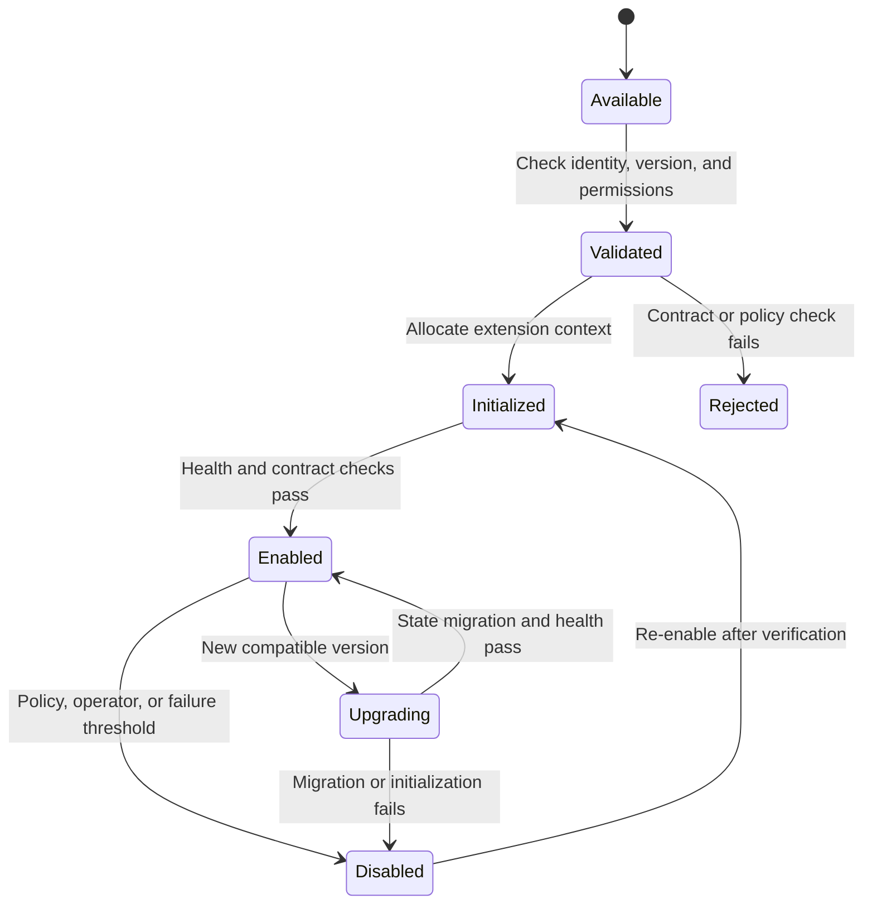

The diagram adds two states that a plain loader lacks. **Rejected** is terminal for a given package version and records why, so an operator can tell a policy refusal from a bug. **Disabled** is reversible and is where quarantine from section 10 lands. The core, not the component, owns these transitions. A component can ask to be stopped, but it cannot move itself to Enabled. Two rules keep the state machine honest. A failed optional component must not stop the core from starting, and the start-up report lists it as degraded. A failed required component (security policy, for example) stops the affected workflow or the whole core, and product policy states which in advance.

Upgrades follow the same states. Upgrading keeps the old version's registrations until the new version passes its health check, so the capability registry never shows a gap. If a component owns data, the migration runs inside the Upgrading state and a failure returns the component to Disabled with the old data intact. A core upgrade that changes the contract needs the migration window sized in section 9.2.

### 12.4 Governing the core and its components

Governance answers who may change what. Without it the core drifts into the fat core described in section 4.3.

- **Core ownership.** One team owns the core and its contract. Others may propose changes through the review in section 9.4, and the core team decides. Shared ownership of the core produces a contract shaped by the loudest component.
- **Component ownership.** Each component has a named owner team and an on-call contact recorded in the registry. A component without an owner is disabled after a stated period, because nobody can answer when it fails.
- **Trust tiers.** First-party components, partner components, and customer components get different grants and different isolation, such as in-process with a bulkhead for the first tier and out-of-process for the last. The tier is an input to admission, not a label.
- **Admission policy.** A component enters only with a manifest, a passing contract test run, and the permissions it needs, reviewed against the principle of least privilege.
- **Retirement.** Removing a capability follows the deprecation window, and the registry shows remaining consumers so the core team can see when usage reaches zero.

The cost of governance is delay for component authors. The benefit is that the system remains explainable: for every behavior, the registry names a component, a version, an owner, and a grant.

## 13. The Core-to-Extension Contract

Section 9 covered how to change the contract without breaking components. This section describes what the contract contains. The core exposes capability-oriented interfaces rather than internal data structures, and components declare what they need. The contract has to answer six questions in writing: which capabilities exist, how errors are reported, how long a call may take, how much of a shared resource a component may use, what observability context travels with each call, and whether a component may alter shared state.

### 13.1 The component manifest

A manifest is the component's side of the contract. It is data the core reads at admission, before any component code runs. The following YAML is an illustrative manifest for the reporting component.

```yaml
id: reporting
version: 3.2.0
tier: partner
provides:
  - name: report.build
    version: 1
requires:
  - name: import.read
    version: 2
  - name: config.read
    version: 1
optional:
  - name: export.pdf
    version: 1
permissions:
  - message: report.request
    access: handle
  - message: import.read
    access: call
limits:
  timeout_ms: 2000
  max_concurrent_calls: 8
  memory_mb: 256
state: none
```

The manifest is checked, not trusted. The core compares `requires` with the capability registry, compares `permissions` with what the tier allows, and enforces `limits` at runtime. A component that calls a capability it did not declare receives a policy denial even if the code path exists. The `state: none` line says the component owns no persistent data, which tells the core that upgrade and rollback need no migration.

### 13.2 Calls in both directions

The contract is not one-way. The core calls into components through lifecycle callbacks and message handlers, and components call back through the core's context. The sequence below shows an invocation with a scoped context and a core service call made by the extension.

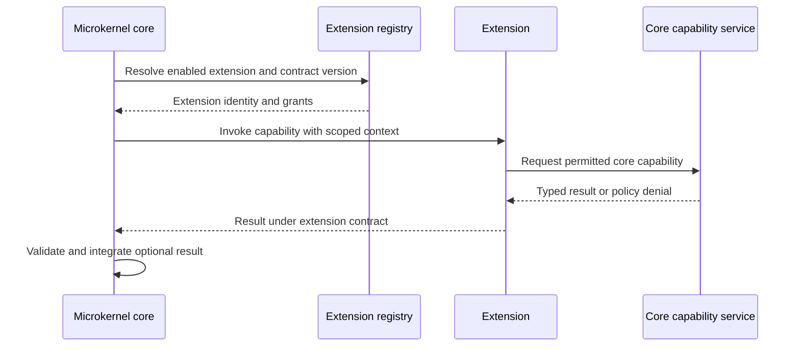

The diagram shows that the extension never holds a reference to the core's internals. It holds a scoped context and asks it for permitted capabilities, and each answer is either a typed result or a policy denial. Both directions carry obligations.

| Direction | Core promises | Component promises |
| --- | --- | --- |
| Core to component | Deliver only declared message types, within the declared limits, with the correlation identifier | Return within the timeout, return only contract-shaped results, handle stop within a stated time |
| Component to core | Resolve declared capabilities, deny the rest, report absence of optional capabilities explicitly | Treat denial and absence as normal outcomes, release resources on stop |

### 13.3 Errors, limits, and shared state

**Error model.** The contract should define a small closed set of error kinds, for example denied, unavailable, timed out, invalid request, and internal. A component that throws an arbitrary exception gives the core nothing to act on, so the core maps unknown failures to internal and counts them toward quarantine. Callers can then branch on a kind, such as retrying only on unavailable.

**Resource budgets.** Timeout, concurrency, and memory limits in the manifest are enforced by the core where the boundary allows. For in-process components only the timeout and the concurrency bulkhead are enforceable. Memory is a request that the core cannot hold the component to, which is one reason untrusted components run out of process.

**Shared state.** The safest rule is that components do not write core state. They return a proposed change and the core validates and applies it. Keep business invariants in the core only when they hold across all components, such as "every record has an owner". Capability-specific policy, such as a particular tax rule, stays with the owning component or a domain service. The core validates component outputs before they affect shared state, with strength proportional to what it knows about the payload.

### 13.4 Keeping the contract small

A useful size check is to count what a component author must learn. If a first component needs more than the manifest format, the envelope, four or five core services, and the error kinds, the contract is too big. Each addition is a promise the core team must keep through every deprecation window.

## 14. Microkernel and Layered Organization

[Layered Architecture](CH01_Layered_Architecture.md) organizes a system by horizontal responsibility, with dependencies pointing one way, such as presentation, application, domain, and data. [Plugin Architecture](CH14_Plugin_Architecture.md) organizes a host and its plugins around extension points. A microkernel is closest to the second, with a stronger claim: the core is minimal, owns the registry and routing, and mediates all communication. The comparison below shows why the organizing question differs.

### 14.1 Different organizing questions

Layers answer "what kind of responsibility is this code?". A microkernel answers "how likely is this capability to vary or be absent?". The same codebase can be cut either way. A reporting feature sits in the application layer of a layered design, shares the domain model with everything else, and is present in every deployment. In a microkernel it sits outside the core, behind the contract, and may be absent.

| Aspect | Layered | Microkernel |
| --- | --- | --- |
| Split by | Responsibility and dependency direction | Stability and variability |
| Typical dependency rule | Upper layers call lower layers | Components call the core, never each other |
| Add a feature | Edit one or more layers | Add a component, no core change |
| Remove a feature | Edit code and release | Disable the component |
| Shared domain model | Natural and encouraged | Hard, since components share only the contract |
| Transactions across features | Straightforward | Difficult, since features do not call each other |
| Main cost | Changes ripple across layers | Contract upkeep and indirection |

### 14.2 They compose

The two patterns answer different pressures, so choosing one does not rule out the other. The core can be layered internally, with its router, registry, and lifecycle in separate layers. Each component can be layered internally too, with its own presentation of results, logic, and data access. The microkernel decides where the outer boundaries fall and layers organize what is inside them. Comparing them as competing checklists misses this.

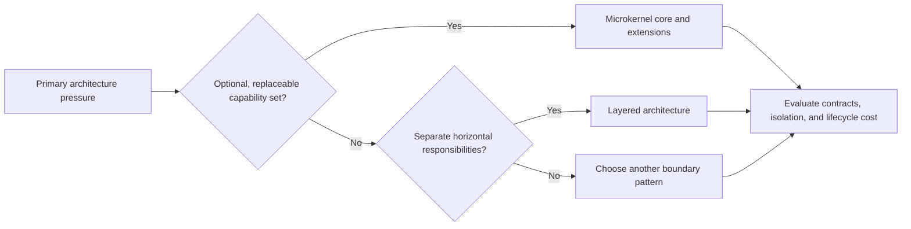

The flow starts with the pressure, not the pattern. Variability of the capability set sends the design toward a microkernel. If the pressure is separating responsibilities, layers are simpler and cheaper.

### 14.3 When each wins

A layered design wins when the system is one product with one deployment shape, one team, a shared domain model, and transactions that span features. A fixed application with no extension ecosystem pays the lifecycle, contract, and hop costs of a microkernel for nothing. The microkernel wins when customers or partners must add capabilities without a core release, when editions differ by feature set, or when the system must keep running while capabilities are added or removed. A third case is common in practice: a layered core with a few extension points, which is a plugin host, and which is usually enough. Move to a full microkernel only when mediated communication, capability resolution, and governance of third-party components are real needs. Otherwise stay with the cheaper plugin form, or with a layered structure and build-time modules.

## 15. Testing, Observability, and Security at the Core

The core sees every interaction, which makes it the cheapest place to test, observe, and secure the system, and the most expensive place to get any of them wrong.

### 15.1 Testing

Testing has three levels, and the core team owns the first two.

1. **Core tests.** Unit and integration tests of the registry, router, lifecycle, and permission checker, using fake components. The fakes should include misbehaving ones: a component that never returns, one that throws, one that claims a duplicate message type, and one that returns a malformed reply. The core's behavior under these is its specification.
2. **Contract tests.** A suite that any component can run against the core and that the core runs against reference components, as section 9.3 described. It checks the envelope, error kinds, lifecycle callbacks, and limits.
3. **Component tests.** Owned by each component team and run against a test harness that provides a scoped context without the full core. If a component cannot be tested without the production core, the contract is too wide.

Continuous integration (CI) for the core runs the contract suite against the previous supported contract version too, so a change that breaks an old component fails the build. A failure-injection test per component tier is worth the effort: kill the out-of-process component mid-call and assert that the caller receives `unavailable` within the timeout.

### 15.2 Observability

Because the core mediates every hop, it emits the telemetry that components would otherwise each emit differently. Cross-cutting concepts such as metrics, logs, and traces are covered in Part 14, and this section names only what the core must emit.

| Signal | What the core emits | Question it answers |
| --- | --- | --- |
| Trace span | One per delivery, with component id and version, linked by correlation identifier | Where did this request spend its time, and which component version handled it |
| Metric | Calls, errors by kind, timeouts, queue depth, and latency per component | Which component is degrading, and is the bulkhead full |
| State event | Every lifecycle transition with its reason | Why is this capability unavailable |
| Degradation record | Each omitted optional result | Did this answer lack a component's contribution |

Version attribution on every span matters more here than in a monolith, because two versions of a component may run side by side during an upgrade. The degradation record is the one most often forgotten, and without it a reduced answer cannot be told from a complete one.

### 15.3 Security

The core is the enforcement point, so its security posture sets the system's. The mechanisms in section 5.4 (authenticate, authorize per message type, deny by default) are the baseline. Three additions apply to untrusted or semi-trusted components.

- **Supply chain at admission.** Check the package's origin and integrity before admission, and record the identity of who published it. Admission is the one moment the core can refuse code before it runs.
- **Least privilege by tier.** Grants come from the manifest, limited by tier, and the core logs each denial. Repeated denials from one component are a signal worth alerting on.
- **Secret scoping.** The scoped context from section 5.5 gives a component only its own secrets. An in-process component can still read process memory, so secrets for untrusted components belong out of process.

Reducing the trusted computing base is the operating system lesson that carries over: the less code runs with the core's authority, the less can compromise it. For the application pattern this argues for a small core and out-of-process execution of the least trusted tier. Threat modeling and authorization models are treated in Part 15.

## 16. Failure and Quality-Attribute Scenarios

Scenarios turn the pattern's promises into tests. Each has a stimulus, an expected response, and a measurable success criterion. The numbers are illustrative targets, not measurements, and each team should set its own from its service level objectives (SLOs).

| # | Stimulus | Expected response | Measurable success criterion |
| --- | --- | --- | --- |
| 1 | An optional analyzer hangs on a malformed input | Calls time out at the manifest limit, the bulkhead rejects overflow, the component is quarantined, the result is marked degraded | Non-analyzer requests keep median latency within 10% of baseline. Quarantine within 30 s. 100% of affected results carry a degradation record |
| 2 | A required security-policy component is unavailable | The core blocks release and returns `unavailable` with the component id | Zero releases pass without a policy decision. Operator sees the root cause in one lookup |
| 3 | A new core release changes a message type | The adapter serves old callers for the deprecation window, contract tests flag affected components | Zero failures of supported components after upgrade. Old-path usage visible per component |
| 4 | A component calls a capability it did not declare | The core returns a policy denial and logs it | Denial within one hop. Zero side effects. Alert after 10 denials in 5 minutes from one component |
| 5 | A partner package declares a message type another component already handles | Admission rejects it with the conflicting component named | Zero routing changes to the existing component. Rejection reason recorded |
| 6 | A traffic burst raises delivered messages sharply | The router sheds low-priority optional work first and keeps required calls | Required-call error rate under 0.1%. Router utilization alerts at 70% |
| 7 | An out-of-process component crashes mid-call | The caller receives `unavailable` within its timeout, the supervisor restarts the process | Caller response within the timeout. Restart within 10 s. No effect on other components |

Scenario 1 is the one worth working through in numbers, because it ties back to section 10.4. At 5% of 200 requests a second there are 10 analyzer calls a second, each tying up a worker for the 2-second timeout, so about 20 workers are held. With an analyzer bulkhead of 8, calls beyond 8 concurrent are rejected immediately, so at most 8 workers are held and the shared pool is not drained. The criterion that matters is the degradation record: a quiet omission is the failure mode that scenarios 1 and 2 are written to prevent.

## 17. Worked Case: A Build and Release Workflow Platform

This case is illustrative. The organization, its numbers, and its results are invented to show the reasoning and are not a report of any real system.

### 17.1 Context and forces

A hypothetical vendor sells a build and release workflow platform to 120 customers in three editions. Every customer needs identity, workflow scheduling, and a mandatory security-policy check before release. Beyond that, customers differ: 14 language analyzers, 9 deployment targets, and customer-written compliance checks. About 30 of the customers write their own checks and refuse to wait for a vendor release. The platform must make a release-gate decision within 25 ms at the 95th percentile, and the peak load is 300 workflow runs a second with 12 core-mediated deliveries per run.

The forces from section 3 are all present: structural variability, a stable center, third-party authors, and a need to bound the effect of extension. The domain model is mature, so the contract can be fixed.

### 17.2 Decisions

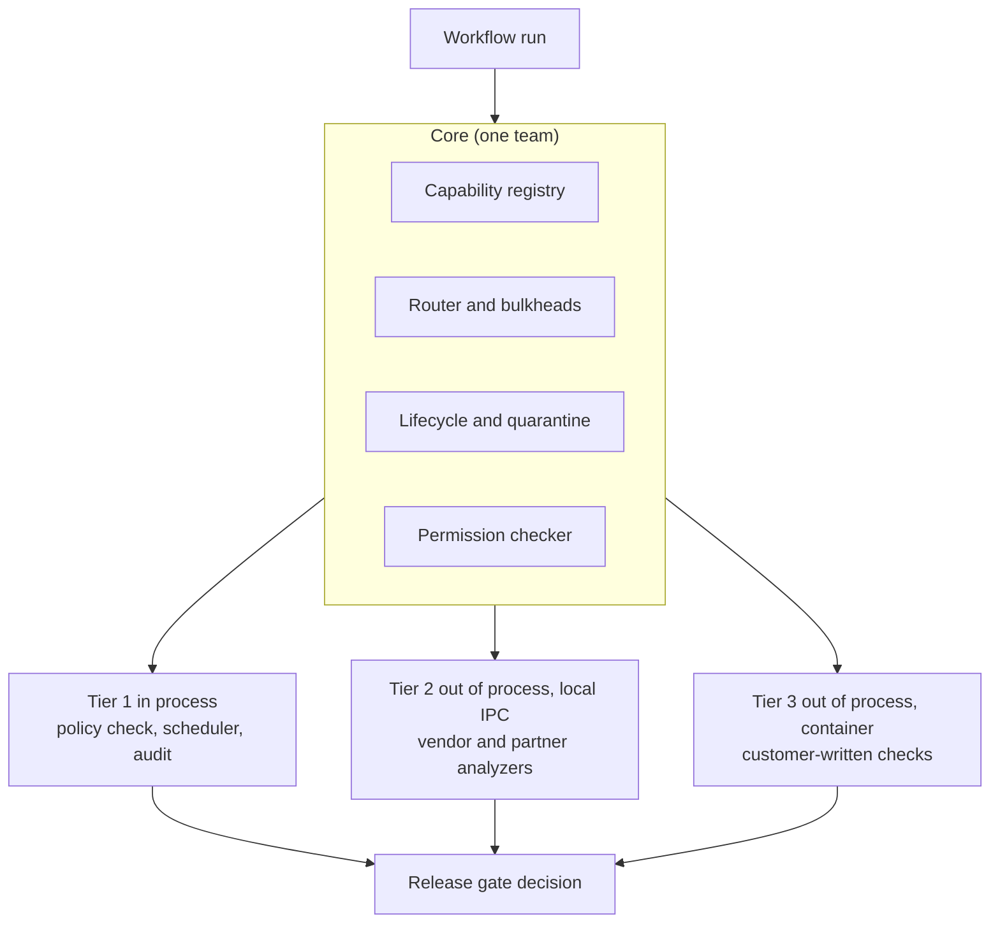

The diagram shows three trust tiers sharing one contract. The decisions follow from the forces.

1. **Core scope.** Registry, routing, lifecycle, permission checks, scoped configuration, and tracing. Release policy stays in a component. The membership tests of section 4.1 reject putting policy in the core, because it varies by customer.
2. **Tiering.** The policy check, scheduler, and audit components are first-party and tested with the core, so they run in process with bulkheads. Analyzers run out of process on the same host. Customer checks run in containers.
3. **Contract.** Message-shaped, versioned per capability, with a manifest, as in section 13. A 7-month deprecation window follows the arithmetic of section 9.2.
4. **Degradation rule.** A missing analyzer degrades coverage and records it. A missing policy check blocks release.

### 17.3 Rejected alternatives

| Alternative | Reason rejected |
| --- | --- |
| Layered monolith with analyzers compiled in | 30 customers need their own checks without a vendor release, and this would need separate builds per customer |
| All components in process | Shared fate. Availability computed below is far worse |
| All components over the network | Latency leaves almost no margin, computed below |
| Policy check inside the core | Policy changes per customer, so the core would release with every policy change |

### 17.4 Arithmetic

**Router load.** $300 \times 12 = 3{,}600$ deliveries a second. At the illustrative 50 microseconds of core work per delivery, one thread handles at most $1 / 0.00005 = 20{,}000$ a second, so utilization is $3{,}600 / 20{,}000 = 18\%$. The 70% alert threshold of scenario 6 leaves a factor of about 3.9 of headroom ($70 / 18$).

**Gate latency.** The gate calls 4 analyzers in sequence, each costing 2 hops and 4 ms of work. With local IPC at 0.3 ms per hop:

- Overhead is $4 \times 2 \times 0.3 = 2.4$ ms, work is $4 \times 4 = 16$ ms, total 18.4 ms against 25 ms, leaving 6.6 ms.
- With network hops at 1.1 ms the overhead is $4 \times 2 \times 1.1 = 8.8$ ms, total 24.8 ms. That passes by 0.2 ms, which is under 1% of the budget and gives no room for tail variation, so the all-network option is rejected.

**Availability.** Take the core at 99.99% and three tier-1 components at 99.95% each, with independent failures. The tier-1 set shares the core's process, so shared fate applies:

$$A = 0.9999 \times 0.9995^{3}$$

$0.9995^{2} = 0.99900025$ and $0.9995^{3} \approx 0.9985007$, so $A \approx 0.9999 \times 0.9985007 \approx 0.9984009$. Unavailability is about $0.0015991$, and over 8,760 hours that is about 14.0 hours a year. The rejected all-in-process option would put 10 components (an illustrative count) in one process. If each had 99.9%, then $0.999^{10} \approx 0.990045$ and $A \approx 0.9999 \times 0.990045 \approx 0.989946$, so unavailability is about $0.010054 \times 8{,}760 \approx 88.1$ hours. Out-of-process tiers 2 and 3 do not add to this figure. A crash there degrades coverage, which scenario 1 covers.

### 17.5 Validation evidence

Before launch the team would collect the following evidence, with the thresholds taken from the scenarios in section 16.

- The contract suite passes for the current and the previous contract version on every core build.
- A load test at 300 runs a second shows router utilization at or below the 18% prediction, within a stated tolerance, and gate latency at the 95th percentile at or below 25 ms.
- Fault injection of scenarios 1, 2, and 7 meets their criteria, including the degradation record on every affected result.
- An admission test with an undeclared capability call and a duplicate message type shows the denial and the rejection.
- A game day removes one analyzer and confirms that the operator finds the root cause from the state event alone.

If any criterion fails, the response follows the cause: reduce hop count by batching, move a component to a different tier, or shrink the core.

## 18. Common Mistakes and Anti-Patterns

Each mistake below has a cause and a consequence. Most trace back to the core tests of section 4 or to treating the contract as an implementation detail.

| Anti-pattern | Cause | Consequence | Fix |
| --- | --- | --- | --- |
| Fat core | Convenience methods added after one component's request, with no placement test | Core releases track component features, components cannot be tested alone, the stable center stops being stable | Apply the membership tests and the two-consumer rule, move capabilities out as components |
| Plug-in folder called a microkernel | A loader is added, but there is no registry, no mediated communication, and no governance | Lifecycle and hidden dependencies with none of the variability benefit | Use the plugin form of [Plugin Architecture](CH14_Plugin_Architecture.md), or drop runtime loading |
| Component-to-component calls | Teams bypass the core for speed | Hidden coupling, no permission check, no replaceability, no trace | Route through the core. Offer batch operations to fix the speed problem |
| Leaking the contract | The contract exposes internal classes or storage layouts | Every core refactor becomes a breaking change | Expose capability-oriented, message-shaped operations |
| Silent last-writer-wins registration | Duplicate claims were never decided | Behavior depends on load order and is hard to reproduce | Reject duplicates or use explicit priority, as in section 12.1 |
| Claiming isolation in process | The operating system microkernel argument is borrowed without its mechanism | One component crash ends the core, as section 10.3 computed | Use separate processes for untrusted or crash-prone components |
| Silent degradation | An optional result is dropped without a record | A reduced answer is presented as complete | Emit and surface a degradation record |
| Chatty components | Per-item calls through the core | Hop overhead and tail latency multiply, as section 11.3 and 11.4 showed | Coarse batch and range operations |
| Overloaded router | Validation and logging in the hot path | The core is the throughput bottleneck | Keep per-message work small and scale the router |
| No owner for components | Registry has no contact for a component | Nobody answers when it fails, and abandoned components stay enabled | Require an owner and disable orphans |
| Business workflow in the core | Cross-component workflow looks like a core concern | Each policy change becomes a core release | Build a coordinating component |
| Microkernel for a fixed product | The pattern chosen for modularity alone | Contract and lifecycle costs with no variability to pay for them | Use layers or a modular monolith |

## 19. Pattern Comparison and Decision Flow

### 19.1 Trade-off table

The table compares the microkernel with its neighbors on the dimensions that decide most selections. The ratings are qualitative judgments for a typical implementation and each depends on the team and the system.

| Dimension | Layered ([CH01](CH01_Layered_Architecture.md)) | Plugin ([CH14](CH14_Plugin_Architecture.md)) | Microkernel (this chapter) | Microservices ([CH05](CH05_Microservices.md)) |
| --- | --- | --- | --- | --- |
| Organizing idea | Responsibility | Extension points on a host | Minimal core plus mediated components | Independently deployed services by business capability |
| Variability by deployment | Low | Medium to high | High | Medium |
| Third-party extension | Poor | Good | Good, with governance | Possible through APIs |
| Core stability need | Low | Medium | Very high | Not applicable, no single core |
| Latency overhead | Lowest | Low | Low to medium, by connection style | Highest, network by default |
| Fault isolation | None by default | Depends on the loader | Chosen by tier | Strong |
| Cross-feature transactions | Easy | Moderate | Hard | Hard |
| Operational cost | Low | Low to medium | Medium | High |
| Main risk | Ripple changes | Unclear extension boundary | Fat core, unstable contract | Distributed complexity |

### 19.2 Decision flow

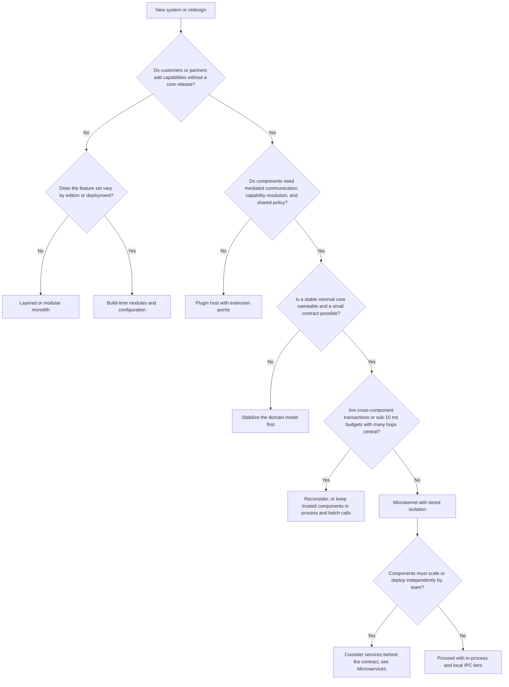

The flow ends in a microkernel only after four separate yes answers: external extension, mediated communication, a nameable core, and tolerable transaction and latency limits. Each earlier exit is a cheaper pattern that serves the case adequately. The last branch notes that the contract of a microkernel can be served over the network later if independent scaling becomes a need, which is the message-shaped contract advantage from section 7.1.

## 20. Design-Review Checklist

Use the list at a design review, before admitting the first external component, and again before each major core release. A "no" answer is a finding to resolve or accept explicitly.

**Fit**

- [ ] Does the feature set vary by customer, edition, or deployment, with at least two written quality-attribute scenarios?
- [ ] Is a cheaper pattern (layers, build-time modules, a plugin host) ruled out and the reason recorded?
- [ ] Is the domain model stable enough to fix a contract?

**Core scope**

- [ ] Does every core capability pass the independence, invariant, or sharing tests, and is that recorded?
- [ ] Is there a rule that adding to the core needs two independent consumers?
- [ ] Is the core free of business-domain names?
- [ ] Does a trivial component start with only the mandatory services?

**Contract**

- [ ] Is the contract message-shaped, versioned per capability, and small enough for a first component to learn quickly?
- [ ] Are error kinds, timeouts, resource limits, and delivery guarantees written down?
- [ ] Do contract tests run on every core build against the current and previous contract versions?
- [ ] Is the deprecation window sized from the slowest component release cycle?

**Loading and governance**

- [ ] Are duplicate registrations and cyclic dependencies rejected at admission?
- [ ] Does each component have an owner, a trust tier, and a manifest with least-privilege grants?
- [ ] Is it defined which missing components block start-up and which only degrade it?

**Failure and performance**

- [ ] Is each tier's isolation boundary justified by trust in that tier?
- [ ] Does every optional result record when it was omitted?
- [ ] Are hop counts for key requests known, and checked against the latency budget with measured hop costs?
- [ ] Is router utilization known and alerted?

**Operations and security**

- [ ] Does every delivery produce a trace span with component id and version?
- [ ] Is every lifecycle transition recorded with its reason?
- [ ] Are admission checks, deny-by-default grants, and secret scoping in place?

## 21. Exercises

Attempt each exercise before reading the answer outline. Numbers are illustrative.

1. **Core membership.** A team proposes moving a currency conversion routine, used by billing and reporting, into the core. Decide.
   *Outline:* It fails the invariant test, since exchange rules change, and fails the sharing test, since its meaning is domain-specific. Publish it as a shared library or a service component that both declare as a required capability. Revisit only if two independent components and a stable meaning emerge.
2. **Hop budget.** A request needs 6 core-mediated hops and 12 ms of work, with a 15 ms budget. Compare in-process (0.05 ms), local IPC (0.3 ms), and network (1.1 ms) hops.
   *Outline:* In process: $6 \times 0.05 = 0.3$, total 12.3 ms. Local IPC: $6 \times 0.3 = 1.8$, total 13.8 ms. Network: $6 \times 1.1 = 6.6$, total 18.6 ms, over budget. Local IPC fits with 1.2 ms spare, and batching to 3 hops would give more room.
3. **Shared fate.** A core at 99.99% hosts 5 in-process components at 99.9% each. Compute availability and yearly downtime.
   *Outline:* $0.999^{5} \approx 0.995010$. Then $0.9999 \times 0.995010 \approx 0.994911$. Unavailability is about $0.005089$, so about $0.005089 \times 8{,}760 \approx 44.6$ hours. Moving the five out of process leaves the core-only figure of about 0.0001 × 8,760 ≈ 0.88 hours for requests needing nothing else.
4. **Deprecation window.** Components release monthly, every 2 months, and every 4 months, with one month of slack. Size the window and say what extending it costs.
   *Outline:* Slowest cycle 4 plus 1 slack gives 5 months. A longer window carries two contract paths in the core for longer and enlarges the test matrix. A shorter one strands the 4-month components.
5. **Duplicate claim.** A new component registers a message type already handled by another. Describe what the core does and what the author sees.
   *Outline:* Reject at admission with the conflicting component and message type named, no routing change, and a recorded reason. Options if both are legitimate: explicit selection by configuration or documented priority, never load order.
6. **Optional versus required.** An export component fails during a regulated release. Decide whether the release proceeds.
   *Outline:* Depends on product policy stated in advance. If the export is a legal record, treat it as required and block with an explicit failure. If it is a convenience, proceed and write a degradation record. The error is leaving the decision to be discovered during failure.
7. **Router capacity.** A system does 4,000 requests a second with 5 hops each, at 50 microseconds of core work per delivery on one thread. Check capacity and propose one remedy if needed.
   *Outline:* $4{,}000 \times 5 = 20{,}000$ deliveries a second, against a single-thread limit of $1 / 0.00005 = 20{,}000$, which is 100% utilization. Scale the router across threads, cut hops by batching, or reduce per-message work. Keep utilization well under the 70% alert level.
8. **Pattern choice.** A product has one deployment, one team, and a shared domain model with transactions across features. Customers ask for nothing custom. Choose a pattern.
   *Outline:* Layered or a modular monolith. No variability, no external authors, and cross-feature transactions all point away from a microkernel. Record the revisit trigger, such as a first partner request.

## 22. Summary

A microkernel architecture keeps a small, stable core and moves everything that varies into components that the core loads, connects, and can replace. The chapter's learning outcomes map to its sections as follows.

| Outcome from the Introduction | Where it is taught | Key takeaway |
| --- | --- | --- |
| 1. Define core, component, and the split by variability and stability | Sections 2 and 3 | The contract is the real architecture. Split by how likely a capability is to vary, not by layer |
| 2. Decide core versus component with explicit tests | Section 4, applied in 12.4 and 17 | Independence, invariant, and sharing tests plus the two-consumer rule keep the core small |
| 3. Describe core services and write a minimal core | Sections 5 and 12 | Registry, routing, lifecycle, security, configuration, and a capability registry with mandatory services |
| 4. Trace a request through core and components | Sections 6, 7, and 13 | Every call passes through the core, which checks, resolves, delivers, and validates |
| 5. Contrast operating system and application microkernels | Section 8, revisited in 14 and 15.3 | Isolation is a hardware guarantee in one and an architect's choice in the other |
| 6. Plan core stability and versioning | Sections 9, 13, and 16 | Classify changes, size the deprecation window, run contract tests, keep the contract narrow |
| 7. Reason with numbers about containment and latency | Sections 10, 11, 16, and 17 | Shared fate, hop count, and router load can be computed before building |

Three further points close the chapter. Governance is part of the pattern, since the core needs one owning team and every component needs an owner, a tier, and least-privilege grants. Failure behavior has to be decided in advance and recorded, so that omission of an optional capability is visible and omission of a required one blocks the work. Finally, the pattern should be adopted only when the forces are present. Layers, build-time modules, or a plugin host serve many systems at lower cost, and a message-shaped contract keeps the option to grow into a microkernel later.

For neighboring patterns, see [Plugin Architecture](CH14_Plugin_Architecture.md) for loading mechanics, [Layered Architecture](CH01_Layered_Architecture.md) for responsibility-based structure, and [Microservices](CH05_Microservices.md) for network-level decomposition.
