# Space-Based Architecture

Part: [20 — Architecture Patterns](PART_OVERVIEW.md) · Status: Revised (in-depth rewrite)

## 1. Introduction

Most web systems scale the stateless application tier by adding servers and leave one shared relational database behind them. That arrangement works until load becomes both high and spiky. The application tier can add instances within minutes, but the database cannot be cloned the same way, so every extra instance sends more concurrent work to the same place. Latency rises, connection pools fill, hot rows serialize, and the system fails at the one component that cannot scale out quickly.

Space-Based Architecture removes that shared component from the request path. Application logic and the data it needs are packaged together into many identical processing units. Each unit keeps its share of the data in memory, so a request is served from memory in one process, without a network round trip to a shared database. Units are added and removed as load changes, and the data is spread over them. The durable database still exists, but it receives changes in the background and is no longer consulted for each request.

The pattern is a deliberate trade. It buys very low latency and elastic write scalability, and it pays with replication and failover logic, a durability window for acknowledged writes, a harder consistency model, and memory-bound capacity limits. This chapter owns the pattern: its model, mechanisms, and consequences. After the first part of the chapter you should be able to:

1. Explain the forces that make a shared database the scaling bottleneck under spiky load, and put numbers on it.
2. Describe a processing unit and an in-memory data grid, and choose between replicated and partitioned data.
3. Name the four virtualized middleware components and what each is responsible for.
4. Trace a request end to end, including what happens when it fails.
5. Reason about write-behind synchronization to the system of record and compute its loss window.
6. Choose a partitioning scheme, plan rebalancing, and size a grid.
7. State the consistency guarantees the pattern gives and how conflicts are handled.

The boundaries with neighbouring material are deliberate:

- Part 07 owns the theory this pattern depends on: [Replication](../07_System_Design_and_Distributed_Systems/CH10_Replication.md), [Partitioning](../07_System_Design_and_Distributed_Systems/CH11_Partitioning.md), the [CAP Theorem](../07_System_Design_and_Distributed_Systems/CH05_CAP_Theorem.md) (Consistency, Availability, Partition tolerance), and [PACELC](../07_System_Design_and_Distributed_Systems/CH06_PACELC.md). This chapter applies their conclusions and recaps them in a few sentences.
- Part 06 owns the database and cache engines: [Caching](../06_Databases_and_Storage/CH09_Caching.md) for cache-aside, read-through, write-through, and write-behind as application-tier cache strategies, [Sharding](../06_Databases_and_Storage/CH06_Sharding.md) for splitting a database, and [Redis](../06_Databases_and_Storage/CH16_Redis.md) for one concrete in-memory store. This chapter owns what changes when the in-memory data becomes the primary working copy of a whole architecture.
- Sibling patterns own their mechanisms: [Event-Driven Architecture](CH07_Event_Driven_Architecture.md) for asynchronous messaging and [CQRS (Command Query Responsibility Segregation)](CH09_CQRS.md) for separating read and write models. Space-Based Architecture often uses both ideas but is defined by where state lives, not by how events flow.

All numbers in this chapter are illustrative. They show how to reason and are not measurements of any real system or product. In-memory data grid products are mentioned only as a class, and their features differ, so verify the guarantees of any product you evaluate.

## 2. Foundational Model: Processing Units and the Space

Three terms carry the pattern.

- A **processing unit** is the deployable and scalable element. It is one process, for example one Java Virtual Machine (JVM), that contains the application logic for a bounded set of requests plus an in-memory store holding the data those requests read and write. Every unit runs the same code. Units differ only in which slice of the data they hold.
- The **space** (also called the data space or data grid) is the logical whole that the units form together: all in-memory data, addressed by key, regardless of which unit holds it. Application code asks for a key and the infrastructure finds the unit that holds it.
- The **system of record** is the durable database that remains the authoritative long-term copy. It holds history, serves reports and batch work, and is the recovery source if memory is lost.

The defining property is data locality at request time. A request is routed to a unit that already holds the state it needs, and the unit executes the whole operation against local memory. The speed gain is real, but it comes from the architecture avoiding a shared network hop, and the memory is only the mechanism.

### 2.1 Where the idea comes from

The word "space" has a specific origin, and it is worth stating carefully. David Gelernter's Linda coordination model, published in the mid-1980s, described a shared associative memory called a tuple space. Processes coordinate by writing tuples into it and by reading or taking tuples that match a pattern, without addressing each other directly. Later Java-based systems exposed tuple-space-style semantics, with JavaSpaces being the best-known example. Space-Based Architecture as a named enterprise pattern, with its vocabulary of processing units and virtualized middleware, is the form in which this idea was packaged for high-volume transactional systems, and this chapter follows the vocabulary popularized by Mark Richards in his description of the pattern.

The historical link matters mostly for one idea: components coordinate through shared state that the infrastructure distributes, and not by calling a central server. Modern in-memory data grids implement that idea with keyed maps, partitions, backups, and distributed execution rather than with literal tuple matching. Treat the lineage as context, not as a claim that every grid implements Linda semantics.

### 2.2 The shape of the pattern

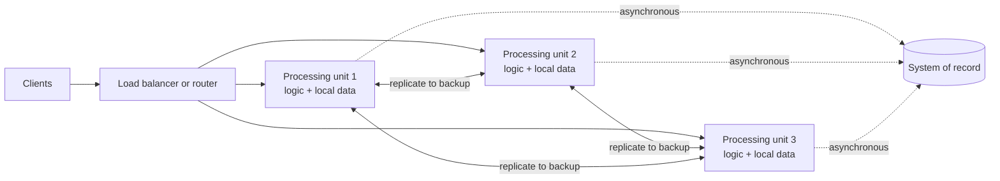

The diagram shows three properties at once. Requests enter through a router and land on one unit, with no shared component in the request path. Each unit replicates its changes to a backup held by another unit, so the loss of one process does not lose the data. The system of record sits behind dotted asynchronous links, which means it is off the critical path. The consequence is that request latency and throughput are set by units and memory, while durability is set by how the dotted links behave. Most of the design effort in this pattern goes into those two things: the replication between units and the synchronization to the system of record.

### 2.3 When the shape fits

The pattern pays off when four conditions hold.

1. Load is high, bursty, or both, so scaling a shared database vertically is expensive or impossible within the time available.
2. Requests mostly touch one key or one small group of related keys, so they can be served by a single unit.
3. The working data set fits in the combined memory of an affordable number of units.
4. The business accepts a defined durability window and a consistency model that is strong per key and weaker across keys.

If requests routinely join across large parts of the data set, or if every acknowledged write must be durable before the caller continues, the model fights the workload. Later sections return to these conditions as measurable tests.

## 3. The Problem: A Shared Database Under Spiky Load

### 3.1 Why the database is the bottleneck

A conventional system has stateless application servers in front of one database. The application tier scales by adding identical instances behind a load balancer. The database does not scale the same way, for three reasons.

- **It is shared state.** Every instance needs the same rows to be consistent, so work converges on one engine (or one primary, if replicas serve reads only). Read replicas help reads and do nothing for write volume.
- **It enforces ordering through locks.** A transaction that updates a row holds a lock until it commits. Concurrent updates to the same row are serialized, so the throughput on one hot row is the reciprocal of the time each transaction holds its lock.
- **It has finite connections and slow elasticity.** Each application instance opens connections, and the engine has a practical ceiling on concurrent sessions. Scaling a database up usually involves a restart, a failover, or a data move, which takes longer than a traffic spike lasts.

Spiky load makes this worse. Capacity planned for the average is far too small for the peak, and capacity planned for the peak sits idle most of the time. When the application tier scales out to meet a spike, it multiplies the number of clients of the database, which then fails under the very scaling that was meant to help.

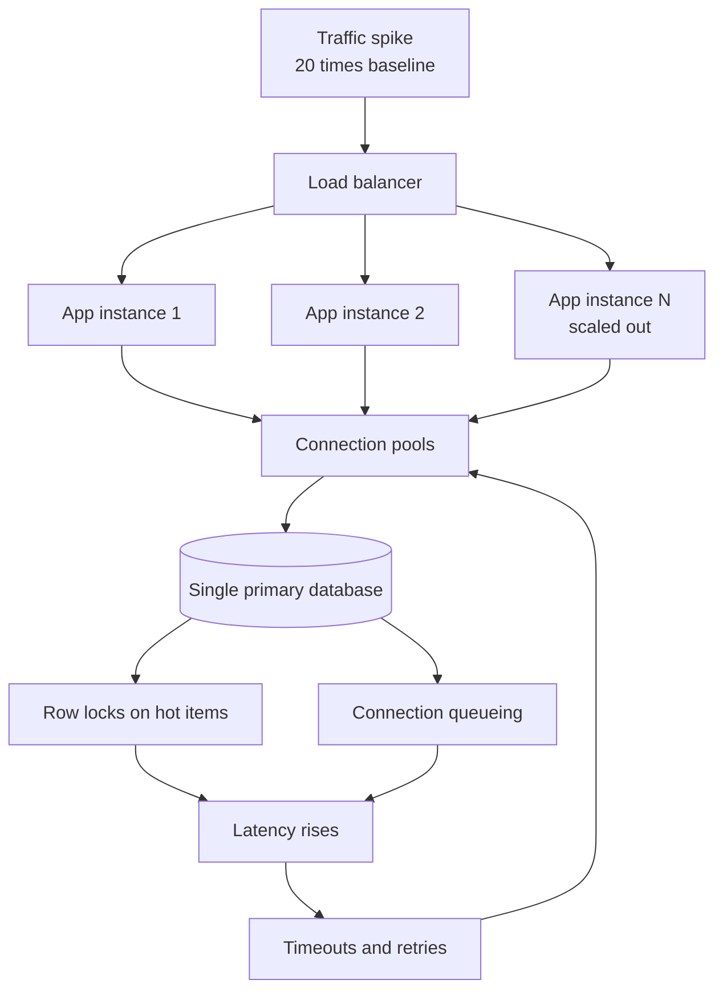

The loop at the bottom of the diagram is the important part. Slow responses cause timeouts, timeouts cause client retries, and retries add load to the component that was already saturated. Scaling the application tier feeds the loop. The implication is that the fix has to remove the shared component from the request path, not just add capacity in front of it.

### 3.2 A worked scenario (illustrative)

An online retailer sells limited-stock items. These figures are illustrative.

- Baseline traffic is 400 stock reservations per second. A flash sale raises it to 8,000 per second for ten minutes, which is 20 times baseline.
- Each reservation is one database transaction that takes 15 ms of database time in total.
- A popular item is one row. The transaction holds that row's lock for about 5 ms.

Three limits follow.

1. **Concurrency.** By Little's law, concurrent transactions equal arrival rate times time in system: $8{,}000 \times 0.015 = 120$ transactions in flight at peak. If the engine and its connection limit are tuned for far fewer concurrent sessions, requests queue, and queueing raises the time in system, which raises the number in flight further.
2. **Hot-row throughput.** One row locked for 5 ms per update allows at most $1 / 0.005 = 200$ updates per second to that row. If a single product draws 3,000 of the 8,000 requests per second, 2,800 per second cannot be served at all, no matter how many application instances exist.
3. **Cost of peak provisioning.** A database sized for 8,000 per second runs at $400 / 8{,}000 = 5\%$ of capacity outside the sale. The idle capacity is paid for continuously.

None of these limits comes from CPU in the application tier. They come from shared state and the lock that protects it. A processing unit that holds the item in memory and applies the reservation inside one process removes the network hop and the shared lock. The same unit, serving only its own partition, becomes the sole writer for that item, which is the property the later sections build on.

### 3.3 Alternatives to try first

The pattern is expensive to operate, so cheaper options deserve a fair test first.

- **Read replicas and caching** (see [Caching](../06_Databases_and_Storage/CH09_Caching.md)) solve read-heavy load. They do not fix write contention.
- **Sharding the database** (see [Sharding](../06_Databases_and_Storage/CH06_Sharding.md)) scales writes but keeps the database in the request path, with its transactions, locks, and per-request network hop.
- **Queue-based load leveling** accepts requests into a durable queue and processes them at a rate the database tolerates. It protects the database, but callers see delayed answers, which fails when the caller needs an immediate accept or reject, as in stock reservation.
- **Optimizing the hot path**, for example by splitting one counter row into several sub-counters, can lift a hot-row ceiling cheaply.

Space-Based Architecture is the right answer when these are insufficient because requests need an immediate, state-dependent answer at a volume and burstiness the database cannot meet.

## 4. In-Memory Data Grids: Replicated and Partitioned Data

An in-memory data grid is a library or cluster of processes that stores keyed data in memory across several nodes and presents it to application code as one logical map. It handles three things: deciding which node holds a key, keeping copies of that key on other nodes, and detecting when a node leaves or joins. Part 06 covers a concrete in-memory store in [Redis](../06_Databases_and_Storage/CH16_Redis.md). This section covers the two layouts a grid can use, because the choice drives memory use, write cost, and scaling.

### 4.1 Replicated cache

In a replicated layout every processing unit holds a full copy of the data. A read is always local. A write must reach every copy, so write cost grows with the number of units, and each unit must have memory for the whole data set.

This layout suits data that is small, read very often, and rarely written, for example reference data such as product categories, tax rules, or feature configuration. It does not scale with data volume, because adding units adds copies and not capacity. It scales reads only.

### 4.2 Partitioned cache

In a partitioned layout the key space is divided into partitions, and each partition has one primary copy on one unit and usually one or more backup copies on other units. A write goes to the key's primary, which updates its memory and forwards the change to the backup. A read goes to the primary, or to a backup if stale reads are acceptable. Adding units spreads partitions over more memory, so both capacity and write throughput scale with the number of units.

The cost is that a unit does not hold every key. A request that needs a key held elsewhere crosses the network, and a request that needs keys from several partitions crosses it several times. This is why the pattern depends on routing each request to the unit that owns its main key.

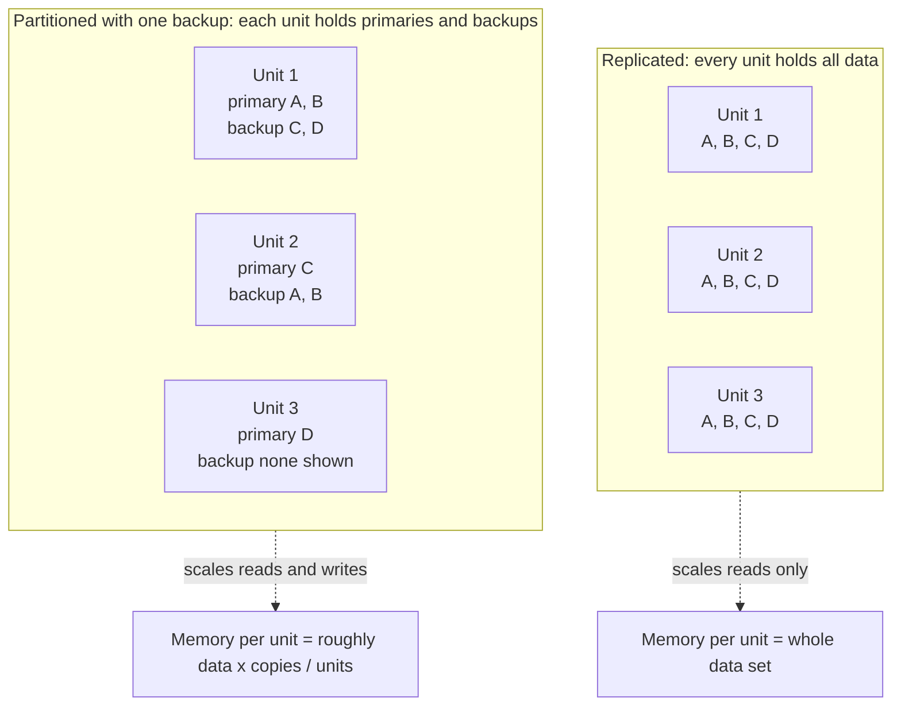

The diagram contrasts memory and write behaviour. In the replicated half, losing two of three units still leaves a full copy, which gives excellent availability for reads, but every unit pays for the whole data set. In the partitioned half, each key lives in two places, so one unit can fail without losing data, and memory per unit shrinks as units are added. Unit 3 in the sketch deliberately shows an unbalanced example: a real grid keeps primaries and backups spread evenly and never places a backup on the same unit as its primary, and it prefers to place backups on a different host or zone.

### 4.3 Near cache

A third element sits between the two. A unit can keep a small local copy of frequently read remote entries, called a near cache. It cuts the network cost of repeated reads of the same remote key. It adds a staleness question: the local copy can lag the primary, so the grid needs an invalidation or version check, or the reader must accept bounded staleness. Use a near cache only for data where that bound is stated and acceptable.

### 4.4 Choosing the layout

| Question | Replicated | Partitioned |
| --- | --- | --- |
| Data volume | Small, bounded | Large, growing |
| Read-to-write ratio | Very read-heavy | Mixed or write-heavy |
| Write cost | One write per unit | One write plus backup writes |
| Memory per unit | Whole data set | Share of data times copies |
| Scales with more units | Reads | Reads, writes, and capacity |
| Typical use | Reference data | Transactional state, such as accounts, carts, orders, inventory |

Real systems combine both: transactional state is partitioned, and small reference data is replicated so that a unit can validate a request without leaving its process.

### 4.5 Backups and their cost

Backup count is a durability decision. With one backup, the data survives the loss of any single unit, but a second failure before re-replication completes loses the partition. Each additional backup multiplies memory and write traffic. Synchronous backups make the write acknowledgment wait for the backup to apply the change, which costs a network round trip and means a write is rejected or delayed when the backup is unreachable. Asynchronous backups acknowledge first and replicate afterwards, which is faster and opens a window in which an acknowledged write exists on one unit only. Part 07 covers these trade-offs in [Replication](../07_System_Design_and_Distributed_Systems/CH10_Replication.md). Section 7 applies the same reasoning to the system of record.

## 5. Virtualized Middleware

The pattern describes the infrastructure around the processing units as four middleware components. The word "virtualized" means each component is a shared capability that the units use through an interface, so application code does not manage connections, routing, or placement itself. The four components are conceptual. A product may implement several of them in one runtime, and a custom build may implement them with ordinary libraries. What matters is that each responsibility has an owner.

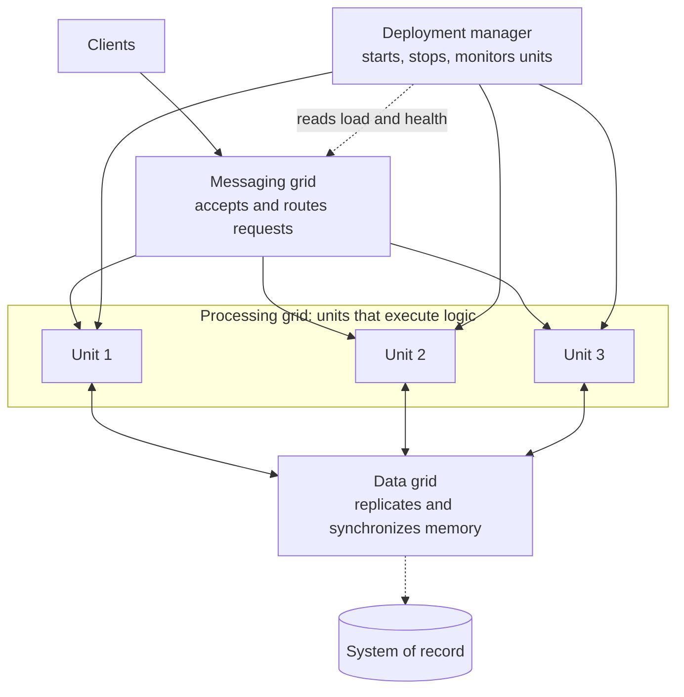

### 5.1 Messaging grid

The messaging grid receives each incoming request and decides which processing unit should handle it. It holds the routing rule, normally derived from the request's partition key and the current partition map, and it sends the request to a unit that is alive and, ideally, holds that key's primary. It also decides what to do when a target is unavailable: retry on the new primary, queue briefly, or reject. This is the component that makes locality real. A grid with excellent local access and poor routing still performs cross-network reads, so the messaging grid's partition map must be current. It does not need to be centralized: routers can cache the partition map and refresh it when a unit replies that it no longer owns the key.

### 5.2 Data grid

The data grid keeps the in-memory data in the units consistent and available. It decides primary and backup placement, forwards writes from primaries to backups, serves reads, and handles repair when a unit fails or joins. It also exposes the hook for synchronization to the system of record, covered later in this chapter. In the model, application code sees a keyed API, and the data grid owns the replication protocol. The consistency guarantees of the whole architecture are largely the guarantees of this component, so they must be read from its documentation and tested, not assumed from the word "replicated".

### 5.3 Processing grid

The processing grid is an optional component for requests that need to run across several units, for example a calculation over all partitions of a data set. It splits the work into per-unit tasks, runs each task on the unit that holds the relevant data, and merges the results. Its purpose is to move computation to the data instead of moving data to the computation. An aggregate such as "total reserved stock across all regions" becomes many small local sums and one merge. If the workload never needs cross-partition work, this component is not required.

### 5.4 Deployment manager

The deployment manager starts and stops processing units dynamically from load. It watches indicators such as request rate, queue depth, memory use, and latency, and it adds units when they rise and removes them when they fall. It is the elasticity mechanism. Its decisions have data consequences because adding or removing a unit triggers partition movement in the data grid, so scaling is not free: it consumes network and CPU while data moves. A deployment manager that scales in too eagerly after a spike can cause a second burst of rebalancing at the wrong moment.

### 5.5 What the decomposition buys

Separating the four responsibilities gives each one its own failure and scaling story. The messaging grid scales with request rate, the data grid with memory and write volume, the processing grid with compute, and the deployment manager with fleet size. The implication for design reviews is practical: for each of the four, ask who owns it, how it fails, and what happens to in-flight requests when it does.

## 6. How a Request Flows and Fails

Take a stock reservation request for item 4711. The partition key is the item identifier. The following sequence shows the success path and the main failure branch.

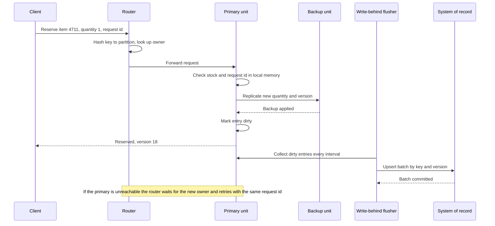

### 6.1 The success path

The router hashes the key to a partition and finds its current owner. The primary does the work in memory: it checks the request identifier to detect a retry, checks stock, applies the decrement, and increments the entry's version. It sends the change to the backup and waits for the backup to apply it, which is the synchronous replication choice made in this example. Only then does it answer the client. The system of record has not been touched yet. A background flusher later collects entries marked dirty and writes them to the database in batches.

Two details deserve attention. The request identifier makes the operation idempotent, so a retry after an ambiguous failure does not reserve twice. [Idempotency](../07_System_Design_and_Distributed_Systems/CH16_Idempotency.md) in Part 07 owns the mechanism. The version number lets the later database write be guarded so that an older update never overwrites a newer one.

### 6.2 Failure branches

Each step has a distinct failure and a distinct client-visible effect.

| Failure point | What the client sees | What must be true for safety |
| --- | --- | --- |
| Router has a stale partition map | Request reaches a unit that no longer owns the key | The unit rejects or forwards it, and the router refreshes its map |
| Primary dies before replicating | Timeout, with no acknowledgment | The retry with the same request id applies once on the new primary |
| Primary dies after the backup applied but before replying | Timeout, though the change exists | The backup becomes primary, and the retry finds the request id already applied |
| Backup unreachable | Delay or error, depending on policy | The policy is explicit: block, degrade to no backup with an alert, or reject |
| Primary and backup both die inside the flush window | Acknowledged write is lost | Accepted only if the loss window is within the recovery point objective (RPO) |
| System of record down | Requests continue; dirty backlog grows | The backlog is bounded and monitored, with a defined behaviour at the limit |

The last two rows are the distinctive ones. In a conventional system, the database being down stops all writes at once, which is simple and safe. Here the grid keeps accepting writes while the database is down, which keeps the business running and quietly increases the amount of data that exists only in memory. The pattern therefore needs an explicit limit and an explicit decision about what happens when the limit is reached. Section 7 quantifies this.

### 6.3 Reads

A read for the same item goes to the primary and returns current memory, so it sees every acknowledged write for that key. A read served from a backup or near cache may lag. Reads that cross partitions, such as "all items in category X", are not served by one unit. They either use the processing grid to fan out, or they are served from a separate query store built from change events, in the style of [CQRS](CH09_CQRS.md). Which choice is right depends on freshness: the fan-out is current but costs more, and the query store is cheap but behind.

## 7. Synchronizing to the System of Record

The processing units hold the working copy. The system of record must still receive every change, for durability, reporting, audit, and recovery. There are three ways to connect them, and they differ in what they expose the caller to.

| Strategy | Caller waits for database | Write latency | Loss exposure | Database load |
| --- | --- | --- | --- | --- |
| Write-through | Yes | Includes database time | None for acknowledged writes, if the database commit is durable | One write per update |
| Write-behind (write-back) | No | Memory and backup only | Entries not yet flushed | Batched, can be coalesced |
| Periodic snapshot or event log | No | Memory and backup only | Changes since the last snapshot or log flush | Lowest |

Write-through keeps the shared database in the critical path, so it recreates the bottleneck that motivated the pattern. This chapter therefore treats write-behind as the main choice. [Caching](../06_Databases_and_Storage/CH09_Caching.md) in Part 06 teaches write-behind as an application-tier strategy. Here the same mechanism is the persistence path of the whole architecture, so its risks matter more.

### 7.1 How write-behind works

Each partition keeps a dirty set: the keys whose latest value has not yet reached the database. A flusher collects the dirty set on a timer or when it reaches a size, and sends a batch to the database. Three properties make it efficient.

- **Batching.** One round trip carries many changes, so the database sees far fewer, larger writes.
- **Coalescing.** If a key changes ten times between flushes, only its latest value needs to be written. For hot keys this removes most of the database load.
- **Decoupling.** A slow database makes the dirty set grow rather than making callers wait.

The database write must be safe to repeat and to arrive out of order, because a flush can fail halfway and be retried. The standard guard is to write by key with the version, and to apply it only if the version is newer:

```sql
-- Idempotent, order-safe upsert of one reservation row
INSERT INTO stock (item_id, quantity, version)
VALUES (:item_id, :quantity, :version)
ON CONFLICT (item_id) DO UPDATE
SET quantity = EXCLUDED.quantity, version = EXCLUDED.version
WHERE stock.version < EXCLUDED.version;
```

The syntax shown is PostgreSQL's. Other engines have an equivalent conditional upsert. Part 06's [PostgreSQL](../06_Databases_and_Storage/CH11_PostgreSQL.md) chapter covers the engine.

### 7.2 The durability risk

An acknowledged write is durable only to the extent that its dirty entry survives until the flush succeeds. Between acknowledgment and flush, the change exists in the primary's memory and the backup's memory. It is lost if both are lost before the flush. That period is the loss window, and its length is the time to the next flush plus the time the flush takes.

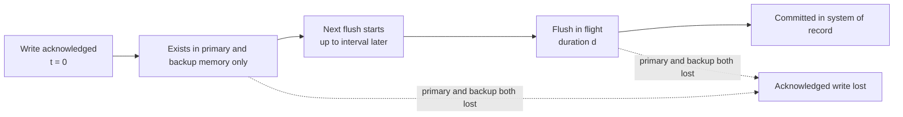

The window does not end when the flush starts. It ends when the database commit is confirmed, so the in-flight time counts. The implication is that the loss window is a design parameter that can be set and measured, and it should be derived from the business RPO, not chosen by convention.

### 7.3 Worked loss-window arithmetic (illustrative)

Suppose each processing unit receives 2,000 writes per second, the flush interval is 500 ms, and a flush takes 100 ms to commit. These figures are illustrative.

1. **Worst-case loss window.** A write that lands just after a flush collection waits a full interval and then the flush duration: $0.5 + 0.1 = 0.6$ seconds.
2. **Writes exposed at worst.** $2{,}000 \times 0.6 = 1{,}200$ writes per unit, before coalescing.
3. **Average exposure.** A random write waits on average half an interval plus the flush: $0.25 + 0.1 = 0.35$ seconds, so about $2{,}000 \times 0.35 = 700$ writes are in memory only at any moment.

Now add the backup. Data is lost only if the primary and its backup both fail inside the window. Assume, for the arithmetic only, that a unit fails on average once per 1,000 hours and that failures are independent.

- The window is $0.6 / 3600 = 1.67 \times 10^{-4}$ hours.
- The chance that the backup fails inside the window after the primary has failed is about $1.67 \times 10^{-4} / 1{,}000 = 1.67 \times 10^{-7}$.
- With 20 primaries, the expected number of primary failures per year is $20 \times 8{,}760 / 1{,}000 \approx 175$. Multiplying gives $175 \times 1.67 \times 10^{-7} \approx 2.9 \times 10^{-5}$ double-failure losses per year.

That number looks reassuring, and it should not be trusted as it stands. It assumes independent failures. Real double failures are dominated by correlated causes: both copies on the same host or in the same zone, a bad release deployed to every unit, an out-of-memory condition triggered by the same load spike, or a power or network event. The honest conclusion is that independent hardware failure is a small term and correlated failure is the one that sets the true risk. Mitigations are therefore structural: place primary and backup in different failure domains, roll out releases gradually, and shorten the window where the business requires it.

### 7.4 When the database is slow or down

The second risk is growth of the dirty set. Suppose a unit receives 2,000 writes per second at peak, the database can absorb 800 per second from that unit, and no coalescing is possible, which is the worst case for unique keys. For a 60-second spike, the backlog grows by $(2{,}000 - 800) \times 60 = 72{,}000$ entries. At 1 KB per entry that is 72 MB, a modest size in memory, though the loss exposure is now 72,000 writes rather than 1,200. After the spike ends, if the arrival rate falls to 400 per second, the drain rate is $800 - 400 = 400$ per second, so the backlog clears in $72{,}000 / 400 = 180$ seconds.

Three controls follow from this arithmetic.

- **A backlog limit.** Set a maximum dirty-set size or age. When it is reached, the unit must change behaviour, because the alternative is unbounded memory growth and an unbounded loss window.
- **A defined behaviour at the limit.** Options are to slow callers (backpressure), reject writes with a clear error, or fall back to synchronous write-through. The right option is a business decision: reject for stock, perhaps degrade for a low-value counter.
- **Alerts on age, not only on size.** The age of the oldest dirty entry is the loss window as it exists right now, and it is the metric that ties directly to the RPO.

### 7.5 Alternatives and when to choose them

If the RPO is zero for acknowledged writes, write-behind is not acceptable as the only durability path. Options include write-through for those specific entities, an append-only log written before acknowledgment (the log is then the durable record and the grid is a projection of it, as in [Event Sourcing](CH11_Event_Sourcing.md)), or a different pattern. A common hybrid is to write-through the few operations that carry money or legal weight and write-behind everything else, so the durability cost is paid only where it is required.

## 8. A Partitioned Store With Write-Behind (Java 21 Sketch)

The following sketch shows the core mechanics in one process: key-to-partition routing, a single-writer worker per partition, optimistic version checks, a dirty set that coalesces repeated writes, and a flusher with a guarded retry. It omits replication to a backup, failure detection, and rebalancing, so it shows the write path and its durability window, not a production grid.

```java
import java.util.*;
import java.util.concurrent.*;

record Versioned(String value, long version) {}

interface SystemOfRecord {
    // Must be idempotent and ignore entries older than what it already holds.
    void upsertBatch(Map<String, Versioned> batch) throws Exception;
}

final class Partition {
    private final Map<String, Versioned> data = new HashMap<>();
    private final Map<String, Versioned> dirty = new HashMap<>();
    private final ExecutorService worker = Executors.newSingleThreadExecutor();

    // All state is touched only on the worker thread, so no locks are needed.
    CompletableFuture<Versioned> put(String key, String value, long expectedVersion) {
        return CompletableFuture.supplyAsync(() -> {
            Versioned current = data.get(key);
            long currentVersion = current == null ? 0 : current.version();
            if (currentVersion != expectedVersion) {
                throw new IllegalStateException("version conflict on " + key);
            }
            Versioned next = new Versioned(value, currentVersion + 1);
            data.put(key, next);
            dirty.put(key, next); // overwrites an earlier unflushed value: coalescing
            return next;
        }, worker);
    }

    CompletableFuture<Versioned> get(String key) {
        return CompletableFuture.supplyAsync(() -> data.get(key), worker);
    }

    CompletableFuture<Map<String, Versioned>> drainDirty() {
        return CompletableFuture.supplyAsync(() -> {
            Map<String, Versioned> batch = new HashMap<>(dirty);
            dirty.clear();
            return batch;
        }, worker);
    }

    void requeue(Map<String, Versioned> failed) {
        worker.execute(() -> failed.forEach((k, v) ->
            dirty.merge(k, v, (a, b) -> a.version() >= b.version() ? a : b)));
    }
}

final class PartitionedStore implements AutoCloseable {
    private final Partition[] partitions;
    private final ScheduledExecutorService flusher = Executors.newSingleThreadScheduledExecutor();

    PartitionedStore(int partitionCount, SystemOfRecord sor, long flushIntervalMs) {
        partitions = new Partition[partitionCount];
        for (int i = 0; i < partitionCount; i++) partitions[i] = new Partition();
        flusher.scheduleWithFixedDelay(() -> flushAll(sor),
                flushIntervalMs, flushIntervalMs, TimeUnit.MILLISECONDS);
    }

    // Stable routing: a key always maps to the same partition.
    private Partition route(String key) {
        return partitions[Math.floorMod(key.hashCode(), partitions.length)];
    }

    CompletableFuture<Versioned> put(String key, String value, long expectedVersion) {
        return route(key).put(key, value, expectedVersion);
    }

    CompletableFuture<Versioned> get(String key) {
        return route(key).get(key);
    }

    private void flushAll(SystemOfRecord sor) {
        for (Partition p : partitions) {
            Map<String, Versioned> batch = p.drainDirty().join();
            if (batch.isEmpty()) continue;
            try {
                sor.upsertBatch(batch);
            } catch (Exception e) {
                p.requeue(batch); // keep the entries; the dirty backlog grows
            }
        }
    }

    @Override
    public void close() {
        flusher.shutdown();
    }
}
```

### 8.1 What the sketch shows

Each partition owns its state through a single-thread executor, so the single-writer rule needs no locks, and the version check turns a lost-update race into an explicit conflict that the caller handles. The dirty map coalesces repeated writes to a key, which is the mechanism behind lower database load. If `upsertBatch` throws, the batch is merged back keeping the newer version, so a failed flush does not lose entries while the process lives.

The durability window is visible in the code. `put` completes when memory is updated, and `flushAll` runs later. A crash between the two loses everything in `dirty`. A production design would add synchronous replication of each accepted change to a backup before completing the future, a bound on the size or age of `dirty` with the behaviour at the limit described earlier, and metrics on the age of the oldest dirty entry.

### 8.2 Limits of the sketch

The routing uses `hashCode` modulo the partition count, which is stable only while the partition count never changes. The next section explains why a real grid separates a fixed number of logical partitions from the changing number of units. The flusher also drains partitions one after another with `join`, so a slow database delays every partition. A production flusher would run per partition or per batch with its own timeout.

## 9. Partitioning, Routing, and Rebalancing

Section 8 routed keys with `hashCode` modulo the partition count. That is acceptable for a fixed set of partitions and wrong for a grid that adds and removes units. The general theory lives in [Partitioning](../07_System_Design_and_Distributed_Systems/CH11_Partitioning.md) in Part 07 and database splitting lives in [Sharding](../06_Databases_and_Storage/CH06_Sharding.md) in Part 06. This section applies their conclusions to a grid where processing and data move together.

### 9.1 Logical partitions decouple keys from units

The standard design uses a fixed number of logical partitions, chosen once and much larger than the expected number of units. A key maps to a partition by hashing: $p = h(key) \bmod P$ where $P$ is the partition count. A separate partition map assigns each partition to a primary unit and a backup unit. When units join or leave, only the map changes and whole partitions move. A key never changes partition, so its identity in the space is stable.

The alternative is to hash directly to units, so $u = h(key) \bmod N$ with $N$ the unit count. The cost shows when $N$ changes. Going from 8 to 12 units, a key keeps its owner only when $k \bmod 8 = k \bmod 12$. Over a repeating cycle of 24 hash values that holds for 8 of them, so one third of the keys keep their owner and two thirds move. With 256 logical partitions spread over the units, adding 4 units to 8 moves only enough partitions to even out the load: the 4 new units each take about $256 / 12 \approx 21$ partitions, roughly 85 in total, or 33% of the data. That equals the theoretical minimum of $4 / 12$. Consistent hashing with virtual nodes reaches the same goal by a different mechanism, and either approach is acceptable if movement is proportional to the change.

The partition count is a one-way decision. Too few partitions limit how far the grid can spread, because the number of units cannot usefully exceed the number of partitions. Too many add per-partition overhead for threads, queues, and metadata. A common rule of thumb is to choose a count at least an order of magnitude above the largest unit count you expect.

### 9.2 Scale-out placement

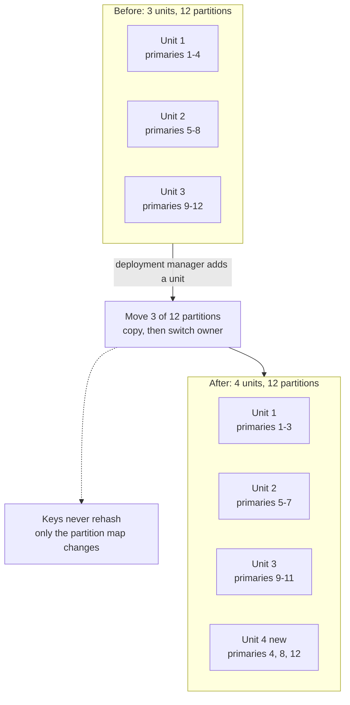

The diagram shows a scale-out from 3 to 4 units. Only three partitions move, the same fraction as the new unit's share of the fleet. The unit that owns a partition stays the single writer until the copy completes, and the switch is a map update. Routers that still hold the old map are told to refresh when they reach a unit that no longer owns the key. The implication is that scale-out cost is the volume of data moved and the work to keep it consistent during the move, and not a re-hash of the key space.

### 9.3 Cost of moving partitions (illustrative)

Take 64 GB of primary data in 256 partitions, so each partition holds about 0.25 GB. Adding 4 units to an 8-unit grid moves about 85 partitions, which is $85 \times 0.25 \approx 21$ GB of primary data. Each new unit receives about 5.3 GB of primaries and, with one backup, about the same again in backup copies, so roughly 10.7 GB per new unit.

If migration is throttled to 100 MB per second per unit to protect request latency, each new unit needs $10{,}700 / 100 \approx 107$ seconds, close to two minutes. The throttle is a deliberate choice. An unthrottled copy finishes sooner and competes with live requests for network, CPU, and memory, which shows up as latency spikes. The consequence for operations is that scaling out is not instantaneous, and a spike that rises in seconds cannot be absorbed by reactive scaling alone. Section 14 returns to this.

### 9.4 Skew and hot keys

Uniform hashing balances the number of keys and does nothing for the load per key. Return to the flash sale of Section 3.2: 8,000 requests per second, of which 3,000 target one item. Spread over 256 partitions and 8 units, the remaining 5,000 requests per second give about 19.6 per partition. The unit that owns the hot item carries $3{,}000 + 31 \times 19.6 \approx 3{,}608$ requests per second, while each other unit carries about $32 \times 19.6 \approx 627$. The hot unit runs at nearly six times the load of its peers, although every unit holds the same number of keys.

Because one writer owns each key, adding units cannot help the hot item. Three remedies exist, and they trade correctness for throughput in different ways.

1. **Split the key.** Divide the item's stock into, say, 10 sub-counters stored under different keys, each owning a tenth of the stock. Reservations pick a sub-counter, so load spreads over up to 10 partitions at roughly 300 per second each. The price is that a reservation may fail on an empty sub-counter while other sub-counters still hold stock, so an allocation or rebalancing rule is needed, and the total is the sum of the parts.
2. **Admit selectively.** Reject or queue requests above a rate the owner can serve, as an explicit admission limit.
3. **Replicate the reads.** If the hot access is mostly reading, serve it from near caches with a stated staleness bound.

Choose the remedy from the business rule. A strict stock limit favors sub-counters with rebalancing. A popularity counter can tolerate approximate answers.

### 9.5 Rebalancing safely

A partition move has a copy phase, a catch-up phase, and a switch. During the copy the source stays primary, and writes that arrive meanwhile are applied at the target during catch-up. The switch briefly pauses writes, flips the map, and resumes on the target. If the target fails mid-copy, the source stays the owner. Run only a few moves at a time, because simultaneous moves multiply the load on the network and garbage collection (GC).

## 10. Write Replication, Ordering, and Conflict Handling

Section 4.5 introduced synchronous and asynchronous backups. This section makes the guarantee precise, because "replicated" says nothing about what an acknowledgment means. The underlying models are in Part 07 [Replication](../07_System_Design_and_Distributed_Systems/CH10_Replication.md), the [CAP Theorem](../07_System_Design_and_Distributed_Systems/CH05_CAP_Theorem.md), and [PACELC](../07_System_Design_and_Distributed_Systems/CH06_PACELC.md). The recap needed here is short: when a network partition occurs, a grid must choose between rejecting writes (consistency) and accepting them on both sides (availability). When no partition exists, it still chooses between the latency of waiting for a backup and the risk of not waiting.

### 10.1 Acknowledgment policies

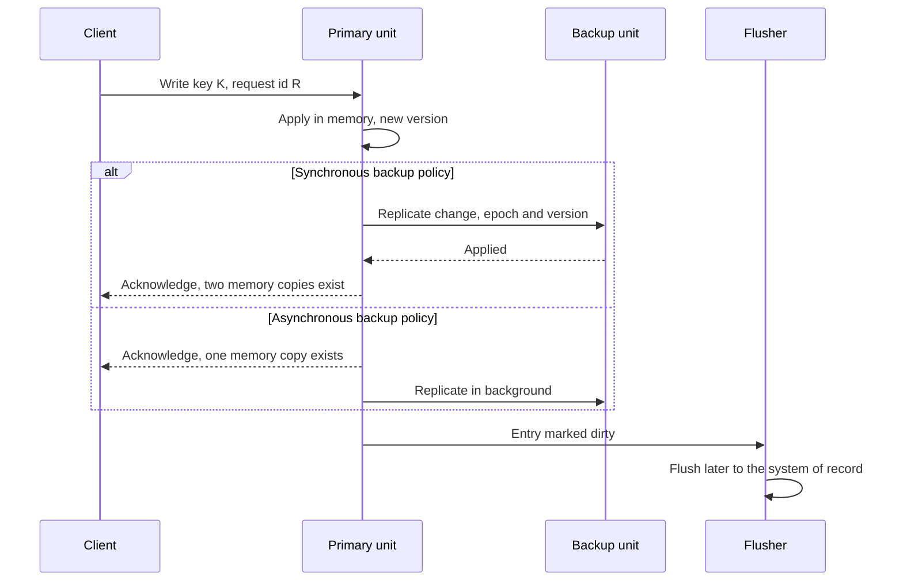

The two branches differ in what the client is told. In the synchronous branch an acknowledgment means two memory copies exist, so a single unit failure cannot lose the write. In the asynchronous branch it means one copy exists, and a primary failure before the background send loses the write although the client saw success. Neither branch says anything about the database, which is a separate guarantee defined in Section 7.

| Policy | Acknowledgment means | Illustrative write latency | Exposure |
| --- | --- | --- | --- |
| Primary only | One memory copy | About 0.3 ms | Any single unit failure before the backup receives the change |
| Synchronous to one backup in the same zone | Two copies, same zone | About 0.8 ms | Zone loss |
| Synchronous to one backup in another zone | Two copies, two zones | About 1.9 ms | Both zones lost, or a correlated cause |
| Synchronous to a majority of three copies | Two of three copies | About 1.9 ms, set by the slower of two backups | Rare correlated loss |

The latencies are assumptions for the arithmetic: 0.3 ms for routing and local apply, 0.5 ms for a same-zone round trip, and 1.6 ms for a cross-zone round trip. A cross-zone synchronous write costs about $0.3 + 1.6 = 1.9$ ms against 0.3 ms for primary-only, roughly six times more. That is still far below a database transaction of 15 ms, which is why the pattern remains attractive even with the strongest memory policy. The decision rule is to buy the weakest policy whose exposure fits the business recovery point objective (RPO) for that entity type, and to set the policy per entity type and not per grid.

### 10.2 What happens when the backup is unreachable

A synchronous policy forces a choice at the moment of failure. The primary can block the write until the backup returns, which preserves the guarantee and turns a backup fault into an availability fault for that partition. It can reject the write with a clear error, which is the same effect made visible. Or it can continue with no backup and raise an alert, which keeps availability and silently downgrades the guarantee to a single copy. Pick one on purpose for each entity type. Money-bearing data normally blocks or rejects. A page-view counter normally continues.

### 10.3 Ordering and the single-writer rule

Within one partition the primary applies writes one at a time and assigns increasing versions, so all changes to a key have a total order. The backup receives them in that order, and the version lets it discard duplicates and detect gaps. Across partitions there is no global order. Two reservations for different items may be applied in either order on different units, and any logic that needs a cross-key invariant, such as "total across a customer's items must not exceed a limit", cannot rely on the grid for it. Options are to place the related keys in the same partition by using a shared routing key, to use a coordinator, or to accept a bounded violation and reconcile later. Same-partition placement is the cheapest, and it is the main reason partition key design matters so much.

### 10.4 Conflicts

With a single primary per key, concurrent writers do not conflict inside the grid. They are serialized, and the second writer either wins with a newer version or fails an optimistic version check as in the Section 8 sketch. Conflicts return in three situations.

- **Split-brain.** A network partition splits the cluster and each side believes it should own the same partitions. If both sides accept writes, the histories diverge and cannot be merged without losing intent. The prevention is to let a partition be primary only on the side that holds a majority of the cluster membership, using a membership service or the consensus mechanisms of [Consensus](../07_System_Design_and_Distributed_Systems/CH07_Consensus.md) and [Leader Election](../07_System_Design_and_Distributed_Systems/CH08_Leader_Election.md), and to attach an epoch number to every ownership change so a replica rejects writes carrying an older epoch. The minority side stops accepting writes. The price is that part of the cluster becomes unavailable during the partition, which is the consistency choice from CAP.
- **Multi-site active-active.** If two regions each own the same keys, conflicts are inevitable. The simplest remedy is to avoid it by giving each key a home region. If both must write, resolve by a merge rule agreed per entity: last writer wins by timestamp, which depends on clock quality and discards one update; per-field merge; or a data type designed to merge, such as the counters and sets described in Part 07's replication chapter. Make the rule explicit and test it.
- **Reconciliation with the system of record.** If a grid is rebuilt from the database after a loss, the rebuilt value may be older than a value a client already saw. The version column from Section 7.1 prevents an older value from overwriting a newer one in the database, and a reconciliation step against another source decides the rest.

### 10.5 Reads and stale data

A read from a primary sees every acknowledged write for the key. A read from a backup or near cache can lag. Send "read your own write" flows to the primary, let dashboards read from any copy, and state the lag bound for each.

## 11. Failure Recovery: Promotion and Re-Replication

When a processing unit dies, two separate things must be repaired. Availability is restored when a surviving backup becomes primary for the failed unit's partitions. Redundancy is restored when new backup copies are built. The first takes seconds and the second takes much longer, and the gap between them is the period in which a second failure loses data.

### 11.1 The recovery sequence

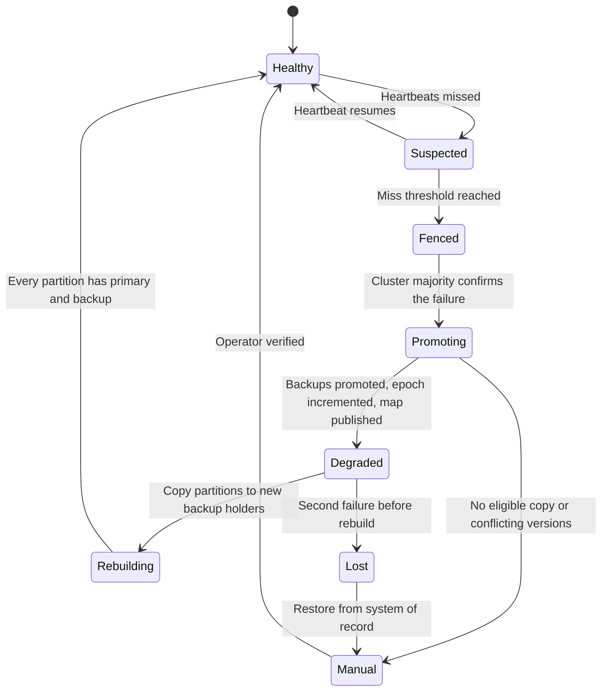

The diagram has two states worth noticing. `Degraded` is a serving state that looks healthy from outside and has a single copy of every affected partition. `Lost` is the branch no design should hide: it is reached by a second failure while degraded, and the only way out is the system of record. The fencing step stops the suspected unit from continuing to accept writes if it is in fact alive but slow, which is the same split-brain risk as in Section 10.4. A paused or partitioned unit that comes back must discover that its epoch is stale and rejoin as an empty member.

### 11.2 Recovery-time arithmetic (illustrative)

Use the 8-unit grid from Section 9.3: 64 GB of primary data, 256 partitions, one backup, so each unit holds 32 primaries and 32 backups, 64 partitions in all.

1. **Detection.** Heartbeats every 1 second, with a unit suspected after 3 missed beats, give about 3 seconds. Adding about 1 second to confirm with the cluster majority and publish the new map gives roughly 4 seconds.
2. **Promotion.** Backups already hold the data, so promotion is a map and epoch change. The 32 partitions whose primary died, which is 12.5% of the key space, are unavailable for writes for about those 4 seconds, plus client retry time.
3. **Re-replication volume.** The failed unit held 64 partitions of 0.25 GB, so $64 \times 0.25 = 16$ GB must be copied to restore two copies of every partition.
4. **Re-replication time.** If 7 surviving units each contribute 50 MB per second, the aggregate is 350 MB per second, so the rebuild takes $16{,}000 / 350 \approx 46$ seconds.

The window with one copy is therefore about $4 + 46 = 50$ seconds for the affected partitions. During that window the system survives no second failure of the units that hold the lone copies. That is the number to compare with the earlier loss-window arithmetic and with the failure-domain placement rules, since the risk is highest when the same zone or host hosts both a partition's replicas.

### 11.3 Capacity headroom for recovery

Recovery needs memory on the survivors. With one backup, total memory in use is $64 \times 2 = 128$ GB over 8 units, which is 16 GB per unit. After one failure the same 128 GB is spread over 7 units, so each carries $128 / 7 \approx 18.3$ GB, or 14% more. If units run at 90% of heap in normal operation, recovery pushes them over the limit and triggers GC pressure or out-of-memory failures, which turns one unit failure into a cascade. The rule is to size so that the grid fits in memory after losing the number of units (or the whole zone) it is designed to survive. Section 13 applies this rule.

### 11.4 Total loss of a partition

If all copies of a partition are lost, for example when a correlated defect or a zone loss takes both copies, the grid rebuilds from the system of record, as it does after a cold start. Section 12 covers the time and limits. Place backups in a different zone from the primary, and never let an upgrade or autoscaling action stop a unit before its partitions are re-replicated. Section 17 lists the recovery tests to run regularly.

## 12. The Persistence Boundary and Rebuilding from the System of Record

The persistence boundary is the line between what the grid guarantees and what the business must be able to reconstruct from elsewhere. Section 7 defined the write-behind path. This section examines what sits on the other side of that line.

### 12.1 Choosing the boundary

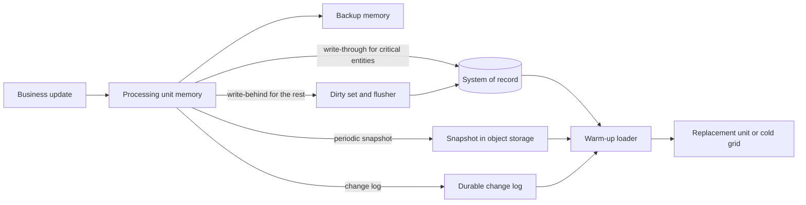

The diagram shows four durability paths that can coexist. Write-through puts selected entities on the critical path and gives the strongest guarantee. Write-behind covers most data cheaply. A periodic snapshot gives a fast restore point, and a change log written before acknowledgment gives a replayable record between snapshots. The warm-up loader turns any of these into memory on a replacement unit. The implication for design is that each entity type gets one row in a table of its path, its loss window, and its restore source, and the table is reviewed with the business.

### 12.2 Cold-start arithmetic (illustrative)

Suppose the whole grid is lost and 64 GB of primary data must be loaded from the database. If the database can sustain 200 MB per second of bulk reads without harming other users, the load takes $64{,}000 / 200 = 320$ seconds, about 5.3 minutes, before any index or secondary structure is rebuilt. If the database's limit is only 50 MB per second, it takes $64{,}000 / 50 = 1{,}280$ seconds, about 21 minutes. A restore from snapshots held in object storage, with each of 8 units loading its own 8 GB at 500 MB per second, takes $8{,}000 / 500 = 16$ seconds for the data and then the time to replay the change log since the snapshot. The difference is why large grids usually add snapshots even when a database exists. The recovery time objective (RTO) decides whether the database alone is enough.

### 12.3 Reconciling the lost window

After a loss, the restored state is as of the last committed flush or snapshot. Anything acknowledged afterward and lost is gone from the grid. Recovery therefore includes a reconciliation step against other sources of truth: a payment provider's records, an order ledger, an upstream message log. The reconciliation can be as simple as replaying messages from the broker since a recorded offset, as described in [Event-Driven Architecture](CH07_Event_Driven_Architecture.md), if inputs are retained and processing is idempotent. A design that cannot say where the missing writes can be recovered from has an RPO it has not written down.

### 12.4 What the grid does not remove

The database still needs its own backups, retention rules, and schema migration, because it is the last line of defense. Reporting that needs history or joins runs against the database or a derived store, which is the role a [CQRS](CH09_CQRS.md) read side can play.

## 13. Capacity Planning

Capacity planning for a grid starts with memory, not CPU. The data set must fit in the combined heap with room for replication, recovery, and garbage collection. The following worked example is illustrative and every input should be replaced by measurements from a prototype.

### 13.1 Memory

Assume 20 million entries, each about 600 bytes serialized, with 1 backup copy.

1. **Raw size.** $20{,}000{,}000 \times 600 = 12$ GB.
2. **In-memory size.** Objects in memory are larger than their serialized form because of headers, indexes, and grid metadata. Assume a measured overhead factor of 2.5, giving $12 \times 2.5 = 30$ GB of primaries.
3. **With backup.** $30 \times 2 = 60$ GB across the grid.
4. **Heap headroom.** Keep normal heap use at or below 60%, so GC has room and migration has space. Units have 16 GB heaps. The unit count for normal operation must satisfy $60 / (N \times 16) \le 0.6$, so $N \ge 6.25$, which rounds up to 7.
5. **Failure headroom.** After losing one unit, the survivors may run hotter, say at most 80%. Then $60 / ((N - 1) \times 16) \le 0.8$, so $N - 1 \ge 4.7$ and $N \ge 5.7$, which rounds up to 6.

The binding constraint is the normal-operation rule, so the grid needs 7 units. Surviving a whole zone requires repeating step 5 for the number of units in that zone, which can change the answer. With 7 units spread over three zones (3, 2, 2), losing the largest zone leaves 4 units, and $60 / (4 \times 16) = 94\%$ exceeds the 80% limit. Either use more units or accept that zone loss means reduced redundancy or load shedding. State which.

### 13.2 CPU and network

Take peak traffic of 8,000 writes and 24,000 reads per second. Each operation costs about 0.1 ms of CPU. Reads cost 24,000 operations, and writes cost 8,000 on the primary and 8,000 on the backup, 16,000 in all, for a total of 40,000 operations or $40{,}000 \times 0.1 = 4{,}000$ ms of CPU per second, 4 cores busy. At a 50% target utilization that is 8 cores across the grid, a little over one core per unit. At about 1 KB per replicated change, replication traffic is $8{,}000 \times 1 = 8$ MB per second, which is small. The conclusion from this arithmetic is typical: memory sets the size of the grid, and CPU and network are secondary unless operations are heavy, such as the aggregations of the processing grid.

### 13.3 The database behind the flusher

The database must absorb the flushed writes. If the database can apply 5,000 rows per second from bulk upserts, then at 8,000 writes per second the outcome depends on coalescing. With a measured coalescing ratio of 3 to 1, the database sees $8{,}000 / 3 \approx 2{,}667$ rows per second, which is 53% of its capacity. With no coalescing it faces 8,000 and falls behind by 3,000 per second. A 10-minute peak then builds a backlog of $3{,}000 \times 600 = 1{,}800{,}000$ entries, about 1.8 GB at 1 KB each. That is small for memory and large for the loss window, since the oldest dirty entry now waits for the whole backlog. Capacity planning therefore includes a coalescing measurement from a realistic key distribution, because the ratio depends on how often hot keys repeat.

## 14. Deployment, Elasticity, and Release Safety

The deployment manager from Section 5.4 starts and stops units. Its decisions have data consequences, which makes deployment in this pattern a stateful operation, and not the routine replacement of interchangeable instances that stateless tiers allow.

### 14.1 Scaling out and in

Scale-out adds units, then partitions move. Using Section 9.3 as a base, growing from 7 to 10 units moves about 30% of 60 GB, which is 18 GB, and each of the 3 new units receives 6 GB. At 50 MB per second per unit that takes $6{,}000 / 50 = 120$ seconds, plus unit start time. A spike that rises in seconds will not wait for that. Two practices follow. Scale ahead of known events on a schedule, since a flash sale has a start time. For unpredictable load, keep headroom that can absorb the first minutes, and scale on leading signals such as memory use and request queue depth, not on CPU alone.

Scale-in is the dangerous direction. Removing a unit first requires moving its partitions elsewhere, and doing it right after a spike risks a second burst of rebalancing at the wrong moment. Use a cool-down period, remove one unit at a time, and confirm every partition has two copies before the next removal.

### 14.2 Rolling release

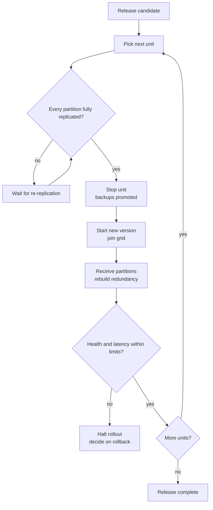

The gate named "every partition fully replicated" is what makes the rollout safe. Without it, stopping a second unit can remove the last copy of some partition. The rollout is slow by design. With 7 units holding 60 / 7 ≈ 8.6 GB each, refilling a restarted unit at 50 MB per second takes $8{,}571 / 50 \approx 171$ seconds. Add 30 seconds for restart and the cycle is about 201 seconds per unit, so $7 \times 201 \approx 1{,}407$ seconds, a little over 23 minutes.

Two further risks belong to this pattern. First, during the rollout two versions of the code run together and exchange replicated entries, so the serialized form must be readable by both. Use the expand and contract approach: first deploy a version that reads both the old and new forms, then one that writes the new form, then drop the old reader. Second, a bad release that crashes on a specific input can take down units one after another, which turns a single defect into the correlated failure that the loss-window arithmetic excluded. The halting check in the diagram and a canary, one unit upgraded first and observed, limit that blast radius. [Cell-Based Architecture](CH18_Cell_Based_Architecture.md) takes the same concern further by splitting the whole system into independent cells that are released one at a time.

## 15. Observability

The grid's failure modes are quiet, so its metrics must say what the architecture promises. Metrics common to every service, such as request rate and error rate, are not enough. Part 14 teaches the general mechanisms in [Metrics](../14_Observability/CH02_Metrics.md), [Tracing](../14_Observability/CH03_Tracing.md), and [SLO](../14_Observability/CH11_SLO.md) (service level objective). This section names the signals specific to space-based systems.

| Signal | Why it matters | Alert design |
| --- | --- | --- |
| Age of the oldest dirty entry | It is the current loss window | Alert when above the budget derived from the RPO |
| Dirty set size and flush failure rate | Backlog growth predicts the limit | Alert on trend, with a hard limit that triggers the defined behaviour |
| Partitions with fewer than two copies | The count of degraded partitions is the exposure to a second failure | Page when non-zero for longer than the expected rebuild time |
| Partition ownership per unit | Detects imbalance after failures and moves | Alert on divergence from the mean |
| Request rate per partition | Reveals hot keys before they cause an outage | Alert on one partition far above the median |
| Remote-access ratio | A rise shows routing misses or cross-partition work | Track against a baseline |
| Version conflict and redirect rates | Shows contention and stale routing maps | Track trend |
| Heap use, GC pause time, allocation rate | The first sign of memory pressure | Alert before the failure-headroom limit |
| Migration activity | Explains latency changes during scaling | Annotate dashboards |

Traces should carry the request identifier and the partition key through router, unit, and flusher, so a single reservation can be followed from arrival to database commit. Latency should be reported by percentile and by partition, because an average hides a hot unit. The reconciliation job from Section 12.3 is also an observability tool: a periodic comparison of counts and checksums between the grid and the system of record detects silent divergence that no metric will show. Tie each alert to a runbook that states the first action, since the response to a growing dirty set (shed load, throttle writers, fix the database) differs from the response to an unbalanced partition map.

## 16. Security of the Grid

A grid concentrates a large share of an organization's live data in memory, spread over many processes that talk to each other. That changes the attack surface in four ways. The general mechanisms are in Part 15, and the transport mechanics are in [TLS](../05_Networking_and_OS/CH06_TLS.md) (Transport Layer Security).

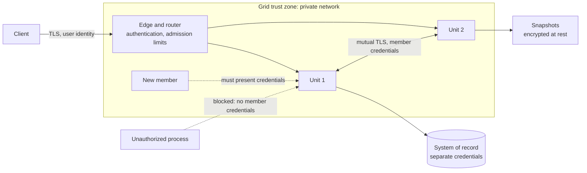

The diagram draws the grid as its own trust zone. The router authenticates callers and applies admission limits. Units authenticate each other. The database and snapshots are separate trust relationships with their own credentials and encryption. The implication is that compromising the edge must not be enough to read the whole space, and joining the cluster must be a privileged act.

### 16.1 Membership is a privilege

A process that joins the cluster is given partitions, which means it receives a copy of the data. If membership is open to anything on the network, an attacker who reaches the private network can join and read every partition assigned to it, with no further access needed. Require authenticated membership, with credentials that rotate, and restrict network reachability of the grid ports to the grid's own subnet. Treat the grid's management interface the same way, because it can usually move partitions and read entries.

### 16.2 Encryption in transit and at rest

Replication and migration traffic carries the full data set over the network. Encrypt it with mutual TLS between members. The cost is CPU, which Section 13.2 shows to be spare in most sizings, and a longer handshake when units join. Snapshots, change logs, heap dumps, and the database all contain the same data and need encryption at rest and equivalent access control. A heap dump taken for debugging is a full copy of a unit's partitions, so restrict who may take one and where it may be stored.

### 16.3 Authorization stays in the unit

Because a router chooses the unit by key, an attacker who can forge a key can steer a request. Do not rely on routing for authorization. Each unit checks that the authenticated caller may act on the entity, using the same policy that a database layer would enforce. In multi-tenant grids, include the tenant identifier in the key and in the authorization check, so a bug in routing cannot return another tenant's entry. See [Cell-Based Architecture](CH18_Cell_Based_Architecture.md) for isolating tenants more strongly.

### 16.4 Serialization and abuse

Entries are serialized to move between units and to storage. Deserializing untrusted or unrestricted types is a known source of remote code execution in many runtimes, so allow only an explicit list of entry classes and never deserialize data from an unauthenticated source. The other abuse pattern is load: an attacker or a faulty client can drive a single key hot, or create entries without limit and fill memory. Admission limits per caller and per key, entry size limits, and expiry for entries that can be created by clients, bound the damage. Expiry is also a cost control, since unbounded creation is the same as a memory leak.

## 17. Failure and Quality-Attribute Scenarios

Each scenario gives a stimulus, the expected response, and a measurable criterion. The figures reuse the illustrative arithmetic above and are targets to test against, not claims about any product.

| Scenario | Stimulus | Expected response | Success criterion |
| --- | --- | --- | --- |
| Traffic spike | Load rises from 400 to 8,000 reservations per second within 30 seconds | Pre-scaled grid absorbs it, with hot item handled by sub-counters | 99th percentile latency at or below 50 ms, no database timeouts, error rate below 0.1% |
| Unit failure | One of 7 units is killed under peak load | Backups promoted, clients retry with the same request id, redundancy rebuilt | Writes to affected partitions resume within 10 seconds, no duplicate reservations, full redundancy within 3 minutes |
| Double failure | Primary and backup of one partition are killed together | Loss detected, partition restored from the system of record, reconciliation run | Loss reported within 1 minute, lost writes bounded by the flush window, reconciliation finishes before the sale ends |
| Database outage | System of record unavailable for 5 minutes | Grid keeps serving, dirty set grows, backlog limit and its behaviour apply | Oldest dirty entry age alerts at 60 seconds, writes follow the defined rule at the limit, backlog drains within 15 minutes after recovery |
| Zone loss | One of three zones fails | Surviving units serve with reduced redundancy, load shedding applies if memory limit is exceeded | Service restored within 1 minute, degraded partitions reported, no out-of-memory failure |
| Hot key | One item draws 40% of traffic | Admission limit or sub-counter split keeps the owner unit within bounds | Owner unit CPU stays below 70%, other items' latency unchanged |
| Rolling release | New version deployed during a normal day | One unit at a time, halting on bad health | No request error above baseline, rollout aborts within 2 minutes of a defect |
| Rogue member | An unauthorized process tries to join | Membership refused, event logged | Zero partitions assigned, alert raised within 1 minute |
| Network partition | Cluster splits 4 and 3 | Majority side continues, minority side stops writes | No key accepts writes on both sides, rejoined members discard stale state |

Treat these rows as tests that run in a pre-production environment on a schedule. A scenario without a measured result is a claim, and the usual finding on first execution is that a timeout or throttle value assumed in design was set differently in practice.

## 18. Worked Case: A Flash-Sale Reservation Platform

This case is a hypothetical organization, and all figures are illustrative. A retailer, called here Harbor and Pine, runs limited-time sales of a few hundred items. A sale lasts about 10 minutes and has the load profile used throughout this chapter: a baseline of 400 reservations per second and a peak of 8,000, of which up to 3,000 per second target a single item. Customers need an immediate "reserved" or "sold out" answer, and a reservation holds stock for 10 minutes while the customer pays. The catalog and stock hold 2 million products across 10 fulfilment regions, which is 20 million stock entries.

### 18.1 Requirements

- Reserve or reject within 50 ms at the 99th percentile at peak.
- Never confirm more reservations than stock, subject to a stated tolerance after a double failure.
- Reservations: recovery point objective of about 1 second, since a customer can retry. Orders and payments: zero, through write-through.
- Survive one unit failure without customer-visible errors beyond a short retry, and one zone failure with reduced redundancy.
- Meet a recovery time objective of 15 minutes for total grid loss.

### 18.2 Decisions

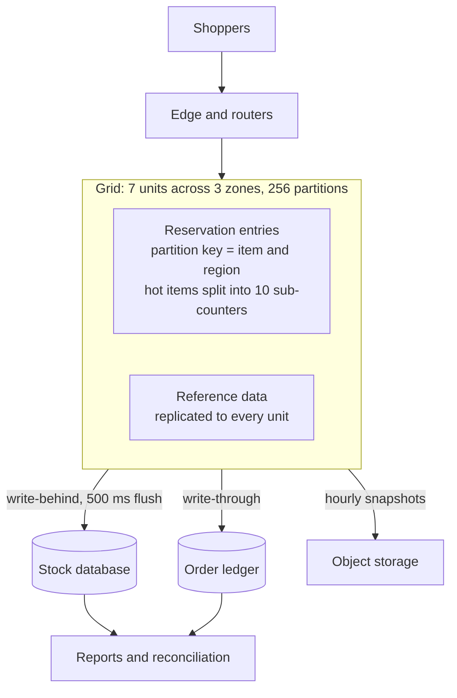

The design applies each earlier section in turn.

1. **Partitioning.** Entries are keyed by item and region and spread over 256 logical partitions. Items expected to be hot in a sale are split into 10 sub-counters before the sale opens. From Section 9.4, a 3,000-per-second item then costs about 300 per second per sub-counter rather than loading one unit with 3,000.
2. **Replication.** Reservation writes are acknowledged after a synchronous backup in another zone. From Section 10.1 the cost is about 1.9 ms, comfortably inside the 50 ms goal.
3. **Persistence.** Reservations use write-behind with a 500 ms flush. From Section 7.3 the worst-case window is $0.5 + 0.1 = 0.6$ seconds. At 8,000 per second that is $8{,}000 \times 0.6 = 4{,}800$ acknowledged reservations exposed across the grid. Spread over 256 partitions, the average is $4{,}800 / 256 \approx 19$ per partition, and the hot item's exposure is up to $3{,}000 \times 0.6 = 1{,}800$ if its partition is the one lost. Payments and orders write through to the order ledger, so a lost reservation can never become a lost order.
4. **Sizing.** Section 13 gives 7 units with 16 GB heaps for 60 GB of data with a backup. The expected zone layout of 3, 2, and 2 means losing the 3-unit zone pushes survivors to 94% heap use, above the 80% limit, so the team adds a rule: during zone loss the sale shuts off new items and sheds the lowest-priority reads, which Section 17 tests.
5. **Release and scaling.** The grid scales from 7 to 10 units one hour before a sale starts, since the 120-second move time for 6 GB per new unit is too slow to do reactively. Releases are frozen during a sale.

### 18.3 Rejected alternatives

| Alternative | Reason for rejection |
| --- | --- |
| Larger database with read replicas | The hot item stays a single row. At 5 ms of lock hold per update, the ceiling is 200 updates per second, far below 3,000 |
| Database sharded eight ways | Eight shards do not split a single hot row, and the database stays in the request path with its 15 ms transaction |
| Queue-based load leveling | Customers need an immediate reserved or sold-out answer, so a delayed reply fails the requirement |
| Grid with write-through for everything | Restores the database transaction time to every reservation and reintroduces the connection and lock ceiling |
| Grid with asynchronous backups only | Saves about 1.6 ms per write and loses reservations on any single unit failure, which is not needed to meet the latency target |

### 18.4 Validation evidence

The team would accept the design only with these test results, shown here as illustrative targets and outcomes of the kind to record:

- **Load test at 1.25 times peak (10,000 per second).** 99th percentile latency 31 ms, error rate 0.02%, replication round trips within the 1.9 ms estimate. The targets were 50 ms and 0.1%.
- **Hot-item test.** With sub-counters, the busiest unit peaks at 52% CPU. Without them, the same test saturates one unit at 100% CPU and the 99th percentile latency rises above 400 ms, which is the evidence for the split.
- **Unit kill under peak.** Writes to affected partitions resume in 6 seconds, full redundancy returns in 52 seconds, and a replay of 5,000 requests with repeated request ids produces zero double reservations.
- **Database outage of 5 minutes.** Oldest dirty entry age alerts at 60 seconds, the backlog reaches 0.8 million entries, and it drains in under 10 minutes after recovery.
- **Cold-start rebuild.** Loading 64 GB from snapshots and the change log takes 4 minutes, inside the 15-minute objective, where a database-only rebuild at 200 MB per second would need 5.3 minutes of data load plus index work.

The remaining risk is recorded openly: a correlated loss of both copies of a partition could resurrect released stock for up to the exposure of that partition. The mitigation is a reconciliation job that recomputes available stock from confirmed orders and active holds, with expired holds simply released. Reservation loss is an annoyance for a retried customer, and an oversold confirmed order is a business cost that the order ledger's write-through path prevents.

## 19. Common Mistakes and Anti-Patterns

| Mistake | Cause | Consequence |
| --- | --- | --- |
| Adopting the pattern for a read-heavy workload | Assuming in-memory means faster for every problem | Replication and failover cost is paid for a problem that read replicas and a cache would have solved |
| Calling the grid "durable" because it is replicated | Confusing memory copies with a committed write | An acknowledged write is lost when both copies fail inside the flush window, and nobody had written down the RPO |
| No limit on the dirty set | Treating the database as always available | A database outage lets the unflushed backlog and the loss window grow until memory is exhausted |
| Hashing keys directly to unit count | Reusing the simple modulo routing | Every scaling event moves about two thirds of the data and causes a latency storm |
| Placing both copies in one failure domain | Default placement, or backups chosen for lowest latency | A single host or zone failure loses the partition, though the design promised one-failure tolerance |
| Ignoring skew | Believing uniform hashing balances load | One unit carries several times the load of the others, and adding units does not help |
| Cross-partition transactions in the request path | Modelling the grid like a relational database | Network hops and coordination return, and the latency advantage disappears |
| Sizing from serialized data size | Forgetting object and index overhead | The grid runs out of heap during recovery, and a unit failure cascades |
| Scaling in right after a spike | Optimizing cost with a short cool-down | Rebalancing starts at the moment the next spike is likely, and partitions lose redundancy |
| Open cluster membership | Convenience in development carried to production | Any process on the network can join and receive a copy of the data |
| Rolling releases without a replication gate | Treating units as interchangeable instances | Two units stopped in a row remove the last copy of a partition |
| Using the grid as the only copy of history | Skipping database backups and audit | There is nothing to restore from when the grid is lost, and reporting has no source |

Several of these share a cause: the database leaves the request path and teams forget that it remains the recovery source. Review any design that depends on a probability such as the one in Section 7.3 by asking which correlated event breaks the independence assumption.

## 20. Comparing the Pattern With Its Alternatives

The comparison is against the baseline that most teams already operate, a scaled database tier with a cache, and against the two sibling patterns that share ideas with this one.

| Dimension | Scaled database tier with cache | Space-Based Architecture | CQRS (CH09) | Event-Driven Architecture (CH07) |
| --- | --- | --- | --- | --- |
| Where the working data lives | Database, with a cache in front | In memory across processing units | Write model and one or more read models | Wherever each consumer keeps its own state |
| Request path | App, cache, database | Router, unit | Command path and query path | Producer, broker, consumer |
| Write scalability | Limited by the primary or by sharding | Scales with units, per key single writer | Command side scales as its store allows | Scales with partitions in the broker |
| Read scalability | Replicas and cache | Local memory, near caches | Read models shaped for queries | Consumers build local views |
| Latency | Milliseconds, dominated by database | Sub-millisecond to low milliseconds | Depends on each side | Asynchronous by design |
| Durability of an acknowledged write | Database commit | Memory copies, then flush, set by policy | Per side | Broker durability settings |
| Consistency | Strong at the database | Strong per key, weaker across keys | Eventual between write and read model | Eventual |
| Main operational cost | Database tuning and cache invalidation | Replication, rebalancing, memory sizing | Projection lag and rebuilds | Delivery guarantees and schema evolution |
| Best fit | Read-heavy and moderate write load | High, spiky, key-local stateful load needing immediate answers | Different read and write shapes | Decoupled workflows and fan-out |
| Typical failure | Database saturation | Correlated loss of copies, hot partitions, dirty backlog | Stale read models | Duplicates, poison messages |

The patterns combine. A space-based write path often publishes change events to a broker for other consumers, in the style of [Event-Driven Architecture](CH07_Event_Driven_Architecture.md), and a query store built from those events is the [CQRS](CH09_CQRS.md) read side that serves reports. The [Actor Model](CH12_Actor_Model.md) shares the single-writer idea, since an actor processes one message at a time over its own state, and a grid partition behaves like a long-lived actor for its keys. The pattern is defined by where the primary working state lives and how it is partitioned, which is why it remains distinct from those siblings even in combination.

### 20.1 Decision flow

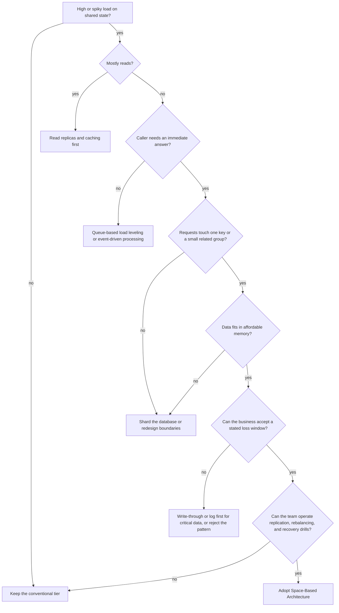

The flowchart orders the questions from cheapest to most expensive to answer. Most teams leave at the first three tests. The last test is organizational and often decides the outcome, since a design that needs drills nobody will run is a design that will fail the first time a unit dies.

## 21. Design-Review Checklist

Use these questions in a review. An answer of "unknown" is a finding.

**Fit**

- Is there a measured limit that conventional options (replicas, cache, sharding, queues, hot-path changes) cannot meet?
- Do requests touch one key or a small, colocated group of keys? What fraction cross partitions?
- Does the working set, including overhead and backups, fit in affordable memory?

**Partitioning and scaling**

- Is there a fixed number of logical partitions, and is it well above the largest planned unit count?
- What is the hot-key plan, and has it been tested with realistic skew?
- Is scale-out scheduled ahead of known peaks, given measured partition move times?

**Replication and consistency**

- What does an acknowledgment guarantee, per entity type, and what is its latency?
- What happens when a backup is unreachable? Is the behaviour chosen and tested?
- How are split-brain and stale primaries prevented, and what is the epoch or fencing mechanism?
- Which reads may be stale, by how much, and who decides?

**Persistence and recovery**

- What is the loss window for each entity type, derived from the RPO, and how is the age of the oldest dirty entry monitored?
- What is the behaviour at the dirty backlog limit?
- What is the cold-start time, and does it meet the RTO?
- Where can writes lost in the window be reconstructed from?
- Are both copies of a partition always in different failure domains?

**Operations and security**

- Is there a replication gate on rolling releases, and is serialization compatible across versions?
- Does the grid fit in memory after the largest failure domain you promise to survive?
- Is membership authenticated, traffic encrypted, and authorization checked inside units?
- Are recovery, hot-key, database outage, and double-failure scenarios run on a schedule with recorded results?

## 22. Exercises

1. **Bottleneck analysis.** A system sees 6,000 updates per second to 2,000 distinct rows, with lock hold time of 4 ms and a peak where 40% of updates hit one row. Compute the hot-row ceiling and decide whether the pattern is justified.
   *Outline:* The ceiling is $1 / 0.004 = 250$ updates per second per row. The hot row receives $0.4 \times 6{,}000 = 2{,}400$ per second, nearly ten times the ceiling. Adding application instances cannot help. Compare sub-counters in the database with this pattern, and note that the 2,000-row working set is small enough for memory.
2. **Routing change.** A grid with 10 units routes by $h(key) \bmod N$. It grows to 15 units. What fraction of keys moves, and how does 300 logical partitions change this?
   *Outline:* A key keeps its owner when $k \bmod 10 = k \bmod 15$. Over a cycle of 30 values that holds for 10, so one third stay and two thirds move. With 300 logical partitions, the new units take about $5 / 15 = 33\%$, so about 100 partitions move, the minimum possible.
3. **Loss window.** A grid flushes every 250 ms and a flush takes 150 ms. A unit takes 5,000 writes per second. Compute the worst-case loss window and the writes exposed per unit, then list three structural mitigations for correlated failure.
   *Outline:* The window is $0.25 + 0.15 = 0.4$ s, and $5{,}000 \times 0.4 = 2{,}000$ writes. Mitigations: backups in a different zone, gradual releases, shorter interval or write-through for critical entities, and a replication gate on upgrades.
4. **Recovery time.** A 6-unit grid holds 48 GB of primaries with one backup. One unit dies, and the 5 survivors rebuild at 40 MB per second each. How much must be re-replicated and for how long is the data at one copy?
   *Outline:* Each unit holds $48 \times 2 / 6 = 16$ GB, so 16 GB is re-replicated. The aggregate rate is $5 \times 40 = 200$ MB per second, so $16{,}000 / 200 = 80$ seconds, plus detection time. Check memory headroom: $96 / 5 = 19.2$ GB per survivor against $16$ GB before.
5. **Sizing.** 50 million entries of 400 bytes serialized, overhead factor 2, one backup, 32 GB heaps, 60% normal heap target. How many units are needed?
   *Outline:* Raw $50{,}000{,}000 \times 400 = 20$ GB, in memory 40 GB, with backup 80 GB. $80 / (N \times 32) \le 0.6$ gives $N \ge 4.17$, so 5 units. Then check the failure rule and the largest failure domain.
6. **Dirty backlog.** A unit takes 3,000 writes per second for 120 seconds. The database absorbs 1,200 per second from it and keys do not repeat. How big is the backlog, and how long does it take to drain once arrival falls to 600 per second?
   *Outline:* Backlog $= (3{,}000 - 1{,}200) \times 120 = 216{,}000$ entries. Drain rate $= 1{,}200 - 600 = 600$ per second, so $216{,}000 / 600 = 360$ seconds. State the limit and the behaviour at the limit, and say what the alert should watch.
7. **Pattern choice.** An online game needs sub-10 ms updates for player sessions, each session touching only that player's state. Player data must survive a loss of one server, and a loss of 2 seconds of progress is acceptable. Is this pattern appropriate, and what would you change if any update involved purchases?
   *Outline:* Fit is good: per-key locality, memory-sized data, a stated loss window. Use write-behind with a 1 second flush and a cross-zone backup. Purchases need write-through to a ledger, because a zero RPO does not fit write-behind.

## 23. Summary

Space-Based Architecture removes the shared database from the request path by packaging logic and data into identical processing units that hold partitions of the data in memory. It buys low latency and write scalability where load is high, spiky, and key-local, and it pays with replication logic, a loss window, a per-key consistency model, and memory-bound capacity. The introduction's seven outcomes map to the chapter as follows.

| Outcome | Where it is covered | Key point |
| --- | --- | --- |
| 1. Forces behind the database bottleneck, with numbers | Section 3 | Hot-row ceiling, concurrency, and idle peak capacity follow from shared state |
| 2. Processing units, grids, replicated versus partitioned data | Sections 2 and 4 | Replicated data scales reads, partitioned data scales reads, writes, and capacity |
| 3. The four middleware components | Section 5 | Messaging, data, processing grids, and the deployment manager each have an owner and a failure mode |
| 4. A request end to end, including failure | Section 6 | Idempotent request identifiers and versioned entries make retries safe |
| 5. Write-behind synchronization and its loss window | Sections 7, 8, and 12 | Window equals flush interval plus flush time, and correlated failure sets the true risk |
| 6. Partitioning, rebalancing, and sizing | Sections 9, 11, 13, and 14 | Logical partitions, throttled moves, and memory headroom for failure |
| 7. Consistency guarantees and conflicts | Section 10 | Strong per key through one writer, weaker across keys, with epochs to prevent split-brain |

The operating sections extend these outcomes into practice: observability (Section 15), security (Section 16), scenarios (Section 17), the case study (Section 18), anti-patterns (Section 19), the comparison and decision flow (Section 20), and the review checklist (Section 21). The decision to adopt the pattern should rest on a measured limit of the conventional tier, a stated loss window, and a team ready to run recovery drills. Where those are absent, the sibling patterns and a well-tuned database tier are the better choice.


