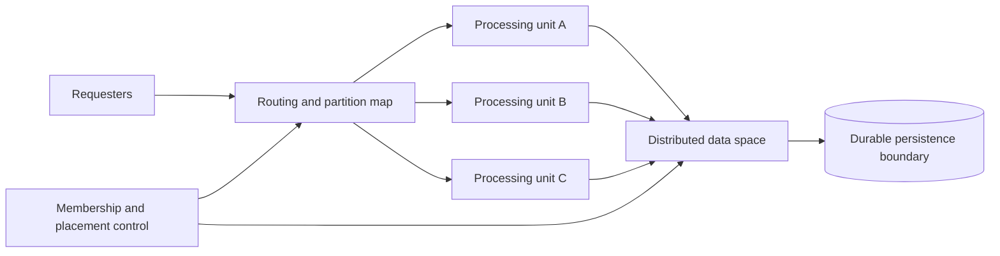
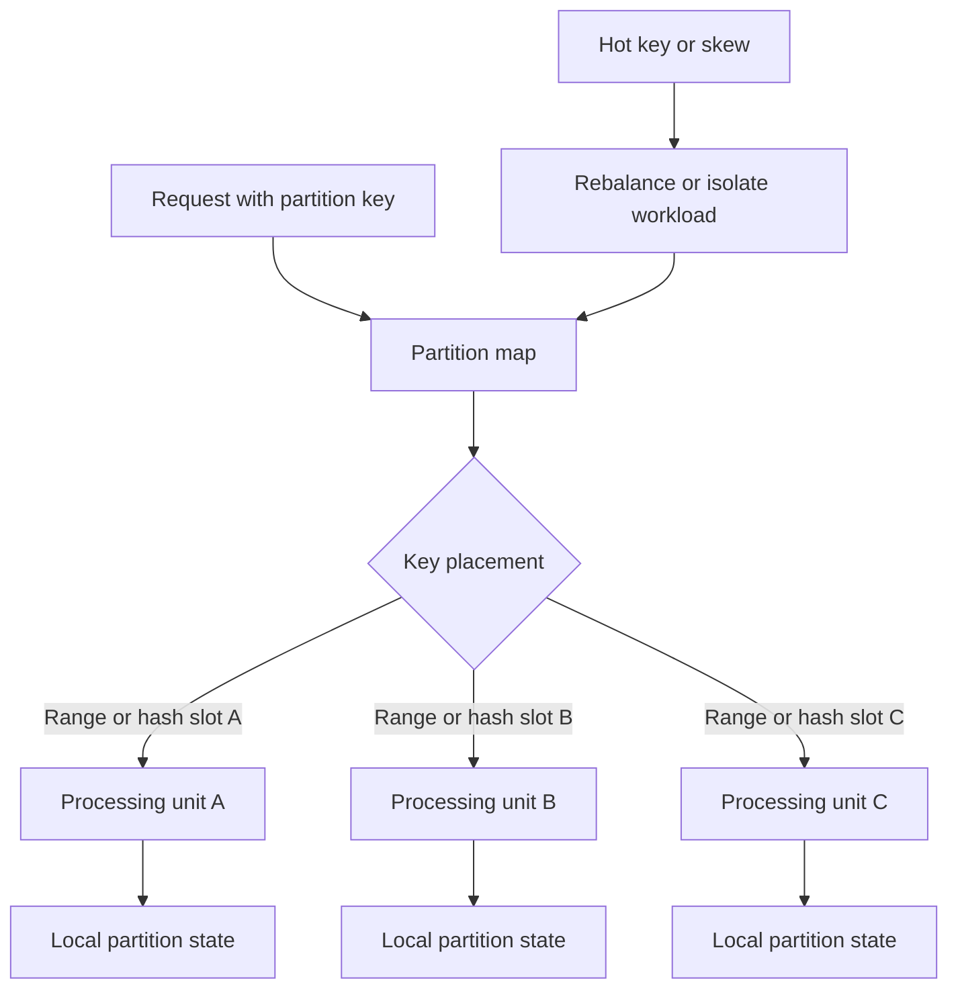
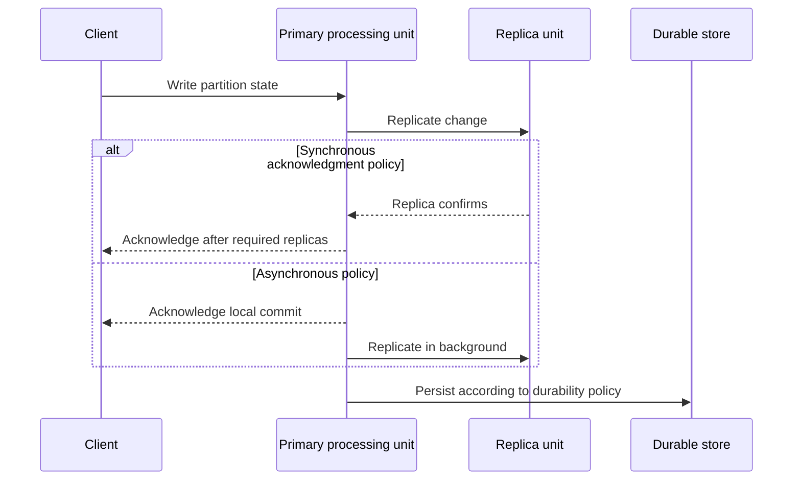
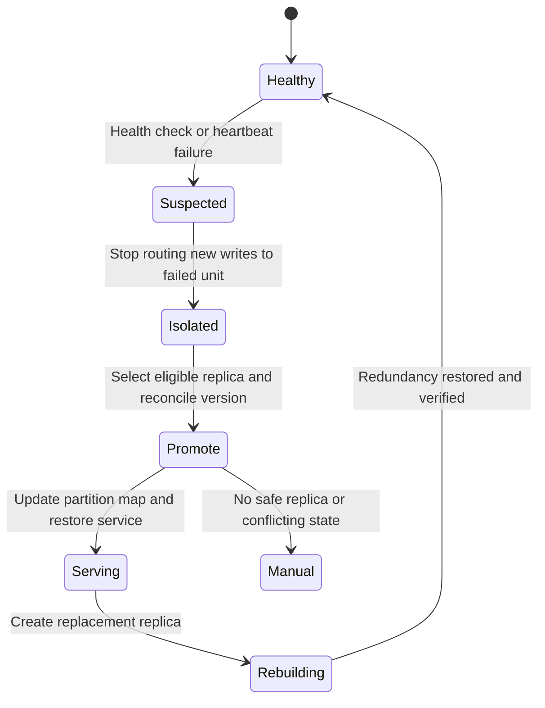
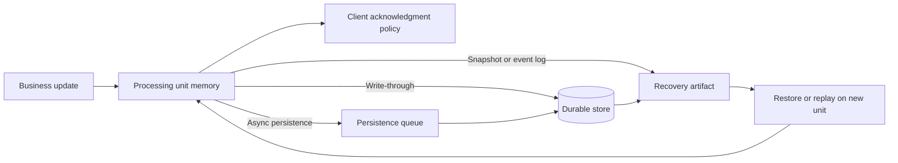

# Space-Based Architecture

Part: [20 — Architecture Patterns](PART_OVERVIEW.md)

Space-Based Architecture distributes processing and in-memory state across multiple units to handle high-volume workloads that would overwhelm a centralized database or application tier. It reduces shared bottlenecks by partitioning work and data, but introduces replication, consistency, placement, recovery, and persistence decisions. Part 06 owns database sharding; Part 07 owns replication and consistency theory.

## Compose Processing Units and a Data Space

A processing unit contains application logic and a share of in-memory data. Units can scale horizontally as demand grows. A data grid or replicated memory layer coordinates access and distribution. The pattern is most useful when the workload is partitionable and the system can operate with the chosen consistency and persistence model.

The processing unit should own the state it mutates, or the architecture must define coordination for shared records. A request router needs current placement information and a safe response when a target unit is unavailable. The data space is not automatically a strongly consistent database; state guarantees must match business needs.

## Partition Work and Place State

Partitioning assigns data and requests to units, often by tenant, account, or key. Good partition keys distribute load and keep related operations local. Hot keys, uneven tenants, and cross-partition transactions create skew and coordination. Rebalancing moves state and requires consistency and capacity planning.

Partition choice affects query patterns, tenant isolation, and migration. A key that evenly distributes current load may create expensive cross-partition reads later. Measure per-partition traffic, storage, and queueing; plan rebalancing before growth makes movement risky.

## Replicate Writes With Explicit Guarantees

Replication can improve availability and read locality but requires a policy for acknowledgment, ordering, conflicts, and stale reads. Synchronous replication adds latency and reduces availability during network partitions; asynchronous replication lowers write latency but can lose or delay acknowledged data under some failures. The pattern must name the required guarantee rather than say “replicated” as if it implied durability.

Define which reads may observe replica lag and how conflicting writes are resolved. A business workflow that cannot tolerate lost updates may require stronger coordination or a different storage choice. Part 07 owns the underlying consistency models.

## Recover From Unit or Grid Failure

Failure recovery requires detecting lost members, selecting a surviving copy, restoring routing, and rebuilding redundancy. A promoted replica may be stale or missing writes depending on the acknowledgment policy. Recovery should reconcile versions and prevent split-brain writes before admitting traffic.

Test failure detection delay, routing convergence, data-loss window, and recovery capacity. A system that can serve from one surviving unit but cannot rebuild redundancy may remain fragile after the first incident. Include backup restore and regional failure in recovery tests.

## Choose the Persistence Boundary

In-memory state can deliver low latency but is volatile. Persistence may be write-through, asynchronous, periodic snapshot, or reconstructed from an event log; each changes recovery time, write latency, and data-loss exposure. Keep durable system-of-record responsibilities explicit. Do not assume an in-memory grid eliminates the need for backups, retention, or reconciliation.

Document which acknowledged updates survive which failures. Persistence queues need backpressure and monitoring; snapshots need versioning and restore tests. If the recovery point or recovery time cannot meet the business objective, the in-memory-first design may be inappropriate.

## Worked Case: Flash-Sale Inventory Reservation

A retailer experiences extreme short-lived traffic spikes during flash sales. Inventory partitions by product and region. Processing units handle reservations close to the relevant inventory state, while a durable ledger records accepted reservations. A hot product receives a dedicated partition and admission limits prevent oversell beyond the business policy.

The design documents whether a reservation acknowledgment waits for durable persistence and how replica lag affects availability reads. When a processing unit fails, the router isolates it, promotes a replica only after version reconciliation, and rebuilds redundancy. Load tests include hot-key skew, scale-out, regional loss, persistence slowdown, and replayed requests. If the workload requires globally strict inventory ordering that the partition model cannot provide within latency limits, the team revisits the pattern rather than weakening correctness silently.

## Review Questions

1. Which workload properties make processing and state partitionable?
2. How does the partition key affect locality, skew, and cross-partition work?
3. What does a write acknowledgment guarantee under each replication policy?
4. How does failover prevent stale or conflicting state from accepting writes?
5. Which persistence mode meets the recovery objective?

Space-Based Architecture can absorb high volume when processing and state partition cleanly. Its benefits depend on explicit consistency and durability guarantees, careful hot-key management, tested recovery, and a persistence boundary that matches business loss tolerance.
