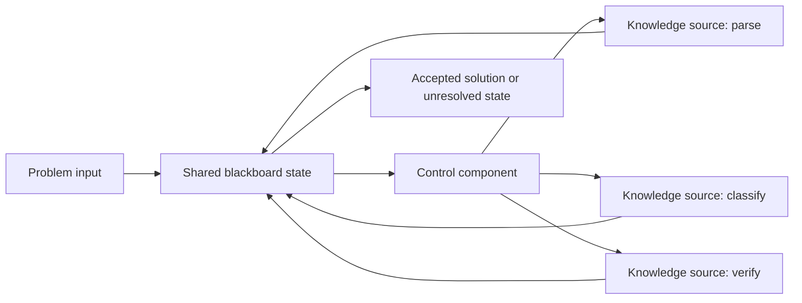
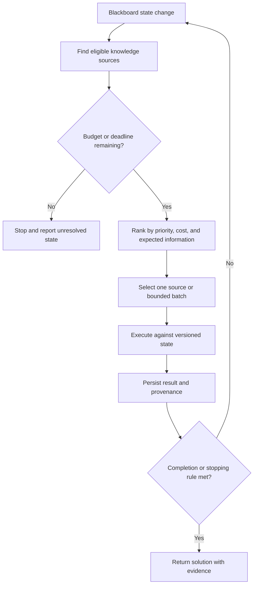
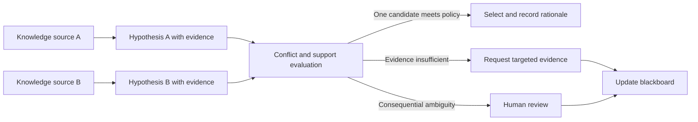
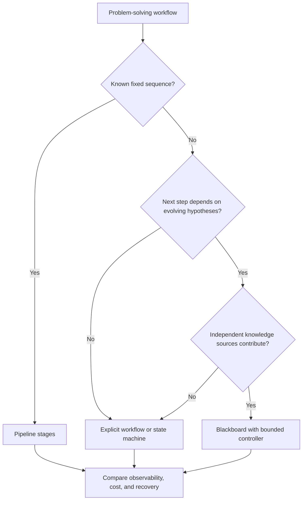

# Blackboard Pattern

Part: [20 — Architecture Patterns](PART_OVERVIEW.md)

The Blackboard Pattern coordinates independent knowledge sources through a shared state that evolves as partial solutions are discovered. A control component selects which knowledge source should act next. It fits problems where the solution is incremental, heuristic, and not known as a fixed linear sequence. Shared mutable state creates coupling and observability costs, so the pattern is not a general replacement for a pipeline or workflow.

## Organize Blackboard, Knowledge Sources, and Control

The blackboard stores the current problem state, hypotheses, evidence, and partial results. Knowledge sources inspect the state and contribute a transformation or finding. A controller determines which source is eligible and valuable to activate. The controller can be centralized or policy-driven, but its strategy must be observable and bounded.



Knowledge sources should declare their inputs, output types, preconditions, cost, and failure behavior. The blackboard needs ownership, versioning, access controls, and conflict rules. Without those contracts, sources can overwrite each other or repeatedly trigger work without progress.

## Update State and Activate Sources

Each source can become eligible when required evidence appears or a prior hypothesis changes. The controller evaluates eligible work, selects a source based on priority, expected value, or resource budget, and records the choice. Completion may require a confidence threshold, agreement among sources, or human review.

```mermaid
sequenceDiagram
    participant Controller
    participant Board as Blackboard
    participant Parser as Parsing source
    participant Classifier as Classification source
    Controller->>Board: Read current state and eligible tasks
    Controller->>Parser: Request structured parse
    Parser-->>Board: Add candidate entities and provenance
    Board-->>Controller: State changed; new tasks eligible
    Controller->>Classifier: Classify supported entities
    Classifier-->>Board: Add labels and confidence evidence
    Board-->>Controller: Re-evaluate completion criteria
```

Record the state version used by each source so stale work does not overwrite newer findings. Use deduplication and bounded activation to prevent repeated identical work. A failed source should record its failure without corrupting unrelated state.

## Choose a Control Strategy

Control can be opportunistic, rule-driven, cost-aware, confidence-aware, or human-directed. A purely event-triggered strategy is simple but can oscillate when sources invalidate each other. A priority queue offers fairness and budget control but needs a useful priority model. A deterministic workflow is preferable when the sequence is already known.



Define hard limits on iterations, elapsed time, memory, and external calls. Completion should depend on evidence and policy rather than a source claiming success. When the budget expires, report partial findings with uncertainty. Escalate or stop instead of looping indefinitely.

## Resolve Conflicting Hypotheses

Independent sources can disagree, produce overlapping candidates, or operate on incomplete evidence. Store provenance, confidence or quality evidence, and state version for each contribution. Conflict resolution may use domain rules, weighted evidence, additional knowledge sources, or human review. Do not silently overwrite a weaker hypothesis if that loses an audit-relevant alternative.



Conflict policy is domain-specific. For safety-critical or regulated results, disagreement may require abstention or human review. Keep the rejected alternatives and their evidence when needed to explain the final result.

## Choose Blackboard Over a Pipeline

A pipeline is preferable when stages and order are known. Blackboard is appropriate when the next useful step depends on evolving partial results and multiple independent sources can contribute. The pattern costs more in shared-state management, control logic, concurrency, and explanation. Use it only when dynamic collaboration among knowledge sources is material to the solution.



Avoid introducing a blackboard merely because several services write to a shared database. A blackboard is an explicit coordination model with evolving problem state and a control strategy, not any shared persistence layer.

## Worked Case: Medical Image Triage

A triage system combines image-quality assessment, anatomy localization, and candidate finding detectors. Each source adds evidence and provenance to a case blackboard. The controller schedules only sources applicable to the image and remaining budget, then checks whether findings meet the evidence threshold for escalation. Conflicting or low-confidence results go to a clinician; the system does not autonomously finalize a diagnosis.

The architecture versions each contribution, bounds processing time, and retains the evidence needed for review. If one detector is unavailable, the controller marks coverage as incomplete and routes to human review rather than treating absence of a finding as negative evidence. A fixed preprocessing sequence remains a pipeline; dynamic selection of follow-up detectors uses the blackboard.

## Review Questions

1. What state belongs on the blackboard, and who may update it?
2. How does the controller choose the next knowledge source?
3. Which conditions terminate processing safely?
4. How are conflicting hypotheses and stale contributions handled?
5. Why is a fixed pipeline not equivalent to a blackboard?

The Blackboard Pattern is useful when independent knowledge sources progressively refine an uncertain solution. Make shared state versioned and attributable, bound control and resource use, preserve conflicts, and choose a deterministic workflow when the sequence is already known.
