# Blackboard Pattern

Part: [20 — Architecture Patterns](PART_OVERVIEW.md) · Status: Revised (in-depth rewrite)

## 1. Introduction

Some problems have no known sequence of steps that reliably solves them. Interpreting a noisy signal, reading a degraded document, or fusing reports from several sensors into one picture of what is happening all share a feature: the input is ambiguous, no single technique is sufficient, and the next useful step depends on what has already been inferred. The Blackboard Pattern is an architecture for this class of problem. Independent specialists, called knowledge sources, read a shared store of partial results, add their own contributions, and a control component decides which specialist runs next. The solution emerges from many small, opportunistic contributions rather than from a pre-planned procedure.

For an engineer moving into architecture, the practical skill is recognising the narrow set of problems where this model fits and the larger set where it looks attractive but a simpler pattern is better. The pattern moves complexity into three places: the shape of the shared data, the logic that schedules specialists, and the rules for stopping. Each of those can fail in ways a pipeline cannot, so the decision to use it needs evidence.

This chapter owns the Blackboard Pattern: the problem it addresses, its three roles, its control strategies, conflict resolution and termination, and the concurrency behaviour of a shared blackboard. After the first part of the chapter you should be able to:

1. Describe the class of problem that has no deterministic solution strategy and explain why a fixed sequence of stages does not fit it.
2. Name the three roles (blackboard, knowledge source, control component) and state what each owns.
3. Trace one problem from raw input to an accepted solution and explain every scheduling decision.
4. Compare priority-based, agenda-based, and opportunistic control, and choose termination criteria that guarantee the system stops.
5. Reason about concurrent writers on a blackboard using locking, optimistic versioning, and event notification, with simple contention arithmetic.
6. Recognise modern systems that resemble the pattern without claiming they are the same thing.

The boundaries with neighbouring material are deliberate:

- The [Pipeline Pattern](CH13_Pipeline_Pattern.md) owns fixed-order stage processing. This chapter recaps it only to separate the two models.
- The [Actor Model](CH12_Actor_Model.md) owns isolated stateful entities that communicate only by messages. A blackboard is the opposite choice: its participants communicate through shared state.
- [Event-Driven Architecture](CH07_Event_Driven_Architecture.md) owns publish and subscribe event flows. This chapter uses event notification as one mechanism for waking knowledge sources and does not re-teach brokers or delivery guarantees.
- Agent design belongs to Part 16 and Part 17: [Agents, Tool Calling, Memory, and Planning](../16_AI_and_GenAI/CH21_Agents_Tool_Calling_Memory_Planning.md) and [Agentic System Architecture and Tool Boundaries](../17_AI_Architecture/CH06_Agentic_System_Architecture_and_Tool_Boundaries.md).

All numbers in this chapter are illustrative. They show how to reason and are not measurements of any real system.

## 2. The Problem Class: No Deterministic Solution Strategy

### 2.1 What makes a problem suitable

A deterministic solution strategy is a procedure that, given any valid input, reaches a correct answer by a known sequence of steps. Sorting, tax calculation, and format conversion have one. Many interpretation problems do not. A system reading an ambiguous input has several partial interpretations at once, each with some evidence, and the correct one is clear only after several kinds of knowledge have been applied to it.

Three properties together mark a blackboard-shaped problem:

1. **Uncertain or noisy input.** The raw data supports more than one reading. A smudged character could be two letters, a radar return could be a vehicle or clutter.
2. **Several kinds of knowledge contribute, and none is sufficient alone.** Lexical knowledge, grammar, physical constraints, and domain rules each narrow the possibilities. A specialist for one kind of knowledge cannot be written so that it needs the others' internals.
3. **The useful next step depends on the current partial solution.** If a date has been found, an amount extractor is more useful than another date search. If two readings of a word conflict, a grammar check becomes the best next action. The order cannot be fixed in advance because it depends on what the data turns out to contain.

When the first property is missing, a deterministic algorithm is available. When the second is missing, one component can do the work. When the third is missing, a pipeline or workflow is simpler and cheaper to reason about. The pattern earns its cost only when all three hold.

### 2.2 Incremental and opportunistic solving

Two terms describe how the problem is attacked. Solving is **incremental** because the solution is built up in many small steps, each adding or refining a hypothesis, rather than produced in one computation. Solving is **opportunistic** because the next step is chosen by looking at the current state and selecting the action with the best prospect, not by following a plan written beforehand. A system can pursue the most promising partial solution, abandon a line of reasoning when contrary evidence appears, and combine bottom-up reasoning (from data to interpretation) with top-down reasoning (from an expected interpretation to a check against data) in the same run.

The difference from a conventional program is where the control flow lives. In a procedure, the author fixes the order of steps. On a blackboard, the order is computed at run time from the data and from the rating each specialist gives its own readiness.

### 2.3 Why a fixed sequence does not fit

Consider reading an invoice image. A fixed pipeline might run text recognition, then field extraction, then classification. That works while the image is clean. When recognition output is ambiguous, the best remedy might be to re-run recognition on one region after extraction has told the system a currency amount is expected there. That is a backward step from a later stage to an earlier one, driven by a partial result. A pipeline can be extended with loops and branches to do this, but each such extension is an ad hoc piece of control logic. When these accumulate across many stages, the control logic is the real system, and the blackboard pattern names it, isolates it, and makes it a first-class component.

### 2.4 Forces

| Force | Pull toward a blackboard | Pull away from it |
| --- | --- | --- |
| Solution path unknown in advance | Control can adapt to the data | A known path is cheaper as a pipeline |
| Several expertise areas | Each specialist evolves and is tested alone | Specialists share a data vocabulary, so they are not fully independent |
| Uncertain data | Hypotheses carry confidence and are revised | Confidence values from different sources are hard to compare |
| Need to add or remove specialists | Specialists are added without changing others | The blackboard schema and trigger conditions must stay stable |
| Explainability | Provenance on every hypothesis shows how a result arose | Run-time order varies, so behaviour is harder to reproduce |
| Resource limits | Budgets are enforced in one control place | The controller must itself be cheap and correct |

The last column carries the cost of the pattern. A reviewer should require evidence that the first column dominates for the problem at hand.

## 3. Structure and Responsibilities

The pattern has three roles. Each has a narrow job, and the quality of the architecture depends on keeping those jobs separate.

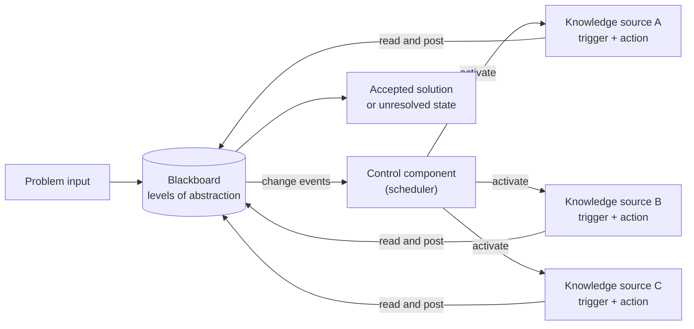

Knowledge sources never call each other. They communicate only by reading and writing the blackboard, and the control component is the only party that decides who runs. That is what lets a specialist be added, replaced, or removed without editing the others. The cost is that every specialist depends on the shape of the data on the board, which a later section treats as the main coupling risk.

### 3.1 The blackboard: a shared hypothesis store with levels

The blackboard is a structured, shared store of the problem's current state. Its contents are **hypotheses**: partial or complete interpretations, each with a value, a confidence or quality estimate, the identity of the specialist that proposed it, and a reference to the evidence it rests on. It also holds the raw input and, usually, the control information the scheduler needs.

Most blackboards divide the store into **levels of abstraction**. The lowest level holds raw data. Each higher level holds interpretations built from the level below. Specialists typically read hypotheses at one level and post hypotheses at another, so the levels give the system a vocabulary and a direction of inference.

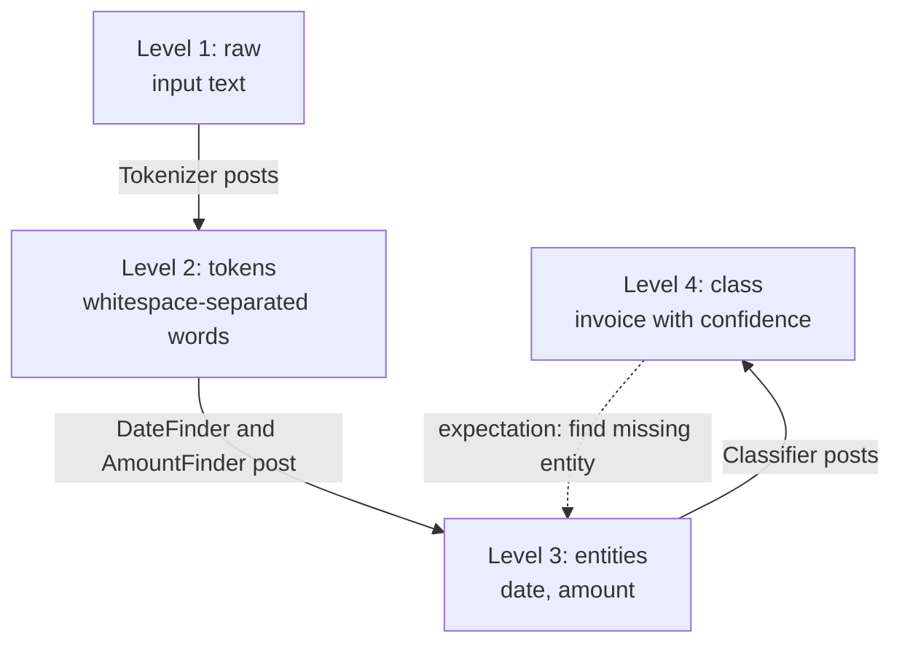

The solid arrows show bottom-up inference, where evidence at one level supports a hypothesis at the next. The dotted arrow shows top-down inference: a high-level hypothesis such as "this is an invoice" creates an expectation, so a specialist looks for a missing amount that the hypothesis predicts. Both directions use the same board and the same scheduler, which is why the pattern handles problems where reasoning must flow both ways.

The blackboard has responsibilities beyond storage:

- **A defined schema per level.** Hypothesis types, fields, and allowed relations are part of the architecture. They are the contract that specialists share.
- **Atomic posting.** A specialist's contribution is either entirely visible or not visible, so another specialist never reads half of a finding.
- **Provenance.** Each hypothesis records its author, the hypotheses it was derived from, and the board version it was based on. This supports explanation and the stale-work checks in the concurrency section.
- **Change notification.** The board tells interested parties that something changed at a given level, so nobody has to poll the whole store.
- **Access rules.** Which specialist may post at which level, and which may only read. Without this, one faulty specialist can corrupt another's inputs.

### 3.2 Knowledge sources: independent specialists

A knowledge source is a self-contained module that encapsulates one kind of expertise. Two parts define it:

- **Trigger condition (precondition).** A test over the blackboard that says whether the specialist has something to contribute now. It is evaluated by or for the controller and must be cheap and free of side effects. In the original literature the trigger often yields a rating of how promising an activation would be, not only a yes or no.
- **Action.** The work itself: read named hypotheses, compute, and post new or revised hypotheses. The action may be expensive.

Splitting trigger from action is deliberate. The controller evaluates many triggers per cycle but runs few actions, so a cheap trigger keeps scheduling cost low. A knowledge source should also declare the levels it reads, the levels it writes, an estimated cost, and what happens on failure. A source that fails records the failure on the board or in the control log and posts nothing, so that unrelated hypotheses are not corrupted.

Independence has a precise meaning here. Sources do not call each other, do not share memory other than the board, and can be developed, tested, and deployed separately. They are not independent of the board's schema. A test for a knowledge source is therefore a function from a fixture board to a set of posted hypotheses, which makes it straightforward to unit test.

Sources may be heterogeneous. One may be a rule set, another a statistical model, another a call to an external service. The board's contract hides these differences, provided every contribution carries comparable confidence evidence.

### 3.3 The control component: deciding who acts next

The control component, often called the scheduler, owns the question "which activation runs next, and when do we stop". It observes board changes, determines which knowledge sources are eligible, ranks the eligible activations, executes one or a bounded batch, and checks the termination criteria. It does not contain domain knowledge about the problem. It contains knowledge about scheduling: ratings, budgets, fairness, and stopping rules.

This separation is the pattern's central design decision. Domain experts change specialists. Control engineers change the scheduler. A system whose scheduler hard-codes "run the date finder, then the amount finder" has become a pipeline in disguise, and has lost the property that justified the pattern.

The controller must also be observable. Every decision (the eligible set, the ranking, the choice, the reason) should be logged, because without that log the run-time order is impossible to reproduce or explain.

## 4. Origin: The Hearsay-II Speech-Understanding System

The pattern comes from artificial intelligence research on speech understanding. Hearsay-II was a speech-understanding system built at Carnegie Mellon University in the 1970s, in the context of the Advanced Research Projects Agency (ARPA) Speech Understanding Research programme. It is described in Erman, Hayes-Roth, Lesser, and Reddy, "The Hearsay-II Speech-Understanding System: Integrating Knowledge to Resolve Uncertainty" (ACM Computing Surveys, 1980). The paper is the usual starting point for the term, and H. Penny Nii's articles on blackboard systems in AI Magazine (1986) are a common survey. The software-architecture form of the pattern was later catalogued in Buschmann and colleagues, Pattern-Oriented Software Architecture, Volume 1 (1996), which names the three roles used in this chapter.

Three ideas from Hearsay-II carry into the general pattern, and this chapter states only these:

- Speech was interpreted at several levels of abstraction, from low-level acoustic description up through units such as syllables and words to phrases. Specialists for different kinds of knowledge posted hypotheses at these levels on a shared store.
- Because the acoustic signal is ambiguous, no single level could be resolved in isolation. Higher-level expectations helped decide between lower-level readings, and the reverse.
- A scheduling mechanism chose which pending activation to run, based on estimates of how promising it was. That separation of domain specialists from a scheduler is the origin of the control component.

The historical context matters for judging fit. The original problem had very ambiguous input, expensive search, and many types of knowledge. Most enterprise problems do not look like that, which is the first reason to be careful before adopting the pattern for ordinary integration work.

## 5. How a Problem Is Solved End to End

This section follows one small problem through the board. The input is the line `Invoice due 2026-11-30 total $120.50`. The goal is to classify it as an invoice with confidence of at least 0.7. Four knowledge sources exist:

| Knowledge source | Reads | Posts | Trigger rating |
| --- | --- | --- | --- |
| Tokenizer | raw | tokens | 10 when raw exists and no tokens exist |
| DateFinder | tokens | date | 5 when tokens exist and no date exists |
| AmountFinder | tokens | amount | 5 when tokens exist and no amount exists |
| Classifier | date, amount | class | 3 when both a date and an amount exist and no class exists |

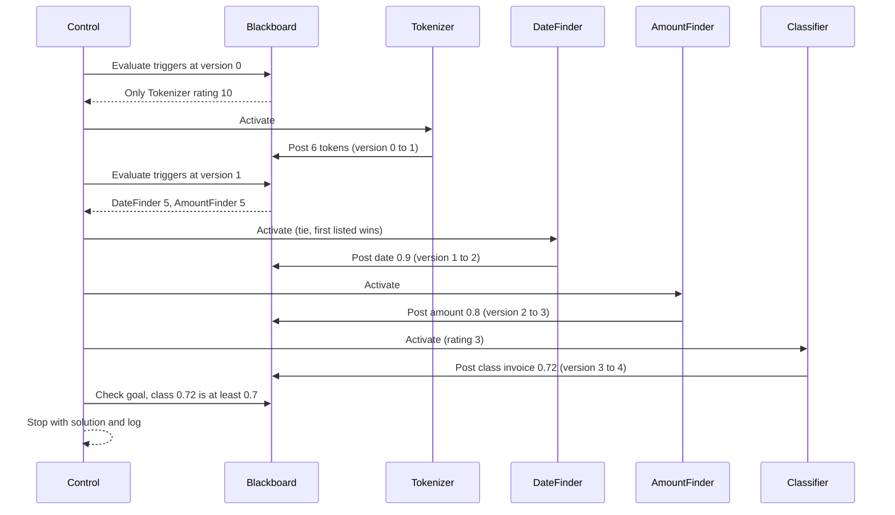

Reading the trace shows several properties of the pattern:

- **The order was computed, not coded.** Nothing says "tokenize, then date, then amount, then classify". The Tokenizer ran first only because it was the sole eligible source at version 0. The Classifier ran last only because its trigger needs both entities. Change the input so that no amount is present and the Classifier never becomes eligible, with no change to any code.
- **Ties need a rule.** DateFinder and AmountFinder both rated 5. The scheduler resolved the tie by list order, which is deterministic and reproducible. A tie rule that depends on hash order or thread timing would make runs impossible to compare.
- **Every step increments the version.** The version recorded at each activation is how the controller later detects that a result was computed against a state that has since changed.
- **The solution carries its evidence.** The class hypothesis has a confidence of 0.72 because the Classifier combined the date confidence of 0.9 and the amount confidence of 0.8 by multiplying them, which is one simple, illustrative way to combine independent evidence. The product rule is a choice. A real system must justify its combination rule for the domain, because confidences from different sources are rarely calibrated to one another.
- **Termination was evidence-based.** The run stopped because a hypothesis met an explicit acceptance threshold, not because a specialist declared itself finished.

### 5.1 When a trigger finds nothing

Suppose the input is `Invoice due soon total $120.50`. The Tokenizer and AmountFinder run as before. DateFinder is eligible (tokens exist, no date), runs, finds nothing, and posts nothing. The board version does not change, and its trigger still says "tokens exist and no date exists". If the controller simply re-evaluated, it would select DateFinder forever. This is the non-terminating control failure that a later section on failure modes treats in more detail. The standard defence is for the controller to remember which source was run at which board version, and not to re-run the same source against an unchanged board. The code example later in the chapter implements exactly this check.

The run ends with no agenda entries left and no accepted solution. The correct output in that case is an unresolved state that reports the evidence found (tokens and an amount), the source that found nothing, and the missing hypothesis. Returning a low-confidence guess as though it were an answer would hide the gap from the caller.

## 6. Control Strategies

The control component repeats one cycle: observe the board, find eligible activations, rank them, run the chosen one, and check whether to stop. Strategies differ in how they rank and in how much state the controller keeps.

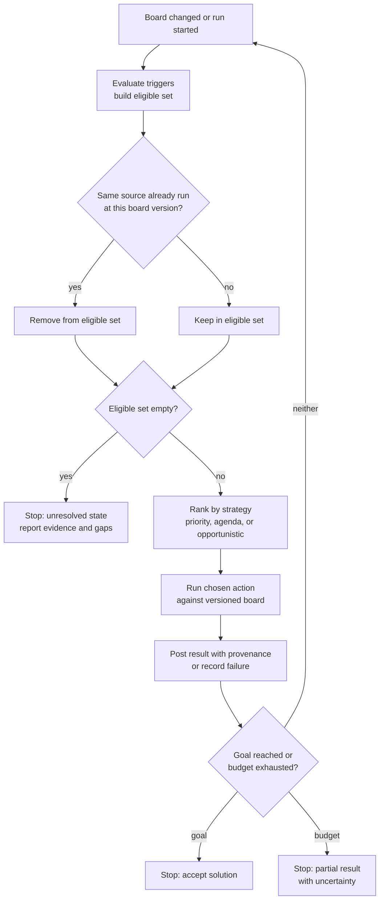

The diagram has three exits: success, an empty agenda with no solution, and budget exhaustion. A controller that lacks any of them can run forever or return a result without saying why it stopped. The duplicate check on the way in is the guard against the non-terminating case from the previous section.

### 6.1 Priority-based control

In priority-based control, each knowledge source carries a priority, either fixed at design time or computed by its trigger. The controller always runs the eligible source with the highest priority. The invoice example uses this form: the Tokenizer rates 10, the finders 5, the Classifier 3.

Strengths are simplicity and predictability. The ranking is a single number, the trace is easy to read, and a unit test can assert which source wins in a given board state. The weaknesses are equally direct:

- **Starvation.** A high-priority source that keeps becoming eligible can prevent lower-priority sources from ever running. Aging (raising a waiting source's priority over time) or per-source activation caps address this.
- **Static priority ignores the data.** A fixed number cannot express that this particular amount hypothesis is much more promising than that one.
- **Priorities encode a hidden order.** If priorities are chosen so that the sources always run in one sequence, the system is a pipeline with extra machinery.

### 6.2 Agenda-based control

In agenda-based control, the controller keeps an explicit list of pending activations. Each entry pairs a knowledge source with the specific hypotheses that triggered it, so one source may have several entries, one for each hypothesis it could act on. The controller picks from the agenda, and the entries are re-rated when the board changes.

This is closer to the form used in classic blackboard systems, where a rating is computed for each pending activation from factors such as the confidence of its stimulus hypothesis, the expected value of its action, and its cost. The mechanics are as follows:

1. When a hypothesis is posted, the controller creates agenda entries for every source whose trigger matches it.
2. Each entry receives a rating from a scoring function. A simple function is `rating = expected_value * stimulus_confidence / cost`.
3. The controller runs the highest-rated entry and removes it from the agenda.
4. Entries whose stimulus hypothesis was superseded or retracted are pruned, so the system does not act on stale reasons.

Agenda control spends effort per entry rather than per source, which is where it gets its precision. It can pursue the best of three competing date hypotheses rather than treating the source as one unit. The cost is the scoring function. Estimating expected value is a modelling task, and a poor estimate produces effort on the wrong lines of reasoning, exactly as a poor heuristic does in any search.

### 6.3 Opportunistic control

Opportunistic control is the general idea that the next action is chosen from the current state instead of from a plan. Priority-based and agenda-based control are both opportunistic in that sense. The term is also used for a stricter style in which the controller considers the whole state, including which hypotheses are most credible or most in conflict, and picks the action with the best prospect of advancing the solution, even if that means switching between lines of reasoning.

Practical forms include:

- **Focus on the most credible hypothesis.** Extend the best current partial solution until it succeeds or its confidence falls, then switch to the next.
- **Resolve the biggest conflict first.** If two hypotheses at one level disagree and a higher-level hypothesis depends on them, run a source that can discriminate between them.
- **Drive by goal.** Start from an expected high-level hypothesis, then look for the evidence it predicts (top-down). This is the dotted arrow in the levels diagram.

The benefit is flexibility. The cost is that behaviour depends on a heuristic the author must understand and tune, and runs for different inputs may take very different paths. That makes testing and capacity planning harder than with fixed priorities.

### 6.4 Comparison

| Aspect | Priority-based | Agenda-based | Opportunistic (state-driven) |
| --- | --- | --- | --- |
| Controller state | Source priorities | Pending activation list with ratings | Whole board plus a heuristic over it |
| Granularity | Per source | Per source and trigger hypothesis | Per line of reasoning |
| Predictability | High | Medium | Lower |
| Typical failure | Starvation, hidden pipeline | Bad rating function | Thrashing between lines of reasoning |
| Test approach | Assert winner for a fixture board | Assert agenda order for a fixture board | Scenario runs with logged decision traces |
| Use when | Few sources, clear urgency order | Many hypotheses compete for effort | Search-like problems with strong top-down knowledge |

A sound default is to start with priority-based control, add agenda entries when a single source needs to act on many hypotheses with different promise, and move to state-driven control only when logged runs show that simpler ranking wastes effort. Each step up adds tuning work that must be justified.

## 7. Conflict Resolution and Termination

### 7.1 Where conflicts come from

Independent specialists will disagree. Two sources may propose different values for the same slot, one may propose a hypothesis that another's finding contradicts, or two may produce overlapping candidates that cannot both hold. Conflicts are normal in this pattern, because they are how ambiguity shows up, and a design that treats them as errors will discard useful alternatives.

The board therefore models a hypothesis as an object with a lifecycle and not as a field that is overwritten.

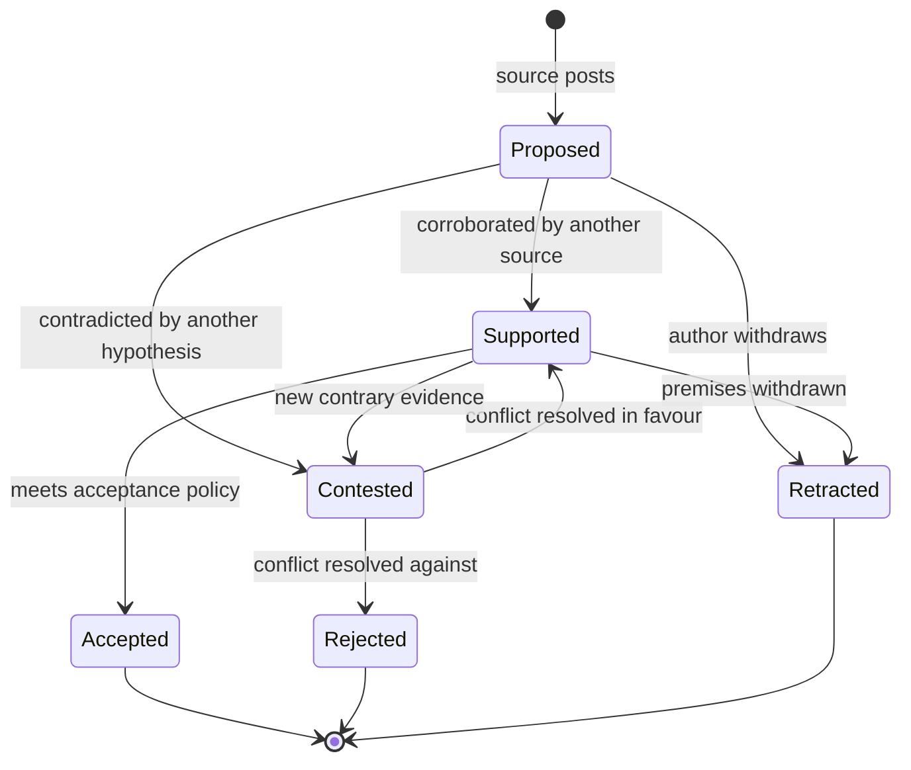

Rejected and retracted hypotheses stay on the board, marked as such, with the reason. That keeps the audit trail and prevents a source from proposing the same rejected value repeatedly, since its trigger can check for a prior rejection. A Retracted state also matters for dependencies: when a lower-level hypothesis is withdrawn, higher-level hypotheses built on it lose their support and must be re-examined.

### 7.2 Resolution policies

The conflict policy is a domain decision with a few standard forms:

1. **Highest confidence wins.** Simple, and sound only if confidences are comparable across sources. Check calibration before relying on it.
2. **Weighted evidence.** Combine support from several sources, with weights reflecting each source's historical reliability. This needs data on that reliability.
3. **Dedicated arbiter source.** A knowledge source whose trigger is "two hypotheses conflict at level N" and whose action posts a ruling or requests more evidence. This keeps arbitration inside the pattern, visible and testable.
4. **Targeted evidence request.** Raise the rating of sources that can discriminate between the candidates. This is the opportunistic response.
5. **Human review.** When a wrong decision is costly, route the conflict to a person with the competing hypotheses and their evidence.
6. **Abstention.** Report that the problem is unresolved. In safety-sensitive uses, an honest "cannot decide" is better than a confident error.

A conflict worked in numbers (illustrative): two sources read the same region of a document. Source P reports the characters "5O" with confidence 0.55, source Q reports "50" with confidence 0.60. Highest-confidence-wins picks Q, but the margin is 0.05. A policy that requires a margin of at least 0.15 before accepting would classify this as unresolved and trigger an arbiter, for example a source that checks whether a numeric field is expected at that position. If the arbiter posts "numeric expected" with 0.95, the weighted support for "50" rises and the conflict resolves. The margin threshold is a tunable control parameter, and the way to choose it is by measuring error rates against labelled cases.

### 7.3 Termination criteria

Termination answers two separate questions: when is a solution good enough, and when must the system stop whether or not it has one. A controller needs both.

- **Acceptance criterion.** A predicate over the board, such as "a class hypothesis with confidence at least 0.7 exists", "the top-level hypothesis covers all of the input", or "no unresolved conflicts remain at level 3 and the best hypothesis exceeds the threshold". The criterion lives in the controller or a configured policy and is stated in terms of evidence. A knowledge source claiming "done" is not an acceptance criterion.
- **Budget limits.** Maximum number of activations, elapsed time, total cost of external calls, and board size. Each is a hard stop.
- **Quiescence.** The eligible set is empty, so nothing more can be done. If no solution was accepted, this is an unresolved result.
- **No-progress detection.** If the last K activations did not raise the best hypothesis's confidence or add any new hypothesis, stop. This catches loops among sources that keep invalidating each other.

Termination should be proven for the controller by argument and tested by adversarial fixtures. A simple argument is a bounded measure: if every activation either adds a hypothesis of a type from a finite set, or is recorded as run at a version, and there is a hard cap on activations, the run must stop. The cap is the backstop for what the argument misses.

When the budget ends the run, return the partial state: the best hypotheses, the confidence of each, the conflicts left open, and the budget consumed. The caller can then decide whether to escalate, retry with a larger budget, or accept a partial answer.

## 8. Concurrency on a Shared Blackboard

The examples so far ran one activation at a time. That is correct and often sufficient, and it should be the starting point. Concurrency is added when specialists are slow (model inference, external calls) and independent activations can overlap. Once two activations run at once, the board is shared mutable state, and every standard hazard of shared state applies: lost updates, stale reads, and writers that invalidate each other.

### 8.1 The hazard

Two activations, A and B, both read the board at version 7. A computes a date hypothesis and posts it, producing version 8. B, working from version 7, computes a conclusion that assumed no date existed and posts it. If the board accepts B's post, the board now holds a conclusion built on a premise that A just falsified. Nothing crashed, and the data is inconsistent. The pattern needs an explicit rule for such cases.

### 8.2 Three mechanisms

**Locking.** The simplest approach is a lock around the board. Two granularities matter:

- A single exclusive lock held for the whole activation (read, compute, post). It is correct and serialises everything, so concurrency is lost.
- A readers-writer lock held only while reading and while posting. Computation runs outside the lock. It allows parallel computation but not a guarantee that the premise is still valid at posting time, so by itself it does not prevent the stale-conclusion hazard.

**Optimistic versioning.** The board keeps a version counter. An activation records the version it read, computes without holding any lock, and posts with a compare-and-set: the post succeeds only if the version is unchanged. If it changed, the post is rejected and the controller re-evaluates triggers against the new state, because the original reason for the activation may no longer hold. This gives the stale-work protection that the provenance field was designed for. The version can be global, per level, or per hypothesis. Narrower versions mean fewer false conflicts but more bookkeeping, and a source must declare the read set it depends on so the board can check exactly that set.

**Event notification.** Instead of every source polling the board, the board publishes change events labelled with the level and hypothesis type, and sources subscribe to the ones their triggers depend on. This reduces trigger evaluation work and gives the controller a natural queue of "something changed" signals. It is a wake-up mechanism and does not by itself give consistency. A subscriber that reacts to an event still needs optimistic or locked posting. For event delivery in general, see [Event-Driven Architecture](CH07_Event_Driven_Architecture.md).

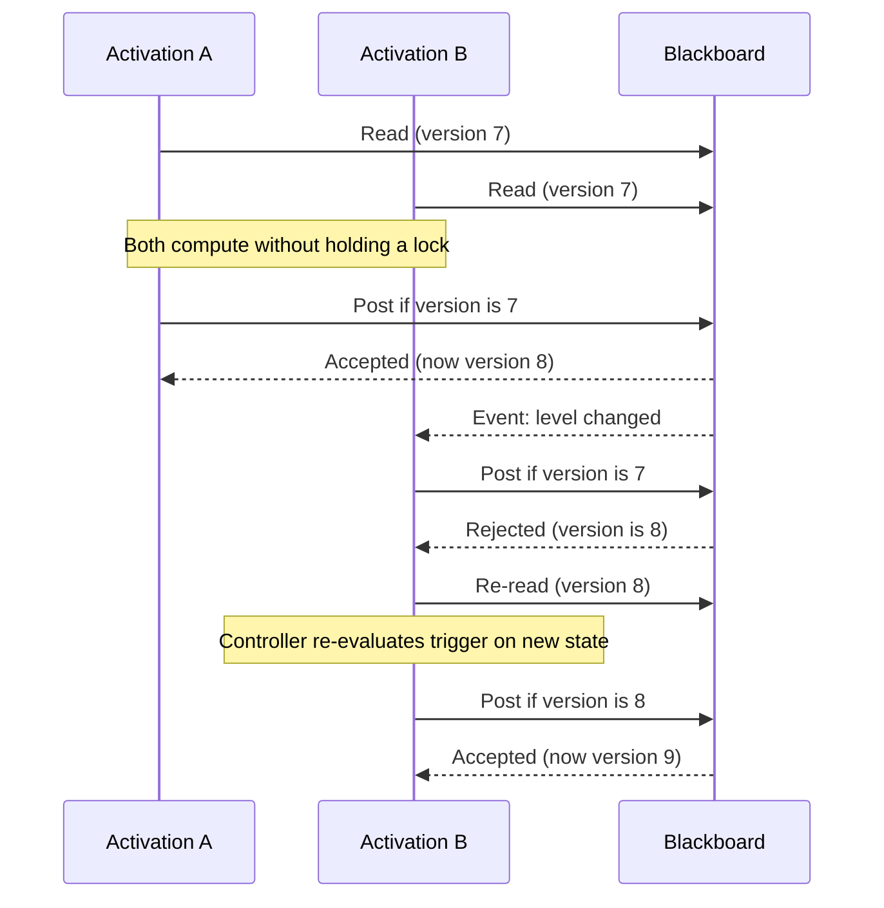

The diagram shows why the rejection is part of the design and not a failure. B's first computation was wasted, but the board never held a conclusion that rested on an outdated premise. The re-evaluation step is essential: after a rejection, the controller must ask again whether B still has anything to contribute, not simply repeat B's earlier action.

### 8.3 Contention arithmetic (illustrative)

Assume the controller allows several activations in flight. Each activation reads the board, computes for 40 ms, then spends 2 ms posting. Demand is 50 activations per second. These numbers are made up to show the method.

**Exclusive lock for the whole activation.** Each activation holds the lock for 40 + 2 = 42 ms. Maximum throughput is 1 / 0.042 ≈ 23.8 activations per second. Demand of 50 per second gives utilisation 50 / 23.8 ≈ 2.1, which is above 1, so the queue grows without bound. Adding workers does not help, because the lock is the bottleneck.

**Optimistic, one global version.** An activation conflicts if any other post commits during its 40 ms compute window. Commits arrive at about 50 per second, so the expected number of intervening commits is 50 × 0.040 = 2.0. Treating commits as random arrivals, the chance of none is e^(-2.0) ≈ 0.135. So about 13.5% of attempts succeed, and the expected number of attempts per success is 1 / 0.135 ≈ 7.4. To deliver 50 successful posts per second the system performs about 50 × 7.4 ≈ 370 computations per second, of which about 320 are discarded.

**Optimistic, one version per level, four levels with load spread evenly.** Conflicting commits now come only from the same level: 50 / 4 = 12.5 per second. Expected intervening commits in a 40 ms window: 12.5 × 0.040 = 0.5. Success probability e^(-0.5) ≈ 0.607. Attempts per success: 1 / 0.607 ≈ 1.65. Computation rate: 50 × 1.65 ≈ 82 per second, of which about 32 are discarded.

**Declared read sets.** If an activation conflicts only when a hypothesis it actually read has changed, the conflict rate falls further, since most commits touch hypotheses the activation never read. The saving depends on how overlapping the read sets are, which has to be measured.

| Strategy | Capacity or success rate | Computations per second for 50 posts | Main limit |
| --- | --- | --- | --- |
| Exclusive lock for whole activation | 23.8 per second maximum | Cannot sustain 50 | Lock held during computation |
| Optimistic, global version | 13.5% success | about 370 | Wasted computation |
| Optimistic, version per level | 60.7% success | about 82 | Level coupling of work |
| Optimistic, declared read sets | Depends on overlap | Between 50 and 82 in this example | Bookkeeping, correctness of declarations |

The model is a first approximation. It treats commits as random arrivals and ignores that rejected attempts add retry load, and that real work is bursty. Its value is directional: whole-board coordination across slow computations collapses at moderate load, and narrowing the unit of conflict is the main lever. A real system should measure conflict rate and wasted computation as board metrics.

### 8.4 Design consequences

1. **Keep the posting critical section short.** Do computation outside the lock, validate and apply under it.
2. **Make the unit of versioning match the unit of dependency.** Per-level or per-hypothesis versions track what activations actually depend on.
3. **Cap concurrent activations.** More workers raise conflict rate and wasted work, so the cap is a tuning parameter tied to conflict metrics.
4. **Keep the scheduler single-writer.** Concurrent knowledge sources are acceptable. Concurrent schedulers share the agenda and create a second layer of the same problem, so use one controller per board, or partition boards by problem instance.
5. **Prefer one board per problem instance.** Boards for different cases do not share state, so they scale out by running many boards in parallel and the contention above applies only within one case.

## 9. A Minimal Implementation

The following Python program implements the invoice example from the end-to-end section: a versioned board, four knowledge sources with trigger ratings, and a priority-based scheduler with a duplicate check, an acceptance threshold, and an activation cap. It is a teaching sketch, single-threaded, with no persistence.

```python
import re
from dataclasses import dataclass


@dataclass(frozen=True)
class Hypothesis:
    level: str
    value: object
    confidence: float
    source: str


class Blackboard:
    def __init__(self, text):
        self.version = 0
        self.items = [Hypothesis("raw", text, 1.0, "input")]

    def at(self, level):
        return [h for h in self.items if h.level == level]

    def post(self, hyps, read_version):
        if read_version != self.version:
            return False  # stale: caller must re-evaluate
        if hyps:
            self.items.extend(hyps)
            self.version += 1
        return True


class Tokenizer:
    name = "tokenizer"

    def rating(self, bb):
        return 10 if bb.at("raw") and not bb.at("token") else 0

    def act(self, bb):
        text = bb.at("raw")[0].value
        return [Hypothesis("token", t, 1.0, self.name) for t in text.split()]


class DateFinder:
    name = "date_finder"

    def rating(self, bb):
        return 5 if bb.at("token") and not bb.at("date") else 0

    def act(self, bb):
        return [Hypothesis("date", t.value, 0.9, self.name)
                for t in bb.at("token")
                if re.fullmatch(r"\d{4}-\d{2}-\d{2}", t.value)][:1]


class AmountFinder:
    name = "amount_finder"

    def rating(self, bb):
        return 5 if bb.at("token") and not bb.at("amount") else 0

    def act(self, bb):
        return [Hypothesis("amount", t.value, 0.8, self.name)
                for t in bb.at("token")
                if re.fullmatch(r"\$\d+(\.\d{2})?", t.value)][:1]


class Classifier:
    name = "classifier"

    def rating(self, bb):
        ready = bb.at("date") and bb.at("amount")
        return 3 if ready and not bb.at("class") else 0

    def act(self, bb):
        conf = bb.at("date")[0].confidence * bb.at("amount")[0].confidence
        return [Hypothesis("class", "invoice", conf, self.name)]


def run(bb, sources, accept=0.7, max_steps=20):
    done = set()  # (source name, board version) pairs already run
    for step in range(max_steps):
        goal = [h for h in bb.at("class") if h.confidence >= accept]
        if goal:
            return goal[0], step
        agenda = [(ks.rating(bb), ks) for ks in sources
                  if (ks.name, bb.version) not in done]
        agenda = [(r, ks) for r, ks in agenda if r > 0]
        if not agenda:
            return None, step  # quiescence, unresolved
        _, ks = max(agenda, key=lambda pair: pair[0])
        seen = bb.version
        bb.post(ks.act(bb), seen)
        done.add((ks.name, seen))
    return None, max_steps  # budget exhausted


sources = [Tokenizer(), DateFinder(), AmountFinder(), Classifier()]
print(run(Blackboard("Invoice due 2026-11-30 total $120.50"), sources))
print(run(Blackboard("Invoice due soon total $120.50"), sources))
```

The first run returns the invoice hypothesis with confidence about 0.72 after four activations, matching the trace shown earlier. In the second run the Tokenizer runs, then DateFinder finds nothing and posts nothing, then AmountFinder posts an amount and the version advances. The new version makes DateFinder eligible once more, because the board changed since it last looked, so it runs a second time and again finds nothing. It is then recorded at that version and not run again. No other source is eligible, so the agenda is empty and the controller returns an unresolved result after four activations.

Points to notice in the code:

- `post` takes the version the activation read. In this single-threaded program it never fails, and it is there to show where the compare-and-set sits in a concurrent version.
- `done` is the guard against non-terminating control. Without it, the second input would loop on DateFinder until `max_steps`.
- Knowledge sources hold no references to each other. Adding a CurrencyChecker means appending one object to `sources`.
- The sources do share the vocabulary `"token"`, `"date"`, and `"amount"`. That shared vocabulary is the coupling through data shape discussed in the failure-modes material later in the chapter.

## 10. Modern Analogues

Several current system designs resemble the blackboard pattern. The resemblance is structural, and each design differs in guarantees and in how much of the pattern it actually uses. This section states the correspondences carefully and does not claim that any particular product is a blackboard system.

### 10.1 Multi-agent systems

Multi-agent systems consist of several autonomous agents, each with its own capabilities, working toward a shared goal. Some designs coordinate agents through a shared workspace that holds the current task state, intermediate results, and decisions, with agents reading and writing it. That matches the blackboard and knowledge-source roles. Other multi-agent designs coordinate through direct messages between agents, which matches the [Actor Model](CH12_Actor_Model.md) more closely, since the agents hold private state and communicate only by messages. The distinguishing question is where coordination state lives: in a shared store that every participant reads, or in the messages between participants.

### 10.2 Data fusion and signal interpretation

Data-fusion systems combine reports from several sensors or feeds into one estimate of a situation, for example combining position reports from different sources into tracks. Signal-interpretation systems, such as the speech and sensor-analysis systems that motivated the pattern, label ambiguous data at increasing levels of abstraction. These problems have the blackboard properties from the problem-class section: noisy input, several kinds of knowledge, and uncertainty that is resolved by combining evidence. In production fusion systems the shared store is often a track database or situation model, and the scheduling is often fixed by sensor arrival, so the control component may be much simpler than the classic form.

### 10.3 Large language model agent designs with shared memory

Large language model (LLM) agent systems commonly keep a shared state that several components read and update: a task list, working notes, retrieved documents, tool results, and partial drafts. When several specialised agents or tool-calling steps are selected by a coordinating component based on that state, the arrangement has the shape of a blackboard: a shared hypothesis store, specialists with preconditions, and a controller choosing the next action. The mapping is conceptual and hedged for three reasons:

- Many LLM agent systems have one model that plans and calls tools in a loop, so there are no independent knowledge sources with separate trigger conditions.
- The shared state is often an unstructured text context and not a store with typed levels, versions, and per-hypothesis provenance.
- The controller is often the model itself, whose choices are not a rated, logged agenda, so the strong observability properties of the classic pattern do not automatically hold.

The blackboard vocabulary is still useful for review. It prompts the questions of who may write the shared state, how stale or conflicting contributions are handled, what stops the loop, and how a decision is explained afterwards. Those questions are as relevant to agent systems as to the original pattern. Agent planning, memory, and tool boundaries are taught in [Agents, Tool Calling, Memory, and Planning](../16_AI_and_GenAI/CH21_Agents_Tool_Calling_Memory_Planning.md), and the trust and tool boundaries for such systems are covered in [Agentic System Architecture and Tool Boundaries](../17_AI_Architecture/CH06_Agentic_System_Architecture_and_Tool_Boundaries.md). Those chapters own the agent mechanisms, and this chapter only supplies the shared-state coordination view.

### 10.4 What the analogues have in common

| Analogue | Shared store | Specialists | Control | Usual gap against the classic pattern |
| --- | --- | --- | --- | --- |
| Shared-workspace multi-agent system | Task and result workspace | Agents with distinct skills | Coordinator agent or rules | Weak versioning and conflict rules |
| Data fusion | Track or situation database | Sensor and correlation modules | Often fixed by arrival order | Little opportunistic scheduling |
| Signal interpretation | Multi-level hypothesis store | Domain rule and model modules | Rated agenda | Closest to the classic form |
| LLM agent with shared state | Context, notes, task list | Tools and sub-agents | Often the model itself | Unstructured state, unlogged control |

A designer who adopts one of these should check the right-hand column. The value of the pattern depends on its disciplines of versioning, bounded control, and attributable state, and an analogue that lacks them gets the coupling cost without the benefit.

## 11. Choosing Blackboard Over a Pipeline or Other Patterns

A pipeline is preferable when stages and order are known. A blackboard is appropriate when the next useful step depends on evolving partial results and several independent sources can contribute. The pattern costs more in shared-state management, control logic, concurrency, and explanation, so the choice needs criteria that can be checked against evidence and not a preference for flexibility.

### 11.1 Decision criteria

Ask the following questions in order. A "no" at any point sends the design to a simpler pattern.

1. **Is the sequence of steps known and stable?** If a fixed order handles almost every input, use a pipeline. The [Pipeline Pattern](CH13_Pipeline_Pattern.md) owns stage composition, back-pressure, and per-stage scaling, and each of those is easier to reason about than a scheduler.
2. **Does the next step depend on partial results?** If the variation is a small number of branches known at design time, a workflow with explicit branches or a state machine is enough. The variation has to be open-ended for a scheduler to pay off.
3. **Do several independent kinds of knowledge contribute?** If one component can do the work, put it behind one interface. Independence has to be real: separate owners, separate release cycles, or separate technologies.
4. **Is uncertainty central, so that hypotheses compete and carry confidence?** If every step produces a definite answer, ordinary orchestration suffices.
5. **Can the organisation operate it?** The pattern needs a stable board schema, a decision log, replay tooling, and people who can tune a scheduler. If those are not affordable, the pattern will degrade into an unmaintainable pipeline.

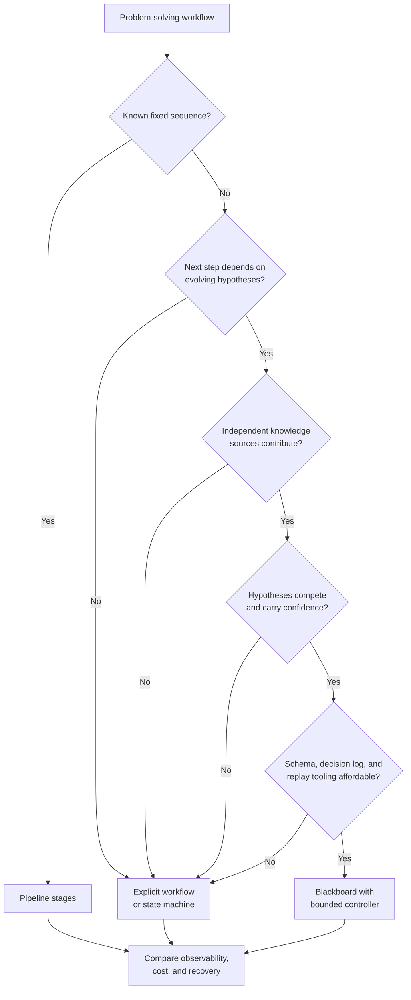

The flowchart routes four of its five exits away from the blackboard. That is intended: the pattern is the answer for a narrow region of problems, and each earlier exit is a cheaper design that should be tried first. Avoid introducing a blackboard merely because several services write to a shared database. A blackboard is an explicit coordination model with evolving problem state and a control strategy, not any shared persistence layer.

### 11.2 Worked comparison from labelled cases (illustrative)

A team builds a document reader with six specialists. Before choosing, it replays 1,000 labelled documents through a prototype and records the order in which specialists were useful. The figures below are illustrative.

| Observed activation order | Documents | Share |
| --- | --- | --- |
| Order 1: the straight sequence of all stages | 880 | 88% |
| Order 2: sequence with one re-read of a region after extraction | 90 | 9% |
| Three other orders, each with a different backward step | 30 | 3% |

A plain pipeline handles order 1 only: 880 of 1,000, or 88%. A pipeline with one conditional re-read stage handles orders 1 and 2: 880 + 90 = 970, or 97%. The remaining 30 documents (3%) can be routed to manual handling. A blackboard would handle all 1,000, at the cost of a scheduler, a board schema, and replay tooling.

The decision turns on the 3% tail. If a manual route for 30 in 1,000 documents is acceptable, the pipeline with one conditional loop is the better design. If those documents are the costly ones (for example, they carry the highest value or the highest risk) and new backward steps keep appearing as inputs change, the blackboard is justified. The point of the exercise is to take the decision from measured activation orders and not from how the problem feels.

### 11.3 Comparison with neighbouring patterns

| Aspect | Blackboard | Pipeline ([CH13](CH13_Pipeline_Pattern.md)) | Actor model ([CH12](CH12_Actor_Model.md)) | Event-driven ([CH07](CH07_Event_Driven_Architecture.md)) | Workflow or state machine |
| --- | --- | --- | --- | --- | --- |
| Coordination medium | Shared hypothesis store | Ordered hand-off between stages | Private state and messages | Published events | Explicit transitions |
| Who decides the next step | Controller from board state | The pipeline definition | Each actor on receiving a message | Each subscriber reacting to events | The workflow definition |
| Handles uncertain, competing results | Designed for it | Poorly, needs added loops | Possible, but conflicts live in messages | Possible, no shared view of the solution | Poorly |
| Reproducing a run | Needs a decision log and versioned board | Easy, order is fixed | Needs message logs and ordering | Needs event log and ordering | Easy |
| Coupling | Through board schema | Through stage contracts | Through message contracts | Through event contracts | Through the workflow |
| Typical failure | Starvation, thrashing, schema drift | Stage bottleneck | Mailbox growth, lost messages | Duplicate and out-of-order events | State explosion |
| Operating cost | Highest | Lowest | Medium | Medium | Low to medium |

Two clarifications keep the table honest. First, the patterns combine. A common shape is a pipeline for known preprocessing, a blackboard for the uncertain interpretation step, and events to deliver the result downstream. Second, the Actor Model and a blackboard answer different questions: actors isolate state, so no participant can see another's, while a blackboard exists so that every specialist can see the whole partial solution.

### 11.4 Relation to agent systems

Agent systems resemble a blackboard when several specialised components read and update shared task state under a coordinating component. The choice questions above apply to them with the same force: is the sequence really open-ended, who may write the shared state, and what stops the loop. Agent planning and memory are taught in [Agents, Tool Calling, Memory, and Planning](../16_AI_and_GenAI/CH21_Agents_Tool_Calling_Memory_Planning.md), and tool boundaries and trust in [Agentic System Architecture and Tool Boundaries](../17_AI_Architecture/CH06_Agentic_System_Architecture_and_Tool_Boundaries.md). This chapter contributes only the coordination vocabulary of versioned, attributable shared state with a bounded controller. Where an agent loop uses one model to plan and call tools, a simple workflow with a step limit is often the right comparison, and the evidence test in the previous subsection applies in the same way.

## 12. Testing and Debugging a Blackboard System

The run-time order of a blackboard varies with the data, which makes ordinary example-based tests insufficient. Four techniques restore control: layered tests, a deterministic controller, a decision trace that can be replayed, and per-hypothesis provenance.

### 12.1 Test layers

1. **Knowledge-source tests.** Each source is a function from a fixture board to a set of posted hypotheses. Tests assert the trigger rating on boards where it should and should not fire, and the exact hypotheses posted. These are fast and numerous.
2. **Controller tests.** Fixture boards with known eligible sets assert the winner under each strategy, tie handling, aging, duplicate suppression, and every termination exit (goal, budget, quiescence, no progress). The controller contains no domain knowledge, so it can be tested with stub sources that post fixed hypotheses.
3. **Scenario tests.** Whole runs on labelled inputs assert the final board and an acceptable range of activations. They catch interactions between sources that unit tests cannot.
4. **Adversarial tests.** Sources that post nothing, post the same value repeatedly, contradict each other, fail, or hang. These tests prove the termination argument from the termination section.
5. **Concurrency tests.** Stale-post rejection and re-evaluation under controlled interleavings, using a fake clock and a fake executor so that the interleaving is chosen by the test and not left to timing.

### 12.2 Determinism

A run is deterministic when the same input, the same source versions, and the same configuration produce the same decision trace. Sources of non-determinism have to be removed or recorded:

- **Tie-breaking.** Use a stable key (source name, then hypothesis identifier), never hash order or arrival order.
- **Time.** Inject a clock. Budgets expressed in wall-clock time vary between runs, so tests use an activation budget and production adds the time budget as an additional guard.
- **Random numbers.** Seed them from the case identifier and record the seed in the trace.
- **Models and external services.** A model update or a changing remote service changes outputs. Record the model version in each hypothesis, and in tests substitute recorded responses.
- **Concurrency.** Parallel activations commit in timing-dependent order. For replay, record the commit order, and have the replay controller apply posts in that order.

Where full determinism is not affordable, aim for the weaker property of replayability: given the recorded trace, the system reconstructs every board version and every decision, even if a fresh run might choose differently.

### 12.3 The control trace and replay

The control trace is an append-only log with one record per cycle. Each record holds the case identifier, board version, eligible set with ratings, the selected activation and the reason, the source and model versions, the posts made or the failure recorded, and the stop decision if any.

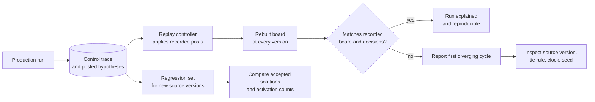

Replay serves two purposes. For debugging, it reconstructs the exact board a controller saw when it made a surprising choice, and the first diverging cycle identifies the cause. For regression, archived traces become a test set: when a source or the scheduler changes, rerun the archived inputs and compare accepted solutions, unresolved rates, and activation counts. A change that raises the average activation count from 25 to 40 on the same inputs is a performance regression even when answers are unchanged.

### 12.4 Observability of knowledge-source firing

The controller log answers what happened. Metrics show the system's health over time, and four views are worth building:

- **Firing counts per source.** A source that never fires is dead weight or has a broken trigger. A source that fires on nearly every cycle may have a trigger that is too permissive.
- **Contribution rate.** The share of activations that posted at least one hypothesis, and the share of those hypotheses that ended up in an accepted solution. A source with high cost and a near-zero contribution rate is a candidate for removal.
- **Outcome mix.** The proportions of runs ending in accepted, unresolved, and budget-exhausted. A rise in budget-exhausted runs is an early signal of looping or of a source slowing.
- **Conflict and rejection rate.** Stale-post rejections, contested hypotheses, and arbiter invocations per case.

### 12.5 Provenance of hypotheses

Every hypothesis records its author, source version, the hypotheses it was derived from, the board version, and any model version. This gives a debugging query that is hard to answer in other architectures: for a wrong accepted solution, walk the derivation graph from the solution back to raw data, and find the first hypothesis that was wrong. Whether that first wrong hypothesis came from a faulty source, a bad combination rule, or poor input quality determines whether the fix is in a source, in the control policy, or upstream. Provenance also supports the dependency re-examination described for retracted hypotheses, because the graph says which higher-level hypotheses rested on the withdrawn one.

## 13. Security and Data Classification on a Shared Store

A shared store concentrates data and makes every source a potential reader of everything. Specialists with very different trust levels, such as an in-house rule set and a third-party model service, work on the same board, so the pattern needs explicit trust boundaries.

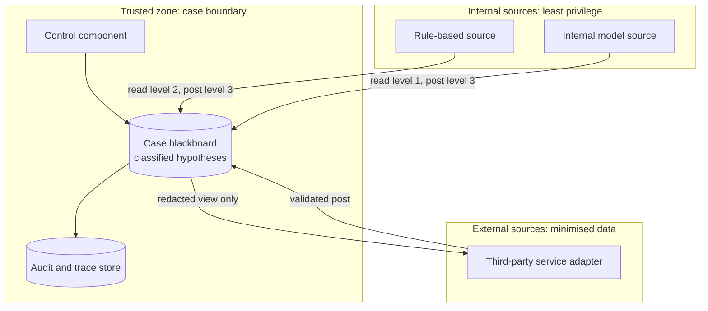

The diagram shows three zones. The controller and board sit together inside the case boundary. Internal sources receive only the levels they are declared to read. The external adapter receives a redacted view and its posts pass through validation before they reach the board.

### 13.1 Controls to design in

1. **Data classification per hypothesis.** Each hypothesis carries a classification label, and derived hypotheses inherit the highest label among their premises. Raw input at the lowest level is usually the most sensitive, and a higher-level hypothesis such as a class label may be less so. Do not assume a derived value is less sensitive than its sources without a stated rule.
2. **Per-source access control.** Role-based access control (RBAC) at the level of the board: each source is granted read access to named levels and write access to named levels and types. A source that posts at a level it is not allowed to write is rejected and the attempt is logged.
3. **Write validation.** The board validates schema, value ranges, and a per-source confidence cap. A new or lightly trusted source cannot post a confidence of 1.0 and win every conflict. Provenance fields are set by the board, never by the source.
4. **Redacted views for external sources.** Give an external service only what it needs, such as a cropped region or a derived feature, and record exactly what was sent.
5. **One board per case or tenant.** Cases do not share a store, so there is no path for one case's hypotheses to reach another's sources. This also bounds the blast radius of a faulty source.
6. **Trace and retention.** The control trace contains hypotheses and therefore inherits the highest classification on the board. Apply the same retention, encryption, and access rules to it, and decide deliberately how long replay needs it.
7. **Poisoned or manipulated inputs.** An attacker who controls raw input may craft it to make a source post misleading hypotheses. Defences are the confidence caps above, requiring corroboration from an independent source before acceptance, and acceptance policies that do not rely on a single source for high-impact conclusions.

### 13.2 Residual risks

A compromised source with legitimate write access to a level can still post plausible false hypotheses. Corroboration rules, anomaly checks on a source's contribution rate, and human review for high-impact outcomes limit the harm but do not remove it. State this in the design review so that the accepted residual risk is a recorded decision.

## 14. Performance and Scaling

The concurrency section covered contention on one board. This section covers per-cycle cost, per-case cost, and scale-out across cases. All numbers are illustrative.

### 14.1 Scheduler overhead

Suppose the system has 40 knowledge sources and evaluates every trigger each cycle at 25 microseconds per trigger. A cycle then costs 40 × 25 = 1,000 microseconds, or 1 ms. If the average action takes 30 ms, the scheduling share is 1 / (30 + 1) ≈ 3.2% of each cycle. That is acceptable. If actions average 2 ms, the share is 1 / 3 ≈ 33%, and scheduling dominates.

Event notification lowers this cost. If only the sources subscribed to the changed level are evaluated, and that is 8 of 40, a cycle costs 8 × 25 = 200 microseconds. The saving is real only if the subscription lists are correct. A missed subscription means a source is not woken when it should be, which is a correctness bug and not a performance bug, so tests must include "source eligible but not woken" cases.

### 14.2 Per-case cost and the activation cap

A case that averages 25 activations at 30 ms each takes 25 × 30 = 750 ms of serial work. An activation cap of 60 bounds the worst case at 60 × 30 = 1,800 ms, or 1.8 seconds, plus scheduling overhead. The cap therefore doubles as a latency guarantee, and its value should be derived from the latency budget divided by the typical activation time, not guessed.

### 14.3 Scale-out across cases

Because one board is used per case, the system scales by running many cases in parallel, with each case executed serially or with a small cap on concurrency. Suppose a node runs 16 case workers and each case takes 0.75 s. Throughput is 16 / 0.75 ≈ 21.3 cases per second per node. With demand of 120 cases per second and 30% headroom, the target is 120 × 1.3 = 156 cases per second, which needs 156 / 21.3 ≈ 7.3, so 8 nodes. By Little's law, in-flight cases per node equal throughput times duration, 21.3 × 0.75 = 16, matching the number of workers. At 2 MB of board per case, that is 32 MB of board memory per node, which is small compared with the cost of the sources themselves.

### 14.4 Trace volume

The decision log has a cost of its own. At 300 bytes per record and 25 records per case, a case writes 7,500 bytes, or 7.5 KB. At 120 cases per second over 86,400 seconds, the system handles 10,368,000 cases per day. That is 10,368,000 × 7.5 KB = 77,760,000 KB, about 77.8 GB of trace per day. Plan retention and storage tiers for this figure, sample traces for successful cases if policy allows, and keep full traces for unresolved and budget-exhausted runs.

### 14.5 What to measure

Track the activation count per case (mean and 95th percentile), time per activation by source, scheduler overhead share, stale-post rejection rate, board size, and the outcome mix. Revisit the contention arithmetic when the rejection rate rises, and revisit the activation cap when the 95th percentile approaches it.

## 15. Failure and Quality-Attribute Scenarios

Each scenario gives the stimulus, the expected response, and a success criterion that can be measured. The thresholds are illustrative design targets, not measured results.

| Scenario | Stimulus | Expected response | Success criterion |
| --- | --- | --- | --- |
| Non-terminating control | A source is eligible every cycle but posts nothing | Duplicate check suppresses re-run at an unchanged version, then quiescence is reported | 100% of adversarial fixtures terminate within the activation cap, and the result is marked unresolved |
| Source failure | A source throws an error or times out mid-activation | Failure is recorded, nothing is posted, other sources continue, coverage is marked incomplete | No partial hypotheses on the board, and the outcome carries a coverage flag in 100% of injected failures |
| Source unavailable for a whole run | An external service is down | Controller skips the source, records the gap, and does not treat absence as negative evidence | Final result lists the missing source, and no acceptance depends on it |
| Conflicting hypotheses | Two sources disagree with a margin below the policy threshold | Arbiter runs, and if still unresolved the case is routed to review with both hypotheses | No case is accepted with a margin below the threshold, and review packets contain both sets of evidence |
| Stale post under concurrency | Two activations read the same version | The second post is rejected, and the controller re-evaluates its trigger | Zero accepted posts built on a superseded premise in the concurrency test suite |
| Schema drift | A source changes the type it posts | Board validation rejects the post and logs the source version | Rejected within one cycle, with an alert, and no downstream source reads the malformed value |
| Budget exhaustion | Input is pathological and the cap is reached | Partial state is returned with best hypotheses and consumed budget | Response time within the budget plus one activation, and the outcome flagged as budget-exhausted |
| Replayability | A production case needs explanation | Trace reconstructs the board at every version | Replay of 100% of sampled traces reproduces the recorded decisions, or reports the first diverging cycle |
| Source addition | A new source is deployed | It appears in a shadow mode first, with its posts recorded but not accepted | No change in accepted solutions on the archived regression set until it is enabled, and a measured contribution rate afterwards |

These scenarios double as acceptance tests. A design that cannot state a measurable criterion for a row has not yet decided how it will behave in that situation.

## 16. Worked Case: Medical Image Triage

This case study applies the chapter to one hypothetical organization. Northvale Imaging Network is an illustrative organization with three outpatient sites. It wants a decision-support tool that orders incoming imaging studies for human review. Nothing here is a clinical claim: the system does not diagnose, it orders and annotates work for clinicians, and every figure is invented to show the method.

### 16.1 Requirements and constraints

- Volume is 1,800 studies per day, with the busiest hour carrying 15% of the day: 1,800 × 0.15 = 270 studies, or 4.5 per minute.
- Each study must have a prioritised annotation within 20 seconds of arrival.
- The tool never finalises a result. Findings below an evidence threshold, conflicting findings, and incomplete coverage all go to a clinician.
- Every annotation must be explainable: which sources contributed, in what order, with what evidence.
- Image data is highly sensitive, and no image leaves the organisation's network.

### 16.2 Architecture

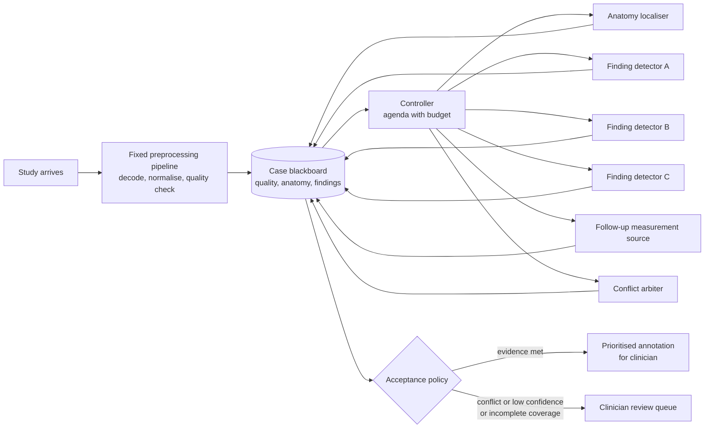

Preprocessing stays a pipeline, because its order is fixed and every study passes through it. The blackboard begins after the quality check. The localiser posts the anatomical region. Detectors apply only to relevant regions. A finding posted by a detector can trigger the follow-up measurement source, and that dependence on partial results is the reason a controller is justified for this phase.

### 16.3 Time and compute arithmetic

Per-source times are illustrative: quality check 1 s (in the pipeline), localiser 2 s, each detector 4 s of graphics processing unit (GPU) time, arbiter 0.5 s.

- **Worst case, all three detectors run:** 1 + 2 + 3 × 4 + 0.5 = 15.5 s, which is within the 20 s budget with 4.5 s of slack.
- **Typical case, an average of 1.5 detectors applicable:** 1 + 2 + 1.5 × 4 + 0.5 = 9.5 s.
- **GPU load at the peak:** 4.5 studies per minute × 9.5 s = 42.75 GPU-seconds per minute, which is 42.75 / 60 ≈ 0.71 of one GPU. The worst case of 4.5 × 15.5 = 69.75 GPU-seconds per minute would be 1.16 GPUs, so two GPUs are needed, giving 69.75 / 120 ≈ 0.58 utilisation even if every study were worst case. (The quality-check second is counted here as GPU time for simplicity.)
- **Activation cap:** with a 20 s budget and a worst-case source time of 4 s, the cap is set at 10 activations per case, which is more than the 6 to 7 expected, and the time budget acts as the binding limit.

### 16.4 Decisions and rejected alternatives

| Decision | Alternatives rejected | Reason |
| --- | --- | --- |
| Pipeline for preprocessing, blackboard for finding interpretation | A single blackboard for everything | Preprocessing order is fixed, so a scheduler adds cost with no benefit (decision criterion 1) |
| Same split rather than a pure pipeline running all detectors | Pipeline with all detectors every time | Always running all three costs 15.5 s for every study. Routing by anatomy would also save time in a pipeline, so the saving alone does not justify the blackboard. The case rests on follow-up sources being triggered by earlier findings and on conflicts between detectors |
| Agenda-based control | Priority-based control | Several candidate regions compete for detector time, so per-hypothesis ratings matter |
| One board per study | A shared board for all studies | Isolates data, bounds blast radius, and avoids cross-case contention |
| Abstain and route to a clinician when coverage is incomplete | Treat a missing detector as no finding | Absence of evidence from an unavailable source is not evidence of absence |
| Margin threshold of 0.15 between competing findings | Highest confidence wins | Confidences from different detectors are not calibrated against each other, so small margins are not trusted |

### 16.5 Conflict handling

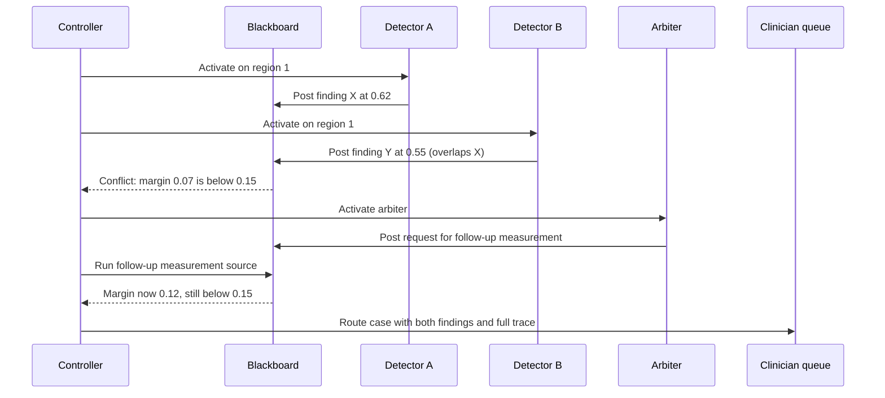

The diagram shows a conflict that the system does not resolve by itself. The margin after the follow-up measurement is 0.12, which is still below 0.15, so the policy sends the case to a clinician with both findings and the trace. The failure to resolve is the intended outcome.

### 16.6 Review workload

Suppose that on the labelled validation set 12% of cases route to review for conflict, low confidence, or incomplete coverage. On 1,800 studies per day, 1,800 × 0.12 = 216 cases are queued. At 2 minutes of added clinician time per annotated case, that is 216 × 2 = 432 minutes, or 7.2 hours, per day across the three sites. This figure is the main operating cost, and it tells the organisation that lowering the review rate must be measured against error rates and not adopted as a target by itself.

### 16.7 Validation evidence required

The case study states the evidence the design must produce before use, not results already obtained:

1. **Termination:** 100% of 500 archived, de-identified studies terminate within the activation cap and 20 s budget, including adversarial fixtures.
2. **Replay:** at least 99% of sampled traces replay to identical decisions, and every divergence has an identified cause.
3. **Failure injection:** with each detector disabled in turn, 100% of affected cases are marked incomplete and routed to review.
4. **Conflict policy:** no case with a margin below 0.15 is accepted automatically.
5. **Security:** a test confirming that no raw image reaches a source outside the network boundary, and that traces carry the highest classification.
6. **Clinical evaluation:** performed separately by qualified clinical reviewers under the organisation's governance. This chapter makes no claim about clinical accuracy.

## 17. Common Mistakes and Anti-Patterns

| Anti-pattern | Cause | Consequence |
| --- | --- | --- |
| Hidden pipeline | Priorities chosen so sources always run in one order | A scheduler's cost with none of its benefits, and surprise when one priority change reorders the system |
| Shared database called a blackboard | Several services writing to one store with no controller or hypothesis model | Coupling through data without coordination, conflicts, or termination |
| No termination proof | Only a goal condition is defined | Runs that loop or never finish, found in production |
| Overwriting instead of preserving hypotheses | Treating conflicts as errors | Lost alternatives, no audit trail, and repeated proposals of rejected values |
| Domain logic in the controller | Convenience during early development | The scheduler becomes the real system, and domain experts cannot change behaviour without editing it |
| Schema drift | No ownership of the board vocabulary | Sources break silently as types change |
| Uncalibrated confidence comparison | Treating scores from different sources as one scale | Wrong winners in conflicts, with misplaced trust in the results |
| Missing decision log | Logging only inputs and outputs | Runs cannot be explained or reproduced |
| Unbounded concurrency | Adding workers to cut latency | Rising stale-post rejection and wasted computation |
| Choosing the pattern for flexibility alone | No measured activation orders | Operating cost without evidence that it is needed |

## 18. Design-Review Checklist

1. Is there evidence, such as measured activation orders, that a pipeline or workflow is insufficient?
2. Is the board schema documented per level, with an owner and a change process?
3. Does every hypothesis carry author, source version, premises, board version, and confidence?
4. Does each source declare its read levels, write levels, cost, and failure behaviour?
5. Are the control strategy, tie rule, and starvation defence specified?
6. Are acceptance, budget, quiescence, and no-progress stops all implemented, with a termination argument?
7. Are conflict policy, margin thresholds, and arbitration defined, and is calibration of confidences checked?
8. Is posting protected against stale reads, and is the unit of versioning matched to the unit of dependency?
9. Can any run be replayed from the trace, and is the trace classified and retained appropriately?
10. Are access control, write validation, confidence caps, and redacted views for external sources in place?
11. Are the scenarios in the failure table testable, with measured criteria?
12. Is the unresolved and partial outcome meaningful to the caller, and is there a human route where the cost of an error is high?

## 19. Exercises

1. **Choose.** A team proposes a blackboard for a nightly report builder with eight fixed steps. Apply the decision criteria. *Outline:* sequence is fixed, so criterion 1 selects a pipeline. Mention a workflow if branches are needed.
2. **Compute the tail.** In a replay of 2,000 cases, 1,700 follow order A and 220 follow order B, which is order A plus one re-read. What does a pipeline with one conditional loop cover? *Outline:* 1,700 + 220 = 1,920, which is 96%. The 80 remaining cases are 4%, and the decision depends on their cost.
3. **Find the loop.** A source posts nothing but stays eligible. Describe two defences and their limits. *Outline:* the duplicate check by source and version, and a no-progress rule over K activations. Mention the hard cap as the backstop.
4. **Contention.** Compute success probability for an optimistic post with a 30 ms compute window and 40 commits per second on one global version. *Outline:* expected commits are 40 × 0.030 = 1.2, success is e^(-1.2) ≈ 0.30, so about 3.3 attempts per success.
5. **Conflict policy.** Two sources report 0.58 and 0.66 for different values. A margin of 0.10 is required. What happens, and what could resolve it? *Outline:* margin is 0.08, so unresolved. Options are an arbiter, a targeted evidence request, or human review.
6. **Trace storage.** At 400 bytes per record, 30 records per case, and 50 cases per second, how much trace is written daily? *Outline:* 400 × 30 = 12,000 bytes per case. Cases per day are 50 × 86,400 = 4,320,000. Total is 4,320,000 × 12,000 bytes = 51,840,000,000 bytes, about 51.8 GB.
7. **Security review.** A third-party service source needs access to a board containing sensitive raw input. Propose controls. *Outline:* redacted view, write validation with a confidence cap, corroboration before acceptance, audit of data sent, one board per case.
8. **Agent comparison.** An agent loop uses one model that plans and calls tools. Is it a blackboard? *Outline:* conceptually similar only if there are independent sources, shared typed state, and a logged controller. Otherwise compare it with a workflow with a step limit, and refer to the agent chapters.

## 20. Summary

The Blackboard Pattern suits problems with uncertain input, several kinds of knowledge, and a next step that depends on partial results. The summary below maps the chapter back to the outcomes listed in the Introduction.

| Introduction outcome | Where covered | Key point |
| --- | --- | --- |
| 1. Problem class and why a fixed sequence fails | Sections 2 and 11 | Three properties together, and measured activation orders as evidence |
| 2. The three roles | Section 3 | Board, knowledge sources, and a controller that holds no domain knowledge |
| 3. Tracing a problem end to end | Sections 5, 9, and 16 | The order is computed from the data, and every decision is logged |
| 4. Control strategies and termination | Sections 6 and 7 | Start simple, preserve conflicts, and bound every run |
| 5. Concurrent writers | Sections 8 and 14 | Optimistic versioning with matched granularity, and contention arithmetic |
| 6. Modern analogues | Sections 10 and 11.4 | Structural resemblance, with the disciplines of the pattern as the test |

Beyond those outcomes, treat testing, replay, security, and operating cost as part of the pattern and not as later additions. Make shared state versioned and attributable, bound control and resource use, preserve conflicts, and choose a deterministic workflow when the sequence is already known.
