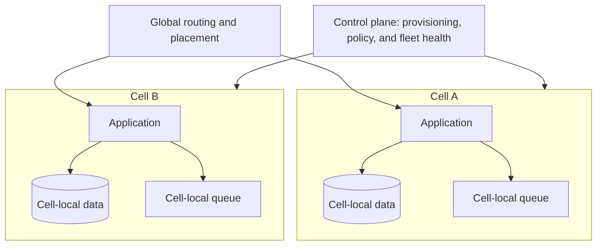
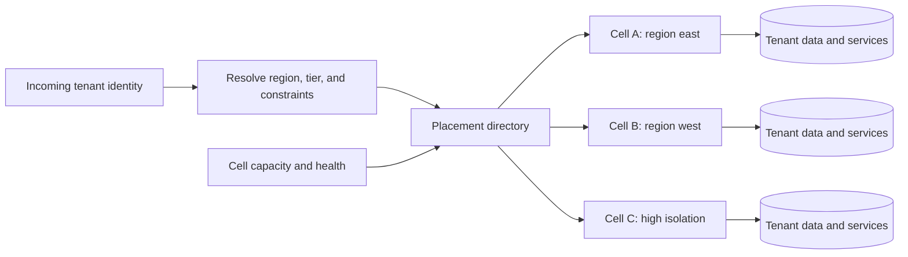
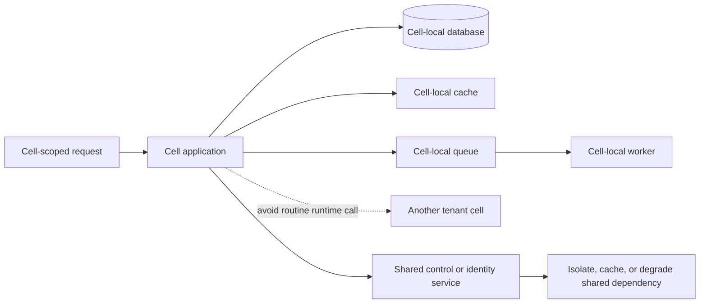
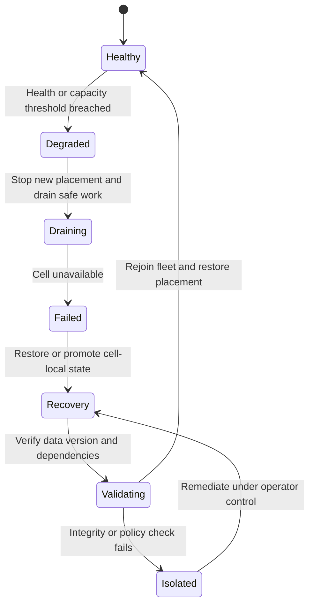
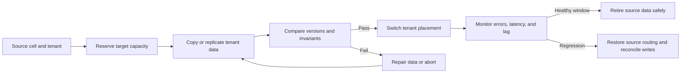

# Cell-Based Architecture

Part: [20 — Architecture Patterns](PART_OVERVIEW.md)

Cell-Based Architecture partitions a service fleet into independent units called cells. Each cell serves a subset of tenants or workload and contains the dependencies needed for that scope. The goal is to limit blast radius and scale capacity by adding cells, while preserving shared control-plane management and routing. Part 09 owns provider fleet products, Part 12 owns Kubernetes mechanics, and Part 07 owns distributed consistency semantics.

## Define Cell and Fleet Boundaries

A cell is a repeatable deployment and operational unit with application services, data partition, queues, and local dependencies. The fleet contains multiple cells and shared control-plane capabilities such as provisioning, configuration, health, and placement. Minimize runtime dependencies across cells; a shared dependency can defeat isolation if every cell fails when it is unavailable.

Define cell invariants, capacity envelope, data ownership, deployment version, and operational readiness checks. Cells should be similar enough to automate but not assumed identical when residency or customer contracts require variants. Keep shared fleet services from becoming unbounded critical-path dependencies.

## Place Tenants and Workloads

Placement maps a tenant, account, or workload to a cell based on capacity, geography, isolation tier, and policy. Stable placement reduces cross-cell calls and simplifies data locality. Rebalancing should be explicit because moving a tenant involves data transfer, routing updates, cache warm-up, and rollback planning.

Placement policy should be deterministic and auditable. Fail closed when no compliant cell has capacity instead of sending data to a convenient but unauthorized region. Avoid cross-cell synchronous dependencies for routine requests; use governed asynchronous aggregation or explicit service contracts when a tenant spans cells.

## Keep Dependencies Cell-Local

Cell-local dependencies limit the number of customers affected by a component failure. Shared identity, control, or metadata services may still exist, but they require their own isolation and availability design. Measure dependency fan-out within and across cells and identify any shared service whose failure can disable the fleet.

Cells reduce blast radius only when data, queues, and runtime dependencies are partitioned consistently. A shared database, global lock, or central queue can reconnect otherwise separate cells. Shared services should have quotas and degradation behavior so one cell cannot consume capacity for all others.

## Contain Failure and Reroute Safely

When a cell fails, routing may remove it from new traffic and send requests to a healthy cell only if that cell can serve the tenant's data and policy. Stateless requests can be rerouted more easily than writes or sessions bound to cell-local state. Define recovery point, session behavior, replication lag, and customer communication before enabling automatic failover.

Do not reroute writes to a cell with stale or conflicting state unless the consistency contract permits it. Circuit-breakers and fleet health should be cell-scoped. A cell that is degraded should not continue receiving work simply because its control plane still responds.

## Migrate and Rebalance Cells

Rebalancing moves tenants to control hot spots, improve locality, or retire capacity. Plan a staged process: reserve target capacity, replicate or copy data, validate, switch routing, monitor, and preserve rollback until source cleanup is safe. During migration, define which cell accepts writes and how concurrent changes are reconciled.

Migration tooling should track state and be restartable. Protect tenant isolation during copying and avoid logging sensitive records. Define cutover criteria, rollback window, and how data created after the copy begins is handled.

## Worked Case: Multi-Tenant Workflow Service

A workflow platform serves thousands of tenants with uneven traffic and regional residency requirements. The team places tenants in cells by region and isolation tier. Each cell owns its application, queue, database, and cache; global routing resolves tenant placement. A shared control plane provisions cells and publishes versions, but runtime requests use cell-local dependencies.

One cell experiences a queue backlog. Fleet health marks it degraded and pauses new tenant placement; existing work drains within its deadline. The platform does not move tenants automatically because their workflow state is cell-local. Operators restore capacity, verify queue age and data integrity, and then re-enable placement. A later planned rebalance copies a tenant under a versioned migration protocol with a tested rollback window.

## Review Questions

1. Which services and data are cell-local, and which remain shared?
2. How does placement honor geography, isolation, and capacity simultaneously?
3. What blast radius remains through shared dependencies?
4. Under which consistency conditions can requests or writes be rerouted?
5. How does migration preserve correctness and support rollback?

Cell-Based Architecture limits blast radius when cells own their runtime and state boundaries. Make placement policy explicit, minimize shared runtime dependencies, reroute only when state and policy permit, and treat rebalancing as a controlled data migration.
