# Cell-Based Architecture

Part: [20 — Architecture Patterns](PART_OVERVIEW.md) · Status: Revised (in-depth rewrite)

## 1. Introduction

A service that runs as one large shared deployment has one failure domain. A bad release, a poisoned request, an exhausted connection pool, or a corrupted partition can degrade every customer at once, and the damage grows with the size of the customer base. Cell-based architecture answers this by running the whole service stack as many complete, independent copies called cells. Each cell serves a fixed subset of customers. A failure that stays inside one cell harms only that cell's customers, so the blast radius (the share of customers affected by one fault) is bounded by design instead of by luck.

The price is real. Capacity is split into pieces that each need headroom, operations multiply by the number of cells, and a thin routing layer must send each request to the right cell. The pattern pays off when the cost of a fleet-wide outage is high and the team can keep cells genuinely independent. It does not pay off for a small system where one failure domain is acceptable.

This chapter owns the cell pattern: what a cell is, how cells are sized, how requests are routed and customers assigned, how cells are deployed to safely, and how isolation and observability are kept per cell. After this first part you should be able to:

1. Define a cell and state the invariants that keep it independent.
2. Compute blast radius and per-cell headroom for a given number of cells.
3. Explain why the router is the one shared component and how to keep it small and available.
4. Choose between hash-based and lookup-table assignment of customers to cells, and plan a rebalance.
5. Explain shuffle sharding and compute the probability that two customers share a failure.
6. Design a progressive rollout across cells with bake time and canary cells.
7. Describe the isolation of data, quotas, and noisy neighbours, and what to observe per cell.

The boundaries with neighbouring material are deliberate:

- Partitioning and sharding mechanics belong to Part 07 and Part 06: [Partitioning (Distributed Systems)](../07_System_Design_and_Distributed_Systems/CH11_Partitioning.md) and [Sharding](../06_Databases_and_Storage/CH06_Sharding.md). A cell partitions the whole stack, not only the data, and this chapter recaps the data mechanics only where they decide cell design.
- Cloud multi-region and multi-account architecture belongs to Part 10, for example [Resilience, Availability, and Disaster Recovery Architectures](../10_Cloud_Architecture/CH09_Resilience_Availability_and_Disaster_Recovery_Architectures.md) and [Organizational Hierarchy and Landing Zones](../10_Cloud_Architecture/CH02_Organizational_Hierarchy_and_Landing_Zones.md). The reliability pillar belongs to Part 11: [Reliability Pillar](../11_AWS_Well_Architected_Framework/CH04_Reliability_Pillar.md).
- Sibling patterns in Part 20: [Microservices](CH05_Microservices.md) split a system by function, whereas cells replicate the whole system by customer group. [Space-Based Architecture](CH16_Space_Based_Architecture.md) scales stateful processing with in-memory data grids, and can be used inside a cell.

All numbers in this chapter are illustrative. They show how to reason and are not measurements of any real system.

## 2. The Foundational Model: Cells, Fleet, and Router

A **cell** is a complete, independent, replicated copy of the service stack, sized to serve a bounded subset of customers. The **fleet** is the set of all cells running the same service. A **cell router** is a thin layer in front of the fleet that maps each request to the cell that owns the request's customer. A **control plane** provisions cells, deploys software to them, and records which customer lives in which cell. Customers are normally tenants, accounts, or organizations, and this chapter uses "customer" for whatever unit the business chooses to isolate.

Two properties define the pattern.

1. **Complete.** A cell contains every component needed to serve its customers' requests: application services, data stores, caches, queues, and workers. A request that enters a cell is finished inside that cell without calling another cell.
2. **Independent.** A fault in one cell does not propagate to another. This requires that cells share no runtime state, no database, no queue, and no lock, and that no routine request path crosses a cell boundary.

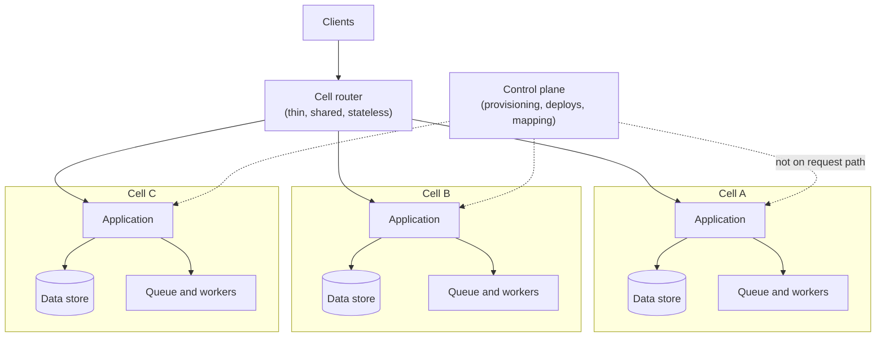

The diagram shows the fleet topology. The router is the only component every request touches, and the control plane is deliberately off the request path: if the control plane is down, existing cells keep serving, and only provisioning, deployment, and placement changes stop. Each cell is a vertical slice. The practical consequence is that the router and the control plane become the highest-criticality components of the whole design, a point the later router section develops, and that every other component's failure is contained to one cell.

### 2.1 Cell invariants

An invariant is a rule that must hold for every cell, or the isolation claim is false. A useful working set:

- **Same shape.** Every cell is built from the same templates and runs the same software version set, except during a controlled rollout. This makes a cell cheap to add and lets operators reason about one cell as a sample of all.
- **Fixed capacity envelope.** Each cell has a defined maximum load and a defined maximum number of customers. A cell is added when the fleet needs more room. A cell is not grown without bound.
- **No cross-cell runtime calls.** A request is served entirely within one cell. Cross-cell work, such as reporting across all customers, is done asynchronously through a governed export, not through synchronous calls.
- **Cell-local state.** Each cell owns its data, caches, and queues. A cell can be restored or rebuilt without reading another cell.
- **Addressable as a unit.** Operators and automation can deploy to, drain, and observe a cell by name.

Where residency rules or contracts require different configurations, such as a cell pinned to a region, keep them as declared variants of the same template. Cells that drift into one-off snowflakes lose the property that makes them cheap to operate.

### 2.2 What a cell is not

A cell is not a Kubernetes namespace or a cloud account by definition, though either can be used as its boundary. At mechanism level, a separate cloud account, subscription, or project is a strong boundary for permissions, quotas, and many service limits, which is why it is often chosen as the cell boundary, and a separate region or availability zone provides a different physical failure domain. Which isolation each provider boundary actually gives differs by service, so verify it against current documentation for the services in use. The test of a cell is behavioural: if one cell's database is deleted, do the other cells keep serving without any change? If not, the boundary is leaking.

## 3. The Problem: Shared Fate and Blast Radius at Scale

Every shared component is a place where one fault can reach many customers. Replication within a shared stack protects against the loss of a machine or a zone. It does not protect against faults that arrive through the shared logic: a defect in a release, a configuration change, a request that triggers a pathological code path, a schema migration, a certificate or credential expiry, or a dependency that saturates. These faults are correlated across every replica because the replicas run the same code, the same configuration, and the same data layer.

### 3.1 Shared fate

Customers have **shared fate** when one fault can degrade all of them. In a conventional single-stack deployment this is the default. The service may have many instances behind a load balancer and a replicated database, yet one faulty release is deployed to all instances, and one bad row or one hot customer can exhaust the same pool for everyone.

As a service grows, two things get worse together. The number of customers exposed to any single fault rises, and the load on each shared component rises toward its limits. The largest customers also tend to be the most affected by a fleet-wide outage and the most expensive to compensate.

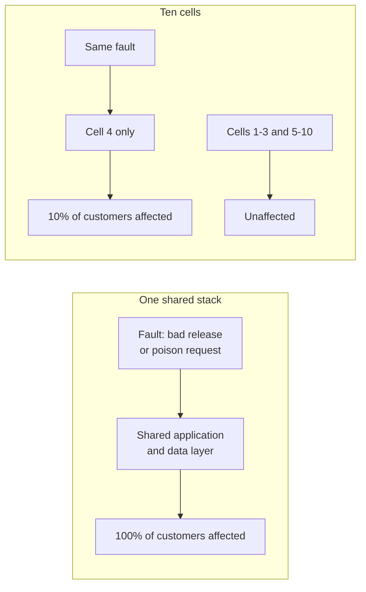

The diagram contrasts the two outcomes for the same fault. In the shared stack the fault reaches the whole customer base. With ten cells the same fault reaches the one cell that received it. The implication for design is that the benefit depends entirely on the fault being confined to one cell, which is why the invariants of independence (no cross-cell calls, no shared data) matter more than the number of cells.

### 3.2 Blast radius arithmetic

Define the blast radius of a fault as the fraction of customers it affects. For a fleet of $N$ equally loaded cells with customers spread evenly, a fault confined to one cell has blast radius

$$
B = \frac{1}{N}
$$

Illustrative values:

| Cells (N) | Blast radius of a single-cell fault | Customers affected out of 10,000 |
| --- | --- | --- |
| 1 (shared stack) | 100% | 10,000 |
| 2 | 50% | 5,000 |
| 10 | 10% | 1,000 |
| 20 | 5% | 500 |
| 100 | 1% | 100 |

The blast radius falls as $1/N$, so each additional cell helps less than the previous one: going from 1 to 2 cells removes 50 percentage points of worst-case exposure, going from 10 to 20 removes 5, and going from 20 to 100 removes 4. The operational cost, in contrast, grows roughly linearly with $N$, so there is a knee in the curve and a sensible fleet size is usually well below the point where each cell holds a handful of customers. The sizing section develops this trade-off.

### 3.3 What cells change and what they do not

Cells need not change the expected amount of downtime. Consider an illustrative stack with 4 incidents a year, each lasting 30 minutes, whose cause is a fault in the stack itself.

- **Shared stack.** Each incident affects every customer. Expected downtime per customer is $4 \times 30 = 120$ minutes a year, about 99.977% availability because a year has 525,600 minutes ($1 - 120/525{,}600 \approx 0.99977$).
- **Twenty cells, if each cell had the same fault rate as the shared stack.** Each cell has 4 incidents a year, each affecting 5% of customers. A given customer lives in one cell, so it still sees 4 incidents of 30 minutes. Expected downtime per customer is again 120 minutes.

Under this assumption the expected loss is identical, and what changes is the distribution. The worst single event shrinks from every customer to 5%, and a customer-visible outage is no longer a headline event for the whole base. In practice cells also reduce the fault rate per cell for two reasons: each cell carries less load, so load-triggered faults happen later, and release-related faults are caught by progressive rollout before they reach most cells. Those effects are real but depend on the deployment discipline described in the section on deployment across cells, and they should be measured, not assumed.

Cells also do not remove faults that are independent of the stack. A regional outage in the cloud provider affects every cell placed in that region, and a flaw in a shared dependency such as an identity provider affects every cell that calls it at runtime. Choosing cell placement across zones or regions is covered in the cloud architecture chapters linked in the introduction, and the question to ask of every shared dependency is whether it sits in the request path of every cell.

### 3.4 Worked scenario: a poisoned request

A service handles document-processing requests. An illustrative defect makes a certain malformed document cause an infinite loop that holds a worker thread. Each retry of the request holds another. In a shared stack with 200 worker threads, a single customer's batch of 200 malformed documents consumes all threads in seconds, and every customer sees timeouts until the offending traffic is blocked.

With 20 cells and 10 worker threads each, the same batch exhausts the threads of only the one cell that owns that customer. Customers in the other 19 cells see no change. The affected customer still has an outage, which cells do not prevent, but the outage is confined to that customer's cell and to the customers who share it. This also shows why per-customer quotas inside the cell remain necessary: they bound how many of the cell's co-residents are harmed by one customer, a topic of the section on data isolation, quotas, and noisy neighbours.

## 4. Sizing Cells: How Many and How Large

Cell count $N$ is a decision between a blast-radius target and the overhead of running many cells. Three constraints bound the choice.

1. **Blast-radius ceiling.** The business states the largest share of customers it accepts losing to one cell fault, $B_{max}$. Then $N \geq 1/B_{max}$.
2. **Minimum cell size.** A cell must be large enough to hold its largest customer with growth room, so the cell's capacity bounds how large a single customer may become.
3. **Overhead ceiling.** Every cell has a fixed minimum footprint, so cost per unit of useful work rises with $N$. The business states how much overhead it accepts.

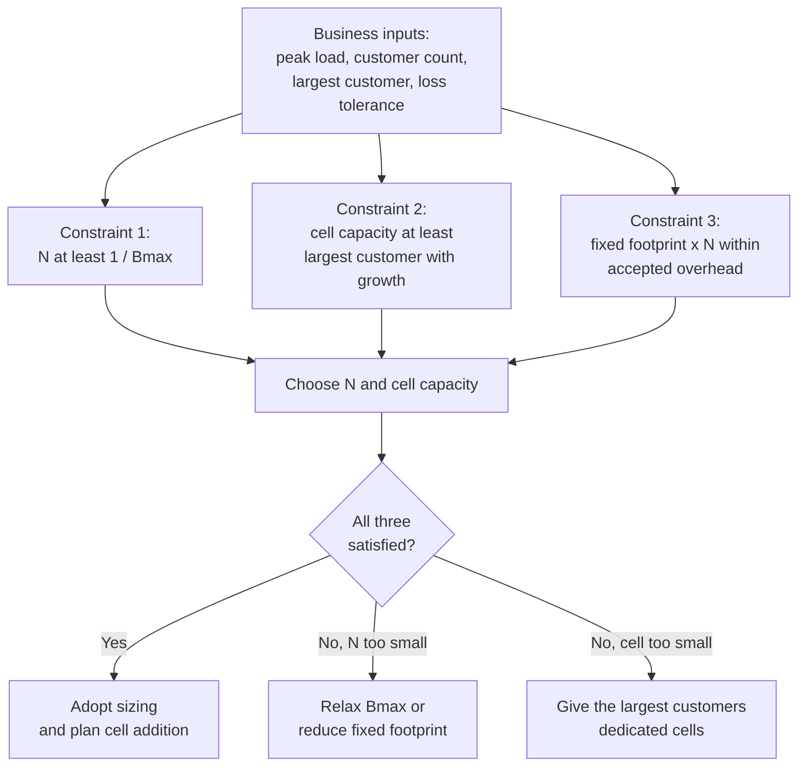

The diagram makes the sizing decision a check of three independent limits and names the two usual ways out when they conflict. A larger fixed footprint pushes $N$ down, a stricter loss tolerance pushes it up, and one very large customer can force a dedicated cell or a larger cell class. Treat the result as a range and revisit it as load grows.

### 4.1 Worked arithmetic: peak load and headroom

Take an illustrative service with 10,000 customers and a fleet-wide peak of 12,000 requests per second. One application instance sustains 200 requests per second at full utilisation, and the team runs instances at no more than 60% of that at peak, so each instance is planned for 120 requests per second. The 40% margin covers uneven customer load, short spikes, rollout of a new version, and inbound tenant migration.

- Variable instances needed fleet-wide: $12{,}000 / 120 = 100$ instances.
- Fixed footprint per cell: 3 instance-equivalents, standing for the minimum redundant deployment across three zones, the data store's minimum replicas, and supporting units.

Total instance-equivalents $= 100 + 3N$. Illustrative results:

| Cells (N) | Total instance-equivalents | Overhead share (3N / total) | Cost relative to one cell | Per-cell peak load (req/s) | Blast radius |
| --- | --- | --- | --- | --- | --- |
| 1 | 103 | 3% | 1.00 | 12,000 | 100% |
| 10 | 130 | 23% | 1.26 | 1,200 | 10% |
| 20 | 160 | 38% | 1.55 | 600 | 5% |
| 50 | 250 | 60% | 2.43 | 240 | 2% |
| 100 | 400 | 75% | 3.88 | 120 | 1% |

The overhead share is $3N/(100+3N)$. For $N=20$ it is $60/160 = 37.5\%$, rounded to 38%. The cost relative to one cell is the total divided by 103.

If the business states $B_{max}=5\%$, constraint 1 gives $N \geq 20$. If it accepts at most 40% of the provisioned instances being fixed overhead, constraint 3 gives $3N/(100+3N) \leq 0.4$, so $3N \leq 40 + 1.2N$, hence $N \leq 22$. The feasible range is 20 to 22 cells, and 20 is the cheaper end of it. Going to 100 cells would cut blast radius to 1% but would cost about three times as much as 10 cells ($400/130 \approx 3.1$), and 75% of capacity would be fixed footprint.

### 4.2 The largest customer sets a floor

Cells are sized to the largest customer they must hold. Suppose the largest customer peaks at 800 requests per second and can grow 50% in a year, so it needs about 1,200. Constraint 2 then requires per-cell capacity of at least 1,200 requests per second for that customer alone, plus the cell's other customers. With 20 cells the average cell peaks at 600 requests per second, so this customer does not fit a standard cell at all.

Two responses are common. The first is a **dedicated cell** or a larger cell class for customers above a size threshold. The second is to split the customer's workload across several cells, which only works if the customer's data and requests can be partitioned, and which reintroduces the cross-cell design problems the pattern avoids. The first is simpler and keeps the invariants. The cost is that the dedicated cell may run at low utilisation, which is acceptable if the customer pays for the isolation.

### 4.3 Headroom and what it is for

Per-cell headroom is spare capacity inside a cell. It has four uses, and the sizing should state which it is meant to cover:

- **Growth and spikes** of the cell's own customers.
- **Deploys**, because a new version may use more resources while old and new overlap.
- **Inbound migration** of a customer from another cell during a rebalance.
- **Failover absorption.** Because data is cell-local, neighbouring cells normally cannot take over a failed cell's customers, so headroom does not provide this. A design that wants it needs a spare cell with replicated data, which is its own cost.

Higher $N$ also lowers average utilisation, because each cell is rounded up to its minimum footprint and because load is less well averaged in small cells. A cell with 10 customers sees large relative swings when one of them doubles its traffic, while a cell with 500 customers averages them out. Utilisation targets for small cells therefore need larger relative headroom than for large ones.

### 4.4 Adding cells over time

A fleet usually starts with a few cells and adds more as customers arrive. New customers are placed in the cell with room, and a cell is declared full at a fixed fraction of its tested capacity, for example 70%. Filling cells one at a time makes the oldest cells the most loaded, so the fleet's blast radius is uneven: the first cells hold many customers and the newest hold few. A balanced alternative is to place new customers across all open cells. The assignment section covers how the mapping makes either policy possible.

## 5. The Cell Router: The One Shared Component

Every request must reach the right cell, so something must sit in front of the fleet and make that decision. This is the **cell router**. It is the one component every customer depends on at runtime, which makes it the largest remaining shared-fate risk in the design. The whole point of the pattern is undermined if the router is a single failure domain that is as complicated as the service it fronts.

### 5.1 Responsibilities and request path

The router does three things and nothing else:

1. **Identify the customer.** It extracts a routing key from the request, such as a tenant identifier in a hostname, a path segment, a header, or a claim in an already validated credential.
2. **Resolve the cell.** It looks up the routing key in a mapping from customer to cell.
3. **Forward the request** to that cell's entry point, or tell the client to talk to the cell directly.

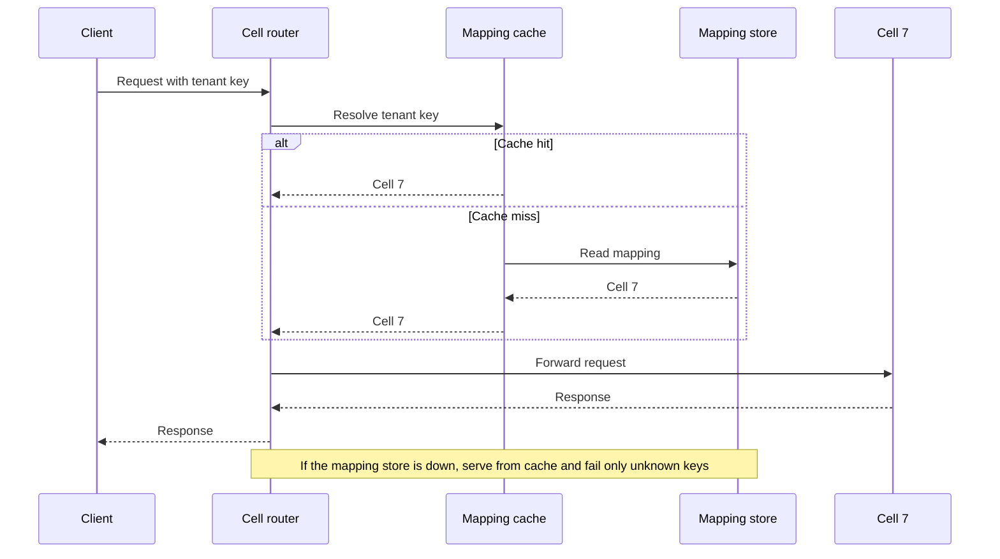

The sequence shows that the router holds a local copy of the mapping and goes to the authoritative store only on a miss. Because a customer's cell rarely changes, almost every request is answered from the cache. The implication is that the mapping store can be unavailable for a while without taking down routing for known customers, which is **static stability**: the router keeps doing the last known good thing when a dependency fails, instead of failing because it cannot refresh.

### 5.2 Why the router is critical

The router's availability caps the availability of every customer, because a customer reaches its cell only through it. If the router is available 99.99% of the time and a cell is available 99.9% of the time, and failures are independent, a customer's end-to-end availability is about $0.9999 \times 0.999 \approx 0.9989$. The router costs a tenth of a percentage point of availability here, and more importantly a router fault has blast radius 100%, in contrast to a cell fault at $1/N$. For 20 cells, a router fault is 20 times as damaging as a cell fault, so the router must be much more reliable than a cell to justify the design.

The router therefore follows stricter rules than the cells behind it:

- **Thin.** No business logic, no data transformation, no calls to cell services, and no per-request calls to the control plane. Less code gives fewer defects.
- **Stateless apart from the cache.** Instances are interchangeable, so any instance can fail and capacity is added horizontally.
- **Changed rarely and carefully.** It is deployed with the progressive discipline described in the section on deployment across cells, and it changes much less often than the cells.
- **Fails safe on unknown keys.** A request whose key cannot be resolved is rejected with a clear error. It is never sent to a default cell, because that could expose one customer's data to the wrong cell.
- **Bounded dependencies.** Its only dependencies are the mapping cache and, on miss, the mapping store. The mapping store must itself be highly available and have a read path independent of the control plane's write path.

### 5.3 Router placement variants

Variants differ in where the mapping lookup happens, and each shifts the risk.

| Variant | How it works | Strength | Weakness |
| --- | --- | --- | --- |
| Proxy router | All traffic passes through router instances that forward to cells | Central control, simple clients | Router capacity and fault reach all traffic |
| Per-cell hostname | Each customer is given a cell-specific hostname resolved through the Domain Name System (DNS), so no proxy sits on the data path | Router off the data path, fewer shared components | DNS caching slows cell moves, and clients must follow the hostname |
| Routing by client library | A client library resolves the cell once and caches it | Minimal central path | Library versions drift and routing logic spreads to clients |
| Layered routers | A small first layer routes to a router group, which routes to cells | Router fleet itself is partitioned | More hops and more routing state to keep consistent |

The per-cell hostname variant is worth noting because it removes the router from the data path for steady-state traffic, so a router fault does not stop requests that already have the answer. The cost is slower tenant moves, because the old answer can persist in caches until its time-to-live expires. The choice depends on how often tenants move and whether the clients are controlled by the operator.

### 5.4 Router failure modes

- **Stale mapping.** The router sends a tenant's request to the old cell after a move. The old cell must refuse the request, or forward a pointer, instead of serving stale data, so the router corrects itself. A cell should check that it owns the tenant on every request.
- **Mapping corruption.** A bad write to the mapping store, such as a deleted or scrambled range, misroutes many customers at once. Treat mapping changes as deployments: validate, apply to a small subset first, keep versions, and allow rollback.
- **Capacity exhaustion.** A surge in one customer's traffic saturates router instances and degrades all customers. Apply per-customer rate limits at the router, before forwarding.
- **Bad router release.** The same fault as any shared release defect, but with blast radius 100%, which is why the router's release process is the strictest in the system.

## 6. Cell Assignment: Mapping Customers to Cells

The mapping from customer to cell is the router's data. Two designs dominate, hash-based and lookup-table, and a hybrid is common. The choice decides how easily the fleet grows, how deliberately customers can be placed, and what the router depends on.

### 6.1 Hash-based assignment

A hash function maps the routing key to a cell with no stored table: $\text{cell} = h(\text{key}) \bmod N$. Every router instance computes the same answer from the key alone, so there is nothing to store, replicate, or keep consistent, and the mapping cannot be corrupted or lost.

The weakness appears when $N$ changes. With modulo placement, growing from 20 to 21 cells changes the result for almost every key. Counting over one full cycle of 420 consecutive integers, the key's residue modulo 20 equals its residue modulo 21 only for the first 20 values, so 20 of 420 keys stay put, about $1/21 \approx 4.8\%$. The remaining 95.2% of customers would have to move cells, which is not acceptable when a move is a data migration.

**Consistent hashing** and **rendezvous hashing** reduce this: when a cell is added, only about $1/(N+1)$ of keys move to it, about 4.8% for $N=20$. Part 07's chapter on [Partitioning](../07_System_Design_and_Distributed_Systems/CH11_Partitioning.md) teaches these schemes and their variants, so this chapter assumes them. Two cell-specific limits remain. Hash placement ignores customer size, so one cell may receive several large customers by chance. And a hash decides placement from the key alone, so residency rules, isolation tiers, or a dedicated cell for a large customer cannot be expressed.

### 6.2 Lookup-table assignment

A table stores customer to cell explicitly. Placement at onboarding is a decision, made by the control plane using capacity, region, tier, and policy, and recorded in the table. Moving a customer is a table update after the data has moved.

This gives control that hashing cannot: dedicated cells, residency pins, deliberate balancing, draining a cell for retirement, and per-customer moves. The cost is that the table is state. It must be stored durably, read at very low latency, cached in every router instance, versioned, and protected from corruption, and it becomes a dependency of the router as the previous section described. For 10,000 customers the table is tiny, a few hundred kilobytes, so caching it in every router instance is simple. For hundreds of millions of customers it needs partitioned storage with a cache, and the lookup path deserves its own design.

### 6.3 Hybrid: hash to buckets, buckets to cells

A common compromise hashes the key to one of a fixed, large number of **buckets**, for example 4,096, and keeps a small table from bucket to cell. The number of buckets never changes, so the hash never moves a key between buckets. Adding a cell moves whole buckets from existing cells to the new one by updating the table. The table has 4,096 rows regardless of customer count, which keeps it small. The trade-off is granularity: a bucket moves as a unit, so customers cannot be placed individually, and a very large customer still needs an explicit override. Many deployments combine the hybrid with a small override table for pinned and dedicated customers.

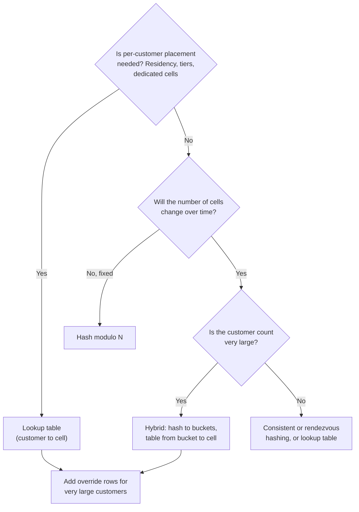

The decision tree starts from the capability that only a table can provide, per-customer placement, and falls back to hashing when no such need exists. The practical implication is that most production designs end up with a table in some form, because residency and dedicated-cell requirements arrive eventually, and it is cheaper to plan for one than to retrofit it onto a pure hash.

### 6.4 Rebalancing and moving a customer

A move is a data migration with a routing change at the end. The risk is a write accepted by the old cell after the new cell has taken over, or the reverse. The safe sequence has explicit states and a single point at which ownership changes.

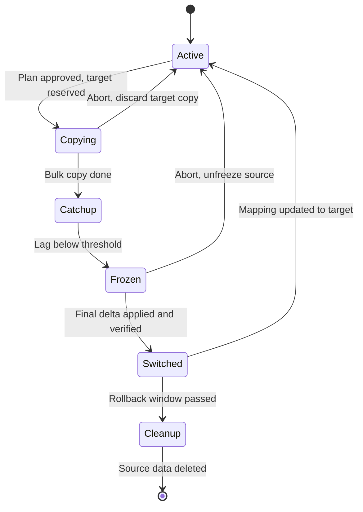

The states show that the source cell remains the owner through `Copying` and `Catchup`, so a failure before `Frozen` costs nothing but wasted work and can be aborted. In `Frozen`, writes for the customer are rejected or queued for a short window while the last changes are applied and compared, and ownership flips in one atomic update to the mapping. A rollback window then keeps the source data until the customer has run on the target long enough to be confident. The length of the frozen window is the customer-visible cost, and it is kept short by catching up before freezing.

Rules that make moves safe:

- **One owner at a time.** Each cell checks on every request that it owns the customer at the current mapping version, and refuses otherwise. This stops a stale router from writing to the old cell.
- **Restartable steps.** Each step is idempotent and its state is recorded, so a crashed migration resumes.
- **Verify before switching.** Compare record counts and checksums or row versions on the source and target before flipping ownership.
- **Reserve capacity first.** The target cell needs headroom for the arriving customer, one of the four uses of headroom in the sizing section.
- **Rate-limit moves.** Copying competes with customer traffic in the source cell, so cap the copy rate.

### 6.5 Router and rebalance sketch (Python)

This sketch resolves a customer through an override table and then a bucket table, and tracks a move through the states above. It omits persistence and concurrency across processes. The lock guards single-process access only.

```python
from dataclasses import dataclass, replace
from enum import Enum
import hashlib
import threading


class MoveInProgress(Exception):
    """Writes for this tenant are paused during the final cutover."""


class State(Enum):
    ACTIVE = "active"
    FROZEN = "frozen"


@dataclass(frozen=True)
class Placement:
    cell: str
    version: int = 0
    state: State = State.ACTIVE
    target: str | None = None


class TenantRouter:
    def __init__(self, cells: list[str], buckets: int = 4096):
        self._buckets = buckets
        self._bucket_cell = {b: cells[b % len(cells)] for b in range(buckets)}
        self._overrides: dict[str, Placement] = {}
        self._lock = threading.Lock()

    def _bucket(self, tenant: str) -> int:
        digest = hashlib.sha256(tenant.encode()).digest()
        return int.from_bytes(digest[:8], "big") % self._buckets

    def resolve(self, tenant: str) -> Placement:
        with self._lock:
            if tenant in self._overrides:
                return self._overrides[tenant]
            return Placement(cell=self._bucket_cell[self._bucket(tenant)])

    def route(self, tenant: str, write: bool) -> str:
        p = self.resolve(tenant)
        if write and p.state is State.FROZEN:
            raise MoveInProgress(tenant)
        return p.cell

    def freeze(self, tenant: str, target: str) -> None:
        with self._lock:
            p = self._overrides.get(tenant) or Placement(
                cell=self._bucket_cell[self._bucket(tenant)]
            )
            self._overrides[tenant] = replace(p, state=State.FROZEN, target=target)

    def switch(self, tenant: str) -> None:
        with self._lock:
            p = self._overrides[tenant]
            if p.state is not State.FROZEN or p.target is None:
                raise ValueError("tenant is not frozen for a move")
            self._overrides[tenant] = Placement(
                cell=p.target, version=p.version + 1
            )

    def abort(self, tenant: str) -> None:
        with self._lock:
            p = self._overrides.get(tenant)
            if p is not None and p.state is State.FROZEN:
                self._overrides[tenant] = replace(
                    p, state=State.ACTIVE, target=None
                )


def plan_moves(tenants_by_cell: dict[str, dict[str, float]], tolerance=0.10):
    """Greedy plan: move one tenant at a time from the hottest to the coolest cell."""
    load = {c: sum(t.values()) for c, t in tenants_by_cell.items()}
    average = sum(load.values()) / len(load)
    moves = []
    while True:
        hot = max(load, key=load.get)
        cold = min(load, key=load.get)
        gap = load[hot] - load[cold]
        if gap <= tolerance * average:
            return moves
        fits = {t: v for t, v in tenants_by_cell[hot].items() if v <= gap / 2}
        if not fits:
            return moves
        tenant = max(fits, key=fits.get)
        size = tenants_by_cell[hot].pop(tenant)
        tenants_by_cell[cold][tenant] = size
        load[hot] -= size
        load[cold] += size
        moves.append((tenant, hot, cold))
```

A tenant is moved only if its load is at most half of the gap between the hottest and coolest cells, which guarantees that each move strictly reduces the gap and so the loop terminates. A production planner would also respect residency pins, headroom on the target, and a limit on moves per period. The `freeze`, copy, and `switch` sequence matches the state diagram, and the cell-side ownership check described earlier remains necessary because the router cannot by itself guarantee that no stale router instance exists.

## 7. Progressive Deployment Across Cells

Cells make the most common cause of large outages, a defective change, containable. The mechanism is to deploy to cells in order, observe each group for long enough, and stop when a signal is bad. The cells that have not yet received the change are the untouched population that protects the fleet. Progressive delivery as a general practice, including canary and feature-flag mechanics, belongs to Part 13: [Progressive Delivery](../13_DevOps/CH13_Progressive_Delivery.md) and [Canary Deployment](../13_DevOps/CH16_Canary_Deployment.md). This section covers what the cell boundary adds: the unit of rollout is a whole cell, and cells that run different versions at the same time are normal.

### 7.1 Waves, canary cells, and bake time

A **wave** is a group of cells that receive a change together. The first wave is one or more **canary cells**, chosen to be representative but low in consequence, for example a cell of internal users or of customers who accepted early access. **Bake time** is the minimum period a wave runs on the new version, with all checks green, before the next wave starts.

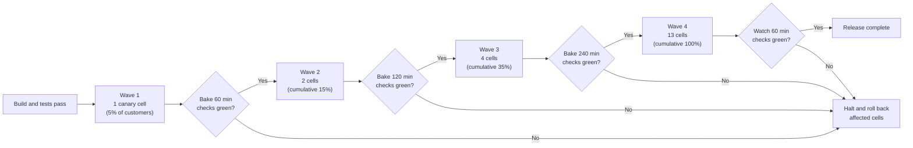

The flow shows a release gated by four checkpoints, each followed by a decision that either widens the exposure or rolls back. The implication is that the worst case for a defect is set by the wave in which it is detected, not by the fleet size. With 20 cells and the waves above, a defect caught in wave 1 touches 1 of 20 cells (5%), in wave 2 touches 3 (15%), and in wave 3 touches 7 (35%). All numbers are illustrative.

Choose the bake time from the failure you want to catch, not from convenience. A defect that appears only when a nightly batch runs, when a cache entry expires after a day, or when a monthly job executes cannot be found by a 60-minute bake. Where the defect is slow to show, either lengthen the bake of the early waves, or provoke the slow trigger in the canary cell on purpose, for example by running the batch job early. Total elapsed time for the schedule above, assuming each wave takes 20 minutes to deploy, is $4 \times 20 + 60 + 120 + 240 + 60 = 560$ minutes, about 9 hours 20 minutes. A rollout that long is acceptable for a service that releases daily or weekly and is a real cost for one that wants to release many times a day, which is a reason to pipeline releases so that the next version starts in wave 1 while the previous version is in a later wave, within a limit on how many versions may coexist.

### 7.2 Gates: what counts as green

A gate is an automated comparison of the cells on the new version with the cells still on the old version over the same period. Useful signals are the error rate, latency at a high percentile, saturation of the cell's resources, and the rate of errors visible to customers. Compare the new cells against both their own history and the unchanged cells, because customers differ between cells and a difference in mix can look like a regression. Part 14 teaches how to define such measurements: [SLO](../14_Observability/CH11_SLO.md) and [Alerting](../14_Observability/CH10_Alerting.md).

Two further rules prevent gates from being decorative:

- **Minimum traffic.** A gate that passes because no traffic arrived has measured nothing. The canary cell must receive enough requests, in enough variety, that a defect would be visible. A synthetic probe set that exercises every important operation covers cells with low organic traffic.
- **Stop the line.** A failed gate halts the release in every cell and blocks later releases until a person acknowledges the cause. Automatic rollback applies to the cells already changed.

### 7.3 Rollback and version skew

Rollback is cheaper in cells than in a shared stack for two reasons: it affects a small group, and it can be rehearsed on a canary. It is not free of risk. Plan for the following.

- **Compatibility across versions.** During a rollout, cells run versions $N$ and $N+1$ at once, and a rollback returns cells to $N$ after they may have written data in a $N+1$ format. Use the expand-and-contract pattern for schema changes: first deploy code that tolerates both formats, then change the format, then remove the old path in a later release. A destructive schema change must never ride in the same release as the code that needs it.
- **Router and mapping compatibility.** The router must understand every cell version that can be live at once. Releases that change how the router addresses a cell, or what a cell expects in a forwarded request, need their own sequence: change the cell to accept both forms, then the router, then retire the old form.
- **Bounded skew.** State the largest number of versions allowed in the fleet at once, for example two, so that support, testing, and incident response can assume a small set.
- **Configuration is a release.** A configuration change, a feature flag, a certificate rotation, or a mapping edit can break a cell as easily as code. Route all of them through the same waves. The shared control plane that pushes configuration to every cell at once reintroduces the shared fate that cells remove.

Illustrative rollback timing: if rolling a cell back takes 15 minutes, and a failed wave 3 covers 4 cells that can be rolled back in parallel by the deployment system, customers in those cells are exposed for roughly the detection delay plus 15 minutes. If the deployment system rolls cells back one at a time, the same recovery takes $4 \times 15 = 60$ minutes. Whether rollback is parallel is a design decision of the deployment tooling and should be tested, not assumed.

## 8. Shuffle Sharding: Shrinking Blast Radius Within a Cell

A cell bounds a fault to its customers, but inside a cell all customers still share workers. If one customer's requests are poisonous and each retry removes a worker, a naive pool shares that harm with everyone in the cell. **Shuffle sharding** gives each customer a different, deterministic subset of the workers, picked so that two customers rarely share the same subset. A fault that takes out one customer's workers then leaves almost every other customer with at least one healthy worker.

### 8.1 Worked probability example

All numbers are illustrative. A cell has 8 workers, and each customer is assigned a shard of 2 of them. The number of different 2-worker shards is the number of combinations of 8 taken 2 at a time:

$$
\binom{8}{2} = \frac{8 \times 7}{2} = 28
$$

Suppose a poisonous customer's two workers fail. Another customer is fully affected only if it was assigned the same two workers, which has probability $1/28 \approx 3.6\%$. It is partly affected if its shard shares exactly one worker or both. The probability of sharing none is $\binom{6}{2}/\binom{8}{2} = 15/28$, so the probability of sharing at least one is $1 - 15/28 = 13/28 \approx 46\%$. A customer that shares only one worker still has a healthy worker and can succeed if clients retry against it.

Compare conventional sharding, which splits the 8 workers into 4 fixed groups of 2 and assigns each customer to one group. A poisonous customer takes out its group, and a quarter of customers (25%), those in the same group, lose all capacity. Shuffle sharding reduces total loss from 25% of customers to about 3.6%.

The effect grows quickly with the pool size. With 100 workers and a shard of 5:

$$
\binom{100}{5} = \frac{100 \times 99 \times 98 \times 97 \times 96}{120} = 75{,}287{,}520
$$

The chance that another customer has the identical shard is $1/75{,}287{,}520 \approx 1.3 \times 10^{-8}$. The chance that it shares at least one worker is $1 - \binom{95}{5}/\binom{100}{5} = 1 - 57{,}940{,}519/75{,}287{,}520 \approx 23\%$. Most customers lose some capacity but keep four of five workers, and essentially none lose all of it.

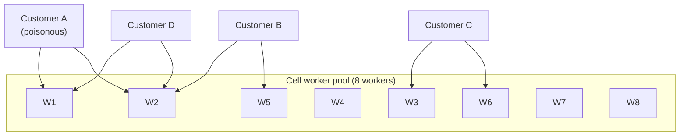

The diagram shows that customer A's shard is W1 and W2. Customer B shares one worker with A and still has W5. Customer C shares none. Customer D has the same shard as A and is the unlucky case, probability $1/28$ per customer in this small example. The implication is that shard assignment must be deterministic per customer, recorded or computable, so that retries reach the same shard, and that clients or the router need to retry across the shard's members, otherwise the healthy member is never used.

### 8.2 Where it fits

- **Inside a cell, not across cells.** Using shuffle sharding across cells would mean a customer is served by several cells, which requires its data in each of them and breaks the invariant that one request is finished in one cell. Use it on stateless worker pools, connection pools, and queue consumers within the cell.
- **Reasonable overhead.** The only cost is the assignment logic, a retry across the shard, and an operational view of which customer maps to which shard. No extra workers are needed.
- **Limits.** It protects against a single faulty customer or request, not against a defect that every request triggers. A bad release hits all shards, and rollout waves remain the control for that case.
- **Stateful pools.** If workers hold customer state, a shard of workers needs that state replicated across its members. The cheapest uses are stateless pools.

A short sketch of shard assignment that is deterministic from the customer key:

```python
import hashlib
import random


def shard_for(customer: str, workers: list[str], size: int) -> list[str]:
    seed = int.from_bytes(hashlib.sha256(customer.encode()).digest()[:8], "big")
    return random.Random(seed).sample(workers, size)
```

The same customer and worker list always produce the same shard. When the worker list changes, shards change for some customers, so production implementations add or remove workers in a controlled order and avoid reshuffling a customer whose shard is currently under load.

## 9. Isolation: Data, Quotas, Noisy Neighbours, and Residency

Isolation is the property the cell boundary is meant to deliver, and it fails at the places where something is shared. This section covers four kinds of sharing: data, resource consumption inside a cell, runtime dependencies, and legal or contractual location.

### 9.1 The cell-local dependency boundary

Every dependency of a cell is either inside the boundary (cell-local) or outside it (shared). Inside is a copy per cell. Outside is a dependency of the fleet, so its failure can reach many cells.

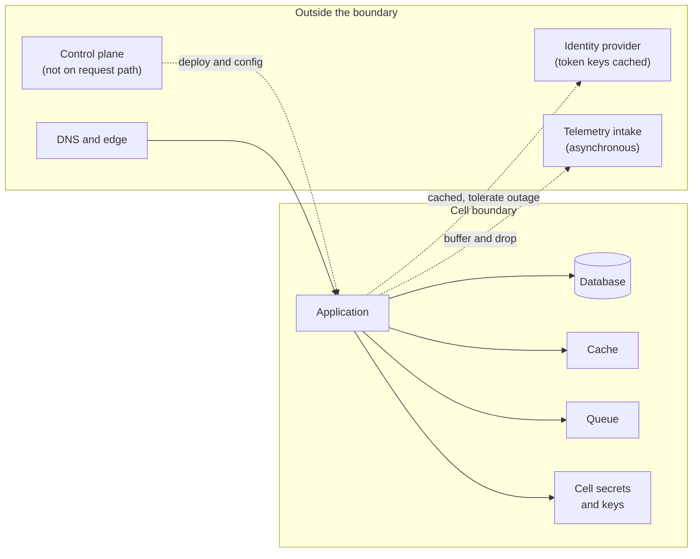

The solid lines inside the boundary show dependencies whose failure stays in one cell. The dotted lines show allowed shared dependencies, each with a stated way to survive its outage: token verification keys cached for a bounded time, telemetry buffered or dropped instead of blocking, and the control plane touched only for changes. The implication for design review is to list every outside dependency and ask what the cell does while it is down. A dependency that has no answer, such as a synchronous call to a central permissions service on every request, silently reinstates shared fate. Part 15 covers the identity and secrets mechanics: [Secrets Management](../15_Security/CH09_Secrets_Management.md) and [Encryption](../15_Security/CH10_Encryption.md).

### 9.2 Data isolation

Data isolation has three layers. **Placement:** each cell has its own data store, so there is no shared table or schema for one fault to corrupt. **Access:** each cell has its own credentials and roles, so a compromised cell does not hold the credentials of another. **Cryptography:** each cell uses its own encryption keys, held in a key management service (KMS), so exposure of one cell's keys does not expose another cell's data. Where cells are separate cloud accounts, the account boundary also limits what an attacker or a mistaken administrator can reach, and the limits and quotas of one account do not drain another's. The details of those provider boundaries are in Part 10, linked in the introduction.

The mapping store and the control plane are the exceptions: they hold fleet-wide metadata. Keep personal data out of them. The mapping needs only an opaque customer identifier and a cell name, and operational tooling should use the same identifiers instead of names or contents.

### 9.3 Noisy neighbours and quotas

Customers within a cell still compete for its capacity. A **noisy neighbour** is a customer whose consumption degrades others in the same cell. Cells reduce the number of customers who can be hurt, but quotas decide whether one customer can hurt the others at all.

- **Rate limits per customer.** A token bucket per customer limits sustained rate and burst size. Apply it at the router and again at the cell's entry, so that traffic that bypasses the router is also limited.
- **Concurrency limits.** A cap on in-flight requests per customer prevents slow requests from holding all threads. Rate alone does not catch a customer that sends few but very expensive requests.
- **Fair queuing.** Where work waits in queues, use per-customer queues or weighted scheduling so that one customer's backlog does not delay the rest.
- **Resource quotas for storage and background work.** Limits on storage, number of objects, and background job slots stop slow accumulation of consumption.
- **Load shedding.** When the cell is saturated, shed work from customers who exceed their quota first, and return an explicit overload response that tells well-behaved clients to back off.

Illustrative arithmetic: a cell has a planned peak of 600 requests per second and holds 50 customers. If each customer's rate limit is 40 requests per second, the sum of limits is $50 \times 40 = 2{,}000$, which is $2{,}000/600 \approx 3.3$ times the cell's capacity. Oversubscription is normal and acceptable because customers rarely peak together, but it means quotas alone cannot guarantee that every customer can use its quota at once. If one customer bursts to its limit of 40 requests per second, that is $40/600 \approx 6.7\%$ of the cell, which is tolerable. If the limit were 400, one customer could take two thirds of the cell, so the limit must be set relative to cell capacity and tested. Customers whose legitimate need exceeds a fair share are candidates for a dedicated cell, as the sizing section described.

### 9.4 Data residency and compliance placement

Some customers must keep data in a given country or region by law or contract. Cells make this simple to satisfy because a cell has a location. Place the cell in the permitted region, assign the customer by lookup table or override with a residency pin, and refuse any move that would violate the pin. The checks to include:

- **Pins are enforced by the control plane,** not only by the onboarding process, so a rebalance planner cannot move a pinned customer.
- **Everything that carries customer data stays in the region:** backups, replicas, logs, traces, analytics exports, and support tooling. A cell that is compliant in its database and leaks data in its logs is not compliant.
- **Fleet-wide features need a policy.** Cross-cell reporting, global search, or shared machine-learning features move data across cells. Allow them only for data classes that policy permits, and aggregate or anonymise before export.
- **Evidence.** Keep a record of which cell and region each customer was in over time, because an auditor will ask.

This chapter does not interpret specific regulations. The rules that apply to a given system must be established with the organisation's legal and compliance staff.

## 10. Failure Containment and Safe Rerouting

When a cell fails, the first aim is containment: the failure should stay in the cell, and the rest of the fleet should not notice. The second aim is recovery of that cell's customers. Rerouting those customers to another cell is possible only when that other cell holds their data, which is not the default.

### 10.1 Cell health lifecycle

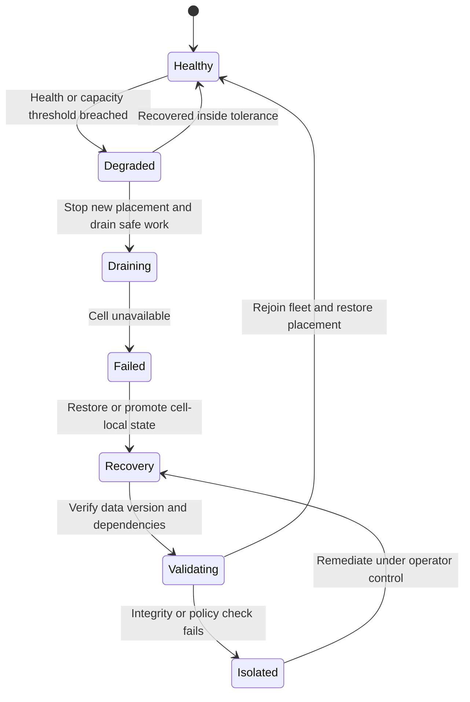

The states make explicit that a cell does not jump from healthy to failed. In `Degraded`, the control plane stops placing new customers on the cell. In `Draining`, work that can safely finish is allowed to, and work that cannot is refused with a clear error. `Validating` is the step teams most often skip: a cell that comes back is checked for data version and dependency health before it takes traffic again, and `Isolated` holds a cell whose integrity check failed so that it cannot take writes. A degraded cell must not keep receiving work simply because its control endpoint still answers. Health must reflect whether customer requests succeed.

### 10.2 Reroute policy

Rerouting a customer to another cell is safe when three conditions hold:

1. **The target holds the data.** This needs cross-cell replication of that customer, which has a cost and its own consistency questions, or a read-only subset such as static content.
2. **The consistency contract permits it.** Writing to a cell with stale or conflicting state creates divergence. Define the recovery point objective (RPO), the amount of recent data the business accepts losing, and the recovery time objective (RTO), the time the business accepts being down, before enabling automatic failover.
3. **The target has capacity.** A failed cell with 5% of customers adds 5% to the neighbours' load only if spread evenly. If a single neighbour takes it all, the neighbour must have more than 5% of the fleet's load as headroom.

Most designs choose one of three levels. Recovery within the cell (restore from backup or a standby inside the cell's own zones) is the simplest and keeps the invariant. A **paired standby cell** with replicated data gives a fast alternative and costs an extra cell for every one it protects. Reads-only degradation during an outage serves cached or replicated data while writes wait. The right level follows the RTO and RPO of each customer tier, and many systems use different levels for different tiers. Resilience across zones and regions is the subject of Part 10's [Resilience, Availability, and Disaster Recovery Architectures](../10_Cloud_Architecture/CH09_Resilience_Availability_and_Disaster_Recovery_Architectures.md).

### 10.3 Control plane and router failure

Two shared components need a stated behaviour when they fail.

- **Control plane down.** Existing cells keep serving because the control plane is not on the request path. Deployments, new customer onboarding, and moves stop. A break-glass procedure may allow operators to act on one cell directly. That procedure is itself a risk, so it is logged and rehearsed.
- **Router down.** Every customer is affected. Design the router with several independent instances in different failure domains, static stability against mapping store outages, and a tested fallback such as per-cell hostnames that clients already hold. Practise the failure with game days, as Part 13's [Chaos Engineering](../13_DevOps/CH17_Chaos_Engineering.md) describes.

## 11. Observability and Health Per Cell

A fleet of 20 cells emits 20 sets of signals. Observability must make a single cell visible and comparable, because the pattern depends on noticing that one cell differs from the rest.

### 11.1 Cell as a dimension

Every metric, log line, and trace carries the cell identifier, the customer identifier where it is safe to do so, the software version, and the region. With these labels one can ask the three questions that matter during an incident: which cells are affected, is the problem tied to a version, and is it tied to one customer. High-cardinality labels such as the customer identifier belong in logs and traces. In metrics they must be limited to the largest customers or to aggregated groups, to bound storage cost. Part 14 covers the signals themselves: [Metrics](../14_Observability/CH02_Metrics.md), [Logs](../14_Observability/CH01_Logs.md), and [Tracing](../14_Observability/CH03_Tracing.md).

### 11.2 Health signals and SLOs

Define health per cell with a few signals measured from the customer's side: the success rate, latency at a high percentile, and saturation. A service level indicator (SLI) is a measured ratio, and a service level objective (SLO) is the target for it. Set the SLO per cell and fleet-wide, and alert on both. An alert that watches only the fleet average can stay green while one cell is down, because a single failed cell out of 20 changes the average by only 5%. The reverse also happens: a fleet that pages on every cell dip creates alert noise. A workable policy pages when one cell burns its error budget quickly, and opens a ticket when a cell is slightly worse than its peers for a long period. Part 14's [SLI](../14_Observability/CH12_SLI.md) and [Error Budgets](../14_Observability/CH13_Error_Budgets.md) chapters teach the mechanics.

Illustrative arithmetic: with 20 cells each serving 600 requests per second, a cell whose success rate falls to 50% has 300 failures per second. Fleet-wide, the failure rate is $300/12{,}000 = 2.5\%$. A fleet-wide alert set at 5% would not fire, while the affected customers lose half their requests. The per-cell alert is the one that detects it.

### 11.3 Outside-in checks

Run synthetic probes against each cell through the router and directly against the cell. If the router path fails and the direct path succeeds, the router or mapping is at fault. If both fail, the cell is. The probes also provide traffic for deployment gates on quiet cells, and they provide the health signal that tells the router to stop sending new placement to a cell.

### 11.4 Cell comparison

The fleet view is a table or a heat map with cells as rows and signals as columns. Outliers matter more than absolute values. A cell that diverges from the median on error rate, latency, or saturation, even within its SLO, is the earliest warning of a defect, a noisy customer, or a failing dependency. Deployment gates use the same comparison, which is why the cells need identical shape.

## 12. Quality-Attribute Scenarios

Each scenario states the stimulus, the expected response, and a measurable criterion. Numbers are illustrative targets for a fleet of 20 cells.

| Scenario | Stimulus | Expected response | Measurable success criterion |
| --- | --- | --- | --- |
| Defective release | A release contains an error that raises failures in 30% of requests | The canary gate detects the regression and halts the rollout, and the deployment system rolls back the changed cells | At most 1 cell (5% of customers) exposed. Detection within 15 minutes of deployment. Rollback complete within 15 minutes of detection |
| Cell failure | One cell's database becomes unavailable | The router continues serving other cells. The failed cell returns explicit errors and the control plane stops placement there | Customers in the other 19 cells see error rate within 0.1 percentage point of baseline. Affected customers receive an error response within 2 seconds, not a hang |
| Noisy neighbour | One customer sends 10 times its quota for 10 minutes | Router and cell rate limits reject excess traffic. Other customers in the cell are unaffected | p99 latency for other customers in the cell rises by no more than 10%. Over-quota requests are rejected with an overload code |
| Router instance failure | One router instance in a group of 6 fails | Remaining instances absorb its traffic, with no change in mapping | No customer-visible errors beyond in-flight requests. Remaining instances stay below 70% utilisation |
| Mapping store outage | The mapping store is unavailable for 30 minutes | The router serves known customers from cache and rejects unknown keys | Known customers see 100% routing success. New customer onboarding paused. Alert raised within 5 minutes |
| Tenant move | A customer is moved between cells | The move completes with a frozen window and no lost writes | Frozen window under 60 seconds. Zero lost or duplicated writes in verification. Rollback possible for 7 days |
| Capacity growth | Customer count grows 25% in a quarter | New cells are added through the template and receive new customers | A new cell is serving within one working day of the decision. No existing cell exceeds 70% of tested capacity |
| Residency pin | A rebalance run includes a pinned customer | The planner refuses to move the pinned customer | Zero moves that violate a pin in audit of the placement history |

Each criterion is testable. A failure scenario that cannot be tested, for example by disabling a cell's database in a pre-production fleet, is an assumption. Rehearse the first three scenarios regularly.

## 13. Worked Case Study: A Multi-Tenant Workflow Platform

All names and numbers in this case are illustrative. A hypothetical company, Northwind Flow, sells a workflow automation service to businesses. It has 8,000 customer organizations, a fleet-wide peak of 9,600 requests per second, and a service level target of 99.95% monthly availability. One shared-stack outage last year, caused by a defective release, affected every customer for 50 minutes, and its largest ten customers have a contractual credit clause.

### 13.1 Requirements and constraints

- Blast radius: no single fault may affect more than 5% of customers, so $N \geq 20$.
- Residency: 1,200 customers (15%) must keep data in the European Union (EU), and 400 customers (5%) must keep it in a second, non-EU region pinned by contract.
- Size: the largest customer peaks at 400 requests per second today.
- Operations: a platform team of 6 engineers, with a deployment pipeline already in place.

### 13.2 Decisions

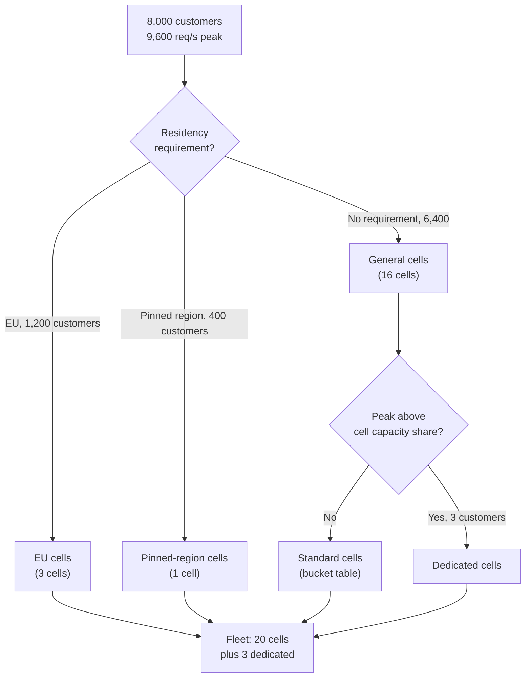

The diagram shows how the requirements split the fleet before any sizing arithmetic. Residency decides the region of a cell. Size decides whether a customer fits a standard cell. The remaining customers go to standard cells through the bucket table.

**Cell count.** The blast-radius limit gives 20 cells. With peak 9,600 requests per second and 60% planned utilisation of 200 requests per second per instance (120 each), the fleet needs $9{,}600/120 = 80$ instances. With a fixed footprint of 3 instance-equivalents per cell, 20 cells need $20 \times 3 = 60$ more, a total of 140. Overhead is $60/140 \approx 43\%$. That is above the team's preferred 40%, so they accept 20 cells but reduce the fixed footprint to 2.5 instance-equivalents per cell by running the data store replicas across smaller instances. New total: $80 + 50 = 130$, overhead $50/130 \approx 38\%$.

**Distribution.** The 20 standard cells split as 3 EU cells, 1 pinned-region cell, and 16 general cells. The EU cells hold 1,200 customers across 3 cells, 400 each. The pinned-region cell holds 400 customers, so its blast radius is 5% of customers, not 1/20 of general load, and is acceptable because its customers are low volume. General cells hold $6{,}400/16 = 400$ customers each. Each cell averages $9{,}600/20 = 480$ requests per second if loads were even, but the cells are uneven, which is why headroom is explicit.

**Large customers.** Three customers peak above 300 requests per second, which is more than 60% of an average cell. They get dedicated cells, so the fleet is 23 cells, and the three customers pay a dedicated-cell price. The extra cost is $3 \times 2.5 = 7.5$ instance-equivalents of fixed footprint plus their own variable load.

**Assignment.** Hybrid placement: customers hash to 4,096 buckets, and a table maps buckets to cells within the region pool. A small override table holds the dedicated and pinned customers. The control plane refuses any move that violates a residency pin.

**Deployment.** Four waves of 1, 2, 4, and 13 of the 20 standard cells, with bake times of 60, 120, 240, and 60 minutes. The three dedicated cells follow the last wave, because their customers hold the strictest credits. The first wave is the internal-tenant cell.

### 13.3 Rejected alternatives

| Alternative | Reason rejected |
| --- | --- |
| Stay on one shared stack and add more replicas | Replicas share the same release and data layer. Last year's defect would have hit all customers again |
| Two large regional deployments | Blast radius of 50% per fault, which fails the 5% requirement |
| 100 small cells | Blast radius of 1%, but fixed footprint of $100 \times 2.5 = 250$ against 80 variable gives 76% overhead, and the six-engineer team cannot operate 100 cells |
| Microservices split of the single stack | Reduces coupling by function, but each service is still shared by all customers, so a defective release of any service still reaches everyone |
| Pure hash assignment | Cannot express residency pins or dedicated cells |
| Shared control-plane database queried per request | Reintroduces a shared dependency on the request path |

### 13.4 Validation evidence

The team collects evidence before moving customers.

- **Isolation test.** Delete the database in a pre-production cell and show that the other cells' error rate stays within 0.1 percentage point of baseline.
- **Load test.** Drive one standard cell to 120% of planned peak of 480 requests per second ($576$) and confirm that per-customer limits shed excess traffic while other customers' p99 latency rises under 10%.
- **Release rehearsal.** Deploy a deliberately faulty build and show that the gate halts at wave 1 and rollback completes in 15 minutes.
- **Move rehearsal.** Move 100 customers between two pre-production cells, with a frozen window under 60 seconds and a zero-difference check of record counts and checksums.
- **Residency audit.** Query placement history and confirm no pinned customer was ever placed outside its region.
- **Availability estimate.** Using the previous year's one 50-minute outage as a model with the new design, a single-cell fault of the same duration affects 5% of customers. Per affected customer the downtime is the same 50 minutes, but 95% of customers see no downtime. Fleet-wide availability computed over customer-minutes is $1 - 0.05 \times 50/43{,}200 \approx 99.994\%$ for a 30-day month (43,200 minutes), against $1 - 50/43{,}200 \approx 99.884\%$ for the shared stack. The 99.95% target is met on this measure, and it was missed by the shared stack.

### 13.5 Residual risks

The router and control plane remain fleet-wide components and get the strictest release rules. The platform team's workload grows with every cell, so automation of cell creation and teardown has priority over new features. The mapping table and residency pins need audit. Cross-cell reporting is handled by an asynchronous export into an analytics store that holds only the data classes the policy permits.

## 14. Common Mistakes and Anti-Patterns

| Anti-pattern | Cause | Consequence |
| --- | --- | --- |
| Cells share a database or queue | A shared store is simpler to run | Shared fate returns, and one bad query degrades every cell |
| Synchronous cross-cell calls | A feature needs data from another customer group | A fault in one cell spreads through the callers, and the invariants no longer hold |
| Fat router | Business rules and transformations are added to the routing layer | The router has a blast radius of 100% and the largest change rate, so it becomes the main outage source |
| Default cell for unknown keys | A fallback was added to avoid errors | Data of a customer is written to the wrong cell, and residency pins are violated |
| Cells that drift | Hotfixes applied by hand to one cell | The cell is no longer a representative sample, gates compare unlike cells, and rollbacks fail on the cell |
| Deploying to all cells at once | Waves are skipped to save time | The cell boundary gives no protection against release defects |
| Bake time shorter than the failure cycle | Bake chosen for speed | Defects that appear after a cache expiry or a nightly job reach the whole fleet |
| Alerts only on fleet averages | Dashboards were built before cells existed | One failed cell is invisible until customers call |
| Too many tiny cells | Blast radius is optimised without costing | Overhead dominates, the team cannot operate the fleet, and cells run unpatched |
| Moving customers without a freeze and owner check | The copy is quick, so cutover is informal | Writes land in both cells or are lost, and a stale router writes to the old cell |
| Unlimited customers per cell | Capacity is added only when a cell fails | A cell exceeds its tested capacity, and its failure is larger than designed |
| Missing quotas | Cells are assumed to solve noisy neighbours | One customer degrades its whole cell |
| Global shared dependency on the request path | A central permissions service or configuration service is called per request | Its outage takes down every cell |

The most expensive mistakes share one cause. A shared component enters the request path for convenience and is not noticed because the cells look independent in a diagram. The design review should list every call a request makes and mark each as inside or outside the cell.

## 15. Comparing Cells With Alternatives

### 15.1 Trade-off table

| Dimension | Shared multi-tenant stack | Regional deployments | Microservices ([CH05](CH05_Microservices.md)) | Space-based ([CH16](CH16_Space_Based_Architecture.md)) | Cell-based |
| --- | --- | --- | --- | --- | --- |
| What is replicated | Instances of one stack | The full stack per region | Nothing by default, services are split by function | Processing units with in-memory data grid | The full stack per customer group |
| Partitioned by | Not partitioned | Geography | Business capability | Data and processing keys | Customer group |
| Blast radius of a release defect | All customers | All customers in the region, often all customers | All customers of the changed service | All units on the new version | One cell at a time, with waves |
| Blast radius of a poisoned request | All customers | Region | Customers of the service | Partition | Cell, or shard within a cell |
| Operations cost | Lowest | Moderate | High, many services | High, grid operations | High, grows with cell count |
| Capacity efficiency | Highest, pooled | Moderate | Moderate | Moderate | Lower, headroom and footprint per cell |
| Customer-specific placement | Hard | By region only | Not applicable | By key only | Natural, pin or dedicate |
| Main risk | Shared fate | Treating a region as a failure domain for software faults | Distributed complexity | Data grid consistency and cost | Router and control plane, operational load |
| Fits best when | Small system, tolerable shared failure | Latency or legal location is the driver | Independent teams and scaling by function | Extreme scale with in-memory state | High cost of fleet-wide outage and large customer base |

The patterns combine. Cells can contain microservices, and often do: a cell is a complete copy of whatever structure the service has. A cell can also use space-based processing for a hot path. Regions and cells are orthogonal: a region can hold many cells, and a cell can be pinned to a region. The patterns that split by function and the pattern that replicates by customer group address different failure and scaling problems, as Part 20's sibling chapters describe.

### 15.2 When to adopt cells

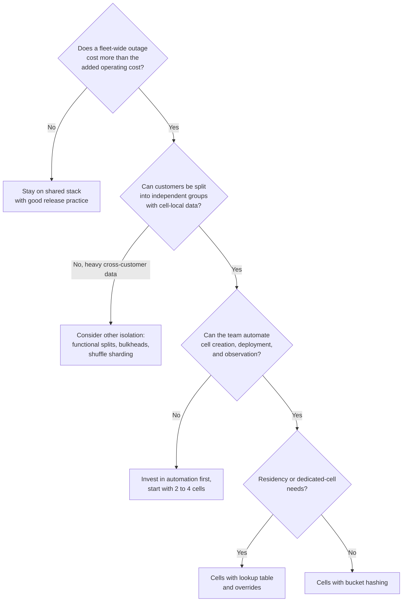

The decision follows the questions that most often make cells fail in practice. Cost of an outage justifies the pattern, partitionability makes it possible, and automation makes it affordable to run. Where heavy cross-customer data prevents partitioning, shuffle sharding and bulkheads inside a shared stack give partial protection at lower cost.

## 16. Design-Review Checklist

Use the list at design review and again before each increase in the number of cells.

- Is every component a request touches listed, and marked cell-local or shared?
- Does each shared dependency have a documented behaviour when it is down?
- Is the blast-radius target stated, and does the cell count meet it? Is the cost of the fixed footprint accepted?
- Is the largest customer smaller than a cell with growth room, or does it have a dedicated cell?
- Is the router free of business logic, stateless, and deployed more carefully than the cells?
- Does an unknown key fail safe, with no default cell?
- Is the assignment method chosen with the need for residency, dedicated cells, and growth in mind?
- Is a customer move restartable, verified before switching, and guarded by an owner check in the cell?
- Do the rollout waves, bake times, and gates match the slowest failure you want to catch?
- Are schema, router, and configuration changes compatible across the versions that can coexist?
- Are per-customer rate, concurrency, and storage quotas set and tested against cell capacity?
- Are pinned customers protected from moves by the control plane, and does the residency boundary cover logs and backups?
- Is every metric and log labelled by cell and version, and are alerts defined per cell as well as fleet-wide?
- Is there a defined recovery level (in-cell, standby cell, degrade) per customer tier, with RTO and RPO stated?
- Is the operating load of the planned cell count affordable for the team, with automated creation and teardown?
- Have the failure scenarios been rehearsed in a pre-production fleet?

## 17. Exercises

1. A service has 15,000 customers and a fleet-wide peak of 18,000 requests per second. An instance serves 250 requests per second at full load and is planned for 60%. Each cell has a fixed footprint of 4 instance-equivalents. Management wants a blast radius of at most 4%. Compute the minimum cell count, the total instance-equivalents, and the overhead share.
2. Explain why modulo hashing is a poor assignment method when the number of cells changes, and compute the fraction of keys that stay in place when going from 16 to 17 cells under modulo placement. Name two alternatives.
3. A cell has 12 workers and each customer is assigned a shard of 3. Compute the number of shards, the probability that a second customer has an identical shard, and the probability that it shares no worker with the first.
4. Design a rollout schedule for 30 cells with a failure that appears only after a weekly job. State the waves, the bake times, and how the weekly job is exercised.
5. A router is deployed to all instances at once in a fleet where cells deploy in waves. Explain why this is inconsistent and propose a router release process.
6. A customer must be moved between cells with a frozen window under 30 seconds. Describe the steps, the verification, the ownership check, and the rollback.
7. A reviewer notices that every request calls a central permissions service. Explain the risk and give two designs that remove it from the request path.
8. A fleet-wide alert on 5% error rate did not fire while one of 25 cells was down for 20 minutes. Compute the fleet error rate if the cell was fully down and all cells carried equal load, and propose alerts that would have fired.

### 17.1 Answer outlines

1. Blast radius 4% gives $N \geq 25$. Planned per-instance rate is $250 \times 0.6 = 150$, so variable instances are $18{,}000/150 = 120$. Fixed footprint is $25 \times 4 = 100$. Total 220, overhead $100/220 \approx 45\%$. Comment on whether this is acceptable, and consider shrinking the footprint.
2. When $N$ changes from 16 to 17, a key keeps its cell only if its residue modulo 16 equals its residue modulo 17. Over a cycle of $16 \times 17 = 272$ consecutive integers, 16 keys match, so $16/272 = 1/17 \approx 5.9\%$ stay and about 94% move. Alternatives: consistent hashing, rendezvous hashing, a bucket table, or a lookup table.
3. $\binom{12}{3} = 220$. Identical shard probability $1/220 \approx 0.45\%$. No shared worker: $\binom{9}{3}/\binom{12}{3} = 84/220 \approx 38\%$.
4. Early waves need at least a week of bake, or the weekly job must be run in the canary cell shortly after deployment. A schedule such as 1, 3, 8, and 18 cells with the weekly job triggered manually in each wave, and at least 24 hours of bake plus the job run, is reasonable. State the delay cost.
5. A router release has blast radius 100% and no untouched population. The process should use multiple router groups updated in sequence, a canary share of traffic, version compatibility with the cells, and a quick rollback. Prefer rare, small router changes.
6. Reserve capacity, copy, catch up while the source owns the tenant, freeze writes, apply the final delta, verify counts and checksums, update the mapping at a new version, and unfreeze. The cell checks ownership at the current version on every request. Keep the source for a rollback window and abort before the switch if verification fails.
7. The permissions service is a shared dependency on every cell, so its outage or slowness affects all cells. Options: verify signed tokens locally with cached keys, or replicate permission data into each cell and update it asynchronously, accepting bounded staleness.
8. One cell of 25 failing is $1/25 = 4\%$ of requests, below the 5% threshold. Alerts should fire on per-cell error rate or on the cell's burn rate of its error budget, and on any cell that diverges from the median of the fleet.

## 18. Summary

Cell-based architecture runs the complete service as many independent copies, each serving a bounded group of customers, so that a fault is confined to one cell and the blast radius is $1/N$ in the simplest case. The chapter's outcomes map to its sections as follows.

| Outcome | Where it is covered |
| --- | --- |
| Define a cell and state the invariants that keep it independent | Sections 2 and 9.1 |
| Compute blast radius and per-cell headroom for a given number of cells | Sections 3.2, 4, and 13.2 |
| Explain why the router is the one shared component and how to keep it small and available | Sections 5 and 10.3 |
| Choose between hash-based and lookup-table assignment and plan a rebalance | Section 6 and the case study |
| Explain shuffle sharding and compute the probability that two customers share a failure | Section 8 |
| Design a progressive rollout across cells with bake time and canary cells | Section 7 |
| Describe isolation of data, quotas, and noisy neighbours, and what to observe per cell | Sections 9 and 11 |

Three habits carry most of the benefit. Keep the cells complete and independent, and treat every shared dependency on the request path as a defect to be justified. Keep the router thin and changed rarely, because it is the one component with a blast radius of 100%. Release everything, including configuration and mapping changes, in waves with bake times that match the slowest failure to be caught. The cost is capacity headroom in every cell and operating work that grows with the cell count, so adopt the pattern where the cost of a fleet-wide outage justifies it and where automation makes a fleet of cells affordable to run.
